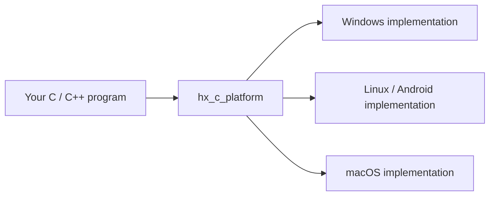

# hx_c_platform

[![CI configuration][ci-badge]](.github/workflows/build.yml) [![C99 core][c-badge]](CMakeLists.txt) [![C++11 facade][cpp-badge]](docs/CPP_POOL.md) [![Header-only C++ facade][header-badge]](docs/CPP_POOL.md) [![CMake 3.16+][cmake-badge]](CMakeLists.txt) [![First-party license pending][license-badge]](THIRD_PARTY_NOTICES.md) [![Linux GCC and Clang][linux-badge]](docs/VALIDATION.md) [![macOS validation pending][macos-badge]](docs/VALIDATION.md) [![Windows MSVC][windows-badge]](docs/VALIDATION.md) [![Windows 113/113 and Linux 115/115 local suites passed][tests-badge]](docs/VALIDATION.md) [![Embedded Linux target pending][embedded-badge]](docs/VALIDATION.md) [![Android API 21 ARM cross-build passed][android-badge]](docs/ANDROID.md)

[简体中文](README.zh-CN.md) · [Task tutorials](docs/USAGE.md) · [Detailed reference](docs/REFERENCE.md)

- [1. What the library helps you do](#section-1)
- [2. Requirements and platforms](#section-2)
- [3. Add the library to your project](#section-3)
- [4. Common tasks](#section-4)
- [5. A few rules to remember](#section-5)
- [6. Where to find more features](#section-6)
- [7. Builds, validation and licensing](#section-7)

<a id="section-1"></a>

## 1. What the library helps you do

`hx_c_platform` gives C/C++ projects common tools for files, UTF-8 strings, configuration, containers, variant values, threads, background tasks and cooperative coroutines. You call one interface; the library handles differences between Windows, Linux and other adapted systems.

The core uses C99. C++11 developers can choose the optional C++ interface; C++20 coroutine syntax is a separate opt-in layer. Ordinary use needs no global runtime setup, Qt or OBS dependency. The current version is 0.1.0.

The diagram shows the call path: your application calls the library, which selects the system implementation.



<a id="section-2"></a>

## 2. Requirements and platforms

Use CMake 3.16 or newer and a C compiler. C++ examples also need a C++11 compiler. MSVC is suitable on Windows; GCC or Clang on Linux. The core is a compiled library; the C++ interface wraps it in headers.

| Platform | Current evidence |
| --- | --- |
| Windows | MSVC x86/x64 builds and runs; Win7 SP1/8.1 remain compatibility targets with old-system testing pending |
| Linux | Built and run on WSL Linux |
| macOS | Adapters present; Intel 10.13 / ARM64 11.0 baselines, Apple-host validation pending |
| Android | API 21 builds for both ARM ABIs; ARM64 runs through translation on an API 34 emulator |
| Embedded Linux | ARMv7/AArch64 cross-build records; specific libc and boards still need validation |

<a id="section-3"></a>

## 3. Add the library to your project

Create the following layout and put this library's source in `external/hx_c_platform`. Use the complete C program in section 4.1 for `main.c`. Run examples separately; each prints its own result.

```text
hx_demo/
├── CMakeLists.txt
├── main.c
├── hello.txt
├── config.json
└── external/
    └── hx_c_platform/
```

Save `hello.txt` as UTF-8 with this content:

```text
Hello, hx_c_platform!
```

The configuration example later uses this `config.json`:

```json
{"port": 8080}
```

Use this `CMakeLists.txt`. The two switches disable the library's own tests and examples. `configure_file` copies the input files to the directory where you will run the program.

```cmake
cmake_minimum_required(VERSION 3.16)
project(hx_demo LANGUAGES C)
set(HX_OS_BUILD_TESTS OFF CACHE BOOL "" FORCE)
set(HX_OS_BUILD_EXAMPLES OFF CACHE BOOL "" FORCE)
add_subdirectory(external/hx_c_platform)
add_executable(hx_demo main.c)
target_link_libraries(hx_demo PRIVATE hx_c_platform::hx_c_platform)
set_target_properties(hx_demo PROPERTIES
	C_STANDARD 99 C_STANDARD_REQUIRED YES C_EXTENSIONS NO)
configure_file(hello.txt hello.txt COPYONLY)
configure_file(config.json config.json COPYONLY)
```

Run in `hx_demo`; on Windows use a developer terminal with MSVC and CMake available:

```sh
cmake -S . -B build
cmake --build build --config Release
cd build
```

For a Visual Studio build on Windows, run:

```powershell
.\Release\hx_demo.exe
```

For a Makefile/Ninja build on Linux, run:

```sh
./hx_demo
```

The result should be `Hello, hx_c_platform!`. Input paths use the current working directory, so these commands enter `build` first. For C++, save the program as `main.cpp` and use the [complete C++ CMake setup](docs/USAGE.md#cpp-project), including its options to disable exceptions.

<a id="section-4"></a>

## 4. Common tasks

These examples cover common tasks. The text-reading examples are complete programs. Other short excerpts state their headers and required objects; find full programs, run steps and more C/C++ versions in the linked task tutorials.

### 4.1 Read and display a text file: C / C++

Read `hello.txt` from section 3 and display its contents. The entry point opens, reads and closes the file internally; you use the returned string.

**C: save as `main.c`; this is a complete program.**

```c
#include <hx_os.h>
#include <stdio.h>

int main(void)
{
	hx_string text = HX_STRING_INIT;
	hx_os_status status = hx_os_file_read_text("hello.txt", &text, NULL);
	if (status == HX_OS_OK)
		puts(hx_string_c_str(&text));
	else
		fprintf(stderr, "Read failed: %s\n", hx_os_status_name(status));
	hx_string_destroy(&text);
	return status == HX_OS_OK ? 0 : 1;
}
```

`text` receives the contents. `HX_OS_OK` means success; `hx_string_c_str` exposes printable text. `hx_string_destroy` releases the string's memory. The read function has already closed the file.

**C++: save as `main.cpp` and use the C++ build setup linked in section 3.**

```cpp
#include <hx/Files.hpp>
#include <cstdio>

int main()
{
	auto text = hx::Files::readText("hello.txt");
	if (!text) {
		std::fprintf(stderr, "Read failed: %s\n",
			hx_os_status_name(text.status()));
		return 1;
	}
	std::puts(text.value().c_str());
	return 0;
}
```

`if (!text)` checks for a read failure. On success, `text.value()` gives the string and `c_str()` its printable character pointer. The C++ string releases memory at scope exit. Both programs print `Hello, hx_c_platform!`.

### 4.2 Trim whitespace and make text lowercase: C++

Turn `"  Hello  "` into `"hello"`. Include `<hx/Values.hpp>` and `<cstdio>` and put this excerpt in `main()`:

```cpp
auto text = hx::String::copy("  Hello  ");
if (!text)
	return 1;
text.value().trimAscii().lowerAscii();
std::puts(text.value().c_str());
```

`trimAscii()` removes surrounding ASCII whitespace; `lowerAscii()` converts ASCII uppercase letters in the same string. Output: `hello`. Non-ASCII characters remain unchanged. [Complete C/C++ examples](docs/USAGE.md#strings).

### 4.3 Read a port from a JSON file: C++

Read `8080` from `config.json`, whose content is `{"port":8080}`. Include `<hx/Config.hpp>` and `<cstdio>` and put the excerpt in `main()`:

```cpp
auto config = hx::ConfigDocument::load("config.json");
if (!config)
	return 1;
auto port = config.value().integer("/port");
if (!port)
	return 1;
std::printf("Port: %lld\n", static_cast<long long>(port.value()));
```

`load()` reads and parses JSON. `integer("/port")` selects the root's `port` and checks integer conversion. `/port` is a query location, not a file path. Output: `Port: 8080`. [Complete programs and failure cases](docs/USAGE.md#configuration).

### 4.4 Change two settings: C++

Set `port=8080` and `enabled=true` in memory. Include `<hx/Settings.hpp>` and `<cstdio>`. Here, `settings` is an `hx::Settings` object successfully initialized by `settings.create()`. The [settings tutorial](docs/USAGE.md#settings) shows complete creation and closing.

```cpp
auto changed = settings.update()
		       .setInt("port", 8080)
		       .setBool("enabled", true)
		       .finish();
if (!changed)
	std::fprintf(stderr, "%s\n", hx_os_status_name(changed.status()));
```

`finish()` reports this group's result. Success applies both values. The first failure skips later writes and preserves prior successes. This excerpt does not save a file; saving is a separate operation.

### 4.5 Store integers in a C vector

Store `10` and `20`, then display the count and first value. Include `<hx_os.h>` and `<stdio.h>` and declare the integer container outside `main()`:

```c
HX_OS_DECLARE_VECTOR(int_vector, int)
```

The macro generates functions such as `int_vector_create/push/at/destroy`. Put this excerpt in `main()`:

```c
int_vector *numbers = NULL;
hx_os_status status = int_vector_create(NULL, 16, &numbers, NULL);
if (status == HX_OS_OK)
	status = int_vector_push(numbers, 10, NULL);
if (status == HX_OS_OK)
	status = int_vector_push(numbers, 20, NULL);
if (status == HX_OS_OK)
	printf("Count: %zu, first: %d\n", int_vector_size(numbers),
		*int_vector_at(numbers, 0));
hx_os_status closed = int_vector_destroy(&numbers, NULL);
if (status == HX_OS_OK)
	status = closed;
if (status != HX_OS_OK)
	return 1;
```

`16` limits the number of elements. `push` appends; `at(..., 0)` reads the first element; `destroy` releases the container. Output: `Count: 2, first: 10`. [Complete vector/queue programs](docs/USAGE.md#containers).

### 4.6 Submit a background calculation: C++

Calculate `21 × 2` on a thread pool. Include `<hx/ThreadPool.hpp>` and `<cstdio>`. Here, `pool` is an existing pool. The [thread-pool tutorial](docs/USAGE.md#thread-pool) includes creation of two workers and final shutdown.

```cpp
auto submitted = pool.submit([](int value) noexcept { return value * 2; }, 21);
if (submitted) {
	auto answer = submitted.value().getUntil(hx_os_deadline_after_ms(2000));
	if (answer)
		std::printf("Answer: %d\n", answer.value());
	else
		std::fprintf(
			stderr, "%s\n", hx_os_status_name(answer.status()));
}
else
	std::fprintf(stderr, "%s\n", hx_os_status_name(submitted.status()));
```

Successful `submit` means the pool accepted the task. `getUntil` waits for its result, with a two-second waiting budget here. Normal output: `Answer: 42`. `noexcept` declares the task's no-exception contract. Explicitly shut down the pool after use. A wait/close timeout retains ownership for further handling.

### 4.7 Store different types in one value: C / C++

Store integer 42, then replace it with hello. Include `<hx_variant.h>` and `<stdio.h>` and put this C excerpt in main():

```c
hx_variant value = HX_VARIANT_INIT;
hx_string_view text;
hx_os_status status = hx_variant_set_i32(&value, 42, NULL);
if (status == HX_OS_OK)
	status = hx_variant_set_cstr(&value, "hello", NULL);
if (status == HX_OS_OK)
	status = hx_variant_get_string_view(&value, &text, NULL);
if (status == HX_OS_OK)
	printf("String: %.*s\n", (int)text.size, text.data);
hx_variant_destroy(&value);
if (status != HX_OS_OK)
	return 1;
```

Output: `String: hello`. A variant holds one active value; setting the string replaces the integer. It owns the text and destroy releases it.

C++ can store your own structure directly. Include `<hx/Variant.hpp>` and `<cstdio>` and put this excerpt in main():

```cpp
struct Point { double x; double y; };
hx::Variant value;
if (!value.set(Point{2, 5}))
	return 1;
auto position = value.get<Point>();
if (!position)
	return 1;
std::printf("Point: %.1f, %.1f\n", position.value().x,
	position.value().y);
```

Output: `Point: 2.0, 5.0`. set stores an independent copy; get<Point> checks its type and returns a structure reference. Destruction releases it automatically. See the [variant tutorial](docs/VARIANT.md) for complete C structure, copy, visitor and mixed-container examples.

### 4.8 Find a file in nested directories: C++

Find the first config.json under assets recursively. Include `<hx/Files.hpp>` and `<cstdio>` and put this excerpt in main():

```cpp
auto path = hx::Directory::findFirstFile("assets", "config.json");
if (!path)
	return 1;
std::puts(path.value().c_str());
```

If the file is assets/nested/config.json, that path is printed. No match reports failure. This call scans synchronously; a GUI should use its existing pool. Directory::findFiles streams every match. Complete C/C++ and background examples are in the [recursive search tutorial](docs/FILE_SEARCH.md).

### 4.9 Start a coroutine without retaining task handles

A coroutine pauses during a library wait so its worker can run another task. After creating `runtime` once and entering its `Scope`, include the optional `hx/GoKeywords.hpp` last and write:

```cpp
co_chan<int> answers(1); // One buffered value.
if (!answers)
	return 1;
go [answers]() noexcept { return answers << 6 * 7; };
auto done = runtime.waitUntil(hx_os_deadline_after_ms(2000));
if (!done)
	return 1;
auto answer = answers.receive(HX_OS_DEADLINE_NOW);
if (answer)
	std::printf("Answer: %d\n", answer.value());
```

Output: `Answer: 42`. The runtime owns ordinary `go` tasks, releases them after cleanup and retains submission/execution failures for a unified check. [The complete C++11 program](examples/go.cpp) shows the one-time setup and explicit shutdown. `runtime.submit(...)` remains available for `Task<T>` results. [The coroutine guide](docs/COROUTINES.md) explains `co_sleep`, channels with owning values, cooperative locks, local values, optional groups and C++20 `co_await`. Ordinary blocking calls still occupy a worker; long computations explicitly yield.

### 4.10 Format and print text

In C++11, include `hx/Format.hpp`:

```cpp
auto printed = hx::println("{}: {:.2f}", "张三", 3.75);
if (!printed)
	return 1;
```

Output: `张三: 3.75`. `{}` takes the next argument; `.2f` prints two digits after the decimal point. In C99, enabling one CMake helper also allows automatic types and C expressions:

```c
hx_os_status status = HX_FPRINTLN("{user.name}: {price * count:.2f}");
```

Here `user`, `price` and `count` are ordinary variables in the calling C function. The [formatting guide](docs/FORMAT.md) includes complete programs, the CMake setup, custom structures, encoding rules and a C99 path needing no generator. The optional generator runs during the normal build and leaves original sources unchanged.

Need ordered or duplicate keys? The [red-black multimap example](examples/ordered_map.c) and [container guide](docs/CONTAINERS.md) cover ordered traversal, sorting, filtering, list splice and set operations.

### 4.11 Communicate with another process: C / C++

Each transport has its own business programs, runner and tutorial. Open the corresponding sources to adapt the workflow:

| Transport | Business and threads | Guide |
| --- | --- | --- |
| Native IPC: named pipes / Unix domain sockets | Two device request threads and a notification receiver | [Device control](docs/IPC_BUSINESS.md) |
| TCP | Order sender and receipt receiver; length framing and partial I/O | [Orders](docs/TCP_BUSINESS.md) |
| UDP | Sensor publisher and feedback receiver; gaps, duplicates and late data | [Samples](docs/UDP_BUSINESS.md) |
| KCP | Block producer and KCP I/O thread; retransmission and business confirmation | [Reliable transfer](docs/KCP_BUSINESS.md) |

After building as described in the guides, run each separate Windows entry point. Every command starts two processes and verifies their results:

```powershell
python examples/run_ipc_business.py --bin-dir build-net/bin/Release
python examples/run_tcp_business.py --bin-dir build-net/bin/Release
python examples/run_udp_business.py --bin-dir build-net/bin/Release
python examples/run_kcp_business.py --bin-dir build-net/bin/Release
```

In the native IPC device example, once the client has created `connection` and opened device `101` with `OPEN`, C++11 queries its interval with:

```cpp
auto reply = connection.requestText("GET", 101);
if (reply)
	std::printf("Reply: %s\n", reply.value().text());
```

`GET` is the native IPC server's query command and `101` its device channel. The library manages request IDs; C uses `hx_ipc_request_text_until`. These IPC calls provide complete messages, request matching and concurrent sending internally.

TCP/UDP business code directly calls `hx_os_socket_*`; KCP uses `hx_os_kcp_*` with UDP. None of these three network workflows calls `hx_ipc_*`, and they run with IPC disabled. Full IPC contracts and the cross-language HXIP protocol are in the [IPC reference](docs/IPC.md). All examples use ordinary threads with explicit timeout, disconnect and resource handling.

<a id="section-5"></a>

## 5. A few rules to remember

- **Check before accessing a result.** C checks `HX_OS_OK`; C++ checks a result before `value()`. Handle type, allocation and file errors.
- **Text defaults to UTF-8.** Paths also use UTF-8. Select an explicit conversion for other encodings.
- **Release resources after use.** C strings, documents and containers have matching release functions. C++ synchronous owners usually release automatically; pools and similar owners need explicit close.
- **Timeout does not mean work stopped.** Retain live objects and data, then continue waiting or retry close according to application policy.

The meaning of `NULL` depends on its position: allocator/options parameters select defaults; an error-record parameter declines extra diagnostics. Homepage examples use the default module configuration. [First-use questions](docs/USAGE.md#questions) explain errors, input locations and closing.

<a id="section-6"></a>

## 6. Where to find more features

| What you need | Where to start |
| --- | --- |
| Native IPC device control | [Independent IPC example](docs/IPC_BUSINESS.md) |
| TCP order submission and receipts | [Independent TCP example](docs/TCP_BUSINESS.md) |
| UDP samples and feedback | [Independent UDP example](docs/UDP_BUSINESS.md) |
| KCP reliable block transfer | [Independent KCP example](docs/KCP_BUSINESS.md) |
| IPC, duplex messages, concurrent callers and other languages | [IPC tutorial and protocol](docs/IPC.md) |
| Brace formatting, automatic C arguments and expressions | [Formatting](docs/FORMAT.md) |
| Complete text, configuration, container and pool programs | [Task tutorials](docs/USAGE.md) |
| Nested file search and background scanning | [Recursive search tutorial](docs/FILE_SEARCH.md) |
| Full feature list, limits and build switches | [Detailed reference](docs/REFERENCE.md) |
| Encoding, translation, directory visits and lexing | [Common utilities](docs/COMMON_UTILITIES.md) |
| JSON/YAML/XML/INI/TOML/ENV/properties | [Configuration formats](docs/CONFIGURATION.md) |
| Different value types and custom structures | [Variant](docs/VARIANT.md) |
| Other containers and element copy/release | [C containers](docs/CONTAINERS.md) |
| Cancellation, close retries and C++ results | [Thread pool](docs/CPP_POOL.md) · [Result](docs/CPP_RESULTS.md) |
| Network, processes, pipes, watches, mappings and system info | [Platform utilities](docs/PLATFORM_UTILITIES.md) |
| Android and embedded builds | [Android](docs/ANDROID.md) · [Cross-compilation](docs/REFERENCE.md#section-28) |

<a id="section-7"></a>

## 7. Builds, validation and licensing

See the [build reference](docs/REFERENCE.md#section-27) for development builds, tests, static/shared installation and optional dependencies. The latest full-suite record for the library implementation is Windows 113/113 and WSL Linux 115/115 from 2026-10-03. The seven separated communication workflows passed on Windows, WSL and WSL memory/race detection builds; an IPC-disabled WSL build also passed six network business cases. [Validation records](docs/VALIDATION.md) identify exact configurations and pending targets. Documentation-example checks are separate from target-platform validation.

The first-party distribution license is pending; see [third-party licensing](THIRD_PARTY_NOTICES.md). The coroutine implementation is self-developed; hx_c_log integration remains future work.

[ci-badge]: https://img.shields.io/badge/CI-configured-lightgrey?logo=githubactions
[c-badge]: https://img.shields.io/badge/C-99-blue?logo=c
[cpp-badge]: https://img.shields.io/badge/C%2B%2B-11-blue?logo=cplusplus
[header-badge]: https://img.shields.io/badge/header--only-C%2B%2B%20facade-yellowgreen
[cmake-badge]: https://img.shields.io/badge/CMake-3.16%2B-blue?logo=cmake
[license-badge]: https://img.shields.io/badge/license-pending-lightgrey
[linux-badge]: https://img.shields.io/badge/Linux-GCC%20%7C%20Clang-yellow?logo=linux
[macos-badge]: https://img.shields.io/badge/macOS-pending-lightgrey?logo=apple
[windows-badge]: https://img.shields.io/badge/Windows-MSVC-blue
[tests-badge]: https://img.shields.io/badge/tests-Win%20113%2F113%20Linux%20115%2F115-brightgreen
[embedded-badge]: https://img.shields.io/badge/embedded%20Linux-target%20pending-lightgrey
[android-badge]: https://img.shields.io/badge/Android-API%2021%20ARM%20builds-blue?logo=android
