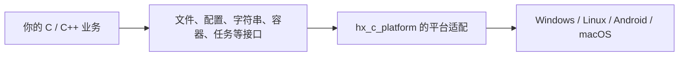

# hx_c_platform

[![C99 核心][c-badge]](CMakeLists.txt) [![C++11 封装][cpp-badge]](docs/CPP_POOL.zh-CN.md) [![仅 C++ 封装为 header-only][header-badge]](docs/CPP_POOL.zh-CN.md) [![CMake 3.16+][cmake-badge]](CMakeLists.txt) [![自有代码许可证待定][license-badge]](THIRD_PARTY_NOTICES.zh-CN.md) [![Linux GCC 与 Clang][linux-badge]](docs/PLATFORMS.zh-CN.md) [![macOS 待验证][macos-badge]](docs/PLATFORMS.zh-CN.md) [![Windows MSVC][windows-badge]](docs/PLATFORMS.zh-CN.md) [![嵌入式 Linux 待目标验证][embedded-badge]](docs/PLATFORMS.zh-CN.md) [![Android API 21 ARM][android-badge]](docs/ANDROID.zh-CN.md)

[English](README.md) · [完整入门教程](docs/USAGE.zh-CN.md) · [按功能查找](#section-6) · [接口参考](docs/REFERENCE.zh-CN.md)

<a id="section-1"></a>

## 1. 这个库用来做什么

你在写 C/C++ 程序时，经常要读取文件、解析配置、处理字符串、给数组排序，或者把任务交给后台线程。`hx_c_platform` 把这些常用操作整理成一套接口，并在内部处理 Windows、Linux 等平台的差异。

比如，要读取一个 UTF-8 文本文件，调用 `hx_os_file_read_text()` 就可以取得文字；要把一组整数从小到大排列，调用 `hx_os_sort_i32()`。本页先带你运行几个小程序，再给出更多功能的入口。



核心需要编译成库，使用 C99；C++11 包装提供自动资源管理和显式结果检查。普通使用没有全局初始化步骤，不依赖 Qt 或 OBS。C++20 协程层按需开启。平台基线与限制见[平台支持](docs/PLATFORMS.zh-CN.md)。

<a id="section-2"></a>
<a id="section-3"></a>

## 2. 先准备一个能运行的项目

需要 CMake 3.16 或更新版本和 C 编译器。Windows 使用 MSVC 开发者终端；Linux 使用 GCC 或 Clang。下面按“从源码接入”操作，第三方源码放在你的项目 `deps` 中：

```sh
mkdir hx_demo
cd hx_demo
mkdir deps
cd deps
git clone --branch dev https://github.com/HuangX666/hx_c_platform.git
git -C hx_c_platform submodule update --init --recursive
cd ..
```

在 `hx_demo` 中创建 `CMakeLists.txt`，填写下面的内容。`main.c` 使用第 3.1 节的完整程序。

```cmake
cmake_minimum_required(VERSION 3.16)
project(hx_demo LANGUAGES C)

foreach(module CRYPTO ARCHIVE COMPRESSION HTTP URL UNICODE PERSISTENT_QUEUE)
	set(HX_OS_ENABLE_${module} OFF CACHE BOOL "")
endforeach()

add_subdirectory(deps/hx_c_platform)

add_executable(hx_demo main.c)
target_link_libraries(hx_demo PRIVATE hx_c_platform::hx_c_platform)
set_target_properties(hx_demo PROPERTIES
	C_STANDARD 99
	C_STANDARD_REQUIRED YES
	C_EXTENSIONS NO)
```

这份入门配置保留文件、字符串、内置配置解析、容器及线程池等能力，并关闭需要另行准备原生 SDK 的几个模块。以后需要 HTTP、加密或压缩时，按[依赖指南](docs/DEPENDENCIES.zh-CN.md)准备 SDK，再开启对应模块。

在 `hx_demo` 中编译：

```sh
cmake -S . -B build
cmake --build build --config Release
```

后面的运行命令都从 `hx_demo` 目录执行。每次只选择一个完整程序作为 `main.c`；换一个例子后重新构建即可。C++ 程序保存为 `main.cpp`，使用[教程中的 C++ CMake 配置](docs/USAGE.zh-CN.md#cpp-project)。已有 `include/lib/bin` 安装包时，可直接采用[安装包接入方式](docs/USAGE.zh-CN.md#installed-project)。

<a id="section-4"></a>

## 3. 常用操作：照着运行，再换成自己的数据

### 3.1 读取一个文本文件：C

假设程序需要读取 `hello.txt`，然后显示里面的文字。库会完成打开、读取和关闭文件，把内容放进 `text`。

**准备文件：**在 `hx_demo` 目录创建 UTF-8 编码的 `hello.txt`：

```text
Hello, hx_c_platform!
```

**完整程序：**保存为 `main.c`，使用第 2 节配置编译。

```c
#include <hx_os.h>
#include <stdio.h>

int main(void)
{
	hx_string text = HX_STRING_INIT;

	hx_os_status status =
		hx_os_file_read_text("hello.txt", &text, NULL);

	if (status == HX_OS_OK)
		puts(hx_string_c_str(&text));
	else
		fprintf(stderr, "Read failed: %s\n",
			hx_os_status_name(status));

	hx_string_destroy(&text);

	return status == HX_OS_OK ? 0 : 1;
}
```

这次读取的三个参数分别是：

| 参数 | 在这里的作用 |
| --- | --- |
| `"hello.txt"` | 要读取的文件路径，也可以换成 `"data/config.txt"` |
| `&text` | 接收文件内容的字符串 |
| `NULL` | 本例只检查返回状态，暂时不取详细系统错误 |

`HX_STRING_INIT` 初始化空字符串；`HX_OS_OK` 表示读取成功。成功后，`hx_string_c_str(&text)` 取得可以交给 `puts()` 使用的字符指针。最后用 `hx_string_destroy()` 释放读出来的文字。文件已经由读取函数关闭。

**运行：**在 `hx_demo` 目录执行 Windows 命令，或下方 Linux 命令。

```powershell
.\build\Release\hx_demo.exe
```

```sh
./build/hx_demo
```

正常输出 `Hello, hx_c_platform!`。若找不到文件，先确认终端当前目录中有 `hello.txt`：相对路径从当前工作目录查找。

换成业务代码时，把文件路径改成自己的路径，把 `puts()` 改成处理文件内容的逻辑，用完文字后再销毁字符串。[更多文件操作与 C++ 写法](docs/USAGE.zh-CN.md#files)。

### 3.2 整理用户输入的文字：C

假设用户输入了 `"  DEVICE_A  "`，你想去掉两端空格，并得到小写的 `device_a`。替换 `main.c` 后重新构建；这个例子不需要输入文件。

```c
#include <hx_os.h>
#include <stdio.h>

int main(void)
{
	hx_string name = HX_STRING_INIT;

	hx_os_status status =
		hx_string_assign_cstr(&name, "  DEVICE_A  ", NULL);
	if (status == HX_OS_OK) {
		hx_string_trim_ascii_in_place(&name);
		hx_string_lower_ascii_in_place(&name);
		puts(hx_string_c_str(&name));
	}
	else
		fprintf(stderr, "String failed: %s\n",
			hx_os_status_name(status));

	hx_string_destroy(&name);

	return status == HX_OS_OK ? 0 : 1;
}
```

输出 `device_a`。`assign_cstr` 复制输入文字；`trim_ascii_in_place` 去掉两端 ASCII 空白；`lower_ascii_in_place` 转换 ASCII 大写字母。三个调用处理同一个字符串，最后统一销毁。

这适合英文设备名、标记和普通 ASCII 输入；中文等非 ASCII 字符会保留。需要 Unicode 规范化或大小写折叠时，使用[对应工具](docs/UNICODE.zh-CN.md)。

### 3.3 从 JSON 配置中读取端口：C++11

在 `hx_demo` 目录准备 `config.json`：

```json
{"port": 8080}
```

使用[完整 C++ 构建配置](docs/USAGE.zh-CN.md#cpp-project)，把下面程序保存为 `main.cpp`。它先加载文件，再读取 `port`。

```cpp
#include <hx/Config.hpp>
#include <cstdio>

int main()
{
	auto config = hx::ConfigDocument::load("config.json");
	if (!config) {
		std::fprintf(stderr, "Config failed: %s\n",
			hx_os_status_name(config.status()));
		return 1;
	}

	auto port = config.value().integer("/port");
	if (!port) {
		std::fprintf(stderr, "Port failed: %s\n",
			hx_os_status_name(port.status()));
		return 1;
	}

	std::printf("Port: %lld\n", static_cast<long long>(port.value()));

	return 0;
}
```

输出 `Port: 8080`。`load` 返回的结果包含“成功／失败”和成功时的文档；`if (!config)` 检查失败，成功后用 `config.value()` 取得文档。`integer("/port")` 读取根对象的整数 `port`；`/port` 表示 JSON 中的位置。

`port` 缺失或类型不对时会进入错误分支。文件里的数字要写成 `8080`，字符串 `"8080"` 是另一种类型。C++ 对象离开作用域时自动释放。[完整 C 写法、嵌套对象与错误说明](docs/USAGE.zh-CN.md#configuration)。

### 3.4 给现有整数数组排序：C

你已经有普通 C 数组 `{5, 1, 3}`，希望按从小到大排序。保存为 `main.c` 后构建运行：

```c
#include <hx_algorithm.h>
#include <stdio.h>

int main(void)
{
	int32_t values[] = {5, 1, 3};

	hx_os_status status = hx_os_sort_i32(values, 3, NULL);
	if (status != HX_OS_OK) {
		fprintf(stderr, "Sort failed: %s\n",
			hx_os_status_name(status));
		return 1;
	}

	printf("%d %d %d\n", (int)values[0], (int)values[1],
		(int)values[2]);

	return 0;
}
```

输出 `1 3 5`。`values` 是要修改的数组，`3` 是元素个数，最后的 `NULL` 表示不取详细错误。排序结果直接保留在原数组中；数组是普通局部变量，用完无需调用本库的销毁函数。

自定义结构体排序、二分查找、筛选，以及 C++ 迭代器写法见[算法教程](docs/ALGORITHMS.zh-CN.md)。需要动态增长的集合时再看[容器教程](docs/USAGE.zh-CN.md#containers)。

### 3.5 把计算交给后台线程：C++11

例如在后台计算 `21 × 2`，主线程取得结果后显示 `42`。线程池的完整使用顺序是：

1. 创建线程池，指定两个工作线程。
2. 提交计算函数和参数 `21`。
3. 等待并取得计算结果。
4. 显式关闭线程池。

把 [thread_pool.cpp](examples/thread_pool.cpp) 的完整内容作为 `main.cpp`，按 C++ 配置编译，正常输出：

```text
Task result: 42
```

程序中的 `submit()` 负责提交，`getUntil()` 等待结果，`shutdownUntil()` 关闭。例子使用 2 秒等待预算，业务可以自行设置。超时表示操作尚未完成，服务程序要保留 `owner` 和任务数据，之后继续处理或重试关闭。

[逐步教程](docs/USAGE.zh-CN.md#thread-pool)包含完整程序、每个对象的用途，以及失败和关闭的处理方法。

### 3.6 用 `{}` 打印文字和数字：C99

想输出设备电压，并保留两位小数，可以把下面程序保存为 `main.c`：

```c
#include <hx_print.h>

int main(void)
{
	hx_os_status status = HX_PRINTLN("{}: {:.2f}",
		hx_fmt_str("Voltage"), hx_fmt_f64(3.75));

	return status == HX_OS_OK ? 0 : 1;
}
```

输出 `Voltage: 3.75`。`{}` 取下一个参数，`{:.2f}` 把浮点数显示为两位小数；`hx_fmt_str` 表示字符串参数，`hx_fmt_f64` 表示浮点参数。正常包含头文件并链接库即可使用，本例不需要生成代码。

C++ 自动按参数类型选择格式化方式。自定义结构体和更多占位符用法见[格式化教程](docs/FORMAT.zh-CN.md)。

<a id="section-5"></a>

## 4. 先记住这几件事

- **C 调用先检查状态。**`HX_OS_OK` 是成功；其他状态要按接口含义处理。`hx_os_status_name()` 可把状态显示成英文文字。
- **C++ 先检查结果，再取值。**`if (!result)` 是失败；成功后才能使用 `result.value()`。本库使用显式错误返回，不使用异常捕获。
- **C 创建的资源要按对应接口释放。**例如字符串用 `hx_string_destroy()`，配置文档用 `hx_os_config_release()`。接口说明会给出具体释放方式。
- **带线程或 I/O 的对象需要完成关闭。**等待超时后对象仍可能在工作，要保留它以及任务借用的数据。

这些规则的具体例子见[初次使用常见问题](docs/USAGE.zh-CN.md#questions)。

<a id="section-6"></a>

## 5. 更多功能到哪里找

一行调用文本／文件加密、SHA-256、HMAC 和签名，见[加密教程及完整 C/C++ 示例](docs/CRYPTO.zh-CN.md)。

| 想做什么 | 先看哪里 |
| --- | --- |
| 本地 IPC 的设备控制业务 | [IPC 独立示例](docs/IPC_BUSINESS.zh-CN.md) |
| TCP 的订单发送与回执 | [TCP 独立示例](docs/TCP_BUSINESS.zh-CN.md) |
| UDP 的采样发送与反馈 | [UDP 独立示例](docs/UDP_BUSINESS.zh-CN.md) |
| KCP 的可靠数据块传输 | [KCP 独立示例](docs/KCP_BUSINESS.zh-CN.md) |
| 进程通信、双向消息、多线程、其他语言对端 | [IPC 教程与协议](docs/IPC.zh-CN.md) |
| 压缩文件／目录、密码 ZIP、可选加密 7z | [压缩教程与完整程序](docs/ARCHIVE.zh-CN.md) |
| 花括号格式化、C 自动实参与表达式 | [格式化教程](docs/FORMAT.zh-CN.md) |
| 文本、配置、容器和线程池的完整程序 | [常用任务教程](docs/USAGE.zh-CN.md) |
| 在多层目录中查找文件、后台扫描 | [递归查找教程](docs/FILE_SEARCH.zh-CN.md) |
| 找完整功能、接口限制、构建开关 | [详细参考](docs/REFERENCE.zh-CN.md) |
| 更多编码、翻译、目录遍历、词法工具 | [常用工具说明](docs/COMMON_UTILITIES.zh-CN.md) |
| JSON/YAML/XML/INI/TOML/ENV/properties | [配置格式说明](docs/CONFIGURATION.zh-CN.md) |
| 结构体与文本互转、深层混合数据、七种格式写出 | [序列化教程](docs/SERIALIZATION.zh-CN.md) |
| 不同类型的值和自定义结构体 | [variant 说明](docs/VARIANT.zh-CN.md) |
| Base64／Base64URL、十六进制编解码 | [编码工具](docs/ENCODING.zh-CN.md) |
| 紧凑整数、UUID 解析与 UUID v7 | [整数工具](docs/INTEGER_TOOLS.zh-CN.md) |
| 有长度上限的 UTF-8 逐行读取 | [逐行读取](docs/LINE_READER.zh-CN.md) |
| 借用式切分、严格整数解析、自然顺序比较 | [文本工具](docs/TEXT_UTILITIES.zh-CN.md) |
| 计时器、有限退避、令牌桶限流 | [计时与流控](docs/CONTROL.zh-CN.md) |
| 统一取消、WaitGroup、线程读写锁 | [线程协调](docs/COORDINATION.zh-CN.md) |
| 普通数组、结构体、C++ 迭代器的排序和查找 | [通用算法](docs/ALGORITHMS.zh-CN.md) |
| 其他容器及元素复制/释放 | [C 容器说明](docs/CONTAINERS.zh-CN.md) |
| 任务取消、关闭重试和 C++ 结果 | [线程池](docs/CPP_POOL.zh-CN.md) · [Result](docs/CPP_RESULTS.zh-CN.md) |
| UTF-8 路径打开 FILE、原生 wchar_t 转换 | [文本互操作](docs/TEXT_INTEROP.zh-CN.md) |
| 有界字节缓存，批量读写与预览 | [字节队列](docs/BYTE_QUEUE.zh-CN.md) |
| 外部内存环形缓冲、两段直接借用 | [固定环形缓冲](docs/RING.zh-CN.md) |
| 单条／批量线程消息收发、SPSC/MPSC/MPMC | [并发队列](docs/QUEUES.zh-CN.md) |
| 有界 LRU 缓存、逐项设置过期时间 | [LRU 缓存](docs/CACHE.zh-CN.md) |
| 动态位图、位搜索和集合运算 | [位集合](docs/BITSET.zh-CN.md) |
| 二进制协议与有界后台文件写出 | [读写流与后台写出](docs/STREAMS.zh-CN.md) |
| INI 修改、配置备份恢复与设置覆盖 | [配置编辑](docs/CONFIG_EDIT.zh-CN.md) |
| 直接调用 SQLite／OpenSSL／libcurl／压缩 SDK | [底层依赖调用](docs/NATIVE_DEPENDENCIES.zh-CN.md) |
| 持久化消息、业务确认和处理租约 | [持久化队列](docs/PERSISTENT_QUEUE.zh-CN.md) |
| Unicode 规范化和大小写折叠 | [Unicode](docs/UNICODE.zh-CN.md) |
| 分块 SHA-256／SHA-512 和 HMAC | [分块摘要](docs/INCREMENTAL_HASH.zh-CN.md) |
| UTF-8 正则、捕获、替换和高级语法 | [正则表达式](docs/REGEX.zh-CN.md) |
| 流、套接字和 TLS 上的完整消息 | [消息帧](docs/FRAMES.zh-CN.md) |
| 共享状态只初始化一次 | [一次初始化](docs/ONCE.zh-CN.md) |
| 打乱／抽样、基数排序、字节查找和布隆过滤 | [二进制与查找工具](docs/FAST_TOOLS.zh-CN.md) |
| HTTP／HTTPS、压缩、URL、命令行、临时资源、串口和共享内存 | [常用 I/O 工具](docs/UTILITY_EXTENSIONS.zh-CN.md) |
| 第三方源码与原生依赖构建 | [依赖说明](docs/DEPENDENCIES.zh-CN.md) |
| 区间树、独立快照与有界 P50／P95／P99 | [Profiler 统计](docs/PROFILER.zh-CN.md) |
| 可增长的命名参数与二进制数据 | [参数包](docs/PARAMETERS.zh-CN.md) |
| 订阅全部信号、修改通知参数、返回可增长过程结果 | [信号通知](docs/SIGNALS.zh-CN.md) |
| 运行时符号检查、字符串读取与嵌套分组跳过 | [解析辅助](docs/PARSING.zh-CN.md) |
| 运行时常量、条件分支与有界配置文件包含 | [预处理](docs/PREPROCESSING.zh-CN.md) |
| Windows DLL 版本、窗口标题与显示器／GPU 识别 | [Windows 工具](docs/WINDOWS_UTILITIES.zh-CN.md) |
| 借用原生文件、套接字、线程与进程对象 | [原生对象互操作](docs/NATIVE_INTEROP.zh-CN.md) |
| 通过已有 Linux 桌面服务申请作用域防睡眠 | [Linux 桌面](docs/LINUX_DESKTOP.zh-CN.md) |
| 网络、进程、管道、监听、映射及系统信息 | [平台工具](docs/PLATFORM_UTILITIES.zh-CN.md) |
| Android 与嵌入式构建 | [Android](docs/ANDROID.zh-CN.md) · [交叉编译](docs/REFERENCE.zh-CN.md#section-28) |

<a id="section-7"></a>

## 6. 构建、平台与项目许可

公开示例独立提供，开启 `HX_OS_BUILD_EXAMPLES=ON` 可直接构建。详细构建／安装选项见[构建参考](docs/REFERENCE.zh-CN.md#section-27)，平台要求见[平台支持](docs/PLATFORMS.zh-CN.md)。回归源码、执行日志和临时报告由维护者本地保存，远端 CI 保持关闭。

自有代码的分发许可证尚未确定；第三方组件各自遵循原许可证。使用和分发前阅读[第三方声明](THIRD_PARTY_NOTICES.zh-CN.md)。

[c-badge]: https://img.shields.io/badge/C-99-blue?logo=c
[cpp-badge]: https://img.shields.io/badge/C%2B%2B-11-blue?logo=cplusplus
[header-badge]: https://img.shields.io/badge/header--only-C%2B%2B%20facade-yellowgreen
[cmake-badge]: https://img.shields.io/badge/CMake-3.16%2B-blue?logo=cmake
[license-badge]: https://img.shields.io/badge/license-pending-lightgrey
[linux-badge]: https://img.shields.io/badge/Linux-GCC%20%7C%20Clang-yellow?logo=linux
[macos-badge]: https://img.shields.io/badge/macOS-pending-lightgrey?logo=apple
[windows-badge]: https://img.shields.io/badge/Windows-MSVC-blue
[embedded-badge]: https://img.shields.io/badge/ARM%20Linux-ARMv7%20%7C%20AArch64-blue
[android-badge]: https://img.shields.io/badge/Android-API%2021%20ARM-blue?logo=android
