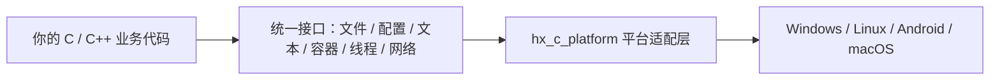

# hx_c_platform

[![C99 核心][c-badge]](CMakeLists.txt) [![C++11 封装][cpp-badge]](docs/CPP_POOL.zh-CN.md) [![仅 C++ 封装为 header-only][header-badge]](docs/CPP_POOL.zh-CN.md) [![CMake 3.16+][cmake-badge]](CMakeLists.txt) [![自有代码许可证待定][license-badge]](THIRD_PARTY_NOTICES.zh-CN.md) [![Linux GCC 与 Clang][linux-badge]](docs/PLATFORMS.zh-CN.md) [![macOS 待验证][macos-badge]](docs/PLATFORMS.zh-CN.md) [![Windows MSVC][windows-badge]](docs/PLATFORMS.zh-CN.md) [![嵌入式 Linux 待目标验证][embedded-badge]](docs/PLATFORMS.zh-CN.md) [![Android API 21 ARM][android-badge]](docs/ANDROID.zh-CN.md)

[English](README.md) · [完整入门教程](docs/USAGE.zh-CN.md) · [可运行示例目录](examples/README.zh-CN.md) · [按功能查找](#section-6) · [接口参考](docs/REFERENCE.zh-CN.md)

<a id="section-1"></a>

## 1. 这个库用来做什么

在编写跨平台 C/C++ 应用程序或基础服务时，往往需要反复处理文件读写、配置解析、字符串与编码转换、通用容器排序、后台线程池以及网络/进程间通信。`hx_c_platform` 将这些高频系统能力收敛为一套统一的接口，在内部屏蔽 Windows、Linux、Android 与 macOS 的底层系统差异。



### 核心特性

- **C99 编译核心 + C++11 Header-Only 封装**：底层核心采用标准 C99 编写；可选的 `include/hx/` 头文件封装提供 RAII 自动资源释放与 `hx::Result<T>` 显式结果检查（全程不使用 C++ 异常 `try`/`catch`/`throw`），并支持按需开启 C++20 协程。
- **开箱即用，无隐式全局状态**：日常调用无需执行全局初始化，不依赖 Qt、Boost 或 OBS 等重型框架；支持按上下文（`hx_os_context`）注入自定义内存分配器。
- **可裁剪的模块化构建**：文件、字符串、内置配置解析（JSON/INI/TOML 等）、容器与线程池开箱即用；加密（OpenSSL）、归档压缩（libarchive/zlib/lzma/zstd）、HTTP（libcurl）、持久化队列（SQLite）等重度模块均可通过 CMake 开关按需启停。
- **明确的所有权与超时安全契约**：所有阻塞与关闭操作均支持截止时间（Deadline）。等待超时绝不会强行销毁仍在后台运行的对象或释放工作线程正在访问的内存。

> [!TIP]
> - 想要直接跑通现成的功能演示？可以从 [可运行示例目录](examples/README.zh-CN.md) 按任务挑选，每项都列出了构建目标、输入参数与预期输出。
> - 需要排查 CPU 热点或内存泄漏？请参考 [perf、Valgrind 与 WPR/WPA 性能分析指南](docs/ANALYSIS.zh-CN.md)。
> - 各操作系统的编译器基线与已知限制详见 [平台支持说明](docs/PLATFORMS.zh-CN.md)。

<a id="section-2"></a>
<a id="section-3"></a>

## 2. 5 分钟接入：准备一个最小可运行工程

**环境要求**：CMake 3.16+，以及对应平台的 C/C++ 编译器（Windows 推荐使用 Visual Studio 开发者终端 MSVC，Linux 使用 GCC 或 Clang）。

如果手头已经有预编译好的 `include/lib/bin` SDK 安装包，请直接查看 [SDK 安装包接入指南](docs/INSTALL.zh-CN.md)。下面演示**从源码子目录（`add_subdirectory`）接入**的标准流程：

### 2.1 拉取源码

在你的项目目录 `hx_demo` 下创建 `deps/`，拉取 `hx_c_platform` 及其子模块：

```sh
mkdir hx_demo && cd hx_demo
mkdir deps && cd deps
git clone --branch dev https://github.com/HuangX666/hx_c_platform.git
git -C hx_c_platform submodule update --init --recursive
cd ..
```

### 2.2 编写 `CMakeLists.txt`

在 `hx_demo` 根目录下创建 `CMakeLists.txt`。为了让你无需预先编译 OpenSSL、libcurl 等外部原生 SDK 就能立即跑通基础功能，这里先关闭几个外部依赖模块（后续需要 HTTP、加密或压缩时，按 [依赖构建指南](docs/DEPENDENCIES.zh-CN.md) 准备好 SDK 后再开启即可）：

```cmake
cmake_minimum_required(VERSION 3.16)
project(hx_demo LANGUAGES C)

# 关闭需要外部原生 SDK 的可选模块，仅保留开箱即用的核心模块
foreach(module CRYPTO ARCHIVE COMPRESSION HTTP URL UNICODE PERSISTENT_QUEUE)
	set(HX_OS_ENABLE_${module} OFF CACHE BOOL "")
endforeach()

add_subdirectory(deps/hx_c_platform)

add_executable(hx_demo main.c)
target_link_libraries(hx_demo PRIVATE hx_c_platform::hx_c_platform)
set_target_properties(hx_demo PROPERTIES
	C_STANDARD 99
	C_STANDARD_REQUIRED YES
	C_EXTENSIONS NO)
```

> [!NOTE]
> **如果要编译第 3 节中的 C++11 示例（`main.cpp`）**：
> 只需将 `project(hx_demo LANGUAGES C)` 改为 `LANGUAGES C CXX`，将源文件改为 `main.cpp`，并把链接目标从 `hx_c_platform::hx_c_platform` 替换为 `hx_c_platform::cpp`。完整配置可参考 [C++ 工程 CMake 模板](docs/USAGE.zh-CN.md#cpp-project)。

### 2.3 编译工程

把第 3 节中任一示例保存为 `hx_demo/main.c`（或 `main.cpp`），然后执行构建：

```sh
cmake -S . -B build
cmake --build build --config Release
```

<a id="section-4"></a>

## 3. 常用代码示例：先跑通，再替换成你的业务数据

下面每个小节都是一个独立的完整程序。每次挑选一个保存为 `main.c`（或 `main.cpp`），在 `hx_demo` 目录下编译并运行即可。

### 3.1 一行调用读取 UTF-8 文本文件（C99）

**场景**：读取 `hello.txt` 的全部文本并打印到终端，由库内部自动完成打开、读取与关闭文件句柄。

1. 在 `hx_demo` 目录下创建 UTF-8 编码的 `hello.txt`：

   ```text
   Hello, hx_c_platform!
   ```

2. 将以下代码保存为 `main.c`：

   ```c
   #include <hx_os.h>
   #include <stdio.h>

   int main(void)
   {
   	hx_string text = HX_STRING_INIT;

   	hx_os_status status =
   		hx_os_file_read_text("hello.txt", &text, NULL);

   	if (status == HX_OS_OK)
   		puts(hx_string_c_str(&text));
   	else
   		fprintf(stderr, "Read failed: %s\n",
   			hx_os_status_name(status));

   	hx_string_destroy(&text);

   	return status == HX_OS_OK ? 0 : 1;
   }
   ```

3. 在 `hx_demo` 目录下运行（确保工作目录中能找到相对路径 `hello.txt`）：

   ```powershell
   # Windows (MSVC Release)
   .\build\Release\hx_demo.exe
   ```

   ```sh
   # Linux / WSL
   ./build/hx_demo
   ```

   **预期输出**：`Hello, hx_c_platform!`

**关键接口说明**：

| 代码写法 | 作用与生命周期说明 |
| --- | --- |
| `hx_string text = HX_STRING_INIT` | 将字符串初始化为空状态（尚未分配堆内存） |
| `hx_os_file_read_text("hello.txt", &text, NULL)` | 读取文件并写入 `text`；第 3 个参数 `hx_os_error *` 传 `NULL` 表示仅通过返回值判断状态，无需获取底层 OS 错误码 |
| `hx_string_c_str(&text)` | 获取以 `\0` 结尾的只读 `const char *` 指针，生命周期跟随 `text` |
| `hx_string_destroy(&text)` | 释放 `text` 占用的内存（文件句柄已在 `hx_os_file_read_text` 返回前自动关闭） |

更多文件读写、按行读取与 C++ 写法详见 [文件操作教程](docs/USAGE.zh-CN.md#files)。

---

### 3.2 清理并规范化用户输入的字符串（C99）

**场景**：用户输入了带前后空格的大写设备名 `"  DEVICE_A  "`，需要原地去除首尾空白并转为小写 `device_a`。

```c
#include <hx_os.h>
#include <stdio.h>

int main(void)
{
	hx_string name = HX_STRING_INIT;

	hx_os_status status =
		hx_string_assign_cstr(&name, "  DEVICE_A  ", NULL);
	if (status == HX_OS_OK) {
		hx_string_trim_ascii_in_place(&name);
		hx_string_lower_ascii_in_place(&name);
		puts(hx_string_c_str(&name));
	}
	else
		fprintf(stderr, "String failed: %s\n",
			hx_os_status_name(status));

	hx_string_destroy(&name);

	return status == HX_OS_OK ? 0 : 1;
}
```

**预期输出**：`device_a`

- `hx_string_assign_cstr()` 将 C 字符串拷贝到 `name` 中。
- `hx_string_trim_ascii_in_place()` 与 `hx_string_lower_ascii_in_place()` 直接在原缓冲区上裁剪 ASCII 空白并转换大写字母，不会影响中文字符等多字节 UTF-8 内容。
- 如果需要对多语言文本做完整的 Unicode 规范化（NFC/NFKC）或大小写折叠（Case Folding），请使用 [Unicode 转换工具](docs/UNICODE.zh-CN.md)。

---

### 3.3 从 JSON 配置文件中读取端口（C++11）

**场景**：加载 `config.json` 并按路径提取整型字段 `/port`，利用 C++11 `hx::Result<T>` 进行无异常错误检查。

1. 在 `hx_demo` 目录下准备 `config.json`：

   ```json
   {"port": 8080}
   ```

2. 按 [C++ 构建配置](docs/USAGE.zh-CN.md#cpp-project) 链接 `hx_c_platform::cpp`，将以下代码保存为 `main.cpp`：

   ```cpp
   #include <hx/Config.hpp>
   #include <cstdio>

   int main()
   {
   	auto config = hx::ConfigDocument::load("config.json");
   	if (!config) {
   		std::fprintf(stderr, "Config failed: %s\n",
   			hx_os_status_name(config.status()));
   		return 1;
   	}

   	auto port = config.value().integer("/port");
   	if (!port) {
   		std::fprintf(stderr, "Port failed: %s\n",
   			hx_os_status_name(port.status()));
   		return 1;
   	}

   	std::printf("Port: %lld\n", static_cast<long long>(port.value()));

   	return 0;
   }
   ```

**预期输出**：`Port: 8080`

- `hx::ConfigDocument::load()` 返回 `hx::Result<hx::ConfigDocument>`：先用 `if (!config)` 检查是否加载失败，确认成功后再通过 `config.value()` 访问文档对象。文档离开作用域时会自动释放底层资源。
- `integer("/port")` 按路径读取根对象下的整数 `port`。该接口执行严格类型检查：如果字段缺失，或 JSON 中写成了字符串 `"8080"`，都会返回错误状态（`HX_OS_NOT_FOUND` 或 `HX_OS_TYPE_MISMATCH`）。
- C 语言接口写法、嵌套对象查询及多格式支持详见 [配置读取教程](docs/USAGE.zh-CN.md#configuration)。

---

### 3.4 对原生数组原地排序（C99）

**场景**：直接对栈上的普通 C 数组 `int32_t values[] = {5, 1, 3}` 按升序原地排序，无需额外拷贝到动态容器中。

```c
#include <hx_algorithm.h>
#include <stdio.h>

int main(void)
{
	int32_t values[] = {5, 1, 3};

	hx_os_status status = hx_os_sort_i32(values, 3, NULL);
	if (status != HX_OS_OK) {
		fprintf(stderr, "Sort failed: %s\n",
			hx_os_status_name(status));
		return 1;
	}

	printf("%d %d %d\n", (int)values[0], (int)values[1],
		(int)values[2]);

	return 0;
}
```

**预期输出**：`1 3 5`

- `hx_os_sort_i32(values, 3, NULL)` 直接修改原数组中的 3 个元素；普通栈数组用完后无需调用任何销毁函数。
- 自定义结构体排序、二分查找、条件过滤以及 C++ 迭代器支持详见 [通用算法指南](docs/ALGORITHMS.zh-CN.md)；需要动态扩容数组或哈希表时请看 [C 容器说明](docs/USAGE.zh-CN.md#containers)。

---

### 3.5 把计算任务提交给后台线程池（C++11）

**场景**：创建一个包含 2 个工作线程的线程池，把 `21 * 2` 放到后台线程执行，主线程带超时等待结果并安全关闭线程池（完整代码对应 [examples/thread_pool.cpp](examples/thread_pool.cpp)）。

```cpp
#include <hx/ThreadPool.hpp>
#include <cstdio>

int main()
{
	hx_os_thread_pool *owner = NULL;

	if (!(hx_os_capabilities() & HX_OS_CAP_THREAD_POOL)) {
		std::puts("Thread pools are disabled.");
		return 0;
	}

	// 1. 创建含 2 个工作线程的线程池，底层句柄保存在 owner 中
	auto created = hx::ThreadPool::withThreads(owner, 2);
	if (!created) {
		std::fprintf(
			stderr, "%s\n", hx_os_status_name(created.status()));
		auto closed = hx::ThreadPool(owner).shutdownUntil(
			hx_os_deadline_after_ms(2000));
		if (!closed)
			std::fputs("Cleanup pending; keep owner to retry.\n",
				stderr);
		return 1;
	}

	auto &pool = created.value();

	// 2. 提交后台任务，并在 2 秒截止时间内等待计算结果
	auto submitted =
		pool.submit([](int value) noexcept { return value * 2; }, 21);

	hx_os_status workStatus = submitted.status();
	if (submitted) {
		auto answer = submitted.value().getUntil(
			hx_os_deadline_after_ms(2000));
		workStatus = answer.status();
		if (answer)
			std::printf("Task result: %d\n", answer.value());
	}

	// 3. 显式关闭线程池（取消尚未开始的任务，最多等待 2 秒）
	auto closed = pool.shutdownUntil(
		hx_os_deadline_after_ms(2000), HX_OS_POOL_CANCEL_PENDING);
	if (!closed) {
		std::fprintf(stderr, "Close pending: %s\n",
			hx_os_status_name(closed.status()));
		return 1;
	}

	return workStatus == HX_OS_OK ? 0 : 1;
}
```

**预期输出**：`Task result: 42`

> [!IMPORTANT]
> **为什么要传入 `owner` 并显式调用 `shutdownUntil()`？**
> `hx_c_platform` 严格遵循“超时不销毁活跃资源”的原则：如果后台任务在截止时间内仍未结束，`shutdownUntil()` 会返回 `HX_OS_TIMEOUT`，此时**不会强行杀死线程或释放 `owner`**，以防止工作线程访问已释放内存。在常驻服务程序中，如果关闭超时，应当保留 `owner` 及任务借用的数据，稍后再次重试关闭。详见 [线程池与生命周期教程](docs/USAGE.zh-CN.md#thread-pool)。

---

### 3.6 使用 `{}` 占位符格式化打印（C99）

**场景**：在纯 C99 代码中像现代语言一样使用 `{}` 和 `{:.2f}` 打印带精度的浮点数，并获得编译期类型明确的实参包装。

```c
#include <hx_print.h>

int main(void)
{
	hx_os_status status = HX_PRINTLN("{}: {:.2f}",
		hx_fmt_str("Voltage"), hx_fmt_f64(3.75));

	return status == HX_OS_OK ? 0 : 1;
}
```

**预期输出**：`Voltage: 3.75`

- `{}` 依次匹配后续参数，`{:.2f}` 将双精度浮点数格式化为两位小数。
- C99 中通过 `hx_fmt_str()`、`hx_fmt_f64()`、`hx_fmt_i32()` 等内联构造函数标记参数类型，直接包含 `<hx_print.h>` 即可编译，无需额外部署代码生成器。
- 在 C++11 中调用时可根据实参类型自动推导格式化方式。自定义结构体格式化、自动实参宏与更多占位符语法详见 [格式化教程](docs/FORMAT.zh-CN.md)。

<a id="section-5"></a>

## 4. 核心使用约定（写代码前先记住这 4 条）

1. **C 接口先检查 `hx_os_status` 返回值**：`HX_OS_OK`（`0`）表示成功；其他正值（如 `HX_OS_EOF`）或负值错误码需按接口契约处理。调用 `hx_os_status_name(status)` 可将状态码转为可读英文名称。
2. **C++ 接口先检查 `Result`，再调 `.value()`**：先用 `if (!result)` 判断是否失败，成功后再取 `result.value()`。库内所有 C++ 封装均采用显式错误返回，不抛出异常。
3. **成对释放 C 资源**：C 语言没有析构函数，凡是由库分配的资源都需调用对应的释放接口（例如 `hx_string_destroy()`、`hx_os_config_release()`）。
4. **带工作线程或异步 I/O 的对象必须完成关闭**：当 `shutdown` / `close` 等待超时（`HX_OS_TIMEOUT`）时，底层工作可能仍在执行，调用方必须继续保留对象句柄及其借用的业务数据，直至关闭成功。

更多新手常见疑问与排错方法请查看 [初次使用常见问题](docs/USAGE.zh-CN.md#questions)。

<a id="section-6"></a>

## 5. 功能全景与文档导航

按你要解决的具体问题查找对应的专题指南与完整示例：

### 5.1 文件、数据流与文本处理

| 想做什么 | 推荐入口 |
| --- | --- |
| 文件读写、字符串、配置、容器与线程池快速上手 | [常用任务教程](docs/USAGE.zh-CN.md) |
| 花括号 `{}` 格式化打印、C 自动实参与自定义类型输出 | [格式化教程](docs/FORMAT.zh-CN.md) |
| 带单行长度上限的 UTF-8 逐行读取 | [逐行读取](docs/LINE_READER.zh-CN.md) |
| 零拷贝借用式切分、严格整数解析、自然排序比较 | [文本工具](docs/TEXT_UTILITIES.zh-CN.md) |
| UTF-8 路径打开 `FILE*`、Windows `wchar_t` 互转 | [文本互操作](docs/TEXT_INTEROP.zh-CN.md) |
| Unicode 规范化（NFC/NFD/NFKC/NFKD）与大小写折叠 | [Unicode 工具](docs/UNICODE.zh-CN.md) |
| UTF-8 正则表达式匹配、分组捕获与替换 | [正则表达式](docs/REGEX.zh-CN.md) |
| Base64 / Base64URL 与十六进制编解码 | [编码工具](docs/ENCODING.zh-CN.md) |
| 多层目录递归查找文件与后台扫描 | [递归查找教程](docs/FILE_SEARCH.zh-CN.md) |
| 二进制大小端读写流与有界后台文件写出 | [读写流与后台写出](docs/STREAMS.zh-CN.md) |
| ZIP / TAR 打包解包、加密 ZIP 与可选 7z 归档 | [压缩与归档教程](docs/ARCHIVE.zh-CN.md) |
| 编码转换、翻译查表、目录遍历与词法切分 | [常用工具说明](docs/COMMON_UTILITIES.zh-CN.md) |

### 5.2 配置解析、序列化与动态类型

| 想做什么 | 推荐入口 |
| --- | --- |
| 解析 JSON / YAML / XML / INI / TOML / ENV / Properties | [配置格式说明](docs/CONFIGURATION.zh-CN.md) |
| 修改 INI、配置自动备份与恢复、运行时设置覆盖 | [配置编辑](docs/CONFIG_EDIT.zh-CN.md) |
| C/C++ 结构体与 7 种配置格式双向序列化 | [序列化教程](docs/SERIALIZATION.zh-CN.md) |
| 在同一变量中保存不同类型的值或自定义结构体 | [Variant 说明](docs/VARIANT.zh-CN.md) |
| 可动态增长的命名参数包与二进制载荷传递 | [参数包](docs/PARAMETERS.zh-CN.md) |
| 运行时词法符号检查、引号字符串读取与嵌套块跳过 | [解析辅助](docs/PARSING.zh-CN.md) |
| 运行时常量替换、条件分支与有界配置文件包含 | [配置预处理](docs/PREPROCESSING.zh-CN.md) |

### 5.3 容器、算法与高速数据结构

| 想做什么 | 推荐入口 |
| --- | --- |
| C 动态数组（Vector）、双向链表、队列与红黑树映射 | [C 容器说明](docs/CONTAINERS.zh-CN.md) |
| 原生数组、自定义结构体与 C++ 迭代器的排序与查找 | [通用算法](docs/ALGORITHMS.zh-CN.md) |
| 有界字节队列（支持批量读写与 Peek 预览） | [字节队列](docs/BYTE_QUEUE.zh-CN.md) |
| 外部内存固定环形缓冲与两段式直接借用读写 | [固定环形缓冲](docs/RING.zh-CN.md) |
| 带容量上限与逐项过期时间（TTL）的 LRU 缓存 | [LRU 缓存](docs/CACHE.zh-CN.md) |
| 动态位图（Bitset）、位搜索与集合交并运算 | [位集合](docs/BITSET.zh-CN.md) |
| 紧凑变长整数（Varint/ZigZag）、UUID 解析与 UUID v7 | [整数与 UUID 工具](docs/INTEGER_TOOLS.zh-CN.md) |
| 随机打乱/抽样、基数排序、多模式字节查找与布隆过滤器 | [二进制与查找工具](docs/FAST_TOOLS.zh-CN.md) |

### 5.4 并发、线程池、队列与协程

| 想做什么 | 推荐入口 |
| --- | --- |
| C++ 线程池任务提交、取消、关闭重试与 `Result` 用法 | [线程池](docs/CPP_POOL.zh-CN.md) · [Result 说明](docs/CPP_RESULTS.zh-CN.md) |
| 线程间单条/批量消息收发（SPSC / MPSC / MPMC 队列） | [并发队列](docs/QUEUES.zh-CN.md) |
| 基于 SQLite 的落盘持久化队列、消费确认（ACK）与租约 | [持久化队列](docs/PERSISTENT_QUEUE.zh-CN.md) |
| 协作式取消令牌、`WaitGroup` 与读写锁 | [线程协调](docs/COORDINATION.zh-CN.md) |
| 多线程安全的单次初始化（Once） | [一次初始化](docs/ONCE.zh-CN.md) |
| 秒表计时器、指数退避重试与令牌桶限流 | [计时与流控](docs/CONTROL.zh-CN.md) |
| 同步信号订阅、观察者通知与可修改调用参数 | [信号通知](docs/SIGNALS.zh-CN.md) |

### 5.5 网络通信、IPC、安全传输与密码学

| 想做什么 | 推荐入口 |
| --- | --- |
| TCP 业务收发完整示例（订单发送与回执） | [TCP 独立示例](docs/TCP_BUSINESS.zh-CN.md) |
| UDP 业务收发完整示例（采样上报与反馈） | [UDP 独立示例](docs/UDP_BUSINESS.zh-CN.md) |
| KCP 可靠 UDP 数据块传输示例 | [KCP 独立示例](docs/KCP_BUSINESS.zh-CN.md) |
| 本地进程间通信（IPC）设备控制示例与多语言接入协议 | [IPC 独立示例](docs/IPC_BUSINESS.zh-CN.md) · [IPC 教程与协议](docs/IPC.zh-CN.md) |
| Keepalive、IPv6 双栈、广播、组播与本机网卡查询 | [网络选项与设备发现](docs/NETWORK_OPTIONS.zh-CN.md) |
| UDP 报文元数据、批量收发、分散/聚集 I/O 与局域网 KCP | [网络 I/O 实用入口](docs/NETWORK_IO.zh-CN.md) |
| 基于流、Socket 与 TLS 的长度前缀消息帧 | [消息帧](docs/FRAMES.zh-CN.md) |
| 证书校验 TLS 双向连接与多线程 JSON 收发 | [TLS 指南与示例](docs/TLS.zh-CN.md) |
| HTTP/HTTPS 流式文件上传下载与协程请求 | [HTTP 传输](docs/HTTP_FILES.zh-CN.md) |
| 一行调用文本/文件加密、SHA-256、HMAC 与数字签名 | [加密教程与示例](docs/CRYPTO.zh-CN.md) |
| 分块流式计算 SHA-256 / SHA-512 与 HMAC | [分块摘要](docs/INCREMENTAL_HASH.zh-CN.md) |

### 5.6 系统集成、性能统计与平台工具

| 想做什么 | 推荐入口 |
| --- | --- |
| HTTP、内存压缩、URL、命令行解析、临时文件、串口与共享内存 | [常用 I/O 扩展工具](docs/UTILITY_EXTENSIONS.zh-CN.md) |
| 子进程管理、匿名/命名管道、目录监听、内存映射与系统信息 | [平台工具](docs/PLATFORM_UTILITIES.zh-CN.md) |
| 借用底层原生句柄（`HANDLE` / `fd` / `SOCKET` / 线程 / 进程） | [原生对象互操作](docs/NATIVE_INTEROP.zh-CN.md) |
| Windows DLL 版本读取、窗口标题与显示器/GPU 枚举 | [Windows 工具](docs/WINDOWS_UTILITIES.zh-CN.md) |
| 为 Windows 客户端程序配置 WER LocalDumps 崩溃转储 | [WER LocalDumps](docs/LOCAL_DUMPS.zh-CN.md) |
| 通过 Linux 桌面服务申请作用域防休眠（Sleep Inhibit） | [Linux 桌面电源管理](docs/LINUX_DESKTOP.zh-CN.md) |
| 耗时区间统计树、独立快照与有界 P50/P95/P99 分位数计算 | [Profiler 统计](docs/PROFILER.zh-CN.md) |
| 在业务中直接复用随包的 SQLite / OpenSSL / libcurl / 压缩库 | [底层依赖调用](docs/NATIVE_DEPENDENCIES.zh-CN.md) |
| 第三方子模块管理与原生依赖库编译 | [依赖构建指南](docs/DEPENDENCIES.zh-CN.md) |
| Android NDK 与嵌入式 Linux 交叉编译 | [Android 构建指南](docs/ANDROID.zh-CN.md) · [交叉编译参考](docs/REFERENCE.zh-CN.md#section-28) |
| 查询所有模块开关、接口限制与完整 API 索引 | [详细接口参考](docs/REFERENCE.zh-CN.md) |

<a id="section-7"></a>

## 6. 构建选项、平台支持与许可证

- **构建公开示例**：配置 CMake 时传入 `-DHX_OS_BUILD_EXAMPLES=ON` 即可编译 `examples/` 目录下的独立示例程序。所有 CMake 构建与安装开关详见 [构建与安装参考](docs/REFERENCE.zh-CN.md#section-27)，各操作系统与架构基线详见 [平台支持说明](docs/PLATFORMS.zh-CN.md)。
- **许可证说明**：本项目自有代码的分发许可证尚未最终确定；`deps/` 下引用的第三方组件各自遵循其原始开源许可证。在集成、使用或分发前，请务必阅读 [第三方许可证声明](THIRD_PARTY_NOTICES.zh-CN.md)。

[c-badge]: https://img.shields.io/badge/C-99-blue?logo=c
[cpp-badge]: https://img.shields.io/badge/C%2B%2B-11-blue?logo=cplusplus
[header-badge]: https://img.shields.io/badge/header--only-C%2B%2B%20facade-yellowgreen
[cmake-badge]: https://img.shields.io/badge/CMake-3.16%2B-blue?logo=cmake
[license-badge]: https://img.shields.io/badge/license-pending-lightgrey
[linux-badge]: https://img.shields.io/badge/Linux-GCC%20%7C%20Clang-yellow?logo=linux
[macos-badge]: https://img.shields.io/badge/macOS-pending-lightgrey?logo=apple
[windows-badge]: https://img.shields.io/badge/Windows-MSVC-blue
[embedded-badge]: https://img.shields.io/badge/ARM%20Linux-ARMv7%20%7C%20AArch64-blue
[android-badge]: https://img.shields.io/badge/Android-API%2021%20ARM-blue?logo=android
