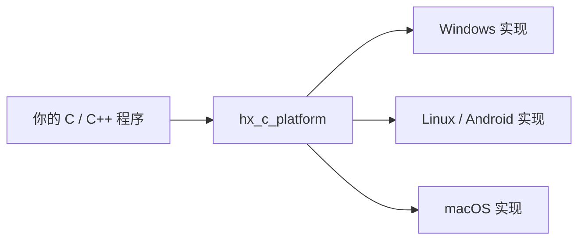

# hx_c_platform

[![CI 配置][ci-badge]](.github/workflows/build.yml) [![C99 核心][c-badge]](CMakeLists.txt) [![C++11 封装][cpp-badge]](docs/CPP_POOL.zh-CN.md) [![仅 C++ 封装为 header-only][header-badge]](docs/CPP_POOL.zh-CN.md) [![CMake 3.16+][cmake-badge]](CMakeLists.txt) [![自有代码许可证待定][license-badge]](THIRD_PARTY_NOTICES.zh-CN.md) [![Linux GCC 与 Clang][linux-badge]](docs/VALIDATION.zh-CN.md) [![macOS 待验证][macos-badge]](docs/VALIDATION.zh-CN.md) [![Windows MSVC][windows-badge]](docs/VALIDATION.zh-CN.md) [![本地 Windows 131/131、Linux 133/133 项测试通过][tests-badge]](docs/VALIDATION.zh-CN.md) [![嵌入式 Linux 待目标验证][embedded-badge]](docs/VALIDATION.zh-CN.md) [![Android API 21 ARM 交叉编译通过][android-badge]](docs/ANDROID.zh-CN.md)

[English](README.md) · [常用任务教程](docs/USAGE.zh-CN.md) · [详细参考](docs/REFERENCE.zh-CN.md)

- [1. 这个库能帮你做什么](#section-1)
- [2. 使用要求与平台状态](#section-2)
- [3. 把库接入自己的项目](#section-3)
- [4. 常用任务示例](#section-4)
- [5. 先记住的几条规则](#section-5)
- [6. 更多功能到哪里找](#section-6)
- [7. 构建、验证与项目许可](#section-7)

<a id="section-1"></a>

## 1. 这个库能帮你做什么

`hx_c_platform` 给 C/C++ 项目提供一套常用工具：读写文件、处理 UTF-8 字符串、读取配置、使用容器和 variant、创建线程、提交后台任务和运行协程。你调用同一个函数，库负责处理 Windows、Linux 等系统的差异。

核心用 C99 实现；C++11 开发者可以选择更方便的 C++ 接口，C++20 协程语法是单独启用的可选层。普通使用不需要创建全局运行环境，也不依赖 Qt 或 OBS。当前版本为 0.1.0。

下面这张图表示调用关系：业务代码调用库，由库选择对应的系统实现。



<a id="section-2"></a>

## 2. 使用要求与平台状态

需要 CMake 3.16 或更新版本，以及 C 编译器；使用 C++ 示例时还需要支持 C++11 的编译器。Windows 可使用 MSVC，Linux 可使用 GCC 或 Clang。核心需要编译成库，C++ 接口是头文件包装。

| 平台 | 当前情况 |
| --- | --- |
| Windows | MSVC x86/x64 已构建和运行；Win7 SP1/8.1 保留为兼容目标，旧系统待实测 |
| Linux | 已在 WSL Linux 构建和运行 |
| macOS | 有平台实现；Intel 10.13 / ARM64 11.0 为基线，Apple 主机待验证 |
| Android | API 21，两种 ARM ABI 编译通过；ARM64 在 API 34 模拟器经翻译运行 |
| 嵌入式 Linux | ARMv7/AArch64 有交叉编译记录，具体 libc 和板卡仍需验证 |

<a id="section-3"></a>

## 3. 把库接入自己的项目

先建立下面的目录，把本库源码放到 `external/hx_c_platform`。`main.c` 使用第 4.1 节的完整 C 程序。每个示例单独运行，程序会打印自己的结果。

```text
hx_demo/
├── CMakeLists.txt
├── main.c
├── hello.txt
├── config.json
└── external/
    └── hx_c_platform/
```

`hello.txt` 保存为 UTF-8，内容是：

```text
Hello, hx_c_platform!
```

`config.json` 保存以下内容，稍后的配置示例会用到它：

```json
{"port": 8080}
```

`CMakeLists.txt` 使用以下内容。前两项开关关闭库自身的测试和示例，只编译你的程序需要的库。`configure_file` 把输入文件复制到运行目录，避免找不到文件。

```cmake
cmake_minimum_required(VERSION 3.16)
project(hx_demo LANGUAGES C)
set(HX_OS_BUILD_TESTS OFF CACHE BOOL "" FORCE)
set(HX_OS_BUILD_EXAMPLES OFF CACHE BOOL "" FORCE)
add_subdirectory(external/hx_c_platform)
add_executable(hx_demo main.c)
target_link_libraries(hx_demo PRIVATE hx_c_platform::hx_c_platform)
set_target_properties(hx_demo PROPERTIES
	C_STANDARD 99 C_STANDARD_REQUIRED YES C_EXTENSIONS NO)
configure_file(hello.txt hello.txt COPYONLY)
configure_file(config.json config.json COPYONLY)
```

在 `hx_demo` 目录执行；Windows 使用装好 MSVC 和 CMake 的开发者终端：

```sh
cmake -S . -B build
cmake --build build --config Release
cd build
```

Windows 的 Visual Studio 构建运行：

```powershell
.\Release\hx_demo.exe
```

Linux 的 Makefile/Ninja 构建运行：

```sh
./hx_demo
```

结果应为 `Hello, hx_c_platform!`。输入文件按当前工作目录查找，因此这里先进入了 `build`。使用 C++ 时，把程序保存为 `main.cpp`，采用[教程中的完整 C++ CMake 配置](docs/USAGE.zh-CN.md#cpp-project)；其中也包含关闭异常的选项。

<a id="section-4"></a>

## 4. 常用任务示例

下面保留几个常用任务。读取文本给出完整程序；其余短片段标明所需头文件和已有对象，完整程序、运行步骤和更多 C/C++ 写法见各任务所链接的教程。

### 4.1 读取并显示文本文件：C / C++

任务：读取第 3 节的 `hello.txt`，把内容显示出来。这个入口在内部完成打开、读取和关闭文件，你只需要使用返回的字符串。

**C：保存为 `main.c`，可以直接编译。**

```c
#include <hx_os.h>
#include <stdio.h>

int main(void)
{
	hx_string text = HX_STRING_INIT;
	hx_os_status status = hx_os_file_read_text("hello.txt", &text, NULL);
	if (status == HX_OS_OK)
		puts(hx_string_c_str(&text));
	else
		fprintf(stderr, "Read failed: %s\n", hx_os_status_name(status));
	hx_string_destroy(&text);
	return status == HX_OS_OK ? 0 : 1;
}
```

`text` 接收文件内容，`HX_OS_OK` 表示成功，`hx_string_c_str` 取得可打印的文本。最后的 `hx_string_destroy` 释放字符串占用的内存；文件已经由读取函数关闭。

**C++：保存为 `main.cpp`，使用第 3 节链接的 C++ 构建配置。**

```cpp
#include <hx/Files.hpp>
#include <cstdio>

int main()
{
	auto text = hx::Files::readText("hello.txt");
	if (!text) {
		std::fprintf(stderr, "Read failed: %s\n",
			hx_os_status_name(text.status()));
		return 1;
	}
	std::puts(text.value().c_str());
	return 0;
}
```

`if (!text)` 检查读取是否失败；成功后，`text.value()` 取得字符串，`c_str()` 取得可打印的字符指针。C++ 字符串离开作用域时自动释放内存。两份程序的输出相同：`Hello, hx_c_platform!`。

### 4.2 去掉两端空白并转换为小写：C++

任务：把 `"  Hello  "` 变为 `"hello"`。包含 `<hx/Values.hpp>` 和 `<cstdio>`，把以下片段放入 `main()`：

```cpp
auto text = hx::String::copy("  Hello  ");
if (!text)
	return 1;
text.value().trimAscii().lowerAscii();
std::puts(text.value().c_str());
```

`trimAscii()` 去掉两端 ASCII 空白，`lowerAscii()` 转换 ASCII 大写字母；原地处理同一个字符串。输出：`hello`。中文等非 ASCII 字符不会被转换。[完整 C/C++ 示例](docs/USAGE.zh-CN.md#strings)。

### 4.3 从 JSON 文件读取端口：C++

任务：从 `config.json` 的 `{"port":8080}` 中读取数字 `8080`。包含 `<hx/Config.hpp>` 和 `<cstdio>`，把片段放入 `main()`：

```cpp
auto config = hx::ConfigDocument::load("config.json");
if (!config)
	return 1;
auto port = config.value().integer("/port");
if (!port)
	return 1;
std::printf("Port: %lld\n", static_cast<long long>(port.value()));
```

`load()` 加载并解析 JSON；`integer("/port")` 读取根对象的 `port`，并检查它能否按整数读取。`/port` 是查询位置，不是文件路径。输出：`Port: 8080`。[完整程序和失败说明](docs/USAGE.zh-CN.md#configuration)。

### 4.4 连续修改两个设置：C++

任务：给内存中的设置写入 `port=8080` 和 `enabled=true`。包含 `<hx/Settings.hpp>` 和 `<cstdio>`；这里的 `settings` 是已通过 `settings.create()` 创建成功的 `hx::Settings` 对象。完整创建和关闭代码见[设置教程](docs/USAGE.zh-CN.md#settings)。

```cpp
auto changed = settings.update()
		       .setInt("port", 8080)
		       .setBool("enabled", true)
		       .finish();
if (!changed)
	std::fprintf(stderr, "%s\n", hx_os_status_name(changed.status()));
```

`finish()` 检查这组写入的结果。成功后两个值已生效；首次失败会跳过后续写入，之前成功的值保留。这段代码不保存文件；文件保存是另一个明确的操作。

### 4.5 用 C 的 vector 保存整数

任务：保存 `10` 和 `20`，显示数量和第一个值。包含 `<hx_os.h>` 和 `<stdio.h>`，先在 `main()` 外声明整数容器：

```c
HX_OS_DECLARE_VECTOR(int_vector, int)
```

宏生成 `int_vector_create/push/at/destroy` 等函数，下面放入 `main()`：

```c
int_vector *numbers = NULL;
hx_os_status status = int_vector_create(NULL, 16, &numbers, NULL);
if (status == HX_OS_OK)
	status = int_vector_push(numbers, 10, NULL);
if (status == HX_OS_OK)
	status = int_vector_push(numbers, 20, NULL);
if (status == HX_OS_OK)
	printf("Count: %zu, first: %d\n", int_vector_size(numbers),
		*int_vector_at(numbers, 0));
hx_os_status closed = int_vector_destroy(&numbers, NULL);
if (status == HX_OS_OK)
	status = closed;
if (status != HX_OS_OK)
	return 1;
```

`16` 是元素数量上限；`push` 追加，`at(..., 0)` 访问第一个元素，`destroy` 释放容器。输出：`Count: 2, first: 10`。[完整 vector/queue 程序](docs/USAGE.zh-CN.md#containers)。

### 4.6 提交一个后台计算任务：C++

任务：在线程池计算 `21 × 2`。包含 `<hx/ThreadPool.hpp>` 和 `<cstdio>`；这里的 `pool` 是已创建的线程池。创建两个工作线程及最终关闭的完整程序见[线程池教程](docs/USAGE.zh-CN.md#thread-pool)。

```cpp
auto submitted = pool.submit([](int value) noexcept { return value * 2; }, 21);
if (submitted) {
	auto answer = submitted.value().getUntil(hx_os_deadline_after_ms(2000));
	if (answer)
		std::printf("Answer: %d\n", answer.value());
	else
		std::fprintf(
			stderr, "%s\n", hx_os_status_name(answer.status()));
}
else
	std::fprintf(stderr, "%s\n", hx_os_status_name(submitted.status()));
```

`submit` 成功表示任务被接受；`getUntil` 等待计算结果，本例最多等待 2 秒。正常输出：`Answer: 42`。`noexcept` 表示任务不使用异常机制。用完必须显式关闭线程池；等待或关闭超时后，要保留对象再处理，不能当作已经释放。

### 4.7 同一个变量保存不同类型：C / C++

任务：先保存整数 42，再改为字符串 hello。C 包含 `<hx_variant.h>` 和 `<stdio.h>`，把下面片段放入 main()：

```c
hx_variant value = HX_VARIANT_INIT;
hx_string_view text;
hx_os_status status = hx_variant_set_i32(&value, 42, NULL);
if (status == HX_OS_OK)
	status = hx_variant_set_cstr(&value, "hello", NULL);
if (status == HX_OS_OK)
	status = hx_variant_get_string_view(&value, &text, NULL);
if (status == HX_OS_OK)
	printf("String: %.*s\n", (int)text.size, text.data);
hx_variant_destroy(&value);
if (status != HX_OS_OK)
	return 1;
```

输出：`String: hello`。variant 每次只保存一个值，设置字符串会替换整数；字符串内容由 variant 持有，最后的 destroy 负责释放。

C++ 也可以直接保存你定义的结构体。包含 `<hx/Variant.hpp>` 和 `<cstdio>`，下面放入 main()：

```cpp
struct Point { double x; double y; };
hx::Variant value;
if (!value.set(Point{2, 5}))
	return 1;
auto position = value.get<Point>();
if (!position)
	return 1;
std::printf("Point: %.1f, %.1f\n", position.value().x,
	position.value().y);
```

输出：`Point: 2.0, 5.0`。set 保存独立副本，get<Point> 检查类型并返回结构体引用，离开作用域时自动释放。C 自定义结构体、复制、访问器和容器混合值的完整示例见[variant 教程](docs/VARIANT.zh-CN.md)。

### 4.8 在多层目录中找到文件：C++

任务：递归查找 assets 中第一个 config.json。包含 `<hx/Files.hpp>` 和 `<cstdio>`，把下面片段放入 main()：

```cpp
auto path = hx::Directory::findFirstFile("assets", "config.json");
if (!path)
	return 1;
std::puts(path.value().c_str());
```

例如文件位于 assets/nested/config.json，就输出这个路径。没有匹配会明确失败。这个调用同步扫描；界面程序应放进现有线程池。逐个返回全部匹配的入口是 Directory::findFiles，完整 C/C++ 程序和后台示例见[递归查找教程](docs/FILE_SEARCH.zh-CN.md)。

### 4.9 启动协程，不必为普通任务保存句柄

协程在调用本库等待接口时可以暂停，让工作线程执行其他任务。先创建一次 `runtime` 并进入它的 `Scope`，最后包含可选的 `hx/GoKeywords.hpp`，后面的任务就可以这样写：

```cpp
co_chan<int> answers(1); // 可以暂存一个值。
if (!answers)
	return 1;
go [answers]() noexcept { return answers << 6 * 7; };
auto done = runtime.waitUntil(hx_os_deadline_after_ms(2000));
if (!done)
	return 1;
auto answer = answers.receive(HX_OS_DEADLINE_NOW);
if (answer)
	std::printf("Answer: %d\n", answer.value());
```

输出：`Answer: 42`。运行时自动持有普通 `go` 任务，清理完成后回收，并保留提交／执行失败供统一检查。[完整 C++11 程序](examples/go.cpp) 展示一次性创建和显式关闭。需要任务返回值时仍可用 `runtime.submit(...)` 获取 `Task<T>`。[协程教程](docs/COROUTINES.zh-CN.md) 继续说明 `co_sleep`、拥有字符串等资源的 channel、协程锁、局部值、可选任务组和 C++20 `co_await`。普通阻塞调用仍会占住工作线程，长时间计算需要主动 yield。

### 4.10 格式化并打印文本

C++11 包含 `hx/Format.hpp` 后可以直接写：

```cpp
auto printed = hx::println("{}: {:.2f}", "张三", 3.75);
if (!printed)
	return 1;
```

输出：`张三: 3.75`。`{}` 取下一个实参，`.2f` 表示保留小数点后两位。C99 在 CMake 中启用一次辅助函数后，也可以自动识别类型，直接写 C 表达式：

```c
hx_os_status status = HX_FPRINTLN("{user.name}: {price * count:.2f}");
```

这里的 `user`、`price`、`count` 都是当前 C 函数里的普通变量。[格式化教程](docs/FORMAT.zh-CN.md) 提供完整程序、CMake 配置、自定义结构体、编码规则，以及不使用生成步骤的 C99 写法。可选的生成步骤随正常构建自动运行，不改原始源文件。

需要有序键或重复键时，[红黑树 multimap 示例](examples/ordered_map.c) 与[容器说明](docs/CONTAINERS.zh-CN.md) 包含有序遍历、排序、筛选、链表 splice 和集合运算。

### 4.11 和另一个进程通信：C / C++

四种通信分别提供独立的业务程序、运行器和教程。业务正文全部使用 UTF-8 JSON：发送端序列化，接收端解析并校验字段类型，数字、字符串和布尔值不会混用。打开对应文件即可修改自己的业务：

| 想用什么 | 实际业务与线程 | 教程 |
| --- | --- | --- |
| 本地 IPC：命名管道 / Unix 域套接字 | 两个设备请求线程与一个主动通知接收线程 | [设备控制](docs/IPC_BUSINESS.zh-CN.md) |
| TCP | 订单发送线程与回执接收线程，处理消息长度与短读短写 | [订单业务](docs/TCP_BUSINESS.zh-CN.md) |
| UDP | 传感器发送线程与反馈接收线程，处理缺号、重复、晚到 | [采样业务](docs/UDP_BUSINESS.zh-CN.md) |
| KCP | 数据块生产线程与 KCP I/O 线程，检查重传与业务完成确认 | [可靠传输](docs/KCP_BUSINESS.zh-CN.md) |

按教程构建后，Windows 上分别执行对应入口，每条命令自动运行两个进程并检查结果：

```powershell
python examples/run_ipc_business.py --bin-dir build-net/bin/Release
python examples/run_tcp_business.py --bin-dir build-net/bin/Release
python examples/run_udp_business.py --bin-dir build-net/bin/Release
python examples/run_kcp_business.py --bin-dir build-net/bin/Release
```

例如，TCP 发送的订单正文是：

```json
{"type":"order","id":1,"sku":101,"quantity":2,"note":"桌面设备"}
```

在本地 IPC 设备示例中，客户端创建好 `connection` 并发送 `type="open"` 打开设备 `101` 后，C++11 查询采样间隔只需：

```cpp
auto reply = connection.requestText(
	R"({"type":"get","device_id":101})", 101);
if (reply)
	std::printf("Reply: %s\n", reply.value().text());
```

JSON 的 `type="get"` 表示查询，`device_id=101` 与设备通道相同；请求编号由库自动管理。C 对应使用 `hx_ipc_request_text_until`。完整业务程序继续解析 JSON 回复，不用文本相等代替字段检查。JSON 示例依赖默认开启的 `CONFIG`、`CONFIG_SERIALIZE`、`SETTINGS`，复用现有解析与字符串转义能力。

TCP／UDP 业务直接使用 `hx_os_socket_*`，KCP 业务使用 `hx_os_kcp_*` 与 UDP；三个网络示例均不调用 `hx_ipc_*`，关闭 IPC 模块也能运行。完整接口契约与跨语言 HXIP 协议见 [IPC 参考](docs/IPC.zh-CN.md)。这些示例使用普通线程，超时、断开与资源释放都需要明确处理。

### 4.12 读写多层 JSON，并转换成 YAML

下面的数组同时包含整数、文字、null 和嵌套对象，转换后仍保留各自的类型。包含 `<hx/Config.hpp>` 和 `<cstdio>`，把下面片段放在 `main` 中：

```cpp
auto document = hx::ConfigDocument::parse(
	"{\"items\":[1,\"文字\",null,{\"children\":[true,2.5]}]}");
if (!document)
	return 1;
auto yaml = document.value().serialize(HX_OS_CONFIG_YAML);
if (!yaml)
	return 1;
std::puts(yaml.value().c_str());
```

固定业务结构体可以声明一次字段映射，然后直接调用 `hx_os_codec_encode/decode`，C++ 对应 `hx::Codec<T>`。七种格式的范围、C/C++ 完整程序、嵌套数组和资源释放见[序列化教程](docs/SERIALIZATION.zh-CN.md)。普通文档默认最多 64 层，可显式调到 128 层；INI、ENV、properties 继续遵守各自的简单结构限制。

<a id="section-5"></a>

## 5. 先记住的几条规则

- **先检查，再读结果。** C 检查是否为 `HX_OS_OK`；C++ 检查结果后再调用 `value()`。类型错误、内存不足和文件错误仍需处理。
- **文本默认 UTF-8。** 文件路径也使用 UTF-8；其他字符编码通过明确的转换接口处理。
- **资源用完要释放。** C 的字符串、文档和容器有对应释放函数；C++ 同步对象通常自动释放，线程池等对象需要显式关闭。
- **超时不等于任务已停止。** 保留仍在使用的对象和数据，按应用策略继续等待或重试关闭。

`NULL` 的含义按参数位置决定：分配器或选项位置表示使用默认设置；错误记录位置表示本例不额外接收错误详情。首页示例采用默认模块配置。[初次使用常见问题](docs/USAGE.zh-CN.md#questions)解释报错、输入文件和关闭问题。

<a id="section-6"></a>

## 6. 更多功能到哪里找

| 想做什么 | 先看哪里 |
| --- | --- |
| 本地 IPC 的设备控制业务 | [IPC 独立示例](docs/IPC_BUSINESS.zh-CN.md) |
| TCP 的订单发送与回执 | [TCP 独立示例](docs/TCP_BUSINESS.zh-CN.md) |
| UDP 的采样发送与反馈 | [UDP 独立示例](docs/UDP_BUSINESS.zh-CN.md) |
| KCP 的可靠数据块传输 | [KCP 独立示例](docs/KCP_BUSINESS.zh-CN.md) |
| 进程通信、双向消息、多线程、其他语言对端 | [IPC 教程与协议](docs/IPC.zh-CN.md) |
| 花括号格式化、C 自动实参与表达式 | [格式化教程](docs/FORMAT.zh-CN.md) |
| 文本、配置、容器和线程池的完整程序 | [常用任务教程](docs/USAGE.zh-CN.md) |
| 在多层目录中查找文件、后台扫描 | [递归查找教程](docs/FILE_SEARCH.zh-CN.md) |
| 找完整功能、接口限制、构建开关 | [详细参考](docs/REFERENCE.zh-CN.md) |
| 更多编码、翻译、目录遍历、词法工具 | [常用工具说明](docs/COMMON_UTILITIES.zh-CN.md) |
| JSON/YAML/XML/INI/TOML/ENV/properties | [配置格式说明](docs/CONFIGURATION.zh-CN.md) |
| 结构体与文本互转、深层混合数据、七种格式写出 | [序列化教程](docs/SERIALIZATION.zh-CN.md) |
| 不同类型的值和自定义结构体 | [variant 说明](docs/VARIANT.zh-CN.md) |
| 其他容器及元素复制/释放 | [C 容器说明](docs/CONTAINERS.zh-CN.md) |
| 任务取消、关闭重试和 C++ 结果 | [线程池](docs/CPP_POOL.zh-CN.md) · [Result](docs/CPP_RESULTS.zh-CN.md) |
| 网络、进程、管道、监听、映射及系统信息 | [平台工具](docs/PLATFORM_UTILITIES.zh-CN.md) |
| Android 与嵌入式构建 | [Android](docs/ANDROID.zh-CN.md) · [交叉编译](docs/REFERENCE.zh-CN.md#section-28) |

<a id="section-7"></a>

## 7. 构建、验证与项目许可

开发本库时的构建与测试命令、静态/共享库安装和可选依赖配置见[构建参考](docs/REFERENCE.zh-CN.md#section-27)。2026-10-04 的全量测试为 Windows 131/131、WSL Linux 133/133；新增深层序列化、结构体映射及 C/C++ 示例通过内存检测与安装消费检查，Android API 21 两种 ARM ABI 编译通过。具体配置与未验证目标见[验证记录](docs/VALIDATION.zh-CN.md)。文档示例的构建检查单独记录，不代替目标平台验证。

自有代码的发布许可证尚未确定，第三方许可证见[许可说明](THIRD_PARTY_NOTICES.zh-CN.md)。协程使用自研实现；hx_c_log 接入仍属于后续工作。

[ci-badge]: https://img.shields.io/badge/CI-configured-lightgrey?logo=githubactions
[c-badge]: https://img.shields.io/badge/C-99-blue?logo=c
[cpp-badge]: https://img.shields.io/badge/C%2B%2B-11-blue?logo=cplusplus
[header-badge]: https://img.shields.io/badge/header--only-C%2B%2B%20facade-yellowgreen
[cmake-badge]: https://img.shields.io/badge/CMake-3.16%2B-blue?logo=cmake
[license-badge]: https://img.shields.io/badge/license-pending-lightgrey
[linux-badge]: https://img.shields.io/badge/Linux-GCC%20%7C%20Clang-yellow?logo=linux
[macos-badge]: https://img.shields.io/badge/macOS-pending-lightgrey?logo=apple
[windows-badge]: https://img.shields.io/badge/Windows-MSVC-blue
[tests-badge]: https://img.shields.io/badge/tests-Win%20131%2F131%20Linux%20133%2F133-brightgreen
[embedded-badge]: https://img.shields.io/badge/embedded%20Linux-target%20pending-lightgrey
[android-badge]: https://img.shields.io/badge/Android-API%2021%20ARM%20builds-blue?logo=android
