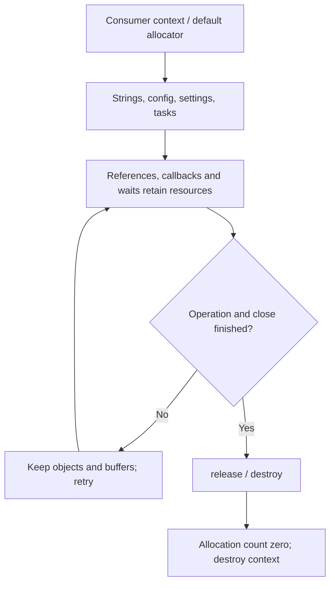
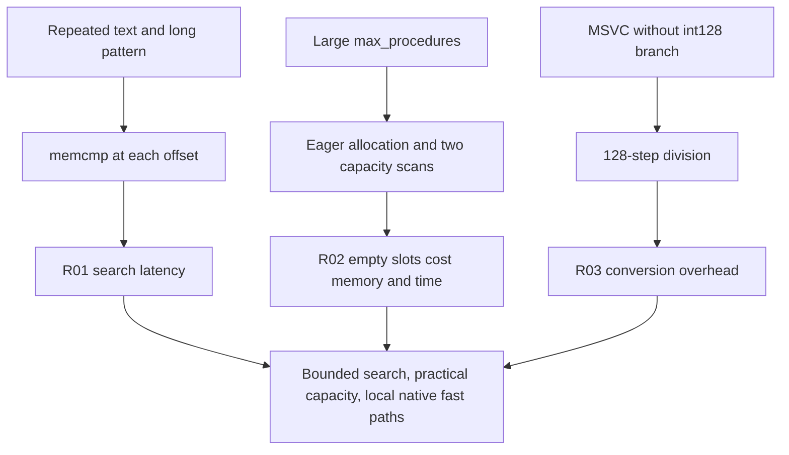

# hx_c_platform performance and memory audit

Measurements belong to this audit's stated source baseline. The later C++ Result migration changes facade storage and error handling; old measurements and proposed exception cases are not evidence for the new facade.

[简体中文](BUG_MEMORY_LEAK_AUDIT.zh-CN.md)

Date: 2026-10-01. Audited revision: `96c5490`, with the same source tree as `477a5c8` before history cleanup. This audit combines source inspection, runtime tests, allocation tracking, and microbenchmarks. Production code was not changed; the optimization proposals below remain unimplemented.

## 1. Conclusion and findings

The executed tests reported no leaks, out-of-bounds accesses, use-after-free, or data races. Windows and WSL Linux each completed 1,001 combined lifecycle rounds: 105,105 allocations matched 105,105 deallocations. Tracked live bytes returned to zero and context destruction succeeded after every round. Handle/descriptor counts stayed constant and Release memory stabilized after warmup. These observations cover executed paths, not every platform, input, or possible scheduling interleaving.

Two performance problems scale with input or configured capacity. A third opportunity concerns Windows wide arithmetic. Per-task allocation costs in C and C++ were also measured. Pool caches, retained settings snapshots, and resources preserved after a close timeout have explicit release paths; this audit does not misclassify their retention as a leak.

| ID | Severity | Category / location | Finding | Resolution |
| --- | --- | --- | --- | --- |
| R01 | 🟡 Medium | Search / `src/string.c:214` | Repeated prefixes approach O(n×m) work | 🔴 Unresolved |
| R02 | 🟡 Medium | Dispatch / `src/dispatch.c:265` | Calls scan reserved capacity; creation allocates all slots | 🔴 Unresolved |
| R03 | 🟢 Low | Arithmetic / `src/wide.c:38` | MSVC wide division uses a bitwise fallback | 🔴 Unresolved |
| R04 | 🔵 Info | Pool / `src/thread_pool.c:214` | Four allocations per C task; five in this C++ case | ⚪ Not applicable |
| R05 | 🔵 Info | Time / `src/time.c:20` | Windows short waits retain the existing tick-clock limit | ⚪ Not applicable |
| R06 | 🔵 Info | Lifetime / `src/base.c:379` | Executed paths release resources; cache retention checked separately | ⚪ Not applicable |

Severity: 🔴 Critical means highest-impact memory corruption/availability; 🟠 High means serious leakage or stability risk; 🟡 Medium means meaningful problems under particular inputs/configurations; 🟢 Low means lower-impact efficiency, compatibility, or diagnostic issues; 🔵 Info means observations, known boundaries, or positive evidence.

Resolution: 🔴 Unresolved means no fix; 🟡 In progress / partially resolved means incomplete work or validation; 🟢 Resolved requires a verified fix; ⚪ Not applicable marks observations requiring no defect repair. No new Critical/High issue was confirmed, and no proposal is marked resolved.

## 2. Data and resource flow





<svg xmlns="http://www.w3.org/2000/svg" viewBox="0 0 860 155"
role="img" aria-label="Live objects, pool caches and detector retention">
  <rect x="5" y="5" width="850" height="145" rx="10" fill="#f1f5f9"/>
  <g font-family="sans-serif" font-size="15" fill="#0f172a">
    <rect x="20" y="20" width="255" height="110" rx="8" fill="#bfdbfe"/>
    <text x="35" y="48">Live consumer objects</text>
    <text x="35" y="78">Check after release / destroy</text>
    <text x="35" y="108">Final tracked bytes: 0</text>
    <rect x="300" y="20" width="255" height="110" rx="8" fill="#bbf7d0"/>
    <text x="315" y="48">Free pages cached by pool</text>
    <text x="315" y="78">collect releases empty pages</text>
    <text x="315" y="108">destroy releases metadata</text>
    <rect x="580" y="20" width="255" height="110" rx="8" fill="#fde68a"/>
    <text x="595" y="48">ASan quarantine / metadata</text>
    <text x="595" y="78">RSS differs from live bytes</text>
    <text x="595" y="108">Use LSan and Release evidence</text>
  </g>
</svg>

## 3. Detailed findings

### R01 [🟡 Medium] Repeated-prefix search degrades

**Location:** [hx_string_find](../src/string.c#L214), particularly the loop starting near line 227.

**Trigger:** A fixed 1 MiB string of `a`; patterns of 16, 256, and 4096 bytes contain `a` followed by a final `b`. None matches.

**Impact:** Long patterns repeatedly compare the same large prefixes. The 4096-byte pattern took a median 107.01 ms on Windows and 53.40 ms on Linux. Synchronous UI, serial parsing, or repeated external-input processing can block significantly. This is neither memory corruption nor evidence that every library operation is slow.

**Evidence:** After UTF-8 validation, each candidate offset invokes memcmp without reusing prefix knowledge or providing a worst-case linear bound. The 16-byte pattern took about 5.88 / 1.63 ms. The five retained samples for 4096 bytes ranged over 105.93..107.65 / 50.84..56.39 ms, respectively.

**Remediation:** Use an established worst-case linear search at the shared string boundary, preserving short-pattern fast paths. Review replace_all and split helpers for reuse. Preserve UTF-8 and byte-offset semantics, and avoid adding a heap allocation to every search merely to improve one benchmark.

**Verification:** Test random/repetitive input, misses, embedded NUL, Chinese, supplementary characters, and start boundaries. Vary n and m independently; report time, allocations, and correctness.

### R02 [🟡 Medium] Named procedures pay for reserved capacity

**Location:** [Slot allocation](../src/dispatch.c#L143), [count scan](../src/dispatch.c#L265), and [snapshot scan](../src/dispatch.c#L285).

**Trigger:** Register only one `count` procedure while increasing max_procedures through 16, the default 256, 4096, and 65535.

**Impact:** Time and memory increase without any additional active procedure. Embedded consumers reserving a large future capacity pay immediately.

**Evidence:** Creation allocates the entire slot array. Invocation scans capacity twice while holding the handler mutex for each scan. Unique named calls add no allocations, which is a positive result.

| Capacity | Windows ns/call | Linux ns/call | Windows tracked live bytes |
| ---: | ---: | ---: | ---: |
| 16 | 155.52 | 198.29 | 3,098 |
| 256 | 304.40 | 397.58 | 43,418 |
| 4096 | 3,824.60 | 3,208.60 | 688,538 |
| 65535 | 263,419.90 | 278,489.74 | 11,010,290 |

Live bytes include context, handler, slots, synchronization objects, binding, and library allocation overhead. They exclude hidden malloc overhead and the audit allocator's own prefix. All are released on close.

**Remediation:** Consumers can currently set options to a realistic capacity. Internally, consider a name index and allocation on demand. Preserve generation checks, callbacks outside locks, unregister waits, and reentry rules. A naive first-match shortcut must not break multi-subscriber behavior in the shared signal dispatcher.

**Verification:** Vary capacity and active count independently. Test misses, unregister/re-register, concurrent calls, close races, allocation failure, and callback self-unregister. Measure contention separately.

### R03 [🟢 Low] MSVC wide arithmetic uses bitwise division

**Location:** [hx_os_u128_divide](../src/wide.c#L38), the 128-step loop near line 64.

**Trigger:** MSVC does not define `__SIZEOF_INT128__` and selects the portable fallback. The benchmark computes `i * 1000000000 / 30000`, rounding down, 100,000 times and checks the result checksum.

**Impact:** The median was 202.37 ns on Windows versus 10.15 ns on WSL GCC. Occasional conversions are inexpensive; frequent media timebase conversion is a plausible optimization target.

**Evidence:** GCC uses compiler-supported 128-bit arithmetic; MSVC performs 128 shift/compare steps even when the product's high half is zero. Different OS/compiler results do not establish the speedup of an unimplemented patch. Five-run ranges were 200.39..223.04 / 9.02..12.59 ns.

**Remediation:** First consider a zero-high-half division fast path, then MSVC x64 multiply/divide intrinsics. Preserve correct older-toolchain, Win32, and ARM fallbacks. Handwritten assembly is not the first requirement.

**Verification:** Compare before/after on the same MSVC configuration. Cover full 128-bit quotients, zero divisor, carry, remainder, rounding overflow, and unchanged outputs on failure. Current arithmetic tests pass; this is not a confirmed arithmetic correctness defect.

### R04 [🔵 Info] Per-task allocation cost is measurable

**Location:** [Task allocation](../src/thread_pool.c#L214), [event mutex/condition](../src/thread.c#L56), and [C++ prepare](../include/hx/ThreadPool.hpp#L366).

**Trigger:** One worker; 128 batches of 128 tasks per sample. C runs empty tasks and waits on the last item in each batch. C++ returns 42 and checks each result with get.

**Impact:** Each C task allocates task, event, mutex, and condition. The C++ case adds Work/result state, making five. This does not mean four system calls or a Windows kernel event for every event abstraction.

**Evidence:** C records 65,536 allocations per sample, requesting a total 4,784,128 / 6,488,064 bytes on Windows/Linux, or 292 / 396 bytes per task. These are cumulative requested bytes, not simultaneous live memory. C++ records 81,920 context allocations, excluding user-callable allocations and the vector's own default allocation. Tracked allocation/free counts match after task and pool release.

| Timing without tracking | Windows ns/task | Linux ns/task |
| --- | ---: | ---: |
| C empty task | 625.52 | 705.53 |
| C++ integer-result task | 688.21 | 813.79 |

These are batch throughput costs, not task scheduling latency or a controlled measurement of C++ abstraction overhead. Result processing differs. The atomic tracking allocator changes timings, so it was measured separately.

**Remediation:** Measure actual workload share first. If tiny tasks are dominated by overhead, batch work before considering embedded synchronization storage or bounded reuse. Preserve ABI, alignment, cancellation, timeout, exactly-once cleanup, and results that outlive the pool.

**Verification:** Multiple producers/workers, cancellation, exceptions, OOM, delayed tasks, and close races. No new leak or queue correctness defect was confirmed here; no production memory-pool experiment was introduced.

### R05 [🔵 Info] Windows precise waits retain a known clock limit

**Location:** [Monotonic clock](../src/time.c#L20), [precise wait](../src/wait.c#L12), and [public contract](../include/hx_os_wait.h#L7).

**Trigger:** Default 200 us spin budget, 2 ms deadline, five runs of 30 waits.

**Impact:** Run-average lateness was 13.09..13.48 ms on Windows and 0.323..2.538 us on WSL; one WSL wait was 42.975 us late. Neither hard real time nor consistently microsecond-accurate WSL scheduling is established.

**Evidence:** Windows preserves its existing tick-based deadline clock's epoch and suspend exclusion. QPC bounds spinning but cannot undo a late coarse sleep. Lateness is measured using the library deadline clock and is itself affected by clock quantization.

**Remediation:** Timing-sensitive consumers should measure their target. A future Windows clock backend needs capability detection and an explicit plan for existing deadlines and suspend semantics. Do not mix clock epochs. The current header already documents the limitation; this is not a newly discovered contract violation.

**Verification:** Record independent QPC elapsed time, CPU use, percentiles, Win7/new Windows, idle/load, and suspend/resume. Preserve the agreed policy of not changing global timer resolution.

### R06 [🔵 Info] Executed lifetime paths release correctly

**Location:** [Context destruction](../src/base.c#L379), [pool collect](../src/memory_pool.c#L295), [arena reset](../src/arena.c#L176), and [request release](../src/loop.c#L100).

**Trigger:** Repeated allocation/release, parse success/failure, settings snapshots, task results released after pool close, and free-page collection.

**Impact:** No accumulation of tracked live allocations or native resources, and no failed context destruction, was observed.

**Evidence:** Every lifecycle round uses UTF-8 strings/split, JSON parse/serialize/syntax failure, settings updates/snapshots, a named call, one worker, and 16 tasks. context_allocations returns zero, destroy succeeds, and tracked live bytes return to zero. The combined probe also passes ASan/UBSan/LSan. Other modules were not all subjected to 1,001 rounds.

**Remediation:** Preserve ownership and retryable close. Do not release callbacks, active threads, I/O buffers, or retained snapshots prematurely to make RSS smaller.

**Verification:** Continue failure injection and cross-thread release checks when paths change. Remaining target requirements are listed below.

## 4. Memory and native-resource results

| Observation | Windows Release | WSL Linux Release |
| --- | ---: | ---: |
| Allocations / frees over 1,001 rounds | 105,105 / 105,105 | 105,105 / 105,105 |
| Tracked live bytes after each round | 0 | 0 |
| Native resource samples | 125 handles, constant | 6 fds, constant |
| RSS at rounds 100 / 1000 | 7,786,496 / 7,786,496 B | 2,838,528 / 2,838,528 B |
| PrivateUsage at rounds 100 / 1000 | 1,478,656 / 1,478,656 B | Not measured |
| Pool reserved after free | 197,091 B | 197,195 B |
| Pool reserved after collect | 222 B | 254 B |

The pool probe allocates and frees 1024 blocks of 128 bytes. After free, live_allocations and requested_bytes are zero; collect releases cached pages, then destroy releases metadata. Nonzero reserved bytes after free are expected. RSS and reserved bytes measure different things. FD samples include temporary `/proc` observation files and inherited descriptors; only compare within a run.

Default ASan ended around 105.7 MB RSS. Limiting global quarantine to 1 MiB and thread-local quarantine to 64 KiB produced about 24.9 MB. Both runs had zero tracked live allocations and successful LSan exit. This supports an instrumentation-retention effect without attributing all RSS to one cache. All performance figures use Release without sanitizers.

Inspection also covered async callback references, DNS completion, bounded process capture, TLS/profiler cleanup, parser-backend failure cleanup, retained settings roots, and pool frees outside locks. Context destruction still requires exclusion of new API entrants; borrowed user data remains consumer-owned. This was not per-type native handle tracing, a long soak, or exhaustive injection at every allocation site.

## 5. Recommended sequence

1. R01: shared search improvement with repetitive-input and short-input data.
2. R02: a name index/active-slot traversal, then allocation on demand, while preserving shared signal semantics.
3. R03: an MSVC-local arithmetic fast path with correct older-target fallback.
4. R04: storage/reuse changes only after real consumers demonstrate overhead.
5. R05: a separate target-clock design that preserves existing contracts.

These are proposals. This turn commits audit documentation only. hx_c_log integration has not happened, so none of these numbers establishes its locked Windows/WSL five-times baseline or no-single-thread-regression requirement.

## 6. Tests and reproduction

Host: i5-12490F, Windows 11 build 26200, MSVC 19.40 with `/O2`; WSL2 kernel 6.18.40.1, Ubuntu GCC 15.2 with `-O3`. Performance uses x64 shared builds. No fixed frequency or CPU affinity; WSL shares the host. These are local observations, not a platform ranking or SLA.

| Check | Current result | Boundary |
| --- | --- | --- |
| Windows Release full CTest | 82/82 | Includes C/C++, resource and close tests |
| WSL Release full CTest | 84/84 | Two additional native RNG fault tests |
| WSL ASan + UBSan + LSan | 84/84 | detect_leaks=1; no reports |
| WSL TSan | 84/84 | No reports; not exhaustive scheduling |
| Combined lifecycle probe | Windows / Linux / ASan pass | 1,001 rounds each |
| C/C++ pool and scaling probes | Both hosts pass | Six samples; discard first, median of five |
| Public ABI / third-party sources | Unchanged | No full ABI rerun for documentation changes |
| Android emulator | No new memory-specific run | Prior API 34 evidence remains in validation docs |
| macOS, Win7, physical ARM, musl | Target validation pending | No inherited pass claim from host tests |

ASan/TSan builds enable integrated third-party parser backends and instrument the library/tests. GCC TSan still has its documented standalone-fence modeling limitation; atomic tests use appropriate publish/acquire operations, not a claim that arbitrary fence protocols have been proved. Valgrind was not installed or used.

Commands using existing build configurations:

```powershell
cmake --build build-shared-msvc --config Release --parallel 8
ctest --test-dir build-shared-msvc -C Release --output-on-failure
```

```sh
cmake --build build-shared-linux --parallel 8
ctest --test-dir build-shared-linux --output-on-failure
ASAN_OPTIONS=detect_leaks=1:halt_on_error=1 \
LSAN_OPTIONS=exitcode=23 \
ctest --test-dir build-parsers-asan --output-on-failure
TSAN_OPTIONS=halt_on_error=1 \
ctest --test-dir build-tsan-linux --output-on-failure
```

Local probes, their CMake project, summaries, and logs remain under ignored `build-audit/`; they are not committed production sources or a permanent CI suite, and are not included in a fresh clone. On the audit machine, use the [C probe](../build-audit/audit_probe.c), [C++ probe](../build-audit/audit_cpp.cpp), and [measurement JSON](../build-audit/measurements.json). Install the library to a workspace-local prefix, then build the local probe project with find_package. Run `audit_probe memory`, `audit_probe performance`, and `audit_cpp`. Windows needs the installed bin directory on the process PATH; Linux uses the generated runtime path.

Procedure samples use capacities 16/256/4096/65535, with 10,000 calls for the first three and 1,000 for the last. String samples perform five searches. Pool samples execute 128×128 tasks. Five separate runs of the existing hx_os_portable_baseline measure arithmetic and waits. Windows elapsed timing uses QPC; Linux uses the monotonic clock. Results are checked to prevent invalid/eliminated work. Tracking and untracked measurements are separate.

Raw records: `build-audit/{msvc,linux,tsan}-test.log`, `build-parsers-asan/audit-test.log`, `memory-*.log`, `performance-*.log`, `cpp-*.log`, and `baseline-*.log`. No remote CI claim is made.

## 7. Minimum acceptance for later fixes

- Same-platform, same-workload before/after measurements; size reductions alone are not throughput or latency evidence.
- Adversarial misses, large capacities, and ordinary short input; allocations, locks, and retained resources recorded.
- Relevant C99/C++11, static/shared, installed consumption, ABI, and module selection checks pass.
- Regressions pass ASan/UBSan/LSan; relevant concurrency cases pass TSan.
- Retryable close, no forced thread termination, output/result ownership, and read-only third-party boundaries remain intact.
- Unverified targets remain explicitly pending.

## 8. Git organization

As confirmed, `main` was renamed `master` and advanced from the initial baseline to the validated code. `master` and the new `dev` start at `96c5490`; audit documentation is committed on `dev`. The completion branch `codex/obs-platform-completion` uses the same rewritten tip. No remote is configured and nothing was pushed.

The initial subject is now `chore: 初始化源码`. The other 29 subjects were already concise and retain their meaning. All 30 master commits have no long body; the longest subject has 24 characters. All 30 old/new pairs preserve source trees, author/committer identities, and timestamps. Only the root message and cascading parent-dependent hashes changed.

The old tip `477a5c8` remains on `backup/pre-audit-20261001`, and the earlier `backup/pre-message-cleanup-20261001` remains intact. The root changed from `7cf52fc` to `b6c0a6b`; the full local mapping is `build-audit/history-map.json`. Old hashes in historical validation records are still reachable through backups; no source content was lost.
