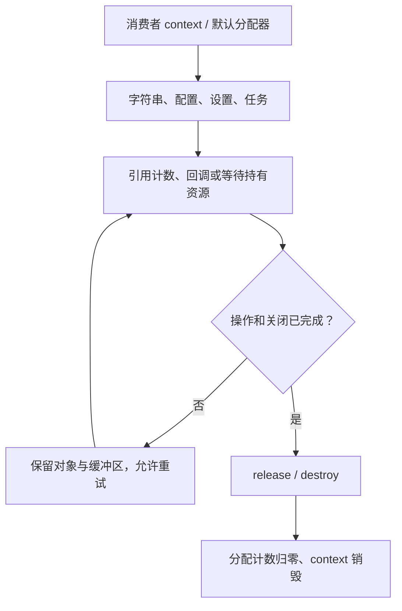
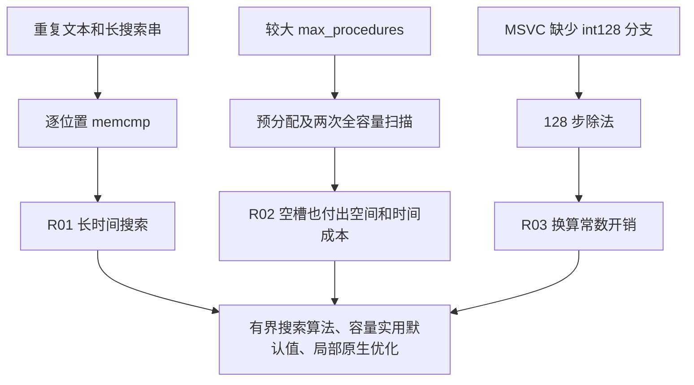

# hx_c_platform 性能与内存审查

本报告的测量属于所标明的源码基线。后续 C++ Result 迁移改变便利层存储和错误处理；旧测量及建议中的异常用例不能作为新版便利层证据。

[English](BUG_MEMORY_LEAK_AUDIT.md)

日期：2026-10-01。审查代码：`96c5490`，源码树与整理历史前的 `477a5c8` 相同。本轮结合代码审查、实际运行、分配跟踪和微基准；生产实现未修改，以下优化建议尚未实施。

## 1. 结论与风险总览

本轮覆盖的测试没有报告泄漏、越界、释放后使用或数据竞争。 Windows、WSL Linux 各执行 1,001 轮组合生命周期测试：105,105 次分配与 105,105 次释放配对，每轮结束追踪存活字节数均为零，context 均成功销毁。进程句柄/描述符计数保持稳定，Release 内存预热后稳定。这些结果只覆盖执行到的路径，不等于证明全部平台、输入和并发交错无问题。

确认两处随输入规模放大的性能问题，以及一处 Windows 算术优化机会。普通线程池及 C++ 层的分配成本也已量化，属于有明确功能代价的优化候选。内存池缓存、调用者持有的设置快照及关闭超时后的保留均有对应释放机制，本轮没有将它们误报为泄漏。

| ID | 严重程度 | 类别 / 位置 | 结论 | 是否解决 |
| --- | --- | --- | --- | --- |
| R01 | 🟡 Medium | 搜索 / `src/string.c:214` | 重复前缀使搜索接近 O(n×m) | 🔴 未解决 |
| R02 | 🟡 Medium | 分发 / `src/dispatch.c:265` | 调用扫描全部预留槽位，创建也预分配全部槽位 | 🔴 未解决 |
| R03 | 🟢 Low | 算术 / `src/wide.c:38` | MSVC 宽位除法逐位执行，存在专用路径优化空间 | 🔴 未解决 |
| R04 | 🔵 Info | 线程池 / `src/thread_pool.c:214` | C 每任务 4 次分配，本次 C++ 用例为 5 次 | ⚪ 不适用 |
| R05 | 🔵 Info | 时间 / `src/time.c:20` | Windows 短等待受原有 tick 时钟限制 | ⚪ 不适用 |
| R06 | 🔵 Info | 生命周期 / `src/base.c:379` | 已执行路径回收成功，缓存与存活对象已分开核查 | ⚪ 不适用 |

严重程度：🔴 Critical 为最高级内存破坏/可用性风险；🟠 High 为严重泄漏或稳定性风险；🟡 Medium 为特定输入/配置下的明显问题；🟢 Low 为较低影响的效率、兼容或诊断问题；🔵 Info 为观察、已知边界或正向证据。

状态：🔴 未解决表示尚无修复；🟡 处理中 / 部分解决表示处理或验证未完成； 🟢 已解决要求修复和验证证据；⚪ 不适用表示不要求缺陷修复。本次没有新确认的 Critical/High 问题，也没有把建议标记为已解决。

## 2. 数据与资源流转





<svg xmlns="http://www.w3.org/2000/svg" viewBox="0 0 860 155"
role="img" aria-label="区分用户存活、池缓存和检测器保留">
  <rect x="5" y="5" width="850" height="145" rx="10" fill="#f1f5f9"/>
  <g font-family="sans-serif" font-size="16" fill="#0f172a">
    <rect x="20" y="20" width="255" height="110" rx="8" fill="#bfdbfe"/>
    <text x="35" y="48">用户对象仍存活</text>
    <text x="35" y="78">release / destroy 后核对</text>
    <text x="35" y="108">本轮最终：0 字节</text>
    <rect x="300" y="20" width="255" height="110" rx="8" fill="#bbf7d0"/>
    <text x="315" y="48">内存池空闲缓存</text>
    <text x="315" y="78">collect 释放空页</text>
    <text x="315" y="108">destroy 释放剩余元数据</text>
    <rect x="580" y="20" width="255" height="110" rx="8" fill="#fde68a"/>
    <text x="595" y="48">ASan 隔离缓存 / 元数据</text>
    <text x="595" y="78">RSS 不等于用户存活内存</text>
    <text x="595" y="108">结合 LSan 与 Release 观察</text>
  </g>
</svg>

## 3. 详细发现

### R01 [🟡 Medium] 重复前缀搜索退化

**位置：** [hx_string_find](../src/string.c#L214)，尤其第 227 行开始的循环。

**触发条件：** 文本为 1 MiB 的 `a`，搜索串为 16、256、4096 字节，前面均为 `a`、末尾为 `b`，因此不存在匹配。文本长度保持不变。

**影响：** 长模式使每个候选位置重复比较大段前缀。 4096 字节模式单次搜索中位数为 Windows 107.01 ms、Linux 53.40 ms；同步用于 UI、串行解析或大量外部输入时会明显阻塞调用线程。本例没有内存破坏，也没有证据表明整个库都慢。

**证据与路径：** UTF-8 校验后，对每一个偏移调用 `memcmp`，未复用已知匹配前缀，也没有坏字符跳转或最坏复杂度保证。16 字节模式分别约 5.88 / 1.63 ms。 5 次有效样本中，4096 字节模式范围为 105.93..107.65 / 50.84..56.39 ms。

**修复建议：** 在共用字符串搜索边界采用成熟的最坏线性搜索方案，保留短模式快速路径；同时审查 replace_all/split 的查找辅助逻辑，避免各自重复实现。不要以引入每次堆分配或改变 UTF-8/字节偏移契约换取单个样本的改善。

**验证建议：** 覆盖随机文本、重复前缀、无匹配、嵌入 NUL、中文、补充平面字符和边界起点。固定 n 改变 m，再固定 m 改变 n，报告时间、分配和正确性。

### R02 [🟡 Medium] 命名过程按预留容量付费

**位置：** [槽位分配](../src/dispatch.c#L143)、 [计数扫描](../src/dispatch.c#L265)、[快照扫描](../src/dispatch.c#L285)。

**触发条件：** 始终只注册一个 `count` 过程，将 max_procedures 从 16 增加到默认 256、4096、65535。

**影响：** 没有增加实际函数数目，调用时间与内存仍明显增加。嵌入式应用若把容量设置得很大以防将来不足，会提前付出这笔成本。

**证据与路径：** 创建时一次性分配整个槽位数组；每次调用对全部槽位扫描两次，扫描在 handler 互斥锁下进行。唯一命名调用本身没有新增分配，这是正向结果。

| 预留容量 | Windows ns/调用 | Linux ns/调用 | Windows 追踪存活字节 |
| ---: | ---: | ---: | ---: |
| 16 | 155.52 | 198.29 | 3,098 |
| 256 | 304.40 | 397.58 | 43,418 |
| 4096 | 3,824.60 | 3,208.60 | 688,538 |
| 65535 | 263,419.90 | 278,489.74 | 11,010,290 |

存活字节包含 context、handler、槽位、同步对象和已注册绑定的库内开销，不包含 malloc 隐藏开销和审查分配器自己的前置头。关闭后全部释放。

**修复建议：** 当前调用者按真实规模设置 options。后续内部以名称索引定位活动槽位，并考虑按需分配；保留 generation、锁外回调、注销等待与重入约束。不能只提前跳出第一个扫描而破坏共享信号分发器的多订阅语义。

**验证建议：** 分别改变容量与活动数量；检查空查询、注销并重注册、并发调用、关闭竞争、分配失败和回调自身注销。记录锁等待，不用单线程结果代替竞争测试。

### R03 [🟢 Low] MSVC 宽位乘除仍用逐位算法

**位置：** [hx_os_u128_divide](../src/wide.c#L38)，第 64 行附近的 128 步循环。

**触发条件：** MSVC 构建不定义 `__SIZEOF_INT128__`，走可移植分支；基准为 `i * 1000000000 / 30000`，向下取整，100,000 次调用并核对校验值。

**影响：** 当前 Windows 中位数 202.37 ns/次，WSL GCC 为 10.15 ns/次。少量时间换算影响很小；频繁媒体时基换算时值得优化。

**证据与路径：** GCC 分支使用编译器 128 位运算；MSVC 回退每次执行 128 次移位/比较，即使乘积高半部为零。两平台编译器、运行环境不同，该差值不是同平台优化补丁的提速证据。5 轮范围分别为 200.39..223.04 / 9.02..12.59 ns。

**修复建议：** 先评估高半部为零时的直接除法，再评估 MSVC x64 原生乘除 intrinsic；保留旧工具链、Win32、ARM 的正确回退。不要先引入手写汇编。

**验证建议：** 使用同一 MSVC 构建做前后对照；覆盖完整 128 位商、除零、进位、余数、舍入溢出和输出不变契约。当前测试通过，不是算术正确性缺陷。

### R04 [🔵 Info] 线程池有可测的逐任务分配成本

**位置：** [任务分配](../src/thread_pool.c#L214)、 [event 的 mutex/condition](../src/thread.c#L56)、 [C++ prepare](../include/hx/ThreadPool.hpp#L366)。

**触发条件：** 一个工作线程，每批 128 个任务，共 16,384 个任务/样本。 C 执行空任务并等待批末；C++ 返回整数 42 并逐个 get 校验结果。

**影响：** C 每个任务固定 4 次分配：task、event、mutex、condition； C++ 此用例另分配一次 Work/结果状态，共 5 次。不是每个 event 都创建一个 Windows 内核事件，也不是 4 次系统调用；不能混淆分配和原生句柄。

**证据与路径：** C 每样本 65,536 次分配，Windows/Linux 累计请求字节分别 4,784,128 / 6,488,064，即 292 / 396 字节每任务，不表示同时存活这些内存。 C++ 每样本 81,920 次 context 分配；未计用户 callable 自行分配及 vector 本身的默认分配。所有任务和池释放后，追踪分配/释放配对。

| 无追踪器计时 | Windows ns/任务 | Linux ns/任务 |
| --- | ---: | ---: |
| C 空任务 | 625.52 | 705.53 |
| C++ 整数结果任务 | 688.21 | 813.79 |

以上是批处理吞吐平均成本，不是单个任务排队延迟，也不是公平的 C/C++ 抽象额外成本差值。二者结果处理不同。带原子计数的分配器会改变耗时，因此分开测量。

**修复建议：** 实际任务达到微秒以上时先测业务占比；若细粒度任务确有瓶颈，优先批量提交/合并工作，再评估任务内嵌同步存储或有界复用。保持 ABI、对齐、取消、超时、cleanup 恰好一次及结果比线程池活得更久的契约。

**验证建议：** 多生产者、1/多工作线程、取消、异常、OOM、延迟任务和关闭竞争。此处没有确认新的泄漏或队列正确性问题，也没有实施内存池性能实验。

### R05 [🔵 Info] Windows 精细等待有已知分辨率限制

**位置：** [单调时钟](../src/time.c#L20)、 [精细等待](../src/wait.c#L12)、[公开说明](../include/hx_os_wait.h#L7)。

**触发条件：** 默认 200 us 自旋预算，2 ms 截止时间，5 轮、每轮 30 次等待。

**影响：** Windows 每轮平均晚醒 13.09..13.48 ms；WSL 为 0.323..2.538 us，其中一次最晚 42.975 us。没有硬实时保证，也不能据此承诺 WSL 总是微秒精度。

**证据与路径：** Windows 为兼容原有时钟 epoch/排除 suspend 的语义，使用 tick 时钟；QPC 只限制自旋预算，无法消除之前已经发生的粗粒度睡眠晚醒。晚醒数字使用库截止时间时钟，本身也受其量化影响。

**修复建议：** 精确时序的消费者先按目标测量；未来若提供新 Windows 时钟后端，需处理动态可用能力、已有截止时间和睡眠恢复语义，不能直接混用两个时钟数值。当前文档已经说明这一边界，本项不是新发现的契约违反。

**验证建议：** 用独立 QPC 同时记录墙上经过时间、CPU 消耗和分位数，并覆盖 Win7 与新系统、空闲/忙载、休眠恢复。保持不修改全局计时器精度的已定边界。

### R06 [🔵 Info] 已执行生命周期路径回收正常

**位置：** [context 销毁](../src/base.c#L379)、 [内存池 collect](../src/memory_pool.c#L295)、 [arena reset](../src/arena.c#L176)、[request release](../src/loop.c#L100)。

**触发条件：** 重复分配与释放、解析成功/失败、设置快照保留与释放、线程池任务结果在池关闭后释放，以及内存池空页回收。

**影响：** 没有观察到存活分配累积、句柄持续增长或 context 无法正常销毁。

**证据与路径：** 1,001 轮每轮处理 UTF-8 字符串和拆分、JSON 解析/序列化及语法失败、设置更新与快照、命名调用、一个工作线程和 16 个任务。每轮 context_allocations 为零，destroy 成功，自定义分配器存活字节归零。 ASan/UBSan/LSan 同样通过该组合探针；不能把它扩展为所有模块均做了 1,001 轮。

**修复建议：** 保留现有所有权与可重试关闭规则；不要为降低 RSS 擅自提前释放回调、仍运行的线程、I/O 缓冲区或调用者持有的快照。

**验证建议：** 新增相关路径时继续检查故障注入和跨线程释放，真实目标补测见下表。

## 4. 内存与资源专项结果

| 观察 | Windows Release | WSL Linux Release |
| --- | ---: | ---: |
| 1,001 轮总分配 / 总释放 | 105,105 / 105,105 | 105,105 / 105,105 |
| 每轮末追踪存活字节 | 0 | 0 |
| 原生资源采样 | 125 个句柄，全程不变 | 6 个 fd，全程不变 |
| 第 100 / 1000 轮 RSS | 7,786,496 / 7,786,496 B | 2,838,528 / 2,838,528 B |
| 第 100 / 1000 轮 PrivateUsage | 1,478,656 / 1,478,656 B | 未测 |
| 内存池 free 后 reserved | 197,091 B | 197,195 B |
| 内存池 collect 后 reserved | 222 B | 254 B |

内存池探针分配并释放 1024 个 128 字节块；free 后 live_allocations 和 requested_bytes 均为零，collect 清除缓存页，destroy 再释放池元数据。这解释了 free 后 reserved 非零。RSS 与 reserved 衡量不同内容。 fd 采样包含探针临时打开的 `/proc` 观察文件以及继承描述符，只比较同轮系列。

ASan 默认配置下探针最终 RSS 约 105.7 MB；将隔离缓存限制为 1 MiB、线程本地隔离缓存限制为 64 KiB 后约 24.9 MB。两次存活分配仍为零、LSan 退出成功。这支持检测器保留会影响 RSS 的判断，但不将全部 RSS 归因于单一缓存。性能数字全部来自未启用检测器的 Release。

代码审查还检查了异步请求的回调引用、DNS 完成、进程捕获输出上限、TLS/profiler 清理、配置后端失败清理、设置旧根快照与内存池锁外释放。上下文销毁仍要求排除新操作并发进入；借用 user 指针仍由调用者管理。本轮不是操作系统句柄逐类型跟踪、长时间 soak 或所有 OOM 点穷举。

## 5. 建议处理顺序

1. R01：共用搜索算法，先用重复前缀回归证明复杂度改善和短模式不回退。
2. R02：命名过程名称索引/活动槽位遍历，再评估按需容量；保留共享信号语义。
3. R03：MSVC 本机的宽位快路径，旧平台正确回退。
4. R04：在真实消费者负载证明逐任务分配占比后，再做布局或复用优化。
5. R05：作为目标平台时序能力设计单独处理，不暗改已有时钟契约。

以上均为后续建议，本轮只提交审查文档。hx_c_log 尚未接入，不能据此声明其 Windows/WSL 锁定原版五倍、且单线程不回退的性能门槛已满足。

## 6. 本轮测试矩阵与复现

主机：i5-12490F，Windows 11 build 26200，MSVC 19.40、`/O2`； WSL2 内核 6.18.40.1，Ubuntu GCC 15.2、`-O3`。两套性能构建为 x64 共享库。未锁频、未绑核，WSL 与宿主共享机器；结果是本机观察，不是平台排名或 SLA。

| 检查 | 本轮结果 | 边界 |
| --- | --- | --- |
| Windows Release 全量 CTest | 82/82 | 含 C/C++、资源与关闭测试 |
| WSL Release 全量 CTest | 84/84 | 多两项原生随机源故障验证 |
| WSL ASan + UBSan + LSan | 84/84 | `detect_leaks=1`，无报告 |
| WSL TSan | 84/84 | 无报告，不穷举线程调度 |
| 组合生命周期探针 | Windows / Linux / ASan 均通过 | 每配置 1,001 轮 |
| C/C++ 池与扩容性能探针 | 两主机通过 | 6 样本，首样本预热，余下取中位数 |
| 公共 ABI / 第三方源码 | 本轮未改 | 未因文档改动重复完整 ABI 矩阵 |
| Android 模拟器 | 本轮未补做内存专项 | 既有 API 34 运行记录见验证文档 |
| macOS、Win7、ARM 真机、musl | 待目标环境验证 | 不借用 Windows/WSL 结果宣称通过 |

ASan/TSan 构建启用了已接入的第三方解析后端；库及测试按对应 sanitizer 编译。 GCC TSan 对独立 fence 的建模限制仍存在，原子测试使用相应原子发布/获取关系，没有据此声称任意 fence 同步模式均获得检测器证明。Valgrind 未安装，本轮未使用。

复用已有构建的基础命令：

```powershell
cmake --build build-shared-msvc --config Release --parallel 8
ctest --test-dir build-shared-msvc -C Release --output-on-failure
```

```sh
cmake --build build-shared-linux --parallel 8
ctest --test-dir build-shared-linux --output-on-failure
ASAN_OPTIONS=detect_leaks=1:halt_on_error=1 \
LSAN_OPTIONS=exitcode=23 \
ctest --test-dir build-parsers-asan --output-on-failure
TSAN_OPTIONS=halt_on_error=1 \
ctest --test-dir build-tsan-linux --output-on-failure
```

新增本地探针、CMake 工程、汇总与原始日志保留于被忽略的 `build-audit/`，不作为正式源码或持续集成套件提交；克隆仓库不会自动包含它们。审查机器上的 [C 探针](../build-audit/audit_probe.c)、 [C++ 探针](../build-audit/audit_cpp.cpp) 与 [汇总 JSON](../build-audit/measurements.json) 可继续复现。先将库安装到工作区内前缀，再通过 find_package 构建该本地工程；运行 `audit_probe memory`、`audit_probe performance`、`audit_cpp`。 Windows 需要安装前缀的 bin 在进程 PATH 中。Linux 使用生成的运行路径。

微基准设置：过程容量为 16/256/4096/65535，前三组每样本 10,000 调用，最后一组 1,000；字符串每样本搜索 5 次；池每样本 128×128 个任务。另有现有 `hx_os_portable_baseline` 的 5 次独立执行用于宽位与等待测量。 Windows 使用 QPC 测经过时间，Linux 使用单调时钟。验证返回值与结果，防止无效工作被优化掉。测量跟踪器与无跟踪器分别运行。

原始记录：`build-audit/{msvc,linux,tsan}-test.log`、 `build-parsers-asan/audit-test.log`、`memory-*.log`、`performance-*.log`、 `cpp-*.log`、`baseline-*.log`。报告中的结果不依赖远程 CI 声明。

## 7. 后续修复最小验收

- 每项修改给出同平台、同负载前后数据；不以尺寸减少代替吞吐/延迟证据。
- 无匹配复杂输入、较大容量和普通短输入同时测试；记录分配、锁和资源持有。
- 现有 C99/C++11、静态/共享、安装消费、ABI 与模块开关检查按影响范围通过。
- 对应回归用例在 ASan/UBSan/LSan、相关并发用例在 TSan 下通过。
- 关闭超时可重试、不杀线程、输出与结果所有权、第三方只读边界保持有效。
- 未实测平台继续标注待验证。

## 8. Git 整理结果

按已确认选择，`main` 更名为 `master`，并将其从初始基线快进到当前验证代码； `master` 与新建 `dev` 都以 `96c5490` 起步，后续审查文档提交在 `dev`。 `codex/obs-platform-completion` 同步到同一新版历史。未配置远程，也未推送。

最初提交改为 `chore: 初始化源码`，其余 29 条主题已简短，保留原意。当前 master 的 30 条提交均无长正文，最长主题 24 个字符。逐项核对 30 个新旧提交的源码树、作者/提交者身份及时间完全相同；仅根说明和由父提交变化导致的散列改变。

旧 tip `477a5c8` 保留在 `backup/pre-audit-20261001`；更早的 `backup/pre-message-cleanup-20261001` 也保留。根提交由 `7cf52fc` 变为 `b6c0a6b`，完整映射在本地 `build-audit/history-map.json`。历史验证文档中的旧散列仍能通过备份访问，无源码丢失。
