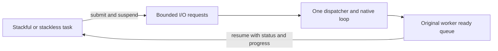
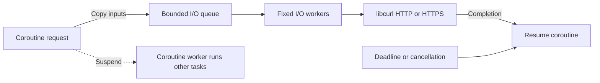

# Cooperative coroutines

[简体中文](COROUTINES.zh-CN.md) · [README](../README.md)

Use the cooperative coroutine module when you want to run many concurrent tasks waiting on channels, timers, or asynchronous network I/O without dedicating an OS thread to every task. When a coroutine waits on a channel, timer, or coroutine I/O operation, it suspends and yields its underlying worker thread so other ready tasks can run.

### Quick Start: Run Your First Coroutine Program

Start with the complete C++11 program [go.cpp](../examples/go.cpp), which computes `42` inside a background coroutine and sends the answer back to the main thread over a channel.

From the repository root after completing the [example setup](../examples/README.md#run), build and run `hx_os_go` (replace `build` with your build directory; for Debug builds, change `Release` to `Debug` in both the build command and executable path):

```sh
cmake --build build --config Release --target hx_os_go
```

Windows with Visual Studio:

```powershell
.\build\bin\Release\hx_os_go.exe
```

Linux / WSL:

```sh
./build/bin/hx_os_go
```

No arguments, external files, or manually created threads are required. The program prints `Answer: 42` and exits. Internally, `go.cpp` performs these steps:

| Step | Purpose |
| --- | --- |
| `Runtime::create(owner)` | Creates the coroutine runtime and its managed worker threads |
| `Scope::enter(runtime)` | Binds the current host thread so subsequent `go` statements know which runtime to target |
| `co_chan<int> answers(1)` | Creates a buffered channel with capacity `1` so the task can store `42` before exiting |
| `go ...` | Submits an ordinary lambda as a stackful coroutine owned and reclaimed by the runtime |
| `waitUntil(...)` | Waits on the main thread for active tasks to finish and checks submission/execution errors |
| `receive(HX_OS_DEADLINE_NOW)` | Reads the buffered integer from the channel and prints it |
| `shutdownUntil(...)` | Closes the runtime and waits for its worker threads to exit cleanly |

The short snippets below focus on individual APIs. When starting a new project, copy the full [go.cpp](../examples/go.cpp) as your `main.cpp` and link it using the [minimal C++ project](USAGE.md#cpp-project) setup. Section 8 lists all runnable C99, C++11, and C++20 example targets.

## 1. Choose a calling style

This library implements its own coroutine scheduler, queues, timers, channel/`select` engine, and lifetime management. It uses native OS fibers on Windows and a first-party CPU context switch on POSIX—without depending on `minicoro`, `Boost.Context`, or any third-party coroutine library.

Choose the style that fits your language standard and memory model:

| Style | How to start work | How to wait | Where state lives across suspensions |
| --- | --- | --- | --- |
| **C99 stackful** | `hx_os_coro_spawn(..., HX_OS_CORO_STACKFUL, ...)` | Ordinary function calls (including nested functions) | The coroutine's fixed-size private stack |
| **C++11 stackful** | `runtime.spawn(function, arguments...)` or optional `go lambda;` | `hx::coro::sleepFor`, `channel.receive`, `Stream` methods | Ordinary local variables with full C++ RAII |
| **C99 / C++11 stackless** | `HX_OS_CORO_STACKLESS` callback | Repeat the operation after `HX_OS_WOULD_BLOCK` (with optional state-machine macros) | Caller-owned persistent state struct |
| **Optional C++20 stackless** | `runtime.go(namedCoroutine(arguments))` | `co_await hx::coro::async::...` | Compiler-generated coroutine frame |

> [!NOTE]
> **Cooperative scheduling boundary**
> Coroutine sleep, channel waits, coroutine synchronization primitives, and library coroutine I/O suspend the coroutine and free its worker thread for other tasks. Long CPU-bound loops must call `yield` periodically. Ordinary blocking file I/O, OS mutex waits, or blocking third-party SDK calls still block the underlying worker thread. All C++11 functions and callbacks remain exception-free and return `hx::Result<T>`.

## 2. Ordinary C++11 tasks without task handles

Create the runtime once as shown in [go.cpp](../examples/go.cpp). If you want `libgo`-style syntax, include `hx/GoKeywords.hpp` **after** all other headers and enter a `Scope` on the host thread:

```cpp
auto scope = hx::coro::Scope::enter(runtime);
if (!scope)
	return hx::Failure(scope.error());

co_chan<int> answers(1);
if (!answers)
	return hx::Failure(answers.error());

go [answers]() noexcept { return answers << 6 * 7; };

auto done = runtime.waitUntil(hx_os_deadline_after_ms(2000));
if (!done)
	return done;

auto answer = answers.receive(HX_OS_DEADLINE_NOW);
```

- **Automatic task management**: `go` submits a task that the runtime retains through execution and cleanup—you do not need to hold a `Task` handle or create a task group for fire-and-forget work.
- **Why does `answers` use capacity `1` here?** Because the main thread calls `runtime.waitUntil()` before calling `receive()`. With capacity `0` (an unbuffered rendezvous channel), the sender would wait for a receiver while the main thread waits for the sender to finish. For an unbuffered channel, either run a concurrent receiver coroutine or call `receive()` on the main thread before `waitUntil()`.
- **Using explicit macros or methods instead of global keywords**: If you prefer not to define the `go` keyword macro, include `hx/Go.hpp` and use `hx_go(runtime) lambda;`, `hx_go_here lambda;`, or the regular method `runtime.spawn(function, args...)`. When `hx/GoKeywords.hpp` is included, it also provides `co_chan<T>`, `co_sleep(milliseconds)`, and (outside C++20) `co_yield`; use `.submit()` instead of `.go()` when you need a typed `Task<T>` handle.
- **`Scope` lifetime rules**: `Scope` selects an existing runtime for the current host thread without creating threads or a global singleton. Nested scopes must close in LIFO order on the same host thread that created them. Inside a running coroutine, `go` automatically inherits that coroutine's runtime.
- **Error tracking and `waitUntil()`**: Managed tasks may return `void` or `Result<void>` (return the `Result` from the callback if you want failures recorded by the runtime). The runtime stores the first complete `hx_os_error` along with a saturating failure count; inspect it with `runtime.errors()` or read-and-clear with `runtime.errors(true)`. `runtime.waitUntil()` waits until the runtime becomes idle and then returns the first recorded failure without clearing it (use `Group` in Section 10 when you need isolated batch waiting).

Always create and shut down the runtime through an explicit host-owned `owner` pointer:

```cpp
hx_os_coro_runtime *owner = NULL;

auto created = hx::coro::Runtime::create(owner);
if (!created) {
	auto closed = hx::coro::Runtime(owner).shutdownUntil(
		hx_os_deadline_after_ms(2000));
	return closed ? 1 : 2;
}

auto &runtime = created.value();
```

`hx::coro::Runtime` is a non-owning view whose destructor never blocks. Call `runtime.shutdownUntil(deadline)` before teardown; if it returns `HX_OS_TIMEOUT`, `HX_OS_BUSY`, or `HX_OS_NOT_SUPPORTED`, keep `owner`, borrowed captures, the allocator `context`, and loaded plugins alive and retry shutdown according to your host policy.

## 3. C++20 without a private stack

When building with a C++20 compiler, include `hx/Coroutines20.hpp` and link the optional `hx_c_platform::cpp20` target (the core library remains C99, and other targets can stay on C++11):

```cpp
hx::coro::Routine<int> answer()
{
	auto waited = co_await hx::coro::async::sleepFor(
		std::chrono::milliseconds(10));
	if (!waited)
		co_return hx::Result<int>(hx::Failure(waited.error()));

	co_return 42;
}

// After creating runtime:
auto task = runtime.go(answer());
```

[The complete C++20 program](../examples/coroutine20.cpp) prints `Answer: 42`. `Routine<>` represents a `void` coroutine and finishes with `co_return hx::Result<void>();`. Write an explicit result on every exit path, including success. A bare `co_return` requires a different promise, and falling off the end has undefined behavior.
- **Frame allocation**: Compiler coroutine frames allocate through the default C allocator (`runtime.go()` returns `HX_OS_NO_MEMORY` if frame allocation fails), while scheduler structures and result slots use the runtime's `context`.
- **Prefer named coroutine functions with value arguments**: Always invoke `runtime.go(namedFunction(args...))` and pass inputs by value. Avoid temporary capturing coroutine lambdas, because the temporary closure object may be destroyed at the first suspension point while the compiler frame still references `this`.

## 4. Send and receive values

`Channel<int>::create(runtime)` creates an unbuffered rendezvous channel (capacity `0`) where each send waits for a matching receiver; pass a positive capacity to create a bounded buffered channel. Both native host threads and coroutines can send and receive on the same channel (host threads block while coroutines suspend; `HX_OS_DEADLINE_NOW` is always nonblocking).

```cpp
auto created = hx::coro::Channel<int>::create(runtime, 8);
if (!created)
	return 1;

auto channel = created.value();

auto producer = runtime.go([channel]() noexcept {
	auto sent = channel.send(42);
	if (!sent)
		return sent;
	return channel.close();
});

auto consumer = runtime.go([channel]() noexcept {
	return channel.receive();
});
```

- **Close and drain**: Calling `channel.close()` rejects subsequent sends with `HX_OS_CLOSED`, while values already in the buffer remain readable until drained, after which receivers get `HX_OS_EOF`. Remaining buffered values are dropped when the final channel reference (including any suspended operation) is released.
- **Plain values and resource-owning objects**:
  - C++ `Channel<T>` supports both trivially copyable values and resource-owning C++ types (such as `hx::String`) that have `noexcept` move constructors and destructors. Resource-owning C++ objects are transported in stable reference-counted boxes charged to the runtime's channel-byte budget so self-pointers remain valid across moves. Stream operators `channel << value` and `channel >> output` are also available.
  - The C channel API supports container `copy`/`drop` callbacks for owning `hx_string`, `hx_variant`, or custom C structs.
- **C++20 channel awaiters**: C++20 coroutines use the exact same `Channel<T>` with `co_await`:

```cpp
auto sent = co_await hx::coro::async::send(channel, 42);

auto received = co_await hx::coro::async::receive(channel);
```

- **Multi-channel `select`**: Use `hx_os_coro_select`, C++11 `hx::coro::select`, or C++20 `co_await hx::coro::async::select` inside a coroutine to wait on up to `64` send/receive cases simultaneously. Exactly one ready case commits per call (the starting inspection index rotates across calls). `HX_OS_DEADLINE_NOW` returns `HX_OS_WOULD_BLOCK` if no case can commit immediately; expired finite deadlines return `HX_OS_TIMEOUT`. The `selected` output index is valid when the chosen branch returns `HX_OS_OK`, `HX_OS_EOF`, or `HX_OS_CLOSED`.

## 5. C99 state machines

For pure C99 or memory-constrained builds without private coroutine stacks, use stackless state-machine callbacks. [The complete C program](../examples/coroutine.c) prints `Count: 1`, `Count: 2`, `Count: 3`:

```c
typedef struct counter_state {
	int step;
	int value;
} counter_state;

static hx_os_status count(hx_os_coro *self, void *user, hx_os_error *error)
{
	counter_state *state = user;
	hx_os_status status;

	(void)self;
	HX_OS_CORO_BEGIN(state->step);

	for (state->value = 1; state->value <= 3; ++state->value) {
		HX_OS_CORO_AWAIT(state->step, status, hx_os_coro_yield(error));
		if (status != HX_OS_OK)
			return hx_os_coro_complete(status, error);

		printf("Count: %d\n", state->value);
	}

	HX_OS_CORO_END(state->step);

	return HX_OS_OK;
}
```

- **Store cross-suspension variables in `user` state**: Initialize `step = 0` and keep all variables or buffers that must survive suspension inside your persistent state struct rather than stack locals.
- **Macro rules**: Place each `HX_OS_CORO_AWAIT` on its own line. Because the macros expand to a `switch`/`case` statement, do not jump across variable-length array (VLA) declarations or nest them inside another `switch`. Use `hx_os_coro_complete(status, error)` when returning a terminal error so the scheduler can distinguish a terminal `HX_OS_WOULD_BLOCK` error from a suspension request.
- **Avoid busy-spinning**: Returning `HX_OS_WOULD_BLOCK` without registering a wait (such as sleep, channel, sync, or I/O) immediately requeues the coroutine onto its worker's ready queue and will spin a CPU core if repeated in a tight loop.

## 6. Network and pipe I/O

Coroutine I/O integrates sockets and pipes with a dedicated event-loop dispatcher:
- **C API**: `hx_os_coro_listen`, `hx_os_coro_dial`, `hx_os_coro_accept`, `hx_os_coro_read`, `hx_os_coro_write`, `hx_os_coro_resolve`, and `hx_os_coro_pipe_pair`.
- **C++11 API**: `Stream::dial`, `Stream::listen`, `stream.accept()` / `read()` / `write()`, `Stream::pipePair`, and `Addresses::resolve`.
- **C++20 API**: `hx::coro::async::listen` / `dial` / `accept` / `read` / `write` / `pipePair` / `resolve` awaiters.



All native socket and pipe operations run on the runtime's I/O dispatcher thread:
- A socket `Stream` supports one concurrent read and one concurrent write across runtime workers (conflicting operations return `HX_OS_BUSY`); a pipe endpoint accepts one operation at a time.
- Reads return as soon as bytes are available or on `HX_OS_EOF`; writes attempt the entire buffer and preserve partial byte progress via `Result<size_t>` (`hasValue()`) on failure.
- Caller buffers remain borrowed until the underlying native I/O operation retires; even on cancellation or timeout, the coroutine resumes only after the native completion callback finishes, preventing premature buffer reuse.

### 6.1 Receive UDP without blocking a worker

Call `hx_os_coro_udp_bind` (or C++11 `Stream::bindUdp`) to bind a local UDP address and obtain a retained `hx_os_coro_stream` handle (passing port `0` selects an ephemeral port and writes the actual address to `bound`). Then call `hx_os_coro_send_to` and `hx_os_coro_receive_from` (C++11 `sendTo` and `receiveFrom`) inside a coroutine to send and receive datagrams without blocking the worker thread.

Build and run the complete C99 state-machine example [coroutine_udp.c](../examples/coroutine_udp.c) (requires examples, `HX_OS_ENABLE_NETWORK`, `HX_OS_ENABLE_LOOP`, `HX_OS_ENABLE_COROUTINES`, and `HX_OS_ENABLE_COROUTINE_IO`):

```sh
cmake --build build --config Release --target hx_os_coroutine_udp
```

Run `./build/bin/hx_os_coroutine_udp` on Linux/WSL or `.\build\bin\Release\hx_os_coroutine_udp.exe` on Windows with Visual Studio. Expected output:

```text
UDP JSON: {"type":"status","device_id":7}
```

Each receive consumes one UDP datagram. An empty datagram succeeds with `HX_OS_OK` and `0` bytes (not `HX_OS_EOF`). If the receive buffer is smaller than the datagram, the call returns `HX_OS_LIMIT` along with the copied byte count and sender address, discarding the remaining bytes of that datagram (never parse a truncated prefix as a complete JSON message).

## 7. Bounds, cancellation and lifetime

| Setting or operation | Default and contract |
| --- | --- |
| Default workers | `2`, fixed at creation; no hidden global runtime |
| `max_coroutines` | `1,024` live handles (including completed tasks whose handles are still retained) |
| Stackful stack budget | `128 KiB` usable stack per coroutine; `64 MiB` aggregate reservation budget (including guard pages and OS page rounding) |
| Channels and coroutine sync objects | Shared `128`-object limit; shared `16 MiB` budget for objects, buffers, waiters, and owning boxes |
| Coroutine I/O budget | `1,024` stream wrappers; `16 MiB` native loop request/byte budget; `1` dispatcher thread |
| `max_io_handles = 0` | CPU/channel-only runtime without an I/O dispatcher thread or network initialization |
| DNS resolution | Shared bounded resolver pool; `resolve` uses system DNS, `resolve_cancellable` cancels `c-ares` queries |
| `cancel` | Sets the cooperative cancellation flag and wakes/cancels active waits; never kills threads or unwinds C++ stacks |
| `wait_until` | Blocks native callers and suspends coroutine callers; waiting on oneself returns `HX_OS_DEADLOCK`, cross-runtime coroutine wait returns `HX_OS_NOT_SUPPORTED` |
| `drain_until` | Rejects new tasks and lets accepted tasks finish (a subsequent `close_until` can escalate to cancellation) |
| `close_until` | Rejects new tasks, cancels accepted tasks, and waits/joins workers within the caller's monotonic deadline |
| `destroy` | Requires a prior successful close; otherwise returns `HX_OS_BUSY` and preserves `owner` |

> [!WARNING]
> **Thread-local storage (TLS) and native mutex rules**
> - **Coroutines stay pinned to their worker**: Child coroutines spawned from a coroutine inherit the same worker thread, while native-thread submissions use round-robin assignment; there is no cross-worker migration.
> - **OS TLS is not coroutine-local**: On POSIX, all coroutines sharing a worker thread share the same OS TLS; on Windows, FLS follows native fibers. Use `hx::coro::Local<T>` (or the C local-key API in Section 9) for portable coroutine-local storage.
> - **Never hold an OS mutex across a suspension point**: Suspending a coroutine while holding a native `hx_os_mutex` can deadlock the worker thread if another coroutine scheduled onto that same worker tries to acquire the same native lock. Use coroutine synchronization primitives (Section 9) instead.

If runtime creation (or coroutine HTTP service creation) fails and worker/I/O rollback cannot finish within the deadline, the factory returns an error with a non-NULL closing `owner`. Do not submit tasks; retry cleanup via `hx::coro::Runtime(owner).shutdownUntil(deadline)` until it succeeds (see [shared lifetime rules](CONTRACTS.md#shared-rules)).

## 8. Build, trim and verify

You can build and run any individual example target below without command-line arguments or input files:

| Target | Complete source | Expected output |
| --- | --- | --- |
| `hx_os_go` | [go.cpp](../examples/go.cpp) | C++11 channel example printing `Answer: 42` |
| `hx_os_cpp_coroutine` | [coroutine.cpp](../examples/coroutine.cpp) | C++11 `Task<int>` example printing `Answer: 42` |
| `hx_os_coroutine` | [coroutine.c](../examples/coroutine.c) | C99 stackless state machine printing `Count: 1`, `Count: 2`, `Count: 3` |
| `hx_os_coroutine_udp` | [coroutine_udp.c](../examples/coroutine_udp.c) | C99 coroutine sending and receiving a JSON UDP datagram |
| `hx_os_cpp_coroutine20` | [coroutine20.cpp](../examples/coroutine20.cpp) | C++20 `co_await` example printing `Answer: 42` |

When examples are enabled, CMake probes `<coroutine>` (`HX_OS_HAVE_CPP20_COROUTINES`) and defines `hx_os_cpp_coroutine20` automatically when supported; the C99 and C++11 examples do not require C++20.

In an installed consumer project, link the target that matches your language level:

```cmake
find_package(hx_c_platform CONFIG REQUIRED)

target_link_libraries(my_c_app PRIVATE hx_c_platform::hx_c_platform)
target_link_libraries(my_cpp11_app PRIVATE hx_c_platform::cpp)
target_link_libraries(my_cpp20_app PRIVATE hx_c_platform::cpp20)
```

`HX_OS_ENABLE_COROUTINES`, `HX_OS_ENABLE_STACKFUL_COROUTINES`, and `HX_OS_ENABLE_COROUTINE_IO` default to `ON`:
- Disabling `HX_OS_ENABLE_STACKFUL_COROUTINES` keeps C99 state machines and C++20 stackless coroutines available.
- POSIX stackful context switching includes `x86_64`, `i386/SSE`, `ARMv7/VFP`, and `AArch64` backends. On Linux x86 systems with hardware shadow stacks enabled (see the [Linux kernel interface](https://www.kernel.org/doc/html/latest/arch/x86/shstk.html)), stackful entry points detect active shadow stacks and return `HX_OS_NOT_SUPPORTED` without weakening host protection. See [platform support](PLATFORMS.md) for target details.

## 9. Coroutine synchronization and local values

Include `hx/CoroutineSync.hpp` (or `hx_os_coroutine.h` in C) for synchronization primitives that suspend contending coroutines instead of blocking worker threads:

| Primitive | Factory and contract |
| --- | --- |
| **Mutex (`Mutex`)** | `Mutex::create(runtime)`. Nonrecursive; ownership tracks coroutine identity or native thread. Relocking from the same owner returns `HX_OS_DEADLOCK`. `acquireUntil` returns an RAII `Lock`. |
| **Semaphore (`Semaphore`)** | `Semaphore::create(runtime, initial, maximum)`. Bounded count; posting past `maximum` returns `HX_OS_LIMIT` without modifying the count. |
| **Event (`Event`)** | `Event::create(runtime, manualReset, initiallySet)`. Manual-reset wakes all waiters and stays set; auto-reset wakes a single waiter. |
| **Read/write lock (`RwLock`)** | `RwLock::create(runtime)`. Concurrent readers or one exclusive writer; queued writers block new readers. No recursive read locking or read-to-write upgrade. |
| **Condition variable (`Condition`)** | `Condition::create(runtime)`. Atomically releases the caller's held coroutine mutex while waiting; recheck your predicate in a loop upon waking. |

> [!IMPORTANT]
> **Condition waits always reacquire the mutex before returning, and task exit never auto-unlocks**
> - **Mutex reacquisition guarantee**: A `Condition` wait **always reacquires its mutex before returning**, including on timeout, cancellation, or condition close. Because reacquisition waits for the current lock holder and cannot be skipped, the caller is guaranteed to hold the lock on return and must unlock it before finishing.
> - **Unlock before exiting a coroutine**: Coroutine exit does **not** automatically unlock a held `Mutex` or `RwLock` (auto-unlocking would expose partially mutated state). Ensure every C exit path unlocks acquired locks, and keep C++ RAII `Lock` guards inside the acquiring coroutine so they unlock before the coroutine completes.

C++20 provides matching awaiters: `async::acquire(mutex)`, `async::wait(event/semaphore)`, `async::readLock(lock)` / `async::writeLock(lock)`, and `async::wait(condition, guard)`.

**Coroutine-local storage (`Local<T>`)**: Call `Local<T>::create(context)` to allocate a key (copies of the wrapper share the same key). `set(value)` stores a coroutine-owned value, `get()` borrows a pointer to the current coroutine's value, and `clear()` destroys it. Different coroutines on the same worker thread see independent values, and each stored value is destroyed once on replacement or coroutine exit (up to `64` local slots are shared between application keys and internal profiler state; native host threads do not have coroutine-local slots).

## 10. Optional groups and results

- **Bounded task batches (`Group`)**: `Group group(runtime, capacity)` collects a bounded batch of `void` / `Result<void>` tasks. Launch work with `group.spawn(...)`, wait with `group.waitUntil(deadline)` to consume completed entries and inspect the first recorded error, or call `group.cancel()` to request cooperative cancellation. `Group` is operated serially by a single caller and does not block or cancel in its destructor.
- **Typed return values (`Task<T>`)**: Call `runtime.submit(function, args...)` when you need a `Task<T>` handle, and retrieve the outcome via `Task<T>::getUntil(deadline)` (see the complete [C++11](../examples/coroutine.cpp) and [C++20](../examples/coroutine20.cpp) typed examples).

## 11. Suspend while TLS or HTTP is waiting

- **Coroutine TLS operations**: For an existing TLS session `owner`, replace synchronous readiness, send, receive, and flush calls with `hx_os_coro_tls_wait_ready`, `hx_os_coro_tls_send_until`, `hx_os_coro_tls_receive_until`, or `hx_os_coro_tls_flush_until` (or use the borrowed `hx::coro::Tls` facade in `<hx/CoroutineNetwork.hpp>` from C++11 stackful coroutines). These register directly with the TLS owner's worker without adding polling threads (see [TLS](TLS.md) for certificate trust and profiles).
- **Coroutine HTTP client**: Create an explicit `hx_os_coro_http` service backed by a dedicated bounded I/O pool (defaulting to `2` worker threads, `16` in-flight requests, and a `64 MiB` admission budget for copied request/response payloads):



Run the complete C99 state-machine example [coroutine_http.c](../examples/coroutine_http.c):

```sh
cmake --build build --config Release --target hx_os_coroutine_http
# Start the local HTTP server described in HTTP_FILES.md first.
build/bin/hx_os_coroutine_http http://127.0.0.1:8080/hello.txt
```

On Visual Studio, run `build/bin/Release/hx_os_coroutine_http.exe`. When `hello.txt` contains `hello`, the program prints `HTTP 200` followed by `hello`. Inside a stackful coroutine, a GET request is a single `hx_os_coro_http_get(service, url, NULL, &response, &error)` call (or `hx::coro::Http(service).get(url, response)` in C++11). Always close the HTTP service from a host thread with `close_until` before closing the coroutine runtime (see [HTTP transfers](HTTP_FILES.md) for streaming file downloads).

When DNS resolution itself must respond to cancellation while waiting for an unresponsive server, use `hx_os_coro_resolve_cancellable` (`Addresses::resolveCancellable` in C++11, `async::resolveCancellable` in C++20; see the `--coro` mode in the [DNS example](NETWORK_OPTIONS.md#123-use-an-event-loop-or-coroutine)). For coroutine HTTP requests, link a `c-ares`-enabled `libcurl` SDK and enable `hx_os_coro_http_use_cancellable_dns` before submitting requests (see [HTTP configuration](HTTP_FILES.md#4-cancel-even-when-dns-receives-no-reply)).
