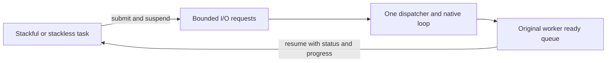

# Cooperative coroutines

[简体中文](COROUTINES.zh-CN.md) · [README](../README.md)

## 1. Choose a calling style

A coroutine is a task that can pause while waiting and let its worker run another task. This library owns its scheduler, queues, timers, channel/select logic and lifetime rules. It uses Windows fibers as an operating-system primitive and its own CPU context switch on POSIX. It does not use minicoro, Boost.Context or another coroutine library.

| Style | Start work | Wait | Values across a wait |
| --- | --- | --- | --- |
| C99 stackful | `hx_os_coro_spawn(..., HX_OS_CORO_STACKFUL, ...)` | Ordinary calls, including nested functions | Remain on the coroutine's fixed stack |
| C++11 stackful | `runtime.spawn(function, arguments...)` or optional `go lambda;` | `hx::coro::sleepFor`, `channel.receive`, stream methods | Ordinary local variables and RAII |
| C99/C++11 stackless | `HX_OS_CORO_STACKLESS` callback | Repeat an operation after `WOULD_BLOCK`; optional state macros | Put them in persistent user state |
| Optional C++20 stackless | `runtime.go(namedCoroutine(arguments))` | `co_await hx::coro::async::...` | Compiler-generated frame |

This is cooperative scheduling. Sleep, channel waits, task waits and library coroutine I/O release the worker. A long computation must periodically call `yield`. A normal blocking file call, mutex wait or third-party blocking function still occupies that worker. There is no system-call interception, preemptive interruption, garbage collector, growing stack or Go language keyword. C++11 functions and callbacks remain exception-free; they return `Result<T>`.

## 2. Ordinary C++11 tasks without task handles

Create the runtime once, as in [go.cpp](../examples/go.cpp). Include `hx/GoKeywords.hpp` **last** to opt into libgo-like spelling. Then enter a scope on the native host thread:

```cpp
auto scope = hx::coro::Scope::enter(runtime);
if (!scope)
	return hx::Failure(scope.error());

co_chan<int> answers(1);
if (!answers)
	return hx::Failure(answers.error());

go [answers]() noexcept { return answers << 6 * 7; };

auto done = runtime.waitUntil(hx_os_deadline_after_ms(2000));
if (!done)
	return done;

auto answer = answers.receive(HX_OS_DEADLINE_NOW);
```

This excerpt belongs in a function returning `Result<void>`. `go` submits a task, the runtime retains it through cleanup, and the task sends 42 to a buffered channel. No per-task handle or task group is required. `done` checks completion and the runtime's stored task errors; check `answer` before reading `answer.value()`. The complete program prints `Answer: 42` and demonstrates creation and explicit shutdown.

`Scope` selects an existing runtime; it does not create workers or a global singleton. Bindings nest in LIFO order and must close on their creating native thread. They retain the runtime but do not stop it. Never move a scope to another thread or destroy outer bindings first. Inside a coroutine, `go` automatically uses that coroutine's runtime. With no scope/current coroutine, submission returns an error, and there is no runtime in which to retain it; do not discard that result.

Without global keyword macros, include `hx/Go.hpp` and use `hx_go(runtime) lambda;` or `hx_go_here lambda;`. `runtime.spawn(function, args...)` offers the same ownership using a regular method. The optional keyword header also defines `co_chan<T>`, `co_sleep(milliseconds)` and, outside C++20, `co_yield`. These are C++ helpers, not new language keywords. `go` is a macro and can collide with unrelated identifiers, including the old `.go()` method; use `.submit()` for typed tasks when opting in.

Ordinary tasks may return void or `Result<void>`. Return an operation's failure from the task if it should appear in the runtime report; ignoring an error inside a void callback cannot make it observable. Non-void values from ordinary spawn are discarded after cleanup; use `runtime.submit(...)` to obtain `Task<T>` when a value is needed. The existing `runtime.go(...)` contract is preserved for code that does not enable the keyword header.

Admission failures and terminal task failures are stored as the first complete `hx_os_error` plus a saturating count. `runtime.errors()` reads the snapshot; `runtime.errors(true)` reads and clears it. This bounded record is not an unlimited error queue. `waitUntil` waits for idle and then reports the first recorded failure without clearing it; later waits continue to report it until cleared. It does not reject new submissions or wait only for a frozen batch. Stop external producers before using idle as a completion boundary; tasks already running may submit children. A timeout leaves work alive. For a named batch use optional `Group` as described below.

Create a runtime explicitly:

```cpp
hx_os_coro_runtime *owner = NULL;

auto created = hx::coro::Runtime::create(owner);
if (!created)
	return 1;

auto &runtime = created.value();
```

The C pointer is the durable owner; `Runtime` is a borrowed facade and never waits in its destructor. Finish with `runtime.shutdownUntil(deadline)`. On `TIMEOUT`, `BUSY` or `NOT_SUPPORTED`, retain the owner and retry according to the host's policy. Runtime close does not replace checking task errors. Borrowed captures must outlive task execution and cleanup, and plugins/context cannot be unloaded while dependent work remains.

## 3. C++20 without a private stack

Include `hx/Coroutines20.hpp` and link the optional `hx_c_platform::cpp20` target. The C library remains C99, and other consumers can keep C++11.

```cpp
hx::coro::Routine<int> answer()
{
	auto waited = co_await hx::coro::async::sleepFor(
		std::chrono::milliseconds(10));
	if (!waited)
		co_return hx::Result<int>(hx::Failure(waited.error()));

	co_return 42;
}

// After creating runtime:
auto task = runtime.go(answer());
```

[The complete C++20 program](../examples/coroutine20.cpp) also prints `Answer: 42`. `Routine<>` represents a void result and finishes with `co_return hx::Result<void>();`. Frame allocation can fail; `go` then returns `NO_MEMORY`. Frames use the immutable default C allocator; scheduler objects and admitted task result storage use the runtime's context. Creating a routine creates its frame before admission. Rejected admission normally leaves the routine available; rejection after successful prepare during a concurrent close has already transferred and cleaned it.

Use named coroutine functions with value parameters and `runtime.go(function(arguments))`. Submitting a routine-producing factory as an ordinary stackful callable is rejected at compile time. Invoking a temporary capturing coroutine lambda can leave a dangling closure pointer in the compiler frame. Library awaiters retain their channel/stream handles. Buffer pointers still borrow their storage, which must remain valid through the await. The frame accepts the library's awaiters; an external executor cannot resume it on a different thread. Native callables must never throw; the required compiler `unhandled_exception` hook does not make exceptions a supported error path.

## 4. Send and receive values

`Channel<int>::create(runtime)` creates a rendezvous channel: a send waits for a receiver. Pass a positive capacity for bounded buffering. Native host threads can also send and receive; they block while coroutine callers suspend. Coroutine send/receive/select must use the owning runtime. Native-thread select is unsupported. `NOW` never blocks.

```cpp
auto created = hx::coro::Channel<int>::create(runtime, 8);
if (!created)
	return 1;

auto channel = created.value();

auto producer = runtime.go([channel]() noexcept {
	auto sent = channel.send(42);
	if (!sent)
		return sent;
	return channel.close();
});

auto consumer = runtime.go([channel]() noexcept {
	return channel.receive();
});
```

Check both submission results, wait for both tasks and close the runtime as in the complete examples. Closing rejects future sends with `CLOSED`, allows buffered values to drain, then receivers get `EOF`. It does not discard buffered values. Releasing the final channel reference drops remaining values. Suspended operations hold their own channel references.

C++ `Channel<T>` supports plain values and owning C++ objects with nonthrowing move construction/destruction. Plain values use byte transport and nonthrowing default receive storage. Owning values such as `hx::String` use a stable reference-counted box and proper constructors/destructors; self-pointers remain valid through moves. Box storage is charged to the runtime channel-byte budget; nested payload storage remains separately owned. Lvalue sends additionally require nonthrowing copy construction. Use `send(std::move(value))` for move-only objects; once box allocation succeeds, a later send failure may already have consumed the source. Use the C channel's existing container copy/drop policy for owning `hx_string`, `hx_variant` or custom C values. Copy runs before scheduling and may fail; drop runs exactly once for retained values. Callbacks must not suspend or reenter channel operations. Receiving constructs a fresh output and transfers the value's release obligation. The C policy still requires byte-relocatable stored representations; the C++ owning path avoids relocating the object itself. `channel << value` sends, and `channel >> output` receives using nonthrowing move assignment; both return an explicit result.

C++20 uses the same channels:

```cpp
auto sent = co_await hx::coro::async::send(channel, 42);

auto received = co_await hx::coro::async::receive(channel);
```

C++ offers `hx::coro::select` and `co_await hx::coro::async::select`. Use `hx_os_coro_select` to wait on up to 64 send/receive cases. Exactly one commits. Ready cases rotate between calls; this is not a strict fairness guarantee. `NOW` returns `WOULD_BLOCK` if none can commit. Other elapsed deadlines return `TIMEOUT`. A selected index is meaningful on a selected `OK`, `EOF` or `CLOSED` result. Cancellation/timeouts unlink every losing case; a select cannot rendezvous with itself.

## 5. C99 state machines

[The complete C program](../examples/coroutine.c) prints `Count: 1`, `Count: 2`, `Count: 3`. The important pattern is:

```c
typedef struct counter_state {
	int step;
	int value;
} counter_state;

static hx_os_status count(hx_os_coro *self, void *user, hx_os_error *error)
{
	counter_state *state = user;
	hx_os_status status;

	(void)self;
	HX_OS_CORO_BEGIN(state->step);

	for (state->value = 1; state->value <= 3; ++state->value) {
		HX_OS_CORO_AWAIT(state->step, status, hx_os_coro_yield(error));
		if (status != HX_OS_OK)
			return hx_os_coro_complete(status, error);

		printf("Count: %d\n", state->value);
	}

	HX_OS_CORO_END(state->step);

	return HX_OS_OK;
}
```

Start with `step=0`. Put each `AWAIT` on its own source line. Values and buffers used across suspension belong in persistent state. These macros use switch/case and cannot cross a VLA declaration or an unrelated nested switch. They pause execution but do not silently handle failures. `hx_os_coro_complete` distinguishes a final `WOULD_BLOCK` error from a callback asking to be scheduled again. A raw stackless callback can implement the same protocol without macros.

Returning `WOULD_BLOCK` without a registered wait puts the task back on its worker's ready queue. Repeating this can consume a CPU core; it does not wait for an external event. Use the coroutine sleep, channel, synchronization or I/O entries with `AWAIT` to suspend until their result is ready. Keep `yield` for deliberately sharing the worker during computation. Existing explicit requeue behavior is preserved.

## 6. Network and pipe I/O

The C entries are `hx_os_coro_listen`, `dial`, `accept`, `read`, `write`, `resolve` and `pipe_pair`. Addresses use existing `hx_os_address`; DNS returns an owned `hx_os_address_list`. `listen` can return an ephemeral bound port. Address reuse is explicitly selected, never silently enabled. Dial uses one numeric address; DNS results can be tried by the caller under one absolute deadline.

C++11 uses `Stream::dial`, `Stream::listen`, `stream.accept/read/write` and `Stream::pipePair`. `Addresses::resolve` and `async::resolve` own their DNS results. C++20 has `async::listen/dial/accept/read/write/pipePair` awaiters. Receive buffers belong to the caller; write buffers are borrowed until the operation completes. Reads return some bytes or `EOF`; writes attempt the entire buffer and preserve partial byte counts on failure. Inspect `Result<size_t>::hasValue()` to access progress even when `ok()` is false.



The dispatcher owns all native socket/pipe calls. Its stream wrappers can cross runtime workers, with one read and one write per socket; conflicting operations return `BUSY`. A pipe endpoint accepts one operation. Cancellation requests native retirement and does not release a borrowed buffer early. Completion becomes visible after the native callback returns. Stream release does not wait for I/O retirement; the dispatcher closes the native resource. Successful runtime close retires every native stream, while retained wrappers remain releasable. No native handle escapes this ownership boundary.

## 7. Bounds, cancellation and lifetime

| Setting or operation | Contract |
| --- | --- |
| Default workers | 2, fixed after creation; no global runtime |
| `max_coroutines` | 1,024 live handles, including completed tasks still retained |
| Stackful stack | 128 KiB payload; 64 MiB aggregate reservation budget including guard/native rounding |
| Channels and coroutine sync objects | Shared 128-object limit; shared 16 MiB object/buffer/waiter/owning-box budget |
| I/O | 1,024 stream wrappers; 16 MiB native loop request/byte budget; one dispatcher |
| `max_io_handles=0` | CPU/channel runtime without I/O dispatcher or network initialization |
| DNS | Existing bounded resolver pool, started on demand; native resolver calls are not forcibly interrupted |
| `cancel` | Cooperative flag plus wake/cancel of an outstanding wait; never kills a thread or forcibly unwinds a C++ stack |
| `wait_until` | Native caller blocks, coroutine caller suspends; self-wait is `DEADLOCK`, cross-runtime coroutine wait is `NOT_SUPPORTED` |
| `drain_until` | Reject new tasks, let accepted tasks finish; a later close can escalate to cancellation |
| `close_until` | Reject new tasks, cancel accepted tasks, wait and join within the caller's monotonic deadline |
| `destroy` | Requires successful close; `BUSY` preserves the owner otherwise |

Lazy native stack creation may fail after admission; wait/get reports that failure. Callback self/current pointers are borrowed; retain before taking ownership. An accepted task's cleanup runs once, including cancellation before its first instruction. Completion includes cleanup. Scheduler cleanup and I/O dispatcher callbacks get DEADLOCK when waiting for unfinished tasks; runtime close from scheduler/dispatcher threads also returns DEADLOCK. Timeouts leave objects and background storage valid for retry. No operation promises a hard real-time deadline. A coroutine that never yields can prevent close from completing. The owner is not a shared mutable global allocator/configuration.

Tasks remain pinned to one worker. Child tasks submitted from a coroutine inherit that worker; native-thread submissions use round robin. There is no work stealing or automatic load migration. Thread-local storage is not coroutine-local storage: POSIX TLS is shared by tasks on the worker, while Windows FLS follows native fibers. Use `Local<T>` or the C local-key API for portable coroutine-local values, or keep state in user data/the frame. Never hold a native mutex across a coroutine suspension. Library signal/profiler/hash reentry state is switched explicitly. Profiler interval stacks are also isolated per coroutine, so interleaving is not mistaken for nesting. Up to 64 local slots, shared by profiler instances and application coroutine-local keys, may be associated with one coroutine; exit frees caches and aborts unfinished intervals, while max_threads still bounds all profiling contexts. Close a profiler from the native host after its tasks finish; its close API remains synchronous. This does not make arbitrary third-party TLS-based APIs coroutine-safe.

Module byte budgets count their direct backing storage. User callbacks, nested value allocations, C++ frames/results and native worker stacks have separate costs and lifetimes. Fixed stack exhaustion is an OS fault, not a recoverable status. Stack reservations are not resident-memory measurements. Shutdown includes worker TLS cleanup and native thread joining. Android API 21 supports finite join: the Bionic adapter observes the kernel-cleared thread ID through `pthread_gettid_np` before final reclamation, including TLS cleanup. A timeout preserves the thread for retry. This is a monotonic deadline, not forced cancellation or a hard real-time bound. Coordinate caller-created submitting threads and exclude in-flight API calls before destroying the owner; library close does not join those threads. Retained tasks/channels/streams can retain context allocations after close, so release them before context destruction. Before plugin unload, release every handle, frame, result and callback table that depends on its code, even after runtime close. Cycles in user-owned values require user cleanup; there is no tracing collector.

## 8. Build, trim and verify

```cmake
find_package(hx_c_platform CONFIG REQUIRED)

target_link_libraries(my_c_app PRIVATE hx_c_platform::hx_c_platform)
target_link_libraries(my_cpp11_app PRIVATE hx_c_platform::cpp)
target_link_libraries(my_cpp20_app PRIVATE hx_c_platform::cpp20)
```

`HX_OS_ENABLE_COROUTINES`, `HX_OS_ENABLE_STACKFUL_COROUTINES` and `HX_OS_ENABLE_COROUTINE_IO` default ON. Turning off the core removes its scheduler/channel/native implementation. Turning off stackful support retains C state machines and C++20. I/O requires NETWORK and LOOP; if either is disabled, coroutine I/O reports `NOT_SUPPORTED`. Closing unused I/O lifecycle state still succeeds because there are no resources to retire. The embedded minimal cache disables the module explicitly; selectively re-enable it after `-C cmake/minimal.cmake`.

POSIX stack switching has x86_64, i386/SSE, ARMv7/VFP and AArch64 backends. An unadapted CPU fails clearly; use stackless-only configuration until it is adapted. Active Linux x86 shadow stacks are detected and stackful entry reports unsupported without disabling host protection; see the [Linux kernel interface](https://www.kernel.org/doc/html/latest/arch/x86/shstk.html). Windows uses native fiber context preservation. Apple implementation paths are present, with target builds/runs pending. See [platform support](PLATFORMS.md) for other target limits.

## 9. Coroutine synchronization and local values

Include `hx/CoroutineSync.hpp`. `Mutex::create(runtime)`, `Semaphore::create(runtime, initial, maximum)`, `Event::create(runtime, manualReset, initiallySet)`, `RwLock::create(runtime)` and `Condition::create(runtime)` return explicit results. Their C counterparts live in `hx_os_coroutine.h`; they also support C99 stackless retry/consume semantics.

| Primitive | Contract |
| --- | --- |
| Mutex | Nonrecursive; ownership belongs to a coroutine identity or native thread. Same-owner relock reports `DEADLOCK`. `acquireUntil` returns an RAII `Lock`. |
| Semaphore | Bounded count; post beyond the maximum reports `LIMIT` without changing it. |
| Event | Manual reset releases all waiters and remains set; auto reset releases one waiter or retains one notification. Repeated set is not a counter. |
| Read/write lock | Concurrent readers or one writer; queued writers prevent reader bypass. No upgrade, downgrade or recursive-read guarantee. Caller must own each read share it releases. |
| Condition | Wait atomically releases the supplied owned mutex; notification is not retained. Recheck the predicate in a loop. |

Uncontended acquisition uses the runtime lock without allocating a waiter. Contention allocates a bounded waiter. Native hosts block and coroutines suspend; cross-runtime coroutine waits return `NOT_SUPPORTED`. `NOW` reports `WOULD_BLOCK` when unavailable. Objects must remain referenced for a call; accepted waits retain what they use. Closing rejects/wakes waits, while owned locks can still be unlocked. Closing a mutex is not a way to forcibly revoke its owner.

A condition wait reacquires its mutex **before returning**, including after timeout, cancellation or condition close. Reacquisition can pass the deadline and is not interrupted by repeated cancellation; the mutex must eventually be released by its owner. This is a mutex-ownership guarantee, not a hard cutoff. Keep guards in the acquiring coroutine/thread, unlock before completing the task, and never copy a guard to a different execution context. Destruction of a guard unlocks without blocking.

Task exit does not automatically unlock a coroutine mutex or write lock. An owner that exits without unlocking can leave other callers blocked indefinitely; another thread or coroutine cannot unlock an owner-checked mutex on its behalf. Automatic unlock could expose partially updated shared data. C callbacks must unlock on every exit path after acquisition; C++ guards must stay in the owning execution context and cover error/cancellation returns.

Closing a runtime or synchronization object does not interrupt condition-wait reacquisition or revoke the current lock owner. A caller-owned native thread can still be reacquiring after runtime close succeeds, because runtime close joins only its own workers. Let the lock owner finish and unlock, join the host thread, release synchronization handles, then destroy the runtime. A hard deadline for this whole sequence is not provided by the current return-with-lock contract.

C++20 adds `async::acquire(mutex)`, `async::wait(event/semaphore)`, `async::readLock/writeLock(lock)` and `async::wait(condition, guard)`. The guard used with a condition must remain alive across the await. These waits use the same C scheduler; they do not create one thread per wait.

`Local<T>::create(context)` creates a key; copying the wrapper shares that key. `set(value)` creates coroutine-owned storage; `get()` borrows a pointer in the current coroutine and `clear()` destroys its value. Another coroutine on the same worker sees its own value. Replacement and thread-of-execution cleanup destroy each owned value once; releasing the last external key reference does not invalidate live stored values. The C API accepts a borrowed value pointer and optional cleanup callback, transferring that value's cleanup responsibility only on successful set. Cleanup runs on the finishing coroutine's worker and must not yield or mutate local slots. Host threads have no coroutine-local slot. Stored values/callbacks can retain a plugin; finish tasks and release keys before unloading it.

## 10. Optional groups and results

`Group group(runtime, capacity)` collects a bounded batch of void/`Result<void>` tasks. `group.spawn(...)` retains task handles; `group.waitUntil(deadline)` waits and consumes completed entries, keeps unfinished entries on timeout, and reports the first stored submission/execution failure. Task failure does not skip waiting for the rest. `group.cancel()` requests cooperative cancellation. The group is used by one serialized caller; it is not concurrent Go `WaitGroup.Add`. Destruction only releases handles, with no hidden wait or cancellation, so referenced application data still needs its execution lifetime. Its error remains sticky for that group; construct a new group for a new error scope.

Use `runtime.submit(function, args...)` for typed results. `Task<T>::getUntil` consumes the handle only after task completion. A timeout keeps it usable; releasing a task handle never kills the task. The complete typed examples remain [C++11](../examples/coroutine.cpp) and [C++20](../examples/coroutine20.cpp). Ordinary managed tasks, optional groups and typed handles all share the same task/stack budgets and scheduler.
