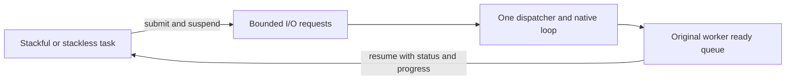

# Cooperative coroutines

[简体中文](COROUTINES.zh-CN.md) · [README](../README.md)

## 1. Choose a calling style

A coroutine is a task that can pause while waiting and let its worker run another task. This library owns its scheduler, queues, timers, channel/select logic and lifetime rules. It uses Windows fibers as an operating-system primitive and its own CPU context switch on POSIX. It does not use minicoro, Boost.Context or another coroutine library.

| Style | Start work | Wait | Values across a wait |
| --- | --- | --- | --- |
| C99 stackful | `hx_os_coro_go(..., HX_OS_CORO_STACKFUL, ...)` | Ordinary calls, including nested functions | Remain on the coroutine's fixed stack |
| C++11 stackful | `runtime.go(function, arguments...)` or `runtime.go(lambda)` | `hx::coro::sleepFor`, `channel.receive`, stream methods | Ordinary local variables and RAII |
| C99/C++11 stackless | `HX_OS_CORO_STACKLESS` callback | Repeat an operation after `WOULD_BLOCK`; optional state macros | Put them in persistent user state |
| Optional C++20 stackless | `runtime.go(namedCoroutine(arguments))` | `co_await hx::coro::async::...` | Compiler-generated frame |

This is cooperative scheduling. Sleep, channel waits, task waits and library coroutine I/O release the worker. A long computation must periodically call `yield`. A normal blocking file call, mutex wait or third-party blocking function still occupies that worker. There is no system-call interception, preemptive interruption, garbage collector, growing stack or Go language keyword. C++11 functions and callbacks remain exception-free; they return `Result<T>`.

## 2. First C++11 task

Build and run [the complete program](../examples/coroutine.cpp), which prints `Answer: 42`. Its work function is:

```cpp
auto task = runtime.go([]() noexcept -> hx::Result<int> {
	auto slept = hx::coro::sleepFor(std::chrono::milliseconds(10));
	if (!slept)
		return hx::Failure(slept.error());
	return 6 * 7;
});
```

`go` stores the callable and arguments, admits one task within the runtime limits, and returns a task handle. `getUntil(deadline)` waits for the result and consumes the task only after completion. A timeout leaves that handle usable. Captures must have nonthrowing construction/destruction. Borrowed pointers and references must outlive execution and cleanup; returned references do not extend the referenced object's lifetime; copying a pointer does not copy the object it points to.

Create the runtime explicitly, once for a group of tasks:

```cpp
hx_os_coro_runtime *owner = NULL;
auto created = hx::coro::Runtime::create(owner);
if (!created)
	return 1;
auto &runtime = created.value();
```

The C pointer is the durable owner, as with the existing thread pool facade. `Runtime` is a borrowed view and never secretly waits in its destructor. Finish with `runtime.shutdownUntil(deadline)`. On `TIMEOUT`, `BUSY` or `NOT_SUPPORTED`, keep the owner and retry according to the host's shutdown policy. Never unload code, free task arguments or destroy the context while its workers or callbacks are still alive.

## 3. C++20 without a private stack

Include `hx/Coroutines20.hpp` and link the optional `hx_c_platform::cpp20` target. The C library remains C99, and other consumers can keep C++11.

```cpp
hx::coro::Routine<int> answer()
{
	auto waited = co_await hx::coro::async::sleepFor(
		std::chrono::milliseconds(10));
	if (!waited)
		co_return hx::Result<int>(hx::Failure(waited.error()));
	co_return 42;
}
// After creating runtime:
auto task = runtime.go(answer());
```

[The complete C++20 program](../examples/coroutine20.cpp) also prints `Answer: 42`. `Routine<>` represents a void result and finishes with `co_return hx::Result<void>();`. Frame allocation can fail; `go` then returns `NO_MEMORY`. Frames use the immutable default C allocator; scheduler objects and admitted task result storage use the runtime's context. Creating a routine creates its frame before admission. Rejected admission normally leaves the routine available; rejection after successful prepare during a concurrent close has already transferred and cleaned it.

Use named coroutine functions with value parameters and `runtime.go(function(arguments))`. Submitting a routine-producing factory as an ordinary stackful callable is rejected at compile time. Invoking a temporary capturing coroutine lambda can leave a dangling closure pointer in the compiler frame. Library awaiters retain their channel/stream handles. Buffer pointers still borrow their storage, which must remain valid through the await. The frame accepts the library's awaiters; an external executor cannot resume it on a different thread. Native callables must never throw; the required compiler `unhandled_exception` hook does not make exceptions a supported error path.

## 4. Send and receive values

`Channel<int>::create(runtime)` creates a rendezvous channel: a send waits for a receiver. Pass a positive capacity for bounded buffering. A native thread can create, close and release a channel; send/receive/select require a running coroutine in the same runtime.

```cpp
auto created = hx::coro::Channel<int>::create(runtime, 8);
if (!created)
	return 1;
auto channel = created.value();
auto producer = runtime.go([channel]() noexcept {
	auto sent = channel.send(42);
	if (!sent)
		return sent;
	return channel.close();
});
auto consumer = runtime.go([channel]() noexcept {
	return channel.receive();
});
```

Check both submission results, wait for both tasks and close the runtime as in the complete examples. Closing rejects future sends with `CLOSED`, allows buffered values to drain, then receivers get `EOF`. It does not discard buffered values. Releasing the final channel reference drops remaining values. Suspended operations hold their own channel references.

C++ `Channel<T>` is a convenience for nonthrowing default-constructible, trivially copyable values such as integers and plain structures. Use the C channel's existing container copy/drop policy for owning `hx_string`, `hx_variant` or custom C values. Copy runs before scheduling and may fail; drop runs exactly once for retained values. Callbacks must not suspend or reenter channel operations. Receiving constructs a fresh output and transfers the value's release obligation. Raw byte relocation is not valid for arbitrary C++ objects with self-pointers.

C++20 uses the same channels:

```cpp
auto sent = co_await hx::coro::async::send(channel, 42);
auto received = co_await hx::coro::async::receive(channel);
```

C++ offers `hx::coro::select` and `co_await hx::coro::async::select`. Use `hx_os_coro_select` to wait on up to 64 send/receive cases. Exactly one commits. Ready cases rotate between calls; this is not a strict fairness guarantee. `NOW` returns `WOULD_BLOCK` if none can commit. Other elapsed deadlines return `TIMEOUT`. A selected index is meaningful on a selected `OK`, `EOF` or `CLOSED` result. Cancellation/timeouts unlink every losing case; a select cannot rendezvous with itself.

## 5. C99 state machines

[The complete C program](../examples/coroutine.c) prints `Count: 1`, `Count: 2`, `Count: 3`. The important pattern is:

```c
typedef struct counter_state {
	int step;
	int value;
} counter_state;

static hx_os_status count(hx_os_coro *self, void *user, hx_os_error *error)
{
	counter_state *state = user;
	hx_os_status status;
	(void)self;
	HX_OS_CORO_BEGIN(state->step);
	for (state->value = 1; state->value <= 3; ++state->value) {
		HX_OS_CORO_AWAIT(state->step, status, hx_os_coro_yield(error));
		if (status != HX_OS_OK)
			return hx_os_coro_complete(status, error);
		printf("Count: %d\n", state->value);
	}
	HX_OS_CORO_END(state->step);
	return HX_OS_OK;
}
```

Start with `step=0`. Put each `AWAIT` on its own source line. Values and buffers used across suspension belong in persistent state. These macros use switch/case and cannot cross a VLA declaration or an unrelated nested switch. They pause execution but do not silently handle failures. `hx_os_coro_complete` distinguishes a final `WOULD_BLOCK` error from a callback asking to be scheduled again. A raw stackless callback can implement the same protocol without macros.

## 6. Network and pipe I/O

The C entries are `hx_os_coro_listen`, `dial`, `accept`, `read`, `write`, `resolve` and `pipe_pair`. Addresses use existing `hx_os_address`; DNS returns an owned `hx_os_address_list`. `listen` can return an ephemeral bound port. Address reuse is explicitly selected, never silently enabled. Dial uses one numeric address; DNS results can be tried by the caller under one absolute deadline.

C++11 uses `Stream::dial`, `Stream::listen`, `stream.accept/read/write` and `Stream::pipePair`. `Addresses::resolve` and `async::resolve` own their DNS results. C++20 has `async::listen/dial/accept/read/write/pipePair` awaiters. Receive buffers belong to the caller; write buffers are borrowed until the operation completes. Reads return some bytes or `EOF`; writes attempt the entire buffer and preserve partial byte counts on failure. Inspect `Result<size_t>::hasValue()` to access progress even when `ok()` is false.



The dispatcher owns all native socket/pipe calls. Its stream wrappers can cross runtime workers, with one read and one write per socket; conflicting operations return `BUSY`. A pipe endpoint accepts one operation. Cancellation requests native retirement and does not release a borrowed buffer early. Completion becomes visible after the native callback returns. Stream release does not wait for I/O retirement; the dispatcher closes the native resource. Successful runtime close retires every native stream, while retained wrappers remain releasable. No native handle escapes this ownership boundary.

## 7. Bounds, cancellation and lifetime

| Setting or operation | Contract |
| --- | --- |
| Default workers | 2, fixed after creation; no global runtime |
| `max_coroutines` | 1,024 live handles, including completed tasks still retained |
| Stackful stack | 128 KiB payload; 64 MiB aggregate reservation budget including guard/native rounding |
| Channels | 128 objects; 16 MiB total object/buffer/pending-case storage |
| I/O | 1,024 stream wrappers; 16 MiB native loop request/byte budget; one dispatcher |
| `max_io_handles=0` | CPU/channel runtime without I/O dispatcher or network initialization |
| DNS | Existing bounded resolver pool, started on demand; native resolver calls are not forcibly interrupted |
| `cancel` | Cooperative flag plus wake/cancel of an outstanding wait; never kills a thread or forcibly unwinds a C++ stack |
| `wait_until` | Native caller blocks, coroutine caller suspends; self-wait is `DEADLOCK`, cross-runtime coroutine wait is `NOT_SUPPORTED` |
| `drain_until` | Reject new tasks, let accepted tasks finish; a later close can escalate to cancellation |
| `close_until` | Reject new tasks, cancel accepted tasks, wait and join within the caller's monotonic deadline |
| `destroy` | Requires successful close; `BUSY` preserves the owner otherwise |

Lazy native stack creation may fail after admission; wait/get reports that failure. Callback self/current pointers are borrowed; retain before taking ownership. An accepted task's cleanup runs once, including cancellation before its first instruction. Completion includes cleanup. Scheduler cleanup and I/O dispatcher callbacks get DEADLOCK when waiting for unfinished tasks; runtime close from scheduler/dispatcher threads also returns DEADLOCK. Timeouts leave objects and background storage valid for retry. No operation promises a hard real-time deadline. A coroutine that never yields can prevent close from completing. The owner is not a shared mutable global allocator/configuration.

Tasks remain pinned to one worker. Child tasks submitted from a coroutine inherit that worker; native-thread submissions use round robin. There is no work stealing or automatic load migration. Thread-local storage is not coroutine-local storage: POSIX TLS is shared by tasks on the worker, while Windows FLS follows native fibers. Keep portable coroutine state in user data or the frame. Never hold a native mutex across a coroutine suspension. Library signal/profiler/hash reentry state is switched explicitly. Profiler interval stacks are also isolated per coroutine, so interleaving is not mistaken for nesting. Up to 64 profiler instances may be associated with one coroutine; exit frees caches and aborts unfinished intervals, while max_threads still bounds all profiling contexts. Close a profiler from the native host after its tasks finish; its close API remains synchronous. This does not make arbitrary third-party TLS-based APIs coroutine-safe.

Module byte budgets count their direct backing storage. User callbacks, nested value allocations, C++ frames/results and native worker stacks have separate costs and lifetimes. Fixed stack exhaustion is an OS fault, not a recoverable status. Stack reservations are not resident-memory measurements. Shutdown includes worker TLS cleanup and native thread joining. Android API 21 lacks the current backend's finite native join capability; a finite close can return `NOT_SUPPORTED`. A controlled host may explicitly retry with `INFINITE` after arranging termination. The library never silently converts a finite wait into an infinite one. Coordinate caller-created submitting threads and exclude in-flight API calls before destroying the owner; library close does not join those threads. Retained tasks/channels/streams can retain context allocations after close, so release them before context destruction. Before plugin unload, release every handle, frame, result and callback table that depends on its code, even after runtime close. Cycles in user-owned values require user cleanup; there is no tracing collector.

## 8. Build, trim and verify

```cmake
find_package(hx_c_platform CONFIG REQUIRED)
target_link_libraries(my_c_app PRIVATE hx_c_platform::hx_c_platform)
target_link_libraries(my_cpp11_app PRIVATE hx_c_platform::cpp)
target_link_libraries(my_cpp20_app PRIVATE hx_c_platform::cpp20)
```

`HX_OS_ENABLE_COROUTINES`, `HX_OS_ENABLE_STACKFUL_COROUTINES` and `HX_OS_ENABLE_COROUTINE_IO` default ON. Turning off the core removes its scheduler/channel/native implementation. Turning off stackful support retains C state machines and C++20. I/O requires NETWORK and LOOP; if either is disabled, coroutine I/O reports `NOT_SUPPORTED`. Closing unused I/O lifecycle state still succeeds because there are no resources to retire. The embedded minimal cache disables the module explicitly; selectively re-enable it after `-C cmake/minimal.cmake`.

POSIX stack switching has x86_64, i386/SSE, ARMv7/VFP and AArch64 backends. An unadapted CPU fails clearly; use stackless-only configuration until it is adapted. Active Linux x86 shadow stacks are detected and stackful entry reports unsupported without disabling host protection; see the [Linux kernel interface](https://www.kernel.org/doc/html/latest/arch/x86/shstk.html). Windows uses native fiber context preservation. Apple implementation paths are present, with target builds/runs pending. API 21 ARM builds, emulator evidence, Windows x86/x64, sanitizer results, installation, ABI checks, layout and microbenchmarks are recorded in [validation](VALIDATION.md). These are separate claims, not blanket certification of every target.
