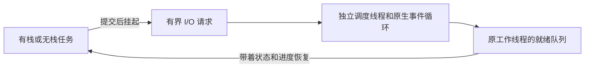

# 协作式协程

[English](COROUTINES.md) · [README](../README.zh-CN.md)

## 1. 先选择一种写法

协程是能够在等待时暂停、让工作线程去运行其他任务的任务。本库自研调度器、队列、定时等待、channel/select 和生命周期管理；Windows 使用操作系统原生 fiber，POSIX 使用本库的 CPU 上下文切换代码。没有使用 minicoro、Boost.Context 或其他协程库。

| 写法 | 启动任务 | 等待方式 | 等待前的变量放在哪里 |
| --- | --- | --- | --- |
| C99 有栈 | `hx_os_coro_spawn(..., HX_OS_CORO_STACKFUL, ...)` | 普通函数调用，也支持嵌套函数 | 协程自己的固定大小栈 |
| C++11 有栈 | `runtime.spawn(函数, 参数...)` 或可选的 `go lambda;` | `hx::coro::sleepFor`、`channel.receive`、stream 方法 | 普通局部变量，可以使用 RAII |
| C99/C++11 无栈 | `HX_OS_CORO_STACKLESS` 回调 | 返回 `WOULD_BLOCK` 后，下一次回调继续同一个操作；可使用状态机宏 | 自己定义的持久状态结构体 |
| 可选 C++20 无栈 | `runtime.go(协程函数(参数))` | `co_await hx::coro::async::...` | 编译器生成的协程帧 |

调度方式是已经确认的协作式：协程版睡眠、channel、任务等待和 I/O 会让出工作线程，长时间计算需要主动调用 `yield`。普通阻塞文件操作、原生互斥锁等待和第三方阻塞函数仍会占住工作线程。这里没有接管系统调用、强制抢占普通代码、垃圾回收、自动增长栈，也不能给 C/C++ 增加 Go 的语言关键字。C++11 函数和回调继续使用无异常的 `Result<T>` 错误返回。

## 2. C++11：普通任务不必保存句柄

先按 [go.cpp 完整程序](../examples/go.cpp) 创建一次运行时。在其他头文件**之后**包含 `hx/GoKeywords.hpp`，即可选择接近 libgo 的写法。宿主线程先进入一个作用域：

```cpp
auto scope = hx::coro::Scope::enter(runtime);
if (!scope)
	return hx::Failure(scope.error());

co_chan<int> answers(1);
if (!answers)
	return hx::Failure(answers.error());

go [answers]() noexcept { return answers << 6 * 7; };

auto done = runtime.waitUntil(hx_os_deadline_after_ms(2000));
if (!done)
	return done;

auto answer = answers.receive(HX_OS_DEADLINE_NOW);
```

这段放在返回 `Result<void>` 的函数里。`go` 提交任务，运行时持有它直到清理完成；任务向有一个缓冲槽的 channel 发送 42。无需为每个任务保存句柄，也不用先建任务组。`done` 检查完成情况及运行时保留的任务错误；检查 `answer` 后再读取 `answer.value()`。完整程序输出 `Answer: 42`，并展示创建与显式关闭。

`Scope` 选中一个已有运行时，不会创建线程或全局单例。作用域可以嵌套，必须在创建它的宿主线程上按后进先出顺序关闭；它持有运行时引用，但不负责停止运行时。不能把 scope 移到其他线程，或先销毁外层 scope。在协程内部调用 `go` 时，自动沿用该协程的运行时。既没有 scope 也不在协程内时，提交会返回错误，此时也没有运行时可以保存它，不能忽略返回值。

不需要全局关键字宏时，包含 `hx/Go.hpp`，使用 `hx_go(runtime) lambda;` 或 `hx_go_here lambda;`。普通方法 `runtime.spawn(函数, 参数...)` 具有相同的自动持有行为。可选关键字头还提供 `co_chan<T>`、`co_sleep(毫秒)`，以及 C++20 之外的 `co_yield`；它们是 C++ 辅助语法，不是新增的语言关键字。`go` 宏可能与其他标识符冲突，也会影响旧 `.go()` 方法，因此启用它后用 `.submit()` 获取有返回值的任务。

普通任务可以返回 void 或 `Result<void>`。如果希望内部操作的失败出现在统一报告中，必须从任务返回这个错误；void 回调内部忽略的错误无法自动变得可见。普通 spawn 的非 void 值会在清理后丢弃，需要结果时使用返回 `Task<T>` 的 `runtime.submit(...)`。没有启用关键字头的旧代码仍然可以使用 `runtime.go(...)`，其既有契约保持不变。

提交失败与执行失败保存为“首个完整 `hx_os_error` + 饱和累计数量”，不是无限增长的错误队列。`runtime.errors()` 读取快照，`runtime.errors(true)` 读取并清空。`waitUntil` 先等运行时空闲，再报告首个已记录错误，不自动清空；未清空时后续等待仍会返回这个错误。它不会拒绝新任务，也不是对固定批次做快照；需要把空闲视作本批结束时，先停止外部生产者，已运行任务仍可提交子任务。等待超时保留工作。需要独立命名批次时可使用下文的可选 `Group`。

运行时仍然显式创建：

```cpp
hx_os_coro_runtime *owner = NULL;

auto created = hx::coro::Runtime::create(owner);
if (!created)
	return 1;

auto &runtime = created.value();
```

C 指针 `owner` 是需要保留的所有者；`Runtime` 是借用它的操作入口，析构不等待。最后调用 `runtime.shutdownUntil(截止时间)`；返回 `TIMEOUT`、`BUSY` 或 `NOT_SUPPORTED` 时保留 owner，由宿主决定何时重试。关闭运行时不能替代检查任务错误。借用的捕获对象必须活到执行及清理结束，仍有工作依赖插件或 context 时不能卸载、销毁它们。

## 3. C++20：不用单独的栈

包含 `hx/Coroutines20.hpp`，链接可选目标 `hx_c_platform::cpp20`。C 库仍按 C99 编译，其他消费者仍可使用 C++11。

```cpp
hx::coro::Routine<int> answer()
{
	auto waited = co_await hx::coro::async::sleepFor(
		std::chrono::milliseconds(10));
	if (!waited)
		co_return hx::Result<int>(hx::Failure(waited.error()));

	co_return 42;
}

// 创建 runtime 后：
auto task = runtime.go(answer());
```

[完整 C++20 程序](../examples/coroutine20.cpp) 同样输出 `Answer: 42`。`Routine<>` 表示没有返回值，用 `co_return hx::Result<void>();` 正常结束。协程帧分配失败时，`go` 返回 `NO_MEMORY`。协程帧使用不可变的默认 C 分配器；调度器对象、任务结果存储使用运行时的 context。调用协程函数时会先创建帧，再提交任务。通常提交被拒绝时仍保留 routine；如果 prepare 已成功、随后遇到并发关闭，则所有权已转移，并由库完成清理。

优先使用具名协程函数，通过值参数传入数据；C++20 使用 `runtime.go(函数(参数))`，把返回 routine 的工厂当作普通有栈函数提交会在编译时被拒绝。临时的、带捕获的协程 lambda 可能让编译器帧持有已经失效的闭包指针。库提供的 awaiter 会持有 channel/stream 句柄；传入的缓冲区仍是借用，必须活到等待完成。协程帧只接受本库 awaiter，不能交给外部执行器在别的线程恢复。编译器要求的 `unhandled_exception` 钩子不意味着这里支持用异常报告业务错误；用户回调依然不得抛异常。

## 4. 用 channel 传递值

`Channel<int>::create(runtime)` 创建容量为零的 channel：发送者要等接收者到达。传入正容量则建立有界缓冲。普通宿主线程也可以发送、接收，等待时阻塞线程；协程调用则挂起协程。协程的发送、接收及 select 必须使用所属运行时，普通线程的 select 尚不支持。`NOW` 不阻塞。

```cpp
auto created = hx::coro::Channel<int>::create(runtime, 8);
if (!created)
	return 1;

auto channel = created.value();

auto producer = runtime.go([channel]() noexcept {
	auto sent = channel.send(42);
	if (!sent)
		return sent;
	return channel.close();
});

auto consumer = runtime.go([channel]() noexcept {
	return channel.receive();
});
```

检查两个提交结果，等待任务完成，再按完整示例关闭运行时。channel 关闭后，新发送返回 `CLOSED`；已经进入缓冲的值仍可读出，读完后返回 `EOF`。关闭不会丢弃缓冲值。最后一个 channel 引用释放时，才清理剩余值；挂起的操作会持有自己的 channel 引用。

C++ `Channel<T>` 同时支持普通值与拥有资源的 C++ 对象，后者的移动构造和析构必须不抛异常。普通值按字节传递，接收存储需要无异常默认构造；`hx::String` 等拥有资源的对象放入地址稳定、带引用计数的盒子，正常调用构造与析构，不按字节搬移对象本身。盒子计入运行时 channel 字节预算，内部字符串等载荷另计。左值发送还要求无异常复制；只能移动的对象使用 `send(std::move(value))`。盒子分配成功后，即使发送随后失败，也可能已经消耗原值。需要拥有字符串、variant 或自定义 C 对象时，可以给 C channel 设置已有容器的 copy/drop 策略。复制发生在调度之前，可以明确失败；保留下来的值最终只清理一次。接收输出应当是尚未持有资源的存储，接收成功后由接收者承担值的释放责任。回调不得挂起或重入 channel 操作。C 策略的存储表示仍必须能够按字节搬移，C++ 拥有值的路径则通过正确移动保持自指针语义。`channel << value` 发送，`channel >> output` 接收并无异常移动赋值，两者都返回明确的结果。

C++20 使用同一个 channel，只把等待写成：

```cpp
auto sent = co_await hx::coro::async::send(channel, 42);

auto received = co_await hx::coro::async::receive(channel);
```

C++ 可使用 `hx::coro::select` 或 `co_await hx::coro::async::select`。`hx_os_coro_select` 最多同时等待 64 个发送/接收分支，最终只有一个分支提交。每次轮换就绪分支的检查起点，但不承诺严格公平。`NOW` 下没有就绪分支返回 `WOULD_BLOCK`；其他截止时间到期返回 `TIMEOUT`。选中的分支返回 `OK`、`EOF` 或 `CLOSED` 时，selected 才是对应索引。取消和超时会移除所有未获选分支；同一 select 中的发送和接收不会互相配对。

## 5. C99 无栈状态机

[完整 C 程序](../examples/coroutine.c) 输出 `Count: 1`、`Count: 2`、`Count: 3`。关键写法如下：

```c
typedef struct counter_state {
	int step;
	int value;
} counter_state;

static hx_os_status count(hx_os_coro *self, void *user, hx_os_error *error)
{
	counter_state *state = user;
	hx_os_status status;

	(void)self;
	HX_OS_CORO_BEGIN(state->step);

	for (state->value = 1; state->value <= 3; ++state->value) {
		HX_OS_CORO_AWAIT(state->step, status, hx_os_coro_yield(error));
		if (status != HX_OS_OK)
			return hx_os_coro_complete(status, error);

		printf("Count: %d\n", state->value);
	}

	HX_OS_CORO_END(state->step);

	return HX_OS_OK;
}
```

初始 `step=0`，每个 `AWAIT` 单独占一行。跨等待使用的值和缓冲区放在 state 中，不能放在回调的普通局部变量里。宏使用 switch/case，不能跨越变长数组声明或混入另一个嵌套 switch。宏负责挂起，不会代替调用者检查错误。`hx_os_coro_complete` 用于区分“任务以 WOULD_BLOCK 错误结束”和“回调还要继续调度”。不使用宏也可以直接实现同一状态机协议。

没有注册等待就返回 `WOULD_BLOCK`，任务会重新进入工作线程的就绪队列。反复这样返回可能占满一个 CPU 核心，并不会等待外部事件。需要挂起时，使用协程版 sleep、channel、同步或 I/O 接口，配合 `AWAIT` 等到结果就绪；计算循环中的 `yield` 用于主动让出工作线程。已有显式重新排队的行为继续保留。

## 6. 网络与管道

C 接口提供 `hx_os_coro_listen`、`dial`、`accept`、`read`、`write`、`resolve`、`pipe_pair`。地址沿用 `hx_os_address`，DNS 返回调用者拥有的 `hx_os_address_list`。listen 可以返回系统分配的临时端口；地址复用必须显式开启。dial 连接一个数字地址，调用者可以在同一个绝对截止时间内依次尝试 DNS 返回的地址。

C++11 提供 `Stream::dial`、`Stream::listen`、`stream.accept/read/write`、`Stream::pipePair`。`Addresses::resolve` 和 `async::resolve` 提供自动释放的 DNS 结果。C++20 提供对应的 `async::listen/dial/accept/read/write/pipePair` awaiter。读取缓冲区由调用者持有，写入缓冲区借用到操作完成。读操作返回部分字节或 EOF；写操作尝试写完整段数据，失败时保留已完成字节数。即使 `ok()` 为 false，仍可先检查 `Result<size_t>::hasValue()`，再读取实际进度。



所有原生 socket/pipe 操作由 I/O 调度线程负责。stream 可以在同一运行时的工作线程间使用；一个 socket 可以同时存在一个读和一个写，冲突操作返回 `BUSY`；管道端点只接受一个操作。取消只是请求原生操作退出，不会提前释放仍被使用的缓冲区。原生完成回调返回之后，才通知协程恢复。释放 stream 不等待 I/O 退役，由调度线程完成原生关闭。运行时关闭成功后所有原生 stream 已退役，调用者保留的包装句柄仍可安全释放；不向外暴露需要调用者自行协调的原生句柄。

## 7. 容量、取消与生命周期

| 配置或操作 | 契约 |
| --- | --- |
| 默认工作线程 | 2 个，创建后固定；没有全局运行时 |
| `max_coroutines` | 1,024 个活跃句柄；已经完成但仍持有的任务也占名额 |
| 有栈协程栈 | 默认有效区 128 KiB；总预留预算 64 MiB，包括保护页和原生取整 |
| channel 与协程同步对象 | 共用 128 个对象上限；对象、缓冲区、等待者和拥有值盒子合计最多 16 MiB |
| I/O | 1,024 个 stream 包装对象；原生 loop 请求/字节预算 16 MiB；一个调度线程 |
| `max_io_handles=0` | 仅使用计算/channel，不创建 I/O 线程，也不初始化网络 |
| DNS | 按需启动已有有界解析线程池；不强行中断原生解析调用 |
| `cancel` | 设置协作式取消标志，唤醒或取消当前等待；不强杀线程，不强行展开 C++ 栈 |
| `wait_until` | 普通线程阻塞，协程挂起；等待自身返回 `DEADLOCK`，协程跨运行时等待返回 `NOT_SUPPORTED` |
| `drain_until` | 拒绝新任务，允许已接收任务结束；随后 close 可以升级为取消 |
| `close_until` | 拒绝新任务，取消已接收任务，在调用者给定的单调截止时间内等待和 join |
| `destroy` | 必须先关闭成功；否则返回 `BUSY` 并保留 owner |

有栈的原生栈在首次调度时创建；接收任务后仍可能出现原生栈分配或平台能力失败，这类错误通过任务结果返回。回调的 self/current 指针是借用，需要拥有独立引用时先 retain。任务一旦被接收，其 cleanup 最终执行一次，包括还没开始执行就被取消的情况。任务完成状态包含 cleanup 已结束。清理回调和 I/O 调度线程等待未完成任务时返回 DEADLOCK；在调度线程内关闭运行时同样返回 DEADLOCK。超时保留对象和后台存储，允许重试；不承诺硬实时。一个始终不让出的协程，可能让 close 一直无法完成。运行时的配置和分配器不会变成影响其他消费者的可变全局设置。

协程固定在一个工作线程上；协程内提交的子任务默认继承当前工作线程，普通线程提交的任务轮流分配。没有工作窃取或自动迁移。线程局部存储不等于协程局部存储：POSIX TLS 在同一工作线程的任务间共享，Windows FLS 跟随原生 fiber。可移植协程局部值可使用 `Local<T>`／C local-key 接口，或使用 user 数据、编译器帧，不要拿着原生互斥锁跨越协程挂起。本库会切换 signal/profiler/hash 的重入状态，profiler 的计时栈另按协程隔离，避免交替执行被误记为相互嵌套。每个协程最多 64 个局部槽，由 profiler 与应用局部键共用；结束时释放缓存并标记未结束区间为 aborted，max_threads 继续约束计时上下文总数。从宿主线程在任务结束后关闭 profiler；其关闭接口仍是同步接口。这不会自动让任意依赖 TLS 的第三方 API 适合协程。

容量预算计算的是相应模块的直接存储，用户回调的分配、值内部的分配、C++ 帧/结果及原生工作线程栈各有自己的生命周期和占用。固定栈溢出是操作系统故障，不能转换成普通错误返回；栈预留量也不等于物理内存驻留量。关闭包括工作线程 TLS 清理和原生 join。Android API 21 已支持有限时间 join：Bionic 适配通过 `pthread_gettid_np` 观察内核清零的线程标识，再完成原生资源回收，等待范围包含 TLS 清理。超时保留线程对象，可以重试；这提供单调截止时间，不代表强制取消或硬实时保证。宿主还需要协调自行创建的提交线程，并在销毁 owner 前排除正在进行的 API 调用；库不会替宿主 join 这些线程。关闭之后仍保留的任务/channel/stream 句柄可能继续占有 context 分配，应先释放这些句柄，再销毁 context。插件卸载前，还必须释放依赖插件代码的句柄、帧、结果和回调表；即使运行时已经关闭，也不能忽略这些对象。用户值中构成的引用环也需要用户自行解除。

## 8. 构建、裁剪和验证

```cmake
find_package(hx_c_platform CONFIG REQUIRED)

target_link_libraries(my_c_app PRIVATE hx_c_platform::hx_c_platform)
target_link_libraries(my_cpp11_app PRIVATE hx_c_platform::cpp)
target_link_libraries(my_cpp20_app PRIVATE hx_c_platform::cpp20)
```

`HX_OS_ENABLE_COROUTINES`、`HX_OS_ENABLE_STACKFUL_COROUTINES`、`HX_OS_ENABLE_COROUTINE_IO` 默认 ON。关闭核心后排除调度/channel/原生切换实现；仅关闭有栈仍可使用 C 状态机和 C++20。协程 I/O 依赖 NETWORK 和 LOOP，任何一个关闭后，相应接口明确返回 `NOT_SUPPORTED`。没有创建 I/O 资源时，内部生命周期清理自然可以成功。嵌入式最小配置明确关闭本模块；可以在 `-C cmake/minimal.cmake` 后按需重新开启。

POSIX 栈切换已有 x86_64、i386/SSE、ARMv7/VFP、AArch64 适配。没有适配的 CPU 会明确编译失败，可以暂时使用仅无栈配置。Linux x86 若实际开启影子栈，有栈入口会检测并返回不支持，不会替宿主关闭保护；查询规则见 [Linux 内核说明](https://www.kernel.org/doc/html/latest/arch/x86/shstk.html)。Windows 由原生 fiber 保存上下文。Apple 适配路径已提供，目标构建和运行仍待验证。 其他目标限制见[平台支持](PLATFORMS.zh-CN.md)。

## 9. 协程同步与局部值

包含 `hx/CoroutineSync.hpp`。`Mutex::create(runtime)`、`Semaphore::create(runtime, initial, maximum)`、`Event::create(runtime, manualReset, initiallySet)`、`RwLock::create(runtime)`、`Condition::create(runtime)` 都返回明确结果。对应 C 接口位于 `hx_os_coroutine.h`，也支持 C99 无栈的重试／消费完成结果协议。

| 原语 | 契约 |
| --- | --- |
| 互斥锁 | 不可递归，拥有者是协程身份或宿主线程；同一个拥有者重复上锁返回 `DEADLOCK`。`acquireUntil` 返回 RAII `Lock`。 |
| 信号量 | 计数有界，post 超过最大值返回 `LIMIT`，计数不变。 |
| 事件 | 手动复位唤醒全部等待者并保持已设置；自动复位唤醒一个，或保留一次通知。重复 set 不累计次数。 |
| 读写锁 | 多个读者或一个写者；等待中的写者阻止新读者插队。不提供升级、降级或递归读锁保证。调用者必须拥有每一份释放的读锁。 |
| 条件变量 | 等待时原子地释放传入且已持有的互斥锁；通知不保留，醒来后需要循环检查条件。 |

无竞争加锁使用运行时锁，不分配等待者；发生竞争时才分配有界等待对象。宿主线程等待会阻塞，协程等待会挂起；跨运行时的协程等待返回 `NOT_SUPPORTED`。`NOW` 下不能完成时返回 `WOULD_BLOCK`。调用期间必须持有对象引用，已经接受的等待会保留所需引用。close 拒绝或唤醒等待，原有锁仍可解锁；关闭互斥锁不会强行剥夺拥有者。

条件变量等待在**返回前重新取得互斥锁**，超时、取消、关闭条件变量时也如此。重新取得锁可能超过截止时间，重复取消不会打断这一步，因此拥有者最终必须解锁。这保证返回时的锁所有权，不是硬截止承诺。guard 留在取得它的协程／线程，任务结束前解锁，不要跨执行上下文转移。guard 析构只解锁，不阻塞等待。

协程退出不会自动释放它持有的互斥锁或写锁。拥有者没有解锁就退出，可能让其他调用者永久阻塞；其他线程或协程不能代替拥有者解开会检查所有权的互斥锁。自动解锁可能让其他任务读到只修改了一半的共享数据。C 回调取得锁后，每条退出路径都必须清理；C++ guard 留在拥有者所在的执行上下文，覆盖错误和取消的返回路径。

关闭运行时或同步对象不会打断条件变量重新加锁，也不会撤销当前拥有者。运行时关闭成功后，宿主创建的普通线程仍可能在重新加锁，因为运行时只 join 自己的工作线程。先让锁拥有者完成并解锁，再由宿主等待该线程退出，释放同步句柄，最后销毁运行时。当前“返回时持锁”的契约不保证这一整段流程存在硬截止时间。

C++20 提供 `async::acquire(mutex)`、`async::wait(event/semaphore)`、`async::readLock/writeLock(lock)` 和 `async::wait(condition, guard)`；条件变量所引用的 guard 必须活到 await 结束。这些入口共用 C 调度器，不会为每个等待创建线程。

`Local<T>::create(context)` 创建键，复制包装对象仍共享同一个键。`set(value)` 保存当前协程拥有的值，`get()` 借用当前协程的值指针，`clear()` 销毁它。同一工作线程上的其他协程有独立值；替换或协程退出时，每个拥有值只清理一次。释放外部最后一个键引用不会使仍存储的值失效。C 接口接受值指针及可选清理回调，set 成功才转移该值的清理责任。最多 64 个局部槽，与内部 profiler 使用的槽共用上限。清理在结束该协程的工作线程上执行，不得 yield 或修改局部槽；宿主线程没有协程局部槽。值或回调可能依赖插件，卸载之前先结束任务并释放键。

## 10. 按需使用任务组和返回值

`Group group(runtime, capacity)` 收集有界的一批 void／`Result<void>` 任务。`group.spawn(...)` 保存任务句柄，`group.waitUntil(deadline)` 等待并消费已经完成的条目；超时保留未完成条目，最终报告首个保存的提交／执行失败。某个任务失败不会跳过其余任务的等待。`group.cancel()` 请求协作取消。任务组由同一个调用方串行操作，不是支持并发 Add 的 Go WaitGroup；析构只释放句柄，不暗中等待或取消，被引用的应用数据仍需满足执行生命周期。组内错误持续保留，新错误范围请创建新任务组。

需要返回值时用 `runtime.submit(函数, 参数...)`。`Task<T>::getUntil` 只在任务完成后消耗句柄，等待超时保留句柄，释放句柄也不会强杀任务。[C++11 完整返回值示例](../examples/coroutine.cpp) 与 [C++20 示例](../examples/coroutine20.cpp) 继续保留。普通自动持有任务、可选任务组和有返回值任务，共用同一份任务／栈预算及调度器。
