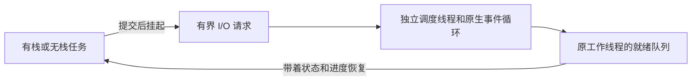

# 协作式协程

[English](COROUTINES.md) · [README](../README.zh-CN.md)

## 1. 先选择一种写法

协程是能够在等待时暂停、让工作线程去运行其他任务的任务。本库自研调度器、队列、定时等待、channel/select 和生命周期管理；Windows 使用操作系统原生 fiber，POSIX 使用本库的 CPU 上下文切换代码。没有使用 minicoro、Boost.Context 或其他协程库。

| 写法 | 启动任务 | 等待方式 | 等待前的变量放在哪里 |
| --- | --- | --- | --- |
| C99 有栈 | `hx_os_coro_go(..., HX_OS_CORO_STACKFUL, ...)` | 普通函数调用，也支持嵌套函数 | 协程自己的固定大小栈 |
| C++11 有栈 | `runtime.go(函数, 参数...)` 或 `runtime.go(lambda)` | `hx::coro::sleepFor`、`channel.receive`、stream 方法 | 普通局部变量，可以使用 RAII |
| C99/C++11 无栈 | `HX_OS_CORO_STACKLESS` 回调 | 返回 `WOULD_BLOCK` 后，下一次回调继续同一个操作；可使用状态机宏 | 自己定义的持久状态结构体 |
| 可选 C++20 无栈 | `runtime.go(协程函数(参数))` | `co_await hx::coro::async::...` | 编译器生成的协程帧 |

调度方式是已经确认的协作式：协程版睡眠、channel、任务等待和 I/O 会让出工作线程，长时间计算需要主动调用 `yield`。普通阻塞文件操作、原生互斥锁等待和第三方阻塞函数仍会占住工作线程。这里没有接管系统调用、强制抢占普通代码、垃圾回收、自动增长栈，也不能给 C/C++ 增加 Go 的语言关键字。C++11 函数和回调继续使用无异常的 `Result<T>` 错误返回。

## 2. 先跑一个 C++11 任务

[完整程序](../examples/coroutine.cpp) 会输出 `Answer: 42`。其中任务本身只需要这样写：

```cpp
auto task = runtime.go([]() noexcept -> hx::Result<int> {
	auto slept = hx::coro::sleepFor(std::chrono::milliseconds(10));
	if (!slept)
		return hx::Failure(slept.error());
	return 6 * 7;
});
```

`go` 保存函数及参数，在容量允许时接收任务，并返回任务句柄。`getUntil(截止时间)` 等待并取出结果；任务完成后才消耗句柄，等待超时则保留句柄，之后可以再次等待。捕获对象的构造和析构必须不抛异常。指针和引用指向的对象需要活到执行及清理结束；返回引用也不会延长被引用对象的寿命；复制一个指针不会自动复制它指向的内容。

先为这一组任务显式创建运行时：

```cpp
hx_os_coro_runtime *owner = NULL;
auto created = hx::coro::Runtime::create(owner);
if (!created)
	return 1;
auto &runtime = created.value();
```

与现有线程池便利层一样，C 指针 `owner` 是需要保留的所有者，`Runtime` 只是借用它的操作入口，析构不会暗中等待。最后调用 `runtime.shutdownUntil(截止时间)`；出现 `TIMEOUT`、`BUSY` 或 `NOT_SUPPORTED` 时保留 owner，由宿主决定何时重试。工作线程或回调还活着时，不能卸载相关代码、释放任务参数或销毁 context。

## 3. C++20：不用单独的栈

包含 `hx/Coroutines20.hpp`，链接可选目标 `hx_c_platform::cpp20`。C 库仍按 C99 编译，其他消费者仍可使用 C++11。

```cpp
hx::coro::Routine<int> answer()
{
	auto waited = co_await hx::coro::async::sleepFor(
		std::chrono::milliseconds(10));
	if (!waited)
		co_return hx::Result<int>(hx::Failure(waited.error()));
	co_return 42;
}
// 创建 runtime 后：
auto task = runtime.go(answer());
```

[完整 C++20 程序](../examples/coroutine20.cpp) 同样输出 `Answer: 42`。`Routine<>` 表示没有返回值，用 `co_return hx::Result<void>();` 正常结束。协程帧分配失败时，`go` 返回 `NO_MEMORY`。协程帧使用不可变的默认 C 分配器；调度器对象、任务结果存储使用运行时的 context。调用协程函数时会先创建帧，再提交任务。通常提交被拒绝时仍保留 routine；如果 prepare 已成功、随后遇到并发关闭，则所有权已转移，并由库完成清理。

优先使用具名协程函数，通过值参数传入数据；C++20 使用 `runtime.go(函数(参数))`，把返回 routine 的工厂当作普通有栈函数提交会在编译时被拒绝。临时的、带捕获的协程 lambda 可能让编译器帧持有已经失效的闭包指针。库提供的 awaiter 会持有 channel/stream 句柄；传入的缓冲区仍是借用，必须活到等待完成。协程帧只接受本库 awaiter，不能交给外部执行器在别的线程恢复。编译器要求的 `unhandled_exception` 钩子不意味着这里支持用异常报告业务错误；用户回调依然不得抛异常。

## 4. 用 channel 传递值

`Channel<int>::create(runtime)` 创建容量为零的 channel：发送者要等接收者到达。传入正容量则建立有界缓冲。普通线程可以创建、关闭、释放 channel；发送、接收和 select 必须在所属运行时的协程中执行。

```cpp
auto created = hx::coro::Channel<int>::create(runtime, 8);
if (!created)
	return 1;
auto channel = created.value();
auto producer = runtime.go([channel]() noexcept {
	auto sent = channel.send(42);
	if (!sent)
		return sent;
	return channel.close();
});
auto consumer = runtime.go([channel]() noexcept {
	return channel.receive();
});
```

检查两个提交结果，等待任务完成，再按完整示例关闭运行时。channel 关闭后，新发送返回 `CLOSED`；已经进入缓冲的值仍可读出，读完后返回 `EOF`。关闭不会丢弃缓冲值。最后一个 channel 引用释放时，才清理剩余值；挂起的操作会持有自己的 channel 引用。

C++ `Channel<T>` 方便传递整数、普通结构体等可按字节复制、能无异常默认构造的值。需要拥有字符串、variant 或自定义 C 对象时，可以给 C channel 设置已有容器的 copy/drop 策略。复制发生在调度之前，可以明确失败；保留下来的值最终只清理一次。接收输出应当是尚未持有资源的存储，接收成功后由接收者承担值的释放责任。回调不得挂起或重入 channel 操作。含内部自指针的任意 C++ 对象不能按 C 的字节搬移方式使用。

C++20 使用同一个 channel，只把等待写成：

```cpp
auto sent = co_await hx::coro::async::send(channel, 42);
auto received = co_await hx::coro::async::receive(channel);
```

C++ 可使用 `hx::coro::select` 或 `co_await hx::coro::async::select`。`hx_os_coro_select` 最多同时等待 64 个发送/接收分支，最终只有一个分支提交。每次轮换就绪分支的检查起点，但不承诺严格公平。`NOW` 下没有就绪分支返回 `WOULD_BLOCK`；其他截止时间到期返回 `TIMEOUT`。选中的分支返回 `OK`、`EOF` 或 `CLOSED` 时，selected 才是对应索引。取消和超时会移除所有未获选分支；同一 select 中的发送和接收不会互相配对。

## 5. C99 无栈状态机

[完整 C 程序](../examples/coroutine.c) 输出 `Count: 1`、`Count: 2`、`Count: 3`。关键写法如下：

```c
typedef struct counter_state {
	int step;
	int value;
} counter_state;

static hx_os_status count(hx_os_coro *self, void *user, hx_os_error *error)
{
	counter_state *state = user;
	hx_os_status status;
	(void)self;
	HX_OS_CORO_BEGIN(state->step);
	for (state->value = 1; state->value <= 3; ++state->value) {
		HX_OS_CORO_AWAIT(state->step, status, hx_os_coro_yield(error));
		if (status != HX_OS_OK)
			return hx_os_coro_complete(status, error);
		printf("Count: %d\n", state->value);
	}
	HX_OS_CORO_END(state->step);
	return HX_OS_OK;
}
```

初始 `step=0`，每个 `AWAIT` 单独占一行。跨等待使用的值和缓冲区放在 state 中，不能放在回调的普通局部变量里。宏使用 switch/case，不能跨越变长数组声明或混入另一个嵌套 switch。宏负责挂起，不会代替调用者检查错误。`hx_os_coro_complete` 用于区分“任务以 WOULD_BLOCK 错误结束”和“回调还要继续调度”。不使用宏也可以直接实现同一状态机协议。

## 6. 网络与管道

C 接口提供 `hx_os_coro_listen`、`dial`、`accept`、`read`、`write`、`resolve`、`pipe_pair`。地址沿用 `hx_os_address`，DNS 返回调用者拥有的 `hx_os_address_list`。listen 可以返回系统分配的临时端口；地址复用必须显式开启。dial 连接一个数字地址，调用者可以在同一个绝对截止时间内依次尝试 DNS 返回的地址。

C++11 提供 `Stream::dial`、`Stream::listen`、`stream.accept/read/write`、`Stream::pipePair`。`Addresses::resolve` 和 `async::resolve` 提供自动释放的 DNS 结果。C++20 提供对应的 `async::listen/dial/accept/read/write/pipePair` awaiter。读取缓冲区由调用者持有，写入缓冲区借用到操作完成。读操作返回部分字节或 EOF；写操作尝试写完整段数据，失败时保留已完成字节数。即使 `ok()` 为 false，仍可先检查 `Result<size_t>::hasValue()`，再读取实际进度。



所有原生 socket/pipe 操作由 I/O 调度线程负责。stream 可以在同一运行时的工作线程间使用；一个 socket 可以同时存在一个读和一个写，冲突操作返回 `BUSY`；管道端点只接受一个操作。取消只是请求原生操作退出，不会提前释放仍被使用的缓冲区。原生完成回调返回之后，才通知协程恢复。释放 stream 不等待 I/O 退役，由调度线程完成原生关闭。运行时关闭成功后所有原生 stream 已退役，调用者保留的包装句柄仍可安全释放；不向外暴露需要调用者自行协调的原生句柄。

## 7. 容量、取消与生命周期

| 配置或操作 | 契约 |
| --- | --- |
| 默认工作线程 | 2 个，创建后固定；没有全局运行时 |
| `max_coroutines` | 1,024 个活跃句柄；已经完成但仍持有的任务也占名额 |
| 有栈协程栈 | 默认有效区 128 KiB；总预留预算 64 MiB，包括保护页和原生取整 |
| channel | 128 个对象；对象、缓冲区和等待分支合计最多 16 MiB |
| I/O | 1,024 个 stream 包装对象；原生 loop 请求/字节预算 16 MiB；一个调度线程 |
| `max_io_handles=0` | 仅使用计算/channel，不创建 I/O 线程，也不初始化网络 |
| DNS | 按需启动已有有界解析线程池；不强行中断原生解析调用 |
| `cancel` | 设置协作式取消标志，唤醒或取消当前等待；不强杀线程，不强行展开 C++ 栈 |
| `wait_until` | 普通线程阻塞，协程挂起；等待自身返回 `DEADLOCK`，协程跨运行时等待返回 `NOT_SUPPORTED` |
| `drain_until` | 拒绝新任务，允许已接收任务结束；随后 close 可以升级为取消 |
| `close_until` | 拒绝新任务，取消已接收任务，在调用者给定的单调截止时间内等待和 join |
| `destroy` | 必须先关闭成功；否则返回 `BUSY` 并保留 owner |

有栈的原生栈在首次调度时创建；接收任务后仍可能出现原生栈分配或平台能力失败，这类错误通过任务结果返回。回调的 self/current 指针是借用，需要拥有独立引用时先 retain。任务一旦被接收，其 cleanup 最终执行一次，包括还没开始执行就被取消的情况。任务完成状态包含 cleanup 已结束。清理回调和 I/O 调度线程等待未完成任务时返回 DEADLOCK；在调度线程内关闭运行时同样返回 DEADLOCK。超时保留对象和后台存储，允许重试；不承诺硬实时。一个始终不让出的协程，可能让 close 一直无法完成。运行时的配置和分配器不会变成影响其他消费者的可变全局设置。

协程固定在一个工作线程上；协程内提交的子任务默认继承当前工作线程，普通线程提交的任务轮流分配。没有工作窃取或自动迁移。线程局部存储不等于协程局部存储：POSIX TLS 在同一工作线程的任务间共享，Windows FLS 跟随原生 fiber。需要可移植的协程状态时使用 user 数据或编译器帧，不要拿着原生互斥锁跨越协程挂起。本库会切换 signal/profiler/hash 的重入状态，profiler 的计时栈另按协程隔离，避免交替执行被误记为相互嵌套。每个协程最多关联 64 个 profiler；结束时释放缓存并标记未结束区间为 aborted，max_threads 继续约束计时上下文总数。从宿主线程在任务结束后关闭 profiler；其关闭接口仍是同步接口。这不会自动让任意依赖 TLS 的第三方 API 适合协程。

容量预算计算的是相应模块的直接存储，用户回调的分配、值内部的分配、C++ 帧/结果及原生工作线程栈各有自己的生命周期和占用。固定栈溢出是操作系统故障，不能转换成普通错误返回；栈预留量也不等于物理内存驻留量。关闭包括工作线程 TLS 清理和原生 join。Android API 21 当前后端缺少有限时间原生 join，有限截止时间的 close 可能返回 `NOT_SUPPORTED`。宿主安排好退出后，可以自行选择用 `INFINITE` 重试；库不会擅自把有限等待改成无限等待。宿主还需要协调自行创建的提交线程，并在销毁 owner 前排除正在进行的 API 调用；库不会替宿主 join 这些线程。关闭之后仍保留的任务/channel/stream 句柄可能继续占有 context 分配，应先释放这些句柄，再销毁 context。插件卸载前，还必须释放依赖插件代码的句柄、帧、结果和回调表；即使运行时已经关闭，也不能忽略这些对象。用户值中构成的引用环也需要用户自行解除。

## 8. 构建、裁剪和验证

```cmake
find_package(hx_c_platform CONFIG REQUIRED)
target_link_libraries(my_c_app PRIVATE hx_c_platform::hx_c_platform)
target_link_libraries(my_cpp11_app PRIVATE hx_c_platform::cpp)
target_link_libraries(my_cpp20_app PRIVATE hx_c_platform::cpp20)
```

`HX_OS_ENABLE_COROUTINES`、`HX_OS_ENABLE_STACKFUL_COROUTINES`、`HX_OS_ENABLE_COROUTINE_IO` 默认 ON。关闭核心后排除调度/channel/原生切换实现；仅关闭有栈仍可使用 C 状态机和 C++20。协程 I/O 依赖 NETWORK 和 LOOP，任何一个关闭后，相应接口明确返回 `NOT_SUPPORTED`。没有创建 I/O 资源时，内部生命周期清理自然可以成功。嵌入式最小配置明确关闭本模块；可以在 `-C cmake/minimal.cmake` 后按需重新开启。

POSIX 栈切换已有 x86_64、i386/SSE、ARMv7/VFP、AArch64 适配。没有适配的 CPU 会明确编译失败，可以暂时使用仅无栈配置。Linux x86 若实际开启影子栈，有栈入口会检测并返回不支持，不会替宿主关闭保护；查询规则见 [Linux 内核说明](https://www.kernel.org/doc/html/latest/arch/x86/shstk.html)。Windows 由原生 fiber 保存上下文。Apple 适配路径已提供，目标构建和运行仍待验证。API 21 两种 ARM 构建、模拟器、Windows x86/x64、sanitizer、安装、ABI、布局及微基准证据见[验证记录](VALIDATION.zh-CN.md)，这些状态分别记录，不代表所有目标都经过实测。
