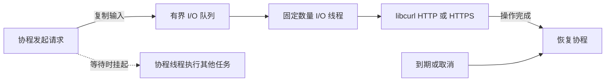

# 协作式协程

[English](COROUTINES.md) · [README](../README.zh-CN.md)

当应用需要同时管理大量等待 Channel、定时器或异步网络 I/O 的并发任务，又不希望为每个连接或任务创建独立的操作系统线程时，可以使用本库的协作式协程模块。协程在等待 Channel、睡眠或协程 I/O 时会自动挂起并让出底层工作线程，去执行其他就绪任务。

### 快速上手：运行第一个协程程序

我们先用完整的 C++11 示例 [go.cpp](../examples/go.cpp) 跑通最常见的流程：在后台协程中计算出 `42`，再通过 Channel 发回主线程打印。

在库源码根目录下完成一次[示例配置](../examples/README.zh-CN.md#run)后，构建并运行 `hx_os_go`（请将下方 `build` 替换为你的构建目录；Debug 构建请将命令和路径中的 `Release` 替换为 `Debug`）：

```sh
cmake --build build --config Release --target hx_os_go
```

Windows（Visual Studio）：

```powershell
.\build\bin\Release\hx_os_go.exe
```

Linux / WSL：

```sh
./build/bin/hx_os_go
```

程序无需任何命令行参数或外部文件，运行后会打印 `Answer: 42` 并退出。`go.cpp` 内部依次完成了以下核心步骤：

| 步骤 | 作用 |
| --- | --- |
| `Runtime::create(owner)` | 创建协程运行时及其托管的工作线程，业务无需手动管理调度线程 |
| `Scope::enter(runtime)` | 将当前宿主线程绑定到该运行时，使随后的 `go` 语句知道往哪里提交任务 |
| `co_chan<int> answers(1)` | 创建容量为 1 的整型缓冲 Channel，让后台协程可以先写入 `42` 再退出 |
| `go ...` | 提交普通 lambda 作为有栈协程运行，运行时自动持有并在结束后回收该任务 |
| `waitUntil(...)` | 主线程等待运行时内所有任务完成，并检查是否有提交或执行错误 |
| `receive(HX_OS_DEADLINE_NOW)` | 从 Channel 立即取出已算好的整数并打印 |
| `shutdownUntil(...)` | 关闭运行时并等待所有底层工作线程安全退出 |

下文的小代码片段用于拆解各个接口的细节；初次接入工程时，可直接将完整的 [go.cpp](../examples/go.cpp) 复制为你的 `main.cpp`，并按[最小 C++ 工程](USAGE.zh-CN.md#cpp-project)链接目标。第 8 节汇总了其余 C99、C++11 和 C++20 完整示例的构建目标。

## 1. 先选择一种写法

本库自研了完整的协程调度器、就绪队列、定时等待、Channel / `select` 以及生命周期管理：Windows 下使用操作系统原生 Fiber 保存有栈上下文，POSIX 下使用自研的架构级 CPU 上下文切换实现，不依赖 `minicoro`、`Boost.Context` 等第三方协程库。

你可以根据项目语言标准和内存预算，在四种调用风格中选择：

| 写法 | 启动方式 | 等待方式 | 跨挂起点的变量保存在哪里 |
| --- | --- | --- | --- |
| **C99 有栈协程** | `hx_os_coro_spawn(..., HX_OS_CORO_STACKFUL, ...)` | 直接在普通函数（含深层嵌套调用）中调用协程等待接口 | 协程独立的固定大小私有栈 |
| **C++11 有栈协程** | `runtime.spawn(函数, 参数...)` 或可选的 `go lambda;` | `hx::coro::sleepFor`、`channel.receive`、`Stream` 方法 | 普通局部变量，支持完整 C++ RAII |
| **C99 / C++11 无栈状态机** | `HX_OS_CORO_STACKLESS` 回调 | 返回 `HX_OS_WOULD_BLOCK` 后由下一次调度继续同一操作（可配合状态机宏） | 调用方自定义的持久化状态结构体 |
| **可选 C++20 无栈协程** | `runtime.go(协程函数(参数))` | `co_await hx::coro::async::...` | 编译器自动生成的协程帧（Coroutine Frame） |

> [!NOTE]
> **协作式调度边界**
> 只有调用本库提供的协程版睡眠、Channel、协程同步原语和协程 I/O 时，协程才会挂起并让出工作线程；长时间纯 CPU 计算需要定期主动调用 `yield`。如果在协程内部调用普通阻塞式文件读写、原生操作系统互斥锁或第三方阻塞 SDK，仍会占住当前底层工作线程。C++11 接口全程使用无异常的 `hx::Result<T>` 返回错误。

## 2. C++11：普通任务不必保存句柄

先按 [go.cpp 完整程序](../examples/go.cpp) 创建运行时。若希望使用类似 Go / `libgo` 的简洁语法，可在所有其他头文件**之后**包含 `hx/GoKeywords.hpp`，并在宿主线程上进入 `Scope`：

```cpp
auto scope = hx::coro::Scope::enter(runtime);
if (!scope)
	return hx::Failure(scope.error());

co_chan<int> answers(1);
if (!answers)
	return hx::Failure(answers.error());

go [answers]() noexcept { return answers << 6 * 7; };

auto done = runtime.waitUntil(hx_os_deadline_after_ms(2000));
if (!done)
	return done;

auto answer = answers.receive(HX_OS_DEADLINE_NOW);
```

- **自动托管任务句柄**：`go` 提交任务后，由运行时自动持有该任务直至执行和清理完毕，无需为每个任务单独保存 `Task` 句柄或预先创建任务组。
- **为什么上面代码中 Channel 容量设为 `1`？** 因为主线程先调用了 `runtime.waitUntil()` 等待协程结束，之后才调用 `receive()`。如果把容量改成 `0`（无缓冲会合模式），协程发送时必须等待接收者就绪，而主线程又在等待协程结束，两边就会互相死等。使用无缓冲 Channel 时，应当让另一个协程并发接收，或者让主线程先 `receive()` 再 `waitUntil()`。
- **如果不希望引入全局 `go` 宏**：只需包含 `hx/Go.hpp`，使用 `hx_go(runtime) lambda;`、`hx_go_here lambda;` 或常规成员函数 `runtime.spawn(函数, 参数...)`，它们具有完全相同的自动托管语义。可选头文件 `hx/GoKeywords.hpp` 定义的 `go`、`co_chan<T>`、`co_sleep(ms)` 和 `co_yield` 都是 C++ 宏/类型辅助（启用 `go` 宏后，若需获取带返回值的 `Task<T>`，请调用 `runtime.submit(...)` 而不是 `.go()`）。
- **`Scope` 绑定规则**：`Scope` 仅将当前宿主线程绑定到已有运行时，不会隐式创建线程或全局单例。多个 `Scope` 可以嵌套，但必须在创建它的同一宿主线程上按后进先出（LIFO）顺序析构；在协程内部使用 `go` 时会自动沿用所属运行时。若既未进入 `Scope` 也不在协程内，提交会直接报错。
- **错误收集与空闲等待**：普通托管任务可返回 `void` 或 `Result<void>`（若希望内部错误被运行时记录，请从任务返回该 `Result`）。运行时将提交失败与任务执行失败记录为“首个完整 `hx_os_error` + 饱和错误计数”：可通过 `runtime.errors()` 读取快照，或用 `runtime.errors(true)` 读取并清空。`runtime.waitUntil()` 会先等待运行时空闲，再报告首个已记录的错误（不会自动清空错误记录，也不会禁止新任务提交；若需等待独立命名的任务批次，请使用第 10 节的 `Group`）。

运行时的创建与关闭始终显式管理宿主持有的 `owner` 指针：

```cpp
hx_os_coro_runtime *owner = NULL;

auto created = hx::coro::Runtime::create(owner);
if (!created) {
	auto closed = hx::coro::Runtime(owner).shutdownUntil(
		hx_os_deadline_after_ms(2000));
	return closed ? 1 : 2;
}

auto &runtime = created.value();
```

`hx::coro::Runtime` 只是借用 `owner` 指针的视图，其析构函数不会阻塞等待。退出前请显式调用 `runtime.shutdownUntil(deadline)`；若返回 `HX_OS_TIMEOUT`、`HX_OS_BUSY` 或 `HX_OS_NOT_SUPPORTED`，宿主必须保留非空的 `owner` 指针及任务借用的数据、分配器 `context` 和动态库插件，按业务策略稍后重试关闭。

## 3. C++20：不用单独的栈

如果编译器支持 C++20 协程，可以包含 `hx/Coroutines20.hpp` 并链接可选目标 `hx_c_platform::cpp20`（底层 C 库仍按 C99 编译，工程中其他模块仍可保持 C++11）：

```cpp
hx::coro::Routine<int> answer()
{
	auto waited = co_await hx::coro::async::sleepFor(
		std::chrono::milliseconds(10));
	if (!waited)
		co_return hx::Result<int>(hx::Failure(waited.error()));

	co_return 42;
}

// 创建 runtime 后：
auto task = runtime.go(answer());
```

[完整 C++20 程序](../examples/coroutine20.cpp) 同样输出 `Answer: 42`。无返回值的协程使用 `Routine<>`，并通过 `co_return hx::Result<void>();` 正常结束。每条退出路径都应显式返回结果，包括成功路径。裸 `co_return` 要求不同的 promise，自然执行到函数末尾属于未定义行为。
- **内存分配**：调用协程函数时，编译器生成的协程帧通过默认 C 分配器分配（若分配失败，`runtime.go()` 返回 `HX_OS_NO_MEMORY`）；调度器对象与任务结果槽位则使用运行时绑定的 `context`。
- **避免悬空捕获**：编写 C++20 协程时，**优先使用具名协程函数并按值传参**（`runtime.go(answer())`）。不要使用带捕获的临时协程 lambda，因为临时闭包对象在 `co_await` 挂起后可能已经析构，导致协程帧内部访问悬空指针。

## 4. 用 channel 传递值

`Channel<int>::create(runtime)` 默认创建容量为 `0` 的同步会合（Rendezvous）Channel，发送方会挂起等待接收方到达；传入正整数容量则会创建有界缓冲 Channel。普通宿主线程和协程都可以对同一个 Channel 执行发送与接收（宿主线程等待时会阻塞线程，协程等待时则挂起协程并让出工作线程；`HX_OS_DEADLINE_NOW` 始终非阻塞）。

```cpp
auto created = hx::coro::Channel<int>::create(runtime, 8);
if (!created)
	return 1;

auto channel = created.value();

auto producer = runtime.go([channel]() noexcept {
	auto sent = channel.send(42);
	if (!sent)
		return sent;
	return channel.close();
});

auto consumer = runtime.go([channel]() noexcept {
	return channel.receive();
});
```

- **关闭与排空**：调用 `channel.close()` 后，后续发送会立即返回 `HX_OS_CLOSED`；但已在缓冲区中的元素仍可继续被 `receive()` 正常取出，全部取空后才返回 `HX_OS_EOF`。当最后一个 `Channel` 句柄及挂起操作引用全部释放时，剩余未取出的元素会被自动清理。
- **值类型与资源对象**：
  - C++ `Channel<T>` 既支持平凡可复制类型，也支持拥有资源的 C++ 对象（如 `hx::String`，要求移动构造和析构 `noexcept`）。拥有资源的 C++ 对象会被封装在地址稳定、带引用计数的盒子里传递，确保构造、析构和内部自指针语义正确，盒子内存计入运行时的 Channel 字节预算。也可使用流式操作符 `channel << value` 发送、`channel >> output` 接收。
  - C 接口支持为 Channel 配置容器级 `copy` / `drop` 回调策略，用于安全传递拥有堆内存的 `hx_string`、`hx_variant` 或自定义 C 结构体。
- **C++20 协程等待**：C++20 协程可直接复用同一个 `Channel<T>`：

```cpp
auto sent = co_await hx::coro::async::send(channel, 42);

auto received = co_await hx::coro::async::receive(channel);
```

- **多路复用 `select`**：通过 `hx_os_coro_select`、C++11 `hx::coro::select` 或 C++20 `co_await hx::coro::async::select`，可以在协程内同时等待最多 `64` 个发送或接收分支，每次调用至多提交其中一个分支（会轮换就绪分支的检查起点以避免固定偏置）。在 `HX_OS_DEADLINE_NOW` 下若无就绪分支则返回 `HX_OS_WOULD_BLOCK`，超出有限截止时间则返回 `HX_OS_TIMEOUT`。当选中分支返回 `HX_OS_OK`、`HX_OS_EOF` 或 `HX_OS_CLOSED` 时，`selected` 输出参数才表示获选分支下标。

## 5. C99 无栈状态机

在嵌入式裁剪或纯 C99 场景下，如果不需要私有栈，可以使用基于状态机宏的无栈协程。[完整 C 程序](../examples/coroutine.c) 依次输出 `Count: 1`、`Count: 2`、`Count: 3`，核心写法如下：

```c
typedef struct counter_state {
	int step;
	int value;
} counter_state;

static hx_os_status count(hx_os_coro *self, void *user, hx_os_error *error)
{
	counter_state *state = user;
	hx_os_status status;

	(void)self;
	HX_OS_CORO_BEGIN(state->step);

	for (state->value = 1; state->value <= 3; ++state->value) {
		HX_OS_CORO_AWAIT(state->step, status, hx_os_coro_yield(error));
		if (status != HX_OS_OK)
			return hx_os_coro_complete(status, error);

		printf("Count: %d\n", state->value);
	}

	HX_OS_CORO_END(state->step);

	return HX_OS_OK;
}
```

- **状态结构体保存跨挂起变量**：将 `step` 初始化为 `0`，所有需要跨越 `HX_OS_CORO_AWAIT` 挂起点保留的变量和缓冲区都必须放在 `user` 指向的持久化结构体中，不能使用普通栈上局部变量。
- **宏使用注意事项**：每个 `HX_OS_CORO_AWAIT` 必须单独占一行；由于宏展开基于 `switch`/`case`，不能跨越变长数组（VLA）声明或混入外层手写的 `switch` 块中。当任务因错误需要结束时，调用 `hx_os_coro_complete(status, error)`，以便调度器区分“任务真的以 `HX_OS_WOULD_BLOCK` 错误终止”与“任务挂起等待下一次唤醒”。
- **避免空转占满 CPU**：如果在未注册任何协程等待（如睡眠、Channel、同步原语或 I/O）的情况下直接返回 `HX_OS_WOULD_BLOCK`，任务会被立即放回当前工作线程的就绪队列，循环如此会占满一个 CPU 核心。

## 6. 网络与管道

协程 I/O 提供了与操作系统原生事件循环集成的流式网络与命名管道接口：
- **C 接口**：`hx_os_coro_listen`、`hx_os_coro_dial`、`hx_os_coro_accept`、`hx_os_coro_read`、`hx_os_coro_write`、`hx_os_coro_resolve`、`hx_os_coro_pipe_pair`。
- **C++11 接口**：`Stream::dial`、`Stream::listen`、`stream.accept()` / `read()` / `write()`、`Stream::pipePair`，以及自动管理结果生命周期的 `Addresses::resolve`。
- **C++20 接口**：`hx::coro::async::listen` / `dial` / `accept` / `read` / `write` / `pipePair` / `resolve` Awaiter。


所有底层 Socket 和管道操作均由运行时内部独立的 I/O 调度线程驱动：
- 同一个 Socket `Stream` 允许同时存在一个读操作和一个写操作（重复发起同方向操作返回 `HX_OS_BUSY`）；管道端点同一时刻只允许一个在途操作。
- 读操作在收到任意可用字节或遇到 `HX_OS_EOF` 时返回；写操作会尝试写完整段缓冲区，若中途失败仍会通过 `Result<size_t>`（检查 `hasValue()`）保留已写入的字节数。
- 传入的读写缓冲区在整个 I/O 操作完成前由底层借用；即使协程等待超时或被取消，也只有在底层原生 I/O 回调真正退场后，协程才会恢复执行，从而保证借用缓冲区绝不会被提前释放。

### 6.1 用协程等待 UDP，不占住工作线程

调用 `hx_os_coro_udp_bind`（C++11 为 `Stream::bindUdp`）可绑定本地 UDP 地址并获得 `hx_os_coro_stream` 句柄（端口传 `0` 可由系统分配临时端口并通过 `bound` 返回）。随后在协程内调用 `hx_os_coro_send_to` / `hx_os_coro_receive_from`（C++11 为 `sendTo` / `receiveFrom`）收发数据报。等待期间协程会自动挂起，既不会阻塞工作线程，也无需业务自己写轮询循环。

构建并运行完整的 C99 状态机示例 [coroutine_udp.c](../examples/coroutine_udp.c)（需要开启 `HX_OS_ENABLE_NETWORK`、`HX_OS_ENABLE_LOOP`、`HX_OS_ENABLE_COROUTINES` 和 `HX_OS_ENABLE_COROUTINE_IO`）：

```sh
cmake --build build --config Release --target hx_os_coroutine_udp
```

Linux / WSL 运行 `./build/bin/hx_os_coroutine_udp`，Windows Visual Studio 运行 `.\build\bin\Release\hx_os_coroutine_udp.exe`，预期输出：

```text
UDP JSON: {"type":"status","device_id":7}
```

每次 `receive_from` 消费一条 UDP 数据报：收到零字节空数据报时返回 `HX_OS_OK` 和 `0` 字节（而非 `HX_OS_EOF`）；若接收缓冲区小于数据报长度，则返回 `HX_OS_LIMIT`、实际复制的字节数及发送方地址，超出的尾部字节会被截断丢弃（切勿将截断后的前缀当作完整 JSON 解析）。

## 7. 容量、取消与生命周期

| 配置项或操作 | 默认值与行为契约 |
| --- | --- |
| 默认工作线程数 | `2` 个（创建后固定，不设隐藏全局运行时） |
| `max_coroutines` | 最多 `1,024` 个活跃协程句柄（含已执行完但尚未释放句柄的任务） |
| 有栈协程栈预算 | 默认单栈有效区 `128 KiB`；总预留上限 `64 MiB`（含保护页与系统页对齐） |
| Channel 与协程同步原语 | 共享 `128` 个对象上限；对象、缓冲区、等待节点与资源盒子共享 `16 MiB` 预算 |
| 协程 I/O 预算 | 最多 `1,024` 个 `Stream` 包装对象；原生事件循环请求与字节预算 `16 MiB`；`1` 个 I/O 调度线程 |
| `max_io_handles = 0` | 纯计算与 Channel 模式，不启动 I/O 调度线程，也不初始化网络子系统 |
| DNS 解析 | 复用有界解析池：`resolve` 使用系统 DNS，`resolve_cancellable` 支持取消 `c-ares` 查询 |
| `cancel` | 设置协作式取消标志并唤醒当前等待；不强杀线程，也不通过异常强行展开 C++ 栈 |
| `wait_until` | 宿主线程调用时阻塞，协程调用时挂起；等待自身返回 `HX_OS_DEADLOCK`，跨运行时协程等待返回 `HX_OS_NOT_SUPPORTED` |
| `drain_until` | 拒绝新任务提交，等待已接收任务自然结束（后续可调用 `close_until` 升级为取消） |
| `close_until` | 拒绝新任务并取消所有已接收任务，在单调时钟截止时间内等待工作线程退出并 `join` |
| `destroy` | 必须在 `close_until` 成功后调用；否则返回 `HX_OS_BUSY` 并保留 `owner` |

> [!WARNING]
> **线程局部存储（TLS）与原生锁的注意事项**
> - **协程绑定固定工作线程**：每个协程固定在创建时分配的工作线程上运行（协程内派生的子任务默认继承同一工作线程，宿主线程提交的任务按轮询分配），不做跨线程工作窃取。
> - **不要混用操作系统 TLS**：在 POSIX 平台上，同一个工作线程上的多个协程共享同一份线程局部存储（TLS）；在 Windows 上，FLS 则跟随原生 Fiber。如需跨平台一致的协程局部存储，请使用第 9 节的 `hx::coro::Local<T>`（或 C `hx_os_coro_local_*` 接口）。
> - **切勿持有原生互斥锁跨越协程挂起点**：如果在持有操作系统 `hx_os_mutex` 时挂起协程，同一工作线程切换到其他协程后一旦再次请求该锁，就会导致工作线程自身死锁。协程间同步请使用第 9 节的协程同步原语。

创建运行时（或协程 HTTP 服务）时，如果部分工作线程启动失败且回滚清理未能在截止时间内完成，工厂函数会返回错误并保留非空的 `owner` 指针。此时该实例已处于关闭状态，请勿提交任务，只需通过 `hx::coro::Runtime(owner).shutdownUntil(deadline)` 重试清理直至成功（详见[通用生命周期约定](CONTRACTS.zh-CN.md)）。

## 8. 构建、裁剪和验证

你可以按需单独构建以下任一完整示例，所有示例均无需命令行参数或输入文件：

| 构建目标 | 完整源码 | 预期运行结果 |
| --- | --- | --- |
| `hx_os_go` | [go.cpp](../examples/go.cpp) | C++11，通过 Channel 传回并打印 `Answer: 42` |
| `hx_os_cpp_coroutine` | [coroutine.cpp](../examples/coroutine.cpp) | C++11，通过 `Task<int>` 返回并打印 `Answer: 42` |
| `hx_os_coroutine` | [coroutine.c](../examples/coroutine.c) | C99 无栈状态机，依次输出 `Count: 1`、`Count: 2`、`Count: 3` |
| `hx_os_coroutine_udp` | [coroutine_udp.c](../examples/coroutine_udp.c) | C99，在协程内发送并接收一条 JSON UDP 数据报 |
| `hx_os_cpp_coroutine20` | [coroutine20.cpp](../examples/coroutine20.cpp) | C++20，使用 `co_await` 睡眠后返回 `Answer: 42` |

启用示例后，CMake 会自动检测 C++ 编译器是否支持 `<coroutine>`（`HX_OS_HAVE_CPP20_COROUTINES`），检测通过时才会生成 `hx_os_cpp_coroutine20` 目标；C99 与 C++11 示例不依赖 C++20。

在外部工程中使用 `find_package` 接入时，按需选择链接目标即可：

```cmake
find_package(hx_c_platform CONFIG REQUIRED)

target_link_libraries(my_c_app PRIVATE hx_c_platform::hx_c_platform)
target_link_libraries(my_cpp11_app PRIVATE hx_c_platform::cpp)
target_link_libraries(my_cpp20_app PRIVATE hx_c_platform::cpp20)
```

CMake 开关 `HX_OS_ENABLE_COROUTINES`、`HX_OS_ENABLE_STACKFUL_COROUTINES` 和 `HX_OS_ENABLE_COROUTINE_IO` 默认均为 `ON`：
- 仅关闭 `HX_OS_ENABLE_STACKFUL_COROUTINES` 时，C99 无栈状态机和 C++20 无栈协程依然可用。
- POSIX 有栈切换已内置 `x86_64`、`i386/SSE`、`ARMv7/VFP` 和 `AArch64` 后端。若 Linux x86 进程在运行期启用了硬件影子栈（Shadow Stack，见 [Linux 内核说明](https://www.kernel.org/doc/html/latest/arch/x86/shstk.html)），有栈协程入口会自动检测并返回 `HX_OS_NOT_SUPPORTED`，绝不暗中关闭宿主安全防护。更多平台细节见[平台支持](PLATFORMS.zh-CN.md)。

## 9. 协程同步与局部值

包含 `hx/CoroutineSync.hpp`（C 接口位于 `hx_os_coroutine.h`），即可使用专为协程设计的同步原语。当发生锁竞争时，协程会挂起并让出工作线程，而宿主线程调用时则会阻塞等待：

| 同步原语 | 工厂与行为契约 |
| --- | --- |
| **互斥锁（`Mutex`）** | `Mutex::create(runtime)`。不可递归，拥有者按协程身份或宿主线程区分；同一拥有者重复加锁返回 `HX_OS_DEADLOCK`。`acquireUntil` 返回 RAII `Lock`。 |
| **信号量（`Semaphore`）** | `Semaphore::create(runtime, initial, maximum)`。有界计数，`post` 超过最大值时返回 `HX_OS_LIMIT` 且保持原计数不变。 |
| **事件（`Event`）** | `Event::create(runtime, manualReset, initiallySet)`。手动复位事件唤醒所有等待者并保持置位；自动复位事件每次只唤醒一个等待者。 |
| **读写锁（`RwLock`）** | `RwLock::create(runtime)`。支持多读者并发或单写者独占；排队中的写者会阻止新读者插队。不支持递归读锁或直接将读锁升级为写锁。 |
| **条件变量（`Condition`）** | `Condition::create(runtime)`。等待时原子地释放已持有的协程互斥锁，被唤醒后请在循环中重新检查业务条件。 |

> [!IMPORTANT]
> **条件变量返回时必定重新持锁，且协程退出不会自动解锁**
> - **条件变量重获锁保证**：无论是因为收到通知、等待超时、被取消还是条件变量关闭，`Condition` 等待在**返回给调用方之前都会重新取得关联的互斥锁**。重获锁的过程可能会超出原定的截止时间且不会被取消打断，因此调用方在等待返回后最终必须解锁。
> - **严禁持锁退出协程**：协程退出时**不会**自动释放它持有的 `Mutex` 或 `RwLock`（自动解锁可能把修改了一半的共享状态暴露给其他任务）。在 C 回调中请确保每条错误/取消分支都完成解锁；在 C++ 中请将 RAII `Lock` 守卫留在获取它的同一协程上下文内，确保在协程结束前析构解锁。

C++20 同样提供对应的 Awaiter：`async::acquire(mutex)`、`async::wait(event/semaphore)`、`async::readLock(lock)` / `async::writeLock(lock)` 以及 `async::wait(condition, guard)`。

**协程局部存储（`Local<T>`）**：调用 `Local<T>::create(context)` 创建键（复制 `Local<T>` 包装对象共享同一个键）。`set(value)` 为当前协程保存独立的值，`get()` 借用当前协程的值指针，`clear()` 主动销毁它。同一工作线程上的不同协程拥有各自独立的槽位；当值被替换或协程退出时，每个值保证只清理一次（最多支持 `64` 个局部槽位，与内部性能分析器共用上限；宿主线程没有协程局部槽位）。

## 10. 按需使用任务组和返回值

- **命名批次等待（`Group`）**：`Group group(runtime, capacity)` 用于收集固定上限的一批 `void` / `Result<void>` 任务。通过 `group.spawn(...)` 启动任务，再调用 `group.waitUntil(deadline)` 等待该组内的任务完成并汇总首个错误；`group.cancel()` 可向组内任务发起协作式取消。注意：`Group` 由单个调用方串行操作，析构时只释放句柄而不会暗中等待或取消任务。
- **获取任务返回值（`Task<T>`）**：当需要从协程拿回类型化计算结果时，调用 `runtime.submit(函数, 参数...)` 获取 `Task<T>`，随后调用 `Task<T>::getUntil(deadline)` 等待并消费结果（详见 [C++11 完整返回值示例](../examples/coroutine.cpp) 与 [C++20 示例](../examples/coroutine20.cpp)）。

## 11. 等待 TLS 或 HTTP 时让出协程线程

- **协程版 TLS 读写**：对于已创建的 TLS 会话 `owner`，只需将同步的就绪等待、发送、接收和冲刷替换为 `hx_os_coro_tls_wait_ready`、`hx_os_coro_tls_send_until`、`hx_os_coro_tls_receive_until` 和 `hx_os_coro_tls_flush_until`（C++11 有栈协程可使用 `<hx/CoroutineNetwork.hpp>` 中的 `hx::coro::Tls` 视图）。它们直接向该 TLS 会话现有的工作线程登记唤醒，不会额外启动轮询线程（信任校验与配置详见 [TLS](TLS.zh-CN.md)）。
- **协程版 HTTP 客户端**：通过 `hx_os_coro_http` 创建独立的协程 HTTP 服务，内部由有界 I/O 线程池驱动（默认 `2` 个线程、最多 `16` 个在途请求、`64 MiB` 请求/响应数据预算）：



运行完整的 C99 状态机示例 [coroutine_http.c](../examples/coroutine_http.c)：

```sh
cmake --build build --config Release --target hx_os_coroutine_http
# 先按 HTTP_FILES.zh-CN.md 启动本地 HTTP 服务：
build/bin/hx_os_coroutine_http http://127.0.0.1:8080/hello.txt
```

Visual Studio 请运行 `build/bin/Release/hx_os_coroutine_http.exe`。当 `hello.txt` 内容为 `hello` 时，程序会输出 `HTTP 200` 并在下一行打印 `hello`。在有栈协程内部，只需一行 `hx_os_coro_http_get(service, url, NULL, &response, &error)`（或 C++11 `hx::coro::Http(service).get(url, response)`）即可完成挂起等待。退出时请先在宿主线程上调用 `close_until` 关闭 HTTP 服务，再关闭协程运行时（普通流式文件传输详见 [HTTP 传输](HTTP_FILES.zh-CN.md)）。

如果希望 DNS 解析阶段在无响应时也能立即响应协程取消，请使用 `hx_os_coro_resolve_cancellable`（C++11 为 `Addresses::resolveCancellable`，C++20 为 `async::resolveCancellable`，详见[DNS 示例](NETWORK_OPTIONS.zh-CN.md#123-事件循环和协程里怎么用)的 `--coro` 模式）；协程 HTTP 服务则需链接启用了 `c-ares` 的 `libcurl` 并在提交请求前调用 `hx_os_coro_http_use_cancellable_dns`（详见 [HTTP 配置](HTTP_FILES.zh-CN.md#4-连-dns-无响应也需要取消时)）。
