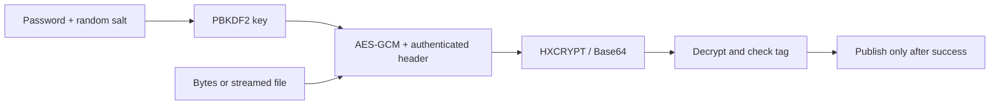

# Cryptography: text, files, hashes and signatures

[简体中文](CRYPTO.zh-CN.md) · [README](../README.md) · [Dependency setup](DEPENDENCIES.md)

## 1. Build and deploy

Enable `HX_OS_ENABLE_CRYPTO` (default ON). This adds the pinned OpenSSL 3.5 SDK to the compiled library; application code still includes only the hx headers. The core remains C99, with optional exception-free C++11 wrappers. There are no worker threads started by this module.

First prepare the dependency SDK using [the dependency instructions](DEPENDENCIES.md#4-build-the-native-dependency-stack), then configure the library with an absolute prefix:

```sh
cmake -S . -B build -DCMAKE_BUILD_TYPE=Release -DHX_OS_DEPENDENCY_PREFIX=/absolute/project/build-deps/prefix
cmake --build build --config Release --parallel 4
ctest --test-dir build -C Release -R "crypto|encrypt_text" --output-on-failure
```

OpenSSL is dynamically linked by default. On Windows the build copies its selected Crypto DLL into the library's `bin/<config>` directory; applications using `add_subdirectory` with another executable directory must also place that DLL beside their executable, or use the installed `bin` directory on PATH. Installation includes the selected Crypto runtime by default (`HX_OS_INSTALL_OPENSSL_RUNTIME=OFF` disables copying when your application owns deployment). Linux installs it next to the core shared library with an origin-relative runtime path. Static core consumers still link OpenSSL dynamically unless explicitly configured otherwise. They need the SDK prefix in their `CMAKE_PREFIX_PATH` when calling `find_package(hx_c_platform CONFIG REQUIRED)`.

To embed OpenSSL statically, build its SDK with `HX_DEPS_OPENSSL_SHARED=OFF` and configure the library with `HX_OS_OPENSSL_STATIC=ON`. Read section 5 before using external threads or unloading a plugin. Keep the license materials of the actual libraries you distribute. Apple runtime relocation and Win7/Android/embedded OpenSSL packages require separate target validation; successful Windows 11/WSL tests do not certify them.

Set `HX_OS_ENABLE_CRYPTO=OFF` to avoid this dependency. Headers and functions remain available; `hx_os_crypto_available()` returns 0 and crypto operations return `HX_OS_NOT_SUPPORTED`. Basic strings, containers and file I/O do not need OpenSSL.

## 2. Encrypt and decrypt UTF-8 text

This complete C program encrypts a short message, decrypts it and prints the verified plaintext. The encrypted value is Base64 text, so it can be stored as a JSON string. The password here is only a demonstration: obtain real passwords from your application's input or secret storage.

```c
#include <hx_os.h>
#include <stdio.h>

int main(void)
{
	hx_string encrypted = HX_STRING_INIT, plain = HX_STRING_INIT;
	hx_string_view message = {"Hello", 5};

	hx_os_status status = hx_os_crypto_encrypt_text(
		"example password", message, &encrypted, NULL);
	if (status == HX_OS_OK)
		status = hx_os_crypto_decrypt_text("example password",
			hx_string_view_of(&encrypted), &plain, NULL);
	if (status == HX_OS_OK)
		puts(hx_string_c_str(&plain));
	else
		fprintf(stderr, "Crypto failed: %s\n",
			hx_os_status_name(status));

	hx_string_destroy(&plain);
	hx_string_destroy(&encrypted);

	return status == HX_OS_OK ? 0 : 1;
}
```

Expected output: `Hello`. Ciphertext differs on every encryption because the salt and nonce are random. The runnable [encrypt_text.c](../examples/encrypt_text.c) also prints the ciphertext; run `build/bin/hx_os_encrypt_text` or `build\bin\Release\hx_os_encrypt_text.exe`.

The same operation in C++11 uses `Result<String>`, without exceptions:

```cpp
#include <hx/Crypto.hpp>
#include <cstdio>

int main()
{
	auto encrypted = hx::Crypto::encryptText("example password", "Hello");
	if (!encrypted)
		return 1;

	auto plain =
		hx::Crypto::decryptText("example password", encrypted.value());
	if (!plain)
		return 1;

	std::puts(plain.value().c_str());
	return 0;
}
```

The C text output uses the initialized string's allocator and remains unchanged on failure. Input and password use strict UTF-8, without normalization; input spans may include NUL. Base64 is canonical, with no spaces or line breaks. Text input is limited to 16 MiB; passwords contain 1–1024 bytes. A wrong password or modified authenticated data returns `HX_OS_AUTH_FAILED`; malformed framing/encoding gets a separate error. Never interpret a failed result as plaintext.

## 3. Encrypt files or arbitrary bytes

For files, these two C calls perform open/read/write/close, authentication and publication:

```c
hx_os_status status =
	hx_os_crypto_encrypt_file("report.pdf", "report.hxc", password, &error);
if (status == HX_OS_OK)
	status = hx_os_crypto_decrypt_file(
		"report.hxc", "restored.pdf", password, &error);
```

Here `password` comes from the application, and `error` is an `hx_os_error`. Check `status` before using the output. C++ equivalents are `hx::Crypto::encryptFile` and `decryptFile` returning `Result<void>`. By default an existing destination produces `EXISTS`; it is never silently replaced. The `_with_options` functions accept `HX_OS_CRYPTO_REPLACE`, a raw 32-byte key or a password span, explicit limits and `hx_os_file_save_result`. This result separates successful publication from parent-directory durability.

Files use 32 KiB chunks, a 64 KiB working buffer and finite length limits, rather than loading the entire file. Default input limit is 4 GiB; the maximum is 64 GiB minus 32 bytes (the GCM per-message limit). Inputs must remain stable during a call. Same-directory staging is synced before publication. A failed authentication never replaces the destination. POSIX publication can use a hard-link fallback when the filesystem lacks no-replace rename; the completed temporary's extra name is removed afterward.

Decryption stages plaintext with private permissions: POSIX owner-only mode or a protected owner-only Windows DACL. The created file's POSIX mode is checked; mounts that ignore 0600, and Windows filesystems lacking persistent ACLs, return `NOT_SUPPORTED` before writing plaintext. The published file retains these permissions. This protects against other ordinary accounts, not an administrator or another process running as the same user. Cleanup is best-effort after failure/publication; an OS cleanup failure may leave a private temporary. Use an application-controlled destination directory. WSL's native filesystem and its Windows mount are distinct test environments.

For non-text data use `hx_os_crypto_encrypt/decrypt`: inputs are `hx_os_bytes_view`, the secret is `hx_os_crypto_secret`, and the output is an owned `hx_os_crypto_bytes *`. `hx_os_crypto_random_key` produces a 32-byte key. Read the result with `bytes_data/bytes_size`, then call `hx_os_crypto_bytes_destroy(&result)`; destruction wipes owned bytes. No NUL terminator is promised. The binary options default to 16 MiB and allow up to 64 MiB, excluding envelope and bounded temporary copies. Memory limits are per call, not a process-wide budget. Keep keys secret and clear your own key buffers with `hx_os_secure_zero` when finished. Raw-key users must coordinate rotation across all processes/devices and keep each key below 2^32 encryptions; this stateless span API does not maintain a global key counter. See the random-nonce constraint in [NIST SP 800-38D section 8.3](https://nvlpubs.nist.gov/nistpubs/Legacy/SP/nistspecialpublication800-38d.pdf).

## 4. Hashes, HMAC and signatures

`hx_os_crypto_sha256(NULL, input, &text, &error)` writes lowercase hexadecimal SHA-256. `hash` also supports SHA-512; `sha256_file/hash_file` use a bounded file buffer. `hmac` accepts a key span and message span. Verify a received hexadecimal tag with `hx_os_crypto_hmac_verify` / `hx::Crypto::verifyHmac`; the validated tag is compared in constant time and a mismatch returns `AUTH_FAILED`. These functions do not change an output string on failure. A plain hash is not authentication; use HMAC with a secret key or a signature to authenticate data.

The following C++ excerpt generates an Ed25519 private key and checks a signature using only the exported public key:

```cpp
auto key = hx::CryptoKey::generate();
if (!key)
	return 1;

auto pem = key.value().exportPublic();
if (!pem)
	return 1;

auto publicKey = hx::CryptoKey::importPublic(pem.value());
auto signature = key.value().sign({"message", 7});
if (!publicKey || !signature)
	return 1;

auto verified =
	publicKey.value().verify({"message", 7}, signature.value().view());
if (!verified)
	return 1;
```

Use the same methods in C through `hx_os_crypto_key_*`, `sign` and `verify`. Explicit `HX_OS_CRYPTO_RSA_3072` generates an RSA key: signatures use RSA-PSS with SHA-256, MGF1-SHA256 and a 32-byte salt. Imported RSA keys must be 2048–8192 bits. Ed25519 signs the message directly. Message size is at most 16 MiB, signature size at most 1024 bytes. RSA generation and password derivation can take noticeable CPU time and are synchronous.

Imports accept exactly one unencrypted PKCS#8 private PEM or SPKI public PEM, with surrounding whitespace only, at most 64 KiB. Unsupported algorithms fail; the library never opens a password prompt. Private export is explicitly **unencrypted** PKCS#8 in a wiping `CryptoBytes` owner. To password-protect it, encrypt those bytes with the authenticated envelope before storing them; decrypt before importing. Encrypted PKCS#8 and traditional PKCS#1 PEM are not parsed by this entry point. Public-only keys cannot sign or export private material. Keys retain their engine, and separate calls may share an immutable key while its owner remains alive.

## 5. Threads, memory and unloading

Pass a NULL engine for a one-off C operation. For repeated work, create one `hx_os_crypto` and pass it to the operations, then release it; C++ `hx::Crypto::create()` supplies RAII and `native()`. Engines use private `OSSL_LIB_CTX` and the built-in default provider. They do not replace the host's allocator, properties or configuration. Existing native error entries are saved/restored around operations, but OpenSSL's public restore API does not preserve `ERR_set_mark` nesting and may lose auxiliary error text on allocation failure. Do not call this API inside a native error-mark scope or an OpenSSL allocator/provider callback. Reentry from a first-party allocator into an active crypto operation on the same thread returns `DEADLOCK`, preventing nested cleanup of active thread state.

First-party objects/buffers use the selected `hx_os_context`; native OpenSSL allocations use OpenSSL's own allocator. Do not claim a context memory budget limits native crypto allocations. Separate calls may share engines/keys, but outputs and destruction require external exclusion. Native thread state for a private engine is retired before each operation returns so its final release can safely occur on another thread. This adds work to short operations; context reuse is not a promise of zero allocation or higher performance. OpenSSL's process/thread infrastructure remains owned by OpenSSL.

Dynamic OpenSSL on Windows cleans ordinary native thread state at thread exit. With **static OpenSSL**, controlled external Windows threads must call `hx_os_crypto_thread_cleanup()` at their last use of that OpenSSL runtime. This clears all OpenSSL state on the calling thread, including other native consumers; never call it while another OpenSSL operation or callback is active there. The library does not call this global per-thread cleanup implicitly. Before unloading any runtime/plugin, all operations and objects must end and participating threads must exit or perform the coordinated cleanup while code is still loaded. Do not unload while TLS destructors or live objects still reference the code.

Owned binary results wipe their bytes on destruction. Ordinary `hx_string` results do not gain a secure-memory guarantee: application copies, allocator history, paging and crash dumps are outside this API. Synchronous file/KDF/key generation calls do not promise cancellation or a hard deadline. Run expensive work on a caller-owned worker when the UI must stay responsive.

## 6. HXCRYPT v1 binary format

This is a documented application envelope around OpenSSL AES-256-GCM, not the output format of `openssl enc`. Independent peers must follow this framing and reject failed authentication.

| Offset | Bytes | Meaning |
| --- | --- | --- |
| 0 | 8 | ASCII `HXCRYPT`, followed by byte 1 |
| 8 | 1 | Cipher 1: AES-256-GCM |
| 9 | 1 | Secret kind 1: raw 32-byte key; 2: password |
| 10 | 2 | Reserved zero |
| 12 | 4 | Big-endian PBKDF2 iteration count; zero for raw key |
| 16 | 16 | Random password salt; all zero for raw key |
| 32 | 12 | Random GCM nonce |
| 44 | N | Ciphertext; same byte count as plaintext |
| 44 + N | 16 | Authentication tag |

All 44 header bytes are GCM additional authenticated data. Password mode uses PBKDF2-HMAC-SHA256 to derive 32 bytes from the exact supplied password bytes and salt. Default cost is 600,000 iterations; configurable encryption cost is 100,000–2,000,000, with a separately bounded accepted decryption maximum (default 2,000,000). Reject oversized inputs and excessive iteration counts before running the KDF. Text helpers encode this complete envelope as standard padded Base64.



## 7. Verification

`crypto` tests SHA/HMAC known answers, binary and empty inputs, every envelope byte's alteration, wrong secrets, limits, UTF-8/NUL handling, file publication and allocation failure. `crypto_native` checks the RFC 8032 Ed25519 vector, native OpenSSL AES-GCM interoperability, host error/property isolation and concurrent use. `cpp_crypto` exercises exception-free result ownership. `encrypt_text_example` runs the developer example. Full platform, sanitizer and installed-consumer evidence is recorded in [VALIDATION.md](VALIDATION.md); unavailable targets remain explicitly unverified.
