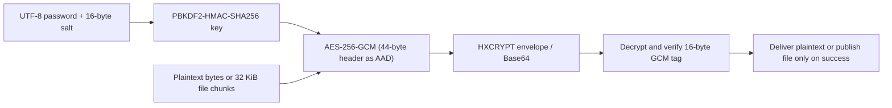

# Cryptography: Text, Files, Hashes and Signatures

[简体中文](CRYPTO.zh-CN.md) · [README](../README.md) · [Dependency Setup](DEPENDENCIES.md)

When your application needs to encrypt sensitive configuration text with a password, encrypt and authenticate large local files without loading them into RAM, compute SHA-256 / SHA-512 digests and HMACs, or sign and verify messages with Ed25519 and RSA-PSS, `hx_os_crypto` provides high-level C99 and exception-free C++11 APIs. Built on a pinned OpenSSL 3.5 dependency stack, it handles random salt and nonce generation, PBKDF2 key derivation, AES-256-GCM authenticated encryption, and atomic file publication so you do not have to wire up low-level `EVP_*` state machines by hand.

Build and run the standalone [encrypt_text.c](../examples/encrypt_text.c) example to see authenticated text encryption in action (enable `HX_OS_BUILD_EXAMPLES=ON` per the [example run instructions](../examples/README.md#run) and build `hx_os_encrypt_text`; no command-line arguments or input files are needed):
- The program prints a freshly randomized Base64 ciphertext line (`Encrypted: ...`) followed by the verified plaintext (`Decrypted: Hello, UTF-8!`).
- When linking against an [installed SDK package](USAGE.md#installed-project), keep the corresponding OpenSSL dependency module enabled.

## 1. Build and deploy

`HX_OS_ENABLE_CRYPTO` is `ON` by default, linking the pinned OpenSSL 3.5 SDK into the library while keeping public headers pure C99 / C++11 with zero background threads started at load time.

First build the native dependency stack following the [Dependency Guide](DEPENDENCIES.md#4-build-the-native-dependency-stack), then pass the absolute install prefix to `HX_OS_DEPENDENCY_PREFIX`:

```sh
cmake -S . -B build -DCMAKE_BUILD_TYPE=Release \
  -DHX_OS_DEPENDENCY_PREFIX=/absolute/project/build-deps/prefix \
  -DHX_OS_BUILD_EXAMPLES=ON
cmake --build build --config Release --target hx_os_encrypt_text --parallel 4
build/bin/hx_os_encrypt_text
```

(On multi-config Windows generators, the binary is placed at `build/bin/Release/hx_os_encrypt_text.exe`.)

### Dynamic Linking, Static Linking, and Building Without OpenSSL

- **Default Dynamic OpenSSL Linking**:
  - On Windows, the build copies the selected OpenSSL Crypto DLL into `bin/<config>` (if you integrate via `add_subdirectory` with a custom runtime output directory, copy that DLL beside your executable or add the installed `bin` folder to `PATH`).
  - `cmake --install` installs the Crypto runtime by default (pass `-DHX_OS_INSTALL_OPENSSL_RUNTIME=OFF` if your installer packages runtimes separately). On Linux, the runtime is installed beside the core shared library with an `$ORIGIN`-relative `RPATH`.
  - Even when the core library is built as a static archive, OpenSSL remains dynamically linked by default; static consumers calling `find_package(hx_c_platform CONFIG REQUIRED)` should include the SDK prefix in `CMAKE_PREFIX_PATH` (enabling TLS also installs the SSL runtime; see the [TLS Guide](TLS.md)).
- **Static OpenSSL Embedding**: To link OpenSSL statically, build the dependency stack with `-DHX_DEPS_OPENSSL_SHARED=OFF`, configure the main project with `-DHX_OS_OPENSSL_STATIC=ON`, and follow the thread-cleanup rules in Section 5.
- **Android SONAME Isolation**: Android SDK builds use custom `libcrypto-hx.so` and `libssl-hx.so` SONAMEs so they never collide with Android's system BoringSSL libraries (see [Cross-Building for Linux ARM and Android](DEPENDENCIES.md#6-cross-build-linux-arm-and-android) and [Android Deployment](ANDROID.md)).
- **Disabling OpenSSL Entirely**: Set both `-DHX_OS_ENABLE_CRYPTO=OFF` and `-DHX_OS_ENABLE_ARCHIVE=OFF` (since encrypted ZIP support in `ARCHIVE` also uses OpenSSL). All symbols remain linkable, `hx_os_crypto_available()` returns `0`, and crypto calls return `HX_OS_NOT_SUPPORTED`.

## 2. Encrypt and decrypt UTF-8 text

The complete C program below encrypts a UTF-8 string with a password, decrypts the resulting Base64 envelope, and prints the verified plaintext (replace the hard-coded demo password with secret input from your application or credential store in production):

```c
#include <hx_os.h>
#include <stdio.h>

int main(void)
{
	hx_string encrypted = HX_STRING_INIT, plain = HX_STRING_INIT;
	hx_string_view message = {"Hello", 5};

	hx_os_status status = hx_os_crypto_encrypt_text(
		"example password", message, &encrypted, NULL);
	if (status == HX_OS_OK)
		status = hx_os_crypto_decrypt_text("example password",
			hx_string_view_of(&encrypted), &plain, NULL);
	if (status == HX_OS_OK)
		puts(hx_string_c_str(&plain));
	else
		fprintf(stderr, "Crypto failed: %s\n",
			hx_os_status_name(status));

	hx_string_destroy(&plain);
	hx_string_destroy(&encrypted);

	return status == HX_OS_OK ? 0 : 1;
}
```

Expected output: `Hello`. In C++11, include `<hx/Crypto.hpp>` to use `hx::Result<hx::String>` without exceptions:

```cpp
#include <hx/Crypto.hpp>
#include <cstdio>

int main()
{
	auto encrypted = hx::Crypto::encryptText("example password", "Hello");
	if (!encrypted)
		return 1;

	auto plain =
		hx::Crypto::decryptText("example password", encrypted.value());
	if (!plain)
		return 1;

	std::puts(plain.value().c_str());
	return 0;
}
```

- **Encoding & Size Limits**: Plaintext and passwords must be valid UTF-8 (no Unicode normalization is performed, and length-delimited plaintext spans may contain embedded `\0` bytes). Base64 ciphertexts must be canonical without whitespace or line breaks. Text inputs are capped at `16 MiB` and passwords at `1`–`1024` bytes.
- **Authentication Failures**: Supplying a wrong password or modifying any ciphertext or header byte returns `HX_OS_AUTH_FAILED` (malformed Base64 or truncated headers return distinct framing/encoding errors) while leaving the output string untouched. **Never use the output buffer unless the call returns `HX_OS_OK`.**

## 3. Encrypt files or arbitrary bytes

For files on disk, `hx_os_crypto_encrypt_file()` and `hx_os_crypto_decrypt_file()` (`hx::Crypto::encryptFile()` and `decryptFile()` in C++11) handle chunked streaming, authentication, and atomic file publication:

```c
hx_os_status status =
	hx_os_crypto_encrypt_file("report.pdf", "report.hxc", password, &error);
if (status == HX_OS_OK)
	status = hx_os_crypto_decrypt_file(
		"report.hxc", "restored.pdf", password, &error);
```

- **Chunked Streaming & Atomic Publication**:
  - Files are processed in `32 KiB` chunks using a `64 KiB` working buffer rather than reading the entire file into memory. The default file size cap is `4 GiB`, configurable up to `64 GiB - 32 bytes` (the AES-GCM single-message ceiling).
  - By default, an existing destination file causes the call to return `HX_OS_EXISTS` without overwriting. Use the `_with_options` variants with `HX_OS_CRYPTO_REPLACE` to overwrite existing files, supply a raw 32-byte key, adjust size limits, or inspect `hx_os_file_save_result`.
  - Output is staged in a sibling temporary file in the destination directory, synced, and published only after the GCM authentication tag verifies cleanly—failed authentication never overwrites the target file.
- **Owner-Only Permissions on Decrypted Staging Files**:
  - Decryption creates its temporary file with private permissions (mode `0600` verified on POSIX, or a protected owner-only DACL on Windows) so other local non-admin users cannot read staged plaintext. Filesystems that ignore `0600` (such as certain WSL Windows-drive mounts) or lack persistent ACLs fail with `HX_OS_NOT_SUPPORTED` before any plaintext is written.
- **In-Memory Binary Encryption (`hx_os_crypto_encrypt` / `decrypt`)**:
  - Pass an `hx_os_bytes_view` input and an `hx_os_crypto_secret` (either a password span or a 32-byte key from `hx_os_crypto_random_key()`) to obtain an owned `hx_os_crypto_bytes *` (default cap `16 MiB`, max `64 MiB`).
  - Access the bytes via `hx_os_crypto_bytes_data()` and `bytes_size()`, then call `hx_os_crypto_bytes_destroy(&result)`, which securely zeroes the buffer before freeing. Always wipe your own raw key buffers with `hx_os_secure_zero()` when done.

> [!WARNING]
> **Raw 32-Byte Key Rotation Limit (NIST SP 800-38D)**
> When encrypting directly with a raw 32-byte key instead of a password-derived PBKDF2 key, each encryption generates a fresh 96-bit random GCM nonce. Per [NIST SP 800-38D Section 8.3](https://nvlpubs.nist.gov/nistpubs/Legacy/SP/nistspecialpublication800-38d.pdf), **you must rotate a raw key before it reaches $2^{32}$ total encryptions across all processes and devices**.

## 4. Hashes, HMAC and signatures

- **One-Shot SHA Digests & Constant-Time HMAC Verification**:
  - `hx_os_crypto_sha256(NULL, input, &text, &error)` writes a lowercase hexadecimal SHA-256 digest (`hx_os_crypto_hash()` also supports SHA-512, and `sha256_file` / `hash_file` hash files on disk in bounded chunks; for chunked streaming inputs, see [Incremental SHA and HMAC](INCREMENTAL_HASH.md)).
  - `hx_os_crypto_hmac()` computes an HMAC tag, and `hx_os_crypto_hmac_verify()` (`hx::Crypto::verifyHmac()` in C++11) validates a hex tag in **constant time**, returning `HX_OS_AUTH_FAILED` on mismatch.
- **Digital Signatures (Ed25519 & RSA-PSS)**:
  - `hx::CryptoKey::generate()` creates an **Ed25519** key pair by default; passing `HX_OS_CRYPTO_RSA_3072` generates a 3072-bit RSA key using **RSA-PSS with SHA-256, MGF1-SHA256, and a 32-byte salt** (imported RSA keys must be 2048–8192 bits; max message size is `16 MiB`).

The C++11 snippet below generates an Ed25519 key pair, exports the public SPKI PEM, and verifies a signature using only the imported public key:

```cpp
auto key = hx::CryptoKey::generate();
if (!key)
	return 1;

auto pem = key.value().exportPublic();
if (!pem)
	return 1;

auto publicKey = hx::CryptoKey::importPublic(pem.value());
auto signature = key.value().sign({"message", 7});
if (!publicKey || !signature)
	return 1;

auto verified =
	publicKey.value().verify({"message", 7}, signature.value().view());
if (!verified)
	return 1;
```

(In C, use `hx_os_crypto_key_*`, `hx_os_crypto_sign()`, and `hx_os_crypto_verify()`.) Key imports accept a single unencrypted PKCS#8 private key PEM or SPKI public key PEM (up to `64 KiB`), and private-key exports return unencrypted PKCS#8 bytes inside a zero-on-destroy `CryptoBytes` container—encrypt those exported bytes with `hx_os_crypto_encrypt()` if you need password-protected storage on disk.

## 5. Threads, memory and unloading

- **Reusable Engine Contexts**: Pass `NULL` as the engine for one-off calls, or create an `hx_os_crypto *` handle (`hx::Crypto::create()` in C++11) to reuse across operations. Each engine owns an isolated `OSSL_LIB_CTX` and default provider without altering the host process's global OpenSSL settings. Same-thread re-entry into an active crypto call from a custom allocator callback returns `HX_OS_DEADLOCK`.
- **Static OpenSSL Thread Cleanup on Windows**: Dynamic OpenSSL DLLs clean up thread-local state automatically when native Windows threads exit. When linking **static OpenSSL (`HX_OS_OPENSSL_STATIC=ON`)**, any external Windows thread that uses that OpenSSL runtime must call `hx_os_crypto_thread_cleanup()` after its final OpenSSL operation. Before unloading a plugin or shared library, finish all crypto calls, destroy all keys and engines, and ensure participating threads have exited or completed thread cleanup.

## 6. HXCRYPT v1 binary format

Binary and file encryption use the documented **HXCRYPT v1** authenticated envelope around AES-256-GCM (note that this is not the `openssl enc` CLI format). Peers in other languages must validate this exact layout:

| Byte Offset | Length (Bytes) | Field Description |
| --- | --- | --- |
| `0` | `8` | 7-byte ASCII magic `HXCRYPT` followed by version byte `0x01` |
| `8` | `1` | Cipher ID: `1` = `AES-256-GCM` |
| `9` | `1` | Secret kind: `1` = raw 32-byte key; `2` = password |
| `10` | `2` | Reserved: must be `0` |
| `12` | `4` | Big-endian `uint32_t` PBKDF2 iteration count (`0` for raw key mode) |
| `16` | `16` | 16-byte random password salt (all zeroes for raw key mode) |
| `32` | `12` | 12-byte random GCM nonce |
| `44` | `N` | Ciphertext payload (same byte length as plaintext) |
| `44 + N` | `16` | 16-byte AES-GCM authentication tag |

- **Additional Authenticated Data (AAD)**: All **44 header bytes are passed as GCM Additional Authenticated Data (AAD)**, so any tampering with the header fields, iteration count, salt, or nonce fails tag verification with `HX_OS_AUTH_FAILED`.
- **PBKDF2 Parameters**: Password mode runs **PBKDF2-HMAC-SHA256** over the exact UTF-8 password bytes and 16-byte salt to derive a 32-byte key. The default iteration count is **600,000** (configurable between `100,000` and `2,000,000` for encryption, with a matching bounded cap enforced before running the KDF on decryption). Text helpers (`_text`) encode the complete binary envelope as standard padded Base64.



## 7. Try the example

Build and run [encrypt_text.c](../examples/encrypt_text.c) to verify encryption and decryption on your target toolchain. Always check for `HX_OS_AUTH_FAILED` before using any decrypted output, and see [Platform Support](PLATFORMS.md) for deployment details.
