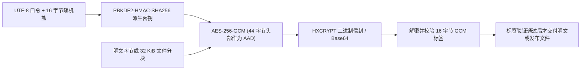

# 加密：文本、文件、摘要与签名

[English](CRYPTO.md) · [首页](../README.zh-CN.md) · [依赖构建](DEPENDENCIES.zh-CN.md)

当应用需要使用口令或密钥加密保存配置文本、对本地大文件进行带完整性认证的加解密、计算 SHA-256 / SHA-512 摘要与 HMAC，或者使用 Ed25519 / RSA-PSS 进行数字签名与验签时，`hx_os_crypto` 提供了开箱即用的高层密码学接口。它基于固定版本的 OpenSSL 3.5 构建，将盐值生成、PBKDF2 密钥派生、AES-256-GCM 认证加密和原子文件发布封装为直观的 C99 与零异常 C++11 调用，让你无需直接操作繁琐的底层 `EVP_*` 接口。

你可以直接编译并运行公开示例 [encrypt_text.c](../examples/encrypt_text.c) 来体验完整的加解密与认证流程（按[示例构建说明](../examples/README.zh-CN.md#run)启用 `HX_OS_BUILD_EXAMPLES=ON` 并构建 `hx_os_encrypt_text`，无需命令行参数或外部文件）：
- 程序会输出一行随机生成的 Base64 密文 `Encrypted: ...`，随后验证并还原出明文 `Decrypted: Hello, UTF-8!`（每次运行生成的密文都不同，因为内部会自动生成随机盐值与随机 GCM Nonce）。
- 如果通过[已安装包接入工程](USAGE.zh-CN.md#installed-project)，请同时保留对应的依赖 SDK 模块。

## 1. 构建与发布

`HX_OS_ENABLE_CRYPTO` 默认开启（`ON`），它会将固定版本的 OpenSSL 3.5 SDK 接入本库，而业务代码依然只需 `#include <hx_os.h>`，且加载模块不会启动任何后台线程。

请先按[依赖构建指南](DEPENDENCIES.zh-CN.md#4-构建依赖)编译依赖 SDK，再将 SDK 的安装前缀绝对路径传给 `HX_OS_DEPENDENCY_PREFIX`：

```sh
cmake -S . -B build -DCMAKE_BUILD_TYPE=Release \
  -DHX_OS_DEPENDENCY_PREFIX=/absolute/project/build-deps/prefix \
  -DHX_OS_BUILD_EXAMPLES=ON
cmake --build build --config Release --target hx_os_encrypt_text --parallel 4
build/bin/hx_os_encrypt_text
```

（Windows 多配置构建生成的可执行文件位于 `build/bin/Release/hx_os_encrypt_text.exe`。）

### 动态链接、静态链接与无 OpenSSL 裁剪

- **默认动态链接 OpenSSL**：
  - 在 Windows 上，构建过程会自动将对应的 Crypto DLL 复制到 `bin/<config>` 目录（若你的主工程通过 `add_subdirectory` 接入且可执行文件输出在其他目录，请将该 DLL 放到可执行文件旁或将安装后的 `bin` 目录加入 `PATH`）。
  - `cmake --install` 默认会一并安装选中的 Crypto 运行库（若宿主工程自行管理运行库部署，可设 `-DHX_OS_INSTALL_OPENSSL_RUNTIME=OFF`）。Linux 安装时会将运行库放在核心共享库旁并自动配置相对 `RPATH`。
  - 注意：即使本库核心编译为静态库，OpenSSL 默认仍为动态链接；外部静态库消费者在调用 `find_package(hx_c_platform CONFIG REQUIRED)` 时，需将依赖 SDK 的 `prefix` 路径加入 `CMAKE_PREFIX_PATH`（若同时启用了 TLS，还会自动包含 SSL 运行库，详见 [TLS 指南](TLS.zh-CN.md)）。
- **静态嵌入 OpenSSL**：若需将 OpenSSL 静态编译进库中，请先用 `-DHX_DEPS_OPENSSL_SHARED=OFF` 构建依赖 SDK，再向主项目传入 `-DHX_OS_OPENSSL_STATIC=ON`，并务必遵守第 5 节的外部线程清理与卸载规则。
- **Android 专有 SONAME 隔离**：Android 平台的依赖 SDK 通过专有配置生成 `libcrypto-hx.so` 与 `libssl-hx.so` SONAME，避免与 Android 系统自带的 BoringSSL 发生符号冲突（请勿手动重命名桌面端动态库或混用不同 ABI，详见[交叉构建指南](DEPENDENCIES.zh-CN.md#6-linux-arm-与-android-交叉构建)与 [Android 部署说明](ANDROID.zh-CN.md)）。
- **彻底裁剪 OpenSSL**：如果目标环境完全不需要密码学能力，请同时设置 `-DHX_OS_ENABLE_CRYPTO=OFF` 和 `-DHX_OS_ENABLE_ARCHIVE=OFF`（因为 `ARCHIVE` 模块的加密 ZIP 同样依赖 OpenSSL）。裁剪后头文件与函数符号依然存在，但 `hx_os_crypto_available()` 返回 `0`，相关调用统一返回 `HX_OS_NOT_SUPPORTED`。

## 2. 加密并解密 UTF-8 文本

下面的完整 C 程序使用口令加密一段 UTF-8 文本，随后解密并打印通过完整性认证的明文。加密产物是标准的 Base64 字符串，非常适合直接存入 JSON、INI 或数据库字段（注：示例中的明文口令仅用于演示，实际业务请从安全输入或密钥管理服务中获取口令）：

```c
#include <hx_os.h>
#include <stdio.h>

int main(void)
{
	hx_string encrypted = HX_STRING_INIT, plain = HX_STRING_INIT;
	hx_string_view message = {"Hello", 5};

	hx_os_status status = hx_os_crypto_encrypt_text(
		"example password", message, &encrypted, NULL);
	if (status == HX_OS_OK)
		status = hx_os_crypto_decrypt_text("example password",
			hx_string_view_of(&encrypted), &plain, NULL);
	if (status == HX_OS_OK)
		puts(hx_string_c_str(&plain));
	else
		fprintf(stderr, "Crypto failed: %s\n",
			hx_os_status_name(status));

	hx_string_destroy(&plain);
	hx_string_destroy(&encrypted);

	return status == HX_OS_OK ? 0 : 1;
}
```

运行后输出 `Hello`。在 C++11 中，包含 `<hx/Crypto.hpp>` 即可使用零异常的 `hx::Result<hx::String>` 接口：

```cpp
#include <hx/Crypto.hpp>
#include <cstdio>

int main()
{
	auto encrypted = hx::Crypto::encryptText("example password", "Hello");
	if (!encrypted)
		return 1;

	auto plain =
		hx::Crypto::decryptText("example password", encrypted.value());
	if (!plain)
		return 1;

	std::puts(plain.value().c_str());
	return 0;
}
```

- **编码与容量约束**：输入明文与口令均严格校验 UTF-8 合法性（不做 Unicode 字符规范化转换；按长度传入的明文允许包含内部 `\0` 字节）。解密输入的 Base64 必须是无空格、无折行的标准規範格式。单次文本输入上限为 `16 MiB`，口令长度范围为 `1`～`1024` 字节。
- **认证失败处理**：如果口令错误或密文/头部被篡改，解密函数会明确返回 `HX_OS_AUTH_FAILED`（若外层 Base64 或帧结构损坏则报告对应的格式/编码错误），同时保持输出字符串原有内容不变——**只有当函数返回 `HX_OS_OK` 时，才允许使用解密输出**。

## 3. 加密文件或任意字节

对于本地文件，只需调用 `hx_os_crypto_encrypt_file()` 和 `hx_os_crypto_decrypt_file()`（C++11 对应 `hx::Crypto::encryptFile()` 与 `decryptFile()`），内部会自动完成分块读写、GCM 认证与原子发布：

```c
hx_os_status status =
	hx_os_crypto_encrypt_file("report.pdf", "report.hxc", password, &error);
if (status == HX_OS_OK)
	status = hx_os_crypto_decrypt_file(
		"report.hxc", "restored.pdf", password, &error);
```

- **分块流式处理与原子发布**：
  - 文件加解密按 `32 KiB` 分块流式处理（内部工作缓冲共 `64 KiB`），不会把整个大文件读入内存。默认单文件上限为 `4 GiB`，最高可配置至 `64 GiB - 32 字节`（即 AES-GCM 单消息理论上限）。
  - 默认情况下，若目标输出文件已存在，函数返回 `HX_OS_EXISTS` 而不会静默覆盖；如需覆盖已有文件，或需使用原始 32 字节密钥、自定义大小上限及获取父目录落盘结果（`hx_os_file_save_result`），请调用 `_with_options` 变体并传入 `HX_OS_CRYPTO_REPLACE`。
  - 解密输出会先写入目标同目录下的私有临时文件，**只有当整份文件的 GCM 认证标签完全校验通过并刷盘成功后，才会原子发布为目标文件**——一旦密码错误或文件尾部被篡改，目标路径绝不会被污染。
- **解密临时文件的权限保护**：
  - 为了防止解密过程中的明文临时文件被同机其他普通用户偷看，POSIX 端强制使用仅所有者可读写的 `0600` 权限并做回读核实，Windows 端则设置仅允许当前所有者的受保护 DACL。如果目标挂载点忽略权限位（如部分 WSL Windows 挂载盘）或不支持持久 ACL，函数会在写入任何明文前直接返回 `HX_OS_NOT_SUPPORTED`。
- **任意二进制内存加解密（`hx_os_crypto_encrypt` / `decrypt`）**：
  - 处理非文本二进制数据时，传入 `hx_os_bytes_view` 与 `hx_os_crypto_secret`（口令或由 `hx_os_crypto_random_key()` 生成的 32 字节原始密钥），输出为独立持有的 `hx_os_crypto_bytes *`（单次默认上限 `16 MiB`，最大可配 `64 MiB`）。
  - 读取完 `hx_os_crypto_bytes_data()` / `bytes_size()` 后，调用 `hx_os_crypto_bytes_destroy(&result)` 即可在释放前自动安全清零内存（调用方自己持有的原始密钥缓冲区用完后也应调用 `hx_os_secure_zero()` 清零）。

> [!WARNING]
> **原始 32 字节密钥的 Nonce 碰撞边界（NIST SP 800-38D）**
> 当跳过 PBKDF2 直接使用固定的 32 字节原始密钥（Raw Key Mode）进行 AES-256-GCM 加密时，由于每次采用 96 位随机 Nonce，根据 [NIST SP 800-38D 第 8.3 节](https://nvlpubs.nist.gov/nistpubs/Legacy/SP/nistspecialpublication800-38d.pdf) 规范，**同一个原始密钥在所有进程与设备上的累计加密次数不得超过 $2^{32}$ 次**，应用层需自行协调密钥轮换。

## 4. 摘要、HMAC 与签名

- **单次 SHA 摘要与常时间 HMAC 校验**：
  - `hx_os_crypto_sha256(NULL, input, &text, &error)` 输出小写十六进制 SHA-256 字符串；通用入口 `hx_os_crypto_hash()` 还支持 SHA-512；文件摘要入口 `sha256_file` / `hash_file` 则使用有界文件缓冲逐块读取（若需边收网络流边算摘要，请见[分块增量哈希指南](INCREMENTAL_HASH.zh-CN.md)）。
  - `hx_os_crypto_hmac()` 接收密钥与消息字节串计算消息认证码；收到对端发来的十六进制 HMAC 标签时，请调用 `hx_os_crypto_hmac_verify()`（C++11 为 `hx::Crypto::verifyHmac()`），它会在校验格式后执行**常量时间比较（Constant-Time Comparison）**，不匹配时返回 `HX_OS_AUTH_FAILED`。
- **非对称数字签名（Ed25519 与 RSA-PSS）**：
  - 默认生成 **Ed25519** 密钥对直接对消息签名；也可显式指定 `HX_OS_CRYPTO_RSA_3072` 生成 RSA 密钥（采用 **RSA-PSS + SHA-256 + MGF1-SHA256 + 32 字节盐**，支持导入 2048～8192 位 RSA 密钥）。单次签名消息上限为 `16 MiB`。

下面的 C++11 示例生成一个 Ed25519 私钥，导出 SPKI 公钥 PEM 后，仅用公钥对象验证签名：

```cpp
auto key = hx::CryptoKey::generate();
if (!key)
	return 1;

auto pem = key.value().exportPublic();
if (!pem)
	return 1;

auto publicKey = hx::CryptoKey::importPublic(pem.value());
auto signature = key.value().sign({"message", 7});
if (!publicKey || !signature)
	return 1;

auto verified =
	publicKey.value().verify({"message", 7}, signature.value().view());
if (!verified)
	return 1;
```

（C 语言对应 `hx_os_crypto_key_*`、`hx_os_crypto_sign()` 与 `hx_os_crypto_verify()`。）注意：PEM 导入接收单张未加密的 PKCS#8 私钥或 SPKI 公钥（上限 `64 KiB`）；私钥导出同样返回保存在自清零 `CryptoBytes` 中的未加密 PKCS#8 数据——如需用口令落盘保存私钥，请先用第 3 节的 `hx_os_crypto_encrypt()` 将其加密为 HXCRYPT 认证信封后再写入磁盘。

## 5. 线程、内存与插件卸载

- **Engine 复用与上下文隔离**：偶发调用直接将 `engine` 参数传 `NULL` 即可；高频重复调用建议显式创建一个 `hx_os_crypto *`（C++11 为 `hx::Crypto::create()`）并在多次调用间共享。每个 Engine 内部持有独立的私有 `OSSL_LIB_CTX` 与内置 Default Provider，绝不会污染宿主进程全局的 OpenSSL 配置。注意：不可在自定义分配器回调或 OpenSSL Provider 回调内部同线程重入正在执行的加密操作，否则会立即返回 `HX_OS_DEADLOCK`。
- **静态链接 OpenSSL 时的 Windows 线程清理**：在 Windows 下使用默认动态链接 OpenSSL 时，`DllMain` 会在线程退出时自动清理线程状态；但如果你显式开启了**静态链接 OpenSSL（`HX_OS_OPENSSL_STATIC=ON`）**，任何调用过该 OpenSSL 运行库的外部自建 Windows 线程，在彻底结束使用 OpenSSL 后必须显式调用一次 `hx_os_crypto_thread_cleanup()`。在卸载动态插件或运行库前，请确保所有加密操作已结束、密钥与 Engine 对象已销毁，且参与线程已退出或完成了线程清理。

## 6. HXCRYPT v1 二进制格式

本库的字节与文件加解密采用公开、自包含的 **HXCRYPT v1** 认证信封格式（基于 AES-256-GCM，注意它不是命令行 `openssl enc` 的格式）。如果其他语言的对端需要直接生成或解密本格式，只需遵循以下二进制布局：

| 字节偏移 | 长度（字节） | 字段含义 |
| --- | --- | --- |
| `0` | `8` | 7 字节 ASCII 魔数 `HXCRYPT`，紧跟 1 字节版本号 `0x01` |
| `8` | `1` | 对称加密算法：`1` 代表 `AES-256-GCM` |
| `9` | `1` | 密钥来源类型：`1` 代表 32 字节原始密钥；`2` 代表口令派生（Password） |
| `10` | `2` | 保留字段：必须为 `0` |
| `12` | `4` | 大端无符号整数：PBKDF2 迭代次数（原始密钥模式下固定为 `0`） |
| `16` | `16` | 16 字节随机密码盐（Salt；原始密钥模式下全为 `0`） |
| `32` | `12` | 12 字节随机 GCM Nonce |
| `44` | `N` | 密文载荷（字节长度与明文完全一致） |
| `44 + N` | `16` | 16 字节 AES-GCM 认证标签（Authentication Tag） |

- **附加认证数据（AAD）**：前 **44 字节头部整体作为 AES-GCM 的附加认证数据（AAD）**参与认证，任何对版本号、迭代次数、盐值或 Nonce 的篡改都会导致 GCM 标签校验失败（返回 `HX_OS_AUTH_FAILED`）。
- **PBKDF2 参数**：口令模式使用 **PBKDF2-HMAC-SHA256** 从精确的 UTF-8 口令字节与 16 字节随机盐派生出 32 字节密钥。默认迭代次数为 **600,000 次**（加密时可在 `100,000`～`2,000,000` 次之间配置；解密端同样检查迭代上限以防恶意超大迭代数造成 CPU 拒绝服务攻击）。文本加解密接口（`_text`）则是将上述完整二进制信封编码为带标准 `=` 填充的 Base64 字符串。



## 7. 运行示例入口

编译并运行 [encrypt_text.c](../examples/encrypt_text.c) 即可快速验证文本加解密流程。在实际工程中，请始终检查函数返回值，遇到错误的口令或被篡改的密文时立即按 `HX_OS_AUTH_FAILED` 中止处理。各操作系统的详细部署要求见[平台支持说明](PLATFORMS.zh-CN.md)。
