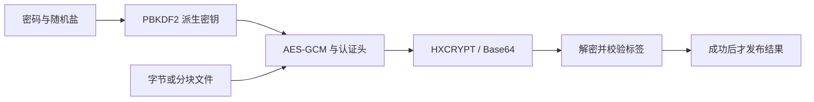

# 加密：文本、文件、摘要与签名

[English](CRYPTO.md) · [首页](../README.zh-CN.md) · [依赖构建](DEPENDENCIES.zh-CN.md)

## 1. 构建与发布

`HX_OS_ENABLE_CRYPTO` 默认开启，将固定版本的 OpenSSL 3.5 SDK 接入编译库；业务仍只需要包含 hx 头文件。核心继续使用 C99，C++11 包装不使用异常。模块启用后不会启动后台线程。

先按[依赖说明](DEPENDENCIES.zh-CN.md#4-构建依赖)构建 SDK，再用绝对 prefix 路径配置本库：

```sh
cmake -S . -B build -DCMAKE_BUILD_TYPE=Release -DHX_OS_DEPENDENCY_PREFIX=/absolute/project/build-deps/prefix
cmake --build build --config Release --parallel 4
ctest --test-dir build -C Release -R "crypto|encrypt_text" --output-on-failure
```

OpenSSL 默认动态链接。Windows 构建会把选中的 Crypto DLL 复制到本库的 `bin/<config>` 目录；通过 `add_subdirectory` 接入且可执行文件在其他目录时，业务也需要把该 DLL 放到程序旁，或者把安装后的 `bin` 加入 PATH。安装默认包含选中的 Crypto 运行库；业务自己管理部署时，可通过 `HX_OS_INSTALL_OPENSSL_RUNTIME=OFF` 关闭复制。Linux 将其安装在核心共享库旁，并设置相对运行库搜索路径。即便核心使用静态库，OpenSSL 默认仍为动态链接；安装后的静态库消费者执行 `find_package(hx_c_platform CONFIG REQUIRED)` 时，需要把 SDK prefix 加入 `CMAKE_PREFIX_PATH`。

启用 TLS 时，同时包含选定的 SSL 运行库，详见 [TLS 教程](TLS.zh-CN.md)。

需要静态集成 OpenSSL 时，用 `HX_DEPS_OPENSSL_SHARED=OFF` 构建 SDK，并给主项目传入 `HX_OS_OPENSSL_STATIC=ON`。外部线程和插件卸载还需遵守第 5 节。分发时保留实际组件的许可证材料。Android 和 Linux ARM SDK 操作见[交叉构建](DEPENDENCIES.zh-CN.md#6-linux-arm-与-android-交叉构建)，当前模拟器／QEMU 结果见[验证记录](VALIDATION.zh-CN.md)。实体板卡结果单列，Apple 和旧版 Windows 运行验证暂缓。

Android SDK 通过自有 OpenSSL 配置使用 `libcrypto-hx.so`、`libssl-hx.so` SONAME，避开系统 BoringSSL 名称。CMake 目标和运行库清单记录实际文件，不要手工改名桌面运行库，也不能混用不同 ABI 的库。详见 [Android 部署](ANDROID.zh-CN.md)。

完全不需要 OpenSSL 时，同时设置 `HX_OS_ENABLE_CRYPTO=OFF` 和 `HX_OS_ENABLE_ARCHIVE=OFF`；ARCHIVE 的密码 ZIP 同样使用 OpenSSL。头文件和函数仍可用，`hx_os_crypto_available()` 返回 0，加密操作返回 `HX_OS_NOT_SUPPORTED`。基础字符串、容器和文件能力不依赖 OpenSSL。

## 2. 加密并解密 UTF-8 文本

下面是完整的 C 程序：加密一段文字，再解密并打印验证通过的原文。加密结果是 Base64 文本，可以存进 JSON 字符串。示例密码只用于演示，实际密码应由程序的输入或秘密存储提供。

```c
#include <hx_os.h>
#include <stdio.h>

int main(void)
{
	hx_string encrypted = HX_STRING_INIT, plain = HX_STRING_INIT;
	hx_string_view message = {"Hello", 5};

	hx_os_status status = hx_os_crypto_encrypt_text(
		"example password", message, &encrypted, NULL);
	if (status == HX_OS_OK)
		status = hx_os_crypto_decrypt_text("example password",
			hx_string_view_of(&encrypted), &plain, NULL);
	if (status == HX_OS_OK)
		puts(hx_string_c_str(&plain));
	else
		fprintf(stderr, "Crypto failed: %s\n",
			hx_os_status_name(status));

	hx_string_destroy(&plain);
	hx_string_destroy(&encrypted);

	return status == HX_OS_OK ? 0 : 1;
}
```

预期输出是 `Hello`。每次加密结果不同，因为盐和 nonce 都随机生成。可直接构建运行的 [encrypt_text.c](../examples/encrypt_text.c) 还会打印密文；运行 `build/bin/hx_os_encrypt_text` 或 `build\bin\Release\hx_os_encrypt_text.exe`。

C++11 使用 `Result<String>`，不需要异常：

```cpp
#include <hx/Crypto.hpp>
#include <cstdio>

int main()
{
	auto encrypted = hx::Crypto::encryptText("example password", "Hello");
	if (!encrypted)
		return 1;

	auto plain =
		hx::Crypto::decryptText("example password", encrypted.value());
	if (!plain)
		return 1;

	std::puts(plain.value().c_str());
	return 0;
}
```

C 的输出使用已初始化字符串自己的分配器，失败时保留原内容。原文和密码严格使用 UTF-8，不做字符规范化；按长度传入的原文可以包含 NUL。Base64 必须为标准规范形式，不接受空白和折行。文本上限为 16 MiB，密码为 1～1024 字节。错误密码或认证内容被修改返回 `HX_OS_AUTH_FAILED`；帧结构、编码错误单独报告。只有成功结果才可以当作解密原文使用。

## 3. 加密文件或任意字节

文件只需调用下面两个 C 入口，打开、读写、关闭、认证和发布由库处理：

```c
hx_os_status status =
	hx_os_crypto_encrypt_file("report.pdf", "report.hxc", password, &error);
if (status == HX_OS_OK)
	status = hx_os_crypto_decrypt_file(
		"report.hxc", "restored.pdf", password, &error);
```

这里 `password` 由业务提供，`error` 是 `hx_os_error`。检查 `status` 后再使用输出文件。C++ 对应 `hx::Crypto::encryptFile`、`decryptFile`，返回 `Result<void>`。默认目标已存在时返回 `EXISTS`，不会悄悄覆盖。需要覆盖时使用 `_with_options`，显式设置 `HX_OS_CRYPTO_REPLACE`；同一入口还支持原始 32 字节密钥、密码字节串、长度限制和 `hx_os_file_save_result`，分别报告“已经发布”和“父目录持久化请求的结果”。

文件按 32 KiB 分块，工作缓冲共 64 KiB，不会把整份文件读入内存。默认文件上限 4 GiB，可配置到 64 GiB 减 32 字节，即 GCM 单条消息上限。调用期间输入文件必须保持稳定。同目录临时文件通过认证、冲刷后才发布，认证失败不会替换目标文件。POSIX 文件系统不支持“不覆盖重命名”时，可通过硬链接原子发布已经写好的临时文件，再移除临时名称。

解密临时文件使用私有权限：POSIX 仅所有者可访问，Windows 使用只允许所有者的受保护 DACL。POSIX 会核实创建后的权限；忽略 0600 的挂载文件系统，以及不支持持久 ACL 的 Windows 文件系统，会在写入明文前返回 `NOT_SUPPORTED`。发布后的文件保留这些权限。此约定保护的是其他普通账户，不能隔离管理员或同一用户身份运行的其他程序。失败和发布后的清理尽力完成，操作系统清理失败时可能留下私有临时文件；目标目录应由应用控制。WSL 原生文件系统和 Windows 挂载盘分别验证。

任意二进制内容使用 `hx_os_crypto_encrypt/decrypt`：输入是 `hx_os_bytes_view`，秘密材料是 `hx_os_crypto_secret`，输出为独立持有的 `hx_os_crypto_bytes *`。`hx_os_crypto_random_key` 生成 32 字节密钥。通过 `bytes_data/bytes_size` 借用结果，完成后调用 `hx_os_crypto_bytes_destroy(&result)`，释放前会清零。结果不承诺 NUL 终止。二进制内存输入默认限制 16 MiB，最多 64 MiB；封装头和有界临时副本另计。限制针对单次调用，不是整个进程的内存预算。业务自己的密钥缓冲使用完后也应通过 `hx_os_secure_zero` 清零。原始密钥模式需要业务跨所有进程／设备协调轮换，同一密钥加密次数应少于 2^32；无状态的字节串入口不保存全局密钥计数。此限制来自随机 nonce 的 [NIST SP 800-38D 第 8.3 节](https://nvlpubs.nist.gov/nistpubs/Legacy/SP/nistspecialpublication800-38d.pdf)。

## 4. 摘要、HMAC 与签名

`hx_os_crypto_sha256(NULL, input, &text, &error)` 返回小写十六进制 SHA-256。`hash` 还支持 SHA-512；`sha256_file/hash_file` 采用有界文件缓冲；`hmac` 接收密钥字节串和消息字节串。收到十六进制标签时，用 `hx_os_crypto_hmac_verify`／`hx::Crypto::verifyHmac` 验证，格式检查后执行常量时间比较，不匹配返回 `AUTH_FAILED`。这些函数失败时不改变输出字符串。普通摘要不能证明发送者身份，需要认证时使用秘密密钥 HMAC 或签名。

下面的 C++ 片段生成 Ed25519 私钥，签名后只用导出的公钥验证：

```cpp
auto key = hx::CryptoKey::generate();
if (!key)
	return 1;

auto pem = key.value().exportPublic();
if (!pem)
	return 1;

auto publicKey = hx::CryptoKey::importPublic(pem.value());
auto signature = key.value().sign({"message", 7});
if (!publicKey || !signature)
	return 1;

auto verified =
	publicKey.value().verify({"message", 7}, signature.value().view());
if (!verified)
	return 1;
```

C 对应 `hx_os_crypto_key_*`、`sign` 和 `verify`。显式选择 `HX_OS_CRYPTO_RSA_3072` 可生成 RSA 密钥，签名使用 RSA-PSS、SHA-256、MGF1-SHA256 和 32 字节盐。导入的 RSA 密钥限定为 2048～8192 位。Ed25519 直接对消息签名。消息最多 16 MiB，签名最多 1024 字节。RSA 生成和密码派生需要计算时间，接口同步执行。

密钥导入接收一份不加密的 PKCS#8 私钥 PEM 或 SPKI 公钥 PEM，前后仅允许空白，最多 64 KiB；不支持的算法明确失败，不会弹出密码输入。私钥导出明确是**不加密**的 PKCS#8，通过释放时清零的 `CryptoBytes` 持有。需要密码保护时，先把这些字节加密为认证封装再保存，读取后解密再导入。此入口不解析加密 PKCS#8 或传统 PKCS#1 PEM。只有公钥的对象不能签名或导出私钥。密钥对象持有自己的 engine 引用；对象存活期间，多个独立调用可以共享同一不可变密钥。

## 5. 线程、内存与插件卸载

一次性 C 调用传入 NULL engine 即可。重复使用时创建 `hx_os_crypto` 并传给操作，结束后释放；C++ 的 `hx::Crypto::create()` 提供 RAII，通过 `native()` 借用底层句柄。engine 使用私有 `OSSL_LIB_CTX` 和内置 default provider，不更换宿主的分配器、属性或配置。调用前后的原生错误条目会保存和恢复，但 OpenSSL 公开恢复接口不保留 `ERR_set_mark` 的嵌套标记，分配失败时可能丢失附加错误文本；因此不要在原生错误标记作用域、OpenSSL 分配器或 provider 回调内部调用这些接口。自有分配器在同一线程重入正在执行的加密操作时返回 `DEADLOCK`，避免嵌套清理正在使用的线程状态。

本库自己的对象和缓冲使用选定的 `hx_os_context`，OpenSSL 内部分配仍使用它自己的分配器，不能声称 context 预算限制了全部原生加密内存。不同调用可以共享 engine／密钥，输出对象和销毁必须由调用方排他访问。每次操作返回前，会清理本线程对该私有 engine 的原生线程状态，允许最后一次引用在其他线程安全释放。短操作因此有额外成本；复用 context 不代表零分配，也不自动构成性能提升证据。OpenSSL 的进程级、线程级基础设施仍由 OpenSSL 管理。

Windows 动态 OpenSSL 会在普通原生线程退出时自动清理其线程状态。使用**静态 OpenSSL** 时，受控的外部 Windows 线程必须在最后一次使用这个 OpenSSL 运行库后调用 `hx_os_crypto_thread_cleanup()`。该操作清理本线程的全部 OpenSSL 状态，也会涉及其他原生消费者；不能在该线程仍有 OpenSSL 操作或回调时调用。本库不会隐式执行这种全线程清理。卸载运行库／插件前，所有操作和对象必须结束，参与线程必须退出，或者在代码仍已加载时协调完成清理。仍有 TLS 析构器或存活对象引用代码时不能卸载。

二进制结果释放时清零；普通 `hx_string` 不因此变为安全内存，业务副本、分配器历史、分页和崩溃转储均不受此接口保护。同步文件、KDF 和密钥生成不承诺可取消或硬截止时间。界面需要及时响应时，把昂贵操作交给调用方持有的工作线程。

## 6. HXCRYPT v1 二进制格式

这是基于 OpenSSL AES-256-GCM 的公开应用封装，不是 `openssl enc` 的文件格式。其他语言的对端需要遵守下面的结构，并拒绝认证失败的数据。

| 偏移 | 字节数 | 含义 |
| --- | --- | --- |
| 0 | 8 | ASCII `HXCRYPT`，后接数值为 1 的字节 |
| 8 | 1 | 算法 1：AES-256-GCM |
| 9 | 1 | 秘密类型 1：32 字节原始密钥；2：密码 |
| 10 | 2 | 保留，必须为零 |
| 12 | 4 | 大端 PBKDF2 迭代数；原始密钥模式为零 |
| 16 | 16 | 随机密码盐；原始密钥模式全部为零 |
| 32 | 12 | 随机 GCM nonce |
| 44 | N | 密文，长度与明文一致 |
| 44 + N | 16 | 认证标签 |

44 字节头整体作为 GCM 的附加认证数据。密码模式对精确的密码字节和盐执行 PBKDF2-HMAC-SHA256，派生 32 字节密钥。默认 600,000 次；加密可配置 100,000～2,000,000 次，解密另有有界的接受上限，默认 2,000,000。长度和迭代限制在 KDF 前检查。文本入口把整份二进制封装转换成带标准填充的 Base64。



## 7. 验证入口

`crypto` 检查 SHA／HMAC 标准结果、二进制与空输入、逐字节篡改封装、错误秘密、容量限制、UTF-8／NUL、文件发布与分配失败。`crypto_native` 检查 RFC 8032 Ed25519 测试向量、原生 OpenSSL AES-GCM 互操作、宿主错误和属性隔离以及并发调用。`cpp_crypto` 验证关闭异常后的结果和所有权，`encrypt_text_example` 运行开发者示例。全量平台、检查器和安装后消费证据见[验证记录](VALIDATION.zh-CN.md)，尚未测试的目标单独标明。
