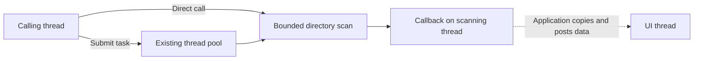

# Recursive file search and background queries

[简体中文](FILE_SEARCH.zh-CN.md) · [Home](../README.md) · [File API](../include/hx_os_file.h)

Use the recursive file search API when your application needs to walk a directory tree, match regular files against a filename wildcard pattern (such as `*.json` or `config.json`), and either process matches as they arrive or grab the first matching file path. Rather than maintaining a persistent in-memory index or buffering an unbounded list of results, the scanner streams matches directly to your callback using bounded scratch memory. This makes it a natural fit for startup configuration discovery, asset scanning, and background queries dispatched to a thread pool.

To see it in action right away, build the `hx_os_find_files` target from [find_files.c](../examples/find_files.c) and run it from the `build` directory as described in the [example run instructions](../examples/README.md#run) (quote the wildcard pattern so your shell does not expand it early):

```sh
# Linux / macOS:
./bin/hx_os_find_files ../examples "*.c"

# Windows PowerShell:
.\bin\Release\hx_os_find_files.exe ..\examples "*.c"
```

The program prints each matching `.c` file under `examples/` line by line, followed by `Files: <count>`. In your own code, simply replace the `print_file` callback in [find_files.c](../examples/find_files.c) with your per-file logic. If you need to keep a GUI thread responsive during a large directory scan, see Section 4 for running queries on a thread pool.

- [1. Choose an entry](#entry)
- [2. Get the first matching path](#first)
- [3. Process matches as they arrive](#stream)
- [4. Query on a thread pool](#threads)
- [5. Depth, count and memory limits](#limits)
- [6. Matching and failure behavior](#behavior)
- [7. Performance and verification scope](#evidence)

<a id="entry"></a>

## 1. Choose an entry

This module performs a live traversal starting from a root directory, descending into subdirectories and matching regular filenames against a pattern. It does not build a background index, retain a full result list, or spawn worker threads behind your back. Pick the C99 or C++11 entry point that matches your task:

| Need | C99 Entry Point | C++11 Entry Point |
| --- | --- | --- |
| First matching file path | `hx_os_directory_find_first_file` | `hx::Directory::findFirstFile` |
| Callback invoked for every matching file | `hx_os_directory_find_files` | `hx::Directory::findFiles` |
| Custom traversal limits and completed callback count | `hx_os_directory_find_files_ex` | `hx::Directory::findFiles` with `options` (returns `hx::Result<size_t>`) |
| Direct entries in a single directory (non-recursive) | `hx_os_directory_visit` | `hx::Directory::forEach` |
| Wildcard expansion across known path levels (e.g., `logs/*/*.log`) | `hx_os_path_glob` | Corresponding C entry point |

> [!NOTE]
> `findFiles` and `forEach` are callback-taking functions; the library does not define a generic C `foreach` macro. For in-memory containers, use their native `begin` / `next` / `value` or `map_entry` iterators directly.

<a id="first"></a>

## 2. Get the first matching path

When you only need to locate a single file (such as finding `config.json` somewhere under an `assets/` directory tree), call `hx_os_directory_find_first_file` or `hx::Directory::findFirstFile`.

Suppose your working directory contains the following layout (file contents do not affect filename matching):

```text
assets/
└── nested/
    └── config.json
```

**C99 Example** (save as `main.c` and build with the [tutorial's C configuration](USAGE.md#c-project)):

```c
#include <hx_os_file.h>
#include <hx_string.h>
#include <stdio.h>

int main(void)
{
	hx_string path = HX_STRING_INIT;

	hx_os_status status = hx_os_directory_find_first_file(
		"assets", "config.json", &path, NULL);
	if (status == HX_OS_OK)
		puts(hx_string_c_str(&path));
	else
		fprintf(stderr, "%s\n", hx_os_status_name(status));

	hx_string_destroy(&path);

	return status == HX_OS_OK ? 0 : 1;
}
```

**C++11 Example** (save as `main.cpp` and build with the [configuration with exceptions disabled](USAGE.md#cpp-project)):

```cpp
#include <hx/Files.hpp>
#include <cstdio>

int main()
{
	auto path = hx::Directory::findFirstFile("assets", "config.json");
	if (!path) {
		std::fprintf(stderr, "%s\n", hx_os_status_name(path.status()));

		return 1;
	}

	std::puts(path.value().c_str());
}
```

Both programs print `assets/nested/config.json`. Internally, the library opens directories, walks down the tree, copies the matching path into `path`, and closes all directory handles before returning:

- **Traversal order**: If multiple files match the pattern, the function returns the first match encountered in native filesystem traversal order (alphabetical order is not guaranteed).
- **No match and failure semantics**: When no matching file exists anywhere under the root, the call returns `HX_OS_NOT_FOUND`. On any failure, the C output `hx_string` is left unmodified.
- **Ownership**: The C API allocates the output buffer using the `hx_context` attached to `path` (destroy it with `hx_string_destroy(&path)`); the C++ API returns an owned `hx::String` inside `hx::Result<hx::String>` that cleans up automatically when it leaves scope.

<a id="stream"></a>

## 3. Process matches as they arrive

To process every matching file in a directory tree, use `hx_os_directory_find_files` or `hx::Directory::findFiles`. Each match is delivered synchronously to your callback on the scanning thread.

The complete C99 and C++11 programs below recursively find all regular files matching `*.json` under `assets`:

```c
#include <hx_os_file.h>
#include <stdio.h>

static hx_os_status HX_OS_CALL show_path(
	hx_string_view path, void *user, hx_os_error *error)
{
	(void)user;
	(void)error;
	printf("%.*s\n", (int)path.size, path.data);

	return HX_OS_OK;
}

int main(void)
{
	hx_os_status status = hx_os_directory_find_files(
		"assets", "*.json", show_path, NULL, NULL);
	if (status != HX_OS_OK)
		fprintf(stderr, "%s\n", hx_os_status_name(status));

	return status == HX_OS_OK ? 0 : 1;
}
```

```cpp
#include <hx/Files.hpp>
#include <cstdio>

int main()
{
	auto found = hx::Directory::findFiles("assets", "*.json",
		[](hx::StringView path) noexcept {
			std::printf("%.*s\n", static_cast<int>(path.size()),
				path.data());
		});

	if (!found) {
		std::fprintf(stderr, "%s\n", hx_os_status_name(found.status()));

		return 1;
	}

	std::printf("Files: %zu\n", found.value());
}
```

With the single-file fixture from Section 2, the C program prints `assets/nested/config.json`, and the C++ program also prints `Files: 1`.

> [!IMPORTANT]
> **Callback Path Lifetime and Return Conventions**
> - **Borrowed view**: The `path` argument (`hx_string_view` / `hx::StringView`) points into the scanner's reusable scratch buffer and is **valid only until the callback returns**. Always copy it into an owned `hx_string` or `hx::String` before storing it in a list or sending it to another thread.
> - **Continuing vs. stopping early**:
>   - **C callbacks**: Return `HX_OS_OK` to continue scanning, `HX_OS_EOF` to stop early and treat the overall traversal as successful (`HX_OS_OK`), or any other `hx_os_status` code to abort immediately and propagate that error.
>   - **C++ callbacks**: May return `void`, `bool` (`true` to continue, `false` to stop cleanly), `hx_os_status`, or `hx::Result<void>`. All C++ callbacks must be `noexcept`.
> - **Zero matches and partial progress**: A scan with zero matches succeeds (`HX_OS_OK`) with a callback count of `0`. Because limits or native filesystem errors can occur after several callbacks have already run, side effects from earlier callbacks are not rolled back. The `completed` output parameter of `hx_os_directory_find_files_ex` and the `size_t` value inside C++ `hx::Result<size_t>` count **all started callbacks** (including a callback that requests an early stop or returns an error). In C++, check `found.hasValue()` before reading partial progress on failure.

<a id="threads"></a>

## 4. Query on a thread pool

While command-line utilities can scan synchronously on `main`, a GUI application or interactive service can submit the scan to an existing thread pool so the UI event loop stays responsive. By default, a submitted search runs sequentially on a single worker thread rather than spawning subtasks per subdirectory (whether parallel directory walks improve wall-clock time depends on storage media, directory fan-out, and filesystem locking, so measure on your target hardware first).



Assuming `pool` is already initialized, the snippet below shows how to submit an asynchronous search from a function returning `hx::Result<void>`. Notice how we copy the root path into an owned `hx::String` and move it into the task closure so the worker owns valid memory after the submitting function returns:

```cpp
auto root = hx::String::copy("assets");
if (!root)
	return hx::Failure(root.error());

auto submitted = pool.submit(
	[](hx::String folder) noexcept {
		return hx::Directory::findFirstFile(
			folder.c_str(), "config.json");
	}, std::move(root).value());
```

Check `submitted` right after submission: propagate `submitted.error()` if queueing failed, or move `submitted.value()` (the task handle) into persistent state managed by your window or controller. Your UI loop can then poll `task.ready()` and retrieve the completed result with `task.getUntil(HX_OS_DEADLINE_NOW)` without blocking a button click handler.

> [!WARNING]
> **Cross-Thread UI Updates and Worker Lifetime**
> - **Never touch UI widgets directly from a scan callback**: Callbacks run on the worker thread. Copy matched paths into owned storage and post them through your GUI toolkit's thread-safe event queue, verifying receiver lifetime when the UI thread processes the event. For large result sets, batch paths before posting so you do not flood the UI queue with one message per file.
> - **A timed-out wait does not stop the worker**: Complete runnable programs are available in [C synchronous search](../examples/find_files.c) and [C++ pool search](../examples/find_files_async.cpp) (both read native UTF-8 argument snapshots rather than narrow Windows CRT `argv`, so they require `HX_OS_ENABLE_SYSTEM_UTILS`, and the async example also requires `HX_OS_ENABLE_THREAD_POOL`). The two-second wait and close budgets in `find_files_async.cpp` are caller-chosen demo timeouts, not built-in search deadlines. If a wait times out, the scan is still running—a long-lived application must keep the `task`, pool `owner`, and callback state alive and retry waiting or closing later. The library never forcibly kills or detaches an active scanning thread.
> - **Cooperative stopping**: The scanner checks for early stop or error returns inside match callbacks; it does not poll a cancellation token on every directory entry. While queued tasks can be cancelled before they start, an active scan does not automatically poll `task.cancel()`. You can inspect a cooperative flag inside your match callback, but a scan traversing directories with zero matches has no immediate cancellation guarantee.

After building with examples enabled, run the binaries from the repository root:

```powershell
# Windows PowerShell:
.\build\bin\Release\hx_os_find_files.exe assets "*.json"
.\build\bin\Release\hx_os_cpp_find_files.exe assets "*.json"
```

```sh
# Linux / macOS single-config build:
./build/bin/hx_os_find_files assets '*.json'
./build/bin/hx_os_cpp_find_files assets '*.json'
```

<a id="limits"></a>

## 5. Depth, count and memory limits

To prevent deeply nested trees or massive directories from exhausting memory, every scan enforces explicit bounds initialized by `HX_OS_WALK_OPTIONS_INIT`:

| Field | Default | Meaning |
| --- | ---: | --- |
| `max_depth` | `64` | Maximum simultaneously open directory levels (root is level `1`; configurable up to `256`) |
| `max_entries` | `1,000,000` | Maximum processed directory entries (including subdirectories and non-matching items) |
| `max_results` | `65,536` | Maximum started match callbacks |
| `max_bytes` | `16 MiB` | Scratch allocation budget for the traversal stack, path buffer, and filename buffers (including metadata and temporary buffers during reallocation) |

All limit fields must be positive. Exceeding `max_depth`, `max_entries`, or `max_results` returns `HX_OS_LIMIT` rather than silently returning a truncated list as `HX_OS_OK` (if a scan hits `max_entries` or `max_results` on the very last item and no further items exist, it still succeeds with `HX_OS_OK`).

To scan a deeper or larger tree—for example, a 96-level directory hierarchy—adjust `hx_os_walk_options` while keeping finite bounds:

```c
hx_os_walk_options options = HX_OS_WALK_OPTIONS_INIT;

options.max_depth = 128;
options.max_entries = 2000000;
options.max_results = 200000;
options.max_bytes = 4 * 1024 * 1024;
```

Pass `&options` to `hx_os_directory_find_files_ex` in C or to the optional `options` parameter of `hx::Directory::findFiles` / `findFirstFile` in C++.

> [!NOTE]
> **Scratch Budget Scope and Path Length Limits**
> - `max_bytes` tracks allocations made through the query `hx_context` for the explicit traversal stack and path buffers. Native OS directory handles (`DIR*` / `HANDLE`), libc directory buffers, temporary UTF-16 path conversions on Windows, and allocations made inside your callback are outside this scratch budget (open native directory handles are bounded by `max_depth`).
> - Root and joined file paths are capped at `32,768` UTF-8 bytes, and basename patterns are capped at `4,096` bytes (the underlying OS may enforce lower limits).
> - During a synchronous call, `options`, the root path, pattern, callback, `user` pointer, and custom `hx_context` must remain valid. Background tasks must own or copy those inputs and keep their `hx_context` alive. Prefer passing an **absolute root path** to background tasks; if you pass a relative path, your application must ensure no other thread changes the process working directory while the scan is running.

<a id="behavior"></a>

## 6. Matching and failure behavior

- **Basename matching only**: Patterns match each file's basename, not its relative path from the root. Passing root `"assets"` and pattern `"*.json"` already searches all subdirectories recursively—do not pass `"**/*.json"` as a filename pattern.
- **Wildcard syntax and case sensitivity**: `*` matches zero or more characters, and `?` matches a single Unicode code point. Character classes (`[...]`), path separators, and backslash escaping are not supported. Matching is **case-sensitive on every platform**.
- **Dotfiles (leading `.`)**: A filename starting with `.` (such as `.gitignore`) is matched only if the pattern also starts with a literal `.` (such as `.*` or `.gitignore`). Hidden subdirectories are still traversed normally. This rule is purely name-based and does not map Windows `FILE_ATTRIBUTE_HIDDEN` to leading-dot behavior.
- **Regular files only, no symlink following**: Only regular files are reported to callbacks. Symlinks, Windows reparse points/junctions, and special files (devices, FIFOs, sockets) encountered during enumeration are skipped without descending into them (the initial root directory itself is opened as a normal path).
- **Joined output paths and concurrent modifications**: Reported paths join the caller-supplied root with the discovered relative subpath (so a relative root yields relative output paths). Traversal is a live scan, not an atomic filesystem snapshot or security sandbox—concurrent renames, deletions, or directory replacements can affect results or cause an error part-way through.
- **Explicit error reporting**: Permission failures (`HX_OS_ACCESS_DENIED`), I/O errors, invalid UTF-8 filenames, and resource exhaustion stop the scan and return an explicit failure status (with native details preserved in `hx_os_error` / `hx::Result`) rather than silently skipping unreadable subtrees and claiming a complete scan.

**CMake Feature Flags**: Recursive search requires `HX_OS_ENABLE_FILE_UTILS=ON` (which advertises `HX_OS_CAP_FILE_SEARCH`; when disabled, search calls return `HX_OS_NOT_SUPPORTED`). Synchronous search does not depend on `HX_OS_ENABLE_CONTAINERS`, `HX_OS_ENABLE_CONFIG`, `HX_OS_ENABLE_SETTINGS`, or the thread pool. When `HX_OS_ENABLE_FILE_INFO=ON`, traversal reuses native directory-entry file types (`d_type` / `WIN32_FIND_DATAW`) and queries metadata only when the entry type is unknown; when `HX_OS_ENABLE_FILE_INFO=OFF`, it falls back to name enumeration plus non-following `lstat`/attribute checks.

<a id="evidence"></a>

## 7. Performance and verification scope

The scanner uses an explicit heap-allocated stack instead of call-stack recursion and reuses its filename and path buffers across entries. In normal operation, it does not allocate a new string or list node per matching file, and non-matching regular files do not even require constructing a full joined path. Native directory enumeration, UTF-8 validation, wildcard matching, and user callbacks still take time, and because there is no persistent index, a full scan must visit the relevant directory entries.

Controlled regression suites on Windows and WSL verify 2,052 matching files, 96 nested directory levels, Unicode filenames, empty result sets, first-match short-circuiting, early-stop and error callbacks, quota exhaustion (`HX_OS_LIMIT`), fault-injected allocation failures, and full resource cleanup. POSIX suites additionally cover cyclic symlinks, external symlinks, and non-UTF-8 byte filenames (WSL tests run on native `/tmp` storage so Windows DrvFS mount translation is not mistaken for native POSIX byte-filename behavior). Across fixture comparisons where only the number of matching files increases, query-context (`hx_context`) allocation counts and peak memory remain constant.

For sorting, binary search, or storing collected paths in ordered containers, see [generic algorithms](ALGORITHMS.md) and [containers](CONTAINERS.md); for OS compiler and runtime requirements, see [platform support](PLATFORMS.md).
