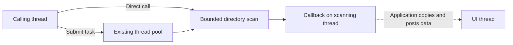

# Recursive file search and background queries

[简体中文](FILE_SEARCH.zh-CN.md) · [Home](../README.md) · [File API](../include/hx_os_file.h)

**Start by finding files you can inspect.** Recursive search suits occasional scans that process each result immediately; it does not maintain a persistent index.

Build `hx_os_find_files`, then enter build as shown in the [run instructions](../examples/README.md#run). Linux: `./bin/hx_os_find_files ../examples "*.c"`; Windows: `.\bin\Release\hx_os_find_files.exe ..\examples "*.c"`. Quote the pattern; the input tree is the checkout's examples directory.

Matching paths appear line by line, followed by `Files: count`; the count changes with the checkout. Replace printing in [find_files.c](../examples/find_files.c)'s print_file callback with your processing. The later pool example keeps work off a UI thread. Copy callback paths if you need to retain them.

- [1. Choose an entry](#entry)
- [2. Get the first matching path](#first)
- [3. Process matches as they arrive](#stream)
- [4. Query on a thread pool](#threads)
- [5. Depth, count and memory limits](#limits)
- [6. Matching and failure behavior](#behavior)
- [7. Performance and verification scope](#evidence)

<a id="entry"></a>

## 1. Choose an entry

The module performs one live scan from a root directory, visiting descendants and matching regular filenames. It creates no file index, retained result list or automatic worker. Use it for occasional queries, initial scans and immediate per-match processing.

| Need | C99 | C++11 |
| --- | --- | --- |
| First matching path | hx_os_directory_find_first_file | Directory::findFirstFile |
| Callback for every matching file | hx_os_directory_find_files | Directory::findFiles |
| Explicit limits/completed callback count | hx_os_directory_find_files_ex | options and Result<size_t> |
| Names in the current directory only | hx_os_directory_visit | Directory::forEach |
| Matching known path levels | hx_os_path_glob | Corresponding C entry |

findFiles/forEach are functions. No general C foreach macro is currently provided. Existing containers expose begin/next/value or map_entry iteration; a loop macro alone does not reduce disk reads or change lookup complexity.

<a id="first"></a>

## 2. Get the first matching path

Prepare this directory. The file may be deeper; contents do not participate in matching:

```text
assets/
└── nested/
    └── config.json
```

Save this C program as main.c and use the [tutorial's C configuration](USAGE.md#c-project):

```c
#include <hx_os_file.h>
#include <hx_string.h>
#include <stdio.h>

int main(void)
{
	hx_string path = HX_STRING_INIT;

	hx_os_status status = hx_os_directory_find_first_file(
		"assets", "config.json", &path, NULL);
	if (status == HX_OS_OK)
		puts(hx_string_c_str(&path));
	else
		fprintf(stderr, "%s\n", hx_os_status_name(status));

	hx_string_destroy(&path);

	return status == HX_OS_OK ? 0 : 1;
}
```

For C++11, save main.cpp and use the [configuration with exceptions disabled](USAGE.md#cpp-project):

```cpp
#include <hx/Files.hpp>
#include <cstdio>

int main()
{
	auto path = hx::Directory::findFirstFile("assets", "config.json");
	if (!path) {
		std::fprintf(stderr, "%s\n", hx_os_status_name(path.status()));

		return 1;
	}

	std::puts(path.value().c_str());
}
```

Both print assets/nested/config.json. The library opens directories, searches, copies the path and closes handles. With multiple candidates, first means native traversal order, not alphabetical order. No match reports NOT_FOUND; failure preserves the C output string. The C output uses its own context; a successful C++ result owns the path until destruction.

<a id="stream"></a>

## 3. Process matches as they arrive

These complete programs search assets and descendants for regular files matching *.json. Paths are delivered individually without an ordering guarantee:

```c
#include <hx_os_file.h>
#include <stdio.h>

static hx_os_status HX_OS_CALL show_path(
	hx_string_view path, void *user, hx_os_error *error)
{
	(void)user;
	(void)error;
	printf("%.*s\n", (int)path.size, path.data);

	return HX_OS_OK;
}

int main(void)
{
	hx_os_status status = hx_os_directory_find_files(
		"assets", "*.json", show_path, NULL, NULL);
	if (status != HX_OS_OK)
		fprintf(stderr, "%s\n", hx_os_status_name(status));

	return status == HX_OS_OK ? 0 : 1;
}
```
```cpp
#include <hx/Files.hpp>
#include <cstdio>

int main()
{
	auto found = hx::Directory::findFiles("assets", "*.json",
		[](hx::StringView path) noexcept {
			std::printf("%.*s\n", static_cast<int>(path.size()),
				path.data());
		});

	if (!found) {
		std::fprintf(stderr, "%s\n", hx_os_status_name(found.status()));

		return 1;
	}

	std::printf("Files: %zu\n", found.value());
}
```

With the single fixture above, C prints its path and C++ also prints Files: 1. path is borrowed only for the callback. Copy it into an owned hx_string/hx::String before retaining it in a list or sending it to another thread.

C callbacks return OK to continue, EOF to stop successfully, or another status to fail with details. C++ bool callbacks use true/false to continue/stop, and void, hx_os_status and Result<void> are also supported. Callbacks run synchronously on the scanning thread; C++ callbacks follow noexcept rules.

No matches is a successful zero-callback traversal. Limits/native failures can occur after callbacks have run; their external effects are not rolled back. C completed and C++ Result<size_t> count started callbacks, including one that stops/fails. Inspect hasValue() before reading partial C++ progress on failure.

<a id="threads"></a>

## 4. Query on a thread pool

A GUI submits a task to its existing pool and continues its event loop; a command-line tool can call synchronously. The default is one task scanning sequentially, with no worker per subdirectory. Whether parallel scans improve elapsed time depends on storage, directory distribution and filesystem, and needs measurement.



Assume pool has been created. Put this excerpt in a submitting function returning hx::Result<void>. The task receives an owned path so it remains valid after that function returns:

```cpp
auto root = hx::String::copy("assets");
if (!root)
	return hx::Failure(root.error());

auto submitted = pool.submit(
	[](hx::String folder) noexcept {
		return hx::Directory::findFirstFile(
			folder.c_str(), "config.json");
	}, std::move(root).value());
```

Then check submitted: propagate submitted.error() on failure, or move submitted.value() into persistent task state and return success. A GUI can check task.ready() and call getUntil(HX_OS_DEADLINE_NOW) after completion. Do not immediately block in a button handler. A worker callback cannot safely update UI objects directly: the application posts independently owned data through its event mechanism and checks receiver lifetime. Batch/bound large result delivery rather than creating unbounded UI messages.

Complete runnable programs: [C synchronous search](../examples/find_files.c) and [C++ pool search](../examples/find_files_async.cpp). They read native UTF-8 argument snapshots, avoiding Windows CRT narrow argv. Argument handling in these examples additionally needs SYSTEM_UTILS; the pool example also needs THREAD_POOL. After a default build, run from the source root:

```powershell
.\build\bin\Release\hx_os_find_files.exe assets "*.json"
.\build\bin\Release\hx_os_cpp_find_files.exe assets "*.json"
```

Linux single-configuration build:

```sh
./build/bin/hx_os_find_files assets '*.json'
./build/bin/hx_os_cpp_find_files assets '*.json'
```

The pool example is a command-line demonstration; its main-thread wait is for printing/exiting, not GUI event handling. Its two-second wait/close budgets are selected by that caller, not fixed search deadlines. A timed-out wait does not mean scanning stopped. A service retains task/owner/callback state and retries waiting/closing; the library never kills or detaches a scanning worker.

The scan currently accepts stop/error through matching callbacks, with no per-directory-entry cancellation token. Queued task cancellation follows the pool's contract. An already running scan does not automatically poll task.cancel(); a match callback can inspect cooperative state, but no-match scans have no prompt-cancellation guarantee. Synchronous native directory calls and callbacks have no hard deadline guarantee.

<a id="limits"></a>

## 5. Depth, count and memory limits

Defaults from HX_OS_WALK_OPTIONS_INIT:

| Setting | Default | Meaning |
| --- | ---: | --- |
| max_depth | 64 | Simultaneously open directory levels, root = 1; configurable up to 256 |
| max_entries | 1,000,000 | Processed directory entries, including directories/nonmatches |
| max_results | 65,536 | Maximum started match callbacks |
| max_bytes | 16 MiB | Stack/path/name allocation budget including metadata and old/new growth buffers |

Limits are positive. Depth exhaustion or excess entry/match counts report LIMIT, not truncated success. Exactly reaching a count limit can succeed if no further corresponding items exist. Native directory objects, libc/OS buffers, temporary Windows path conversions and callback allocations are outside the scratch budget; max_depth bounds open directories. Root/joined paths are limited to 32768 UTF-8 bytes, basename patterns to 4096 bytes, and the OS can impose lower limits.

For a 96-level tree, retain finite bounds and adjust:

```c
hx_os_walk_options options = HX_OS_WALK_OPTIONS_INIT;

options.max_depth = 128;
options.max_entries = 2000000;
options.max_results = 200000;
options.max_bytes = 4 * 1024 * 1024;
```

Pass &options to the C _ex entry or C++ findFiles/findFirstFile optional parameter. Options, root, pattern, callback, user and custom context remain valid through the synchronous call; background tasks must own or copy necessary data and keep the context alive. Prefer an absolute root for background work. When using a relative path, the application must prevent other threads from changing the working directory during the scan.

<a id="behavior"></a>

## 6. Matching and failure behavior

- Patterns match a basename, not a relative path. Root assets plus *.json already recurses; do not pass **/*.json as a basename pattern.
- Star matches zero or more characters; question mark matches one Unicode codepoint. Matching is case-sensitive on every platform. Bracket classes, path separators and backslash escaping are unsupported.
- A leading-dot filename needs a literal leading dot in the pattern. Hidden directories are traversed; Windows hidden attributes are not treated as equivalent to dot names.
- Only regular files are reported. Observed links/reparse points and special files are skipped instead of deliberately descending through them. The selected root is opened as an ordinary path.
- Output joins the supplied root and descendant path, so relative roots produce relative paths. This is not a snapshot or security sandbox: concurrent renames/deletes/replacements can affect results and cause partial failure.
- Permission, I/O, invalid UTF-8 and resource failures are explicit. They are not silently ignored while claiming a complete scan. Native details use hx_os_error/Result.

FILE_UTILS enables search and HX_OS_CAP_FILE_SEARCH. Disabling it returns NOT_SUPPORTED. Synchronous search does not need CONTAINERS, CONFIG, SETTINGS or a pool. With FILE_INFO enabled it reuses native entry types, letting the native adapter query unknown types only. Without FILE_INFO it falls back to name enumeration and non-following stat.

<a id="evidence"></a>

## 7. Performance and verification scope

The implementation uses an explicit stack and reuses filename/path buffers without a string/list allocation per normal match. Nonmatching regular files need no full-path construction in the normal mode. Enumeration, UTF-8 checking, matching and callback work still cost time. There is no file index; a first complete query normally visits relevant entries.

Controlled Windows/WSL tests cover 2,052 matching files, 96 nested levels, Unicode, empty results, first match, stop/error callbacks, limits, allocation failure and cleanup. POSIX additionally covers cyclic/external links and invalid byte filenames. Query-context allocation counts/peaks do not grow with match count in the fixture comparison; this excludes native internals and separately allocated callback data. WSL uses native /tmp so Windows-mount name translation is not mistaken for POSIX byte-name semantics.

Recursive search streams results while scanning and does not maintain a file index. For in-memory sorting/searching or ordered sets, use [generic algorithms](ALGORITHMS.md) and [containers](CONTAINERS.md); see [platform support](PLATFORMS.md) for target requirements.
