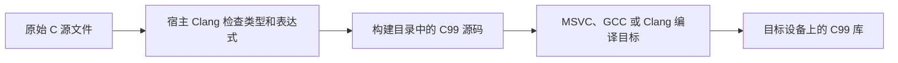

# 格式化与打印

[English](FORMAT.md) · [README](../README.zh-CN.md)

**先运行一个完整例子。** 想用花括号组织文字和数字，同时保持标准 C99 时，用明确类型的格式参数即可。

打开 [format.c](../examples/format.c)。用 hx_fmt_str／hx_fmt_f64 组成参数数组 → hx_print_args 按 {} 和 {:.2f} 输出 → 检查状态。

按[示例运行方法](../examples/README.zh-CN.md#run)启用 examples，并只构建 `hx_os_format`。此例无命令行参数、无需输入文件。

**会得到什么：**UTF-8 终端会显示 `张三: 3.75`。把参数换成业务变量；这种写法不需要代码生成器。自动识别表达式的另一种写法有单独的构建接入步骤。

下面的短片段用于解释接口；复制运行时以完整示例为准。也可按[最小工程配置](USAGE.zh-CN.md#c-project)把完整源码作为自己的 main。

## 1. 先选一种写法

下面几种写法共用 C99 的 UTF-8 格式化实现，都不使用 C++ 异常。`HX_OS_ENABLE_FORMAT` 默认开启；关闭后，运行时接口返回 `HX_OS_NOT_SUPPORTED`，能力查询不再包含 `HX_OS_CAP_FORMAT`。

| 写法 | 示例 | 构建要求 |
| --- | --- | --- |
| C99，简洁的类型化调用 | 包含 `hx_print.h` 后写 `HX_PRINTLN("{}", hx_fmt_i64(count))` | 原来的 C 编译器，无生成步骤 |
| C99，不使用生成步骤 | 把 `hx_fmt_i64(count)` 放入参数数组 | 原来的 C 编译器 |
| C99，自动识别实参类型 | `HX_PRINTLN("{}", count)` | 在 CMake 启用一次；构建电脑安装 Python 3.10+ 和 Clang |
| C++11 | `hx::println("{}", count)` | 原来的 C++11 编译器 |

`std::format` 属于 C++20，`std::print` 属于 C++23。这里提供下文明确说明的花括号格式语法，不宣称完整兼容标准库或 Python。

## 2. C：直接写变量和表达式

[format_syntax.c 完整程序](../examples/format_syntax.c) 输出 `张三: 18, total=3.75`，核心调用是：

```c
#include <hx_format_syntax.h>

// user.name 为 "张三"，user.age 为 18；price 为 1.25，count 为 3。
hx_os_status status = HX_FPRINTLN(
	"{user.name}: {user.age}, total={price * count:.2f}");
```

`HX_FPRINTLN` 从字面量中提取 C 表达式：`user.name` 读取成员，`price * count` 按 C 规则做乘法，`.2f` 保留小数点后两位。检查 `status == HX_OS_OK`，才能确认输出成功。

也可以把实参放在字符串后面：

```c
HX_PRINTLN("{}: {:04d}", user.name, count);
HX_PRINTLN("{name}: {count}", HX_NAMED("name", user.name),
	HX_NAMED("count", count));

hx_string text = HX_STRING_INIT;

hx_os_status status = HX_FFORMAT(&text, "Total: {price * count:.2f}");

// 检查 status 后再使用 text；失败时也要销毁字符串。
hx_string_destroy(&text);
```

`HX_FORMAT(&text, pattern, args...)` 用显式实参生成字符串。`HX_PRINT` 不换行，`HX_PRINTLN` 添加 LF，`HX_EPRINTLN` 输出到 stderr。带 `F` 的入口从字面量提取表达式，不会在运行时根据字符串里的名字寻找局部变量。

在设置好目标的源文件、依赖、头文件目录和编译选项后，启用构建步骤：

```cmake
cmake_minimum_required(VERSION 3.16)
project(format_demo LANGUAGES C)

find_package(hx_c_platform CONFIG REQUIRED)

add_executable(format_demo main.c)
target_link_libraries(format_demo PRIVATE hx_c_platform::hx_c_platform)
set_target_properties(format_demo PROPERTIES
	C_STANDARD 99
	C_STANDARD_REQUIRED YES
	C_EXTENSIONS NO)

if(MSVC)
	target_compile_options(format_demo PRIVATE /utf-8)
endif()

hx_enable_format_syntax(format_demo SOURCES main.c)
```

通过 `add_subdirectory` 引入本库时也可以使用这个函数。之后照常执行 `cmake --build build --config Release`，开发者无需另行手动生成代码。Clang 不在 PATH 时，配置阶段传 `-DHX_FORMAT_CLANG=/path/to/clang`，也可以给函数传 `CLANG`。`PYTHON` 指定宿主解释器；`CLANG_OPTIONS` 补充分析所需的工具链选项，例如特殊的系统头文件目录。



原文件保持不变，每种构建配置使用单独的生成文件。分析步骤继承目标及其依赖传递来的头文件目录、宏和编译选项；源码、相关头文件或工具改变时重新生成，未变化时保留生成文件时间戳。检查失败会停止构建，不替换上一次生成成功的 C 文件。安装包包含 CMake 辅助文件和脚本；目标设备不需要 Python 或 Clang。

目前接受直接列出的 `.c` 文件和目标级编译设置。源文件单独设置的编译属性会明确报错，需先移到目标级。宏定义、宏生成的函数体、全局初始化器以及嵌套格式化标记不在支持范围内；用普通断言宏包住直接调用是支持的。每个目标调用辅助函数一次。交叉编译时，宿主 Clang 必须能够理解目标 triple、sysroot 和源码中的编译器扩展；不兼容的方言会在分析时失败，不猜测类型。MSVC 的运行时库选择也会把 `_MT`、`_DLL`、`_DEBUG` 传给分析步骤。仅通过环境变量改变头文件搜索路径后，需要重建生成缓存。应用如果根据 `__clang__`／`__GNUC__` 等前端身份选择不同类型，必须让分析与最终编译看到相同类型；可以改用统一项目宏，或采用显式类型化 C99 入口。第二个前端不能证明所有编译器扩展的行为都一致。

表达式遵循调用处的 C 作用域与 C 语义。含 `:` 的三元表达式需要括号，避免与格式说明符混淆。固定字面量在生成阶段检查参数数量、基础类型和格式说明；不存在的结构体成员由 Clang 报错。实参表达式按源码顺序各求值一次，输出对象和格式字符串表达式先求值。注册的结构体值复制到本次调用的局部存储中，其中的指针成员仍然只是借用。运行时拼出来的格式字符串在运行时检查。这不等于 Python 表达式解释器、C++ 模板特化或对任意自定义格式化函数的编译期证明。

## 3. C99：不增加构建工具也能用

包含 `hx_print.h` 即可使用普通 C99 调用。CMake 保留常规的 `add_executable` 和 `target_link_libraries`，不需要 `hx_enable_format_syntax`、Python 或 Clang 生成步骤。下面是完整程序，参数类型由小包装函数明确指定：

```c
#include <hx_print.h>

int main(void)
{
	hx_os_status status = HX_PRINTLN("{}, {:04d}",
		hx_fmt_str("HuangX"), hx_fmt_i64(2000));

	return status == HX_OS_OK ? 0 : 1;
}
```

`HX_PRINT` 不追加换行，`HX_PRINTLN` 追加 LF，`HX_EPRINTLN` 输出到 stderr，`HX_FORMAT(&text, pattern, ...)` 写入已初始化的 `hx_string`。`HX_PRINTLN("ready")` 这种没有格式化实参的调用也可以使用。所有入口返回 `hx_os_status`。实参必须是 `hx_fmt_*` 构造的 `hx_format_arg`，不会自动推断原始值的类型。命名参数写成 `HX_NAMED("name", hx_fmt_str("HuangX"))`，自定义结构体使用 `hx_fmt_custom(&object, format_callback)`。

C99 便利宏一次支持 **0—64 个值参数**，格式字符串和输出对象不计入数量；超过 64 个会编译报错。这不限制占位符的重复次数：一个参数可以通过 `{0}` 引用多次，`{{` 和 `}}` 输出字面花括号，不消耗参数。每个实参表达式只求值一次，求值顺序遵循普通 C 规则，不要依赖多个副作用按从左到右执行。临时参数数组（包含一个内部哨兵）使用自动存储，不为参数打包单独申请堆内存；底层格式化器仍保留原有的分配和容量限制。

同一个翻译单元只选择 `hx_print.h`（类型化 C99 调用）或 `hx_format_syntax.h`（通过生成器自动识别类型／表达式）之一。两者使用相同宏名，同时包含会明确报错。`hx_os.h` 不会隐式选择其中一种宏接口。新宏面向 C，C++11 使用下文的便利封装。没有新增导出函数或改变公共对象布局。

运行时才确定的参数数组、超过 64 个的参数、自定义上限或完整错误对象，继续使用下面的现有函数。它们默认支持 **1,024 个参数**和 **16 MiB UTF-8 输出**，打印追加的 LF 也计入上限。这是运行时默认值，不是写死的 1,024 次占位符限制；`hx_format_with_options` 可以显式设置 `max_arguments` 和 `max_output_bytes`，提高上限也会增加潜在的工作量和内存需求。缺少位置参数返回 `HX_OS_RANGE`，超过所选上限返回 `HX_OS_LIMIT`；格式化失败保持输出对象不变，不静默截断。


[format.c 完整程序](../examples/format.c) 只依赖 C 库：

```c
hx_format_arg args[] = {hx_fmt_str("张三"), hx_fmt_f64(3.75)};

hx_os_error error;

hx_os_status status = hx_print_args(HX_PRINT_STDOUT, 1,
	hx_string_view_from_cstr("{}: {:.2f}"), args, 2, &error);
```

类型由这些小函数明确标注，运行时不会猜测 `va_list` 的真实实参类型。支持有符号／无符号 64 位整数、float／double／long double、布尔、Unicode 字符、UTF-8 字符串视图、对象指针、命名实参和自定义格式化回调。`hx_fmt_char` 接收一个 Unicode 码点，UTF-8 多字节字符里的单个字节不能当作完整字符。

`hx_format` 写入 `hx_string`；`hx_format_with_options` 允许设置容量限制；`hx_format_buffer` 写入调用者的缓冲区，所需容量包含末尾 NUL。容量不足返回 `OUTPUT_FULL` 并保持缓冲区原样；NULL 缓冲区加零容量可查询所需大小。原有 printf 风格的 `hx_string_format` 继续保留。

## 4. C++11

```cpp
#include <hx/Format.hpp>

auto printed = hx::println("{}: {:.2f}", "张三", 3.75);
if (!printed)
	return 1;

auto text = hx::format("Answer: {:04d}", 42);
if (!text)
	return 1;
// text.value() 拥有字符串 "Answer: 0042"。
```

`formatTo(existingString, pattern, args...)` 使用目标字符串的 context；`format` 返回拥有字符串的 `Result<hx::String>`。`print`、`println` 和 `printTo` 返回 `Result<void>`。`hx::named("name", value)` 借用参数到本次调用结束，不要保存指向临时对象的命名参数。支持对象指针和枚举；函数指针需要应用自己选择表示方式。自定义类型可以特化 `Formatter<T>`，实现 `noexcept` 的静态 `format` 函数。不支持的 C++ 类型会编译失败；这个 C++11 层中的格式字符串与实参类型匹配仍在运行时检查。

## 5. 支持的格式规则

| 格式 | 含义 |
| --- | --- |
| `{}`、`{0}`、`{name}` | 顺序实参、下标、名称；不能混用自动编号和显式下标 |
| `{{`、`}}` | 输出普通花括号 |
| `{:>8}`、`{:*^8}`、`{:<8}` | 右对齐、用星号居中填充、左对齐 |
| `{:+08d}`、`{:#x}`、`{:b}`、`{:o}` | 符号与补零、十六进制前缀、二进制、八进制 |
| `{:.2f}`、`{:.3e}`、`{:.6g}`、`{:a}`、`{:.1%}` | 固定小数、科学计数、有效数字、十六进制浮点、百分比 |
| `{:,.2f}`、`{:_d}` | 使用逗号或下划线分隔十进制数字 |
| `{:.3s}`、`{:?}`、`{!r}` | 截取文本、带引号转义、字符串表示 |
| `{0:>{1}}`、`{value:.{precision}f}` | 动态整数宽度或精度 |

宽度和文本精度按 Unicode 码点计数，不按终端显示格或完整字素计数；中文、组合字符因此不保证在终端表格里视觉对齐。输入必须是有效 UTF-8，无效数据会报错。显式字符串视图可以包含 NUL，但内置格式说明符中不能含 NUL。字符转换拒绝无效码点。布尔值默认或 `s` 格式输出 `true`／`false`，数字格式输出 0 或 1。

格式化不会修改进程 locale。浮点采用原生的 C locale，平台缺少相应 locale 能力时浮点转换明确返回 `NOT_SUPPORTED`；默认转换会寻找能够还原到原输入类型的有效数字表示，科学计数与固定小数的选择可能不同于 `std::format`。精度上限为 4,096。这条可移植 libc 路径可能多次转换并分配 locale，不是 Dragonbox 一类的高速转换实现；整数与文本路径不经过浮点转换。本模块没有附加汇编优化或提速承诺。

## 6. 自定义结构体与失败行为

C 回调及注册形式如下：

```c
static hx_os_status format_user(const void *object, hx_string_view spec,
	hx_string *out, size_t limit, hx_os_error *error);
HX_FORMATTER(user_info, format_user);
```

注册放在启用生成步骤的源文件中，类型和回调必须已经声明。回调借用 `object`，使用 `out` 的 context 写入 UTF-8，遵守 `limit` 并返回状态；自定义说明符的语义由回调负责。不使用生成器时传 `hx_fmt_custom(&user, format_user)`。C++ 特化 对应 `hx::Formatter<T>::format`，第一个参数改为具体类型引用，说明符用 `hx::StringView`。

格式化先写临时结果，成功后才替换目标。语法、类型、UTF-8、分配失败或容量超限都会保持目标原样；参数借用了目标原有内容时同样成立。实参指针及回调数据只借用到本次同步调用结束。默认最多输出 16 MiB、最多 1,024 个参数；打印追加的 LF 也计入输出上限。回调必须在分配前遵守传入的限制，库在最后检查大小不能阻止应用回调提前大量分配自己的内存。这里没有全局格式化注册表，也不更换全局分配器。

`hx_os_error` 保留原有统一状态和原生错误字段；没有原生错误域的字段解析失败，`cause_code` 表示出错字段在格式字符串中的字节偏移。源码便利标记只返回状态，需要保存完整错误对象时使用类型化运行时入口。自定义回调的原生错误域和错误码会保留。

打印先完成格式化，因此格式化失败不会输出半条文本。写设备失败则可能已经写出部分字节，不承诺跨进程的整条原子输出。Windows 控制台使用 UTF-16 `WriteConsoleW`，重定向输出为无 BOM 的 UTF-8。POSIX 会重试被信号打断的写入，并在调用线程内处理本次断管产生的 `SIGPIPE`。不安装进程级信号处理器、不切换控制台代码页、不修改全局 locale。stdout／stderr 打印是同步操作，可能阻塞，不能当作可取消的协程 I/O。
