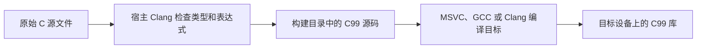

# 格式化与打印

[English](FORMAT.md) · [README](../README.zh-CN.md)

在 C99 和 C++11 项目中拼接日志、状态提示或 CLI 输出时，传统的 `printf` 家族既容易因为格式说明符与实参类型不匹配引发未定义行为，又缺乏按位置或名称复用参数的能力。本模块提供花括号风格（`{}`、`{:.2f}`、`{name}`）的 UTF-8 格式化与终端打印能力，所有接口显式携带实参类型，不使用 C++ 异常，并在 Windows 控制台与 POSIX 终端上统一处理 UTF-8 输出。

你可以先通过内置示例体验完整流程。参考 [format.c](../examples/format.c)，该程序使用 `hx_fmt_str()` 与 `hx_fmt_f64()` 组装类型化参数数组，再调用 `hx_print_args()` 按 `{}: {:.2f}` 模板输出并检查返回状态。按[示例运行方法](../examples/README.zh-CN.md#run)启用示例后，单独构建并运行 `hx_os_format`（无需命令行参数或输入文件）：

```text
张三: 3.75
```

把示例中的字面量替换为业务变量即可直接接入自己的项目；也可按[最小工程配置](USAGE.zh-CN.md#c-project)将完整示例作为 `main.c` 编译运行。下面分场景介绍几种调用方式与格式规则。

## 1. 先选一种写法

以下四种写法共享同一个 C99 UTF-8 格式化引擎，都不使用 C++ 异常。CMake 选项 `HX_OS_ENABLE_FORMAT` 默认开启；若将其关闭，运行时格式化接口会返回 `HX_OS_NOT_SUPPORTED`，且运行时能力掩码中不再包含 `HX_OS_CAP_FORMAT`。

| 写法 | 示例 | 构建要求 |
| --- | --- | --- |
| C99 简洁类型化宏 | 包含 `hx_print.h` 后调用 `HX_PRINTLN("{}", hx_fmt_i64(count))` | 标准 C99 编译器，无需代码生成步骤 |
| C99 显式参数数组 | 将 `hx_fmt_i64(count)` 放入 `hx_format_arg` 数组后调用函数 | 标准 C99 编译器，无需代码生成步骤 |
| C99 自动识别实参类型与内联表达式 | 包含 `hx_format_syntax.h` 后调用 `HX_PRINTLN("{}", count)` | 在 CMake 中为目标启用一次；宿主机需安装 Python 3.10+ 与 Clang |
| C++11 封装 | 包含 `<hx/Format.hpp>` 后调用 `hx::println("{}", count)` | 标准 C++11 编译器 |

> [!NOTE]
> `std::format` 属于 C++20，`std::print` 属于 C++23。本模块旨在为 C99 与 C++11 工程提供清晰、可预期的花括号格式化子集（具体语法见第 5 节），并非完整复刻 C++ 标准库或 Python `str.format`。

## 2. C：直接写变量和表达式

如果你希望像现代脚本语言一样直接在格式字符串中书写 C 变量与算术表达式，或者让构建工具自动推断实参类型，可以使用 `<hx_format_syntax.h>`。完整示例见 [format_syntax.c 完整程序](../examples/format_syntax.c)，运行后会输出 `张三: 18, total=3.75`，核心调用如下：

```c
#include <hx_format_syntax.h>

// user.name 为 "张三"，user.age 为 18；price 为 1.25，count 为 3。
hx_os_status status = HX_FPRINTLN(
	"{user.name}: {user.age}, total={price * count:.2f}");
```

`HX_FPRINTLN` 会在构建阶段从字符串字面量中提取 C 表达式：`user.name` 直接读取结构体成员，`price * count` 按标准 C 语义执行乘法，`:.2f` 则将浮点结果格式化为小数点后两位。调用后请检查 `status == HX_OS_OK` 以确认输出成功。

如果你更习惯把实参写在格式字符串后面，同一头文件也提供了自动推断实参类型的宏：

```c
HX_PRINTLN("{}: {:04d}", user.name, count);
HX_PRINTLN("{name}: {count}", HX_NAMED("name", user.name),
	HX_NAMED("count", count));

hx_string text = HX_STRING_INIT;

hx_os_status status = HX_FFORMAT(&text, "Total: {price * count:.2f}");

// 检查 status == HX_OS_OK 后再读取 text；即使失败也需调用 destroy 释放。
hx_string_destroy(&text);
```

- `HX_FORMAT(&text, pattern, args...)` 与 `HX_FFORMAT(&text, pattern)` 将结果写入已初始化的 `hx_string`。
- `HX_PRINT` 原样输出不加换行，`HX_PRINTLN` 自动追加 `\n`（LF），`HX_EPRINTLN` 则输出到 `stderr`。
- 带 `F` 前缀的宏（`HX_FPRINT`、`HX_FPRINTLN`、`HX_FEPRINTLN`、`HX_FFORMAT`）只在编译前从字符串字面量提取表达式，不会在运行时按名字反射查找局部变量。

要在 CMake 目标上启用这一能力，只需在配好源文件、依赖库、头文件目录和编译选项之后，调用一次 `hx_enable_format_syntax()`：

```cmake
cmake_minimum_required(VERSION 3.16)
project(format_demo LANGUAGES C)

find_package(hx_c_platform CONFIG REQUIRED)

add_executable(format_demo main.c)
target_link_libraries(format_demo PRIVATE hx_c_platform::hx_c_platform)
set_target_properties(format_demo PROPERTIES
	C_STANDARD 99
	C_STANDARD_REQUIRED YES
	C_EXTENSIONS NO)

if(MSVC)
	target_compile_options(format_demo PRIVATE /utf-8)
endif()

hx_enable_format_syntax(format_demo SOURCES main.c)
```

无论是通过 `find_package(hx_c_platform)` 还是 `add_subdirectory()` 引入本库，都可以直接使用 `hx_enable_format_syntax()`。配置完成后照常执行 `cmake --build build --config Release` 即可，无需手动运行任何外部脚本。若宿主机的 `clang` 不在 `PATH` 中，可在 CMake 配置阶段传入 `-DHX_FORMAT_CLANG=/path/to/clang`，或在调用函数时通过 `CLANG` 参数指定；`PYTHON` 参数用于指定宿主 Python 解释器，`CLANG_OPTIONS` 则用于补充特殊工具链的系统头文件目录等前端参数。



该构建步骤保持工作区中的原始 `.c` 文件不变，并在构建目录中按构建配置生成对应的标准 C99 源文件。分析器会自动继承目标及其依赖传递过来的头文件目录、宏定义与编译选项；仅当源文件、依赖头文件或生成工具发生变化时才重新生成，未改动时保留时间戳以避免重复编译。如果类型或格式说明符检查失败，构建会立即报错中止，不会覆盖上一次成功生成的 C 文件。安装包中已自带 CMake 辅助函数与脚本，最终运行程序的目标设备不需要安装 Python 或 Clang。

> [!IMPORTANT]
> **语法生成器的接入与表达式边界：**
> - **目标级配置**：`hx_enable_format_syntax` 仅接受直接列出的 `.c` 源文件，且要求编译选项设置在目标（target）级别；若对单个源文件设置了专属编译属性，构建会明确报错。每个目标只需调用一次该辅助函数。
> - **调用位置限制**：不支持在宏定义体、宏展开生成的函数体、全局变量初始化器中书写格式化标记，也不支持嵌套调用格式化标记；但支持用常规断言宏包裹顶层格式化调用。
> - **交叉编译与前端一致性**：交叉编译时，宿主机 Clang 必须能解析目标平台的 target triple、sysroot 及源码中用到的编译器扩展（MSVC 下会自动传递 `_MT`、`_DLL`、`_DEBUG`）。如果业务代码通过 `#ifdef __clang__` 与 `#ifdef __GNUC__` 分支定义了不同类型，必须确保分析阶段与最终编译器看到一致的类型定义（建议改用项目统一的业务宏，或直接改用第 3 节的纯 C99 显式类型接口）。若仅通过环境变量修改了头文件搜索路径，需清理并重建生成缓存。
> - **表达式求值与生命周期**：内联表达式遵循调用处的 C 作用域与语义。若三元运算符 `?:` 出现在花括号内，请用括号将其括起，以免 `:` 被误判为格式说明符分隔符。输出对象与格式字符串先求值，随后各实参表达式按源码顺序各求值一次。已注册的自定义结构体值会拷贝到当前调用的栈上临时存储中，但结构体内部的指针成员仍为借用引用。

## 3. C99：不增加构建工具也能用

如果项目不希望在构建阶段引入 Python 或 Clang，只需包含 `<hx_print.h>` 即可在纯标准 C99 下使用花括号格式化。CMake 保持最普通的 `add_executable` 与 `target_link_libraries`，只需用 `hx_fmt_*` 包装函数显式标出每个实参的类型：

```c
#include <hx_print.h>

int main(void)
{
	hx_os_status status = HX_PRINTLN("{}, {:04d}",
		hx_fmt_str("HuangX"), hx_fmt_i64(2000));

	return status == HX_OS_OK ? 0 : 1;
}
```

`<hx_print.h>` 同样提供 `HX_PRINT`、`HX_PRINTLN`、`HX_EPRINTLN` 和 `HX_FORMAT(&text, pattern, ...)`，也支持不带额外参数的 `HX_PRINTLN("ready")`。所有宏均返回 `hx_os_status`。在这套接口中，所有值参数都必须通过 `hx_fmt_*` 包装成 `hx_format_arg`：命名参数写作 `HX_NAMED("name", hx_fmt_str("HuangX"))`，自定义结构体写作 `hx_fmt_custom(&object, format_callback)`。

- **参数个数与栈存储**：C99 便利宏单次调用支持 **0—64 个值参数**（不含目标字符串与格式模板），超过 64 个会在编译期报错。同一个参数可在模板中通过 `{0}` 反复引用多次，且 `{{` 与 `}}` 转义不消耗参数。宏内部在栈上构造包含哨兵元素的临时数组，不会为打包参数额外申请堆内存。每个实参表达式只求值一次，但请勿依赖多个实参之间的副作用求值顺序。
- **头文件互斥**：同一个翻译单元（`.c` 文件）只能包含 `<hx_print.h>` 或 `<hx_format_syntax.h>` 之一。两者定义了同名宏，若同时包含会触发明确的编译错误；顶层 `<hx_os.h>` 不会替你隐式包含其中任何一个。

当参数数组需要在运行时动态组装、参数数量超过 64 个、需要自定义容量上限，或者需要获取详细的 `hx_os_error` 错误定位信息时，请直接调用底层运行时函数（参见 [format.c 完整程序](../examples/format.c)）：

```c
hx_format_arg args[] = {hx_fmt_str("张三"), hx_fmt_f64(3.75)};

hx_os_error error;

hx_os_status status = hx_print_args(HX_PRINT_STDOUT, 1,
	hx_string_view_from_cstr("{}: {:.2f}"), args, 2, &error);
```

底层函数完全不依赖 `va_list` 类型猜测，内置包装函数覆盖了有符号／无符号 64 位整数、`float`／`double`／`long double`、布尔值、Unicode 标量码点（`hx_fmt_char`，注意不能传入多字节 UTF-8 序列中的单个字节）、UTF-8 字符串视图、对象指针、命名参数以及自定义结构体回调。

字符串输出方面：
- `hx_format()` 将结果写入 `hx_string`，默认上限为 **1,024 个参数**和 **16 MiB UTF-8 输出**（打印接口追加的 LF 换行符也计入该上限）。
- `hx_format_with_options()` 允许通过 `max_arguments` 与 `max_output_bytes` 调整上述运行时上限。
- `hx_format_buffer()` 直接写入调用方提供的固定缓冲区，`required` 输出长度包含末尾 `\0`；若容量不足则返回 `HX_OS_OUTPUT_FULL` 并保持原缓冲区内容不变（可传入 `buffer = NULL, capacity = 0` 预先查询所需字节数）。
- 缺少位置参数会返回 `HX_OS_RANGE`，超出参数或输出字节上限会返回 `HX_OS_LIMIT`。传统的 `printf` 风格接口 `hx_string_format()` 依然保留。

## 4. C++11

C++11 调用方包含 `<hx/Format.hpp>` 后，可以直接传入原生类型，由模板自动完成类型分发并返还 `hx::Result<T>`：

```cpp
#include <hx/Format.hpp>

auto printed = hx::println("{}: {:.2f}", "张三", 3.75);
if (!printed)
	return 1;

auto text = hx::format("Answer: {:04d}", 42);
if (!text)
	return 1;
// text.value() 持有格式化后的 hx::String："Answer: 0042"。
```

- `hx::format(pattern, args...)` 返回持有新字符串的 `hx::Result<hx::String>`；`hx::formatTo(existingString, pattern, args...)` 则复用目标字符串已绑定的内存上下文写入结果。
- `hx::print`、`hx::println` 和 `hx::printTo` 返回 `hx::Result<void>`。
- 命名参数 `hx::named("name", value)` 仅在当次函数调用期间借用底层值，请勿将指向临时对象的 `hx::named` 结果保存下来延后使用。
- 原生支持对象指针与枚举类型（函数指针需由业务代码自行先转为合适的表示形式）。自定义 C++ 类型可通过特化 `hx::Formatter<T>` 并提供 `noexcept` 的静态 `format` 方法接入。未特化的不支持类型会在编译期报错，而格式说明符与实参类型的匹配则在运行时校验。

## 5. 支持的格式规则

| 格式 | 含义 |
| --- | --- |
| `{}`、`{0}`、`{name}` | 自动顺序实参、显式位置下标、命名实参（同一个模板内不能混用 `{}` 自动编号和 `{0}` 显式下标） |
| `{{`、`}}` | 输出字面量 `{` 或 `}` |
| `{:>8}`、`{:*^8}`、`{:<8}` | 右对齐、使用 `*` 居中填充、左对齐 |
| `{:+08d}`、`{:#x}`、`{:b}`、`{:o}` | 强制正负号与前导补零、十六进制 `0x` 前缀、二进制、八进制 |
| `{:.2f}`、`{:.3e}`、`{:.6g}`、`{:a}`、`{:.1%}` | 定点小数、科学计数法、有效数字、十六进制浮点数、百分比 |
| `{:,.2f}`、`{:_d}` | 使用逗号 `,` 或下划线 `_` 对十进制整数部分做分组分隔 |
| `{:.3s}`、`{:?}`、`{!r}` | 截断文本长度、带双引号与转义输出、调试字符串表示 |
| `{0:>{1}}`、`{value:.{precision}f}` | 通过另一个整数参数动态指定宽度或精度 |

> [!NOTE]
> **字符计数与浮点数转换说明：**
> - **按 Unicode 码点计数**：宽度填充与文本截断精度（如 `{:.3s}`）按 Unicode 标量值（码点）个数计算，而非按终端显示列宽（east-asian width）或字素簇（grapheme cluster）计算。因此包含中文或组合音标的文本在终端表格中不一定视觉等宽。输入文本必须是合法 UTF-8，遇到非法序列会直接返回错误而非静默替换。显式 `hx_string_view` 参数允许包含内嵌 `\0`，但内置格式说明符本身不能包含 `\0`。布尔值默认（或 `:s`）输出 `true`／`false`，使用整数格式说明符时输出 `1` 或 `0`。
> - **进程 Locale 无副作用**：浮点数格式化固定使用 C locale 语义，绝不修改进程的全局 locale。若目标平台缺少独立的 C locale 转换支持，浮点格式化会明确返回 `HX_OS_NOT_SUPPORTED`。未指定精度时，默认浮点转换会搜索能往返还原（round-trip）回原类型的有效数字表示，其选用定点或科学计数法的临界点可能与 `std::format` 略有差异；精度最大支持到 `4096`。

## 6. 自定义结构体与失败行为

在 C 语言中，可以为业务结构体编写自定义格式化回调：

```c
static hx_os_status format_user(const void *object, hx_string_view spec,
	hx_string *out, size_t limit, hx_os_error *error);
HX_FORMATTER(user_info, format_user);
```

- 若启用了第 2 节的 `hx_enable_format_syntax`，在源文件中声明结构体类型与回调函数后，使用 `HX_FORMATTER(type_name, callback)` 即可完成注册；若使用第 3 节的纯 C99 接口，则在调用处直接传入 `hx_fmt_custom(&user, format_user)`。
- 回调函数在当次同步调用期间借用 `object` 指针，负责解析自定义的 `spec` 说明符，使用 `out` 自身的分配器追加合法的 UTF-8 文本，并在分配内存前严格遵守 `limit` 字节上限。C++11 下对应的特化签名为 `hx::Formatter<T>::format`，首参为 `const T &`，说明符为 `hx::StringView`。

**失败原子性与错误诊断：**
- **失败不污染目标**：格式化始终先写入临时缓冲区，全部成功后才提交到目标对象。无论是格式语法错误（`HX_OS_SYNTAX`）、类型不匹配（`HX_OS_TYPE_MISMATCH`）、非法 UTF-8、内存分配失败（`HX_OS_NO_MEMORY`）还是超出长度上限（`HX_OS_LIMIT`），目标字符串都会保持调用前的原样（即使格式化实参本身借用了目标字符串原有的内存片段也是安全的）。
- **错误偏移定位**：当格式字符串解析或某字段校验失败且不属于底层操作系统原生错误时，`hx_os_error.cause_code` 会记录出错字段在格式模板中的字节偏移；自定义回调填写的原生错误域和错误码也会原样保留。

**终端与文件打印行为：**
- 打印接口会先在内存中完成整条文本的格式化，再执行底层写入，因此格式错误绝不会向终端输出半截残缺文本。
- 在 Windows 上，若目标句柄是交互式控制台，底层会自动转换为 UTF-16 并调用 `WriteConsoleW`（无需修改控制台代码页）；若输出被重定向到文件或管道，则直接写出无 BOM 的 UTF-8 字节流。
- 在 POSIX 系统上，写入遇到 `EINTR` 会自动重试，并在调用线程内部安全消化因管道对端关闭产生的 `SIGPIPE`，不会安装进程级信号处理器。注意 `stdout`／`stderr` 打印属于同步阻塞 I/O，不应在需要协作式取消的协程热路径中当作非阻塞 I/O 使用。
