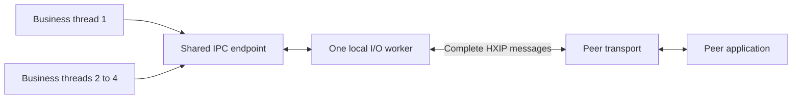
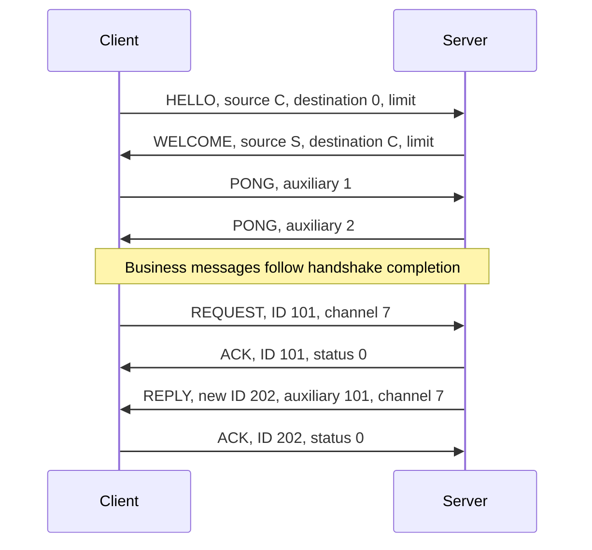

# Local IPC: run an example, then connect your application

[简体中文](IPC.zh-CN.md) · [README](../README.md) · [C API](../include/hx_ipc.h) · [C++11 facade](../include/hx/Ipc.hpp)

Complete the [example setup](../examples/README.md#run) first. Below, build is a placeholder for your existing directory; protocols do not each need a new build directory. Run commands from the checkout and build the endpoints used here.

**Business workflows are separate:** [native IPC devices](IPC_BUSINESS.md), [TCP orders](TCP_BUSINESS.md), [UDP samples](UDP_BUSINESS.md), and [KCP blocks](KCP_BUSINESS.md). Each has its own C programs and runner; TCP/UDP/KCP business code uses socket/KCP APIs without invoking the IPC device program. The minimal echo example below checks IPC connectivity and introduces its lifetime and cross-language protocol.

All four business examples now use UTF-8 JSON for requests, replies and notifications, with real parsing, field-type checks and safe string escaping. The echo programs below are low-level connectivity checks and do not implement those business protocols.

## 1. Choose an address

Two processes using the same transport and HXIP v1 protocol can send in both directions and match concurrent requests with their replies. The peer may use another language without linking hx_c_platform. Section 8 specifies the protocol; an independent Python peer is included.

| Example address | Use case | Delivery |
| --- | --- | --- |
| `local://demo` | Programs running as the same local user | Windows named pipe; Unix domain socket on Linux/macOS |
| `tcp://127.0.0.1:39001` | A peer language with convenient TCP support | Complete, ordered messages and bidirectional requests |
| `udp://127.0.0.1:39002` | Samples or state updates that tolerate loss | Ordinary UDP: loss, duplication and reordering are possible; no business-data retransmission |
| `kcp://127.0.0.1:39003` | Acknowledgements, retransmission, deduplication and ordering over UDP | KCP is driven internally; ordered delivery within a live session, with explicit failure/deadline handling |

IP addresses also accept `[::1]`; non-loopback addresses are rejected. A listener may use port `0` and retrieve its actual address with `hx_ipc_address()`. KCP is not necessarily faster for local communication. This module does not claim a remote-network deployment profile.

`local://demo` is a convenient name. `hx_ipc_address()` returns the actual `pipe://...` or `unix:///...` address for another language's peer. Explicit Windows `pipe://my-name` and POSIX `unix:///absolute/path.sock` addresses are supported. Unix path lengths remain subject to native limits.

## 2. Run the C example in two terminals

Build from the repository root, or use an existing build directory:

```sh
cmake -S . -B build -DHX_OS_BUILD_EXAMPLES=ON
cmake --build build --config Release --target hx_os_ipc_server
cmake --build build --config Release --target hx_os_ipc_client
cmake --build build --config Release --target hx_os_ipc_threads
```

ipc_threads is the C++11 example for section 3; skip that target when using only the C client in section 2.

The Windows paths below assume a Visual Studio generator. With Ninja, executables are directly under `build/bin`; omit the `Release` path component.

**Windows PowerShell, terminal one:**

```powershell
.\build\bin\Release\hx_os_ipc_server.exe local://demo 1
```

**Windows PowerShell, terminal two:**

```powershell
.\build\bin\Release\hx_os_ipc_client.exe local://demo
```

**Linux/macOS, run these in separate terminals:**

```sh
./build/bin/hx_os_ipc_server local://demo 1
./build/bin/hx_os_ipc_client local://demo
```

The server waits for the client. The client prints `Reply: Hello from C`. The server prints its actual listening address, then `Handled 1 complete messages.` and exits. Its last argument selects the number of business messages to handle. Change both programs' addresses to TCP, UDP or KCP to select another transport.

Complete sources: [server](../examples/ipc_server.c), [client](../examples/ipc_client.c). The client's central steps are:

```c
hx_ipc *client = NULL;
hx_ipc_message *reply = NULL;
hx_os_error error = {0};

hx_os_status status = hx_ipc_connect("local://demo", &client, &error);
if (status == HX_OS_OK)
	status = hx_ipc_request_text(client, "Hello from C", &reply, &error);

if (status == HX_OS_OK)
	printf("Reply: %.*s\n", (int)reply->bytes, (const char *)reply->data);

hx_ipc_message_release(reply);
// Close client even when connect or request failed; see section 6.
```

This is the communication fragment; the complete source also reports errors and closes the endpoint. Create a connection once and reuse it. `request_text` assigns a request ID, sends a complete UTF-8 message and waits for the matching reply. Simple calls wait up to five seconds; `_until` calls allow a different deadline.

The server calls `hx_ipc_receive_until()` to obtain one complete message or lifecycle event. Reply to `HX_IPC_REQUEST` with `hx_ipc_reply_text(server, message, "result", &error)`; the library preserves the originating peer, channel and request ID. `HX_IPC_DATA` is a message without a required business reply. `HX_IPC_CONNECTED`, `HX_IPC_DISCONNECTED` and `HX_IPC_OVERFLOW` are events, not message bodies.

## 3. Share a connection between four business threads

Restart the server with a count of 20:

```powershell
.\build\bin\Release\hx_os_ipc_server.exe local://demo 20
```

In another terminal:

```powershell
.\build\bin\Release\hx_os_ipc_threads.exe local://demo
```

On Linux/macOS use `./build/bin/hx_os_ipc_server local://demo 20` and `./build/bin/hx_os_ipc_threads local://demo`.

The [complete C++11 program](../examples/ipc_threads.cpp) creates four business threads, each issuing five requests over one shared endpoint. A thread uses:

```cpp
auto reply = connection.requestText("read temperature", device_id);
if (!reply) {
	std::fprintf(stderr, "Request failed: %d\n", reply.status());

	return NULL;
}

std::printf("Reply: %s\n", reply.value().text());
```

The application assigns `device_id`, exposed as the message's `channel`. The library assigns each request ID. Replies may arrive out of order and still reach the correct caller; an additional application send lock is unnecessary. The C API supports the same concurrency. C++ adds `Result<T>` and automatic message release, with no exceptions.

The final success line is:

```text
20 replies matched across 4 business threads.
```

The preceding 20 `Reply:` lines may appear in any order. Either endpoint can initiate messages and requests. To receive unsolicited messages, have a business thread call `receive_until`. Multiple receivers distribute messages; they do not each receive a broadcast copy.



Each explicitly created endpoint owns one I/O thread for its bounded set of peers. Linking the library starts nothing. Business work runs on the receiving application thread; the I/O worker runs no business callbacks.

If a client disconnects while being accepted, known recoverable socket errors leave the listener running for other clients. Listener failures and resource exhaustion are still reported; see the [network contracts](CONTRACTS.md#networking-and-event-loops).

These IPC waits **block an ordinary OS thread**. The library has coroutines, but IPC does not yet have coroutine-suspending adapters. Calling these synchronous methods inside a coroutine occupies its scheduler worker; that is not coroutine-aware asynchronous IPC. Qt applications should similarly perform these waits in business threads and use their existing delivery mechanism to update the UI.

## 4. A Python peer without the C library

Start a server:

```powershell
.\build\bin\Release\hx_os_ipc_server.exe tcp://127.0.0.1:39001 1
```

In another terminal:

```sh
python examples/ipc_python.py tcp://127.0.0.1:39001 "Hello from Python"
```

Expected output: `Reply: Hello from Python`. The peer uses Python's standard `socket` and `struct` modules for handshake, framing, heartbeat replies and request correlation. It loads no library DLL. On Unix, it also accepts the server's printed `unix:///...` address. This teaching peer does not implement KCP, Windows named pipes, concurrent shared callers or automatic reconnect. Implementations in other languages can use the protocol in section 8.

## 5. Devices, queue limits and backpressure

| Situation | Library behavior | Application responsibility |
| --- | --- | --- |
| Partial or coalesced reads | Accumulate and split frames internally; return one complete message | Use the returned `data` and `bytes` |
| Multiple devices and requests | Preserve session, `channel` and request ID; match replies automatically | Assign channels to devices or logical streams |
| Concurrent senders | A bounded outbox is serialized by the I/O worker | Do not concurrently modify input storage during a call |
| Peer restart | Establish a new session, fail old requests and reject stale-session traffic | Handle lifecycle events and decide which business operations to retry |
| Slow receiver | Reject reliable admission with `HX_OS_LIMIT`; UDP may drop | Slow down, coalesce suitable updates or report failure |
| Disconnect or deadline | Return an explicit status/native error; retain incomplete close ownership | Retry only with an appropriate business idempotency policy |

Options are set at creation and then immutable. Passing `NULL` selects:

| Option | Default | Meaning |
| --- | --- | --- |
| `max_peers` | 16 | Listener connections, including handshakes; clients use one |
| `max_messages` | 128 | Separate count limits for the outbox and business inbox |
| `max_pending_requests` | 128 | Calls waiting for send acknowledgement or a reply |
| `max_message_bytes` | 64 KiB | Business body limit; handshake takes the smaller peer limit |
| `max_pending_bytes` | 4 MiB | Combined incoming business bodies and queued outgoing frames |
| `max_kcp_bytes` | 8 MiB | Fixed KCP allocation reserves across this endpoint's sessions |
| `handshake_timeout_ms` | 5000 | One handshake deadline |
| `idle_timeout_ms` | 15000 | Time without valid received traffic before disconnect; zero disables detection |
| `reconnect_attempts` | 8 | Client retries after a disconnect; zero disables reconnect |
| `reconnect_delay_ms` | 250 | Delay between reconnect attempts |

Reduce peer count, queue counts and body size for smaller footprints. Metadata, native socket buffers, thread stacks and KCP reserves are additional costs; `pending_bytes` is not total process memory. Each peer has an additional 64 KiB control-frame limit, and the event ring holds `2 * max_peers + 8` entries. An event-ring overflow produces `HX_IPC_OVERFLOW`; resynchronize application device state when it occurs.

KCP preallocates its protocol storage at session creation and uses no subsequent context allocations in its engine. IPC messages and native asynchronous requests still allocate. Current KCP admission requires at least 2 MiB of remaining budget before charging the actual reserve, so `max_peers=16` does not guarantee 16 simultaneous KCP sessions fit the default budget.

Messages handed to the user no longer count toward endpoint queue limits. Release them promptly. They can outlive an endpoint and be released on another thread; their custom context must remain alive. `hx_ipc_statistics_read()` reports queued bytes, KCP reserves, peers, rejections and discarded datagrams.

Ordinary UDP bodies must fit `65507 - 64` bytes or sending returns `HX_OS_LIMIT`. Large datagrams are still subject to IP fragmentation; the theoretical maximum is not a recommended size. KCP bodies are also limited to 127 fragments at MTU 1200, minus 24 KCP header bytes per fragment and the 64-byte inner HXIP header. The 64 KiB default fits.

**WSL2 mirrored networking:** IPv4 loopback traffic can traverse the Windows host path, where larger UDP messages may encounter IP-fragmentation limits. Missing fragments cannot be recovered by increasing receive buffers or application timeouts; successful send means local transmission completed.

Within one WSL network namespace, `udp://[::1]:39002` uses Linux IPv6 loopback; Windows-to-WSL communication still needs an address suitable for that path. Use `kcp://127.0.0.1:39003` or TCP for larger reliable messages. Size ordinary UDP for the path MTU: with MTU 1500, a 20-byte IPv4 header, 8-byte UDP header and 64-byte protocol header, keep the body at or below 1408 bytes to avoid fragmentation. Recalculate for other paths.

Control frames also share an endpoint-wide `max_peers * 64 KiB` limit. Frames retained from previous sessions remain charged during reconnect, so changing sessions cannot bypass the bound.

Receiving a lifecycle or overflow event allocates its owned message outside the endpoint mutex, then rechecks queues and closure. Allocation failure leaves the event pending for retry. Another receiver may take it meanwhile; the original call then observes the current queue state and its original deadline. The endpoint remains retained throughout allocation and release of unused message storage.

Custom allocator callbacks run synchronously on application callers or the I/O worker. They may query statistics of a published, live endpoint, but must not close it or perform blocking IPC calls: doing so can wait for the very call or worker running the allocator. During endpoint creation/disposal, or after endpoint destruction, allocator callbacks must not access that endpoint. Keep callbacks thread-safe and bounded, and retain their context while any received message still exists.

## 6. Deadlines and closure

`send_until`, `request_until`, `receive_until` and `close_until` accept this library's **absolute monotonic deadline**. `hx_os_deadline_after_ms(200)` creates one 200 ms from now. `HX_OS_DEADLINE_NOW` polls without waiting; `HX_OS_DEADLINE_INFINITE` explicitly requests an unlimited wait and is not the close default. Deadlines do not provide hard real-time guarantees.

Reliable `send` success means the complete message was admitted by the peer communication layer, **not that a device action executed**. `request` success means a matching reply arrived; its body defines the business outcome. UDP `send` success only means local sending completed. A request may time out after the remote side executed it. Old business requests are never automatically replayed, and this protocol does not promise exactly-once business execution. Use persistent operation IDs and application deduplication for such retries.

Sends copy their bodies, so input storage may be changed or freed after return. Releasing a received message also releases its `data`; never free that pointer independently. Binary bodies may contain zero bytes. Text methods validate UTF-8; convert other encodings explicitly before calling them.

Once a connection object exists, a failed or timed-out `connect` may leave a non-null owner. Continue with `wait_connected_until` or close it; do not discard the pointer. Reconnection does not restore old requests.

The host must stop new calls before closing. Existing waits may overlap close: they are awakened with cancellation/closure and their storage stays alive until they return. Serialize close through one owner; do not mutate that owner pointer concurrently.

```c
hx_os_status status = hx_ipc_close_until(
	&client, hx_os_deadline_after_ms(200), &error);
if (status == HX_OS_TIMEOUT) {
	// Keep client in durable host state; retry from the shutdown owner.
	status = hx_ipc_close_until(
		&client, hx_os_deadline_after_ms(1000), &error);
}
```

Success nulls the pointer. Timeout preserves it for further close attempts, not for new business operations. Close drains necessary protocol acknowledgements within its budget, cancels native I/O and waits for buffers to retire. It does not wait for the peer's business code, kill/detach workers or exit the host process. `NOW` starts cancellation immediately. Close is not a flush promising delivery of all unfinished business messages.

`hx::Ipc` borrows a durable host-owned `hx_ipc *`. Its destructor does not silently wait or discard an unfinished endpoint; the example joins business threads before calling `closeUntil`. This module neither launches/restarts SDK helper processes nor cancels a blocking third-party SDK function in another process. It handles communication; the host chooses isolation and device recovery policies.

## 7. Platforms and build switches

`HX_OS_ENABLE_IPC` and `HX_OS_ENABLE_KCP` default to ON and can be disabled independently. IPC depends on NETWORK, LOOP and RANDOM; disabling a dependency removes `HX_OS_CAP_IPC`, and public calls return `HX_OS_NOT_SUPPORTED`. Disabling only KCP leaves TCP, UDP and local transports available; `kcp://` returns unsupported. The minimal embedded configuration disables both modules.

Windows local transport requires PIPE. POSIX local transport requires LOCAL_SOCKETS and LOOP_FD. Windows uses overlapped I/O and IOCP with the Win7 design baseline; POSIX uses nonblocking sockets and existing epoll/kqueue adapters. IPC explicitly enables POSIX TCP listener address reuse for restart and Windows exclusive address binding. The low-level socket API's opt-in behavior is unchanged.

Windows named pipes grant access to the current user SID and SYSTEM and reject remote clients. POSIX `local://` uses `/tmp/hx-ipc-<uid>` with mode 0700 and a mode-0600 socket. A companion `.lock` file provides exclusive listening and deliberately persists after close to avoid unlink/relock races. Cleanup only removes the socket created by that listener if its device/inode still match.

Android command-line/adb examples use `/data/local/tmp/hx-ipc-<uid>`. APKs should supply an accessible app-private `unix:///...` path. Communication between different application UIDs remains subject to Android sandbox and permission policy. Shell-emulator tests do not establish cross-APK access.

Loopback TCP/UDP/KCP does not provide identity authentication or encryption. Random session values distinguish connection generations, not trusted identities. Do not expose this local profile to remote networks without an additional authentication design.

KCP uses pinned, unmodified upstream v1 sources under MIT. It is compiled as private C object code with no additional DLL, public KCP headers or global allocator changes. Its license is installed. See [third-party notices](../THIRD_PARTY_NOTICES.md) for the pin and SHA256 values.

## 8. HXIP v1 for peers in other languages

Every frame consists of a 64-byte header followed by exactly its declared body length. **All HXIP header integers are big-endian. Never send a C structure's memory layout.** TCP, Unix streams and byte-mode named pipes must loop until headers/bodies are complete, then parse subsequent frames separately. UDP uses one complete frame per datagram; truncated packets and trailing bytes are rejected. Check the local length limit before allocating.

| Offset | Bytes | Field |
| --- | --- | --- |
| 0 | 4 | ASCII `HXIP` |
| 4 | 1 | Version 1 |
| 5 | 1 | Kind from the table below |
| 6 | 2 | Encoding: 0 binary, 1 UTF-8 |
| 8 | 4 | Unsigned body length |
| 12 | 4 | Signed two's-complement status; normally zero |
| 16 | 8 | Nonzero random sender session |
| 24 | 8 | Receiver session; zero for initial HELLO |
| 32 | 8 | Message/request ID |
| 40 | 8 | Application-defined device/stream channel |
| 48 | 8 | Kind-specific auxiliary value |
| 56 | 8 | Reserved, must be zero |

| Kind | Value | Auxiliary value and behavior |
| --- | --- | --- |
| HELLO | 1 | Client body limit; empty body |
| WELCOME | 2 | Server body limit; empty body |
| DATA | 3 | Ordinary business message |
| REQUEST | 4 | Request requiring a business reply |
| REPLY | 5 | Auxiliary is the original request ID; header ID identifies this reply |
| ACK | 6 | Header ID identifies the acknowledged message; status reports admission |
| PING / PONG | 7 / 8 | Heartbeat; special PONG auxiliary values confirm handshake |
| CLOSE | 9 | Peer declares closure; transport disconnect also closes the session |
| KCP_PACKET | 10 | KCP outer UDP envelope containing a standard KCP packet |

Connection sequence:



Each side generates its own random 64-bit session. Data, acknowledgement and heartbeat frames must match both sessions. The public `peer` identifies this connection on the local endpoint; it is not a permanent device ID. Outgoing IDs must not repeat during an endpoint lifetime. The peers choose a business-body format, such as UTF-8 JSON. Reply to PING with PONG using auxiliary zero; control bodies are empty.

Reliable receivers ACK DATA/REQUEST after admission. They also ACK a matched REPLY or a late reply that is discarded. Rejection statuses include `-12` (LIMIT), `-2` (NO_MEMORY), `-10` (CLOSED) and `-15` (INVALID_ENCODING). A successful REQUEST ACK does not complete the request; continue waiting for REPLY. Ordinary UDP DATA/REQUEST sends do not require or wait for successful ACKs and are not retransmitted; other session/reply rules still apply. All status values are in [hx_os_base.h](../include/hx_os_base.h).

During UDP handshake, clients resend HELLO every 100 ms and can resend confirmation after duplicate WELCOME. An unconfirmed HELLO cannot evict an established session: an old HELLO could have arrived late. Reconnect with fresh session values after loss of contact; do not silently replay previous business operations.

For KCP, HELLO/WELCOME are ordinary outer HXIP UDP frames. After exchanging session values, use `(uint32_t)(C XOR S)` as KCP `conv`, mapping zero to one. Other HXIP frames, including confirmation PONGs, are complete messages in KCP **message mode**. Wrap each outgoing KCP packet in an outer kind-10 frame and validate its sessions before KCP input. KCP's own packet fields retain upstream little-endian encoding; do not convert them to HXIP big-endian. Both peers need compatible KCP, message mode, MTU 1200 and regular timer updates. A KCP `conv` alone is insufficient to distinguish a helper-process restart.

Advanced users can drive [hx_os_kcp](../include/hx_os_kcp.h) directly with packets, time and an output callback; that engine creates no socket or worker thread. Ordinary IPC consumers select `kcp://` and need no update loop of their own.

## 9. Run the complete device workflow

Section 2 builds the minimal echo programs. The JSON workflow needs two different targets, using the same build directory:

```sh
cmake --build build --config Release --target hx_os_ipc_device_server
cmake --build build --config Release --target hx_os_ipc_device_client
```

Windows Visual Studio:

```powershell
python examples/run_ipc_business.py --bin-dir build/bin/Release
```

Linux / WSL:

```sh
python3 examples/run_ipc_business.py --bin-dir build/bin
```

Run from the library checkout root; change both configuration and executable path for Debug. The runner starts two processes and checks commands and notifications for two devices. Success prints `PASS ipc_business_local`. Python only launches and checks the demo; the C library does not require it. See the [IPC business guide](IPC_BUSINESS.md) for the workflow, manual two-terminal commands and files to copy, and [platform support](PLATFORMS.md) for target limitations.

## 10. Spread out reconnect attempts

When many local clients restart together, use `hx_ipc_connect_backoff_until` instead of the fixed-delay factory. Its arguments match `connect_until` with an additional optional backoff configuration. NULL selects 100 ms initial delay, a 30-second cap, eight retries and 20% jitter with a per-endpoint seed. The budget resets after a successful handshake. Existing factories keep their fixed-delay behavior.

This changes connection retries only: it never resends business requests automatically. Keep the non-NULL owner after a timeout, wait again or close with the usual deadline. Between trusted machines, use the separate [KCP session example](NETWORK_IO.md); IPC factories remain local-only.
