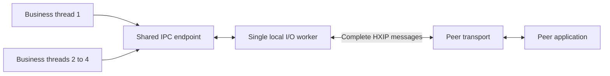
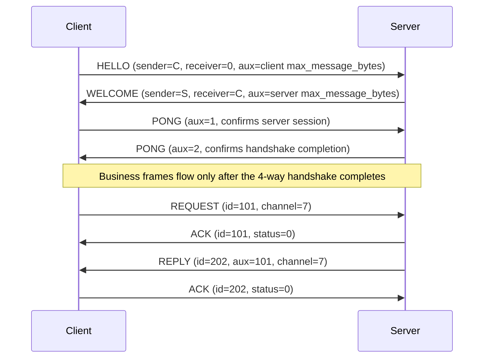

# Local Inter-Process Communication (IPC): Quick Start and Application Integration

[简体中文](IPC.zh-CN.md) · [README](../README.md) · [C API](../include/hx_ipc.h) · [C++11 Facade](../include/hx/Ipc.hpp)

When you need to isolate an unstable or proprietary third-party hardware SDK inside a helper process, or exchange commands and events between a local controller, background daemon, and Python or external tools on the same machine, `hx_ipc` provides an out-of-the-box local IPC layer. It handles message framing, concurrent request/reply correlation, heartbeats, automatic reconnection, and bounded queue backpressure so you do not have to build frame parsers and request routing tables from scratch.

Complete the one-time [example build setup](../examples/README.md#run) before starting. Throughout this guide, `build` refers to your existing build directory—reuse it directly instead of creating a new directory for each transport protocol.

> [!TIP]
> **Full Business Examples by Transport**
> Section 2 uses a minimal echo program to verify `hx_ipc` connectivity, endpoint lifecycle, and cross-language wire framing. When you are ready to copy a complete project template with UTF-8 JSON parsing, strict field-type checks, and business state machines, see the dedicated guide for your transport:
> - [Native Local IPC Device Control](IPC_BUSINESS.md) (concurrent multi-device control and push notifications over `hx_ipc`)
> - [TCP Order Processing](TCP_BUSINESS.md) (built directly on raw `hx_os_socket_*`)
> - [UDP Sensor Telemetry](UDP_BUSINESS.md) (built directly on raw `hx_os_socket_*`)
> - [KCP Block Transfer](KCP_BUSINESS.md) (built directly on raw `hx_os_kcp_*` + UDP)

## 1. Choose an address

Any two local processes that select the same transport and speak the HXIP v1 wire protocol can send messages in both directions and match concurrent requests with their corresponding replies. A peer can be written in another language without linking `hx_c_platform` (Section 8 documents the full wire specification, and the repository includes a standard-library-only Python peer).

| Example Address | Best For | Delivery Semantics & Transport |
| --- | --- | --- |
| `local://demo` | Processes running under the same local user account (recommended default) | Windows Named Pipe on Windows; Unix domain socket on Linux/macOS |
| `tcp://127.0.0.1:39001` | Peer languages or external tools where loopback TCP is easiest to integrate | Complete, ordered messages and bidirectional concurrent requests |
| `udp://127.0.0.1:39002` | High-frequency telemetry or status updates that tolerate occasional packet loss | Ordinary UDP: packets may be lost, duplicated, or reordered; no business-data retransmission |
| `kcp://127.0.0.1:39003` | Reliable, ordered delivery with acknowledgements and retransmission over UDP | Internally driven KCP engine; ordered delivery within a live session with explicit timeout/disconnect reporting |

`local://demo` is a portable shorthand. Once an endpoint is created, call `hx_ipc_address()` to query the resolved native address (`pipe://...` on Windows or `unix:///...` on POSIX) so you can pass it to a peer written in another language. You can also specify explicit `pipe://my-name` or `unix:///absolute/path.sock` addresses directly (note that Unix socket paths are subject to operating system length limits).

> [!NOTE]
> - TCP, UDP, and KCP endpoints also accept IPv6 loopback (`[::1]`) and reject non-loopback IP addresses. A listener may bind to port `0` and call `hx_ipc_address()` to inspect the ephemeral port assigned by the OS.
> - Over localhost, KCP is not inherently faster than native pipes or loopback TCP, and `hx_ipc` is strictly designed for same-machine communication rather than remote internet deployment.

## 2. Run the C example in two terminals

From the repository root, build the minimal echo server, the C client, and the multi-threaded C++11 client used in Section 3:

```sh
cmake -S . -B build -DHX_OS_BUILD_EXAMPLES=ON
cmake --build build --config Release --target hx_os_ipc_server
cmake --build build --config Release --target hx_os_ipc_client
cmake --build build --config Release --target hx_os_ipc_threads
```

You can skip `hx_os_ipc_threads` if you only want to run the single-threaded C client in this section. The Windows commands below assume a multi-config Visual Studio generator; with Ninja, executables are placed directly in `build/bin` (omit the `Release` subdirectory).

**Windows PowerShell (Terminal 1 — start the server):**

```powershell
.\build\bin\Release\hx_os_ipc_server.exe local://demo 1
```

**Windows PowerShell (Terminal 2 — run the client):**

```powershell
.\build\bin\Release\hx_os_ipc_client.exe local://demo
```

**Linux / macOS (run in two separate terminals):**

```sh
./build/bin/hx_os_ipc_server local://demo 1
./build/bin/hx_os_ipc_client local://demo
```

The server prints its resolved listening address and waits for a client (the trailing `1` tells it to exit after handling one business message). When you run the client in the second terminal:
- The client prints `Reply: Hello from C`.
- The server prints `Handled 1 complete messages.` and exits cleanly.

Replace `local://demo` in both commands with a `tcp://`, `udp://`, or `kcp://` address from Section 1 to switch transports without changing a single line of C code.

Full source code is available in [ipc_server.c](../examples/ipc_server.c) and [ipc_client.c](../examples/ipc_client.c). The client's core request flow is straightforward:

```c
hx_ipc *client = NULL;
hx_ipc_message *reply = NULL;
hx_os_error error = {0};

hx_os_status status = hx_ipc_connect("local://demo", &client, &error);
if (status == HX_OS_OK)
	status = hx_ipc_request_text(client, "Hello from C", &reply, &error);

if (status == HX_OS_OK)
	printf("Reply: %.*s\n", (int)reply->bytes, (const char *)reply->data);

hx_ipc_message_release(reply);
// Close client even when connect or request failed; see section 6.
```

Create a connection once and reuse it across requests. `hx_ipc_request_text()` automatically assigns a unique request ID, sends a complete UTF-8 message, and waits for the matching reply. Convenience calls without the `_until` suffix wait up to 5 seconds by default; use the `_until` variants when you need custom deadlines.

On the server side, a loop calls `hx_ipc_receive_until()` to dequeue one complete message or connection lifecycle event at a time:
- For `HX_IPC_REQUEST`, call `hx_ipc_reply_text(server, message, "result", &error)`—the library automatically preserves the originating peer, `channel`, and request ID.
- For `HX_IPC_DATA`, the message is a one-way notification or data frame that does not require a business reply.
- `HX_IPC_CONNECTED`, `HX_IPC_DISCONNECTED`, and `HX_IPC_OVERFLOW` report connection and event-ring status rather than application payloads.

## 3. Share a connection between four business threads

Real applications often have multiple worker threads querying different devices or subsystems over the same IPC channel. Start the server again with a message count of `20`:

```powershell
.\build\bin\Release\hx_os_ipc_server.exe local://demo 20
```

In a second terminal, run the multi-threaded client:

```powershell
.\build\bin\Release\hx_os_ipc_threads.exe local://demo
```

(On Linux/macOS, run `./build/bin/hx_os_ipc_server local://demo 20` and `./build/bin/hx_os_ipc_threads local://demo`.)

The [complete C++11 example (`ipc_threads.cpp`)](../examples/ipc_threads.cpp) spawns four business threads, each issuing five requests over a single shared endpoint:

```cpp
auto reply = connection.requestText("read temperature", device_id);
if (!reply) {
	std::fprintf(stderr, "Request failed: %d\n", reply.status());

	return NULL;
}

std::printf("Reply: %s\n", reply.value().text());
```

Here, `device_id` maps to the message's `channel` field, which your application defines (for example, to distinguish Device 1 from Device 2). The library assigns each request ID internally. Even if replies arrive out of order, each calling thread wakes up with its own matching reply—**you do not need an external mutex around send or request calls**. The C API provides the exact same concurrency guarantees; the C++11 wrapper simply adds exception-free `hx::Result<T>` return values and RAII message cleanup.

When all 20 requests complete, the client prints:

```text
20 replies matched across 4 business threads.
```

The preceding 20 `Reply:` lines may appear in any order depending on thread scheduling. Either side of an IPC connection can initiate one-way messages and requests. To receive unsolicited push notifications, dedicate a business thread to calling `hx_ipc_receive_until()` (if multiple threads call `receive_until` concurrently, incoming messages are load-balanced across them rather than broadcast to every caller).



Each explicitly created endpoint spawns **one** internal I/O worker thread to manage its bounded set of peers; merely including headers or linking the library starts no background threads. All application message processing runs on the thread that calls `receive_until`—the I/O worker never invokes user callbacks.

> [!WARNING]
> **Blocking Thread Waits vs. Coroutines and GUI Threads**
> - Current `hx_ipc` wait calls **block the calling OS thread**. While `hx_c_platform` includes a coroutine runtime, `hx_ipc` does not yet provide coroutine-suspending adapters. Calling synchronous IPC waits inside a coroutine blocks the underlying scheduler worker thread.
> - Similarly, GUI applications (such as Qt) should run IPC requests on background business threads and post results back to the UI thread through the host framework's native event mechanism.
> - If a client disconnects mid-accept, known recoverable socket errors leave the listener running for other clients. Unrecoverable listener errors and resource exhaustion are reported explicitly; see [Networking and Event Loops in CONTRACTS.md](CONTRACTS.md#networking-and-event-loops).

## 4. A Python peer without the C library

To see cross-language interoperability in action, start the C server on a loopback TCP port in Terminal 1:

```powershell
.\build\bin\Release\hx_os_ipc_server.exe tcp://127.0.0.1:39001 1
```

In Terminal 2, run the standalone Python peer:

```sh
python examples/ipc_python.py tcp://127.0.0.1:39001 "Hello from Python"
```

Terminal 2 prints `Reply: Hello from Python`. The script ([ipc_python.py](../examples/ipc_python.py)) uses only Python's standard `socket` and `struct` modules to perform the HXIP v1 handshake, 64-byte header framing, heartbeat responses, and request ID correlation without loading any C DLL or shared library. On Linux and macOS, it also accepts the `unix:///...` path printed by a `local://` server.

Because this teaching script is kept concise for protocol inspection, it does not implement KCP, Windows named pipes, multi-threaded sharing, or automatic reconnect. Other languages can implement those capabilities by following the specification in Section 8.

## 5. Devices, queue limits and backpressure

Long-running services need bounded memory even when a peer stalls or floods the connection. `hx_ipc` enforces explicit resource limits across every queue:

| Runtime Scenario | Library Behavior | Application Responsibility |
| --- | --- | --- |
| Partial or coalesced socket reads | Accumulates and splits frames internally; returns one complete message per call | Read the complete payload directly from `message->data` and `message->bytes` |
| Multiple devices and concurrent requests | Tracks session IDs, `channel`, and request IDs; routes each reply to its waiting caller | Assign distinct `channel` numbers to devices or logical streams |
| Concurrent sender threads | Serializes a bounded outbox through the internal I/O worker thread | Do not mutate the input buffer from another thread while a send call is in progress |
| Peer process crash & restart | Handshake establishes a fresh random session, fails pending old-session requests, and rejects stale packets | Handle `HX_IPC_DISCONNECTED` / `HX_IPC_CONNECTED` events and decide which operations to retry |
| Slow receiver thread | Reliable transports reject admission with `HX_OS_LIMIT`; ordinary UDP may drop datagrams | Throttle senders, coalesce state updates, or report backpressure to callers |
| Disconnect or deadline expiration | Returns an explicit status code and native OS error; preserves endpoint ownership if close times out | Retry business operations only when safe under your application's idempotency rules |

Pass an `hx_ipc_options` struct at endpoint creation to customize limits (options are immutable once created). Passing `NULL` selects these defaults:

| Option Field | Default | Description |
| --- | --- | --- |
| `max_peers` | `16` | Maximum concurrent peer slots on a listener (including handshakes); clients always use `1` |
| `max_messages` | `128` | Independent message count cap for both the outgoing outbox and incoming business inbox |
| `max_pending_requests` | `128` | Maximum concurrent calls waiting for a send acknowledgement or business reply |
| `max_message_bytes` | `64 KiB` | Maximum business payload size per message; handshake negotiates the smaller limit of both peers |
| `max_pending_bytes` | `4 MiB` | Combined byte budget shared by queued incoming payloads and outgoing frames |
| `max_kcp_bytes` | `8 MiB` | Total preallocated memory budget shared across all KCP sessions on this endpoint |
| `handshake_timeout_ms` | `5000` | Deadline for completing a single connection handshake (milliseconds) |
| `idle_timeout_ms` | `15000` | Inactivity timeout without valid traffic before declaring a disconnect (`0` disables detection) |
| `reconnect_attempts` | `8` | Maximum automatic client reconnect attempts after a disconnect (`0` disables reconnect) |
| `reconnect_delay_ms` | `250` | Fixed delay between client reconnect attempts (milliseconds) |

### Memory Accounting and Lifecycle Details

- **Sizing for Constrained Environments**: To reduce memory footprint, lower `max_peers`, `max_messages`, and `max_message_bytes`. Note that `max_pending_bytes` tracks queued payload storage; endpoint metadata, OS socket buffers, worker stack space, and KCP session reserves are accounted separately. Each peer also has a `64 KiB` control-frame budget (capped endpoint-wide at `max_peers * 64 KiB`, with unretired frames from prior sessions still counted during rapid reconnects so session churn cannot bypass the cap).
- **Event Ring Overflow**: The connection lifecycle event ring holds `2 * max_peers + 8` entries. If receivers fall far enough behind to fill the ring, the library delivers an `HX_IPC_OVERFLOW` event so your application knows to resynchronize device state.
- **KCP Preallocation**: KCP preallocates its protocol state when a session is created and performs zero dynamic allocations inside the KCP engine afterward (IPC message wrappers and native async I/O operations still use the context allocator). Because KCP session admission requires at least `2 MiB` of remaining budget before charging the session's actual reserve, `max_peers = 16` does not mean 16 simultaneous KCP sessions will fit inside the default `8 MiB` KCP budget.
- **Ownership of Delivered Messages**: Once a message is returned to the caller, its bytes are no longer charged against the endpoint's queue budget. Release it promptly with `hx_ipc_message_release()`. Delivered messages can outlive the endpoint and be freed on any thread as long as the underlying `hx_os_context` remains alive. Call `hx_ipc_statistics_read()` at any time to inspect queued bytes, KCP reserves, active peers, rejections, and dropped datagrams.

> [!NOTE]
> **UDP / KCP Payload Limits and WSL2 Mirrored Networking**
> - **Datagram & Fragment Limits**: Ordinary UDP payloads cannot exceed `65507 - 64` bytes (larger sends immediately return `HX_OS_LIMIT`). However, large UDP datagrams suffer from IP fragmentation; keep ordinary UDP payloads within your path MTU (for example, `1408` bytes or less for a 1500-byte Ethernet MTU minus 20-byte IPv4, 8-byte UDP, and 64-byte HXIP headers). KCP payloads are bounded by 127 fragments at an MTU of 1200 bytes (minus 24 KCP header bytes per fragment and the 64-byte inner HXIP header), which comfortably accommodates the `64 KiB` default.
> - **WSL2 Mirrored Networking**: Under WSL2 mirrored networking, IPv4 loopback traffic can traverse the Windows host network stack, where large fragmented UDP datagrams may be dropped (once a fragment is lost, larger socket receive buffers or longer timeouts cannot recover the packet). Within a single WSL network namespace, use `udp://[::1]:39002` (native Linux IPv6 loopback) to avoid host-path fragmentation, or switch to `kcp://127.0.0.1:39003` / TCP for large reliable messages.

> [!IMPORTANT]
> **Custom Allocator Callbacks and Lock-Free Event Allocation**
> - When delivering a lifecycle or overflow event, the library allocates the owned `hx_ipc_message` outside the endpoint mutex and rechecks queue state and closure upon re-locking. If allocation fails, the event remains pending for a future retry while in-flight reference counts keep the endpoint alive.
> - Custom allocator callbacks run synchronously on the calling application thread or the internal I/O worker thread. An allocator callback may read statistics from a published, live endpoint, but **must never close an endpoint or invoke blocking IPC calls** (which would deadlock waiting for the thread currently inside the allocator). Never access an endpoint from an allocator callback while the endpoint is being created, destroyed, or after its destruction completes.

## 6. Deadlines and closure

All `_until` functions (`send_until`, `request_until`, `receive_until`, and `close_until`) accept an **absolute monotonic deadline**:
- Call `hx_os_deadline_after_ms(200)` to create a deadline 200 ms from now.
- Pass `HX_OS_DEADLINE_NOW` to poll without blocking.
- Pass `HX_OS_DEADLINE_INFINITE` to wait indefinitely (note that endpoint closure never defaults to an infinite wait).

### Delivery Semantics and Retry Safety

1. **What Send Success Means**: On reliable transports (Local/TCP/KCP), `HX_OS_OK` from `send` means the complete message was admitted into the peer's IPC inbox—**not that the peer's business logic or hardware action has already executed**. For `request`, `HX_OS_OK` means a matching reply arrived (check the reply payload for the business outcome). For ordinary UDP, `send` success only means the local OS accepted the datagram for transmission.
2. **No Silent Request Replay**: A request can time out (`HX_OS_TIMEOUT`) after the remote peer has already executed the command while the reply is still in flight. Consequently, `hx_ipc` **never replays old business requests automatically** across reconnects and does not claim exactly-once execution. When retrying non-idempotent operations, embed a persistent operation ID in your payload (e.g., JSON) and deduplicate on the server.
3. **Buffer Ownership & Encoding**: Send calls copy their input buffer before returning, so you can modify or free your source buffer immediately. A received `hx_ipc_message` owns its `data` buffer; always free both together via `hx_ipc_message_release()` and **never call `free()` on `message->data` directly**. Binary payloads may contain null bytes (`\0`); text APIs (`_text`) validate strict UTF-8 and reject invalid sequences (convert legacy encodings such as GBK to UTF-8 first using the library's codec module).
4. **Connection Lifetimes & Concurrent Reconnects**: Once an internal endpoint object is allocated, `hx_ipc_connect()` may return a non-NULL `client` pointer even if the initial handshake times out—either continue waiting with `hx_ipc_wait_connected_until()` or close the handle with `hx_ipc_close_until()`, **never leak the non-NULL pointer**. If a send call overlaps an automatic reconnect, a call bound to the old session is never silently reassigned to the new session even if an internal slot is reused; it finishes or fails against the original session. After reconnecting, pass `peer = 0` (or query the current peer) for subsequent client requests.

### Closing an Endpoint

Stop issuing new application calls before initiating shutdown. In-flight waits (`receive_until` / `request_until`) may safely overlap closure: they are woken up immediately with a closed/cancelled status, and their underlying memory stays valid until they return. **Serialize `hx_ipc_close_until()` through a single shutdown owner thread** and never mutate the same `hx_ipc *` pointer concurrently:

```c
hx_os_status status = hx_ipc_close_until(
	&client, hx_os_deadline_after_ms(200), &error);
if (status == HX_OS_TIMEOUT) {
	// Keep client in durable host state; retry from the shutdown owner.
	status = hx_ipc_close_until(
		&client, hx_os_deadline_after_ms(1000), &error);
}
```

- **Clean Shutdown (`HX_OS_OK`)**: The library sets `client` to `NULL`.
- **Timeout (`HX_OS_TIMEOUT`) or Native Cleanup Error**: `client` remains non-NULL so the shutdown owner can call `hx_ipc_close_until()` again with a new deadline. Once closure starts, the endpoint cannot be used for new business traffic, and both the owner pointer and its custom allocator must remain alive until `hx_ipc_close_until()` succeeds.
- **What Closure Does**: Within the supplied deadline, `close_until` drains pending protocol acknowledgements, cancels native asynchronous I/O, and waits for in-flight OS buffers to retire (`HX_OS_DEADLINE_NOW` skips draining and begins cancellation immediately). Closure is **not** a flush that guarantees delivery of all queued business messages, and it never kills threads, detaches workers, or terminates the host process.
- **C++11 Wrapper & Process Boundaries**: `hx::Ipc` borrows a host-owned `hx_ipc *`; its destructor never blocks indefinitely or leaks an unclosed handle. Join your business worker threads first, then call `closeUntil()` explicitly. Finally, `hx_ipc` manages communication only—it does not spawn or restart external SDK helper processes or cancel a hung third-party SDK call inside another process.

## 7. Platforms and build switches

- **CMake Switches**: `HX_OS_ENABLE_IPC` and `HX_OS_ENABLE_KCP` default to `ON` and can be toggled independently. `hx_ipc` requires `NETWORK`, `LOOP`, and `RANDOM`; disabling any of those clears `HX_OS_CAP_IPC` and causes public IPC functions to return `HX_OS_NOT_SUPPORTED`. Disabling only `HX_OS_ENABLE_KCP` leaves `local://`, `tcp://`, and `udp://` active while `kcp://` returns `HX_OS_NOT_SUPPORTED`. The minimal embedded profile disables both switches.
- **Native Transports & Event Loops**: Windows local transport requires `PIPE` and uses Overlapped I/O with IOCP (compatible with the Windows 7 baseline). POSIX local transport requires `LOCAL_SOCKETS` and `LOOP_FD`, building on non-blocking sockets and the library's epoll/kqueue adapters. For TCP listeners, `hx_ipc` enables `SO_REUSEADDR` on POSIX for fast service restarts and exclusive address binding on Windows (leaving the low-level socket API's opt-in defaults unchanged).
- **Access Control & Security Boundaries**:
  - **Windows**: Named pipe DACLs grant access only to the current user SID and `SYSTEM`, rejecting remote network pipe clients.
  - **Linux / macOS**: `local://` creates `/tmp/hx-ipc-<uid>` with mode `0700` and binds sockets with mode `0600`. A companion `.lock` file enforces exclusive listening and intentionally persists after close to prevent unlink/relock race conditions; socket cleanup only unlinks the path if its device and inode still match the listener's own socket.
  - **Android**: Command-line/`adb` examples use `/data/local/tmp/hx-ipc-<uid>`. Packaged Android APKs should pass an explicit `unix:///...` path inside an accessible app-private directory; cross-UID communication remains governed by the Android sandbox and SELinux policy.
  - **Loopback Trust Model**: Loopback TCP/UDP/KCP restricts binding to localhost interfaces but does not provide cryptographic authentication or encryption. The 64-bit random session IDs distinguish connection generations and restarts rather than verifying peer identity. Do not expose HXIP directly to untrusted remote networks without an external authentication layer.
- **Bundled KCP Source**: KCP is compiled from pinned, unmodified upstream v1 sources (MIT license) as private C object code—no extra DLL, public KCP headers, or global allocator hooks are introduced, and the license is installed alongside the library. See [Third-Party Notices](../THIRD_PARTY_NOTICES.md) for the exact commit pin and SHA-256 checksums.

## 8. HXIP v1 for peers in other languages

To implement a compatible peer in Python, C#, Go, Rust, or Java without linking the C library, follow the **HXIP v1** wire format below.

Every frame consists of a **fixed 64-byte header** followed by **exact `body_len` payload bytes**. **All header integer fields are big-endian (network byte order); never write a raw C struct layout onto the wire.**
- On stream transports (TCP, Unix domain streams, byte-mode named pipes), loop until all 64 header bytes arrive, validate the header, loop until all `body_len` payload bytes arrive, and then continue parsing subsequent coalesced frames.
- On datagram transports (UDP), each datagram must contain exactly one complete frame; reject truncated datagrams or packets with trailing bytes.
- Always validate `body_len` against your local `max_message_bytes` limit before allocating memory.

### 64-Byte Header Layout

| Byte Offset | Length (Bytes) | Field Description |
| --- | --- | --- |
| `0` | `4` | Magic bytes: ASCII `HXIP` (`0x48, 0x58, 0x49, 0x50`) |
| `4` | `1` | Protocol version: fixed at `1` |
| `5` | `1` | Frame kind (see table below) |
| `6` | `2` | Payload encoding: `0` = binary, `1` = UTF-8 text |
| `8` | `4` | Unsigned payload length in bytes (`uint32_t`) |
| `12` | `4` | Signed two's-complement status code (`int32_t`; normally `0`) |
| `16` | `8` | Non-zero random 64-bit sender session ID |
| `24` | `8` | Receiver session ID (`0` in the initial `HELLO` frame) |
| `32` | `8` | Message or request ID (`uint64_t`) |
| `40` | `8` | Application-defined device or stream `channel` (`uint64_t`) |
| `48` | `8` | Kind-specific auxiliary value (`uint64_t`) |
| `56` | `8` | Reserved: must be sent as `0` and verified as `0` on receipt |

### Frame Kinds and Auxiliary Values

| Frame Kind | Value | Auxiliary Field (Offset 48) & Behavior |
| --- | --- | --- |
| `HELLO` | `1` | Client maximum payload byte limit; empty body |
| `WELCOME` | `2` | Server maximum payload byte limit; empty body |
| `DATA` | `3` | One-way business message (no business reply expected) |
| `REQUEST` | `4` | Business request requiring a matching `REPLY` |
| `REPLY` | `5` | Auxiliary holds the **original request ID**; Offset 32 holds this reply's own unique ID |
| `ACK` | `6` | Offset 32 holds the **acknowledged message ID**; Offset 12 reports the admission status |
| `PING` / `PONG` | `7` / `8` | Heartbeat frames; special `PONG` auxiliary values (`1` and `2`) complete the handshake |
| `CLOSE` | `9` | Peer declares graceful session closure (transport EOF/disconnect also closes the session) |
| `KCP_PACKET` | `10` | Outer UDP envelope for `kcp://` mode; payload is a raw upstream KCP packet |

### Handshake and Request Sequence



### Session Validation, Admission Status Codes, and UDP/KCP Rules

1. **Sessions and IDs**: Each side generates a non-zero 64-bit random session ID (`C` and `S`) during handshake. Every subsequent data, acknowledgement, and heartbeat frame must match both session IDs (the local `peer` handle exposed by the C API is only a local slot identifier, not a persistent device ID). Outgoing message IDs never repeat within an endpoint's lifetime. Reply to heartbeat `PING` frames with a `PONG` using auxiliary value `0`; all control frames have an empty body (`body_len = 0`).
2. **Reliable `ACK` Status Codes**: On reliable transports (Local/TCP/KCP), the receiver sends an `ACK` after admitting a `DATA` or `REQUEST` frame into its inbox, as well as when matching a `REPLY` (or discarding a late reply). When admission is rejected, the `ACK` carries one of the negative status codes from [hx_os_base.h](../include/hx_os_base.h) in Offset 12:
   - `-12` (`HX_OS_LIMIT`): Inbox queue is full or byte budget is exhausted
   - `-2` (`HX_OS_NO_MEMORY`): Memory allocation failed
   - `-10` (`HX_OS_CLOSED`): Endpoint is closing or closed
   - `-15` (`HX_OS_INVALID_ENCODING`): Payload marked as UTF-8 failed validation
   Note that a status-`0` `ACK` for a `REQUEST` only confirms inbox admission; the caller must continue waiting for the `REPLY` frame. On ordinary UDP, `DATA` and `REQUEST` frames neither wait for nor require `ACK` frames, and business payloads are never retransmitted.
3. **UDP Handshake Safety**: During a UDP handshake, the client resends `HELLO` every 100 ms and re-sends its confirmation `PONG` if it receives a duplicate `WELCOME`. An unconfirmed `HELLO` must **never** evict an already-established active session (preventing a delayed stale packet from dropping a live connection). After an idle timeout, peers handshake again with fresh session IDs without replaying old business requests.
4. **KCP Framing Details**: In `kcp://` mode, `HELLO` and `WELCOME` are sent as ordinary outer HXIP UDP frames. Once both peers know `C` and `S`, they compute the 32-bit KCP conversation ID as `(uint32_t)(C ^ S)` (mapping `0` to `1`). All subsequent HXIP frames—including the handshake confirmation `PONG(1)` and `PONG(2)`—are passed as complete messages into KCP **message mode**. Each outgoing packet emitted by KCP is wrapped in an outer `Kind = 10` (`KCP_PACKET`) HXIP UDP frame whose sender/receiver session IDs are validated before feeding `hx_os_kcp_input()`. KCP's own internal header fields retain upstream little-endian layout. Both peers must configure MTU 1200, message mode, and periodic timer updates.

> [!TIP]
> Advanced users who want to run KCP between trusted machines over a LAN without the local-only `hx_ipc` layer can drive [hx_os_kcp.h](../include/hx_os_kcp.h) directly by supplying packets, monotonic timestamps, and an output callback. For local IPC, simply use a `kcp://` address and let `hx_ipc` manage the update loop automatically.

## 9. Run the complete device workflow

Section 2 built the minimal echo programs. To run the complete multi-device JSON workflow—including concurrent device threads, range validation, and asynchronous change notifications—build the device server and client targets in the same build directory:

```sh
cmake --build build --config Release --target hx_os_ipc_device_server
cmake --build build --config Release --target hx_os_ipc_device_client
```

**Windows (Visual Studio generator):**

```powershell
python examples/run_ipc_business.py --bin-dir build/bin/Release
```

**Linux / WSL:**

```sh
python3 examples/run_ipc_business.py --bin-dir build/bin
```

Adjust `--config` and `--bin-dir` if you are using a Debug build. The runner script launches both C processes, verifies commands and push notifications across two simulated devices, and prints `PASS ipc_business_local` (Python is only used to orchestrate the test; the C library itself has no Python dependency). See the [Native Local IPC Business Guide](IPC_BUSINESS.md) for the JSON schema, manual two-terminal commands, and the list of files to copy into your own project, and see [Platform Support](PLATFORMS.md) for OS-specific notes.

## 10. Spread out reconnect attempts

When dozens of local client processes restart or lose connection simultaneously, fixed-interval retries can cause a thundering herd against the server. Replace the fixed-delay connect call with `hx_ipc_connect_backoff_until()` to spread out reconnect attempts.

`hx_ipc_connect_backoff_until()` accepts the same arguments as `hx_ipc_connect_until()` plus an optional pointer to a backoff configuration struct:
- Passing `NULL` for the backoff config selects a **100 ms initial delay, a 30-second maximum cap, up to 8 retries**, and **±20% random jitter** seeded independently per endpoint. A successful handshake resets the retry budget.
- Existing `hx_ipc_connect()` and `hx_ipc_connect_until()` calls keep their fixed-delay behavior.

Backoff only spaces out transport reconnection attempts; it **never resends business requests automatically**. As with `connect_until`, if the overall deadline expires, a non-NULL endpoint handle is preserved so you can either continue waiting or close it cleanly. For reliable UDP communication across separate trusted machines, see the standalone [KCP session example in NETWORK_IO.md](NETWORK_IO.md)—`hx_ipc` endpoints remain strictly local-only.
