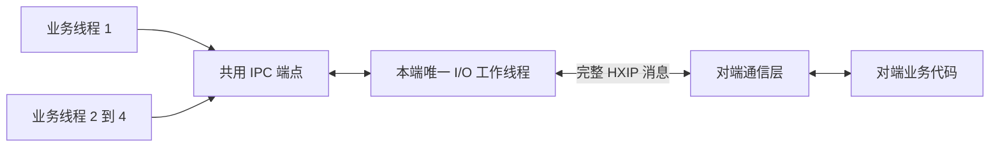
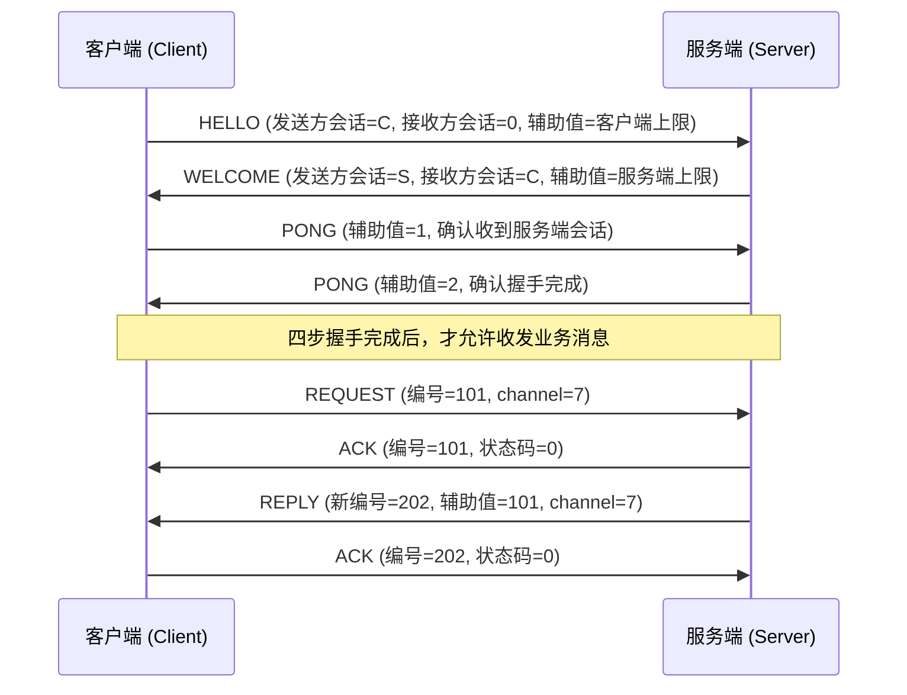

# 本机进程通信（IPC）：从快速上手到业务接入

[English](IPC.md) · [README](../README.zh-CN.md) · [公开 C 接口](../include/hx_ipc.h) · [C++11 接口](../include/hx/Ipc.hpp)

当你需要将不稳定或闭源的第三方硬件 SDK 隔离在独立辅助进程中，或者让同一台机器上的主控程序与后台守护进程、Python/其他语言工具进行双向通信时，`hx_ipc` 提供了开箱即用的本机进程间通信能力。它内置了完整的帧定界、多路请求/回复匹配（Request/Reply Correlation）、心跳检测、自动重连和有界队列背压，让你无需从零手写粘包拆分与请求路由。

在开始前，请先完成一次[示例构建配置](../examples/README.zh-CN.md#run)。下文中的 `build` 代表你现有的构建目录，直接复用即可，无需为不同传输协议新建目录。

> [!TIP]
> **按传输方式划分的完整业务示例**
> 本文第 2 节使用最小回显程序演示 `hx_ipc` 的连通性、生命周期和跨语言协议。如果你想直接参考带 UTF-8 JSON 解析、字段类型校验和业务状态机的完整工程模板，请按通信方式查阅对应的独立教程：
> - [本地 IPC 设备控制](IPC_BUSINESS.zh-CN.md)（基于 `hx_ipc` 的多设备并发控制与主动通知）
> - [TCP 订单处理](TCP_BUSINESS.zh-CN.md)（直接使用底层 `hx_os_socket_*`）
> - [UDP 传感器采样](UDP_BUSINESS.zh-CN.md)（直接使用底层 `hx_os_socket_*`）
> - [KCP 数据块传输](KCP_BUSINESS.zh-CN.md)（直接使用底层 `hx_os_kcp_*` + UDP）

## 1. 先选一种地址

只要两个本机进程使用同一种传输层并遵循 HXIP v1 消息协议，就能双向收发消息、并发发起请求并自动匹配各自的回复。对端甚至可以用其他语言编写而无需链接 `hx_c_platform`（第 8 节给出了完整线协议，仓库也提供了仅依赖标准库的 Python 对端示例）。

| 地址示例 | 适用场景 | 交付语义与底层传输 |
| --- | --- | --- |
| `local://demo` | 同一登录用户下的本机进程通信（推荐首选） | Windows 使用命名管道（Named Pipe）；Linux/macOS 使用 Unix 域套接字 |
| `tcp://127.0.0.1:39001` | 对端语言（如脚本或外部工具）最方便接入 TCP 时 | 完整、有序的字节流消息定界；支持双向并发请求 |
| `udp://127.0.0.1:39002` | 允许偶发丢包的高频状态广播或传感器采样 | 普通 UDP：可能丢失、重复或乱序，不重传业务数据 |
| `kcp://127.0.0.1:39003` | 需要在 UDP 之上获得确认、重传、去重和有序交付 | 内部自动驱动 KCP 引擎，连接存活期间有序交付；仍需处理超时与断开 |

`local://demo` 是一种跨平台便捷写法。端点创建后，你可以调用 `hx_ipc_address()` 获取底层的真实地址（如 Windows 的 `pipe://...` 或 POSIX 的 `unix:///...`），方便传给其他语言编写的对端进程。你也可以直接传入显式的 `pipe://my-name` 或 `unix:///absolute/path.sock`（注意 Unix 域套接字路径长度受操作系统上限约束）。

> [!NOTE]
> - TCP、UDP 和 KCP 地址同样支持 IPv6 回环 `[::1]`，但会明确拒绝非回环（非本机）IP。服务端可以将监听端口设为 `0`，由系统自动分配空闲端口后再通过 `hx_ipc_address()` 读取实际监听地址。
> - 在本机回环场景下，KCP 并不一定比系统原生管道或 TCP 更快；本模块仅面向本机通信设计，不提供跨主机公网部署承诺。

## 2. 两个终端跑通 C 示例

在仓库根目录下构建最小回显服务端、C 客户端以及第 3 节会用到的多线程示例：

```sh
cmake -S . -B build -DHX_OS_BUILD_EXAMPLES=ON
cmake --build build --config Release --target hx_os_ipc_server
cmake --build build --config Release --target hx_os_ipc_client
cmake --build build --config Release --target hx_os_ipc_threads
```

如果你只运行本节的单线程 C 客户端，可以跳过 `hx_os_ipc_threads` 目标。下方 Windows 路径以 Visual Studio 多配置生成器为例；如果使用 Ninja 单配置生成器，可执行文件直接位于 `build/bin` 下（去掉路径中的 `Release` 即可）。

**Windows PowerShell（终端一，启动服务端）：**

```powershell
.\build\bin\Release\hx_os_ipc_server.exe local://demo 1
```

**Windows PowerShell（终端二，运行客户端）：**

```powershell
.\build\bin\Release\hx_os_ipc_client.exe local://demo
```

**Linux / macOS（在两个终端中分别执行）：**

```sh
./build/bin/hx_os_ipc_server local://demo 1
./build/bin/hx_os_ipc_client local://demo
```

服务端启动后会打印实际监听地址并阻塞等待连接（末尾参数 `1` 表示处理完 1 条业务消息后自动退出）。在第二个终端运行客户端后：
- 客户端输出：`Reply: Hello from C`
- 服务端输出：`Handled 1 complete messages.` 并正常退出。

如果把两条命令中的 `local://demo` 同时替换为上表中的 `tcp://`、`udp://` 或 `kcp://` 地址，即可无缝切换底层传输方式。

完整代码见 [ipc_server.c](../examples/ipc_server.c) 与 [ipc_client.c](../examples/ipc_client.c)。其中客户端的核心调用流程非常直接：

```c
hx_ipc *client = NULL;
hx_ipc_message *reply = NULL;
hx_os_error error = {0};

hx_os_status status = hx_ipc_connect("local://demo", &client, &error);
if (status == HX_OS_OK)
	status = hx_ipc_request_text(client, "Hello from C", &reply, &error);

if (status == HX_OS_OK)
	printf("Reply: %.*s\n", (int)reply->bytes, (const char *)reply->data);

hx_ipc_message_release(reply);
// Close client even when connect or request failed; see section 6.
```

连接只需创建一次即可反复复用。`hx_ipc_request_text()` 会自动生成唯一请求编号、发送完整的 UTF-8 文本消息，并阻塞等待与之匹配的回复。不带 `_until` 后缀的便捷接口默认最多等待 5 秒；如果需要自定义超时，请使用对应的 `_until` 变体。

在服务端一侧，程序循环调用 `hx_ipc_receive_until()` 取出一条完整消息或连接生命周期事件：
- 当收到 `HX_IPC_REQUEST` 时，调用 `hx_ipc_reply_text(server, message, "结果", &error)` 发送回复——库会自动沿用原请求的来源连接（`peer`）、通道号（`channel`）和请求编号（`id`）。
- 当收到 `HX_IPC_DATA` 时，表示这是一条单向通知或普通数据消息，无需发送业务回复。
- `HX_IPC_CONNECTED`、`HX_IPC_DISCONNECTED` 和 `HX_IPC_OVERFLOW` 属于连接与队列状态事件，不含业务正文。

## 3. 四个业务线程共用一个连接

在实际工程中，往往有多个业务线程同时访问同一个外设或后台服务。`hx_ipc` 原生支持多线程并发复用同一个端点。我们可以重启服务端，让它连续处理 20 条请求：

```powershell
.\build\bin\Release\hx_os_ipc_server.exe local://demo 20
```

然后在另一个终端运行多线程客户端：

```powershell
.\build\bin\Release\hx_os_ipc_threads.exe local://demo
```

（Linux/macOS 下对应执行 `./build/bin/hx_os_ipc_server local://demo 20` 和 `./build/bin/hx_os_ipc_threads local://demo`。）

[完整 C++11 示例 `ipc_threads.cpp`](../examples/ipc_threads.cpp) 启动了 4 个业务线程，每个线程各自发起 5 次请求，所有线程直接共享同一个连接对象：

```cpp
auto reply = connection.requestText("读取温度", device_id);
if (!reply) {
	std::fprintf(stderr, "Request failed: %d\n", reply.status());

	return NULL;
}

std::printf("Reply: %s\n", reply.value().text());
```

这里的 `device_id` 对应消息头中的 `channel` 字段，由业务层自由定义（例如区分设备 1、设备 2 或不同业务子流）。每次请求的序列号由库内部自动生成并追踪：即使服务端乱序回复，每个调用线程也一定能精准拿到属于自己的那条回复，**应用层无需在发送请求前额外加锁**。C 语言接口同样具备完全相同的线程安全保证；C++11 封装只是额外提供了免异常的 `hx::Result<T>` 返回值和消息自动释放（RAII）。

运行成功后，终端末尾会打印：

```text
20 replies matched across 4 business threads.
```

前面的 20 行 `Reply:` 输出顺序会随线程调度而变化。无论是服务端还是客户端，都可以随时主动发送数据或发起请求。当客户端需要接收服务端主动推送的通知时，只需安排一个业务线程循环调用 `hx_ipc_receive_until()` 即可（注意：如果有多个线程同时调用 `receive_until`，消息会在它们之间分摊消费，而不是广播给每个线程各一份副本）。



每个显式创建的 IPC 端点内部仅启动**一个**后台 I/O 工作线程，负责驱动该端点下的所有连接；仅仅包含头文件或链接本库不会偷偷创建任何后台线程。业务代码的解析与处理全部在调用 `receive_until` 的应用线程中执行，I/O 工作线程绝不会执行用户的业务回调。

> [!WARNING]
> **线程阻塞与协程/GUI 宿主注意事项**
> - 当前版本的 IPC 等待接口是**普通操作系统线程的阻塞等待**。虽然本库包含协程模块，但 `hx_ipc` 尚未提供挂起协程的异步适配器。如果在协程内部直接调用上述同步等待函数，会阻塞底层的调度工作线程。
> - 在 Qt 等 GUI 程序中，同样应当把 IPC 请求放到独立业务线程中执行，拿到结果后再通过宿主框架的跨线程信号/事件投递机制更新界面。
> - 当某个客户端在握手接入瞬间意外断开时，已知可恢复的底层 socket 错误不会导致整个服务端监听器停止，其他客户端仍可正常接入；只有监听器本身失效或系统资源耗尽时才会向上报告错误，详见[网络与事件循环契约](CONTRACTS.zh-CN.md#网络与事件循环)。

## 4. 不链接 C 库的 Python 对端

为了验证跨语言互通，我们在终端一启动监听 TCP 的 C 服务端：

```powershell
.\build\bin\Release\hx_os_ipc_server.exe tcp://127.0.0.1:39001 1
```

在终端二直接运行纯 Python 客户端脚本：

```sh
python examples/ipc_python.py tcp://127.0.0.1:39001 "Hello from Python"
```

终端二会输出 `Reply: Hello from Python`。这个 [ipc_python.py](../examples/ipc_python.py) 脚本没有加载任何 C 动态库（DLL/SO），仅用 Python 标准库的 `socket` 和 `struct` 模块就完整实现了 HXIP v1 握手、64 字节头部拆包、心跳回复与请求匹配。在 Linux/macOS 下，它还可以直接连接服务端打印出的 `unix:///...` 路径。

这个教学脚本专门用于展示最小协议对接，因此没有实现 KCP、Windows 命名管道、多线程共享或断线重连；如果你需要在 C#、Go、Rust 或 Java 中实现完整客户端，直接对照第 8 节的协议规范编写即可。

## 5. 队列、设备和背压

在长周期运行的工业或桌面软件中，如果对端卡死或消费过慢，无界队列很容易把进程内存撑爆。`hx_ipc` 的核心设计原则是**全链路有界预算**：

| 常见运行状况 | `hx_ipc` 内部行为 | 应用层应对方式 |
| --- | --- | --- |
| 底层一次只读到半帧，或一次粘连多帧 | 内部按头部声明长度自动累积并拆包，每次只向应用交付一条完整消息 | 直接按返回消息的 `data` 和 `bytes` 读取完整正文 |
| 多台外设、多线程并发请求 | 内部同时校验连接会话（Session）、`channel` 和请求编号，回复自动精准路由 | 为不同设备或子业务分配各自的 `channel` 编号 |
| 多线程同时发送 | 有界发送队列由后台 I/O 线程串行写入底层传输 | 调用发送函数期间，传入的缓冲区不可被其他线程并发修改 |
| 对端辅助进程崩溃重启 | 重新握手生成全新随机 Session；旧会话中挂起的请求立即返回失败，彻底拒收旧会话残留包 | 监听 `HX_IPC_DISCONNECTED` / `HX_IPC_CONNECTED` 事件，按需重新初始化设备并决定是否重发请求 |
| 接收方业务线程处理过慢 | 可靠传输（Local/TCP/KCP）明确拒绝入队并返回 `HX_OS_LIMIT`；普通 UDP 允许丢弃 | 发送方降低速率、合并状态更新，或向调用方报告繁忙错误 |
| 连接断开或等待超时 | 返回明确的状态码并保留系统原生错误码；若关闭操作超时则保留端点句柄 | 结合业务操作的幂等性决定是否重试 |

创建端点时可通过 `hx_ipc_options` 定制队列与超时参数（创建后不可动态修改）；传入 `NULL` 时采用以下默认配置：

| 配置项 | 默认值 | 含义说明 |
| --- | --- | --- |
| `max_peers` | `16` | 服务端监听端点最多同时保留的连接/握手槽位数（客户端固定为 `1`） |
| `max_messages` | `128` | 发送队列（Outbox）与业务收件箱（Inbox）各自独立的消息条数上限 |
| `max_pending_requests` | `128` | 允许同时处于“等待发送确认”或“等待业务回复”状态的并发调用数上限 |
| `max_message_bytes` | `64 KiB` | 单条业务消息正文的最大字节数；握手时自动取收发双方的较小值 |
| `max_pending_bytes` | `4 MiB` | 业务收件箱正文与待发送帧共享的排队内存总预算 |
| `max_kcp_bytes` | `8 MiB` | 该端点下所有 KCP 会话共享的固定内存预留池上限 |
| `handshake_timeout_ms` | `5000` | 单次连接握手的超时时间（毫秒） |
| `idle_timeout_ms` | `15000` | 未收到任何有效流量（含心跳）时判定断线的空闲超时（毫秒）；设为 `0` 关闭检测 |
| `reconnect_attempts` | `8` | 客户端断线后自动重连的最大尝试次数；设为 `0` 关闭自动重连 |
| `reconnect_delay_ms` | `250` | 每次自动重连尝试之间的固定等待间隔（毫秒） |

### 内存核算与生命周期细节

- **如何裁剪内存占用**：在资源受限环境中，可优先调小 `max_peers`、`max_messages` 和 `max_message_bytes`。注意 `max_pending_bytes` 仅统计排队中的消息载荷，端点元数据、操作系统原生 socket 缓冲区、工作线程栈以及 KCP 预留池另行计算。此外，每个连接槽位还有最多 `64 KiB` 的协议控制帧预算（端点总上限为 `max_peers * 64 KiB`，快速重连期间旧会话未释放的控制帧仍计入总额，防止通过频繁重连绕过限额）。
- **事件环与溢出（Overflow）**：连接生命周期事件环形缓冲区的容量为 `2 * max_peers + 8`。如果业务线程长时间不取消息导致事件环写满，后续会收到一条 `HX_IPC_OVERFLOW` 事件，此时应用应当主动重新同步一次设备状态。
- **KCP 会话预留机制**：KCP 引擎所需的内存会在会话建立时一次性预留，协议引擎运行期间不再向 `hx_os_context` 动态申请内存（IPC 消息对象与底层异步 I/O 请求仍正常走分配器）。当前 KCP 会话准入要求剩余预算至少有 `2 MiB` 才允许建立并扣除实际预留量，因此默认 `8 MiB` 预算下并不能同时跑满 16 个 KCP 会话。
- **已取出消息的所有权**：一旦消息通过 `receive_until` 或 `request_until` 交付给应用层，它就不再占用端点的队列预算，由调用方负责及时调用 `hx_ipc_message_release()` 释放。消息对象可以在端点关闭后继续存活，也支持跨线程释放，但前提是创建该端点时绑定的自定义 `hx_os_context` 必须保持有效。随时可调用 `hx_ipc_statistics_read()` 读取当前的排队字节数、KCP 预留量、活动连接数以及拒收/丢包统计。

> [!NOTE]
> **UDP / KCP 报文长度与 WSL2 镜像网络限制**
> - **分片上限**：普通 UDP 正文不得超过 `65507 - 64` 字节（超出直接返回 `HX_OS_LIMIT`），但接近理论上限的大包极易触发 IP 分片丢包，建议将普通 UDP 载荷控制在路径 MTU 以内（例如以太网 MTU 1500 扣除 20 字节 IPv4 头、8 字节 UDP 头和 64 字节 HXIP 头后，正文不超过 `1408` 字节）。KCP 模式正文的上限受 127 个分片约束（当前固定 MTU 1200 字节，每片 24 字节 KCP 头，外加 64 字节内层 HXIP 头），默认的 `64 KiB` 完全在安全范围内。
> - **WSL2 镜像网络（Mirrored Networking）**：在 WSL2 镜像网络模式下，IPv4 回环流量可能会绕经 Windows 宿主机网络栈，导致较大的 UDP 分片包被丢弃（一旦分片丢失，调大接收缓冲区或超时时间都无法恢复）。在同一个 WSL 网络命名空间内通信时，改用 `udp://[::1]:39002`（Linux 原生 IPv6 回环）即可避开此问题；若需传输较大且要求可靠交付的消息，请直接使用 `kcp://127.0.0.1:39003` 或 TCP。

> [!IMPORTANT]
> **自定义分配器回调与无锁分配安全边界**
> - 当接收连接事件或溢出事件时，库会在端点互斥锁之外分配消息内存，随后重新加锁检查队列与关闭状态；如果内存分配失败，事件会保留在队列中供下次重试。在整个分配与回收过程中，端点生命周期均受在途引用计数保护。
> - 自定义分配器（Allocator）回调会在发起调用的业务线程或后台 I/O 工作线程中同步执行。回调内部可以读取已发布且存活端点的统计信息，但**绝不能在分配器回调里关闭端点或发起阻塞式 IPC 调用**，否则会造成死锁（等待正在执行该回调的线程自身）。在端点创建、销毁期间及销毁完成后，分配器回调不得访问该端点。

## 6. 超时与关闭

所有带 `_until` 后缀的接口（`send_until`、`request_until`、`receive_until`、`close_until`）统一接收本库的**单调时钟绝对截止时间（Monotonic Deadline）**：
- 使用 `hx_os_deadline_after_ms(200)` 构造“从现在起 200 毫秒后”的截止时间。
- 使用 `HX_OS_DEADLINE_NOW` 执行非阻塞轮询（立即返回）。
- 使用 `HX_OS_DEADLINE_INFINITE` 显式要求无限期等待（注意：关闭接口默认不会无限等待）。

### 交付边界与重试原则

1. **发送成功代表什么**：在可靠传输模式（Local/TCP/KCP）下，`send` 返回 `HX_OS_OK` 代表**完整消息已被对端通信层验收入队**，但并不代表对端的业务线程已经执行了硬件动作。`request` 返回 `HX_OS_OK` 代表成功拿到了对端发回的匹配回复（具体业务成败由回复正文决定）。而在普通 UDP 模式下，`send` 成功仅代表本机网卡写入完成。
2. **禁止盲目自动重放**：请求超时（`HX_OS_TIMEOUT`）完全可能发生在“对端已经执行完业务操作，但回复在路上超时”的时刻。因此，本库**绝不会在重连后自动重放旧的业务请求**，也不承诺“恰好一次（Exactly-Once）”的业务执行。对于需要断线重试的关键业务，请在消息正文（如 JSON）中携带持久化的业务操作流水号，由服务端做幂等去重。
3. **缓冲区所有权**：发送接口会立即拷贝输入正文，函数返回后调用方即可修改或释放原缓冲区。接收到的 `hx_ipc_message` 及其内部的 `data` 指针由同一次分配持有，必须统一通过 `hx_ipc_message_release()` 释放，**切勿单独对 `message->data` 调用 `free()`**。二进制消息允许包含 `\0` 字节；文本接口（`_text`）会严格校验 UTF-8 合法性，若输入是 GBK 等其他编码，请先调用本库的编码转换接口转为 UTF-8。
4. **连接与重连并发**：一旦底层连接对象创建完成，即使 `hx_ipc_connect()` 因握手超时返回错误，`client` 指针也可能非空——此时你可以调用 `hx_ipc_wait_connected_until()` 继续等待握手完成，或者调用关闭函数回收它，**不能直接丢弃非空指针导致泄漏**。当自动重连与业务发送并发发生时，已经绑定到旧会话的那次发送调用不会被偷偷转移到新会话槽位上，它会明确按旧会话失败返回；重连成功后，客户端新发起的调用只需传入 `peer = 0`（或重新查询当前 `peer`）即可走新会话。

### 端点关闭流程

在关闭端点前，宿主程序应先停止发起新的业务调用。如果有其他线程正在阻塞等待 `receive_until` 或 `request_until`，允许它们与关闭操作并发：关闭流程会立即唤醒这些等待线程并返回取消/关闭状态，且在所有在途调用安全退出前不会释放底层内存。**关闭操作本身必须由唯一的所有者线程串行执行**，不能由多个线程同时修改同一个 `hx_ipc *` 指针变量：

```c
hx_os_status status = hx_ipc_close_until(
	&client, hx_os_deadline_after_ms(200), &error);
if (status == HX_OS_TIMEOUT) {
	// Keep client in durable host state; retry from the shutdown owner.
	status = hx_ipc_close_until(
		&client, hx_os_deadline_after_ms(1000), &error);
}
```

- **成功关闭（`HX_OS_OK`）**：库会将 `client` 指针自动置为 `NULL`。
- **关闭超时（`HX_OS_TIMEOUT`）或底层清理报错**：`client` 指针保持非空且有效，但此时该端点已进入停止阶段，只能由所有者线程继续调用 `hx_ipc_close_until()` 重试清理，不能再用于收发业务消息。在彻底清理成功前，请继续保留该指针及其关联的自定义分配器。
- **关闭做了什么**：在给定的截止时间内，`close_until` 会尽量发完必要的协议控制确认，随后取消未完成的原生异步 I/O 并等待内核缓冲区安全退役（若传入 `HX_OS_DEADLINE_NOW` 则直接跳过排水进入取消阶段）。它**不是**承诺把所有未发出的业务消息全部送达的 `flush` 接口，更不会强杀工作线程、`detach` 线程或替宿主退出进程。
- **C++11 封装与进程边界**：`hx::Ipc` 仅借用宿主持久持有的 `hx_ipc *` 指针，其析构函数不会暗中无限期阻塞，也不会丢弃未完成关闭的句柄；如示例所示，请先 `join` 业务线程，再显式调用 `closeUntil()`。此外，`hx_ipc` 仅负责进程间通信，不会自动拉起/重启外部 SDK 辅助进程，也无法替你强行打断第三方进程内部卡死的同步 SDK 调用——进程看门狗与硬件复位策略由宿主工程自行掌控。

## 7. 平台与构建开关

- **CMake 构建开关**：`HX_OS_ENABLE_IPC` 与 `HX_OS_ENABLE_KCP` 默认均为 `ON`，且支持独立裁剪。`hx_ipc` 依赖 `NETWORK`、`LOOP` 和 `RANDOM` 三个基础模块；若任一依赖被关闭，`HX_OS_CAP_IPC` 能力位将置零，所有公开入口统一返回 `HX_OS_NOT_SUPPORTED`。如果仅关闭 `HX_OS_ENABLE_KCP`，则 `local://`、`tcp://` 和 `udp://` 照常工作，仅 `kcp://` 返回 `HX_OS_NOT_SUPPORTED`。在最小嵌入式预设（Minimal Profile）下，这两个开关默认关闭。
- **原生传输与事件循环适配**：Windows 命名管道依赖 `PIPE` 模块，底层采用重叠 I/O（Overlapped I/O）与完成端口（IOCP），兼容 Windows 7 基线；POSIX 本地套接字依赖 `LOCAL_SOCKETS` 与 `LOOP_FD`，底层复用非阻塞 socket 与 epoll/kqueue 事件循环。在 TCP 监听模式下，POSIX 端会自动开启地址复用（`SO_REUSEADDR`）以便快速重启服务，Windows 端则采用独占地址绑定（底层通用 socket API 的默认选项行为不受影响）。
- **权限与安全隔离**：
  - **Windows**：命名管道的 DACL 访问控制列表仅授权当前登录用户 SID 与 `SYSTEM` 账户，并显式拒绝远程网络管道客户端接入。
  - **Linux / macOS**：`local://` 默认在 `/tmp/hx-ipc-<uid>` 下创建权限为 `0700` 的私有目录，内部的域套接字文件权限为 `0600`。同名的 `.lock` 伴随锁文件用于保证排他监听，并在端点关闭后故意保留在磁盘上以彻底消除 `unlink` 与重新加锁之间的竞态漏洞；库在清理时只会删除由当前监听器创建且设备号（`dev`）与 `inode` 完全匹配的套接字文件，绝不会误删其他进程的文件。
  - **Android**：命令行或 `adb shell` 测试默认使用 `/data/local/tmp/hx-ipc-<uid>`。正式打包的 Android APK 应当传入应用私有目录下的显式 `unix:///...` 路径；不同 UID 应用之间的跨进程通信依然受 Android SELinux 沙箱与系统权限策略管控（在 `adb shell` 下跑通不代表两个独立 APK 可以直接绕过系统沙箱互通）。
  - **网络信任边界**：本机回环的 TCP/UDP/KCP 仅限制在回环接口收发，本身不提供身份认证或传输加密；协议头中的 64 位随机会话值仅用于区分连接代次与进程重启，不能替代访问控制。请勿在未设计额外认证机制的情况下将本协议直接暴露到不可信的外部网络。
- **内置 KCP 源码声明**：本库集成的 KCP 采用 MIT 许可证下的固定上游 v1 源码（未修改原文件），作为内部私有 C 目标直接编译进库中，不产生额外的 DLL、不暴露全局 KCP 头文件，也不篡改全局内存分配器。安装产物会自动附带其许可证，具体版本号与 SHA-256 校验值见[第三方开源软件说明](../THIRD_PARTY_NOTICES.zh-CN.md)。

## 8. 给其他语言实现的 HXIP v1 协议

如果你需要用 Python、C#、Go、Rust 或 Java 编写对端程序，只需按以下规范在标准 Socket / 命名管道上实现 **HXIP v1** 协议即可，无需调用任何 C 接口。

每条协议帧由**固定 64 字节头部**加上**头部声明长度的正文**组成。**所有头部整数字段均采用大端字节序（Big-Endian / Network Byte Order），严禁直接将 C 结构体的原始内存布局写入网络。**
- 在基于字节流的传输（TCP、Unix 域流套接字、字节模式命名管道）上，接收端必须循环读取直到凑齐 64 字节头部，校验合法后再循环读满 `body_len` 字节正文，并依次解析粘连在一起的后续帧。
- 在基于数据报的传输（UDP）上，每个 UDP 数据报必须且只能包含一帧完整报文；任何截断包或带有尾部多余字节的数据报都必须直接丢弃。
- 解析出 `body_len` 后，必须先校验其是否超过本地配置的 `max_message_bytes` 上限，通过后再分配内存。

### 64 字节帧头布局

| 字节偏移 | 长度（字节） | 字段含义 |
| --- | --- | --- |
| `0` | `4` | 魔数：固定 ASCII 字符 `HXIP`（`0x48, 0x58, 0x49, 0x50`） |
| `4` | `1` | 协议版本号：固定为 `1` |
| `5` | `1` | 帧种类（Kind）：取值见下表 |
| `6` | `2` | 正文编码：`0` 表示二进制（Binary），`1` 表示 UTF-8 文本 |
| `8` | `4` | 正文字节长度（`uint32_t` 无符号整数） |
| `12` | `4` | 状态码（`int32_t` 二进制补码有符号整数，正常时为 `0`） |
| `16` | `8` | 发送方生成的 64 位非零随机会话值（Sender Session） |
| `24` | `8` | 接收方会话值（Receiver Session；初次发送 `HELLO` 时填 `0`） |
| `32` | `8` | 消息编号或请求编号（Message / Request ID） |
| `40` | `8` | 应用层定义的设备或业务流通道号（`channel`） |
| `48` | `8` | 辅助字段（Auxiliary Value）：具体含义随帧种类变化 |
| `56` | `8` | 保留字段：发送时必须填 `0`，接收时必须校验为 `0` |

### 帧种类（Kind）与辅助字段定义

| 帧种类 | 数值 | 辅助字段（偏移 48）含义及处理规则 |
| --- | --- | --- |
| `HELLO` | `1` | 客户端支持的最大正文字节数上限；本帧正文为空 |
| `WELCOME` | `2` | 服务端支持的最大正文字节数上限；本帧正文为空 |
| `DATA` | `3` | 单向普通业务消息（无需业务层回复） |
| `REQUEST` | `4` | 需要对端返回业务回复（`REPLY`）的请求消息 |
| `REPLY` | `5` | 辅助字段填**原请求的编号**；偏移 32 的编号填本条回复自身的新编号 |
| `ACK` | `6` | 偏移 32 的编号填**被确认消息的编号**；偏移 12 的状态码报告入队结果 |
| `PING` / `PONG` | `7` / `8` | 心跳保活帧；握手阶段使用带特殊辅助值的 `PONG` 完成四次握手确认 |
| `CLOSE` | `9` | 对端主动声明关闭会话（底层传输断开同样视为会话结束） |
| `KCP_PACKET` | `10` | 仅用于 KCP 模式的外层 UDP 封装帧，其正文部分为标准 KCP 数据包 |

### 握手与请求交互时序



### 会话校验、确认状态码与 UDP/KCP 补充规则

1. **会话与编号规则**：通信双方在握手时各自生成 64 位非零随机会话值（`C` 与 `S`）。后续所有数据帧、确认帧和心跳帧都必须同时匹配双方的会话值（本地 API 暴露的 `peer` 仅是当前端点内部的连接槽位标识，不可作为持久化的设备 ID）。在同一个端点的生命周期内，发出的消息编号严格递增且不重复。收到日常心跳 `PING` 时应立即回复辅助值为 `0` 的 `PONG`；所有控制帧的正文长度均必须为 `0`。
2. **可靠传输的 `ACK` 与状态码**：在可靠模式（Local/TCP/KCP）下，接收端将 `DATA` 或 `REQUEST` 成功放入业务收件箱后，必须回发一条 `ACK`（收到匹配的 `REPLY` 或丢弃迟到的过期 `REPLY` 时同样回发 `ACK`）。如果拒绝入队，则在 `ACK` 的状态码字段（偏移 12）中填入对应的负值错误码：
   - `-12`（`HX_OS_LIMIT`）：队列已满或超出配额
   - `-2`（`HX_OS_NO_MEMORY`）：内存分配失败
   - `-10`（`HX_OS_CLOSED`）：端点正在关闭或已关闭
   - `-15`（`HX_OS_INVALID_ENCODING`）：声明为 UTF-8 但正文包含非法字节序列
   （完整状态码定义见 [hx_os_base.h](../include/hx_os_base.h)。）注意：客户端收到 `REQUEST` 的成功 `ACK` 仅代表对端已收下请求，必须继续等待 `REPLY` 帧才能完成该次请求。而在普通 UDP 模式下，`DATA` 和 `REQUEST` 不等待也不要求 `ACK`，业务包不重传。
3. **UDP 握手防重放与防误踢**：UDP 握手期间，客户端每 100 毫秒重发一次 `HELLO`；若收到重复的 `WELCOME` 则重发握手 `PONG`。服务端收到尚未完成确认的新 `HELLO` 时，**绝不能直接踢掉当前已建立的活跃会话**（防止网络中延迟到达的旧 `HELLO` 包把刚建好的连接冲掉）。连接超时失联后，双方通过重新握手更换全新会话值，且绝不在新会话中自动重放旧会话未完成的业务操作。
4. **KCP 模式封装细则**：在 `kcp://` 模式下，最初的 `HELLO` 与 `WELCOME` 仍是直接跑在 UDP 上的普通外层 HXIP 帧。双方交换会话值 `C` 和 `S` 后，按 `(uint32_t)(C ^ S)` 计算出 32 位 KCP 会话号 `conv`（若异或结果为 `0` 则取 `1`）。此后的所有 HXIP 帧（包括握手确认阶段的 `PONG(1)` 和 `PONG(2)`）均作为 KCP **消息模式（Message Mode）**下的完整消息交由 KCP 引擎处理。KCP 引擎输出的底层数据包再被装入 `Kind = 10`（`KCP_PACKET`）的外层 HXIP 帧中通过 UDP 发送，接收端在把数据喂给 KCP 之前必须先校验外层帧的双端会话值。注意：KCP 协议自身的内部包头保持上游默认的小端格式（Little-Endian），不要将其篡改为大端。通信双方须统一使用 MTU 1200、消息模式并定期驱动 KCP 时钟更新。

> [!TIP]
> 如果你想在可信局域网的两台机器之间直接使用 KCP（不走本机专用的 `hx_ipc`），可以直接调用底层的 [hx_os_kcp.h](../include/hx_os_kcp.h) 接口，由应用层自行提供 UDP 收发、单调时钟与输出回调（该纯算法引擎不创建任何 socket 或线程）。普通本机 IPC 用户直接选用 `kcp://` 地址即可，无需自己编写 KCP `update` 循环。

## 9. 运行完整设备业务

第 2 节编译的是最小回显程序。如果你想体验完整的双设备并发控制、参数校验与异步状态通知，可以在同一构建目录下编译 JSON 设备业务示例：

```sh
cmake --build build --config Release --target hx_os_ipc_device_server
cmake --build build --config Release --target hx_os_ipc_device_client
```

**Windows（Visual Studio 生成器）：**

```powershell
python examples/run_ipc_business.py --bin-dir build/bin/Release
```

**Linux / WSL：**

```sh
python3 examples/run_ipc_business.py --bin-dir build/bin
```

如果使用 Debug 构建，请相应替换 `--config` 与 `--bin-dir` 路径。该 Python 运行脚本会自动拉起服务端和客户端两个 C 进程，执行两台模拟设备的打开、查询、修改与通知核对，全部通过后输出 `PASS ipc_business_local`（Python 仅作为测试驱动器，C 库运行本身不依赖 Python）。关于该业务的 JSON 协议设计、双终端手动运行命令及工程移植文件清单，请阅读 [本地 IPC 业务示例教程](IPC_BUSINESS.zh-CN.md)；各操作系统的详细支持边界见[平台支持说明](PLATFORMS.zh-CN.md)。

## 10. 错开客户端的重连时间

当本机有十几个客户端进程同时因守护进程重启而断线时，固定间隔的重连很容易在同一毫秒形成“惊群效应（Thundering Herd）”。此时可以将客户端连接入口替换为带指数退避的 `hx_ipc_connect_backoff_until()`。

该函数在 `hx_ipc_connect_until()` 的参数基础上增加了一个可选的退避配置结构体指针：
- 当退避配置传入 `NULL` 时，默认采用 **100 毫秒初始间隔、30 秒最大上限、最多重试 8 次**，并基于每个端点独立的随机种子自动叠加 **±20% 随机抖动（Jitter）**。一旦握手成功，退避预算会自动重置。
- 原有的 `hx_ipc_connect()` / `hx_ipc_connect_until()` 继续保持固定间隔重连行为不变。

请注意，退避策略仅控制底层连接的重连间隔，**不会自动重发已失败的业务请求**。如果连接等待超时，函数同样会保留非空的端点句柄供你继续等待或按截止时间规则安全关闭。若需在可信的多台机器之间建立可靠 UDP 会话，请参考[网络 I/O 指南中的 KCP 会话示例](NETWORK_IO.zh-CN.md)——`hx_ipc` 工厂函数本身始终严格限制为本机回环通信。
