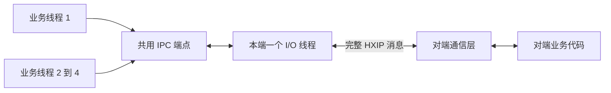
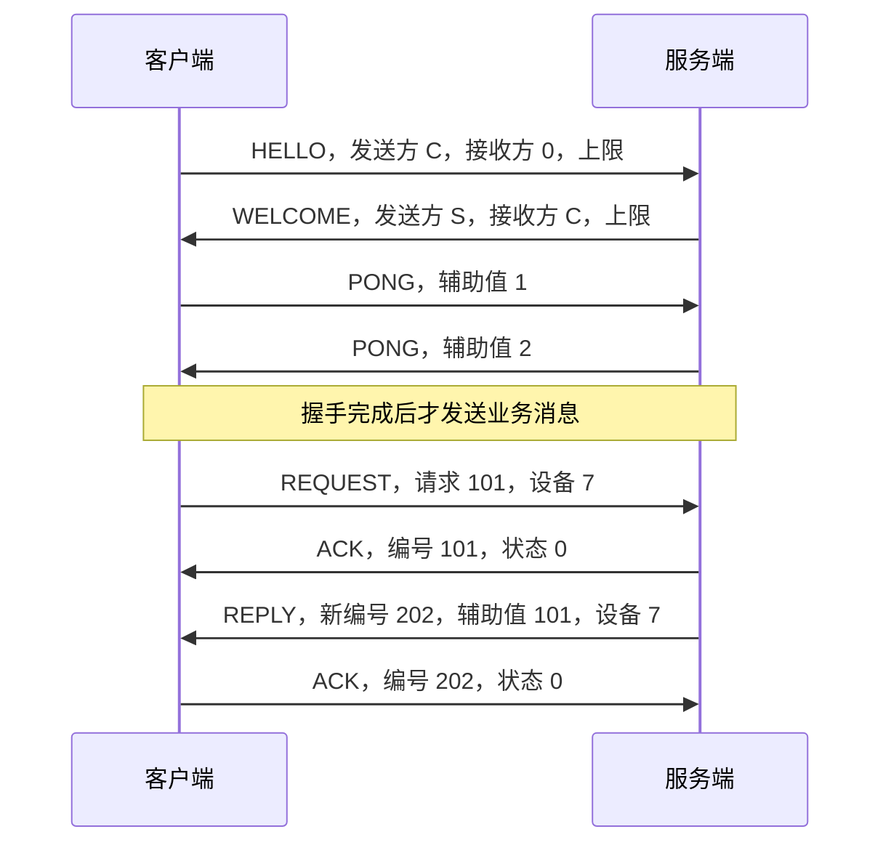

# 本机进程通信：先跑通，再接入业务

[English](IPC.md) · [README](../README.zh-CN.md) · [公开 C 接口](../include/hx_ipc.h) · [C++11 接口](../include/hx/Ipc.hpp)

**业务示例按通信方式独立组织：**[本地 IPC 设备控制](IPC_BUSINESS.zh-CN.md)、[TCP 订单](TCP_BUSINESS.zh-CN.md)、[UDP 采样](UDP_BUSINESS.zh-CN.md)、[KCP 数据块](KCP_BUSINESS.zh-CN.md)。每套都有自己的 C 程序和运行器；TCP／UDP／KCP 业务使用 socket/KCP 接口，不调用 IPC 设备程序。下文的最小回显示例用于验证 IPC 接口连通性，并说明其生命周期和跨语言协议。

四套业务示例的请求、回复和主动通知现已全部使用 UTF-8 JSON，包含实际解析、字段类型检查和安全字符串转义。下文回显程序属于底层接口连通性检查，不承载这些业务协议。

## 1. 先选一种地址

两个进程使用同一种传输和 HXIP v1 消息协议，就可以双向发送消息、发送请求并接收对应回复。对端可以使用其他语言，不必链接 hx_c_platform；第 8 节说明需要实现的协议，仓库提供了只使用标准库的 Python 对端。

| 地址示例 | 适合什么情况 | 交付语义 |
| --- | --- | --- |
| `local://demo` | 同一用户的本机程序，优先选择系统本地通信 | Windows 命名管道；Linux/macOS 使用 Unix 域套接字 |
| `tcp://127.0.0.1:39001` | 对端语言最方便使用 TCP | 完整、有序的消息；支持双向请求 |
| `udp://127.0.0.1:39002` | 允许丢失的状态、采样等数据 | 普通 UDP，可丢失、重复、乱序，不重传业务数据 |
| `kcp://127.0.0.1:39003` | 需要基于 UDP 的确认、重传、去重和排序 | 内部驱动 KCP，连接存活时有序交付；仍可能断开或超时 |

TCP/UDP/KCP 也接受 `[::1]`，拒绝非回环 IP。监听端口可以为 `0`，用 `hx_ipc_address()` 取得实际地址。KCP 不是本机通信必然更快的选择；没有做跨主机网络或互联网部署的承诺。

`local://demo` 是便捷命名。`hx_ipc_address()` 返回真实的 `pipe://...` 或 `unix:///...` 地址，便于告诉其他语言的程序。也可以自己指定 Windows 的 `pipe://my-name`，或 POSIX 的 `unix:///absolute/path.sock`。Unix 路径受系统长度限制。

## 2. 两个终端跑通 C 示例

在仓库根目录构建。已有自己的构建目录时，可以继续使用它。

```sh
cmake -S . -B build-ipc -DHX_OS_BUILD_TESTS=ON -DHX_OS_BUILD_EXAMPLES=ON
cmake --build build-ipc --config Release --parallel 4
```

下方 Windows 路径适用于 Visual Studio 生成器；使用 Ninja 时可执行文件直接在 `build-ipc/bin`，去掉路径中的 `Release`。

**Windows PowerShell，终端一：**

```powershell
.\build-ipc\bin\Release\hx_os_ipc_server.exe local://demo 1
```

**Windows PowerShell，终端二：**

```powershell
.\build-ipc\bin\Release\hx_os_ipc_client.exe local://demo
```

**Linux/macOS，终端一和终端二分别执行：**

```sh
./build-ipc/bin/hx_os_ipc_server local://demo 1
./build-ipc/bin/hx_os_ipc_client local://demo
```

服务端命令会等待，因此第二条命令需要在另一个终端执行。客户端输出 `Reply: Hello from C`；服务端输出实际监听地址，处理完后输出 `Handled 1 complete messages.` 并退出。服务端最后的 `1` 表示处理一条业务消息后结束。将两个命令中的地址一起改为表中的 TCP、UDP 或 KCP 地址，即可切换传输。

完整代码：[服务端](../examples/ipc_server.c)、[客户端](../examples/ipc_client.c)。客户端的主要操作只有这几步：

```c
hx_ipc *client = NULL;
hx_ipc_message *reply = NULL;
hx_os_error error = {0};
hx_os_status status = hx_ipc_connect("local://demo", &client, &error);
if (status == HX_OS_OK)
	status = hx_ipc_request_text(client, "Hello from C", &reply, &error);
if (status == HX_OS_OK)
	printf("Reply: %.*s\n", (int)reply->bytes, (const char *)reply->data);
hx_ipc_message_release(reply);
/* Close client even when connect or request failed; see section 6. */
```

这是完整程序中的通信片段；错误显示和显式关闭见链接中的源码。连接只创建一次，可以重复请求。`request_text` 负责生成请求编号、发送完整 UTF-8 消息、等待对应回复。普通入口默认最多等待 5 秒；需要其他时长时使用 `_until` 入口。

服务端通过 `hx_ipc_receive_until()` 每次取出一条完整消息或连接事件。遇到 `HX_IPC_REQUEST`，用 `hx_ipc_reply_text(server, message, "结果", &error)` 回复；库自动沿用来源、设备编号和原请求编号。遇到 `HX_IPC_DATA` 表示普通消息，不要求业务回复。`HX_IPC_CONNECTED`、`HX_IPC_DISCONNECTED` 和 `HX_IPC_OVERFLOW` 是事件，不能当正文使用。

## 3. 四个业务线程共用一个连接

重新启动服务端，让它处理 20 条请求：

```powershell
.\build-ipc\bin\Release\hx_os_ipc_server.exe local://demo 20
```

另一个终端运行：

```powershell
.\build-ipc\bin\Release\hx_os_ipc_threads.exe local://demo
```

Linux/macOS 对应命令是 `./build-ipc/bin/hx_os_ipc_server local://demo 20` 和 `./build-ipc/bin/hx_os_ipc_threads local://demo`。

[完整 C++11 示例](../examples/ipc_threads.cpp) 创建四个业务线程，每个线程发送五次请求。每个线程使用同一个底层连接，调用方式如下：

```cpp
auto reply = connection.requestText("读取温度", device_id);
if (!reply) {
	std::fprintf(stderr, "Request failed: %d\n", reply.status());
	return NULL;
}
std::printf("Reply: %s\n", reply.value().text());
```

`device_id` 对应消息的 `channel`，由应用定义，例如设备 1、设备 2。每次请求的编号由库自动生成。回复顺序可以与提交顺序不同，调用线程仍取得自己的回复；开发者不需要给发送接口再加一把锁。C 的同一组接口也支持这种多线程用法，C++ 只是返回 `Result<T>` 并自动释放消息，不使用异常。

成功时最后输出：

```text
20 replies matched across 4 business threads.
```

前面的 20 行 `Reply:` 顺序随调度变化。服务端和客户端都可以主动发送，也都可以主动发起请求。需要接收主动推送时，安排一个业务线程调用 `receive_until`；多个接收线程会分摊消息，不会各收到一份副本。



每个显式创建的端点内部只有一个 I/O 工作线程，管理该端点允许的全部连接；包含或链接库不会启动线程。业务处理在调用 `receive_until` 的线程中进行，I/O 线程不执行业务回调。

本版 IPC 等待是**普通线程的阻塞等待**。本库已有协程，但 IPC 尚未提供协程挂起适配，所以这里提供线程示例。把上述调用直接塞进协程，会占住调度工作线程；不能因此称为协程异步通信。Qt 程序也应把这些等待放到业务线程中，再用宿主已有的线程投递方式更新界面。

## 4. 不链接 C 库的 Python 对端

终端一先启动：

```powershell
.\build-ipc\bin\Release\hx_os_ipc_server.exe tcp://127.0.0.1:39001 1
```

终端二执行：

```sh
python examples/ipc_python.py tcp://127.0.0.1:39001 "Hello from Python"
```

输出 `Reply: Hello from Python`。该 Python 示例只使用 `socket`、`struct` 等标准库，实现握手、分帧、心跳回复和请求对应，没有加载本库 DLL。Unix 下还可以传入服务端打印的 `unix:///...` 地址。这个教学对端没有实现 KCP、Windows 命名管道、多线程共享或自动重连；其他语言实现这些能力时遵循第 8 节协议。

## 5. 队列、设备和背压

| 需要处理的情况 | 库的行为 | 应用需要做什么 |
| --- | --- | --- |
| 只读到半条消息、一次读到多条 | 内部按长度累积并拆分，一次返回一条完整消息 | 按 `data` 和 `bytes` 使用正文 |
| 多个设备、多个请求 | 连接会话、`channel` 和请求编号分别保存；回复自动匹配 | 为设备或业务流分配 `channel` |
| 多线程发送 | 有界发送队列由 I/O 线程串行写入同一传输 | 调用期间借用的入参不能被其他线程同时修改 |
| 对端重启 | 握手生成新会话；旧请求失败，旧会话包不能对应到新请求 | 处理断开/连接事件，决定是否重新发起业务操作 |
| 接收业务处理不过来 | 可靠模式明确拒绝入队，返回 `HX_OS_LIMIT`；UDP 可以丢弃 | 降速、合并可合并的状态，或报告失败 |
| 对方断开、超时 | 返回状态，保留原生错误；关闭超时保留对象 | 按业务幂等性决定是否重试 |

创建时可传 `hx_ipc_options`，之后选项不可修改。`NULL` 使用下列默认值：

| 选项 | 默认值 | 含义 |
| --- | --- | --- |
| `max_peers` | 16 | 一个监听端点最多保留的连接/握手；客户端固定一个 |
| `max_messages` | 128 | 发送队列和业务收件箱分别受此数量限制 |
| `max_pending_requests` | 128 | 同时等待发送确认或请求回复的调用数 |
| `max_message_bytes` | 64 KiB | 单条业务正文上限，握手取双方较小值 |
| `max_pending_bytes` | 4 MiB | 内部业务收件正文与排队发送帧共用的字节预算 |
| `max_kcp_bytes` | 8 MiB | 此端点全部 KCP 会话的固定内存预留预算 |
| `handshake_timeout_ms` | 5000 | 一次握手的超时 |
| `idle_timeout_ms` | 15000 | 没有收到有效流量时认定断开；`0` 关闭检测 |
| `reconnect_attempts` | 8 | 每次断开后客户端最多重试的次数；`0` 关闭重连 |
| `reconnect_delay_ms` | 250 | 重连尝试的间隔 |

减少内存可从降低 `max_peers`、消息数量和正文大小开始。元数据、原生 socket 缓冲、线程栈和 KCP 预留另计；`pending_bytes` 不是进程总内存。每个连接另有最多 64 KiB 的协议控制帧预算，事件环容量为 `2 * max_peers + 8`。事件环满时报告 `HX_IPC_OVERFLOW`，应用应重新同步设备状态。

KCP 内存只在会话创建时预留，协议引擎成功创建后不再向 context 动态分配。IPC 的消息和原生异步请求仍会分配内存。当前会话准入要求至少剩余 2 MiB KCP 预算，再按实际预留量计账；因此不能假定 `max_peers=16` 就一定能同时建立 16 个 KCP 会话。

用户取出的消息不再计入端点队列预算，由用户负责及时释放。它可以在端点关闭后继续使用，也可以跨线程释放；对应自定义 context 必须继续存活。`hx_ipc_statistics_read()` 可读当前队列字节、KCP 预留、连接数、拒收及丢弃计数。

普通 UDP 的正文不得超过 `65507 - 64` 字节，超出直接返回 `HX_OS_LIMIT`；较大数据仍受 IP 分片影响，不应把理论上限当作建议大小。KCP 正文还受 127 个分片限制，当前 MTU 为 1200 字节，每片协议头 24 字节，再扣去 64 字节 HXIP 内层头。默认 64 KiB 在范围内。

协议控制帧还共享整个端点的 `max_peers * 64 KiB` 总预算。快速重连时，旧会话尚未释放的帧继续计入总量，不能通过切换会话绕开限制。

## 6. 超时与关闭

`send_until`、`request_until`、`receive_until` 和 `close_until` 接收本库的**单调绝对截止时间**。`hx_os_deadline_after_ms(200)` 生成从现在起 200 ms 的截止时间；`HX_OS_DEADLINE_NOW` 表示不等待，`HX_OS_DEADLINE_INFINITE` 是显式无限等待，不是关闭默认值。期限不提供硬实时保证。

可靠模式下，`send` 成功表示完整消息已被对端通信层接收入队，**不表示设备动作已执行**。`request` 成功表示拿到对应回复，业务执行结果仍由回复正文约定。普通 UDP 的 `send` 成功只表示本地发送完成。请求超时可能发生在对端执行之后，因此不自动重放旧请求，也不保证业务动作“恰好一次”。需要可靠的业务重试时，在正文中设计持久的业务操作编号和去重规则。

发送正文会复制，返回后调用者可以立即释放或修改原缓冲。接收消息及其 `data` 一起释放，不能单独释放 `data`。二进制可能包含零字节；文本入口严格校验 UTF-8，不能直接把 GBK 输入交给它。其他编码先使用本库编码转换接口。

连接对象一旦创建，`connect` 即使超时也可能返回非空的 `client`：可以调用 `wait_connected_until` 继续等待，或者关闭，不能直接丢掉指针。重连不会恢复旧请求。

关闭前由宿主阻止新的调用进入。允许已有等待与关闭并发；已有调用会醒来返回取消/关闭，关闭成功前不会释放它们仍使用的对象。关闭由一个所有者串行操作，同一个所有者指针不能被多个线程同时修改。

```c
hx_os_status status = hx_ipc_close_until(
	&client, hx_os_deadline_after_ms(200), &error);
if (status == HX_OS_TIMEOUT) {
	/* Keep client in durable host state; retry from the shutdown owner. */
	status = hx_ipc_close_until(
		&client, hx_os_deadline_after_ms(1000), &error);
}
```

成功后指针置空。超时后指针仍有效，只能继续关闭，不能重新开始业务通信。关闭会在给定时间内尽量发完必要的协议确认，然后取消原生 I/O，等待缓冲真正退役；不会等待对端业务代码、强杀线程、detach 或替宿主退出进程。`NOW` 直接进入取消阶段。它不是“把所有未完成业务都发送成功”的 flush 接口。

C++ 的 `hx::Ipc` 借用宿主保存的 `hx_ipc *`，析构不会偷偷无限等待或遗忘关闭。完整示例先结束业务线程，再显式 `closeUntil`。库不会自动启动/重启 SDK 辅助进程，也不能取消第三方进程里的阻塞 SDK 函数；本模块负责通信，进程隔离和设备恢复策略仍由宿主决定。

## 7. 平台与构建开关

`HX_OS_ENABLE_IPC` 和 `HX_OS_ENABLE_KCP` 默认开启，可分别关闭。IPC 需要 NETWORK、LOOP 和 RANDOM；任一关闭时 `HX_OS_CAP_IPC` 不提供，公共入口明确返回 `HX_OS_NOT_SUPPORTED`。只关闭 KCP 时，TCP、普通 UDP、本地传输继续工作，`kcp://` 返回不支持。最小嵌入式配置关闭两者。

Windows 命名管道需要 PIPE；POSIX 本地传输需要 LOCAL_SOCKETS 和 LOOP_FD。Windows 使用重叠 I/O 和 IOCP，支持 Win7 设计基线。POSIX 复用非阻塞 socket 和已有 epoll/kqueue 适配。TCP 监听在 POSIX 显式设置地址复用以支持重启；Windows 使用独占地址绑定，普通底层 socket 接口的选项行为保持不变。

Windows 管道限制当前用户 SID 和 SYSTEM，拒绝远程管道客户端。POSIX `local://` 使用 `/tmp/hx-ipc-<uid>` 的 0700 目录，socket 为 0600；伴随的 `.lock` 文件用于排他监听，关闭后保留，防止删除锁文件产生竞争。库只回收自己创建、设备号和 inode 仍匹配的 socket，不随意删除别人的路径。

Android 的命令行/adb 示例使用 `/data/local/tmp/hx-ipc-<uid>`。普通 APK 应使用允许访问的应用私有目录并传 `unix:///...`；不同 UID 的两个应用还受 Android 沙箱和权限策略限制。shell 模拟器测试不证明跨 APK 通信可用。

本机回环 TCP/UDP/KCP 不等于身份认证或加密；会话随机值用于区分连接与重启，不能代替访问控制。网络不可信时需要额外设计认证，不应把当前本机协议直接暴露到远程网络。

KCP 采用 MIT 许可的固定上游 v1 源码，原文件不修改。它作为私有 C 对象编入本库，无额外 DLL、公共 KCP 头或全局分配器设置；安装时保留许可证。版本和 SHA256 见[第三方说明](../THIRD_PARTY_NOTICES.zh-CN.md)。

## 8. 给其他语言实现的 HXIP v1 协议

每帧固定 64 字节头，加指定长度正文。**头字段全部使用大端，禁止直接发送 C 结构体内存。** TCP、Unix 流和字节型命名管道必须循环读满头和正文，多帧逐一解析；UDP 一包一帧，截断包或多余字节拒绝。解析长度后先检查本地限制再分配。

| 偏移 | 长度 | 含义 |
| --- | --- | --- |
| 0 | 4 | ASCII `HXIP` |
| 4 | 1 | 版本，固定 1 |
| 5 | 1 | 消息种类，见下表 |
| 6 | 2 | 编码：0 二进制；1 UTF-8 |
| 8 | 4 | 正文字节数，无符号整数 |
| 12 | 4 | 状态码，二进制补码有符号整数；正常为 0 |
| 16 | 8 | 发送方随机非零会话值 |
| 24 | 8 | 接收方会话值；初始 HELLO 为 0 |
| 32 | 8 | 消息/请求编号 |
| 40 | 8 | 应用定义的设备或业务流 `channel` |
| 48 | 8 | 辅助值，按种类解释 |
| 56 | 8 | 保留，必须为 0 |

| 种类 | 值 | 辅助值及处理 |
| --- | --- | --- |
| HELLO | 1 | 客户端正文上限，正文为空 |
| WELCOME | 2 | 服务端正文上限，正文为空 |
| DATA | 3 | 普通业务消息 |
| REQUEST | 4 | 需要业务回复的请求 |
| REPLY | 5 | 辅助值是原请求编号；头中的编号是此次回复自己的编号 |
| ACK | 6 | 头中编号指向被确认的消息；状态是接收入队结果 |
| PING / PONG | 7 / 8 | 心跳；握手确认使用特殊 PONG 辅助值 |
| CLOSE | 9 | 对端主动声明关闭；连接断开同样有效 |
| KCP_PACKET | 10 | 仅 KCP 外层 UDP 帧，正文是标准 KCP 包 |

初次连接顺序：



双方各生成自己的 64 位随机会话值。数据、确认、心跳必须同时匹配双方会话；本地 API 暴露的 `peer` 是本端对这次连接的标识，不能当永久设备编号。发送编号在一次端点生命期中不重复；回复正文采用双方约定的数据格式，例如 UTF-8 JSON。接到 PING 应回复 PONG，辅助值为 0；控制消息正文为空。

可靠传输接收 DATA/REQUEST 入队后发 ACK；REPLY 被匹配或作为晚到回复丢弃后也发 ACK。队列满时发 `-12`（LIMIT），内存不足发 `-2`，关闭发 `-10`，无效 UTF-8 发 `-15`。请求收到成功 ACK 后继续等待 REPLY，不能把 ACK 当业务结果。普通 UDP 的 DATA/REQUEST 成功不等待/不要求 ACK，业务数据不会自动重传；其他会话与回复规则相同。完整状态常量见 [hx_os_base.h](../include/hx_os_base.h)。

UDP 握手期间客户端每 100 ms 重发 HELLO；重复 WELCOME 后可重发 PONG 确认。未确认的新 HELLO 不能替换已建立的会话，避免延迟的旧 HELLO 把新连接踢掉。连接失去响应后重新握手并更换会话值；不要在新会话自动重放旧业务。

KCP 模式的 HELLO/WELCOME 是普通外层 HXIP UDP 帧。双方确定会话值后，以 `(uint32_t)(C XOR S)` 为 KCP `conv`，结果为 0 时用 1。其他 HXIP 帧（包括握手 PONG）作为 KCP **消息模式**的完整消息传递。KCP 输出包再装入种类 10 的外层帧，其双方会话仍需验证。KCP 自身包头保留上游的小端格式，不改成 HXIP 的大端。两端采用相同 MTU 1200、消息模式与兼容 KCP 协议；还需持续驱动 KCP 的定时更新。仅使用一个 KCP `conv` 不够区分辅助进程重启。

高级使用者可以单独调用 [hx_os_kcp](../include/hx_os_kcp.h)，自行提供完整包、时间和输出回调；该低层引擎不创建 socket 或线程。普通 IPC 用户使用 `kcp://` 即可，不需要自己写 update 循环。

## 9. 一条命令运行自动测试

```sh
ctest --test-dir build-ipc -C Release -R "ipc|kcp" --output-on-failure
```

本机配置且安装 Python 时，测试包含 `ipc`、`kcp`、`ipc_examples`。想看每个演示的输出，可再加 `-V`；没有 Python 时前两组仍运行，手动双终端示例仍可使用。

- `ipc`：四种传输、双向请求、多线程及乱序回复、多连接、重启换会话、超时晚到回复、队列满、关闭重试、分配失败及 context 归零。
- `kcp`：有意丢包、重复和乱序、双向传送、32 位时间回绕、消息/队列限制、固定分配预算。
- `ipc_examples`：实际启动独立服务端和 C/C++ 客户端；独立 Python TCP/Unix 对端；拆开的头、合并的帧、超长和未完成正文，以及旧 UDP 会话流量。

应在实际部署的操作系统和通信方式下运行示例。宿主构建或模拟器运行不能代替原生目标验证；macOS、Win7 和嵌入式板卡需要各自的运行环境，详见[平台概览](REFERENCE.zh-CN.md#section-2)。
