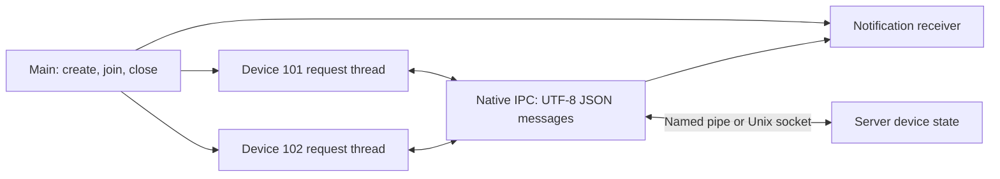

# Native local IPC: control two devices

[简体中文](IPC_BUSINESS.zh-CN.md) · [README](../README.md) · [IPC API and protocol](IPC.md)

## 1. What this example does

Two client request threads operate devices `101` and `102`; a third thread receives server notifications. The server holds two simulated devices and processes open, query, change and close commands. No hardware is required.

This example accepts only `local://`, Windows `pipe://`, or POSIX `unix://` addresses. Windows uses named pipes; Linux/macOS use Unix domain sockets. TCP, UDP and KCP have separate business sources, runners and tutorials: [TCP orders](TCP_BUSINESS.md), [UDP samples](UDP_BUSINESS.md), and [KCP transfer](KCP_BUSINESS.md). They do not invoke this device program.

## 2. Build and run automatically

Build the default modules from the repository root:

```sh
cmake -S . -B build-net -DHX_OS_BUILD_EXAMPLES=ON
cmake --build build-net --config Release --parallel 4
```

Windows PowerShell with the Visual Studio generator:

```powershell
python examples/run_ipc_business.py --bin-dir build-net/bin/Release
```

Linux/WSL:

```sh
python3 examples/run_ipc_business.py --bin-dir build-net/bin
```

The runner starts two independent C processes with a unique local name, checks business state, and prints `PASS ipc_business_local`. Existing development directories can be used as `build-shared-msvc/bin/Release` or `build-shared-linux/bin`. Omit `Release` for Windows Ninja. The runner uses only the Python standard library.

## 3. Run manually in two terminals

Windows terminal one:

```powershell
.\build-net\bin\Release\hx_os_ipc_device_server.exe local://device-demo
```

After `Listening:` appears, use terminal two:

```powershell
.\build-net\bin\Release\hx_os_ipc_device_client.exe local://device-demo
```

On Linux/WSL run `./build-net/bin/hx_os_ipc_device_server local://device-demo` and `./build-net/bin/hx_os_ipc_device_client local://device-demo` separately. The server's demonstration limit is 30 seconds; restart it for each workflow. Manual execution needs no Python.

## 4. JSON messages and threads



Each message carries one UTF-8 JSON object. A parameter update is:

```json
{"type":"set","device_id":101,"interval_ms":250}
```

The server replies:

```json
{"type":"updated","device_id":101,"ok":true,"interval_ms":250,"code":""}
```

It also sends an independent notification to the receiving thread:

```json
{"type":"changed","device_id":101,"interval_ms":250}
```

| Request `type` | Required fields | Reply and behavior |
| --- | --- | --- |
| `open` | Integer `device_id` | `opened`; initial `interval_ms=1000` |
| `get` | Integer `device_id` | `state` with the current interval |
| `set` | Integer `device_id`, integer `interval_ms` | `updated` for 50–5000 ms; also sends `changed` |
| `close` | Integer `device_id` | `closed`; release the session's device |
| `quit` | `device_id=0` | Reply `bye` after both devices close, then exit |

Device `101` selects 250 ms and `102` selects 500 ms, with readback after each change. The test also submits zero and checks `type="error"`, `ok=false`, `code="invalid_interval"`, then confirms the prior state remains intact.

The payload's `device_id` must match the IPC `channel`. The library assigns request IDs and routes JSON replies back to `request_text_until()` callers. `receive_until()` handles unsolicited messages without taking request replies.

## 5. Adapt the business logic

| Source | Entry points |
| --- | --- |
| [ipc_device_client.c](../examples/ipc_device_client.c) | `device_work()` operations; `request_expected()` request encoding and JSON validation; `receive_notifications()` independent receive |
| [ipc_device_server.c](../examples/ipc_device_server.c) | `handle_request()` validates fields, ranges and ownership; `reply_json()` serializes results |
| [run_ipc_business.py](../examples/run_ipc_business.py) | Parses logged JSON and checks each business result |

After opening a device, query through the existing `client` connection:

```c
json_field fields[] = {
	json_text("type", "get"), json_int("device_id", 101)
};

hx_string request = HX_STRING_INIT;
hx_ipc_message *reply = NULL;
hx_os_error error = {0};

if (json_encode(fields, 2, &request)) {
	hx_os_status status = hx_ipc_request_text_until(client, 0, 101,
		hx_string_c_str(&request), hx_os_deadline_after_ms(5000),
		&reply, &error);
	// Check status, then parse reply->data and reply->bytes.
	(void)status;
}

hx_ipc_message_release(reply);
hx_string_destroy(&request);
```

`json_field` and `json_encode()` are example helpers in [business_json.h](../examples/business_json.h), using existing settings serialization and the built-in JSON parser. String escaping is handled by the serializer. Device commands, state and communication remain in the native IPC program's own files.

Although general configuration getters accept numeric strings, this example explicitly checks JSON types: integer `250` is accepted; `"250"`, booleans and missing fields are not integers. Invalid syntax, duplicate keys and non-object roots never reach device operations. Payloads are capped at 1023 bytes, parsing depth at 8, nodes at 64 and parsing memory at 64 KiB.

## 6. Ownership and running the example

```sh
python examples/run_ipc_business.py --bin-dir build-net/bin/Release
```

Main owns the endpoint and worker parameters; join workers before closing. Release each message, parsed document and temporary string. Close timeout retains ownership for retry; request timeout does not prove non-execution. The runner starts both programs and checks 14 replies, bye and two notifications. Use build-net/bin on Linux.
