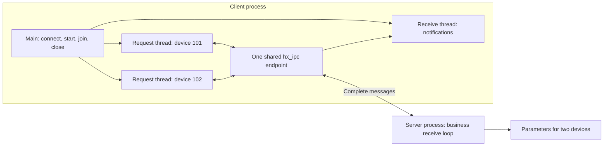
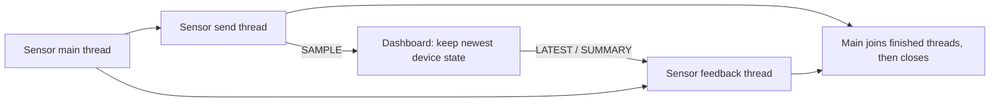

# IPC, TCP, UDP and KCP: threaded application examples

[简体中文](IPC_BUSINESS.zh-CN.md) · [README](../README.md) · [IPC API and protocol](IPC.md)

## 1. Choose a workflow

These examples run two independent C99 processes, without hardware, SDKs or databases. The client has dedicated business sending and receiving threads. The server holds a small amount of device state, processes requests and sends unsolicited messages. The programs call library functions directly so you can replace the simulated operations with your application logic.

| What to try | Application workflow | Complete sources |
| --- | --- | --- |
| Native local IPC | Open two devices concurrently, query and change parameters, receive notifications, close | [Device server](../examples/ipc_device_server.c), [device client](../examples/ipc_device_client.c) |
| TCP | The same device workflow with a `tcp://` address | Same sources; business logic is shared |
| KCP | The same device workflow with a `kcp://` address; the library drives KCP updates and transport | Same sources; business logic is shared |
| Ordinary UDP | Two sensors publish samples; the receiver keeps current state and sends feedback | [Dashboard](../examples/ipc_udp_dashboard.c), [sensor](../examples/ipc_udp_sensor.c) |
| UDP gaps, duplicates and late samples | Deliberately omit two sequence numbers, duplicate one and resend an older number; check current state | Same UDP sources with `--simulate-gaps` |

“Native local IPC” here means `local://`: named pipes on Windows, Unix domain sockets on Linux/macOS. TCP, UDP and KCP also communicate between local processes; all addresses below use loopback. Device IDs `101` and `102` belong to this application and require no library registration.

## 2. Build, then run a complete workflow with one command

Run from the repository root with the default module configuration:

```sh
cmake -S . -B build-ipc -DHX_OS_BUILD_TESTS=ON -DHX_OS_BUILD_EXAMPLES=ON
cmake --build build-ipc --config Release --parallel 4
```

**Windows PowerShell, Visual Studio generator:**

```powershell
python examples/run_ipc_business.py local --bin-dir build-ipc/bin/Release
python examples/run_ipc_business.py tcp --bin-dir build-ipc/bin/Release
python examples/run_ipc_business.py udp --bin-dir build-ipc/bin/Release
python examples/run_ipc_business.py kcp --bin-dir build-ipc/bin/Release
python examples/run_ipc_business.py udp --simulate-gaps --bin-dir build-ipc/bin/Release
```

**Linux/WSL, single-configuration generator:**

```sh
python3 examples/run_ipc_business.py local --bin-dir build-ipc/bin
python3 examples/run_ipc_business.py tcp --bin-dir build-ipc/bin
python3 examples/run_ipc_business.py udp --bin-dir build-ipc/bin
python3 examples/run_ipc_business.py kcp --bin-dir build-ipc/bin
python3 examples/run_ipc_business.py udp --simulate-gaps --bin-dir build-ipc/bin
```

Each command starts the server and client, prints both business logs, checks state changes and reply contents, and finishes with a result such as `PASS ipc_business_tcp`. The runner chooses an available port or a unique local name; separate test cases need no manual port allocation.

For an existing build, point `--bin-dir` at its executable directory, such as this repository's development directories `build-shared-msvc/bin/Release` or `build-shared-linux/bin`. On Windows with Ninja, omit `Release` too. The runner uses only the Python standard library; communication, device state and threads are implemented in the C programs. Manual execution below needs no Python.

## 3. Use two terminals to observe each side

Start the server first. After it prints `Listening:`, start the client in another terminal. The device server has a 30-second demonstration limit, so do not leave it waiting while reading the rest of the guide. Restart both programs for each new run or transport.

**Windows PowerShell:**

| Transport | Terminal one | Terminal two |
| --- | --- | --- |
| Native local IPC | `.\build-ipc\bin\Release\hx_os_ipc_device_server.exe local://device-demo` | `.\build-ipc\bin\Release\hx_os_ipc_device_client.exe local://device-demo` |
| TCP | `.\build-ipc\bin\Release\hx_os_ipc_device_server.exe tcp://127.0.0.1:39001` | `.\build-ipc\bin\Release\hx_os_ipc_device_client.exe tcp://127.0.0.1:39001` |
| KCP | `.\build-ipc\bin\Release\hx_os_ipc_device_server.exe kcp://127.0.0.1:39003` | `.\build-ipc\bin\Release\hx_os_ipc_device_client.exe kcp://127.0.0.1:39003` |
| UDP | `.\build-ipc\bin\Release\hx_os_ipc_udp_dashboard.exe udp://127.0.0.1:39002` | `.\build-ipc\bin\Release\hx_os_ipc_udp_sensor.exe udp://127.0.0.1:39002` |

**Linux/WSL:**

| Transport | Terminal one | Terminal two |
| --- | --- | --- |
| Native local IPC | `./build-ipc/bin/hx_os_ipc_device_server local://device-demo` | `./build-ipc/bin/hx_os_ipc_device_client local://device-demo` |
| TCP | `./build-ipc/bin/hx_os_ipc_device_server tcp://127.0.0.1:39001` | `./build-ipc/bin/hx_os_ipc_device_client tcp://127.0.0.1:39001` |
| KCP | `./build-ipc/bin/hx_os_ipc_device_server kcp://127.0.0.1:39003` | `./build-ipc/bin/hx_os_ipc_device_client kcp://127.0.0.1:39003` |
| UDP | `./build-ipc/bin/hx_os_ipc_udp_dashboard udp://127.0.0.1:39002` | `./build-ipc/bin/hx_os_ipc_udp_sensor udp://127.0.0.1:39002` |

Append `--simulate-gaps` to the UDP client command to observe unusual sequence numbers. If another program owns a fixed port, change it in both commands or use the automatic runner from section 2.

## 4. Local IPC, TCP and KCP: operate two devices concurrently

### 4.1 What the programs actually do

Each device has one request thread. Device `101` changes its sampling interval to `250` milliseconds; device `102` changes it to `500` milliseconds. The following sequence shows device `101`:

| Step | Client sends | Server action and reply | What is checked |
| --- | --- | --- | --- |
| 1 | `OPEN` | Mark the device open, reply `OK online` | The current session owns the device |
| 2 | `GET` | Reply `STATE interval_ms=1000` | The initial interval really is 1000 ms |
| 3 | `SET 250` | Change the interval, reply `OK interval_ms=250`; separately push `CHANGED interval_ms=250` | Replies and unsolicited notifications reach different application receive paths |
| 4 | `GET` | Reply `STATE interval_ms=250` | The change took effect |
| 5 | `SET 0` | Reject the value, reply `ERROR interval must be 50..5000` | Successful communication does not imply a successful business operation |
| 6 | `GET` | Still reply `STATE interval_ms=250` | Rejected input preserved the previous value |
| 7 | `CLOSE` | Release the device, reply `OK offline` | The business resource was closed |

Once both device sequences and both notifications finish, the main thread sends `QUIT` on channel `0`. The server replies `BYE` and exits. `OPEN/GET/SET/CLOSE/QUIT` are application-defined payloads; the library handles message boundaries and request matching. Your application can use JSON, binary data or its own command format.

### 4.2 Which thread sends and receives



**The client has two request threads and one receiving thread.** Request threads call `hx_ipc_request_text_until()` to get their own replies. The receiver calls `hx_ipc_receive_until()` for unsolicited `HX_IPC_DATA`. It does not steal request replies: the library routes those by request ID. Each endpoint additionally owns a library I/O thread, which applications do not need to drive manually.

The server updates both devices from one business receive loop, so its example state array needs no extra lock. Each client request thread writes its own result; main reads results only after successful joins. Sharing a connection does not require an additional application mutex around sends.

### 4.3 Where to replace the example logic

| What to change | Function to read |
| --- | --- |
| A sequence of device operations | `device_work()` in the [client](../examples/ipc_device_client.c) |
| One request, expected-reply check and message release | `request_expected()` in the same file |
| A separate thread receiving notifications | `receive_notifications()` in the same file |
| Create threads, join them and close the connection | `main()` in the same file |
| Look up devices, change parameters, reply and push | `handle_request()` in the [server](../examples/ipc_device_server.c) |

After device `101` has been opened with `OPEN`, its query uses the following core calls. `client` is the reused connection; the second argument `0` selects its server, and `101` selects the device channel:

```c
hx_ipc_message *reply = NULL;
hx_os_error error = {0};
hx_os_status status = hx_ipc_request_text_until(client, 0, 101,
	"GET", hx_os_deadline_after_ms(5000), &reply, &error);
if (status == HX_OS_OK)
	printf("Device state: %.*s\n", (int)reply->bytes,
		(const char *)reply->data);
else
	fprintf(stderr, "GET failed: status=%d\n", (int)status);
hx_ipc_message_release(reply);
```

This is a communication fragment from the complete program. `request_expected()` also validates the channel, encoding, length and expected payload, and prints native errors. `HX_OS_OK` means a reply arrived; its body can still be `ERROR ...`. Applications must interpret their business result.

Typical output follows. Lines from the two devices may interleave differently:

```text
[request thread] device=101 SET 250 -> OK interval_ms=250
[receive thread] device=101 CHANGED interval_ms=250
[request thread] device=101 GET -> STATE interval_ms=250
[request thread] device=101 SET 0 -> ERROR interval must be 50..5000
[request thread] device=101 GET -> STATE interval_ms=250
[request thread] device=101 CLOSE -> OK offline
[main] device=0 QUIT -> BYE
DEVICE CLIENT PASS: 2 devices, 2 request threads, 2 pushes
```

KCP uses this same business code, with no application acknowledgement or retransmission loop. Passing the local workflow does not imply KCP is faster than TCP.

## 5. Ordinary UDP: publish while receiving feedback

### 5.1 Threads and payloads

In the [sensor](../examples/ipc_udp_sensor.c), `publish_samples()` sends two devices' samples from one thread, approximately every 30 ms for 10 rounds. A separate `receive_feedback()` thread receives the server's `LATEST` and `SUMMARY` messages over the same endpoint.



A payload such as `SAMPLE seq=10 temperature_centi=2510` carries an application sample sequence and temperature in hundredths of a degree Celsius: `2510` means `25.10°C`. The device ID remains in the message's `channel`.

The dashboard's `receive_sample()` parses a complete message, checks numeric ranges, and updates state. Every third accepted update triggers `LATEST seq=N` feedback. When its collection window ends, it sends a `SUMMARY` to each device. This demonstrates messages flowing back while samples are being published.

### 5.2 Handle gaps, duplicates and late samples

The example chooses a latest-state policy:

- A greater sequence number updates the temperature and records any observed sequence gaps.
- An equal or smaller number counts as stale/duplicate data and does not overwrite the current temperature.
- Missing feedback does not cause indefinite waiting: the receiver stops at its deadline. Ordinary UDP provides no retransmission guarantee.

With `--simulate-gaps`, the sender **deliberately omits sequences 3 and 7, duplicates 4, and sends 6 again after 8**. This creates reproducible application input; it does not measure network packet loss or modify system networking.

Expected per-device results for this small loopback fixture are:

| Mode | `accepted` updates | `newest` sequence | `gaps` observed missing numbers | `stale` duplicate/late samples |
| --- | --- | --- | --- | --- |
| Normal | 10 | 10 | 0 | 0 |
| `--simulate-gaps` | 8 | 10 | 2 | 2 |

```text
[feedback thread] device=101 SUMMARY accepted=8 newest=10 gaps=2 stale=2
[feedback thread] device=102 SUMMARY accepted=8 newest=10 gaps=2 stale=2
UDP SENSOR PASS: send/receive threads joined; feedback=6
```

`feedback=6` means four intermediate responses and two summaries arrived in this controlled demonstration. Real UDP runs may receive a different count. The C program permits missing feedback; the runner checks that this particular small loopback run delivered the expected feedback. A failed check reports a failed test, rather than redefining UDP as reliable. Use TCP, native local IPC or KCP for reliable commands.

The dashboard waits up to 10 seconds for the first data message, then collects for 1 second. The sensor feedback thread waits for 2 seconds. These application limits make the demonstration terminate automatically; they are neither library shutdown requirements nor throughput or real-time benchmarks.

## 6. Rules to retain in your application

1. Main owns the connection and thread parameters. Business threads borrow the connection. Join them before destroying their parameters or closing the connection.
2. Release each received message with `hx_ipc_message_release()`. If you transfer a message between threads, identify the final owner; do not retain pointers into a released message.
3. Use `hx_ipc_reply_text()` for replies and `hx_ipc_send_text_until()` for independent notifications. Replies preserve source, channel and request ID; notifications explicitly select `message->peer` and the device channel.
4. Separate communication failure from application rejection. A request timeout does not prove the remote operation never ran. Retried business operations need their own idempotency rule or transaction identifier.
5. Reconnecting creates a new session. The example server releases devices owned by a disconnected session. Your application decides whether to reopen devices or reload their state; do not reuse an old `peer`.
6. Check queue exhaustion, overflow and close deadlines. `close_until()` retains its object on timeout and allows another attempt. Do not free objects still in use merely because a wait timed out.

[ipc_demo.h](../examples/ipc_demo.h) only shares diagnostics, message comparison, join and close checks. Business communication stays in the four `.c` files. An unrecoverable thread-join failure exits these command-line demonstrations with failure while borrowed stack parameters are still alive; this is the test program's failure policy, not the library's host shutdown policy. A long-running application should keep its connection and task parameters in a durable owner and continue its own shutdown policy.

These waits occupy ordinary OS threads. Qt applications can use worker threads; do not perform the waits on the UI thread. IPC currently has no coroutine-suspending adapter, so this tutorial does not present blocking calls as coroutine-aware operations. The existing [C++11 threaded example](../examples/ipc_threads.cpp) demonstrates the same API through `Result<T>`, without exceptions.

## 7. Automated checks and coverage

```sh
ctest --test-dir build-ipc -C Release -R "^ipc_business_" --output-on-failure
```

| CTest name | What actually runs |
| --- | --- |
| `ipc_business_local` | Complete device workflow over named pipes or Unix domain sockets |
| `ipc_business_tcp` | Two request threads, a notification thread, state readback and application rejection over TCP |
| `ipc_business_kcp` | The same device workflow over KCP |
| `ipc_business_udp` | Two sample streams, separate sender/receiver threads, current state and feedback |
| `ipc_business_udp_gaps` | State checks after deliberate omissions, duplicates and late samples |

These cases verify payloads, state before and after changes, notifications, thread completion and process exits; printing messages alone does not pass. CMake registers them for native host builds when tests/examples are enabled and Python is found. Disabling KCP or the required native-local capabilities omits the corresponding business case. Cross-builds do not execute target binaries on the host.

Protocol-level split/coalesced frames, session replacement, deadlines, capacity and lifetime checks remain in [test_ipc.c](../tests/test_ipc.c) and the [separate-process protocol tests](../tests/test_ipc_examples.py). KCP synthetic loss, duplication, reordering and clock rollover remain in [test_kcp.c](../tests/test_kcp.c). The business workflows complement those lower-level tests.

All five new cases passed on Windows MSVC x64 and WSL Linux. WSL ASan/UBSan/leak detection and TSan each passed the same five cases. Running these new examples on macOS, Android, Win7/8.1, physical ARM devices and embedded targets remains pending. See the [validation record](VALIDATION.md) for configurations.
