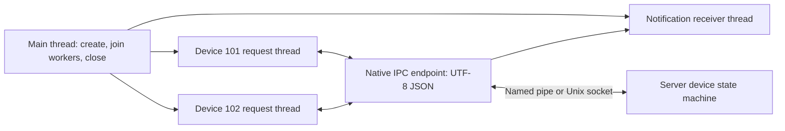

# Native Local IPC Business Example: Multi-Device Control and Notifications

[简体中文](IPC_BUSINESS.zh-CN.md) · [README](../README.md) · [IPC API and Protocol](IPC.md)

In desktop and industrial control software, a controller often needs to manage multiple devices concurrently over local inter-process communication (opening devices, querying or updating sampling intervals) while simultaneously listening for asynchronous state-change notifications pushed by the device service. This guide walks through a complete two-process device control workflow built on `hx_ipc` over native OS local transports (Windows Named Pipes and POSIX Unix domain sockets) using UTF-8 JSON payloads—with no physical hardware required.

Complete the one-time [example build setup](../examples/README.md#run) before starting. Below, `build` refers to your existing CMake build directory.

## 1. What this example does

This workflow runs two independent C programs:
- **Client (`hx_os_ipc_device_client`)**: Spawns two concurrent request threads—one operating device `101` and the other operating device `102`—plus a third dedicated receiver thread that processes unsolicited server notifications.
- **Server (`hx_os_ipc_device_server`)**: Maintains in-memory state for simulated devices `101` and `102`, validating and executing `open`, `get`, `set`, and `close` commands.

> [!NOTE]
> This example specifically targets native local transports and accepts only `local://`, Windows `pipe://`, or POSIX `unix://` addresses. For socket- and KCP-based business workflows, see their standalone guides and sources: [TCP Order Processing](TCP_BUSINESS.md), [UDP Sensor Telemetry](UDP_BUSINESS.md), and [KCP Block Transfer](KCP_BUSINESS.md) (none of those invoke this IPC device program).

## 2. Build and run automatically

From the repository root, build both the device server and device client targets:

```sh
cmake -S . -B build -DHX_OS_BUILD_EXAMPLES=ON
cmake --build build --config Release --target hx_os_ipc_device_server
cmake --build build --config Release --target hx_os_ipc_device_client
```

Run the automated verification script to launch both processes and check every reply and notification:

**Windows PowerShell (Visual Studio generator):**

```powershell
python examples/run_ipc_business.py --bin-dir build/bin/Release
```

**Linux / WSL:**

```sh
python3 examples/run_ipc_business.py --bin-dir build/bin
```

The runner selects a unique local channel name, starts both C executables, verifies all business state transitions, and prints `PASS ipc_business_local`. You can point `--bin-dir` at any existing build directory (such as `build-shared-msvc/bin/Release` or `build-shared-linux/bin`; omit `Release` when using Ninja on Windows). The runner script uses only the Python standard library.

## 3. Run manually in two terminals

You can also run the server and client interactively in two terminals without Python.

**Windows Terminal 1 (start the server):**

```powershell
.\build\bin\Release\hx_os_ipc_device_server.exe local://device-demo
```

Once `Listening:` appears, run the client in **Terminal 2**:

```powershell
.\build\bin\Release\hx_os_ipc_device_client.exe local://device-demo
```

On Linux or WSL, run `./build/bin/hx_os_ipc_device_server local://device-demo` and `./build/bin/hx_os_ipc_device_client local://device-demo` in separate terminals. The demo server enforces a 30-second overall run limit and exits cleanly after handling the client's `quit` command; restart the server before each manual run.

## 4. JSON messages and threads



Every IPC payload carries a single UTF-8 JSON object. For example, to update device `101`'s sampling interval to 250 ms, the client thread sends a `REQUEST`:

```json
{"type":"set","device_id":101,"interval_ms":250}
```

After validating the fields and updating the device state, the server sends a matched `REPLY` back to that request caller:

```json
{"type":"updated","device_id":101,"ok":true,"interval_ms":250,"code":""}
```

The server also pushes a one-way `DATA` notification, which arrives on the client's dedicated notification receiver thread:

```json
{"type":"changed","device_id":101,"interval_ms":250}
```

### Supported Commands and Validation Rules

| Request `type` | Required Fields | Server Reply & Behavior |
| --- | --- | --- |
| `open` | Integer `device_id` | Replies with `type="opened"`; initializes `interval_ms=1000` |
| `get` | Integer `device_id` | Replies with `type="state"` and the current `interval_ms` |
| `set` | Integer `device_id`, integer `interval_ms` | Valid range is `50`–`5000` ms; replies with `type="updated"` and pushes an unsolicited `type="changed"` notification |
| `close` | Integer `device_id` | Replies with `type="closed"` and releases the session's ownership of that device |
| `quit` | `device_id=0` | Replies with `type="bye"` once both devices are closed, then stops the server |

During the run, the client sets device `101` to 250 ms and device `102` to 500 ms, reading back the state after each update. It also submits an out-of-range `interval_ms=0` to verify that the server responds with `type="error"`, `ok=false`, `code="invalid_interval"` and leaves the prior valid interval unchanged.

> [!IMPORTANT]
> **Matching `channel` and Separating Replies from Notifications**
> - The server verifies that the JSON payload's `device_id` matches the IPC frame header's `channel`.
> - Because `hx_ipc` correlates request IDs internally, the two `hx_ipc_request_text_until()` worker threads wake up only with their own request replies, while `hx_ipc_receive_until()` on the notification thread receives only unsolicited `changed` events without stealing request replies.

## 5. Adapt the business logic

| Source File | Key Functions & Responsibilities |
| --- | --- |
| [ipc_device_client.c](../examples/ipc_device_client.c) | `device_work()` per-device workflow; `request_expected()` JSON encoding and reply checking; `receive_notifications()` dedicated push receiver |
| [ipc_device_server.c](../examples/ipc_device_server.c) | `handle_request()` JSON field validation, range/ownership checks, and state updates; `reply_json()` response serialization |
| [run_ipc_business.py](../examples/run_ipc_business.py) | Launches both binaries, parses logged JSON lines, and asserts every expected business outcome |

Once a device is open, querying its state over an established `client` connection looks like this:

```c
json_field fields[] = {
	json_text("type", "get"), json_int("device_id", 101)
};

hx_string request = HX_STRING_INIT;
hx_ipc_message *reply = NULL;
hx_os_error error = {0};

if (json_encode(fields, 2, &request)) {
	hx_os_status status = hx_ipc_request_text_until(client, 0, 101,
		hx_string_c_str(&request), hx_os_deadline_after_ms(5000),
		&reply, &error);
	// Check status, then parse reply->data and reply->bytes.
	(void)status;
}

hx_ipc_message_release(reply);
hx_string_destroy(&request);
```

`json_field` and `json_encode()` are lightweight example helpers defined in [business_json.h](../examples/business_json.h). They wrap the library's built-in settings serializer and JSON parser so strings are escaped safely without manual buffer formatting.

> [!NOTE]
> **Strict JSON Type Checking and Resource Caps**
> While the library's general configuration getters can coerce numeric strings, `business_json.h` enforces strict JSON schema types: integer `250` is accepted, whereas `"250"`, booleans, or missing keys are rejected. Malformed JSON, duplicate keys, and non-object roots are rejected before reaching device handlers. Payloads are bounded to 1023 bytes, JSON nesting depth to 8, node count to 64, and parser memory to 64 KiB.

### Files to copy into your own project

To use this workflow as a starter template:
1. Copy [ipc_device_server.c](../examples/ipc_device_server.c), [ipc_device_client.c](../examples/ipc_device_client.c), and the companion headers [ipc_demo.h](../examples/ipc_demo.h) and [business_json.h](../examples/business_json.h).
2. Build the client and server as two separate CMake executable targets (each file defines its own `main()`) and link both against `hx_c_platform::hx_c_platform` (see [Using an Installed Package](USAGE.md#installed-project)). Remember that helpers like `json_field` and `json_encode` live in `business_json.h` rather than the public `hx_os.h` header.
3. Your production C/C++ executables do not need `run_ipc_business.py`. Verify the unmodified programs in two terminals using the commands in Section 3 first, then customize the JSON fields and handlers while keeping the lifecycle order intact (create endpoint → spawn threads → join threads → close endpoint).

## 6. Ownership and running the example

```sh
python examples/run_ipc_business.py --bin-dir build/bin/Release
```

(Use `--bin-dir build/bin` on Linux.)

Keep these ownership rules in mind when modifying the example:
- **Main Thread Owns the Endpoint**: The main thread holds the `hx_ipc *` handle and worker contexts, and must **join all request and notification threads before calling `hx_ipc_close_until()`**.
- **Release Per-Message Resources**: Free every received `hx_ipc_message`, parsed JSON config document, and temporary `hx_string` after each step.
- **Close Timeouts vs. Request Timeouts**: If `hx_ipc_close_until()` returns `HX_OS_TIMEOUT`, retain the non-NULL endpoint pointer and retry closure; if a business request times out, do not assume the server failed to execute it. Each run of `run_ipc_business.py` verifies all 14 command replies, the final `bye` reply, and both `changed` push notifications.
