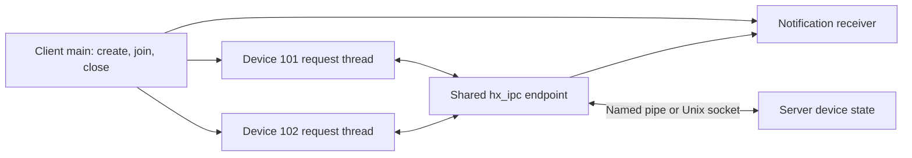

# Native local IPC: control two devices

[简体中文](IPC_BUSINESS.zh-CN.md) · [README](../README.md) · [IPC API and protocol](IPC.md)

## 1. What this example does

Two client request threads operate devices `101` and `102`; a third thread receives server notifications. The server holds two simulated devices and processes open, query, change and close commands. No hardware is required.

This example accepts only `local://`, Windows `pipe://`, or POSIX `unix://` addresses. Windows uses named pipes; Linux/macOS use Unix domain sockets. TCP, UDP and KCP have separate business sources, runners and tutorials: [TCP orders](TCP_BUSINESS.md), [UDP samples](UDP_BUSINESS.md), and [KCP transfer](KCP_BUSINESS.md). They do not invoke this device program.

## 2. Build and run automatically

Build the default modules from the repository root:

```sh
cmake -S . -B build-net -DHX_OS_BUILD_TESTS=ON -DHX_OS_BUILD_EXAMPLES=ON
cmake --build build-net --config Release --parallel 4
```

Windows PowerShell with the Visual Studio generator:

```powershell
python examples/run_ipc_business.py --bin-dir build-net/bin/Release
```

Linux/WSL:

```sh
python3 examples/run_ipc_business.py --bin-dir build-net/bin
```

The runner starts two independent C processes with a unique local name, checks business state, and prints `PASS ipc_business_local`. Existing development directories can be used as `build-shared-msvc/bin/Release` or `build-shared-linux/bin`. Omit `Release` for Windows Ninja. The runner uses only the Python standard library.

## 3. Run manually in two terminals

Windows terminal one:

```powershell
.\build-net\bin\Release\hx_os_ipc_device_server.exe local://device-demo
```

After `Listening:` appears, use terminal two:

```powershell
.\build-net\bin\Release\hx_os_ipc_device_client.exe local://device-demo
```

On Linux/WSL run `./build-net/bin/hx_os_ipc_device_server local://device-demo` and `./build-net/bin/hx_os_ipc_device_client local://device-demo` separately. The server's demonstration limit is 30 seconds; restart it for each workflow. Manual execution needs no Python.

## 4. Threads and business sequence



| Operation | Device 101 result |
| --- | --- |
| `OPEN` | `OK online`; the session owns the device |
| `GET` | `STATE interval_ms=1000` |
| `SET 250` | `OK interval_ms=250`, plus a separate `CHANGED interval_ms=250` notification |
| `GET` | Confirm the interval is now 250 ms |
| `SET 0` | `ERROR interval must be 50..5000` |
| Another `GET` | Confirm rejection preserved 250 ms |
| `CLOSE` | `OK offline` |

Device `102` concurrently follows the same sequence, selecting 500 ms. Once both notifications and all business threads finish, main sends `QUIT` on channel `0`, receives `BYE`, and closes the connection.

`request_text_until()` replies are routed by request ID to their requesting thread. `receive_until()` receives independent messages and lifecycle events without stealing replies. A single server business loop owns the device array; main reads thread results after joining.

## 5. Where to put your application logic

| Source | Functions to read |
| --- | --- |
| [ipc_device_client.c](../examples/ipc_device_client.c) | `device_work()` for operations; `request_expected()` for one request; `receive_notifications()` for independent receives; `main()` for thread lifetime |
| [ipc_device_server.c](../examples/ipc_device_server.c) | `handle_request()` for parameter changes, replies and notifications |
| [run_ipc_business.py](../examples/run_ipc_business.py) | Automated business assertions |

After connecting and opening the device, the core query fragment is:

```c
hx_ipc_message *reply = NULL;
hx_os_error error = {0};
hx_os_status status = hx_ipc_request_text_until(client, 0, 101,
	"GET", hx_os_deadline_after_ms(5000), &reply, &error);
if (status == HX_OS_OK)
	printf("Device state: %.*s\n", (int)reply->bytes,
		(const char *)reply->data);
hx_ipc_message_release(reply);
```

`0` selects the connected server; `101` is the application's device channel. Full sources also validate errors, channel, encoding and expected payload. `HX_OS_OK` means a reply arrived; `ERROR ...` still rejects the business operation.

Output includes:

```text
[request thread] device=101 SET 250 -> OK interval_ms=250
[receive thread] device=101 CHANGED interval_ms=250
[request thread] device=101 SET 0 -> ERROR interval must be 50..5000
[main] device=0 QUIT -> BYE
DEVICE CLIENT PASS: 2 devices, 2 request threads, 2 pushes
```

## 6. Ownership and tests

Main owns the endpoint and thread parameters; workers borrow them. Join before closing, and release every received message. A close timeout retains the object for retry. Request timeout does not prove the remote operation never ran; retried business operations need idempotency. The CLI helper's unrecoverable join failure exits this test program; persistent hosts must retain their owner and follow their shutdown policy.

```sh
ctest --test-dir build-net -C Release -R "^ipc_business_local$" --output-on-failure
```

Waits use ordinary threads. Keep them off the Qt UI thread; no coroutine-suspending adapter is implied. This case is separate from TCP/UDP/KCP workflows. Protocol framing, session, capacity and lifetime tests remain in [test_ipc.c](../tests/test_ipc.c) and [test_ipc_examples.py](../tests/test_ipc_examples.py). See [validation](VALIDATION.md) for target evidence.
