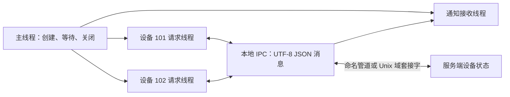

# 本地 IPC 业务示例：两个设备的参数控制

[English](IPC_BUSINESS.md) · [README](../README.zh-CN.md) · [IPC 接口与协议](IPC.zh-CN.md)

## 1. 本例做什么

客户端的两个请求线程分别操作设备 `101`、`102`，另一个接收线程处理服务端主动通知。服务端保存这两个模拟设备的参数，处理打开、查询、修改和关闭。运行不需要真实硬件。

本例只接受 `local://`、Windows `pipe://` 或 POSIX `unix://` 地址。Windows 使用命名管道，Linux/macOS 使用 Unix 域套接字。TCP、UDP、KCP 分别有自己的业务源码、运行器和教程，见 [TCP 订单](TCP_BUSINESS.zh-CN.md)、[UDP 采样](UDP_BUSINESS.zh-CN.md)、[KCP 传输](KCP_BUSINESS.zh-CN.md)。它们不调用这个设备程序。

## 2. 构建与一键运行

在仓库根目录构建默认模块：

```sh
cmake -S . -B build-net -DHX_OS_BUILD_TESTS=ON -DHX_OS_BUILD_EXAMPLES=ON
cmake --build build-net --config Release --parallel 4
```

Windows PowerShell，Visual Studio 生成器：

```powershell
python examples/run_ipc_business.py --bin-dir build-net/bin/Release
```

Linux/WSL：

```sh
python3 examples/run_ipc_business.py --bin-dir build-net/bin
```

脚本启动两个独立 C 进程，自动选择唯一的本地名称，核对业务状态，成功输出 `PASS ipc_business_local`。已有构建可以直接指定 `build-shared-msvc/bin/Release` 或 `build-shared-linux/bin`；Windows Ninja 构建去掉 `Release`。运行器仅使用 Python 标准库。

## 3. 在两个终端手工运行

Windows 终端一：

```powershell
.\build-net\bin\Release\hx_os_ipc_device_server.exe local://device-demo
```

看到 `Listening:` 后，在终端二执行：

```powershell
.\build-net\bin\Release\hx_os_ipc_device_client.exe local://device-demo
```

Linux/WSL 分别执行 `./build-net/bin/hx_os_ipc_device_server local://device-demo` 和 `./build-net/bin/hx_os_ipc_device_client local://device-demo`。服务端演示总时限为 30 秒；每次重跑流程重新启动服务端。手工运行不需要 Python。

## 4. JSON 消息与线程



每次发送一个 UTF-8 JSON 对象。例如修改设备参数：

```json
{"type":"set","device_id":101,"interval_ms":250}
```

服务端回复：

```json
{"type":"updated","device_id":101,"ok":true,"interval_ms":250,"code":""}
```

另外发送一条主动通知，由独立接收线程处理：

```json
{"type":"changed","device_id":101,"interval_ms":250}
```

| 请求的 `type` | 必填字段 | 回复与行为 |
| --- | --- | --- |
| `open` | 整数 `device_id` | `opened`；初始 `interval_ms=1000` |
| `get` | 整数 `device_id` | `state`；返回当前采样间隔 |
| `set` | 整数 `device_id`、整数 `interval_ms` | `updated`；合法范围 50～5000 毫秒，另发 `changed` |
| `close` | 整数 `device_id` | `closed`；释放当前会话持有的设备 |
| `quit` | `device_id=0` | 两个设备关闭后回复 `bye` 并结束 |

设备 `101` 修改为 250 毫秒，设备 `102` 修改为 500 毫秒；每次修改后重新查询。测试还发送 `interval_ms=0`，检查得到 `type="error"`、`ok=false`、`code="invalid_interval"`，再查询确认原值保留。

消息正文的 `device_id` 必须与 IPC 消息的 `channel` 相同。库内部管理请求编号，`request_text_until()` 的 JSON 回复返回对应请求线程；`receive_until()` 取得主动通知，不会抢走请求回复。

## 5. 修改自己的业务

| 源码 | 重点函数 |
| --- | --- |
| [ipc_device_client.c](../examples/ipc_device_client.c) | `device_work()` 连续操作；`request_expected()` 构造请求并检查 JSON 回复；`receive_notifications()` 独立通知接收 |
| [ipc_device_server.c](../examples/ipc_device_server.c) | `handle_request()` 解析字段、检查范围和设备归属、改变状态；`reply_json()` 序列化回复 |
| [run_ipc_business.py](../examples/run_ipc_business.py) | 解析程序输出的 JSON，逐项检查业务结果 |

设备已经打开后，查询片段如下；`client` 是已建立的连接：

```c
json_field fields[] = {
	json_text("type", "get"), json_int("device_id", 101)
};
hx_string request = HX_STRING_INIT;
hx_ipc_message *reply = NULL;
hx_os_error error = {0};
if (json_encode(fields, 2, &request)) {
	hx_os_status status = hx_ipc_request_text_until(client, 0, 101,
		hx_string_c_str(&request), hx_os_deadline_after_ms(5000),
		&reply, &error);
	/* Check status, then parse reply->data and reply->bytes. */
	(void)status;
}
hx_ipc_message_release(reply);
hx_string_destroy(&request);
```

`json_field` / `json_encode()` 是 [business_json.h](../examples/business_json.h) 中的示例辅助代码，使用库已有的 settings 序列化和内置 JSON 解析器。没有自己拼接字符串转义。业务命令、设备状态和收发代码仍属于本地 IPC 自己的文件。

配置模块的通用数字 getter 允许字符串转换，本例额外检查 JSON 类型：整数 `250` 可以使用，字符串 `"250"`、布尔值、缺失字段都不能代替整数。语法损坏、重复键、非对象根节点不会进入设备操作。消息正文最多 1023 字节，解析深度最多 8、节点最多 64，解析内存限额为 64 KiB。

## 6. 所有权与测试

主线程持有连接与线程参数，业务线程借用；先 join，再关闭连接。每条 IPC 消息、每个解析文档和临时 `hx_string` 都释放，文档中的节点/字符串在文档释放后失效。关闭超时保留对象供重试；请求超时不证明远端未执行操作。

```sh
ctest --test-dir build-net -C Release -R "^ipc_business_local$" --output-on-failure
```

`ipc_business_local` 检查两个设备的 14 条业务回复、最终 `bye` 和两条主动通知，按 JSON 字段比较而不是比较序列化文本顺序。JSON 示例需要默认开启的 `CONFIG`、`CONFIG_SERIALIZE` 和 `SETTINGS`；关闭所需模块时不注册该业务测试。

本例使用普通线程等待，不要放在 Qt UI 线程，也不声称具有协程挂起适配。CLI join 失败出口与可重试关闭边界见源码。目标平台证据见[验证记录](VALIDATION.zh-CN.md)。
