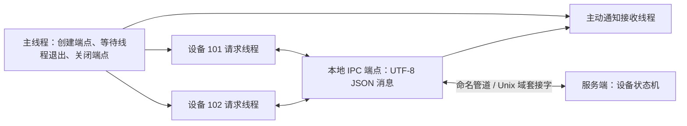

# 本地 IPC 业务示例：多设备并发参数控制与状态通知

[English](IPC_BUSINESS.md) · [README](../README.zh-CN.md) · [IPC 接口与协议](IPC.zh-CN.md)

在实际桌面或工控软件中，主程序往往需要通过本地进程间通信（IPC）并发控制多台外设（如设置采样周期、读取状态），同时还要实时接收设备进程主动推送的状态变更通知。本示例演示如何基于 `hx_ipc` 的系统原生本地通道（Windows 命名管道 / POSIX Unix 域套接字）加上 UTF-8 JSON 消息，构建一套完整的“多线程并发请求 + 独立线程异步通知”设备控制服务，且无需连接任何真实硬件即可直接运行验证。

在开始前，请先完成一次[示例构建配置](../examples/README.zh-CN.md#run)。下文中的 `build` 是你现有构建目录的占位名，直接复用即可。

## 1. 本例做什么

在这个双进程示例中：
- **客户端进程（`hx_os_ipc_device_client`）**：启动两个并发请求线程，分别负责操作设备 `101` 和设备 `102`；同时启动第三个通知接收线程，专门接收服务端主动推送的设备变更通知。
- **服务端进程（`hx_os_ipc_device_server`）**：在内存中维护 `101` 和 `102` 两台模拟设备的状态，处理设备的打开（`open`）、查询（`get`）、修改采样间隔（`set`）和关闭（`close`）命令。

> [!NOTE]
> 本示例专门演示操作系统原生本地传输，因此仅接受 `local://`、Windows `pipe://` 或 POSIX `unix://` 地址。如果你想参考基于 Socket 或 KCP 的业务示例，请分别查阅各自独立的教程与源码：[TCP 订单处理](TCP_BUSINESS.zh-CN.md)、[UDP 传感器采样](UDP_BUSINESS.zh-CN.md) 和 [KCP 数据块传输](KCP_BUSINESS.zh-CN.md)（它们使用各自的通信接口，不会调用本页的设备程序）。

## 2. 构建与一键运行

在仓库根目录下构建服务端与客户端两个可执行目标：

```sh
cmake -S . -B build -DHX_OS_BUILD_EXAMPLES=ON
cmake --build build --config Release --target hx_os_ipc_device_server
cmake --build build --config Release --target hx_os_ipc_device_client
```

使用 Python 运行脚本一键启动双端并自动核对业务结果：

**Windows PowerShell（Visual Studio 生成器）：**

```powershell
python examples/run_ipc_business.py --bin-dir build/bin/Release
```

**Linux / WSL：**

```sh
python3 examples/run_ipc_business.py --bin-dir build/bin
```

该脚本会自动分配唯一的本地通道名称、拉起两个独立的 C 进程、校验全部 JSON 回复与通知，并在验证通过后打印 `PASS ipc_business_local`。如果你使用的是已有的共享库构建目录（如 `build-shared-msvc/bin/Release` 或 `build-shared-linux/bin`），直接替换 `--bin-dir` 即可；Windows 下若使用 Ninja 生成器，请去掉路径末尾的 `Release`。运行脚本仅使用 Python 标准库。

## 3. 在两个终端手工运行

你也可以不依赖 Python 脚本，直接在两个终端中手动观察双端交互。

**Windows 终端一（启动服务端）：**

```powershell
.\build\bin\Release\hx_os_ipc_device_server.exe local://device-demo
```

看到服务端打印 `Listening:` 后，在**终端二（运行客户端）**中执行：

```powershell
.\build\bin\Release\hx_os_ipc_device_client.exe local://device-demo
```

在 Linux 或 WSL 下，分别在两个终端执行 `./build/bin/hx_os_ipc_device_server local://device-demo` 和 `./build/bin/hx_os_ipc_device_client local://device-demo`。服务端演示程序内置了 30 秒的总运行限时，并在处理完 `quit` 命令后自动退出；每次重新手工测试时请重新启动服务端。

## 4. JSON 消息与线程



每条 IPC 消息的正文都是一个标准的 UTF-8 JSON 对象。例如，当客户端请求将设备 `101` 的采样间隔修改为 250 毫秒时，发送如下 `REQUEST`：

```json
{"type":"set","device_id":101,"interval_ms":250}
```

服务端校验通过并更新状态后，向发起请求的线程定向返回 `REPLY`：

```json
{"type":"updated","device_id":101,"ok":true,"interval_ms":250,"code":""}
```

与此同时，服务端还会额外发出一条单向 `DATA` 通知，由客户端的通知接收线程通过 `hx_ipc_receive_until()` 捕获：

```json
{"type":"changed","device_id":101,"interval_ms":250}
```

### 支持的请求类型与校验规则

| 请求 `type` | 必填字段 | 服务端回复与业务行为 |
| --- | --- | --- |
| `open` | 整数 `device_id` | 返回 `type="opened"`；设备初始采样间隔为 `interval_ms=1000` |
| `get` | 整数 `device_id` | 返回 `type="state"` 及该设备当前的 `interval_ms` |
| `set` | 整数 `device_id`、整数 `interval_ms` | 合法范围为 `50`～`5000` 毫秒；成功后返回 `type="updated"`，并额外推送一条 `type="changed"` 主动通知 |
| `close` | 整数 `device_id` | 返回 `type="closed"`，释放当前客户端会话持有的该设备 |
| `quit` | `device_id=0` | 确认两台设备均已关闭后，返回 `type="bye"` 并正常退出服务端进程 |

在演示流程中，客户端会将设备 `101` 设为 250 毫秒、将设备 `102` 设为 500 毫秒，并在每次修改后立即发送 `get` 读回校验。客户端还会故意发送一次非法的 `interval_ms=0`，验证服务端是否准确返回 `type="error"`、`ok=false`、`code="invalid_interval"`，随后再次查询以确认原有的合法间隔未被破坏。

> [!IMPORTANT]
> **通道号（`channel`）与请求/通知分流**
> - 服务端强制要求 JSON 正文中的 `device_id` 与 IPC 帧头的 `channel` 参数完全一致。
> - `hx_ipc` 内部会自动管理每次请求的唯一 ID：调用 `hx_ipc_request_text_until()` 的两个设备线程只会精准拿到属于自己那次请求的 JSON 回复；而调用 `hx_ipc_receive_until()` 的通知线程只会收到服务端主动推送的 `changed` 消息，绝不会误抢请求线程的回复。

## 5. 修改自己的业务

| 源码文件 | 关键函数与职责 |
| --- | --- |
| [ipc_device_client.c](../examples/ipc_device_client.c) | `device_work()`：单台设备的完整控制流；`request_expected()`：编码请求并校验 JSON 回复；`receive_notifications()`：独立线程接收主动通知 |
| [ipc_device_server.c](../examples/ipc_device_server.c) | `handle_request()`：解析 JSON 字段、校验数值范围与设备归属并更新状态；`reply_json()`：序列化并发送回复 |
| [run_ipc_business.py](../examples/run_ipc_business.py) | 自动拉起双端进程、解析控制台输出的 JSON 日志并逐项核对业务状态 |

当设备打开后，使用现有连接 `client` 发起状态查询的典型代码如下：

```c
json_field fields[] = {
	json_text("type", "get"), json_int("device_id", 101)
};

hx_string request = HX_STRING_INIT;
hx_ipc_message *reply = NULL;
hx_os_error error = {0};

if (json_encode(fields, 2, &request)) {
	hx_os_status status = hx_ipc_request_text_until(client, 0, 101,
		hx_string_c_str(&request), hx_os_deadline_after_ms(5000),
		&reply, &error);
	// Check status, then parse reply->data and reply->bytes.
	(void)status;
}

hx_ipc_message_release(reply);
hx_string_destroy(&request);
```

上述代码中的 `json_field` 和 `json_encode()` 来自示例辅助头文件 [business_json.h](../examples/business_json.h)。它直接复用了本库内置的配置序列化器（Settings Serializer）与 JSON 解析器，自动处理特殊字符转义，无需手写字符串拼接。

> [!NOTE]
> **严格的 JSON 类型与资源边界**
> 虽然本库通用的配置读取接口支持将数字字符串自动转为整数，但本业务示例在 `business_json.h` 中对 JSON 节点类型做了严格检查：只有真正的 JSON 整数 `250` 才会被接受，字符串 `"250"`、布尔值或缺失字段都会被直接拒绝。任何语法损坏、重复键（Duplicate Keys）或非对象根节点（Non-Object Root）都会在进入设备状态机之前被拦截。单条消息正文上限为 1023 字节，JSON 解析深度上限为 8 层、最多 64 个节点，解析器内存限额为 64 KiB。

### 放进自己的工程时要复制什么

如果你想以本例为模板编写自己的 IPC 服务：
1. 复制 [ipc_device_server.c](../examples/ipc_device_server.c)、[ipc_device_client.c](../examples/ipc_device_client.c) 以及同目录下的辅助头文件 [ipc_demo.h](../examples/ipc_demo.h) 和 [business_json.h](../examples/business_json.h)。
2. 服务端和客户端各有一个 `main()` 函数，请在 CMake 中分别定义为两个独立的 `add_executable` 目标，并各自链接 `hx_c_platform::hx_c_platform`（外部工程接入方式参见[已安装包接入指南](USAGE.zh-CN.md#installed-project)）。注意 `json_field` 和 `json_encode` 是 `business_json.h` 提供的示例辅助封装，并非 `#include <hx_os.h>` 自带的公共 API。
3. 正式的 C/C++ 产品工程不需要 `run_ipc_business.py`。建议先按第 3 节的命令在两个终端里跑通原版程序，随后保持“主线程创建端点 → 启动收发线程 → 等待工作线程退出 → 关闭端点”的生命周期顺序，直接替换 JSON 字段定义与业务处理函数即可。

## 6. 所有权与运行示例

```sh
python examples/run_ipc_business.py --bin-dir build/bin/Release
```

（Linux 下将目录替换为 `build/bin`。）

在编写多线程 IPC 业务时，请始终遵循以下所有权准则：
- **主线程统一管理生命周期**：主线程持有 `hx_ipc *` 端点句柄和线程上下文参数，退出时必须**先 `join` 所有请求线程和通知接收线程，最后再关闭 IPC 端点**。
- **及时释放每条消息与文档**：每次收发循环结束后，成对释放 `hx_ipc_message`、解析生成的配置文档以及临时 `hx_string`。
- **区分关闭超时与请求超时**：若 `hx_ipc_close_until()` 返回 `HX_OS_TIMEOUT`，必须保留非空端点句柄以便继续重试关闭；若业务请求返回 `HX_OS_TIMEOUT`，并不代表服务端一定没有执行该命令。自动化脚本每次运行都会完整核对 14 条请求回复、`bye` 退出确认以及 2 条异步 `changed` 通知。
