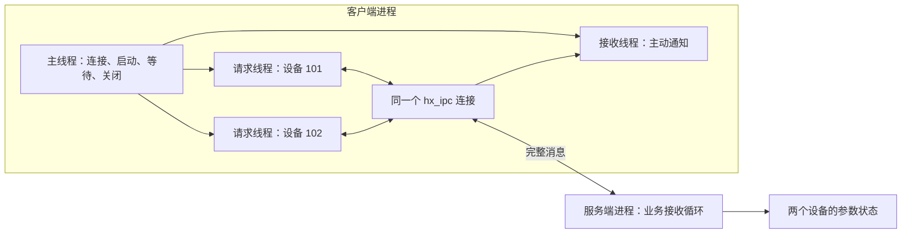

# IPC、TCP、UDP、KCP：多线程业务示例

[English](IPC_BUSINESS.md) · [README](../README.zh-CN.md) · [IPC 接口与协议](IPC.zh-CN.md)

## 1. 先选一个流程

这些示例会启动两个真正独立的 C99 进程，不需要设备、SDK 或数据库。客户端有专门的业务发送线程和接收线程；服务端保存少量设备状态，处理请求并主动发送消息。代码直接调用库里的接口，适合复制后换成自己的业务。

| 要试什么 | 业务流程 | 完整源码 |
| --- | --- | --- |
| 本地 IPC | 两个设备同时打开、查询、修改参数、接收通知、关闭 | [设备服务端](../examples/ipc_device_server.c)、[设备客户端](../examples/ipc_device_client.c) |
| TCP | 相同设备流程，地址换成 `tcp://` | 同上，业务代码共用 |
| KCP | 相同设备流程，地址换成 `kcp://`，内部处理 KCP 更新和收发 | 同上，业务代码共用 |
| 普通 UDP | 两个传感器持续上报，服务端保留最新状态并反馈 | [数据接收端](../examples/ipc_udp_dashboard.c)、[传感器端](../examples/ipc_udp_sensor.c) |
| UDP 缺号、重复、晚到 | 主动漏发两个序号、重复一个序号、再发送旧序号，检查最新状态 | 同上，加 `--simulate-gaps` |

这里的“本地 IPC”专指 `local://`：Windows 使用命名管道，Linux/macOS 使用 Unix 域套接字。TCP、UDP、KCP 也用于本机进程通信，下面统一使用回环地址。`101`、`102` 是这个小程序自定的设备编号，不需要事先向库注册。

## 2. 构建后，一条命令跑完整业务

在仓库根目录执行，保留默认模块配置：

```sh
cmake -S . -B build-ipc -DHX_OS_BUILD_TESTS=ON -DHX_OS_BUILD_EXAMPLES=ON
cmake --build build-ipc --config Release --parallel 4
```

**Windows PowerShell，Visual Studio 生成器：**

```powershell
python examples/run_ipc_business.py local --bin-dir build-ipc/bin/Release
python examples/run_ipc_business.py tcp --bin-dir build-ipc/bin/Release
python examples/run_ipc_business.py udp --bin-dir build-ipc/bin/Release
python examples/run_ipc_business.py kcp --bin-dir build-ipc/bin/Release
python examples/run_ipc_business.py udp --simulate-gaps --bin-dir build-ipc/bin/Release
```

**Linux/WSL，单配置生成器：**

```sh
python3 examples/run_ipc_business.py local --bin-dir build-ipc/bin
python3 examples/run_ipc_business.py tcp --bin-dir build-ipc/bin
python3 examples/run_ipc_business.py udp --bin-dir build-ipc/bin
python3 examples/run_ipc_business.py kcp --bin-dir build-ipc/bin
python3 examples/run_ipc_business.py udp --simulate-gaps --bin-dir build-ipc/bin
```

每条命令分别启动服务端和客户端，打印两边的业务记录，检查状态变化和回复内容，最后输出 `PASS ipc_business_tcp` 等结果。脚本自动分配空闲端口或唯一的本地名称，运行不同用例时不需要手工改端口。

已经构建过项目时，将 `--bin-dir` 换成自己的可执行文件目录即可，例如本仓库开发时使用的 `build-shared-msvc/bin/Release` 或 `build-shared-linux/bin`。Windows 使用 Ninja 时也去掉 `Release`。自动运行器仅使用 Python 标准库；实际通信、设备状态和线程逻辑都在 C 程序里。手工运行下面的程序不需要 Python。

## 3. 分别打开两个终端，观察两边收发

先执行服务端，看到 `Listening:` 后，在另一个终端执行客户端。设备服务端的演示总时限为 30 秒，因此不要启动服务端后长时间停留。每次换传输或重跑流程，都重新启动这两个程序。

**Windows PowerShell：**

| 传输 | 终端一 | 终端二 |
| --- | --- | --- |
| 本地 IPC | `.\build-ipc\bin\Release\hx_os_ipc_device_server.exe local://device-demo` | `.\build-ipc\bin\Release\hx_os_ipc_device_client.exe local://device-demo` |
| TCP | `.\build-ipc\bin\Release\hx_os_ipc_device_server.exe tcp://127.0.0.1:39001` | `.\build-ipc\bin\Release\hx_os_ipc_device_client.exe tcp://127.0.0.1:39001` |
| KCP | `.\build-ipc\bin\Release\hx_os_ipc_device_server.exe kcp://127.0.0.1:39003` | `.\build-ipc\bin\Release\hx_os_ipc_device_client.exe kcp://127.0.0.1:39003` |
| UDP | `.\build-ipc\bin\Release\hx_os_ipc_udp_dashboard.exe udp://127.0.0.1:39002` | `.\build-ipc\bin\Release\hx_os_ipc_udp_sensor.exe udp://127.0.0.1:39002` |

**Linux/WSL：**

| 传输 | 终端一 | 终端二 |
| --- | --- | --- |
| 本地 IPC | `./build-ipc/bin/hx_os_ipc_device_server local://device-demo` | `./build-ipc/bin/hx_os_ipc_device_client local://device-demo` |
| TCP | `./build-ipc/bin/hx_os_ipc_device_server tcp://127.0.0.1:39001` | `./build-ipc/bin/hx_os_ipc_device_client tcp://127.0.0.1:39001` |
| KCP | `./build-ipc/bin/hx_os_ipc_device_server kcp://127.0.0.1:39003` | `./build-ipc/bin/hx_os_ipc_device_client kcp://127.0.0.1:39003` |
| UDP | `./build-ipc/bin/hx_os_ipc_udp_dashboard udp://127.0.0.1:39002` | `./build-ipc/bin/hx_os_ipc_udp_sensor udp://127.0.0.1:39002` |

要看 UDP 的异常序号处理，在 UDP 客户端命令最后加 `--simulate-gaps`。固定端口被其他程序占用时，同时修改两边的端口，或者使用第 2 节的一键运行方式。

## 4. 本地 IPC、TCP、KCP：两个设备同时操作

### 4.1 程序实际做了什么

每个设备由一个请求线程负责。设备 `101` 把采样间隔改成 `250` 毫秒，设备 `102` 改成 `500` 毫秒。下面以设备 `101` 为例：

| 步骤 | 客户端发送 | 服务端动作与回复 | 检查什么 |
| --- | --- | --- | --- |
| 1 | `OPEN` | 标记设备已打开，回复 `OK online` | 设备由当前会话持有 |
| 2 | `GET` | 回复 `STATE interval_ms=1000` | 初始参数确实为 1000 毫秒 |
| 3 | `SET 250` | 修改参数，回复 `OK interval_ms=250`；另外推送 `CHANGED interval_ms=250` | 请求回复与主动通知走不同的接收路径 |
| 4 | `GET` | 回复 `STATE interval_ms=250` | 修改已经生效 |
| 5 | `SET 0` | 拒绝参数，回复 `ERROR interval must be 50..5000` | 收发成功不代表业务操作成功 |
| 6 | `GET` | 仍回复 `STATE interval_ms=250` | 被拒绝的修改没有破坏原值 |
| 7 | `CLOSE` | 释放设备，回复 `OK offline` | 业务资源正常关闭 |

两个设备的请求和两个主动通知全部处理完后，主线程发送通道 `0` 的 `QUIT`，服务端回复 `BYE` 并结束。`OPEN/GET/SET/CLOSE/QUIT` 是示例定义的业务正文，库只负责完整消息和请求匹配；实际项目可以换成 JSON、二进制或自己的命令格式。

### 4.2 谁在发，谁在收



**客户端有两个请求线程和一个接收线程。** 请求线程调用 `hx_ipc_request_text_until()`，取得自己那一次请求的回复；接收线程调用 `hx_ipc_receive_until()`，处理服务端主动发送的 `HX_IPC_DATA`。它不会把请求线程的回复抢走，库内部会按请求编号匹配。每个端点另外有一个库内部 I/O 线程，开发者不需要手工驱动它。

服务端用一个业务接收循环修改两个设备的状态，因此示例的状态数组不需要额外加锁。客户端的两个请求线程各自写自己的结果，主线程在 join 成功后才读取。多个线程共用连接时，不需要再给发送操作加一把业务互斥锁。

### 4.3 从哪段代码开始改

| 要替换的业务 | 看哪个函数 |
| --- | --- |
| 设备的一组连续操作 | [客户端](../examples/ipc_device_client.c) 的 `device_work()` |
| 发一次请求、核对回复、释放消息 | 同文件的 `request_expected()` |
| 独立线程持续接收主动通知 | 同文件的 `receive_notifications()` |
| 创建线程、等待线程、最后关闭连接 | 同文件的 `main()` |
| 查设备、改参数、回复、主动推送 | [服务端](../examples/ipc_device_server.c) 的 `handle_request()` |

例如，已经通过 `OPEN` 打开设备 `101` 后，查询的核心代码如下。`client` 是复用的连接，第二个参数 `0` 表示客户端连接的服务端，`101` 是设备通道：

```c
hx_ipc_message *reply = NULL;
hx_os_error error = {0};
hx_os_status status = hx_ipc_request_text_until(client, 0, 101,
	"GET", hx_os_deadline_after_ms(5000), &reply, &error);
if (status == HX_OS_OK)
	printf("Device state: %.*s\n", (int)reply->bytes,
		(const char *)reply->data);
else
	fprintf(stderr, "GET failed: status=%d\n", (int)status);
hx_ipc_message_release(reply);
```

这是完整程序中的一个通信片段。完整的 `request_expected()` 还校验设备编号、正文编码、长度和预期结果，并输出原生错误。`HX_OS_OK` 表示取得了回复，正文可能仍是 `ERROR ...`；应用需要解释自己的业务结果。

运行时会看到类似输出，两个设备之间的行序可能不同：

```text
[request thread] device=101 SET 250 -> OK interval_ms=250
[receive thread] device=101 CHANGED interval_ms=250
[request thread] device=101 GET -> STATE interval_ms=250
[request thread] device=101 SET 0 -> ERROR interval must be 50..5000
[request thread] device=101 GET -> STATE interval_ms=250
[request thread] device=101 CLOSE -> OK offline
[main] device=0 QUIT -> BYE
DEVICE CLIENT PASS: 2 devices, 2 request threads, 2 pushes
```

KCP 用的就是这份业务代码，并没有另写一套确认或重传循环。成功完成本机业务流程也不代表 KCP 一定比 TCP 更快。

## 5. 普通 UDP：一边上报，一边接收反馈

### 5.1 线程与数据

[传感器端](../examples/ipc_udp_sensor.c) 的 `publish_samples()` 在发送线程中上报两个设备的数据，每轮间隔约 30 毫秒，共 10 轮；`receive_feedback()` 在另一个线程中接收服务端的 `LATEST` 与 `SUMMARY` 消息。两个线程使用同一个连接。


正文示例为 `SAMPLE seq=10 temperature_centi=2510`：`seq` 是应用定义的采样序号，`temperature_centi` 的单位是摄氏度的百分之一，`2510` 表示 `25.10°C`。设备编号继续使用消息的 `channel`。

接收端的 `receive_sample()` 解析一条完整消息，检查数值范围，再更新状态。每收到三个更新的样本就反馈 `LATEST seq=N`；收集窗口结束后，向两个设备分别反馈 `SUMMARY`。这演示了持续上报期间，另一方向也可以发送业务消息。

### 5.2 收到缺号、重复和晚到数据怎么办

示例选择“最新状态优先”：

- 序号比当前值大：更新最新温度，并记录看到的序号空缺。
- 序号等于或小于当前值：视为重复或晚到数据，计入 `stale`，不覆盖最新温度。
- 没有收到反馈：接收线程到达期限就退出，不一直等待；普通 UDP 没有补发保证。

`--simulate-gaps` 在发送端**主动不发序号 3、7，重复发送 4，并在 8 后再发一次 6**。这是可复现的业务输入，不是测量真实网络丢包率，也没有修改系统网络配置。

在当前小批量回环测试中，每个设备的预期结果如下：

| 模式 | `accepted` 接受更新数 | `newest` 最新序号 | `gaps` 观察到的缺号数 | `stale` 重复或晚到数 |
| --- | --- | --- | --- | --- |
| 普通演示 | 10 | 10 | 0 | 0 |
| `--simulate-gaps` | 8 | 10 | 2 | 2 |

```text
[feedback thread] device=101 SUMMARY accepted=8 newest=10 gaps=2 stale=2
[feedback thread] device=102 SUMMARY accepted=8 newest=10 gaps=2 stale=2
UDP SENSOR PASS: send/receive threads joined; feedback=6
```

`feedback=6` 是这次受控演示中收到的四条中途反馈和两条汇总。真实 UDP 运行中数量可能不同；C 程序允许反馈缺失，一键测试脚本会检查这次小批量回环运行确实收到了预期反馈。检查失败会报告本次测试失败，不会改成“UDP 保证送达”。需要可靠命令时，采用前面的 TCP、本地 IPC 或 KCP 流程。

接收端先等待首条数据，最长 10 秒；收到后收集 1 秒。传感器反馈线程等待 2 秒。这些是让示例自动结束的应用参数，不是库固定的关闭规则，也不是吞吐量或实时性基准。

## 6. 换成自己业务时保留哪些规则

1. 主线程持有连接和线程参数，业务线程借用连接；线程 join 完毕后再销毁参数和关闭连接。
2. 每条收到的消息都要 `hx_ipc_message_release()`。跨线程转交消息时也要明确由谁最终释放；不要保存已释放消息里的正文指针。
3. 服务端回复用 `hx_ipc_reply_text()`，独立推送用 `hx_ipc_send_text_until()`。回复自动沿用来源、通道和请求编号，推送显式指定 `message->peer` 与设备通道。
4. 通信失败与业务拒绝分开处理。请求超时后，不能直接推断远端操作未执行；需要重试的业务应自行定义幂等操作或业务流水号。
5. 断线后重新连接属于新的会话。示例服务端会释放旧会话占用的设备，真实项目需要决定是否重新打开设备、重取状态；不要沿用旧 `peer`。
6. 队列满、溢出和关闭超时都要检查。`close_until()` 超时会保留对象，允许之后继续关闭；不能因等待超时就释放仍在使用的对象。

[ipc_demo.h](../examples/ipc_demo.h) 只收拢错误打印、消息比较、join 和关闭检查，业务收发仍在四个 `.c` 文件里。命令行演示遇到无法完成的线程 join 会以失败退出，避免栈上的线程参数先失效；这是测试程序的失败出口，不是库的宿主退出策略。长期运行程序应将连接与任务参数放进明确的 owner，保留对象并继续执行自己的关闭策略。

这些等待接口占用普通系统线程。Qt 可以把它们放到工作线程；不要在 UI 线程等待。当前 IPC 没有协程挂起适配，因此本教程没有把普通阻塞接口包装成协程示例。原有 [C++11 多线程示例](../examples/ipc_threads.cpp) 展示了同一套接口的 `Result<T>` 用法，不需要异常。

## 7. 自动测试与覆盖范围

```sh
ctest --test-dir build-ipc -C Release -R "^ipc_business_" --output-on-failure
```

| CTest 名称 | 实际检查 |
| --- | --- |
| `ipc_business_local` | 命名管道或 Unix 域套接字上的完整设备流程 |
| `ipc_business_tcp` | TCP 上的两个请求线程、独立通知线程、参数回读与业务拒绝 |
| `ipc_business_kcp` | KCP 上运行相同设备流程 |
| `ipc_business_udp` | 两路采样、独立发送/接收线程、最新状态与双向反馈 |
| `ipc_business_udp_gaps` | 主动漏发、重复与晚到样本后的状态检查 |

这些测试会核对正文、修改前后状态、主动通知、线程结束和进程退出，不能只打印几行就算通过。本机原生构建开启测试和示例、找到 Python 后，CMake 自动注册测试；关闭 KCP 或本地传输所需能力时不注册对应业务用例。交叉编译不会直接在宿主运行目标程序。

协议层的半包、合包、会话重建、超时、队列上限和释放检查继续放在 [test_ipc.c](../tests/test_ipc.c)、[跨进程协议测试](../tests/test_ipc_examples.py)；KCP 人工丢包、重复、乱序与时间回绕在 [test_kcp.c](../tests/test_kcp.c)。业务示例和这些底层测试互相补充。

本次五个业务用例在 Windows MSVC x64 与 WSL Linux 运行通过，WSL ASan/UBSan/泄漏检测和 TSan 也分别通过五个用例。新示例的 macOS、Android、Win7/8.1、ARM 真机与嵌入式目标运行仍待验证。具体配置见[验证记录](VALIDATION.zh-CN.md)。
