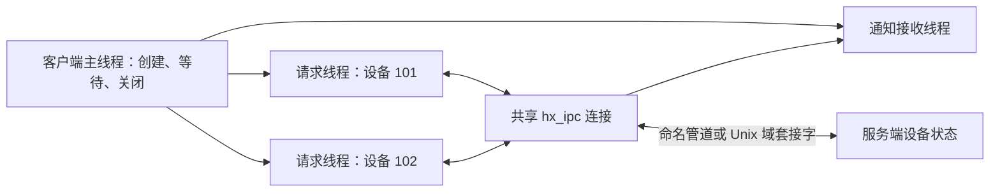

# 本地 IPC 业务示例：两个设备的参数控制

[English](IPC_BUSINESS.md) · [README](../README.zh-CN.md) · [IPC 接口与协议](IPC.zh-CN.md)

## 1. 本例做什么

客户端的两个请求线程分别操作设备 `101`、`102`，另一个接收线程处理服务端主动通知。服务端保存这两个模拟设备的参数，处理打开、查询、修改和关闭。运行不需要真实硬件。

本例只接受 `local://`、Windows `pipe://` 或 POSIX `unix://` 地址。Windows 使用命名管道，Linux/macOS 使用 Unix 域套接字。TCP、UDP、KCP 分别有自己的业务源码、运行器和教程，见 [TCP 订单](TCP_BUSINESS.zh-CN.md)、[UDP 采样](UDP_BUSINESS.zh-CN.md)、[KCP 传输](KCP_BUSINESS.zh-CN.md)。它们不调用这个设备程序。

## 2. 构建与一键运行

在仓库根目录构建默认模块：

```sh
cmake -S . -B build-net -DHX_OS_BUILD_TESTS=ON -DHX_OS_BUILD_EXAMPLES=ON
cmake --build build-net --config Release --parallel 4
```

Windows PowerShell，Visual Studio 生成器：

```powershell
python examples/run_ipc_business.py --bin-dir build-net/bin/Release
```

Linux/WSL：

```sh
python3 examples/run_ipc_business.py --bin-dir build-net/bin
```

脚本启动两个独立 C 进程，自动选择唯一的本地名称，核对业务状态，成功输出 `PASS ipc_business_local`。已有构建可以直接指定 `build-shared-msvc/bin/Release` 或 `build-shared-linux/bin`；Windows Ninja 构建去掉 `Release`。运行器仅使用 Python 标准库。

## 3. 在两个终端手工运行

Windows 终端一：

```powershell
.\build-net\bin\Release\hx_os_ipc_device_server.exe local://device-demo
```

看到 `Listening:` 后，在终端二执行：

```powershell
.\build-net\bin\Release\hx_os_ipc_device_client.exe local://device-demo
```

Linux/WSL 分别执行 `./build-net/bin/hx_os_ipc_device_server local://device-demo` 和 `./build-net/bin/hx_os_ipc_device_client local://device-demo`。服务端演示总时限为 30 秒；每次重跑流程重新启动服务端。手工运行不需要 Python。

## 4. 线程与业务顺序



| 操作 | 设备 101 的结果 |
| --- | --- |
| `OPEN` | `OK online`，当前会话持有设备 |
| `GET` | `STATE interval_ms=1000` |
| `SET 250` | `OK interval_ms=250`，另发 `CHANGED interval_ms=250` 通知 |
| `GET` | 确认间隔已变成 250 毫秒 |
| `SET 0` | `ERROR interval must be 50..5000` |
| 再次 `GET` | 确认拒绝操作后仍为 250 毫秒 |
| `CLOSE` | `OK offline` |

设备 `102` 同时执行相同操作，将间隔改为 500 毫秒。两条通知都处理完、业务线程都结束后，主线程发送通道 `0` 的 `QUIT`，取得 `BYE` 再关闭连接。

`request_text_until()` 的回复由库按请求编号送回对应请求线程。`receive_until()` 接收独立推送与连接事件，不会抢走请求回复。服务端在一个业务循环里更新设备数组；主线程在 join 后读取各线程结果。

## 5. 到哪里替换自己的业务

| 源码 | 重点函数 |
| --- | --- |
| [ipc_device_client.c](../examples/ipc_device_client.c) | `device_work()` 连续设备操作；`request_expected()` 单次请求；`receive_notifications()` 独立接收；`main()` 线程生命周期 |
| [ipc_device_server.c](../examples/ipc_device_server.c) | `handle_request()` 查询参数、修改、回复和主动通知 |
| [run_ipc_business.py](../examples/run_ipc_business.py) | 对业务结果的自动检查 |

连接建立且设备已经 `OPEN` 后，一次查询的核心片段如下：

```c
hx_ipc_message *reply = NULL;
hx_os_error error = {0};
hx_os_status status = hx_ipc_request_text_until(client, 0, 101,
	"GET", hx_os_deadline_after_ms(5000), &reply, &error);
if (status == HX_OS_OK)
	printf("Device state: %.*s\n", (int)reply->bytes,
		(const char *)reply->data);
hx_ipc_message_release(reply);
```

`0` 选择客户端连接的服务端，`101` 是应用的设备通道。完整源码还检查错误、通道、编码和预期正文。`HX_OS_OK` 表示拿到了回复；`ERROR ...` 仍属于业务拒绝，不能当作修改成功。

示例输出会包含：

```text
[request thread] device=101 SET 250 -> OK interval_ms=250
[receive thread] device=101 CHANGED interval_ms=250
[request thread] device=101 SET 0 -> ERROR interval must be 50..5000
[main] device=0 QUIT -> BYE
DEVICE CLIENT PASS: 2 devices, 2 request threads, 2 pushes
```

## 6. 所有权与测试

主线程持有连接与线程参数，业务线程借用；先 join，再关闭连接。收到的每条消息都释放。关闭超时保留对象，可以重试。请求超时不证明远端操作没有执行，真实重试业务需定义幂等策略。`ipc_demo.h` 的不可恢复 join 失败会让这个命令行测试退出；长期运行宿主应保留 owner，继续自己的关闭流程。

```sh
ctest --test-dir build-net -C Release -R "^ipc_business_local$" --output-on-failure
```

本例使用普通线程等待，不能在 Qt UI 线程阻塞，也不声称具备协程挂起适配。它独立于 TCP／UDP／KCP 业务用例。协议层半包、会话、容量和生命周期测试仍在 [test_ipc.c](../tests/test_ipc.c) 与 [test_ipc_examples.py](../tests/test_ipc_examples.py)；目标验证见[验证记录](VALIDATION.zh-CN.md)。
