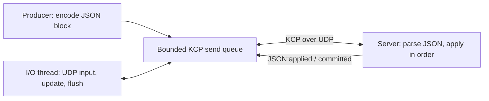

# KCP application example: reliable blocks and processing confirmation

[简体中文](KCP_BUSINESS.zh-CN.md) · [README](../README.md) · [KCP C API](../include/hx_os_kcp.h)

## 1. Independent KCP programs

This example directly uses `hx_os_kcp_*` and a UDP socket. It never calls `hx_ipc_*` or starts the IPC device service. A producer submits three blocks; an independent I/O thread receives UDP packets, drives KCP and receives business confirmations. The server applies the blocks in order and reports completion.

The KCP engine itself creates neither threads nor sockets. This example explicitly shows who drives updates, submits data and receives results. It runs with IPC disabled.

## 2. Build and run

```sh
cmake -S . -B build-net -DHX_OS_BUILD_TESTS=ON -DHX_OS_BUILD_EXAMPLES=ON
cmake --build build-net --config Release --parallel 4
```

Windows PowerShell, Visual Studio build:

```powershell
python examples/run_kcp_business.py --bin-dir build-net/bin/Release
python examples/run_kcp_business.py --drop-first --bin-dir build-net/bin/Release
```

Linux/WSL uses `python3` with `--bin-dir build-net/bin`. Existing development paths are `build-shared-msvc/bin/Release` or `build-shared-linux/bin`; omit `Release` with Windows Ninja. The runner chooses a port and checks actual block applications and replies.

Manual Windows **terminal one**:

```powershell
.\build-net\bin\Release\hx_os_kcp_transfer_server.exe 39003 --drop-first
```

After `Listening:`, **terminal two**:

```powershell
.\build-net\bin\Release\hx_os_kcp_transfer_client.exe 39003 --drop-first
```

On Linux/WSL run `./build-net/bin/hx_os_kcp_transfer_server 39003 --drop-first` and `./build-net/bin/hx_os_kcp_transfer_client 39003 --drop-first`. Omit both flags for normal transfer. Both sides use `127.0.0.1`; the argument is a port, not a `kcp://` URI. Start the client promptly: this demonstration has a 10-second session deadline.

## 3. Produce JSON and receive JSON confirmations



A block, its acknowledgement and final confirmation are:

```json
{"type":"block","id":1,"value":10}
```

```json
{"type":"applied","id":1,"ok":true}
```

```json
{"type":"committed","blocks":3,"total":60,"ok":true}
```

The client sends three JSON objects with IDs 1/2/3 and values 10/20/30. The server checks type, integer IDs, sequence and values before applying each block, acknowledging it and reporting total 60. The client parses JSON and validates IDs, boolean `ok`, block count and total instead of comparing serialized strings.

`committed` means in-memory processing completed, not durable storage. `hx_os_kcp_send()` only accepts data into its queue; business confirmation is still required.

`--drop-first` drops each side's first KCP output datagram and lets KCP retransmit. Tests still require exactly three applications, three `applied` messages and one `committed` message within this run.

## 4. Sources and usage

| File | Entry points |
| --- | --- |
| [kcp_transfer_client.c](../examples/kcp_transfer_client.c) | `send_blocks()` typed JSON encoding; `receive_confirmations()` I/O and parsed results |
| [kcp_transfer_server.c](../examples/kcp_transfer_server.c) | `receive_blocks()` JSON/schema/order validation; `send_confirmation()` response serialization |
| [kcp_business.h](../examples/kcp_business.h) | Independent UDP output, KCP update/flush and whole-message receive |
| [run_kcp_business.py](../examples/run_kcp_business.py) | Parses JSON logs and checks missing/duplicate blocks or replies |

The producer defines fields:

```c
json_field fields[] = {
	json_text("type", "block"), json_int("id", 1), json_int("value", 10)
};
```

Encode and pass the result to the example's `kcp_send_text()`. `send_blocks()` includes error checking and string cleanup. The shared [business_json.h](../examples/business_json.h) uses existing settings serialization and built-in JSON parsing; it contains no KCP business logic or IPC calls.

Default-enabled `CONFIG`, `CONFIG_SERIALIZE` and `SETTINGS` are required. UTF-8 JSON messages are capped at 1023 bytes, parsing depth at 8, nodes at 64 and parsing memory at 64 KiB. Duplicate keys and non-object roots are rejected; integers and booleans require their actual JSON types. Documents and temporary strings are released after use.

A short mutex protects producer submissions. One I/O thread processes at most 32 UDP packets per iteration, updates/flushes KCP and retrieves messages, sleeping 5 ms between iterations. Send capacity is 16 segments, receive window 128 and MTU 1200. JSON parsing/encoding runs outside the engine lock. Main joins before destroying engine, mutex, socket and network.

## 5. Session and shutdown limits

One peer per process run uses fixed `conv=7301`, with no discovery, authentication, reconnect or cross-restart deduplication. Real protocols need session generations and retry rules in their JSON; KCP's conversation number alone is insufficient.

After the final result, the client drives 500 ms more for trailing ACK retransmission, within a 10-second overall deadline. Unlimited loss cannot guarantee successful shutdown. Checking no duplicate application in this run does not promise exactly-once across restarts. See the fuller [IPC session protocol](IPC.md), which this example does not depend on.

## 6. Automated tests

```sh
ctest --test-dir build-net -C Release -R "^kcp_business_" --output-on-failure
```

`kcp_business_transfer` and `kcp_business_loss` check actual JSON blocks, totals, confirmations and cleanup. Engine reordering, duplication, capacity and clock rollover remain in [test_kcp.c](../tests/test_kcp.c). Disabling required JSON modules omits these business cases.
