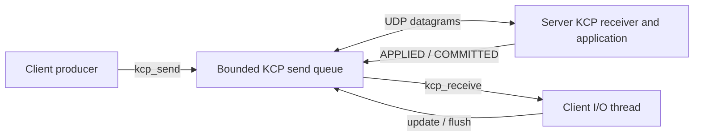

# KCP application example: reliable blocks and processing confirmation

[简体中文](KCP_BUSINESS.zh-CN.md) · [README](../README.md) · [KCP C API](../include/hx_os_kcp.h)

## 1. Independent KCP programs

This example directly uses `hx_os_kcp_*` and a UDP socket. It never calls `hx_ipc_*` or starts the IPC device service. A producer submits three blocks; an independent I/O thread receives UDP packets, drives KCP and receives business confirmations. The server applies the blocks in order and reports completion.

The KCP engine itself creates neither threads nor sockets. This example explicitly shows who drives updates, submits data and receives results. It runs with IPC disabled.

## 2. Build and run

```sh
cmake -S . -B build-net -DHX_OS_BUILD_TESTS=ON -DHX_OS_BUILD_EXAMPLES=ON
cmake --build build-net --config Release --parallel 4
```

Windows PowerShell, Visual Studio build:

```powershell
python examples/run_kcp_business.py --bin-dir build-net/bin/Release
python examples/run_kcp_business.py --drop-first --bin-dir build-net/bin/Release
```

Linux/WSL uses `python3` with `--bin-dir build-net/bin`. Existing development paths are `build-shared-msvc/bin/Release` or `build-shared-linux/bin`; omit `Release` with Windows Ninja. The runner chooses a port and checks actual block applications and replies.

Manual Windows **terminal one**:

```powershell
.\build-net\bin\Release\hx_os_kcp_transfer_server.exe 39003 --drop-first
```

After `Listening:`, **terminal two**:

```powershell
.\build-net\bin\Release\hx_os_kcp_transfer_client.exe 39003 --drop-first
```

On Linux/WSL run `./build-net/bin/hx_os_kcp_transfer_server 39003 --drop-first` and `./build-net/bin/hx_os_kcp_transfer_client 39003 --drop-first`. Omit both flags for normal transfer. Both sides use `127.0.0.1`; the argument is a port, not a `kcp://` URI. Start the client promptly: this demonstration has a 10-second session deadline.

## 3. How the threads cooperate



| Submitted block | Server state | Business reply |
| --- | --- | --- |
| `BLOCK id=1 value=10` | Apply first block; total 10 | `APPLIED id=1` |
| `BLOCK id=2 value=20` | Apply second block; total 30 | `APPLIED id=2` |
| `BLOCK id=3 value=30` | Apply third block; total 60 | `APPLIED id=3`, then `COMMITTED blocks=3 total=60` |

`COMMITTED` means this demonstration processed all three blocks in server memory, not durable storage. A successful `hx_os_kcp_send()` only accepts data into a bounded queue; the client still waits for application confirmation.

`--drop-first` discards the first outgoing KCP datagram at each endpoint's output callback while reporting local success. KCP must retransmit. The server must still apply exactly three blocks and the client must receive three acknowledgements plus completion.

```text
[KCP injection] first outgoing datagram dropped
[KCP I/O thread] APPLIED id=1
[KCP I/O thread] APPLIED id=2
[KCP I/O thread] APPLIED id=3
[KCP I/O thread] COMMITTED blocks=3 total=60
KCP CLIENT PASS: 3 blocks committed; dropped=1
KCP SERVER PASS: blocks=3 total=60 dropped=1
```

## 4. Sources and calls

| File | What to read |
| --- | --- |
| [kcp_transfer_client.c](../examples/kcp_transfer_client.c) | `send_blocks()` producer; `receive_confirmations()` I/O and business results |
| [kcp_transfer_server.c](../examples/kcp_transfer_server.c) | `receive_blocks()` ordered processing, totals and replies |
| [kcp_business.h](../examples/kcp_business.h) | `kcp_output()` raw UDP; `kcp_pump()` input, monotonic updates and ACK flush; bounded setup and exclusion |
| [run_kcp_business.py](../examples/run_kcp_business.py) | Separate normal/loss application assertions |

The producer uses:

```c
if (!kcp_send_text(job->session, block))
	return NULL;
```

This example-private helper calls `hx_os_kcp_send()` under a short mutex. The I/O thread processes at most 32 datagrams per iteration, drives `hx_os_kcp_update()` / `hx_os_kcp_flush()`, and retrieves complete messages, sleeping 5 ms between iterations. Output uses nonblocking `send_to()` without KCP reentry or waiting for network readiness while locked.

The example limits queued send segments to 16, receive window to 128, payload to 127 bytes, and MTU to 1200. Main joins threads before destroying engine, mutex, socket and network. After receiving the final result, the client drives another 500 ms to service retransmitted final ACKs, still bounded by the overall 10-second deadline. This finite policy cannot guarantee successful shutdown under unlimited loss.

## 5. Session limits

The example uses fixed `conv=7301`, one peer per process run, and no discovery, authentication, automatic reconnect or deduplication across restarts. KCP's conversation number is not a random, generation-aware application session identifier. A real multi-peer service must define establishment and teardown rather than copy this fixed ID.

KCP provides reliable ordered messages within a live conversation. Business completion, persistence and safe retries remain application responsibilities. The test checks no duplicate application in this run, not exactly-once execution across process restarts. The more complete HXIP session mechanism is documented in [IPC](IPC.md); this example does not depend on it.

## 6. Automated tests

```sh
ctest --test-dir build-net -C Release -R "^kcp_business_" --output-on-failure
```

`kcp_business_transfer` and `kcp_business_loss` check block order, totals, no duplicate application, confirmations and cleanup. Engine reordering, duplication, capacity and clock rollover remain in [test_kcp.c](../tests/test_kcp.c). These examples make no claim that KCP is faster than TCP. See [validation](VALIDATION.md) for target results.
