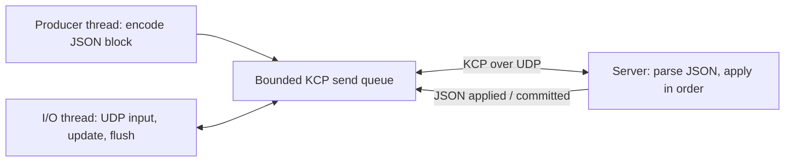

# KCP Business Example: Reliable Block Transfer and Processing Confirmation

[简体中文](KCP_BUSINESS.zh-CN.md) · [README](../README.md) · [KCP C API](../include/hx_os_kcp.h)

When you need UDP transport without sacrificing ordered, lossless, duplicate-free delivery, you can pair the low-level `hx_os_kcp_*` protocol engine directly with a raw UDP socket. This example implements a complete workflow where a producer thread submits three UTF-8 JSON data blocks, an independent I/O thread drives KCP over UDP, and the server applies the blocks in sequence before returning per-block and final commit confirmations.

Complete the one-time [example build setup](../examples/README.md#run) before starting. Below, `build` refers to your existing CMake build directory.

## 1. Independent KCP programs

This workflow consists of a standalone client (`hx_os_kcp_transfer_client`) and server (`hx_os_kcp_transfer_server`) built directly on `hx_os_kcp_*` and `hx_os_socket_*`:
- **No `hx_ipc` Dependency**: Neither program calls `hx_ipc_*` or starts the IPC device server. Both targets build and run even when `HX_OS_ENABLE_IPC=OFF`.
- **Explicit KCP Engine Driving**: Because `hx_os_kcp` is a pure protocol state machine that creates neither threads nor sockets of its own, this example clearly shows how an application separates producer submissions from the I/O worker loop that feeds UDP packets, calls `update` / `flush`, and reads completed messages.

## 2. Build and run

From the repository root, build the KCP transfer server and client targets:

```sh
cmake -S . -B build -DHX_OS_BUILD_EXAMPLES=ON
cmake --build build --config Release --target hx_os_kcp_transfer_server
cmake --build build --config Release --target hx_os_kcp_transfer_client
```

**Windows PowerShell (Visual Studio build, automated runner):**

```powershell
python examples/run_kcp_business.py --bin-dir build/bin/Release
python examples/run_kcp_business.py --drop-first --bin-dir build/bin/Release
```

On Linux or WSL, use `python3` with `--bin-dir build/bin` (or pass an existing build directory such as `build-shared-msvc/bin/Release` or `build-shared-linux/bin`; omit `Release` for Windows Ninja builds). The runner chooses an ephemeral UDP port and verifies every applied block and confirmation message.

### Manual Execution in Two Terminals

To run the C binaries manually without Python, start the server on port `39003` in **Terminal 1** (pass `--drop-first` on both sides to simulate first-packet loss and KCP retransmission, or omit the flag for normal transfer):

```powershell
.\build\bin\Release\hx_os_kcp_transfer_server.exe 39003 --drop-first
```

Once `Listening:` appears, promptly start the client in **Terminal 2**:

```powershell
.\build\bin\Release\hx_os_kcp_transfer_client.exe 39003 --drop-first
```

On Linux/WSL, run `./build/bin/hx_os_kcp_transfer_server 39003 --drop-first` and `./build/bin/hx_os_kcp_transfer_client 39003 --drop-first`. Both programs bind and send to `127.0.0.1`; the argument is a **port number**, not a `kcp://` URI. Because the demo enforces a 10-second overall session deadline, launch the client shortly after starting the server.

## 3. Produce JSON and receive JSON confirmations



The client sends three UTF-8 JSON objects with sequential IDs `1`, `2`, `3` and values `10`, `20`, `30`:

```json
{"type":"block","id":1,"value":10}
```

The server validates `type`, integer `id` ordering, and `value` bounds before applying each block and sending back a per-block confirmation (`applied`):

```json
{"type":"applied","id":1,"ok":true}
```

Once all three blocks have been applied in order, the server sends a final summary confirmation (`committed`) reporting 3 blocks and a total of `60`:

```json
{"type":"committed","blocks":3,"total":60,"ok":true}
```

> [!IMPORTANT]
> **Transport Queue Admission vs. Business Confirmation**
> - `HX_OS_OK` from `hx_os_kcp_send()` only means the message was accepted into the local KCP send queue—the client still waits for and parses the `applied` and `committed` JSON replies to confirm business completion (here `committed` means in-memory state completion rather than disk persistence).
> - With `--drop-first`, each side's UDP output callback intentionally drops its first outgoing KCP datagram so KCP must retransmit it. Automated verification still requires the server to apply each of the three blocks exactly once (total `60`) and the client to receive all three `applied` messages plus one `committed` message.

## 4. Sources and usage

| File | Key Functions & Responsibilities |
| --- | --- |
| [kcp_transfer_client.c](../examples/kcp_transfer_client.c) | `send_blocks()` typed JSON encoding on the producer thread; `receive_confirmations()` KCP I/O loop and reply parsing |
| [kcp_transfer_server.c](../examples/kcp_transfer_server.c) | `receive_blocks()` JSON schema and sequence validation; `send_confirmation()` response serialization |
| [kcp_business.h](../examples/kcp_business.h) | UDP output callback, periodic KCP `update`/`flush`, and complete-message extraction |
| [run_kcp_business.py](../examples/run_kcp_business.py) | Parses JSON logs and asserts zero missing or duplicate blocks and confirmations |

On the producer thread, define a block using typed JSON fields:

```c
json_field fields[] = {
	json_text("type", "block"), json_int("id", 1), json_int("value", 10)
};
```

Encode `fields` with `json_encode()` and submit the string via `kcp_send_text()` (see `send_blocks()` for error checking and `hx_string_destroy()` cleanup). The shared [business_json.h](../examples/business_json.h) header uses the default-enabled `CONFIG`, `CONFIG_SERIALIZE`, and `SETTINGS` modules for safe string escaping and bounded JSON parsing (1023-byte payload limit, depth 8, 64 nodes, and 64 KiB parser memory, rejecting duplicate keys, non-object roots, and mismatched integer/boolean types).

### Thread Synchronization and KCP Engine Tuning

- **Encode Outside the Lock**: JSON encoding and decoding run entirely outside the KCP engine mutex; the producer acquires the short mutex only to enqueue the encoded payload into KCP.
- **Bounded I/O Loop**: A single I/O worker thread reads up to 32 UDP datagrams per iteration, runs KCP `update` and `flush`, extracts complete messages, and sleeps 5 ms between ticks. The KCP instance is configured with a 16-segment send queue cap, a 128-segment receive window, and MTU 1200. The main thread joins all worker threads before destroying the KCP engine, mutex, socket, and network handle.

## 5. Session and shutdown limits

- **Fixed `conv` vs. Full Session Protocols**: To keep the low-level engine wiring easy to follow, each run serves a single peer with a fixed KCP conversation ID (`conv = 7301`) and omits peer discovery, authentication, automatic reconnect, and cross-restart deduplication. Because a raw 32-bit KCP `conv` cannot distinguish a restarted peer reusing sequence numbers, production protocols should either include random session generations and idempotency keys in their JSON schema or use the higher-level [Local IPC (`hx_ipc`)](IPC.md) / [Trusted-LAN KCP Session (`hx_os_kcp_session`)](NETWORK_IO.md#6-kcp-json-requestreply-on-a-trusted-network) APIs.
- **Trailing ACK Drain Window**: After receiving `committed`, the client continues driving KCP for 500 ms so trailing KCP acknowledgements can be retransmitted if needed (bounded by the 10-second overall session deadline).

### Files to copy into your own project

To use this KCP workflow in your own application:
1. Copy [kcp_transfer_server.c](../examples/kcp_transfer_server.c), [kcp_transfer_client.c](../examples/kcp_transfer_client.c), and the companion headers [kcp_business.h](../examples/kcp_business.h), [network_demo.h](../examples/network_demo.h), and [business_json.h](../examples/business_json.h).
2. Build the server and client as two separate CMake executable targets linked against `hx_c_platform::hx_c_platform` (see [Using an Installed Package](USAGE.md#installed-project)). Helpers like `kcp_send_text` and `json_field` belong to those example headers rather than the public `hx_os.h` API.
3. Verify the unmodified programs in two terminals first using the commands in Section 2, then customize the JSON fields and handlers while keeping the thread-join and cleanup order intact.

## 6. Run the business example

```sh
python examples/run_kcp_business.py --bin-dir build/bin/Release
python examples/run_kcp_business.py --bin-dir build/bin/Release --drop-first
```

(On Linux, replace `build/bin/Release` with `build/bin`.) These two commands verify normal ordered block transfer and automatic KCP retransmission when the first outgoing UDP packet on each side is dropped.
