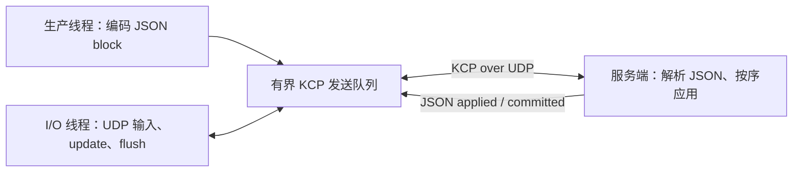

# KCP 业务示例：可靠传递数据块并确认处理结果

[English](KCP_BUSINESS.md) · [README](../README.zh-CN.md) · [KCP C 接口](../include/hx_os_kcp.h)

## 1. 独立的 KCP 程序

本例直接使用 `hx_os_kcp_*` 和 UDP socket，不调用 `hx_ipc_*`，不运行 IPC 设备服务。生产线程提交三个数据块；独立 I/O 线程接收 UDP 包、驱动 KCP、接收业务确认。服务端按顺序应用三个块并发送处理完成消息。

KCP 引擎本身不创建线程或 socket。示例明确演示由谁驱动更新、谁提交数据、谁接收结果；关闭 IPC 模块仍能运行。

## 2. 构建与运行

```sh
cmake -S . -B build-net -DHX_OS_BUILD_TESTS=ON -DHX_OS_BUILD_EXAMPLES=ON
cmake --build build-net --config Release --parallel 4
```

Windows PowerShell，Visual Studio 构建：

```powershell
python examples/run_kcp_business.py --bin-dir build-net/bin/Release
python examples/run_kcp_business.py --drop-first --bin-dir build-net/bin/Release
```

Linux/WSL 使用 `python3` 和 `--bin-dir build-net/bin`。已有构建可使用 `build-shared-msvc/bin/Release` 或 `build-shared-linux/bin`；Windows Ninja 去掉 `Release`。脚本自动选择端口，检查双方实际应用的数据块和回复。

手工运行，Windows **终端一**：

```powershell
.\build-net\bin\Release\hx_os_kcp_transfer_server.exe 39003 --drop-first
```

看到 `Listening:` 后，**终端二**：

```powershell
.\build-net\bin\Release\hx_os_kcp_transfer_client.exe 39003 --drop-first
```

Linux/WSL 分别使用 `./build-net/bin/hx_os_kcp_transfer_server 39003 --drop-first` 和 `./build-net/bin/hx_os_kcp_transfer_client 39003 --drop-first`。去掉两边的 `--drop-first` 即为正常传输。两端使用 `127.0.0.1`，参数是端口号，不是 `kcp://` URI。服务端启动后请及时运行客户端；演示会话总时限为 10 秒。

## 3. 生产线程发 JSON，I/O 线程收 JSON 确认



数据块、单块确认和最终确认分别是：

```json
{"type":"block","id":1,"value":10}
```

```json
{"type":"applied","id":1,"ok":true}
```

```json
{"type":"committed","blocks":3,"total":60,"ok":true}
```

客户端依次发编号 1/2/3、数值 10/20/30 的三个 JSON 对象。服务端检查 `type`、整数编号、顺序与数值，应用后逐块确认，最后报告总值 60。客户端也解析 JSON，检查确认编号、布尔 `ok`、块数与总值；不拿原始字符串相等作为业务判断。

`committed` 表示内存中的业务处理完成，没有磁盘持久化含义。`hx_os_kcp_send()` 成功只表示接受到发送队列，客户端仍需等待业务确认。

`--drop-first` 在双方输出回调中各丢弃首个 KCP 数据报，由 KCP 重传。自动检查仍要求服务端仅应用三块，客户端收到三个 `applied` 和一个 `committed`。

## 4. 源码与使用方式

| 文件 | 看哪里 |
| --- | --- |
| [kcp_transfer_client.c](../examples/kcp_transfer_client.c) | `send_blocks()` 构造并编码 JSON；`receive_confirmations()` 驱动 I/O 并解析结果 |
| [kcp_transfer_server.c](../examples/kcp_transfer_server.c) | `receive_blocks()` 校验 JSON 和业务顺序；`send_confirmation()` 序列化回复 |
| [kcp_business.h](../examples/kcp_business.h) | 独立的 UDP 输出、KCP 更新、冲刷与完整消息接收 |
| [run_kcp_business.py](../examples/run_kcp_business.py) | 将日志解析为 JSON，检查块与确认没有重复/缺失 |

生产线程准备字段：

```c
json_field fields[] = {
	json_text("type", "block"), json_int("id", 1), json_int("value", 10)
};
```

编码后交给本例的 `kcp_send_text()`；完整的错误检查与 `hx_string_destroy()` 在 `send_blocks()` 中。通用 [business_json.h](../examples/business_json.h) 使用现有 settings 序列化与内置 JSON 解析，不承载 KCP 业务逻辑，也不调用 IPC。

示例需要默认开启的 `CONFIG`、`CONFIG_SERIALIZE`、`SETTINGS`。消息为 UTF-8 JSON，最多 1023 字节；解析限制深度 8、节点 64、内存 64 KiB，拒绝重复键和非对象根节点。整数与布尔字段按实际 JSON 类型校验。数据文档和临时字符串在各线程使用完后释放。

生产者在短互斥区提交 KCP 消息，唯一 I/O 线程每轮最多处理 32 个 UDP 包，执行 `update` / `flush` 并取完整消息，循环间休眠 5 毫秒。发送段上限 16、接收窗口 128、MTU 1200。JSON 编解码在引擎锁外完成。主线程 join 后再销毁引擎、互斥锁、socket 和 network。

## 5. 会话与关闭边界

本例每进程仅服务一个对端，固定 `conv=7301`；没有自动发现、认证、重连或跨重启去重。对端重启可能重复编号，实际应用应给 JSON 协议定义会话代次和业务重试规则，不能把 KCP 的 `conv` 当作完整应用会话。

客户端收到最终结果后继续驱动 500 毫秒以便重发末尾 ACK，总会话期限为 10 秒。无限丢包时不保证正常结束。当前会话中无重复应用的检查不构成跨重启 exactly-once 承诺；更完整的 HXIP 会话见 [IPC 协议](IPC.zh-CN.md)，本例不依赖它。

## 6. 自动测试

```sh
ctest --test-dir build-net -C Release -R "^kcp_business_" --output-on-failure
```

`kcp_business_transfer` 与 `kcp_business_loss` 检查实际 JSON 块、处理总值、确认与资源回收。KCP 底层乱序、重复、容量和时间回绕仍由 [test_kcp.c](../tests/test_kcp.c) 覆盖。JSON 模块关闭时不注册业务用例；目标结果见[验证记录](VALIDATION.zh-CN.md)。
