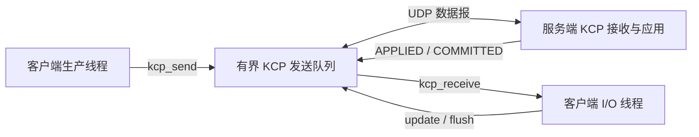

# KCP 业务示例：可靠传递数据块并确认处理结果

[English](KCP_BUSINESS.md) · [README](../README.zh-CN.md) · [KCP C 接口](../include/hx_os_kcp.h)

## 1. 独立的 KCP 程序

本例直接使用 `hx_os_kcp_*` 和 UDP socket，不调用 `hx_ipc_*`，不运行 IPC 设备服务。生产线程提交三个数据块；独立 I/O 线程接收 UDP 包、驱动 KCP、接收业务确认。服务端按顺序应用三个块并发送处理完成消息。

KCP 引擎本身不创建线程或 socket。示例明确演示由谁驱动更新、谁提交数据、谁接收结果；关闭 IPC 模块仍能运行。

## 2. 构建与运行

```sh
cmake -S . -B build-net -DHX_OS_BUILD_TESTS=ON -DHX_OS_BUILD_EXAMPLES=ON
cmake --build build-net --config Release --parallel 4
```

Windows PowerShell，Visual Studio 构建：

```powershell
python examples/run_kcp_business.py --bin-dir build-net/bin/Release
python examples/run_kcp_business.py --drop-first --bin-dir build-net/bin/Release
```

Linux/WSL 使用 `python3` 和 `--bin-dir build-net/bin`。已有构建可使用 `build-shared-msvc/bin/Release` 或 `build-shared-linux/bin`；Windows Ninja 去掉 `Release`。脚本自动选择端口，检查双方实际应用的数据块和回复。

手工运行，Windows **终端一**：

```powershell
.\build-net\bin\Release\hx_os_kcp_transfer_server.exe 39003 --drop-first
```

看到 `Listening:` 后，**终端二**：

```powershell
.\build-net\bin\Release\hx_os_kcp_transfer_client.exe 39003 --drop-first
```

Linux/WSL 分别使用 `./build-net/bin/hx_os_kcp_transfer_server 39003 --drop-first` 和 `./build-net/bin/hx_os_kcp_transfer_client 39003 --drop-first`。去掉两边的 `--drop-first` 即为正常传输。两端使用 `127.0.0.1`，参数是端口号，不是 `kcp://` URI。服务端启动后请及时运行客户端；演示会话总时限为 10 秒。

## 3. 线程如何配合



| 提交的数据 | 服务端操作 | 业务回复 |
| --- | --- | --- |
| `BLOCK id=1 value=10` | 应用第一个块，合计 10 | `APPLIED id=1` |
| `BLOCK id=2 value=20` | 应用第二个块，合计 30 | `APPLIED id=2` |
| `BLOCK id=3 value=30` | 应用第三个块，合计 60 | `APPLIED id=3`，再发 `COMMITTED blocks=3 total=60` |

`COMMITTED` 表示这个演示的三个块已经在服务端内存中处理完毕，没有磁盘持久化含义。`hx_os_kcp_send()` 成功只表示进入有界发送队列，不能直接当作远端执行成功；客户端继续等业务回复。

`--drop-first` 在两端的输出回调中各丢弃第一个实际待发 KCP 数据报，并报告本地发送成功，驱动 KCP 自己重传。服务端仍必须只应用三次，客户端仍必须收到三个处理确认和一个完成消息。

```text
[KCP injection] first outgoing datagram dropped
[KCP I/O thread] APPLIED id=1
[KCP I/O thread] APPLIED id=2
[KCP I/O thread] APPLIED id=3
[KCP I/O thread] COMMITTED blocks=3 total=60
KCP CLIENT PASS: 3 blocks committed; dropped=1
KCP SERVER PASS: blocks=3 total=60 dropped=1
```

## 4. 源码与关键调用

| 文件 | 看哪里 |
| --- | --- |
| [kcp_transfer_client.c](../examples/kcp_transfer_client.c) | `send_blocks()` 生产线程，`receive_confirmations()` I/O 与业务确认线程 |
| [kcp_transfer_server.c](../examples/kcp_transfer_server.c) | `receive_blocks()` 按序接收、累加与回复 |
| [kcp_business.h](../examples/kcp_business.h) | `kcp_output()` 原始 UDP 输出；`kcp_pump()` 输入 UDP、更新单调时钟、冲刷 ACK；有界创建与同步 |
| [run_kcp_business.py](../examples/run_kcp_business.py) | 本例自己的普通传输/丢包断言 |

生产线程的核心是：

```c
if (!kcp_send_text(job->session, block))
	return NULL;
```

这个示例私有函数在短互斥区调用 `hx_os_kcp_send()`。I/O 线程每轮最多处理 32 个 UDP 包，驱动 `hx_os_kcp_update()` / `hx_os_kcp_flush()` 并取出完整业务消息；循环间休眠 5 毫秒。输出回调只调用非阻塞 `send_to()`，不递归进入 KCP，不在持锁期间等待网络。

本例的发送段上限为 16，接收窗口为 128，最大业务正文 127 字节，MTU 为 1200。主线程 join 后再销毁引擎、互斥锁、socket 和 network。接收最后结果后客户端继续驱动 500 毫秒以便重发末尾 ACK，整个会话仍受 10 秒期限限制。该有限策略不保证无限丢包下双方都能正常结束。

## 5. 会话边界

本例固定使用 `conv=7301`，每次启动服务一个对端，不提供自动发现、身份认证、自动重连或跨重启去重。`conv` 只是 KCP 会话编号，不能直接替代带随机性和代次的应用会话标识。真实多对端服务应定义自己的会话建立与销毁协议，不能照搬这个单次演示的固定编号。

KCP 提供当前活动会话内的可靠有序消息传输；应用是否完成、是否持久化、是否可安全重试仍由业务协议决定。这里测试“当前演示没有重复应用”，不承诺进程重启后的 exactly-once。更完整的 HXIP 会话机制另见 [IPC 协议](IPC.zh-CN.md)，但本例不依赖它。

## 6. 自动测试

```sh
ctest --test-dir build-net -C Release -R "^kcp_business_" --output-on-failure
```

分别运行 `kcp_business_transfer`、`kcp_business_loss`；检查三个块的顺序、总值、无重复应用、对端业务确认与正常回收。KCP 引擎的乱序、重复、容量和时间回绕测试继续在 [test_kcp.c](../tests/test_kcp.c)。本例没有提出比 TCP 更快的性能结论。目标结果见[验证记录](VALIDATION.zh-CN.md)。
