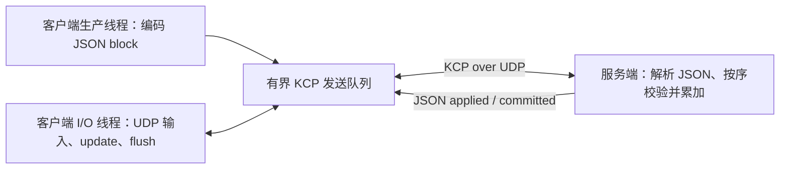

# KCP 业务示例：可靠传递数据块并确认处理结果

[English](KCP_BUSINESS.md) · [README](../README.zh-CN.md) · [KCP C 接口](../include/hx_os_kcp.h)

当你需要基于 UDP 进行通信，但业务又要求消息不能丢失、不能重复、且必须严格按序到达时，可以直接使用底层的 `hx_os_kcp_*` 纯算法引擎搭配 UDP Socket。本示例构建了一套完整的“客户端按序发送 3 个 JSON 数据块 + 服务端按序应用并返回单块确认与最终提交汇总”流程，清晰展示了在脱离 `hx_ipc` 的独立工程中，如何划分**业务生产线程**与 **KCP 定时驱动 I/O 线程**的职责。

在开始前，请先完成一次[示例构建配置](../examples/README.zh-CN.md#run)。下文中的 `build` 是你现有构建目录的占位名，直接复用即可。

## 1. 独立的 KCP 程序

本示例由客户端（`hx_os_kcp_transfer_client`）和服务端（`hx_os_kcp_transfer_server`）两个独立程序组成，直接调用 `hx_os_kcp_*` 与 `hx_os_socket_*`：
- **完全独立于 `hx_ipc`**：不调用任何 `hx_ipc_*` 接口，也不启动 IPC 设备服务。即使在 CMake 中将 `HX_OS_ENABLE_IPC` 设为 `OFF`，本示例依然可以正常编译运行。
- **显式驱动 KCP 引擎**：由于底层的 `hx_os_kcp` 引擎是一个纯粹的协议状态机（它自己不创建任何线程或 Socket），本示例直观地演示了如何由生产线程提交数据、由独立的 I/O 线程收发底层 UDP 数据报并周期性调用 `update` / `flush` 驱动 KCP 状态机。

## 2. 构建与运行

在仓库根目录下构建 KCP 传输服务端与客户端目标：

```sh
cmake -S . -B build -DHX_OS_BUILD_EXAMPLES=ON
cmake --build build --config Release --target hx_os_kcp_transfer_server
cmake --build build --config Release --target hx_os_kcp_transfer_client
```

**Windows PowerShell（Visual Studio 构建，一键自动化验证）：**

```powershell
python examples/run_kcp_business.py --bin-dir build/bin/Release
python examples/run_kcp_business.py --drop-first --bin-dir build/bin/Release
```

在 Linux 或 WSL 下，请使用 `python3` 并将目录改为 `--bin-dir build/bin`（也可直接指定已有的 `build-shared-msvc/bin/Release` 或 `build-shared-linux/bin`；Windows Ninja 构建去掉 `Release`）。Python 运行脚本会自动分配空闲端口，启动双端进程并核对所有数据块的应用次数与确认报文。

### 在两个终端中手工运行

你也可以在两个终端里直接运行 C 程序（加上 `--drop-first` 可故意丢弃首个底层 KCP 数据报以观察自动重传）：

**Windows 终端一（启动服务端，监听 39003 端口）：**

```powershell
.\build\bin\Release\hx_os_kcp_transfer_server.exe 39003 --drop-first
```

看到 `Listening:` 后，立即在**终端二（运行客户端）**中执行：

```powershell
.\build\bin\Release\hx_os_kcp_transfer_client.exe 39003 --drop-first
```

在 Linux/WSL 下分别执行 `./build/bin/hx_os_kcp_transfer_server 39003 --drop-first` 和 `./build/bin/hx_os_kcp_transfer_client 39003 --drop-first`（去掉两端的 `--drop-first` 即为无丢包正常传输）。两端固定使用 `127.0.0.1` 回环地址，命令行参数直接传入**端口号**（不要传 `kcp://` URI）。注意演示会话的总时限为 10 秒，因此启动服务端后请及时运行客户端。

## 3. 生产线程发 JSON，I/O 线程收 JSON 确认



在演示流程中，客户端依次发送编号为 `1`、`2`、`3`，对应数值为 `10`、`20`、`30` 的三个 UTF-8 JSON 数据块：

```json
{"type":"block","id":1,"value":10}
```

服务端解析 JSON 字段，严格校验 `type`、整数编号 `id` 的递增顺序以及 `value` 范围，每成功应用一块就返回一条单块确认（`applied`）：

```json
{"type":"applied","id":1,"ok":true}
```

当三个数据块全部按序处理完毕后，服务端额外发送一条最终汇总确认（`committed`），报告总块数 `3` 与累加总值 `60`：

```json
{"type":"committed","blocks":3,"total":60,"ok":true}
```

> [!IMPORTANT]
> **区分传输层入队与业务层完成**
> - 调用 `hx_os_kcp_send()` 返回 `HX_OS_OK` 仅代表消息已放入本端 KCP 发送队列，**不代表对端已收到或已执行业务逻辑**；客户端必须等待并解析服务端发回的 `applied` 与 `committed` JSON 报文（本示例中的 `committed` 代表内存状态机处理完毕，不涉及磁盘落盘）。
> - 当开启 `--drop-first` 时，收发双方都会在各自的 KCP 输出回调中故意丢弃第一个发出的 UDP 数据报，迫使 KCP 引擎触发超时重传。自动化检查会严格验证：即便发生了首包丢失与重传，服务端依然只将这 3 个数据块各应用一次（总值为 `60`），客户端也准确收齐 3 条 `applied` 和 1 条 `committed`。

## 4. 源码与使用方式

| 源码文件 | 核心函数与职责 |
| --- | --- |
| [kcp_transfer_client.c](../examples/kcp_transfer_client.c) | `send_blocks()`：在生产线程构造并编码 JSON 数据块；`receive_confirmations()`：驱动 KCP I/O 并解析服务端确认 |
| [kcp_transfer_server.c](../examples/kcp_transfer_server.c) | `receive_blocks()`：校验 JSON 结构与块序号顺序；`send_confirmation()`：编码并回发确认消息 |
| [kcp_business.h](../examples/kcp_business.h) | 封装底层 UDP 输出回调、KCP 周期性 `update`/`flush` 以及完整消息读取 |
| [run_kcp_business.py](../examples/run_kcp_business.py) | 解析控制台输出的 JSON 日志，核对数据块与确认报文无缺失、无重复 |

在客户端生产线程中，构造一个数据块只需定义类型化字段：

```c
json_field fields[] = {
	json_text("type", "block"), json_int("id", 1), json_int("value", 10)
};
```

将其交由 `json_encode()` 序列化后，调用示例封装的 `kcp_send_text()` 提交即可（完整的错误检查与 `hx_string_destroy()` 见 `send_blocks()`）。通用的 [business_json.h](../examples/business_json.h) 复用了默认开启的 `CONFIG`、`CONFIG_SERIALIZE` 和 `SETTINGS` 模块（单条 UTF-8 JSON 上限 1023 字节，解析深度上限 8、节点上限 64、内存限额 64 KiB，拒绝重复键与非对象根节点，并严格校验整数与布尔类型）。

### 线程同步与 KCP 驱动参数

- **锁外编解码，短临界区提交**：JSON 的序列化与反序列化全部在 KCP 引擎互斥锁之外完成；生产线程仅在向 KCP 提交消息的瞬间持有短互斥锁。
- **I/O 轮询循环**：唯一的 I/O 线程在每轮循环中最多读取 32 个底层 UDP 数据报喂给 KCP，随后执行 `update` / `flush` 并取出已重组完整的消息，每轮循环之间休眠 5 毫秒。KCP 引擎配置为发送窗口上限 16 段、接收窗口 128 段、MTU 1200 字节。主线程在 `join` 所有工作线程后，才按序销毁 KCP 引擎、互斥锁、Socket 与网络上下文。

## 5. 会话与关闭边界

- **固定 `conv` 与重启边界**：为了保持示例精简，本程序每次运行仅服务一个对端，并固定使用 KCP 会话号 `conv = 7301`，不包含自动发现、身份认证、断线重连或跨进程重启去重。在真实生产协议中，如果对端重启后仍使用相同的 `conv`，旧连接的残留包或重置后的序号可能会造成混淆——因此正式业务应在 JSON 载荷中加入随机会话代次（Session Generation）与幂等去重规则，或者直接使用内置了 64 位双端随机会话握手的 [本地 IPC 协议（`hx_ipc`）](IPC.zh-CN.md) / [可信局域网 KCP 会话（`hx_os_kcp_session`）](NETWORK_IO.zh-CN.md#6-可信局域网-kcp-的-json-请求与回复)。
- **尾包 ACK 排水窗口**：客户端在收到最终的 `committed` 报文后，还会继续驱动 KCP 循环 500 毫秒，以便将末尾的底层 KCP ACK 重传给服务端（整个演示会话受 10 秒总截止时间约束）。

### 放进自己的工程时要复制什么

如果你想基于本例构建自己的独立 KCP 传输程序：
1. 复制 [kcp_transfer_server.c](../examples/kcp_transfer_server.c)、[kcp_transfer_client.c](../examples/kcp_transfer_client.c) 以及同目录下的辅助头文件 [kcp_business.h](../examples/kcp_business.h)、[network_demo.h](../examples/network_demo.h) 和 [business_json.h](../examples/business_json.h)。
2. 将服务端和客户端分别建为两个独立的 CMake 可执行目标，并链接 `hx_c_platform::hx_c_platform`（外部工程接入参见[已安装包接入指南](USAGE.zh-CN.md#installed-project)）。注意 `kcp_send_text`、`json_field` 等辅助函数位于上述示例头文件中，并非 `#include <hx_os.h>` 自带的公共 API。
3. 先用第 2 节的双终端手动命令跑通原版程序，再替换为你自己的 JSON 字段与业务逻辑，同时保持原有的“先 `join` 线程、再销毁引擎与 Socket”的关闭顺序。

## 6. 运行业务示例

```sh
python examples/run_kcp_business.py --bin-dir build/bin/Release
python examples/run_kcp_business.py --bin-dir build/bin/Release --drop-first
```

（Linux 下请将 `build/bin/Release` 替换为 `build/bin`。）这两条命令分别验证正常的 JSON 数据块顺序传输，以及在故意丢弃首个底层 UDP 数据报后的 KCP 自动重传与业务零重复核对。
