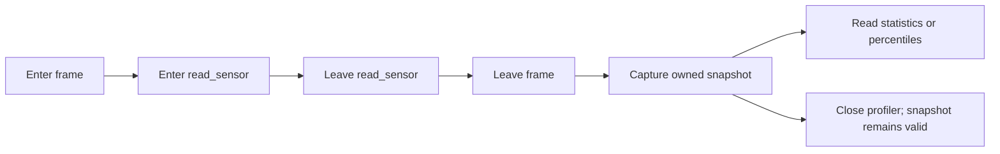

# Interval statistics and bounded percentiles

[简体中文](PROFILER.zh-CN.md) · [README](../README.md)

## 1. What this measures

Use the profiler to answer questions such as “how long did reading the sensor take?” or “which child operation occupied most of a frame?” Call `start_root` before an operation and `leave` after it. Call `reach` to enter a child operation. Each successful entry needs one matching leave on the same thread or library coroutine.

The profiler records monotonic elapsed time, in nanoseconds. This includes sleeping, waiting and scheduling delays. It is not a CPU usage counter. Identical names under identical parent paths merge across threads. Overlapping threads can accumulate more time than the process's elapsed wall time.



The frame's inclusive time includes `read_sensor`; its exclusive time subtracts completed child durations. An open or aborted interval contributes no duration sample. `last_*` means the last completed sample. Restarting a thread aborts its open intervals and releases its timing stack; it does not reset historical statistics.

## 2. Run the complete C example

[profile_statistics.c](../examples/profile_statistics.c) simulates twelve sensor reads, closes the profiler and prints the retained snapshot. Replace the sleep with your operation. The usual project build also builds this program:

```sh
cmake --build build --config Release --target hx_os_profile_statistics
# Linux / macOS:
./build/bin/hx_os_profile_statistics
# Windows with Visual Studio:
./build/bin/Release/hx_os_profile_statistics.exe
```

Output has this shape; timings vary with the machine and scheduler:

```text
read_sensor: 12 samples, mean ... ms, deviation ... ms
P50: [..., ...] ms (approximate interval)
P95: [..., ...] ms (approximate interval)
P99: [..., ...] ms (approximate interval)
```

`hx_os_profiler_create()` enables basic statistics. To request inclusive percentiles, use `hx_os_profiler_create_with_features()` with `HX_OS_PROFILER_HISTOGRAM_INCLUSIVE`. Add `HX_OS_PROFILER_HISTOGRAM_EXCLUSIVE` for percentiles of the interval's own time. Flags are fixed when the profiler is created; no worker thread starts.

The common reporting calls are:

| Operation | C entry | C++11 entry |
| --- | --- | --- |
| Capture all paths | `hx_os_profiler_snapshot_create` | `profiler.snapshot()` |
| Iterate entries | `snapshot_count` and `snapshot_at` | Range-for over `ProfileSnapshot` |
| Inclusive P95 | `snapshot_percentile(snapshot, id, 95, ...)` | `snapshot.percentile(id, 95)` |
| Exclusive P95 | `snapshot_quantile(snapshot, id, 1, 95, 100, ...)` | `snapshot.percentile(id, 95, true)` |
| Release a snapshot | `hx_os_profiler_snapshot_release` | RAII |
| Keep existing text reports | `hx_os_profiler_dump_string` | `profiler.dump()` |

The table abbreviates snapshot query names; each C query begins with `hx_os_profiler_`. Quantiles use `entry.identifier`, which starts at 1. `snapshot_at` uses a zero-based array index. Parent identifiers are local to the originating profiler; parent 0 means a root.

## 3. Read the statistics directly

Snapshots expose immutable `hx_os_profiler_entry` records. There is no need to parse the TSV report.

| Fields | Meaning |
| --- | --- |
| `name`, `name_bytes`, `identifier`, `parent`, `depth` | Copied UTF-8 name and interval tree position |
| `completed`, `aborted` | Counts of completed and aborted intervals |
| `inclusive_ns`, `exclusive_ns` | Accumulated elapsed time |
| `minimum_ns`, `maximum_ns`, `last_inclusive_ns` | Inclusive minimum, maximum and last completion |
| `minimum_exclusive_ns`, `maximum_exclusive_ns`, `last_exclusive_ns` | Corresponding exclusive values |
| `mean_inclusive_ns`, `deviation_inclusive_ns` | Mean and population standard deviation |
| `mean_exclusive_ns`, `deviation_exclusive_ns` | Corresponding exclusive statistics |
| `flags` | 1: saturated counters; 2: clock error |

Means and standard deviations are approximate doubles. Empty statistics are zero. Welford's update maintains variance without retaining samples; the square root is calculated when capturing a snapshot, outside the recording lock. Treat flagged entries as diagnostics, not exact measurements.

For example, after recording work with an initialized `hx::Profiler profiler`, this C++11 reporting block prints each path's mean and optional P95. Include `<hx/Profiler.hpp>` and `<cstdio>`:

```cpp
auto report = profiler.snapshot();
if (!report) {
	std::fprintf(stderr, "Snapshot failed: %s\n",
		hx_os_status_name(report.status()));
}
else {
	for (const auto &entry : report.value()) {
		std::printf("%s: mean %.3f ms\n", entry.name,
			entry.mean_inclusive_ns / 1000000.0);

		auto p95 = report.value().percentile(entry.identifier, 95);
		if (p95) {
			std::printf("P95 lies in [%.3f, %.3f] ms\n",
				(double)p95.value().lower_ns / 1000000.0,
				(double)p95.value().upper_ns / 1000000.0);
		}
		else {
			std::fprintf(stderr, "P95 unavailable: %s\n",
				hx_os_status_name(p95.status()));
		}
	}
}
```

The profiler's host-owned handle still needs explicit close after participating threads have exited or detached their timing caches. The reporting block does not close it. `ProfileSnapshot` itself owns its data and can be copied or moved without copying all records. Copies retain one shared immutable snapshot; ordinary iteration does not allocate.

## 4. Interpret P50, P95 and P99

A percentile describes a completed duration sample at the requested rank. P95 chooses the `ceil(sample_count * 95 / 100)`-th sample in sorted order. With only twelve samples, P95 and P99 both choose the maximum; this is expected, not evidence of a precise tail estimate.

Each enabled channel has 252 fixed logarithmic bins. Values from 0 through 3 ns have exact bins, then each power-of-two range is split into four bins. For example, 1,024–1,279 ns share a bin. The largest bins also cover `UINT64_MAX` safely. A bucket width is at most one quarter of its lower bound, apart from the exact small bins.

Queries return `{lower_ns, upper_ns, samples}`. The interval contains the selected order statistic; it is not a confidence interval or an interpolated exact duration. The result is clipped to the observed minimum and maximum. P0/P100 return the exact observed extrema. Fractional percentiles can use the rational `snapshot_quantile` entry, such as 999/1000 for P99.9.

| Condition | Result |
| --- | --- |
| Selected histogram was not enabled | `HX_OS_NOT_SUPPORTED` |
| Path has no completed sample | `HX_OS_NOT_FOUND` |
| Invalid identifier, numerator above denominator or saturated counters | `HX_OS_RANGE` |
| Null required argument, zero denominator or invalid exclusive flag | `HX_OS_INVALID` |

Query failures preserve the output structure. No query synthesizes a percentile from the mean or min/max alone. Features do not change at runtime, and counts accumulate over the profiler's lifetime; rolling windows and exact sample exports are not provided.

## 5. Memory, concurrency and shutdown

Each enabled histogram adds exactly 2,016 bytes per distinct recorded path, plus at most seven bytes of alignment padding before the histogram area. Both channels add 4,032 bytes. The copied snapshot includes the enabled histogram data too. Defaults allow 1,024 paths; lowering `max_records` is useful on embedded devices. Basic statistics always add 64 bytes to each private record compared with the previous implementation. Names and thread timing stacks have their existing separate limits.

The existing options layout is preserved. `max_output_bytes` also limits each new owned snapshot, including its allocation header/alignment allowance. Old TSV output retains its original formatted-output limit. Default options allow 4 MiB; creating both histograms with null options selects 8 MiB. Explicit options keep exactly the budget supplied. A capture that exceeds the budget fails with `HX_OS_LIMIT`; it does not silently omit paths or histograms. Applications must also bound the number of simultaneously retained snapshots.

Warm paths allocate no new context memory. A completed interval updates min/max/last, means, variance and selected bins inside the existing recording mutex section. No new mutex, thread or per-sample allocation is introduced. This still costs time; see [measured local results](VALIDATION.md). The measurements are not a cross-platform latency guarantee.

A capture allocates outside the profiler lock, then copies statistics and bins consistently under the lock. Copying names and calculating deviations happen after unlocking. Capture work grows with the number of paths and bins, so capture periodically rather than on every timed operation. Concurrent path growth retries at most eight times, then returns `HX_OS_BUSY`. The snapshot records a monotonic observation timestamp. Caller output becomes null on capture failure.

Default snapshot allocation is independent of the profiler's allocator, allowing the original context to close once its resources are released. `snapshot_create_with_context` selects a separate allocator explicitly; that context reports busy while the snapshot is retained. Entry pointers and names borrow the snapshot until its last release. Concurrent readers hold their own references, published through normal synchronization. All snapshots and profiler/TLS state must be gone before unloading the implementing library.

The existing stop/close contracts remain: stop rejects new entries; leave, detach and capture remain available. Close never kills another thread or discards its active timing stack. Timeout/BUSY retain the handle for retry. No signal handler or native stack capture is installed. With `HX_OS_ENABLE_PROFILER=OFF`, creation/capture/queries explicitly report not supported.
