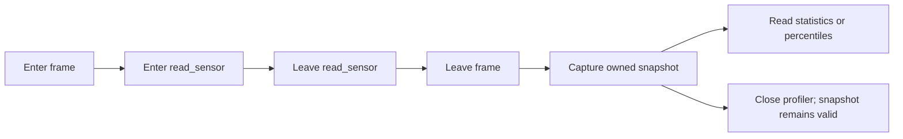

# Interval statistics and bounded percentiles

[简体中文](PROFILER.zh-CN.md) · [README](../README.md)

Use the bounded interval profiler (`hx_os_profiler` / `hx::Profiler`) when you want to measure how long specific application operations take (such as reading a sensor, parsing a message, or running subsystems inside a frame), inspect mean and standard deviation, and query bounded tail-latency percentiles (`P50`, `P95`, `P99`). For uninstrumented CPU sampling, memory-error/leak detection, or heap peak profiling, pair this module with the [optional developer analysis](ANALYSIS.md) workflow.

To see interval statistics and percentiles right away, build and run [profile_statistics.c](../examples/profile_statistics.c). The program creates a profiler with histogram support enabled, records 12 `read_sensor` intervals, captures an independent snapshot, closes the profiler, and prints the mean, standard deviation, and `P50`/`P95`/`P99` bounds from the retained snapshot.

Follow the [example run instructions](../examples/README.md#run) to enable `HX_OS_BUILD_EXAMPLES=ON` and build `hx_os_profile_statistics` (it needs no arguments or input files):

```sh
cmake --build build --config Release --target hx_os_profile_statistics

# Linux / macOS:
./build/bin/hx_os_profile_statistics

# Windows PowerShell (Visual Studio generator):
.\build\bin\Release\hx_os_profile_statistics.exe
```

Running the program prints `read_sensor: 12 samples` along with its mean, standard deviation, and `P50`/`P95`/`P99` duration intervals (exact numbers vary with OS scheduling). Replace the simulated sleep in the example with the code you want to measure, or drop the source into the [minimal project](USAGE.md#c-project) setup.

## 1. What this measures

The profiler builds a hierarchical tree of timed intervals from explicit scope markers:
- Call `hx_os_profiler_start_root` before a top-level operation and `hx_os_profiler_leave` when it finishes.
- Call `hx_os_profiler_reach` to enter a nested child operation and `hx_os_profiler_leave` when the child finishes.
- Every successful entry must be balanced by one matching `leave` on the **same thread or library coroutine**.



Key measurement rules:
- **Monotonic wall-clock duration (not CPU utilization)**: Intervals are timed with the nanosecond monotonic clock, which includes sleeping, lock waits, and OS scheduling delays.
- **Inclusive vs. exclusive duration**: In the diagram above, `frame`'s **inclusive time** includes the time spent inside `read_sensor`, whereas `frame`'s **exclusive time** subtracts all completed child durations (`read_sensor`) so you can separate parent overhead from child work.
- **Cross-thread path merging**: Identical interval names under identical parent paths merge across threads (so overlapping threads executing the same path can accumulate more total inclusive time than elapsed process wall-clock time).
- **Open or aborted scopes never skew samples**: An interval that is still open or aborted via `hx_os_profiler_restart_thread` increments `aborted` without contributing a duration sample. `last_*` always records the most recently completed sample.

## 2. Run the complete C example

[profile_statistics.c](../examples/profile_statistics.c) produces output in this format:

```text
read_sensor: 12 samples, mean ... ms, deviation ... ms
P50: [..., ...] ms (approximate interval)
P95: [..., ...] ms (approximate interval)
P99: [..., ...] ms (approximate interval)
```

`hx_os_profiler_create()` enables basic aggregate statistics (counts, totals, min/max, mean, and standard deviation). To enable percentile queries, create the profiler with `hx_os_profiler_create_with_features()`:
- Pass `HX_OS_PROFILER_HISTOGRAM_INCLUSIVE` to record histograms for **inclusive** durations.
- Add `HX_OS_PROFILER_HISTOGRAM_EXCLUSIVE` to also record histograms for **exclusive** durations.

Histogram flags are fixed at creation time and spawn no background threads:

| Operation | C99 Entry Point | C++11 Entry Point |
| --- | --- | --- |
| Capture a structured snapshot of all paths | `hx_os_profiler_snapshot_create` | `profiler.snapshot()` |
| Iterate recorded path entries | `hx_os_profiler_snapshot_count` & `hx_os_profiler_snapshot_at` | Range-`for` over `hx::ProfileSnapshot` |
| Query an inclusive integer percentile (e.g., P95) | `hx_os_profiler_snapshot_percentile(snapshot, id, 95, ...)` | `snapshot.percentile(id, 95)` |
| Query an exclusive rational quantile (or P95) | `hx_os_profiler_snapshot_quantile(snapshot, id, 1, 95, 100, ...)` | `snapshot.percentile(id, 95, true)` |
| Release a structured snapshot | `hx_os_profiler_snapshot_release` | Automatic RAII destruction |
| Format a tab-separated (TSV) text report | `hx_os_profiler_dump_string` | `profiler.dump()` |

> [!NOTE]
> **Array Index vs. Path Identifier (`entry.identifier`)**
> `hx_os_profiler_snapshot_at` takes a zero-based array index `0 .. count - 1`, whereas `hx_os_profiler_snapshot_percentile` and `hx_os_profiler_snapshot_quantile` take `entry.identifier` (which starts at `1`; `entry.parent == 0` denotes a root interval).

## 3. Read the statistics directly

Snapshots expose immutable `hx_os_profiler_entry` structs directly without requiring TSV parsing:

| Struct Fields | Meaning |
| --- | --- |
| `name`, `name_bytes`, `identifier`, `parent`, `depth` | Copied UTF-8 interval name and position in the interval tree |
| `completed`, `aborted` | Counts of completed and aborted intervals |
| `inclusive_ns`, `exclusive_ns` | Accumulated inclusive and exclusive nanosecond totals |
| `minimum_ns`, `maximum_ns`, `last_inclusive_ns` | Inclusive minimum, maximum, and most recent completed duration (ns) |
| `minimum_exclusive_ns`, `maximum_exclusive_ns`, `last_exclusive_ns` | Exclusive minimum, maximum, and most recent completed duration (ns) |
| `mean_inclusive_ns`, `deviation_inclusive_ns` | Inclusive arithmetic mean and population standard deviation (`double`) |
| `mean_exclusive_ns`, `deviation_exclusive_ns` | Exclusive arithmetic mean and population standard deviation (`double`) |
| `flags` | Diagnostic bitmask: `1` = counter saturated at `UINT64_MAX`; `2` = clock error observed |

When `completed == 0`, all duration fields are `0`. Treat any entry with non-zero `flags` as a diagnostic warning rather than an exact measurement.

In C++11, include `<hx/Profiler.hpp>` and `<cstdio>` to capture a snapshot and iterate over its entries:

```cpp
auto report = profiler.snapshot();
if (!report) {
	std::fprintf(stderr, "Snapshot failed: %s\n",
		hx_os_status_name(report.status()));
}
else {
	for (const auto &entry : report.value()) {
		std::printf("%s: mean %.3f ms\n", entry.name,
			entry.mean_inclusive_ns / 1000000.0);

		auto p95 = report.value().percentile(entry.identifier, 95);
		if (p95) {
			std::printf("P95 lies in [%.3f, %.3f] ms\n",
				(double)p95.value().lower_ns / 1000000.0,
				(double)p95.value().upper_ns / 1000000.0);
		}
		else {
			std::fprintf(stderr, "P95 unavailable: %s\n",
				hx_os_status_name(p95.status()));
		}
	}
}
```

`hx::ProfileSnapshot` owns a reference-counted immutable snapshot—copying or moving it shares the same read-only buffer without deep-copying records, and iterating over it performs zero heap allocations. Because the snapshot is self-contained, it remains valid even after the originating `profiler` is closed.

## 4. Interpret P50, P95 and P99

- **Order-statistic rank**: A percentile selects the `ceil(sample_count * P / 100)`-th completed duration in sorted order. With only 12 samples, both `P95` and `P99` select the 12th (maximum) sample by definition; collect larger sample counts when estimating tail behavior.
- **252 bounded logarithmic bins**: Each enabled channel uses `252` fixed bins: durations `0..3 ns` each have an exact 1-ns bin, and each subsequent power-of-two range is subdivided into four equal bins (for example, `1,024..1,279 ns` share one bin) all the way up to `UINT64_MAX`. Aside from the exact `0..3 ns` bins, every bin's width is at most one quarter (`25%`) of its lower bound.
- **Interval result `{lower_ns, upper_ns, samples}`**: Queries return the `[lower_ns, upper_ns]` bin bounds containing the target rank, clipped to the exact observed `minimum_ns` and `maximum_ns` (`P0` and `P100` return the exact observed extrema). This is a deterministic bucket interval, not a statistical confidence interval or linear interpolation. For fractional quantiles such as `P99.9`, call `hx_os_profiler_snapshot_quantile` with `numerator = 999` and `denominator = 1000`.

Percentile query return codes (failures leave the output struct untouched and never synthesize a percentile from mean or min/max alone):

| Condition | Return Status |
| --- | --- |
| The requested histogram channel was not enabled at profiler creation | `HX_OS_NOT_SUPPORTED` |
| The path has zero completed samples (`completed == 0`) | `HX_OS_NOT_FOUND` |
| Invalid `identifier`, `numerator > denominator`, or saturated counters | `HX_OS_RANGE` |
| `NULL` required pointer, `denominator == 0`, or invalid `exclusive` flag | `HX_OS_INVALID` |

## 5. Memory, concurrency and shutdown

- **Histogram and snapshot memory budget**:
  - Each enabled histogram channel adds `2,016` bytes per distinct recorded path (plus up to 7 bytes of alignment padding); enabling both inclusive and exclusive histograms adds `4,032` bytes per path. Defaults allow up to `1,024` paths (reduce `options.max_records` on memory-constrained embedded targets).
  - `options.max_output_bytes` bounds each captured snapshot including allocation headers and alignment (defaulting to `4 MiB`, or `8 MiB` when both histograms are enabled with `options == NULL`). Exceeding the budget fails with `HX_OS_LIMIT` rather than silently dropping paths or histograms.
- **Zero-allocation steady state and timestamp ordering**:
  - Once a path and thread/coroutine cache are warmed up, entering and leaving existing paths performs **zero new `hx_context` allocations**.
  - On `leave`, the profiler **reads the monotonic end timestamp before acquiring the shared statistics lock**, so mutex contention wait time is never added to the completed interval's duration.
  - **Choose sensible instrumentation granularity**: Time meaningful operations (such as parsing a message or executing a query) rather than wrapping every single-byte loop or atomic increment. For automatic instruction/CPU hotspot discovery without manual markers, use the [optional analysis workflow](ANALYSIS.md).
- **Snapshot allocators and clean shutdown**:
  - `hx_os_profiler_snapshot_create` uses the built-in default allocator so the profiler's custom `hx_context` can close as soon as the profiler itself closes; `hx_os_profiler_snapshot_create_with_context` binds a snapshot to an explicit `hx_context` (which stays busy until the last snapshot reference is released). Release all snapshots and profiler/TLS state before unloading the library or plugin.
  - `hx_os_profiler_stop` blocks new scope entries while allowing active scopes to `leave`, threads to detach via `restart_thread`, and snapshots to be captured. `hx_os_profiler_close` waits for active calls and foreign TLS caches to finish, returning `HX_OS_DEADLOCK` if the calling thread still has an open scope, or `HX_OS_TIMEOUT` / `HX_OS_BUSY` (retaining the handle for retry) if another thread is still active. When built with `HX_OS_ENABLE_PROFILER=OFF`, all profiler calls return `HX_OS_NOT_SUPPORTED`.
