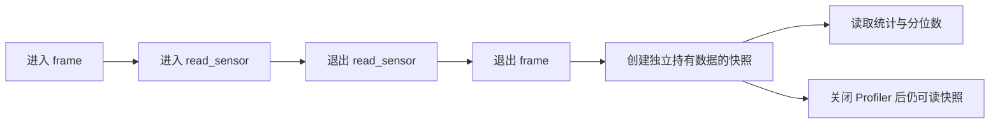

# 区间统计与有界分位数

[English](PROFILER.md) · [README](../README.zh-CN.md)

## 1. 它测量什么

你想知道“读取传感器花了多久”“一帧里哪个子操作最耗时”，就可以使用 Profiler。操作前调用 `start_root`，结束后调用 `leave`；进入子操作时调用 `reach`。每次成功进入都要在同一线程或本库协程中配对一次 leave。

Profiler 使用单调时钟，单位为纳秒，睡眠、等待和调度延迟都会计入。这不是 CPU 使用率。不同线程中，相同父路径下的相同名称会合并统计；多个线程的操作相互重叠，总耗时可能超过进程实际经过的时间。



frame 的“包含耗时”包含 read_sensor；“独占耗时”会减掉已完成的子操作耗时。未结束或已中止的区间不产生耗时样本。`last_*` 指最近完成的那次操作。重置线程会中止未结束区间、释放该线程的计时栈，不会清空已有统计。

## 2. 运行完整 C 示例

[profile_statistics.c](../examples/profile_statistics.c) 模拟读取传感器十二次，关闭 Profiler 后，从保留的快照打印结果。实际使用时，把睡眠换成你要测量的操作。正常构建项目也会构建这个程序：

```sh
cmake --build build --config Release --target hx_os_profile_statistics
# Linux / macOS：
./build/bin/hx_os_profile_statistics
# Windows，使用 Visual Studio 构建时：
./build/bin/Release/hx_os_profile_statistics.exe
```

输出形式如下，数值会随机器和调度情况变化：

```text
read_sensor: 12 samples, mean ... ms, deviation ... ms
P50: [..., ...] ms (approximate interval)
P95: [..., ...] ms (approximate interval)
P99: [..., ...] ms (approximate interval)
```

`hx_os_profiler_create()` 默认提供基础统计。需要包含耗时的分位数时，改用 `hx_os_profiler_create_with_features()`，传入 `HX_OS_PROFILER_HISTOGRAM_INCLUSIVE`。还需要独占耗时的分位数时，再加上 `HX_OS_PROFILER_HISTOGRAM_EXCLUSIVE`。这些选项创建后不变，也不会启动后台线程。

常见的报告操作如下：

| 操作 | C 入口 | C++11 入口 |
| --- | --- | --- |
| 获取所有路径的快照 | `hx_os_profiler_snapshot_create` | `profiler.snapshot()` |
| 遍历统计记录 | `snapshot_count` 和 `snapshot_at` | 对 `ProfileSnapshot` 使用范围 for |
| 查询包含耗时的 P95 | `snapshot_percentile(snapshot, id, 95, ...)` | `snapshot.percentile(id, 95)` |
| 查询独占耗时的 P95 | `snapshot_quantile(snapshot, id, 1, 95, 100, ...)` | `snapshot.percentile(id, 95, true)` |
| 释放快照 | `hx_os_profiler_snapshot_release` | 自动 RAII 释放 |
| 使用原有文本报告 | `hx_os_profiler_dump_string` | `profiler.dump()` |

表中的快照查询函数省略了公共前缀，实际都以 `hx_os_profiler_` 开头。分位数查询接收 `entry.identifier`，编号从 1 开始；`snapshot_at` 接收从 0 开始的数组下标。父编号只在原 Profiler 内有意义，0 表示根节点。

## 3. 直接读取统计数据

快照直接提供只读的 `hx_os_profiler_entry`，无需再解析 TSV 文本。

| 字段 | 含义 |
| --- | --- |
| `name`、`name_bytes`、`identifier`、`parent`、`depth` | 已复制的 UTF-8 名称及区间树中的位置 |
| `completed`、`aborted` | 完成和中止次数 |
| `inclusive_ns`、`exclusive_ns` | 包含、独占耗时的累计值 |
| `minimum_ns`、`maximum_ns`、`last_inclusive_ns` | 包含耗时的最小值、最大值、最近完成值 |
| `minimum_exclusive_ns`、`maximum_exclusive_ns`、`last_exclusive_ns` | 对应的独占耗时数据 |
| `mean_inclusive_ns`、`deviation_inclusive_ns` | 包含耗时的平均值、总体标准差 |
| `mean_exclusive_ns`、`deviation_exclusive_ns` | 对应的独占耗时统计 |
| `flags` | 1：计数发生饱和；2：时钟错误 |

平均值和标准差用 double 近似表示。没有样本时，统计值为零。方差通过 Welford 算法逐次更新，不保存每次样本；标准差的开方放在创建快照时，且在记录锁外完成。带错误标记的数据可以帮助诊断，不应当作精确测量值。

例如，你已经成功初始化 `hx::Profiler profiler` 并记录了操作后，可以使用下面的 C++11 报告代码读取平均值和 P95。需包含 `<hx/Profiler.hpp>` 与 `<cstdio>`：

```cpp
auto report = profiler.snapshot();
if (!report) {
	std::fprintf(stderr, "Snapshot failed: %s\n",
		hx_os_status_name(report.status()));
}
else {
	for (const auto &entry : report.value()) {
		std::printf("%s: mean %.3f ms\n", entry.name,
			entry.mean_inclusive_ns / 1000000.0);

		auto p95 = report.value().percentile(entry.identifier, 95);
		if (p95) {
			std::printf("P95 lies in [%.3f, %.3f] ms\n",
				(double)p95.value().lower_ns / 1000000.0,
				(double)p95.value().upper_ns / 1000000.0);
		}
		else {
			std::fprintf(stderr, "P95 unavailable: %s\n",
				hx_os_status_name(p95.status()));
		}
	}
}
```

Profiler 的宿主句柄仍需要显式关闭，先让参与线程退出或释放其计时缓存。上面的报告代码不会关闭它。`ProfileSnapshot` 自己拥有数据；复制或移动该对象不会深复制全部记录，复制只是保留同一份只读快照。正常遍历不分配内存。

## 4. 怎样理解 P50、P95、P99

分位数对应已完成耗时按大小排序后的某个位置。例如 P95 取第 `ceil(样本数 × 95 / 100)` 个样本。只有十二个样本时，P95 和 P99 都落到最大值，这符合定义，不能据此认为已经精确测出了长尾表现。

每个启用的耗时通道使用 252 个固定统计桶。0～3 ns 分别有精确桶，之后每个二次幂范围分成四桶。例如，1,024～1,279 ns 共用一个桶。最大桶能够安全覆盖 `UINT64_MAX`。除精确小桶外，桶宽最多为其下界的四分之一。

查询结果为 `{lower_ns, upper_ns, samples}`：所选排序位置的耗时位于这个区间内。它不是置信区间，也不是插值得到的精确耗时。结果还会限制在实际观察到的最小值和最大值之间。P0／P100 直接返回精确的已观察极值。需要 P99.9 等值时，可用 `snapshot_quantile` 传入分数 999/1000。

| 情况 | 返回值 |
| --- | --- |
| 没有启用所查询的直方图 | `HX_OS_NOT_SUPPORTED` |
| 该路径尚无已完成样本 | `HX_OS_NOT_FOUND` |
| 编号无效、分子大于分母，或计数发生饱和 | `HX_OS_RANGE` |
| 必需参数为空、分母为零，或 exclusive 标志无效 | `HX_OS_INVALID` |

查询失败不改变输出结构。没有启用直方图时，不会拿平均值或极值冒充百分位数。功能创建后不变，样本在 Profiler 的整个生命周期内累计；这里没有滑动时间窗口或逐个原始样本导出功能。

## 5. 内存、并发与关闭

每个启用的直方图，为每条不同的统计路径固定增加 2,016 字节，直方图区前最多另有七字节对齐填充。两个耗时通道共增加 4,032 字节。快照会复制启用的直方图数据。默认最多 1,024 条路径，嵌入式设备可以调低 `max_records`。相较此前实现，默认基础统计为每个私有记录增加了 64 字节；名称和线程计时栈继续受各自的既有限制约束。

既有 options 布局保持不变。`max_output_bytes` 同时约束每份新增独立快照，包括分配头和对齐预留；原有 TSV 继续按最终文本大小限制。默认预算是 4 MiB；同时启用两种直方图且 options 为空时使用 8 MiB。明确传入 options 时，严格使用调用方给定的预算。快照超预算返回 `HX_OS_LIMIT`，不会偷偷省略路径或直方图。应用还应限制同时保留的快照数量。

预热后不再为每个样本分配 context 内存。统计更新仍要获取记录锁并进行计算，耗时与工作负载和平台有关；需要时用自己的业务负载测量。

创建快照先在锁外分配，再在锁内一致地复制统计与桶，复制名称及计算标准差放在解锁后完成。复制量随路径数和启用桶数增加，因此建议定期采样，不要在每次被测操作后都抓取一次。并发新增路径导致容量不足时最多重试八次，再返回 `HX_OS_BUSY`。快照带有单调观察时间戳；创建失败会把输出句柄置空。

默认快照使用与 Profiler 无关的默认分配器，因此原 context 在自己的资源释放后即可关闭。`snapshot_create_with_context` 可以明确指定另一分配器；只要快照还保留，该 context 就会报告 busy。记录指针和名称借用到快照最后一次 release；并发读者需要持有各自引用，并通过正常同步方式发布指针。卸载实现库之前，必须释放所有快照以及 Profiler／TLS 状态。

原有停止和关闭契约继续适用：stop 拒绝新进入，仍允许 leave、释放线程缓存和捕获快照。close 不会强杀线程或丢弃其它线程的活动计时栈。超时／BUSY 保留同一对象供重试。不安装信号处理器，不捕获原生调用栈。关闭 `HX_OS_ENABLE_PROFILER` 后，创建、捕获和查询明确报告不支持。
