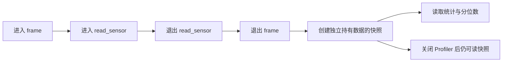

# 区间统计与有界分位数

[English](PROFILER.md) · [README](../README.zh-CN.md)

当你想知道业务代码中某个具体步骤（如“读取传感器”“解析一条网络报文”或“渲染一帧画面中的各个子阶段”）究竟耗时多久、波动多大、长尾延迟（P95 / P99）落在哪个范围时，可以使用内置的有界区间计时器（`hx_os_profiler` / `hx::Profiler`）。如果你需要免插桩的全局 CPU 热点采样、内存越界/泄漏检测或堆峰值分析，请结合使用[可选开发分析](ANALYSIS.zh-CN.md)。

你可以直接编译并运行完整示例 [profile_statistics.c](../examples/profile_statistics.c) 来查看统计快照与分位数输出：它创建一个开启了直方图功能的 Profiler，连续记录 12 次 `read_sensor` 区间耗时，抓取一份独立快照，关闭 Profiler 后再从快照中读取均值、标准差以及 P50 / P95 / P99 区间并释放快照。

按[示例运行方法](../examples/README.zh-CN.md#run)启用 `HX_OS_BUILD_EXAMPLES=ON` 并构建 `hx_os_profile_statistics`（无需命令行参数或外部文件）：

```sh
cmake --build build --config Release --target hx_os_profile_statistics

# Linux / macOS：
./build/bin/hx_os_profile_statistics

# Windows PowerShell（Visual Studio 生成器）：
.\build\bin\Release\hx_os_profile_statistics.exe
```

运行后会看到 `read_sensor: 12 samples` 以及均值、标准差和 P50 / P95 / P99 耗时区间输出（具体毫秒数随机器调度而定）。在实际工程中，只需把示例里的 `sleep` 替换为你真正要测量的代码即可；也可参考[最小工程配置](USAGE.zh-CN.md#c-project)将该示例作为工程模板。

## 1. 它测量什么

Profiler 通过显式的进入/退出标记来构建层级式的操作耗时树：
- 在顶层操作开始前调用 `hx_os_profiler_start_root`，结束后调用 `hx_os_profiler_leave`。
- 在顶层操作内部进入子步骤时调用 `hx_os_profiler_reach`，子步骤结束时同样调用 `hx_os_profiler_leave`。
- 每次成功进入区间后，都必须在**同一个线程（或同一个本库有栈协程）**上配对调用一次 `leave`。



理解以下几个核心概念有助于正确解读报告数据：
- **单调墙钟耗时（而非 CPU 占用率）**：Profiler 使用纳秒级单调时钟（Monotonic Clock）记录从进入到退出的实际经过时间，期间的线程睡眠、锁等待和操作系统调度延迟都会计入其中。
- **包含耗时（Inclusive） vs. 独占耗时（Exclusive）**：如上图所示，父区间 `frame` 的**包含耗时**涵盖了其内部 `read_sensor` 的时间；而 `frame` 的**独占耗时**则会自动扣掉所有已完成子区间（`read_sensor`）的耗时，帮助你一眼看出时间究竟花在父函数自身逻辑还是子函数调用上。
- **跨线程同路径合并**：不同线程中具有相同父路径和相同名称的区间会自动汇总到同一条统计记录中（因此当多个线程并发执行同一路径时，累计总耗时可能超过进程实际经过的墙钟时间）。
- **中止区间不污染样本**：尚未结束或因调用 `hx_os_profiler_restart_thread` 而中途放弃（Aborted）的区间只增加 `aborted` 计数，不会产生虚假的耗时样本。`last_*` 字段始终记录最近一次正常完成的样本耗时。

## 2. 运行完整 C 示例与选择入口

在 [profile_statistics.c](../examples/profile_statistics.c) 中，输出形如：

```text
read_sensor: 12 samples, mean ... ms, deviation ... ms
P50: [..., ...] ms (approximate interval)
P95: [..., ...] ms (approximate interval)
P99: [..., ...] ms (approximate interval)
```

默认入口 `hx_os_profiler_create()` 仅开启基础汇总统计（次数、累计值、极值、均值和标准差）。如果需要查询分位数（P50 / P95 / P99），请改用 `hx_os_profiler_create_with_features()`：
- 传入 `HX_OS_PROFILER_HISTOGRAM_INCLUSIVE` 启用**包含耗时**直方图。
- 加上 `HX_OS_PROFILER_HISTOGRAM_EXCLUSIVE` 同时启用**独占耗时**直方图。

直方图特性在创建 Profiler 时固定，运行期间不会动态改变，也不会启动任何后台线程。常用的快照与报告入口对照如下：

| 操作 | C99 入口 | C++11 入口 |
| --- | --- | --- |
| 捕获当前所有路径的结构化快照 | `hx_os_profiler_snapshot_create` | `profiler.snapshot()` |
| 获取记录条数并按索引访问条目 | `hx_os_profiler_snapshot_count` / `hx_os_profiler_snapshot_at` | 对 `hx::ProfileSnapshot` 使用范围 `for` 循环 |
| 查询包含耗时的整数百分位数（如 P95） | `hx_os_profiler_snapshot_percentile(snapshot, id, 95, ...)` | `snapshot.percentile(id, 95)` |
| 查询独占耗时的任意分位数（或 P95） | `hx_os_profiler_snapshot_quantile(snapshot, id, 1, 95, 100, ...)` | `snapshot.percentile(id, 95, true)` |
| 释放结构化快照 | `hx_os_profiler_snapshot_release` | 离开作用域自动 RAII 释放 |
| 导出制表符分隔（TSV）文本报告 | `hx_os_profiler_dump_string` | `profiler.dump()` |

> [!NOTE]
> **数组下标 `index` 与路径标识符 `identifier` 的区别**
> `hx_os_profiler_snapshot_at` 接收的是从 `0` 开始的连续数组下标；而分位数查询函数 `hx_os_profiler_snapshot_percentile` / `quantile` 接收的是条目结构体中的 `entry.identifier`（从 `1` 开始编号；`entry.parent == 0` 表示根路径）。

## 3. 直接读取统计数据

结构化快照直接暴露只读的 `hx_os_profiler_entry` 结构体，业务代码无需自行解析 TSV 文本即可读取各项指标：

| 结构体字段 | 含义说明 |
| --- | --- |
| `name`、`name_bytes`、`identifier`、`parent`、`depth` | 已复制的 UTF-8 区间名称，以及该节点在调用树中的编号、父节点编号与层级深度 |
| `completed`、`aborted` | 正常完成的次数与中途放弃（Aborted）的次数 |
| `inclusive_ns`、`exclusive_ns` | 包含耗时与独占耗时的累计总纳秒数 |
| `minimum_ns`、`maximum_ns`、`last_inclusive_ns` | 包含耗时的最小值、最大值与最近一次完成值（纳秒） |
| `minimum_exclusive_ns`、`maximum_exclusive_ns`、`last_exclusive_ns` | 独占耗时的最小值、最大值与最近一次完成值（纳秒） |
| `mean_inclusive_ns`、`deviation_inclusive_ns` | 包含耗时的算术平均值与总体标准差（`double` 近似值） |
| `mean_exclusive_ns`、`deviation_exclusive_ns` | 独占耗时的算术平均值与总体标准差（`double` 近似值） |
| `flags` | 状态标志位：`1` 表示累加计数器发生 `UINT64_MAX` 饱和；`2` 表示遇到过时钟读取错误 |

当某条路径尚无已完成样本（`completed == 0`）时，所有耗时统计值均为 `0`。如果 `flags` 非零，说明采样期间发生过计数饱和或底层时钟异常，应将该条记录视为诊断线索而非精确测量值。

在 C++11 中，只需包含 `<hx/Profiler.hpp>` 与 `<cstdio>`，即可在录制完成后抓取快照并遍历打印均值与 P95 区间：

```cpp
auto report = profiler.snapshot();
if (!report) {
	std::fprintf(stderr, "Snapshot failed: %s\n",
		hx_os_status_name(report.status()));
}
else {
	for (const auto &entry : report.value()) {
		std::printf("%s: mean %.3f ms\n", entry.name,
			entry.mean_inclusive_ns / 1000000.0);

		auto p95 = report.value().percentile(entry.identifier, 95);
		if (p95) {
			std::printf("P95 lies in [%.3f, %.3f] ms\n",
				(double)p95.value().lower_ns / 1000000.0,
				(double)p95.value().upper_ns / 1000000.0);
		}
		else {
			std::fprintf(stderr, "P95 unavailable: %s\n",
				hx_os_status_name(p95.status()));
		}
	}
}
```

`hx::ProfileSnapshot` 采用引用计数共享底层只读快照数据，因此复制或移动 `ProfileSnapshot` 不会深拷贝整棵记录树，范围 `for` 遍历也零动态内存分配。快照一经创建即与原 `profiler` 解耦——哪怕随后关闭并销毁了 `profiler`，手里保留的 `ProfileSnapshot` 依然可以安全读取。

## 4. 怎样理解 P50、P95、P99

- **次序统计量定义**：百分位数对应将所有已完成样本按耗时从小到大排序后的指定位置。例如 P95 对应排序后的第 `ceil(样本数 × 95 / 100)` 个样本（当只有 12 个样本时，`ceil(12 × 0.95) = 12`，因此 P95 和 P99 都会落到第 12 个样本即最大值上——这是小样本下的正常数学定义，若要观察稳定的长尾分布，请采集足够多的样本）。
- **252 桶有界对数直方图**：为了在不保存海量原始样本的前提下高效计算分位数，每个启用的耗时通道固定使用 `252` 个对数分桶（Logarithmic Bins）：`0～3 ns` 各自占一个精确桶，此后每跨越一个 2 的幂次范围细分为 4 个等宽子桶（例如 `1,024～1,279 ns` 共用一个桶），直至安全覆盖 `UINT64_MAX`。除 `0～3 ns` 精确小桶外，任意桶的宽度最多不超过其下界的 `25%`（四分之一）。
- **返回区间 `{lower_ns, upper_ns, samples}`**：分位数查询返回目标排序样本所在的桶边界 `[lower_ns, upper_ns]`（并自动用实际观察到的精确最小值 `minimum_ns` 和最大值 `maximum_ns` 裁剪收紧边界；查询 `P0` 和 `P100` 会直接返回精确的已观察最小/最大值）。注意：这是一个确定性的桶边界区间，而非统计学上的置信区间或线性插值估算值。如果需要查询 `P99.9` 等小数分位数，可调用 `hx_os_profiler_snapshot_quantile` 并传入分子 `999`、分母 `1000`。

分位数查询的返回状态码如下表所示（查询失败时保持输出结构体不变，绝不会用平均值或极值伪造分位数）：

| 条件 | 返回状态码 |
| --- | --- |
| 创建 Profiler 时未启用所查询通道的直方图 | `HX_OS_NOT_SUPPORTED` |
| 该路径尚无任何已完成的样本（`completed == 0`） | `HX_OS_NOT_FOUND` |
| `identifier` 无效、`numerator > denominator`，或该路径计数已发生饱和 | `HX_OS_RANGE` |
| 必传指针参数为 `NULL`、`denominator == 0`，或 `exclusive` 标志非法 | `HX_OS_INVALID` |

## 5. 内存、并发与关闭

- **直方图与快照内存开销**：
  - 每启用一个直方图通道，每条不同的记录路径会固定增加 `2,016` 字节（252 个 8 字节桶）及最多 7 字节对齐填充；同时启用包含与独占两个通道则每条路径增加 `4,032` 字节。默认最多支持 `1,024` 条路径（嵌入式环境可通过 `options.max_records` 调小上限）。
  - `options.max_output_bytes` 同时约束每份独立快照的总内存占用（默认预算为 `4 MiB`；若同时启用两个直方图且传入 `options = NULL`，默认预算会自动升至 `8 MiB`）。一旦快照所需空间超过预算，创建会明确返回 `HX_OS_LIMIT`，绝不会偷偷丢弃部分路径或直方图。
- **预热后零分配与锁外计时**：
  - 同一线程或协程在同一路径上完成首次预热后，后续重复进入和退出该路径**不再分配任何 `hx_context` 内存**。
  - 多线程共享统计表通过内部互斥锁同步。在调用 `leave` 退出区间时，库会**先读取单调时钟结束时间戳，再去获取统计更新锁**，因此等待统计锁的时间不会被错误计入刚刚完成的业务区间耗时中。
  - **合理选择插桩粒度**：建议对“解析一条完整消息”“执行一次数据库查询”这类毫秒/微秒级业务单元插桩，不要在每个字符循环或原子加法外层套一层 Profiler 区间（极短操作本身的耗时可能还不如读取时钟与进出锁的开销大；若需排查细粒度指令热点，请使用[可选分析流程](ANALYSIS.zh-CN.md)）。
- **快照分配器与安全关闭顺序**：
  - 默认情况下，`hx_os_profiler_snapshot_create` 使用内置默认分配器，使快照生命周期与 Profiler 自身的 `hx_context` 解耦；若需指定自定义分配器，可调用 `hx_os_profiler_snapshot_create_with_context`（只要快照尚未释放，该自定义 `context` 就会保持忙碌状态；卸载动态库前必须释放所有快照及 Profiler 状态）。
  - `hx_os_profiler_stop` 拒绝新的区间进入，但允许在途区间完成 `leave`、调用 `restart_thread` 以及抓取快照。`hx_os_profiler_close` 会等待在途调用和其他线程的 TLS 缓存退役（若当前调用线程自身仍有未调用 `leave` 的打开区间，会立即返回 `HX_OS_DEADLOCK`；若超时或仍有外部线程持有缓存则返回 `HX_OS_TIMEOUT` / `HX_OS_BUSY` 并保留句柄供重试）。当编译期关闭 `HX_OS_ENABLE_PROFILER=OFF` 时，所有入口明确返回 `HX_OS_NOT_SUPPORTED`。
