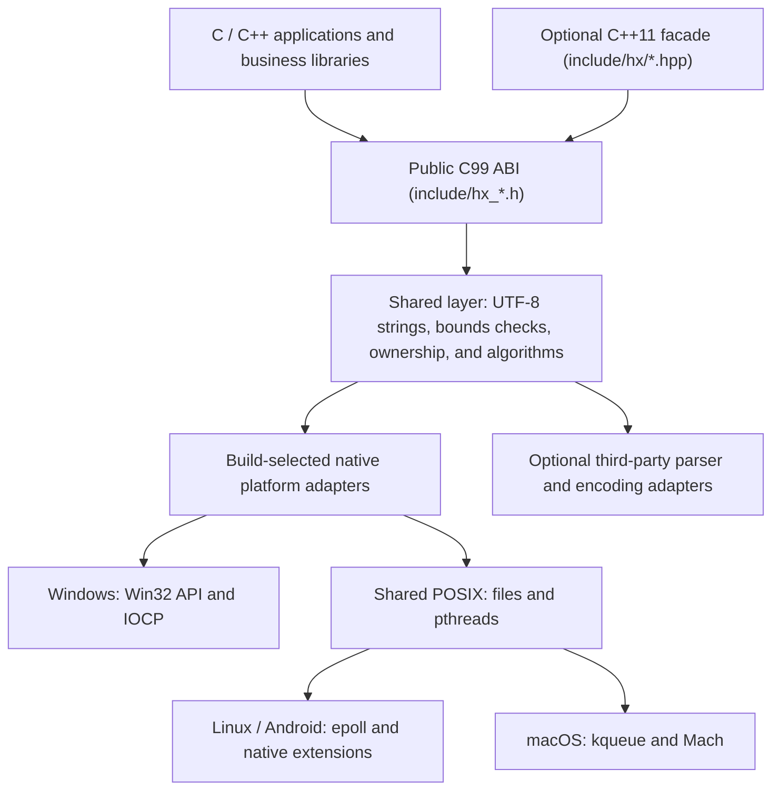
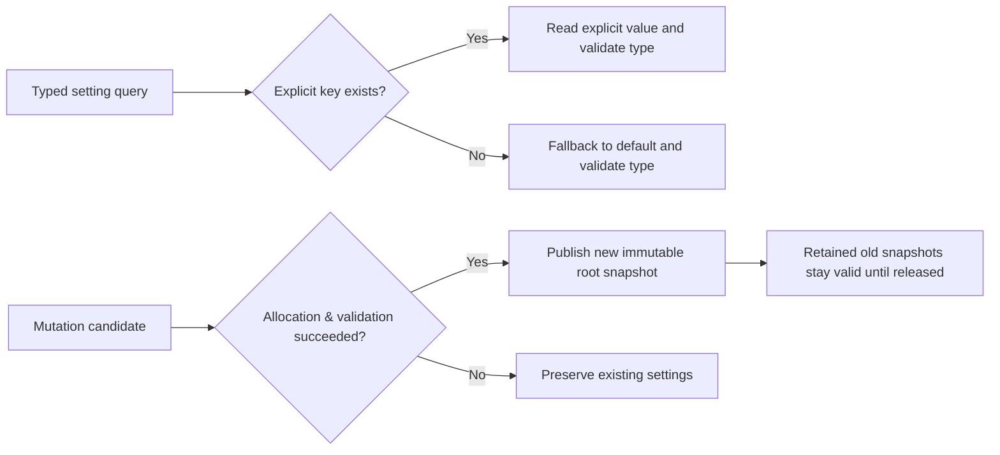
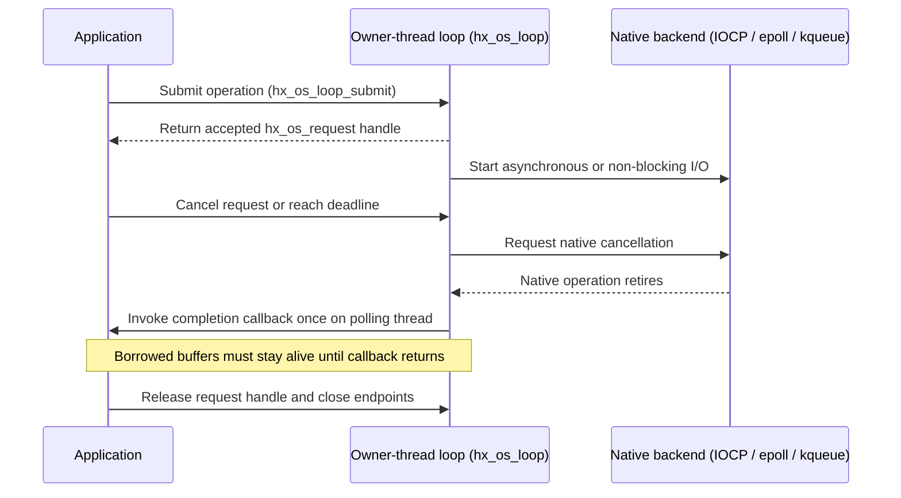

# hx_c_platform Detailed Reference

[简体中文](REFERENCE.zh-CN.md) · [Home](../README.md) · [Task tutorials](USAGE.md)

To browse complete, runnable programs by use case, start with the [runnable example directory](../examples/README.md), which lists each example's scenario, CMake target, required inputs, and expected output.

This reference covers the architecture, module APIs, resource ownership contracts, platform differences, and CMake build switches of `hx_c_platform`. If you are new to the library, start with the [homepage](../README.md) and [task tutorials](USAGE.md); consult this reference when you need exact parameter bounds, status code semantics, or cross-platform behavioral contracts. Unless noted otherwise, all build commands run from the repository root.

> [!NOTE]
> Several default-enabled extension modules use native third-party SDKs: OpenSSL for `CRYPTO` and `TLS`, libcurl for `HTTP` and `URL`, utf8proc for `UNICODE`, codec libraries for `ARCHIVE` and `COMPRESSION`, and a pinned SQLite adapter for `PERSISTENT_QUEUE`. Prepare the [dependency SDK](DEPENDENCIES.md) first and pass its prefix via `CMAKE_PREFIX_PATH` or `HX_OS_DEPENDENCY_PREFIX`. If your project does not need those modules, disable them explicitly with `-DHX_OS_ENABLE_<MODULE>=OFF` or load `cmake/minimal.cmake`. For direct calls into the underlying SDKs, see the [native dependency guide](NATIVE_DEPENDENCIES.md). For verified TLS connections, bounded full-duplex queues, and JSON business protocols, see the [TLS guide](TLS.md).

- [1. Purpose and interface boundaries](#section-1)
- [2. Platforms, languages and verification status](#section-2)
- [3. Architecture, directories and backend selection](#section-3)
- [4. Build and run a first program](#section-4)
- [5. Integrate, install and link](#section-5)
- [6. Errors, contexts and allocator ownership](#section-6)
- [7. UTF-8 strings and encoding conversion](#section-7)
- [8. Files, directories and atomic publication](#section-8)
- [9. Environment, special paths and process identity](#section-9)
- [10. Configuration parsing and serialization](#section-10)
- [11. Mutable settings, defaults and snapshots](#section-11)
- [12. C containers, variant values and ownership](#section-12)
- [13. Clocks, deadlines and precise waits](#section-13)
- [14. Threads, synchronization and thread-local storage](#section-14)
- [15. C thread pools and delayed tasks](#section-15)
- [16. C++11 tasks, results and cooperative cancellation](#section-16)
- [17. Atomics, alignment and memory order](#section-17)
- [18. Networking and the event loop](#section-18)
- [19. Pipes, local IPC and process output capture](#section-19)
- [20. Periodic timers and directory notifications](#section-20)
- [21. System information and dynamic libraries](#section-21)
- [22. Memory pools, arenas, pages and mappings](#section-22)
- [23. Random bytes, UUIDs, wide arithmetic and bit tools](#section-23)
- [24. Calendar strings, translation files and filenames](#section-24)
- [25. Signals, named procedures and interval profiling](#section-25)
- [26. Bounded lexical analysis](#section-26)
- [27. Build options and optional dependencies](#section-27)
- [28. Android and embedded Linux builds](#section-28)
- [29. ABI, ownership and shutdown rules](#section-29)
- [30. Tests, CI and performance evidence](#section-30)
- [31. Engineering rules, platform extensions and licensing](#section-31)
- [32. Detailed documents and runnable examples](#section-32)
- [33. Data, transfer and persistent-work extensions](#section-33)

<a id="section-1"></a>

## 1. Purpose and interface boundaries

`hx_c_platform` is an independent C99 foundation library with a C ABI and an optional header-only C++11 facade. Applications call a unified set of APIs for files, strings, configuration, threads, synchronization, networking, and processes, while shared logic and native OS adapters live inside the library. The current version is **0.1.0**; symbol and package names remain provisional prior to a declared stable ABI release.

Common operations work in a single call—reading a UTF-8 file into an `hx_string`, querying an environment variable, loading a translation catalog, spawning a child process and capturing its output, or submitting a task to a thread pool. You only pass an `options` struct when customizing capacity bounds, timeouts, or special behavior; ordinary use requires no global runtime initialization sequence.

| What `hx_c_platform` owns | What consumer applications own |
| --- | --- |
| File I/O, Unicode path conversion, UTF-8 strings, encoding conversion, and parsed config trees | Application schemas, semantic validation policies, and when to save config files |
| Threads, synchronization primitives, bounded thread pools, and async event loops | Task dependency graphs, application scheduling policies, and shutdown timeout decisions |
| Native error capture, custom allocator contexts (`hx_os_context`), and resource ownership | Logging pipelines, user-facing diagnostics, and application recovery policies |
| Atomic file publication (temp file + sync + replace) and high-resolution timestamps | Log file rotation, archive retention counts, log formatting, and level filtering |
| Interval profiling trees, system metrics, and explicit Windows WER LocalDumps setup | Crash recovery workflows, customer dump collection, and in-memory log ring buffers |

The library builds, installs, and runs independently of `hx_c_log`, and requires neither Qt, a C++ runtime, nor the OBS runtime (while adopting the OBS-inspired pattern of unified public headers, shared common implementations, and CMake-selected platform backends). Self-developed stackful and stackless coroutines are covered in the [coroutine guide](COROUTINES.md). Note the distinction between **TLS** as Thread-Local Storage (`hx_os_thread.h`) and the optional [encrypted network TLS module](TLS.md).

<a id="section-2"></a>

## 2. Platforms, languages and verification status

| Target platform | Design baseline | Current build and verification status |
| --- | --- | --- |
| Windows | Retains Windows 7 SP1 / 8.1 OS API baseline; x86 and x64 | Built and verified locally with MSVC x86/x64; legacy Windows host runtime testing pending |
| Linux | Native POSIX and Linux system calls | Built and verified under WSL with GCC and Clang |
| macOS | Intel 10.13+, ARM64 11.0+ (Universal builds default to 11.0) | Apple backend implemented; native Apple host build and runtime verification pending |
| Embedded Linux | ARMv7-A / AArch64; libc and float ABI determined by target SDK | Cross-built with glibc and partially verified under QEMU; physical board validation pending |
| Android | API 21+ (`arm64-v8a` and `armeabi-v7a`); child process API requires API 28+ | Both ARM ABIs cross-built with the NDK and verified on an API 34 emulator |
| iOS / BSD | Can reuse shared POSIX and cross-platform code | Not yet delivered as complete supported targets |
| FreeRTOS / bare metal | Requires a dedicated memory, task, and filesystem model | Outside current scope |

> [!IMPORTANT]
> - **Compiled core**: The C99 core is a compiled static or shared library (**not header-only**); only the optional C++11 facade under `include/hx/` is header-only.
> - **Language and CMake baselines**: The C core targets C99, the C++ facade is verified under C++11 (with opt-in C++20 coroutine headers), and CMake **3.16** is the minimum required version.
> - **Windows 7 deployment**: While the library source preserves Windows 7 SP1 API compatibility, deploying to Windows 7 also requires verifying that your chosen MSVC toolset, CRT redistributable, and third-party dependency SDKs target Windows 7. See [platform support](PLATFORMS.md) for detailed build requirements and platform limits.

<a id="section-3"></a>

## 3. Architecture, directories and backend selection



CMake selects the appropriate implementation files at configure time based on the target OS, compiler, CPU architecture, and feature switches. Public API calls dispatch directly to the selected backend without duplicating shared POSIX code across OS folders or littering consumer code with `#ifdef _WIN32`. Unsupported target platforms fail at configure time, and capabilities unavailable at runtime return `HX_OS_NOT_SUPPORTED` explicitly rather than faking success with no-op stubs.

```text
hx_c_platform/
├── include/
│   ├── hx_os.h                 Public C umbrella header
│   ├── hx_os_*.h               Native OS facilities and module contracts
│   ├── hx_string.h             Owning UTF-8 strings and borrowed views
│   ├── hx_container.h          Generic and typed POD containers
│   ├── hx_config.h             Immutable configuration documents
│   ├── hx_settings.h           Mutable settings, defaults, and snapshots
│   └── hx/*.hpp                Optional exception-free C++11 facade (Result<T>)
├── src/                        Shared cross-platform implementations
│   ├── windows/                Windows native adapters
│   ├── posix/                  Shared POSIX adapters
│   ├── linux/                  Linux / Android backend implementations
│   └── apple/                  macOS / Apple backend implementations
├── cmake/                      Feature options, package exports, and toolchains
├── examples/                   Standalone runnable example programs
├── benchmarks/                 Opt-in performance and layout benchmarks
├── tools/                      Dependency preparation and verification scripts
└── docs/                       Paired English and Chinese documentation
```

| Header group | Primary responsibility |
| --- | --- |
| `hx_os_base.h`, `hx_os_atomic.h` | Status codes, `hx_os_error`, allocator contexts (`hx_os_context`), clocks, capability flags, and atomics |
| `hx_os_file.h`, `hx_os_file_extra.h` | File I/O, atomic publication, path helpers, directory traversal, attributes, and byte-range locks |
| `hx_os_text.h`, `hx_string.h` | Character encoding conversion, Unicode validation, and UTF-8 strings |
| `hx_config.h`, `hx_settings.h`, `hx_container.h` | Immutable config documents, mutable runtime settings, and C containers |
| `hx_os_thread.h`, `hx_os_pool.h`, `hx_os_wait.h` | Threads, thread-local storage (TLS), mutexes/events/semaphores, bounded thread pools, and precise waits |
| `hx_os_net.h`, `hx_os_loop.h`, `hx_os_loop_fd.h` | TCP/UDP sockets, async event loop requests, and POSIX external descriptor readiness |
| `hx_os_pipe.h`, `hx_os_local.h`, `hx_os_process.h` | Synchronous/asynchronous pipes, local IPC, and child process control/capture |
| `hx_os_timer.h`, `hx_os_watch.h` | Periodic event-loop timers and directory change notifications |
| `hx_os_sysinfo.h`, `hx_os_system.h`, `hx_os_library.h` | Hardware/memory metrics, process identity, CPU feature detection, and dynamic library loading |
| `hx_os_memory.h`, `hx_os_vm.h` | Thread-safe memory pools, object pools, arenas, virtual memory pages, and file mappings |
| `hx_os_util.h`, `hx_os_bits.h`, `hx_os_wide.h`, `hx_os_bitstream.h` | System CSPRNG, UUID v4, CRC32, 128-bit muldiv arithmetic, and bitstream cursors |
| `hx_os_calendar.h`, `hx_os_text_lookup.h`, `hx_os_lexer.h` | UTC calendar formatting, portable filename generation, translation catalogs, and bounded lexing |
| `hx_os_signal.h`, `hx_os_procedure.h`, `hx_os_profiler.h` | Synchronous signals, named procedures, and bounded interval profiling trees |
| `hx_os_env.h`, `hx_os_paths.h`, `hx_os_posix.h` | UTF-8 environment variables, standard OS directories, and POSIX `timespec` conversion |
| `hx_os_registry.h`, `hx_os_power.h`, `hx_os_obfuscate.h` | Windows registry access, scoped sleep-inhibit/performance requests, and reversible string obfuscation |
| `hx_os_local_dumps.h` | Explicit per-EXE Windows [WER LocalDumps configuration](LOCAL_DUMPS.md) (installs no in-process crash handler) |

<a id="section-4"></a>

## 4. Build and run a first program

### 4.1 Desktop build

A fresh CMake build directory compiles only the library by default; examples (`HX_OS_BUILD_EXAMPLES`) and benchmarks (`HX_OS_BUILD_BENCHMARKS`) are opt-in. Prepare the [dependency SDK](DEPENDENCIES.md) (or disable unused SDK-backed modules), then reuse one build directory per platform, compiler, and configuration.

On Linux or macOS:

```sh
cmake -S . -B out/linux -DCMAKE_BUILD_TYPE=Release
cmake --build out/linux --parallel 4
```

On Windows with Visual Studio 2022:

```powershell
cmake -S . -B out/windows -G "Visual Studio 17 2022" -A x64
cmake --build out/windows --config Release --parallel 4
```

> [!TIP]
> - CMake 3.16 predates the Visual Studio 2022 generator; when using CMake 3.16 on Windows, run `NMake Makefiles` or `Ninja` from a configured MSVC developer prompt.
> - Building the C library alone does not probe for a C++ compiler.
> - Existing CMake caches retain their previous switches; pass `-DHX_OS_BUILD_TESTS=OFF -DHX_OS_BUILD_EXAMPLES=OFF` to disable tests or examples in an already-configured build directory.

To build and run a specific example program (such as brace-formatted output `hx_os_format`):

```sh
cmake -S . -B out/linux -DHX_OS_BUILD_EXAMPLES=ON
cmake --build out/linux --target hx_os_format --parallel 4
out/linux/bin/hx_os_format
```

With a Windows multi-configuration generator, pass `--config Release`; the compiled binary is placed under `out/windows/bin/Release/`.

When you open the generated `hx_c_platform.sln` in Visual Studio, targets are organized into solution folders by role (without changing source paths or binary names on disk):

```text
hx_c_platform
├── libraries
│   ├── hx_c_platform
│   │   ├── Header Files
│   │   │   ├── Public       (Public C headers and include/hx/ C++ headers)
│   │   │   └── Private      (Internal and active platform headers)
│   │   ├── Source Files     (Compiled sources selected for this platform/config)
│   │   └── Generated Files
│   └── hx_archive_7zip      (Optional 7-Zip dynamic adapter)
├── deps                     (Third-party dependency targets)
├── examples
│   ├── demos                (Runnable usage examples)
│   └── benchmarks           (Performance and layout probes)
└── CMake                    (ALL_BUILD, INSTALL, ZERO_CHECK, etc.)
```

After changing options in `cmake-gui`, click **Configure** and **Generate**, then reload the solution in Visual Studio—do not hand-edit `.sln`, `.vcxproj`, or `.filters` files. When `hx_c_platform` is consumed via `add_subdirectory`, the top-level project controls the global `USE_FOLDERS` property.

### 4.2 Read UTF-8 text from C with detailed diagnostics

Save the following code as `main.c` and place a UTF-8 file named `配置.json` in the working directory. `hx_os_file_read_text` opens the file, enforces a default 16 MiB size limit, strips any initial UTF-8 BOM, validates UTF-8 encoding, and closes the file. On failure, `text` remains unchanged and `hx_os_error_message` formats a human-readable diagnostic into `message`:

```c
#include <hx_os.h>
#include <stdio.h>

int main(void)
{
	hx_string text = HX_STRING_INIT;
	hx_os_error error;
	hx_os_status status =
		hx_os_file_read_text("配置.json", &text, &error);

	if (status == HX_OS_OK)
		puts(hx_string_c_str(&text));
	else {
		char message[2304];
		size_t required;

		if (hx_os_error_message(&error, message, sizeof(message),
			    &required) == HX_OS_OK)
			fprintf(stderr, "%s\n", message);
		else
			fprintf(stderr, "%s\n", hx_os_status_name(status));
	}

	hx_string_destroy(&text);

	return status == HX_OS_OK ? 0 : 1;
}
```

### 4.3 The corresponding C++11 calls

The C++11 facade returns `hx::Result<T>` without using exceptions. Check `if (!result)` or `result.ok()` before accessing `result.value()`, or inspect `result.error()` on failure. Text results own UTF-8 storage via `hx::String` on top of the same C implementation. See [C++ Result contracts](CPP_RESULTS.md) for partial results, callbacks, ownership, and migration details.

```cpp
#include <hx/Files.hpp>
#include <hx/Paths.hpp>
#include <cstdio>

int main()
{
	auto text = hx::Files::readText("配置.json");
	if (!text) {
		std::fprintf(stderr, "%s\n",
			hx_os_status_name(text.status()));

		return 1;
	}

	auto path = hx::Paths::configFile("hx_example", "settings.json");
	if (!path) {
		std::fprintf(stderr, "%s\n",
			hx_os_status_name(path.status()));

		return 1;
	}

	std::printf("%s\n%s\n", text.value().c_str(),
		path.value().c_str());

	return 0;
}
```

### 4.4 In-place string edits, chained updates, and directory iteration

To keep everyday code concise:
- Once a string is allocated, ASCII trimming (`trimAscii`) and case conversion (`lowerAscii`) mutate the buffer in place without allocating memory or failing.
- `Settings::update()` and `CallData::edit()` apply each setter immediately, skip remaining setters after the first error, and report the final status once at `.finish()`.
- `hx::Directory::forEach` opens the directory, reuses a single growing filename buffer across entries, and closes the handle automatically.

This complete program matches [direct_calls.cpp](../examples/direct_calls.cpp):

```cpp
#include <hx/Files.hpp>
#include <hx/Settings.hpp>
#include <hx/Signal.hpp>
#include <cstdio>

static int report_failure(hx_os_status status)
{
	std::fprintf(stderr, "%s\n", hx_os_status_name(status));

	return 1;
}

int main()
{
	auto text = hx::String::copy("  Hello 中文😀  ");
	if (!text)
		return report_failure(text.status());

	text.value().trimAscii().lowerAscii();
	std::puts(text.value().c_str());
	if (hx_os_capabilities() & HX_OS_CAP_SETTINGS) {
		hx_settings *owner = NULL;

		hx::Settings settings(owner);

		auto created = settings.create();
		if (!created)
			return report_failure(created.status());

		auto changed = settings.update()
				       .setInt("port", 8080)
				       .setString("label", "服务😀")
				       .finish();

		auto label = settings.stringView("label");

		auto closed = settings.closeUntil(HX_OS_DEADLINE_NOW);
		if (!closed)
			return report_failure(closed.status());

		if (!changed)
			return report_failure(changed.status());

		if (!label)
			return report_failure(label.status());

		// The lease owns immutable bytes after the settings close.
		std::puts(label.value().c_str());
	}

	if (hx_os_capabilities() & (HX_OS_CAP_SIGNALS | HX_OS_CAP_PROCEDURES)) {
		hx::CallData data;

		auto prepared = data.edit()
					.setInt("number", 42)
					.setString("label", text.value().view())
					.finish();
		if (!prepared)
			return report_failure(prepared.status());

		auto label = data.view().stringView("label");
		if (!label)
			return report_failure(label.status());

		std::printf("%.*s\n", static_cast<int>(label.value().size()),
			label.value().data());
	}

	auto listed =
		hx::Directory::forEach(".", [](hx::StringView name) noexcept {
			std::printf("Entry: %.*s\n",
				static_cast<int>(name.size()), name.data());
			return false;
		});

	return listed ? 0 : report_failure(listed.status());
}
```

> [!NOTE]
> Notice the lifetime difference between the two string views above:
> - `settings.stringView("label")` returns a reference-counted `SettingStringView` that retains the underlying immutable string node, so it stays valid even after `settings` is modified or closed.
> - `data.view().stringView("label")` returns a borrowed `StringView`; the `CallData` pack must stay alive and unmodified while you read that view.

<a id="section-5"></a>

## 5. Integrate, install and link

### 5.1 Integrate via `add_subdirectory`

When the library source tree is located at `deps/hx_c_platform` inside your project:

```cmake
cmake_minimum_required(VERSION 3.16)
project(my_app LANGUAGES C)

add_subdirectory(deps/hx_c_platform)

add_executable(my_app main.c)
set_target_properties(my_app PROPERTIES
	C_STANDARD 99
	C_STANDARD_REQUIRED YES
	C_EXTENSIONS NO)
target_link_libraries(my_app PRIVATE hx_c_platform::hx_c_platform)

if(MSVC)
	target_compile_options(my_app PRIVATE /utf-8)
endif()
```

### 5.2 Consume an installed package via `find_package`

Install the built library to a prefix directory:

```sh
cmake --install build --config Release --prefix /absolute/install/prefix
```

Then import the package in your consumer `CMakeLists.txt`:

```cmake
cmake_minimum_required(VERSION 3.16)
project(my_app LANGUAGES C)

find_package(hx_c_platform 0.1 CONFIG REQUIRED)

add_executable(my_app main.c)
set_target_properties(my_app PROPERTIES
	C_STANDARD 99
	C_STANDARD_REQUIRED YES
	C_EXTENSIONS NO)
target_link_libraries(my_app PRIVATE hx_c_platform::hx_c_platform)

if(MSVC)
	target_compile_options(my_app PRIVATE /utf-8)
endif()
```

Pass `-DCMAKE_PREFIX_PATH=/absolute/install/prefix` when configuring the consumer project. For a C++ application, enable `CXX` in `project()` and link `hx_c_platform::cpp` (which adds the C++11 requirement only for targets linking it). Exported targets carry all required OS system libraries automatically.

### 5.3 Static and shared library deployment

`BUILD_SHARED_LIBS=OFF` is the default; set `-DBUILD_SHARED_LIBS=ON` to build a shared library (`.dll` / `.so` / `.dylib`). Installation exports public headers, libraries, CMake config files, and `pkg-config` metadata. Default relative install layouts are relocatable.

> [!WARNING]
> - On Windows, place the DLL alongside your executable or on the runtime `PATH`, and ensure the architecture, MSVC runtime (CRT), and Debug/Release configuration match.
> - If an application and its plugins each link a static copy of `hx_c_platform`, they do not share a single default allocator instance. Always free objects through the library instance or `hx_os_context` that allocated them, and finish all callbacks and TLS cleanups before unloading a plugin module.

<a id="section-6"></a>

## 6. Errors, contexts and allocator ownership

### 6.1 Status codes are not simple Booleans

`hx_os_status` distinguishes normal boundary conditions (such as end-of-file or timeout) from actual failures. Branch on the specific status code rather than treating every non-zero return as the same error:

| Status constant | Meaning and caller action |
| --- | --- |
| `HX_OS_OK` | Operation succeeded (note: low-level `read_some` / `write_some` calls can still report partial byte progress on `HX_OS_OK`) |
| `HX_OS_EOF` | End of input reached; a normal boundary rather than a failure |
| `HX_OS_TIMEOUT` | Waiting deadline expired; the target resource is still active and must be retained for retry or clean shutdown |
| `HX_OS_WOULD_BLOCK` | Non-blocking operation cannot make immediate progress; wait for readiness or retry later |
| `HX_OS_OUTPUT_FULL` | Caller-supplied output buffer is too small; inspect the required capacity or progress fields |
| `HX_OS_NOT_FOUND` | Requested key, environment variable, or path does not exist; apply fallback defaults only for this status |
| `HX_OS_TYPE_MISMATCH` | Key or node exists with an incompatible type; treat as an error rather than silently substituting a default |
| `HX_OS_LIMIT` | A configured memory, length, depth, or count limit was reached |
| `HX_OS_NOT_SUPPORTED` | Feature module was disabled at build time or is not supported by the host OS |
| `HX_OS_BUSY` / `HX_OS_DEADLOCK` | Outstanding references/operations prevent destruction, or a worker attempted an illegal self-wait |

`hx_os_error` stores the unified `hx_os_status`, the native error domain and code (Win32, POSIX `errno`, Mach, etc.), and an optional secondary cause without holding borrowed string pointers. Call `hx_os_error_message` to format a message into a caller-supplied buffer. The library never logs its own errors through `hx_c_log` or a global last-error string.

### 6.2 Custom allocator contexts (`hx_os_context`)

Passing `context = NULL` uses the immutable default allocator. To track allocations or plug in a custom allocator, create an `hx_os_context`:

```c
#include <hx_os.h>
#include <stdlib.h>

static void *HX_OS_CALL allocate_bytes(size_t bytes, void *user)
{
	(void)user;

	return malloc(bytes);
}

static void HX_OS_CALL release_bytes(void *memory, void *user)
{
	(void)user;

	free(memory);
}

int main(void)
{
	hx_os_context_options options;
	hx_os_context *context = NULL;
	hx_string text;
	hx_os_status status;

	hx_os_context_options_init(&options);
	options.allocator.allocate = allocate_bytes;
	options.allocator.deallocate = release_bytes;
	options.allocator.user = NULL;

	status = hx_os_context_create(&options, &context, NULL);
	if (status != HX_OS_OK)
		return 1;

	hx_string_init(&text, context);

	status = hx_string_assign_cstr(&text, "owned by this context", NULL);

	hx_string_destroy(&text);
	if (hx_os_context_destroy(&context, NULL) != HX_OS_OK)
		return 2;

	return status == HX_OS_OK ? 0 : 1;
}
```

> [!IMPORTANT]
> - `hx_os_context_create` copies the allocator function table and borrows `options.allocator.user` until the context is destroyed. Custom callbacks must support cross-thread deallocation and platform fundamental alignment (extended alignment requests are handled by the library wrapper).
> - Even an empty string initialized with `hx_string_init(&text, context)` holds a lease on `context`. Destroy all strings, handles, settings snapshots, and TLS values bound to a context before calling `hx_os_context_destroy`; if any allocations or leases remain active, `hx_os_context_destroy` returns `HX_OS_BUSY`.

<a id="section-7"></a>

## 7. UTF-8 strings and encoding conversion

### 7.1 Owning strings (`hx_string`) and borrowed views (`hx_string_view`)

`hx_string` owns NUL-terminated UTF-8 storage, whereas `hx_string_view` borrows a byte slice without ownership. Initialize with `HX_STRING_INIT` for the default allocator, or call `hx_string_init` once to bind a custom `hx_os_context`. Use `hx_string_copy` to duplicate, `hx_string_move` to transfer ownership, and `hx_string_destroy` to release memory (never copy an `hx_string` by raw C struct assignment `=`).

```c
#include <hx_os.h>
#include <stdio.h>

int main(void)
{
	hx_string text = HX_STRING_INIT;
	hx_string_parts *parts = NULL;
	hx_os_status status;
	hx_os_text_result converted;
	unsigned char utf16[128];
	size_t i;

	status = hx_string_assign_cstr(&text, " alpha,beta,中文😀 ", NULL);
	if (status == HX_OS_OK) {
		hx_string_trim_ascii_in_place(&text);

		status = hx_string_split(&text,
			hx_string_view_from_cstr(","), &parts, NULL);
	}

	if (status == HX_OS_OK) {
		for (i = 0; i < hx_string_parts_count(parts); ++i) {
			hx_string_view part;

			status = hx_string_parts_at(parts, i, &part);
			if (status != HX_OS_OK)
				break;

			(void)fwrite(part.data, 1, part.size, stdout);
			putchar('\n');
		}
	}

	if (status == HX_OS_OK)
		status = hx_string_encode(&text, HX_OS_UTF16LE, utf16,
			sizeof(utf16), &converted, NULL);

	if (status == HX_OS_OK)
		printf("UTF-16 bytes: %zu\n", converted.output_used);

	hx_string_parts_destroy(&parts);
	hx_string_destroy(&text);

	return status == HX_OS_OK ? 0 : 1;
}
```

| Operation category | Core functions |
| --- | --- |
| Assign, append, reserve | `hx_string_assign`, `hx_string_append`, `hx_string_reserve` |
| Insert, erase, replace | `hx_string_insert`, `hx_string_erase`, `hx_string_replace` |
| Search, compare, prefix/suffix | `hx_string_find`, `hx_string_compare`, `hx_string_starts_with`, `hx_string_ends_with` |
| Trim, ASCII case, replace all | `hx_string_trim_ascii`, `hx_string_lower_ascii`, `hx_string_upper_ascii`, `hx_string_replace_all` |
| Split and join | `hx_string_split`, `hx_string_parts_at`, `hx_string_join` |
| `printf`-style formatting | `hx_string_format`, `hx_string_append_format` |
| Decode and encode | `hx_string_assign_encoded`, `hx_string_encode` |

On a valid initialized `hx_string`, `hx_string_trim_ascii_in_place`, `hx_string_lower_ascii_in_place`, and `hx_string_upper_ascii_in_place` (or `trimAscii().lowerAscii()` on `hx::String`) mutate the buffer in place, return `void`, allocate no memory, and preserve non-ASCII UTF-8 bytes.

> [!NOTE]
> - All string lengths and offsets are measured in **bytes**. Embedded NUL bytes are allowed inside `hx_string`, though standard C string functions will stop at the first NUL.
> - Ordinary `hx_string_view` slices expire as soon as the source string is modified or destroyed. However, `hx_string_split` stores an internal copy of the input inside `hx_string_parts`, so views returned by `hx_string_parts_at` remain valid until `hx_string_parts_destroy` (defaulting to at most 4096 pieces and preserving empty pieces).
> - `hx_string_format` follows the caller's C `locale`; use `hx_os_text_number` when you need locale-independent numeric formatting.

### 7.2 Windows UTF-8 paths and legacy encodings (`ICONV`)

All public path arguments use UTF-8; Windows adapters convert them to UTF-16 internally before calling Win32 wide APIs, without guessing ANSI codepages or mutating the process `locale`. Compile UTF-8 source literals with `/utf-8` on MSVC.

Built-in encoding conversion covers `UTF-8`, `UTF-16LE`, `UTF-16BE`, `UTF-32LE`, `UTF-32BE`, `ASCII`, and `ISO-8859-1`. To enable legacy multi-byte encodings including `GB2312`, `GBK`, `GB18030` (2005 / 2022), `Big5`, `Shift-JIS`, `EUC-JP`, `EUC-KR`, and Windows codepages `1252`, `932`, `936`, `949`, and `950`, configure with `-DHX_OS_ENABLE_ICONV=ON`:

```sh
cmake -S . -B build-text -DHX_OS_ENABLE_ICONV=ON \
  -DHX_OS_ENABLE_CRYPTO=OFF -DHX_OS_ENABLE_ARCHIVE=OFF \
  -DHX_OS_ENABLE_COMPRESSION=OFF -DHX_OS_ENABLE_HTTP=OFF \
  -DHX_OS_ENABLE_URL=OFF -DHX_OS_ENABLE_UNICODE=OFF \
  -DHX_OS_ENABLE_PERSISTENT_QUEUE=OFF
cmake --build build-text --config Release --parallel 4
```

Enabling `HX_OS_ENABLE_ICONV=ON` fetches the pinned GNU `libiconv` release archive with SHA256 verification and local caching (because the upstream GNU `libiconv` Git repository omits generated lookup tables, this dependency uses the release archive even in `SUBMODULE` mode). Pass `-DHX_OS_ICONV_USE_SYSTEM=ON` to use the system `iconv` instead, or set `HX_OS_ICONV_SOURCE_DIR`. Call `hx_os_encoding_supported()` at runtime before relying on an optional encoding. Note that `hx_string_encode` writes raw encoded bytes without appending an implicit terminator.

<a id="section-8"></a>

## 8. Files, directories and atomic publication

### 8.1 Low-level file I/O with progress reporting

Low-level file calls separate end-of-file (`HX_OS_EOF`), errors, and byte counts:
- `hx_os_file_read_some`: Reports bytes read and returns `HX_OS_EOF` at end of input.
- `hx_os_file_write_some`: May return `HX_OS_OK` with a partial byte count (short write); the caller retries the remaining slice.
- `hx_os_file_write_all`: Loops until all bytes are written, and still reports the number of bytes completed via `completed` if an error occurs mid-write.

```c
#include <hx_os.h>
#include <stdio.h>

int main(void)
{
	const char payload[] = "hello, 中文\n";
	hx_os_file *file = NULL;
	hx_os_error error;
	hx_os_status status, closed;
	size_t completed = 0;

	status = hx_os_file_open(NULL, "readme-output.txt",
		HX_OS_FILE_WRITE | HX_OS_FILE_CREATE | HX_OS_FILE_TRUNCATE,
		&file, &error);
	if (status != HX_OS_OK)
		return 1;

	status = hx_os_file_write_all(file, payload, sizeof(payload) - 1,
		&completed, &error);
	if (status == HX_OS_OK)
		status = hx_os_file_sync(file, &error);

	closed = hx_os_file_close(&file, NULL);
	if (status == HX_OS_OK)
		status = closed;

	if (status != HX_OS_OK)
		fprintf(stderr, "%s after %zu bytes\n",
			hx_os_status_name(status), completed);

	return status == HX_OS_OK ? 0 : 1;
}
```

> [!WARNING]
> - `hx_os_file` has no user-space stream buffer. `hx_os_file_sync` requests OS persistence via `fsync` or `FlushFileBuffers`.
> - **Closing a file always consumes the handle**: Unlike retryable thread or event-loop shutdown, `hx_os_file_close` **consumes and zeroes the file handle even if `close` returns an error**. Never call `close` a second time on a consumed file handle.
> - In C++, `hx::File::read()` returns a successful `ReadResult` with `eof = true` at end of input, whereas `readSome()` and `readAt()` return `HX_OS_EOF`. On I/O failure, `hasValue()` still provides the partial byte count completed before the error.

### 8.2 Whole-file save and atomic publication

`hx_os_file_save` writes a complete byte span, and `hx_os_file_write_text` atomically publishes a UTF-8 string. `hx_os_file_save_atomic_ex` writes and syncs a temporary file in the target directory before replacing the destination atomically, reporting file publication (`published`) and parent-directory sync (`directory_synced`) separately:

```c
#include <hx_os.h>
#include <stdio.h>

int main(void)
{
	const char json[] = "{\"port\":8080}\n";
	hx_os_file_save_result result;

	hx_os_status status = hx_os_file_save_atomic_ex(
		"readme-settings.json", json, sizeof(json) - 1, &result, NULL);
	if (status != HX_OS_OK)
		return 1;

	printf("published=%d directory_synced=%d\n",
		result.published, result.directory_synced);
	if (result.durability_error.status != HX_OS_OK)
		fprintf(stderr, "Directory sync: %s\n",
			hx_os_status_name(result.durability_error.status));

	return 0;
}
```

Replacement with a backup file is not an automatic rollback transaction, and cross-filesystem moves are never silently emulated by copying.

### 8.3 Directory traversal, recursive search, and extended file helpers

For recursive filename search, use `hx_os_directory_find_first_file` (`hx::Directory::findFirstFile`) to obtain the first matching path as an owned string, or `hx_os_directory_find_files` (`hx::Directory::findFiles`) to stream matches synchronously to a callback. Both reuse path buffers and native directory-entry type hints with bounded depth, match count, and memory, require no `CONTAINERS` module, and can run on a thread pool. See the [file search guide](FILE_SEARCH.md) for details.

| File or path task | Header and runnable example |
| --- | --- |
| Copy, existence check, whole-file read, lexical path join | `hx_os_file.h`; see [text_file.c](../examples/text_file.c) |
| Single-level directory visit, bounded glob (`path_glob`), non-symlink-following recursive delete | `hx_os_directory_visit`, `hx::Directory::forEach` |
| Position-independent read/write (`pread` / `pwrite`) | `hx_os_file_read_at`, `hx_os_file_write_at`; see [positioned_read.c](../examples/positioned_read.c) |
| Extended file type and nanosecond timestamps | `hx_os_path_stat_extended`; see [file_info.c](../examples/file_info.c) |
| Byte-range locks, timestamp updates, and permission summaries | `hx_os_file_extra.h`; see [file_attributes.c](../examples/file_attributes.c) |

> [!NOTE]
> - Positioned I/O (`read_at` / `write_at`) does not modify the shared file offset, but concurrent overlapping writes, `truncate`, and `close` still require caller coordination; positioned writes on append-mode files are rejected.
> - Path manipulation helpers perform purely lexical string operations—they are not a security sandbox or symlink containment check.

<a id="section-9"></a>

## 9. Environment, special paths and process identity

String-returning path and environment helpers eliminate manual buffer-sizing loops. Note that an environment variable set to an empty string `""` is distinct from a missing variable (`HX_OS_NOT_FOUND`):

```c
#include <hx_os.h>
#include <stdio.h>

int main(void)
{
	hx_string path = HX_STRING_INIT;
	hx_string value = HX_STRING_INIT;
	hx_os_status status =
		hx_os_path_config_file("my_app", "settings.json", &path, NULL);

	if (status == HX_OS_OK)
		puts(hx_string_c_str(&path));

	if (status == HX_OS_OK) {
		status = hx_os_env_get_string("HX_APP_MODE", &value, NULL);
		if (status == HX_OS_NOT_FOUND)
			status = hx_string_assign_cstr(&value, "production",
				NULL);
	}

	if (status == HX_OS_OK)
		puts(hx_string_c_str(&value));

	hx_string_destroy(&value);
	hx_string_destroy(&path);

	return status == HX_OS_OK ? 0 : 1;
}
```

| Query | Entry point |
| --- | --- |
| User home, per-user config directory, per-user data directory | `hx_os_path_home_string`, `hx_os_path_config_home_string`, `hx_os_path_data_home_string` |
| Machine-wide shared data directory | `hx_os_path_program_data_string` |
| Temporary directory | `hx_os_path_temp_string` |
| Current executable path and current module directory | `hx_os_path_executable_string`, `hx_os_path_module_string` |
| UTF-8 environment get, set, remove, and enumerate | `hx_os_env_get_string`, `hx_os_env_set`, `hx_os_env_remove`, `hx_os_env_visit` |
| UTF-8 command-line arguments, PID, hostname, and CPU features | `hx_os_system.h` |

Special-path queries return the conventional path string without creating the directory on disk or guaranteeing write permissions. Modifying environment variables affects the current process and future child processes (coordinate with the host if other libraries access the environment concurrently). CPU capability queries check both hardware feature bits and OS-enabled register state (such as AVX context support). See [special_paths.c](../examples/special_paths.c) and [environment.c](../examples/environment.c).

<a id="section-10"></a>

## 10. Configuration parsing and serialization

### 10.1 Formats and backends

The default parser backend is always `HX_OS_CONFIG_BUILTIN`; enabling third-party parser libraries never alters parsing behavior behind the scenes. To use an optional backend, set `options.backend` explicitly and check `hx_os_config_backend_available(format, backend)`:

| Format | Built-in profile (`HX_OS_CONFIG_BUILTIN`) | Optional third-party C backend |
| --- | --- | --- |
| JSON | Strict JSON values, objects, arrays, escapes, and exact numeric text preservation | `cJSON` 1.7.19 |
| YAML | Single document; block mappings, sequences, and scalar values | `libyaml` 0.2.5 |
| XML | UTF-8 XML 1.0 elements, attributes, mixed text, and CDATA | `Mini-XML` 4.0.6 |
| INI | Standard `[section]` headers and string key/value pairs | `inih` r62 |
| TOML | Tables, dotted keys, scalars, arrays, and inline tables | `tomlc17` R260821 |
| ENV | Explicit `.env` (dotenv) dialect; never executes shell expansions | Built-in only |
| `.properties` | UTF-8 Java-style key/value syntax and `\uXXXX` Unicode escapes | Built-in only |

> [!NOTE]
> Built-in parsers implement well-defined configuration profiles:
> - Built-in YAML is a subset of YAML 1.2, and both the built-in parser and the `libyaml` adapter reject anchors, aliases, and custom tags.
> - XML parsing never loads external entities (XXE) or external DTDs.
> - TOML multiline strings, arrays of tables (`[[array_of_tables]]`), and native date/time values require the `tomlc17` backend.
> - Legacy `ISO-8859-1` `.properties` files should be converted to UTF-8 before parsing. See [configuration format contracts](CONFIGURATION.md) for exact limits and backend comparisons.

### 10.2 Parse, query, and release

This standalone program parses TOML in memory and queries `/server/port`:

```c
#include <hx_os.h>

#include <inttypes.h>
#include <stdio.h>
#include <string.h>

int main(void)
{
	static const char input[] =
		"title = '中文 configuration'\n[server]\nport = 8080\n";
	hx_os_config_document *document = NULL;
	hx_os_config_error error;
	const hx_os_config_node *port;
	hx_os_status status;
	int64_t number;

	if (!hx_os_config_backend_available(
		    HX_OS_CONFIG_TOML, HX_OS_CONFIG_BUILTIN)) {
		puts("Configuration module is disabled.");

		return 0;
	}

	status = hx_os_config_parse(NULL, HX_OS_CONFIG_TOML, input,
		strlen(input), NULL, &document, &error);
	if (status != HX_OS_OK) {
		fprintf(stderr, "%s at %zu:%zu: %s\n", error.source, error.line,
			error.column, error.message);

		return 1;
	}

	status = hx_os_config_pointer(
		hx_os_config_root(document), "/server/port", &port);
	if (status == HX_OS_OK)
		status = hx_os_config_get_i64(port, &number);

	if (status == HX_OS_OK)
		printf("Server port: %" PRId64 "\n", number);
	else
		fprintf(stderr, "Server port: %s\n", hx_os_status_name(status));

	hx_os_config_release(document);

	return status == HX_OS_OK ? 0 : 1;
}
```

The input buffer is borrowed only during `hx_os_config_parse`; the resulting `hx_os_config_document` owns copies of all node data. Documents are immutable and reference-counted. Nodes (`hx_os_config_node *`) and string views borrow from the document—holding a node pointer does not keep the document alive. Missing keys return `HX_OS_NOT_FOUND` and wrong types return `HX_OS_TYPE_MISMATCH`.

Default bounds are 1 MiB input size, 16 MiB parser memory, 65,536 nodes, nesting depth 64, and 16,777,216 work units. On error, `hx_os_config_error` reports the status and source line/column without echoing secret-bearing raw configuration values.

### 10.3 Serialize and save configuration

`hx_os_config_serialize` serializes documents to `JSON`, `INI`, and `.properties`, and `hx_os_config_save` combines serialization with atomic file publication. Structures or value types that cannot be represented in the target format fail explicitly instead of being silently flattened or coerced. See [config_save.c](../examples/config_save.c).

<a id="section-11"></a>

## 11. Mutable settings, defaults and snapshots

While `hx_os_config_document` is immutable, `hx_settings` manages mutable runtime settings with an explicit user value layer and a fallback default layer. Defaults are used only when a key is absent (`HX_OS_NOT_FOUND`); type mismatches (`HX_OS_TYPE_MISMATCH`) and malformed files still report errors.



```c
#include <hx_os.h>
#include <stdio.h>

int main(void)
{
	hx_settings *settings = NULL;
	hx_settings_string_ref label = HX_SETTINGS_STRING_REF_INIT;
	hx_string json = HX_STRING_INIT;
	int64_t port;
	hx_os_error error;

	hx_os_status status = hx_settings_create(NULL, &settings, &error);
	if (status == HX_OS_OK)
		status = hx_settings_set_default_i64(
			settings, "port", 80, &error);

	if (status == HX_OS_OK) {
		hx_settings_update update = hx_settings_update_begin(settings);
		hx_settings_update_set_i64(&update, "port", 8080);
		hx_settings_update_set_string(&update, "label", "服务😀");

		status = hx_settings_update_finish(&update, NULL, &error);
	}

	if (status == HX_OS_OK)
		status = hx_settings_get_i64(settings, "port", &port, &error);

	if (status == HX_OS_OK)
		status = hx_settings_get_string_ref(
			settings, "label", &label, &error);

	if (status == HX_OS_OK)
		printf("%s: %lld\n", label.text.data, (long long)port);

	if (status == HX_OS_OK && (hx_os_capabilities() & HX_OS_CAP_CONFIG) &&
		(hx_os_capabilities() & HX_OS_CAP_CONFIG_SERIALIZE)) {
		status = hx_settings_to_json(settings, &json, &error);
		if (status == HX_OS_OK)
			puts(hx_string_c_str(&json));
	}

	if (settings) {
		hx_os_status closed = hx_settings_destroy(&settings, NULL);
		if (status == HX_OS_OK)
			status = closed;
	}

	hx_settings_string_ref_destroy(&label);
	hx_string_destroy(&json);
	if (status != HX_OS_OK)
		fprintf(stderr, "%s\n", hx_os_status_name(status));

	return status == HX_OS_OK ? 0 : 1;
}
```

Key ownership and lifecycle rules:
- **Retained snapshots**: Call `hx_settings_snapshot` to obtain a reference-counted immutable tree and `hx_settings_value_release` when done. A snapshot can outlive the `hx_settings` owner (and continues to hold a lease on its `hx_os_context`).
- **Zero-copy string references (`hx_settings_string_ref` / `SettingStringView`)**: `hx_settings_get_string_ref` retains an immutable string node without copying its bytes. Initialize with `HX_SETTINGS_STRING_REF_INIT`, duplicate via `hx_settings_string_ref_copy`, and release with `hx_settings_string_ref_destroy` (do not copy via raw struct assignment).
- **Chained update cursor (`hx_settings_update`)**: Every setter commits and notifies observers immediately. If an earlier setter succeeds and a later one fails, prior changes remain committed and subsequent setters are skipped; `hx_settings_update_finish` (and C++ `finish()`) returns the first error status and reports the count of successful setters.
- **JSON persistence**: Saving to JSON writes only explicit user values; defaults continue to be supplied by application code. See [mutable settings contracts](PLATFORM_UTILITIES.md#mutable-settings-and-retained-snapshots-batch-23b).

<a id="section-12"></a>

## 12. C containers, variant values and ownership

The `CONTAINERS` module provides bounded C99 data structures: `vector`, `deque`, `queue`, `stack`, `list`, `max_heap`, red-black tree `ordered_map` / `ordered_set`, and insertion-ordered `hash_map` / `hash_set`.

### 12.1 Typed POD container macros

For scalars and plain byte-copyable structs, `HX_OS_DECLARE_VECTOR(name, type)` and `HX_OS_DECLARE_QUEUE(name, type)` generate type-safe wrapper functions:

```c
#include <hx_os.h>
#include <stdio.h>

HX_OS_DECLARE_VECTOR(int_values, int)

int main(void)
{
	int_values *values = NULL;

	hx_os_status status = int_values_create(NULL, 128, &values, NULL);
	if (status == HX_OS_OK)
		status = int_values_push(values, 42, NULL);

	if (status == HX_OS_OK) {
		const int *first = int_values_at(values, 0);
		if (first)
			printf("%d, size=%zu\n", *first,
				int_values_size(values));
	}

	if (values) {
		hx_os_status closed = int_values_destroy(&values, NULL);
		if (status == HX_OS_OK)
			status = closed;
	}

	return status == HX_OS_OK ? 0 : 1;
}
```

### 12.2 Generic containers with copy/drop callbacks

For elements that own heap resources (such as `hx_string` or custom structs), initialize `hx_os_container_options` with the element size, count/byte/alignment limits, and `copy` / `drop` callbacks (a built-in preset is provided for `hx_string`). Standard insertions copy elements, whereas `_take` functions transfer ownership only on success.

Ordered maps run in $O(\log n)$ time; hash maps use a private, unmodified copy of `uthash 2.4.0` with exact byte keys and insertion-order iteration. Containers do not perform implicit locking, and iterators/views are invalidated when the container is mutated. See [container contracts](CONTAINERS.md) and [containers.c](../examples/containers.c).

### 12.3 Variant values and custom structures

`hx_variant` holds one active value at a time—a scalar number, an owned UTF-8 string, a borrowed pointer, or a custom structure. Scalars are stored inline; custom structures use aligned storage. Getters verify the exact active type, setting a new value releases the old one, and a failed copy preserves the existing value.

In C++11, `hx::Variant` and `hx::TypedVariant<Ts...>` provide exception-free `set`, `get<T>`, `emplace`, `clone`, and `visit` methods returning `hx::Result`. `hx_variant_container_options_init` configures C vectors, queues, or maps to hold `hx_variant` elements with deep copy and cleanup. See [VARIANT.md](VARIANT.md) and [variant.c](../examples/variant.c) / [variant.cpp](../examples/variant.cpp).

<a id="section-13"></a>

## 13. Clocks, deadlines and precise waits

| Clock or wait API | Units and engineering contract |
| --- | --- |
| `hx_os_wall_time_read` | Unix epoch milliseconds (wall clock); may jump forward or backward on system time adjustments |
| `hx_os_monotonic_read` | Monotonic nanoseconds (excluding system suspend); used for `hx_os_deadline` timeouts |
| `hx_os_high_resolution_read` / `hx_os_high_resolution_ns` | High-resolution nanosecond timestamps for measuring short intervals and frame timing (separate from deadlines) |
| `hx_os_deadline_after_ms` | Converts a relative millisecond timeout into an absolute `hx_os_deadline` |
| `HX_OS_DEADLINE_NOW` | Non-blocking poll; succeeds immediately if the target is already ready |
| `HX_OS_DEADLINE_INFINITE` | Explicit unbounded wait where permitted by the API |
| `hx_os_sleep_until` | Standard low-CPU sleep until a deadline |
| `hx_os_sleep_until_precise_ex` | Sleeps first, then spins within a caller-specified budget window near the deadline |

When running a multi-step shutdown sequence, compute one `hx_os_deadline` up front and pass that same deadline across all steps rather than granting each step a fresh timeout.

### High-resolution interval measurement (`hx_os_high_resolution_read`)

Use `hx_os_high_resolution_read(&stamp, &error)` (in `hx_os_base.h`, always available in the core including `cmake/minimal.cmake` without initialization or allocation) to measure short operations, frame intervals, or playback timing:

| Platform | Native counter source | Includes system suspend |
| --- | --- | --- |
| Windows (including Win7 baseline) | `QueryPerformanceCounter` (frequency queried once and cached) | Yes |
| Linux / Android | `clock_gettime(CLOCK_MONOTONIC)` | No |
| macOS | `mach_absolute_time` | No |

> [!WARNING]
> **Never mix high-resolution interval timestamps with `hx_os_deadline`**: `hx_os_high_resolution_read` has an arbitrary origin and is meant only for subtracting two timestamps sampled in the same running process (verify both reads returned `HX_OS_OK` before subtracting). **Do not** pass these values to `hx_os_deadline` functions or subtract `hx_os_monotonic_ns()` from them—on Windows, QPC and the monotonic deadline clock handle system suspend differently even if their numbers look similar.

A successful read writes a value in `0 .. UINT64_MAX - 1`; the convenience function `hx_os_high_resolution_ns()` returns `UINT64_MAX` on failure (counter conversion uses checked integer arithmetic, rounds down to nanoseconds, and returns `HX_OS_RANGE` on overflow). Build and run the [complete C example](../examples/high_resolution_time.c) from the repository root:

```sh
cmake -S . -B build/clock -C cmake/minimal.cmake -DHX_OS_BUILD_EXAMPLES=ON
cmake --build build/clock --config Release --target hx_os_high_resolution_time
```

Run `build/clock/bin/hx_os_high_resolution_time` (single-config) or `build/clock/bin/Release/hx_os_high_resolution_time.exe` (Visual Studio). See Microsoft's [QPC documentation](https://learn.microsoft.com/en-us/windows/win32/sysinfo/acquiring-high-resolution-time-stamps) for Windows hardware timer details.

### Simple periodic work on the current thread (`hx_os_repeat_until`)

For lightweight periodic work on the calling thread without setting up an event loop, use `hx_os_repeat_until`:

```c
#include <hx_os.h>
#include <stdio.h>

static hx_os_status HX_OS_CALL tick(void *user, hx_os_error *error)
{
	unsigned *count = user;

	(void)error;
	printf("tick %u\n", ++*count);

	return HX_OS_OK;
}

int main(void)
{
	unsigned count = 0;

	hx_os_status status = hx_os_repeat_until(10, 3, tick, &count,
		hx_os_deadline_after_ms(1000), NULL, NULL);

	return status == HX_OS_OK && count == 3 ? 0 : 1;
}
```

`hx_os_repeat_until` invokes the callback after the first interval, coalesces missed periods if a callback runs long, and stops cleanly if the callback returns `HX_OS_EOF`. Precise wait (`hx_os_sleep_until_precise`) defaults to a 200 µs spin window (`_ex` accepts `0 .. 10` ms, with `0` using ordinary sleep; `HX_OS_DEADLINE_INFINITE` is rejected). The library never alters global OS timer resolution (`timeBeginPeriod`).

<a id="section-14"></a>

## 14. Threads, synchronization and thread-local storage

### 14.1 Preserve worker state across a join timeout

Once a worker thread starts, its borrowed user state must stay alive until `hx_os_thread_join_until` returns `HX_OS_OK`. If `join_until` returns `HX_OS_TIMEOUT`, keep the thread handle and `app_worker` alive and retry later—never free memory that a running thread is still using:

```c
#include <hx_os.h>

typedef struct app_worker {
	hx_os_thread *thread;
	int answer;
} app_worker;

static void *HX_OS_CALL calculate(void *user)
{
	app_worker *worker = user;

	worker->answer = 42;

	return NULL;
}

hx_os_status app_worker_start(app_worker *worker, hx_os_error *error)
{
	worker->thread = NULL;
	worker->answer = 0;

	return hx_os_thread_create(NULL, calculate, worker, &worker->thread,
		error);
}

hx_os_status app_worker_finish(app_worker *worker,
	hx_os_deadline deadline, hx_os_error *error)
{
	hx_os_status status = hx_os_thread_join_until(
		worker->thread, deadline, NULL, error);
	if (status == HX_OS_OK)
		status = hx_os_thread_destroy(&worker->thread, error);

	return status;
}
```

Only one caller may join a thread at a time. When `hx_os_thread_join_until` returns `HX_OS_OK`, native TLS destructors on that thread have completed and `hx_os_thread_destroy` is safe to call. A timeout never kills or detaches the worker thread. `hx_os_thread_options` configures thread name, stack size, priority, and CPU affinity (returning `HX_OS_NOT_SUPPORTED` where strict CPU binding is unavailable).

### 14.2 Synchronization primitives and thread-local storage (TLS)

| Primitive | Contract |
| --- | --- |
| Mutex (`hx_os_mutex`) | Select normal or recursive mode at creation; unlock on the locking thread and destroy only when unowned and uncontended |
| Condition variable (`hx_os_cond`) | Wait while holding the mutex and recheck the predicate in a `while` loop; notifications are not latched |
| Manual-reset event | Remains signaled after `set` and releases all waiters until explicitly `reset` |
| Auto-reset event | Retains at most one signal and releases a single waiter; repeated `set` calls do not accumulate an unbounded count |
| Bounded semaphore (`hx_os_semaphore`) | `post` fails if it would exceed the maximum count; `wait` consumes one token |
| TLS key (`hx_os_tls_key`) | Stores per-thread pointers with an optional destructor invoked on normal thread exit |

> [!IMPORTANT]
> - Replacing a thread's TLS value via `hx_os_tls_set` does **not** run the destructor on the old value (destructors run only at normal thread exit for non-`NULL` slots).
> - Destroying an `hx_os_tls_key` while any thread still holds a non-`NULL` value returns `HX_OS_BUSY`. TLS destructors must not set the same key again or throw C++ exceptions. On Windows, TLS keys use Fiber-Local Storage (FLS) for reliable thread-exit cleanup. See [thread_options.c](../examples/thread_options.c).

<a id="section-15"></a>

## 15. C thread pools and delayed tasks

`hx_os_thread_pool` enforces explicit worker-thread and task-queue limits. Every accepted task receives an `hx_os_task *` handle, an execution status, a cooperative cancellation flag, and an optional `cleanup` callback. Once a task is accepted, `cleanup` is guaranteed to run exactly once (even if the task is cancelled while still queued); if submission is rejected, the pool does not take ownership of the caller's `user` pointer.

```c
#include <hx_os.h>
#include <stdio.h>

static hx_os_status HX_OS_CALL work(hx_os_task *task, void *user)
{
	(void)user;

	return hx_os_task_cancel_requested(task) ? HX_OS_CANCELLED : HX_OS_OK;
}

int main(void)
{
	hx_os_thread_pool_options options;
	hx_os_thread_pool *pool = NULL;
	hx_os_task *task = NULL;
	hx_os_status status, closed, result = HX_OS_OK;

	hx_os_thread_pool_options_init(&options);
	options.threads = 2;
	options.queue_capacity = 128;

	status = hx_os_thread_pool_create(NULL, &options, &pool, NULL);
	if (status == HX_OS_OK)
		status = hx_os_thread_pool_submit(
			pool, work, NULL, NULL, &task, NULL);
	if (status == HX_OS_OK)
		status = hx_os_task_wait_until(task,
			hx_os_deadline_after_ms(2000), &result, NULL);

	closed = hx_os_thread_pool_shutdown_ex(&pool,
		HX_OS_POOL_CANCEL_PENDING, hx_os_deadline_after_ms(2000), NULL);

	hx_os_task_release(task);
	if (closed != HX_OS_OK) {
		fprintf(stderr, "Close pending: %s\n",
			hx_os_status_name(closed));

		// A service retains pool in its shutdown state and retries.
		return 1;
	}

	return status == HX_OS_OK && result == HX_OS_OK ? 0 : 1;
}
```

| Operation or mode | Semantics |
| --- | --- |
| `hx_os_thread_pool_submit` | Enqueues a task for immediate execution subject to queue capacity |
| `hx_os_thread_pool_submit_prepared` | Reserves a queue slot before constructing task-owned data |
| `hx_os_thread_pool_submit_delayed` | Schedules a task for an absolute monotonic deadline, sharing the pool's queue capacity (see [delayed_task.c](../examples/delayed_task.c)) |
| `hx_os_task_cancel` | Requests cooperative cancellation without force-killing a running worker |
| `hx_os_task_wait_until` | Waits for task execution and `cleanup`; the return status reflects the wait itself, while `result` receives the task callback's status |
| `HX_OS_POOL_DRAIN` | Shutdown policy: finishes all accepted tasks, including delayed tasks when they become due |
| `HX_OS_POOL_CANCEL_PENDING` | Shutdown policy: cancels and cleans up queued tasks that have not started yet, waiting only for active workers to finish |
| `hx_os_thread_pool_shutdown` / `shutdown_ex` | Closes and destroys the pool; retains `pool` on `HX_OS_TIMEOUT` so the caller can retry |

> [!WARNING]
> A worker thread must **never** wait synchronously on an unfinished task from its own pool or call `shutdown` on its own pool; direct self-waits are rejected with `HX_OS_DEADLOCK`.

<a id="section-16"></a>

## 16. C++11 tasks, results and cooperative cancellation

`include/hx/ThreadPool.hpp` wraps the C thread pool for C++11 functions, lambdas, move-only arguments and return values, member functions, and `std::reference_wrapper`, reporting all outcomes through `hx::Result<T>` without exceptions (link `hx_c_platform::cpp`):

```cpp
#include <hx/ThreadPool.hpp>
#include <cstdio>

int main()
{
	hx_os_thread_pool *owner = NULL;

	if (!(hx_os_capabilities() & HX_OS_CAP_THREAD_POOL)) {
		std::puts("Thread pools are disabled.");

		return 0;
	}

	auto created = hx::ThreadPool::withThreads(owner, 2);
	if (!created) {
		std::fprintf(
			stderr, "%s\n", hx_os_status_name(created.status()));
		auto closed = hx::ThreadPool(owner).shutdownUntil(
			hx_os_deadline_after_ms(2000));
		if (!closed)
			std::fputs("Cleanup pending; keep owner to retry.\n",
				stderr);

		return 1;
	}

	auto &pool = created.value();

	auto submitted =
		pool.submit([](int value) noexcept { return value * 2; }, 21);

	hx_os_status workStatus = submitted.status();
	if (submitted) {
		auto answer = submitted.value().getUntil(
			hx_os_deadline_after_ms(2000));
		workStatus = answer.status();
		if (answer)
			std::printf("Task result: %d\n", answer.value());
	}

	auto closed = pool.shutdownUntil(
		hx_os_deadline_after_ms(2000), HX_OS_POOL_CANCEL_PENDING);
	if (!closed) {
		std::fprintf(stderr, "Close pending: %s\n",
			hx_os_status_name(closed.status()));

		// A service keeps owner in its shutdown state and retries.
		// This command-line example reports the pending close.
		return 1;
	}

	return workStatus == HX_OS_OK ? 0 : 1;
}
```

- **Cooperative cancellation (`submitCancelable`)**: Passes an `hx::CancellationToken` to the callable so it can check `stopRequested()` or `check()` at safe points (cancellation cannot interrupt a blocking OS system call).
- **Delayed tasks (`submitAfter` / `submitAt`)**: Schedules delayed eligibility; `Task<T>::getUntil()` returns `hx::Result<T>`, preserving the task handle if the wait times out and moving the result once completed.
- **Explicit shutdown ownership**: The caller owns `hx_os_thread_pool *owner`, and `hx::ThreadPool` references it. Its destructor never blocks indefinitely, detaches, or force-kills workers. Call `closeUntil` or `shutdownUntil` explicitly and keep `owner` and captured state alive if a timeout occurs. See [CPP_POOL.md](CPP_POOL.md).

Additional C++11 wrappers under `include/hx/` include `hx::Files`, `hx::Paths`, `hx::String`, `hx::TextLookup`, `hx::Lexer`, `hx::SystemInfo`, `hx::CpuUsage`, `hx::ProcedureHandler`, and `hx::Settings`.

<a id="section-17"></a>

## 17. Atomics, alignment and memory order

`hx_os_atomic32` is 4-byte aligned, `hx_os_atomic64` is 8-byte aligned, and pointer atomics use `hx_os_atomic_ptr`. Always initialize atomics with `HX_OS_ATOMIC32_INIT` (or its counterparts) and access them through `hx_os_atomic*` functions—never use `volatile` as a substitute for synchronization or mix non-atomic accesses with concurrent atomic operations.

This standalone example publishes a result using `HX_OS_RELEASE` and reads it with `HX_OS_ACQUIRE`:

```c
#include "hx_os.h"
#include <stdio.h>

typedef struct shared_result {
	hx_os_atomic32 ready;
	int answer;
} shared_result;

static void *calculate(void *user)
{
	shared_result *result = user;

	result->answer = 42;
	hx_os_atomic32_store(&result->ready, 1, HX_OS_RELEASE);

	return NULL;
}

int main(void)
{
	shared_result result = {HX_OS_ATOMIC32_INIT(0), 0};

	hx_os_thread *thread = NULL;
	hx_os_status status =
		hx_os_thread_create(NULL, calculate, &result, &thread, NULL);

	if (status != HX_OS_OK)
		return 1;

	// For a long wait use an event/condition, not a busy loop.
	while (!hx_os_atomic32_load(&result.ready, HX_OS_ACQUIRE))
		hx_os_cpu_relax();

	printf("answer: %d\n", result.answer);

	status = hx_os_thread_join_until(
		thread, HX_OS_DEADLINE_INFINITE, NULL, NULL);
	if (status == HX_OS_OK)
		status = hx_os_thread_destroy(&thread, NULL);

	return status == HX_OS_OK && result.answer == 42 ? 0 : 1;
}
```

Loads, stores, and compare-exchange (`CAS`) validate their memory order arguments (for instance, CAS failure order cannot be `HX_OS_RELEASE` or `HX_OS_ACQ_REL`, nor stronger than the success order). GCC and Clang dispatch to constant-order compiler builtins, while MSVC provides ordering no weaker than requested. Runtime capability flags report lock-free 64-bit atomic support (some 32-bit targets may require linking `libatomic`). See [atomic contracts](ATOMICS.md).

<a id="section-18"></a>

## 18. Networking and the event loop

### 18.1 Sockets and DNS resolution

Create an `hx_os_network` owner first (managing Winsock lifetime on Windows), then open sockets or resolve hostnames. [hx_os_net.h](../include/hx_os_net.h) provides IPv4 / IPv6, TCP / UDP, numeric address parsing, DNS lookup, non-blocking connect and readiness waits, short send/receive, peer queries, and socket options.

- **Non-blocking and explicit options**: Every `hx_os_socket` is non-blocking and non-inheritable (`CLOEXEC`). On short reads or writes, retry using the completed byte count and the same deadline. `SO_REUSEADDR` must be enabled **explicitly** via `hx_os_socket_set_reuseaddr` (`bind` never enables it behind the scenes). `TCP_NODELAY` and TCP keepalive have portable wrappers.
- **DNS and protocol boundaries**: System `getaddrinfo` lookups can block; built-in asynchronous DNS runs on bounded workers and cannot forcibly interrupt an active `getaddrinfo` call (enable `HX_OS_ENABLE_CARES` for threadless, cancellable c-ares DNS resolution). The raw socket layer does not implement HTTP or automatic reconnect policies; certificate-verified TLS is provided by the separate [TLS module](TLS.md).

### 18.2 A local event loop without networking

For cross-thread wakeups (`HX_OS_OP_POST`), periodic timers, and local pipes, call `hx_os_loop_create_local` without initializing the network subsystem. Polling (`poll` / `run_until`) runs synchronously on the owner thread and never spawns a hidden background polling thread:

```c
#include <hx_os.h>

static void HX_OS_CALL posted(hx_os_request *request,
	const hx_os_completion *completion, void *user)
{
	int *count = user;

	(void)request;
	if (completion->error.status == HX_OS_OK)
		++*count;
}

int main(void)
{
	hx_os_loop *loop = NULL;
	hx_os_request *request = NULL;
	hx_os_operation operation;
	hx_os_status status, closed;
	int count = 0;

	status = hx_os_loop_create_local(NULL, NULL, &loop, NULL);
	if (status != HX_OS_OK)
		return 1;

	hx_os_operation_init(&operation, HX_OS_OP_POST);

	status = hx_os_loop_submit(loop, &operation, posted, &count,
		&request, NULL);
	if (status == HX_OS_OK)
		status = hx_os_loop_run_until(
			loop, hx_os_deadline_after_ms(2000), NULL);

	closed = hx_os_loop_close_until(loop, HX_OS_DEADLINE_NOW, NULL);
	if (closed == HX_OS_OK)
		closed = hx_os_loop_destroy(&loop, NULL);

	hx_os_request_release(request);

	return status == HX_OS_OK && closed == HX_OS_OK && count == 1
		? 0 : 1;
}
```

### 18.3 Completion, cancellation, and buffer ownership



> [!IMPORTANT]
> - **Completion callback rules**: Every request accepted by `hx_os_loop_submit` invokes its completion callback **exactly once** on the polling thread (never synchronously inside `submit`). A rejected submission invokes no callback and transfers no buffer ownership.
> - **Buffer lifetime**: Write operations copy the payload by default; borrowed write buffers and read buffers must remain valid **until the completion callback returns** (even if cancellation is requested or a deadline expires, do not free borrowed buffers until the operation retires and the callback fires).
> - **Thread roles and backends**: The creator thread owns polling, standard I/O submission, and final close; `HX_OS_OP_POST` and request cancel, retain, release, and wait are safe to call across threads. Never mix direct synchronous socket I/O with loop-managed pending operations on the same socket. Windows uses IOCP, Linux and Android use `epoll`, and macOS uses `kqueue`; external POSIX file descriptor readiness is available in `hx_os_loop_fd.h`.

<a id="section-19"></a>

## 19. Pipes, local IPC and process output capture

### 19.1 Choose an endpoint type

| Scenario | Facility |
| --- | --- |
| Simple blocking byte stream between threads or parent/child | Synchronous pipe factory returning standard `hx_os_file` endpoints |
| Pipe I/O with deadlines, cancellation, and event-loop integration | Dedicated `hx_os_pipe` objects paired with a local `hx_os_loop` |
| Child process `stdout` / `stderr` redirection | Synchronous child endpoint paired with an asynchronous parent endpoint |
| Bidirectional local stream or message IPC | Local stream sockets (`hx_os_local.h`) or full-duplex pipe endpoints |

On Windows, asynchronous pipes are implemented using private named pipes with Overlapped I/O support (anonymous `CreatePipe` handles cannot support true overlapped I/O); on POSIX systems, pipe writes suppress `SIGPIPE` without installing a process-wide signal handler. Never mix synchronous and asynchronous I/O on the same pipe endpoint. See [pipe_transfer.c](../examples/pipe_transfer.c) and [duplex_message.c](../examples/duplex_message.c).

### 19.2 Spawn a child process and capture its output safely

The functions below manage an application-owned `hx_os_process_capture` session. `arguments` is a `NULL`-terminated array of UTF-8 strings excluding `argv[0]`—the executable is launched directly without invoking a system shell, avoiding shell-injection risks:

```c
#include <hx_os.h>

hx_os_status app_capture_start(const char *executable,
	const char *const arguments[], hx_os_process_capture **session,
	hx_os_error *error)
{
	return hx_os_process_capture_run(NULL, executable, arguments, NULL,
		hx_os_deadline_after_ms(2000), session, error);
}

hx_os_status app_capture_finish(hx_os_process_capture **session,
	hx_string *stdout_text, hx_string *stderr_text, hx_os_error *error)
{
	hx_os_status status = hx_os_process_capture_wait_until(*session,
		hx_os_deadline_after_ms(2000), NULL, error);
	if (status != HX_OS_OK)
		return status;

	status = hx_os_process_capture_text(*session, 0, stdout_text, error);
	if (status == HX_OS_OK)
		status = hx_os_process_capture_text(
			*session, 1, stderr_text, error);

	if (status != HX_OS_OK)
		return status;

	return hx_os_process_capture_close_until(
		session, HX_OS_DEADLINE_NOW, error);
}
```

> [!IMPORTANT]
> - **Retaining live capture sessions**: After `hx_os_process_capture_run`, inspect both the returned status and `*session`. If process creation itself fails, `*session` is `NULL`. If the child process starts and then hits `HX_OS_TIMEOUT`, `HX_OS_LIMIT`, or an I/O error while draining output, `*session` remains non-`NULL` so you can retry `wait_until` or call `close_until` on the same object. If internal startup rollback also fails, the retained non-`NULL` session is marked for cleanup only (`wait` and output access return `HX_OS_CLOSED`; call `hx_os_process_capture_close_until` directly to release it).
> - **Stream bounds and UTF-8 validation**: `stdout` and `stderr` default to **1 MiB per stream** (raise the bound or enable stream discard in options when needed); the library never silently drops output bytes or force-kills the child process just to make `close` succeed. `hx_os_process_capture_text` validates strict UTF-8 by default (use raw byte views or `_encoded` helpers for binary or legacy-encoded output). See [capture_process.c](../examples/capture_process.c).

<a id="section-20"></a>

## 20. Periodic timers and directory notifications

### 20.1 Periodic event-loop timers (`hx_os_timer`)

`hx_os_timer` schedules periodic callbacks on an `hx_os_loop` with nanosecond intervals. It tracks its original time axis, coalesces missed periods if polling falls behind, and allows calling `hx_os_timer_stop(timer)` directly inside the callback:

```c
#include <hx_os.h>
#include <stdio.h>

static void tick(hx_os_timer *timer, const hx_os_error *error, void *user)
{
	unsigned *count = user;

	if (error->status != HX_OS_OK)
		return;

	printf("tick %u\n", ++*count);
	if (*count == 3)
		hx_os_timer_stop(timer);
}

int main(void)
{
	hx_os_loop *loop = NULL;
	hx_os_timer *timer = NULL;
	hx_os_status status;
	unsigned count = 0;

	if (hx_os_loop_create_local(NULL, NULL, &loop, NULL) != HX_OS_OK)
		return 1;

	status = hx_os_timer_create(
		loop, UINT64_C(10000000), tick, &count, &timer, NULL);
	if (status == HX_OS_OK)
		status = hx_os_loop_run_until(
			loop, hx_os_deadline_after_ms(2000), NULL);

	if (timer)
		(void)hx_os_timer_close_until(&timer, HX_OS_DEADLINE_NOW, NULL);

	(void)hx_os_loop_close_until(loop, HX_OS_DEADLINE_NOW, NULL);

	(void)hx_os_loop_destroy(&loop, NULL);

	return status == HX_OS_OK && count == 3 ? 0 : 1;
}
```

For simple synchronous repetition on the calling thread, use `hx_os_repeat_until` from section 13 instead. Always close all attached `hx_os_timer` objects before destroying their `hx_os_loop`.

### 20.2 Directory change watches (`hx_os_watch`)

`hx_os_watch_create` monitors a UTF-8 directory path (optionally recursive) and delivers notifications to a callback with borrowed `user` state. It manages bounded notification storage and any required native watcher threads (nothing starts until `hx_os_watch_create` is called). Paths passed to the callback are borrowed only for the duration of that callback.

> [!NOTE]
> OS directory notifications are not a complete filesystem transaction log, and event granularity differs across Windows, Linux (`inotify`), and macOS. When rapid changes overflow the notification buffer, the callback receives `HX_OS_WATCH_OVERFLOW`—handle this by rescanning the directory. Stop and close the watcher before freeing `user` state, and retain the watcher for retry if closing times out. See [watch_directory.c](../examples/watch_directory.c).

<a id="section-21"></a>

## 21. System information and dynamic libraries

### 21.1 Process CPU usage sampling and hardware metrics

`hx_os_cpu_usage` measures the **current process's** CPU utilization between two samples (computed as user + kernel CPU time elapsed for this process divided by monotonic wall time and the logical CPU count recorded at creation):

```c
#include <hx_os.h>
#include <stdio.h>

int main(void)
{
	hx_string version = HX_STRING_INIT;
	hx_os_cpu_usage *cpu = NULL;
	hx_os_error error;
	double percent;

	hx_os_status status = hx_os_sys_version_string(&version, &error);
	if (status == HX_OS_OK) {
		puts(hx_string_c_str(&version));

		status = hx_os_cpu_usage_create(NULL, &cpu, &error);
	}

	if (status == HX_OS_OK)
		status =
			hx_os_sleep_until(hx_os_deadline_after_ms(100), &error);

	if (status == HX_OS_OK)
		status = hx_os_cpu_usage_query(cpu, &percent, &error);

	if (status == HX_OS_OK)
		printf("Process CPU: %.2f%%\n", percent);
	else
		fprintf(stderr, "%s\n", hx_os_status_name(status));

	hx_os_cpu_usage_destroy(&cpu);
	hx_string_destroy(&version);

	return status == HX_OS_OK ? 0 : 1;
}
```

`hx_os_cpu_usage_create` captures the initial baseline; if zero monotonic time has elapsed between samples, `hx_os_cpu_usage_query` returns `HX_OS_WOULD_BLOCK` without advancing the baseline. This measures the calling process rather than whole-machine CPU load or child processes.

`hx_os_sysinfo.h` also queries total and available RAM, physical and logical core counts, page size, disk free space, process resident set size (RSS), and virtual memory size. When physical core topology cannot be determined on a platform, the query returns `HX_OS_NOT_SUPPORTED` rather than substituting logical core counts. On Linux and Android, OS version queries report the kernel version string.

### 21.2 Dynamic library (plugin) loading and symbol binding

`hx_os_library_open_ex` and `hx_os_library_bind_ex` write detailed OS loader diagnostics into a caller-owned `hx_string` on failure. `hx_os_library_bind_ex` copies the resolved symbol address into a function-pointer variable of the specified size, avoiding non-portable C99 `void *`-to-function-pointer casts.

> [!WARNING]
> Resolving a symbol name does not verify its C function signature; follow [load_plugin.c](../examples/load_plugin.c) by checking an explicit plugin ABI version before calling into plugin functions. Before unloading a plugin (`hx_os_library_close`), stop all plugin tasks, retire registered callbacks and TLS destructors, and free all objects allocated by the plugin.

<a id="section-22"></a>

## 22. Memory pools, arenas, pages and mappings

| Facility | Lifetime and intended use |
| --- | --- |
| Variable-size memory pool | Thread-safe non-moving blocks with cached free-page collection (`collect`) and allocation statistics |
| Fixed-size object pool | Fixed object size and alignment with a bounded maximum of outstanding allocations |
| Arena allocator | Caller-serialized temporary allocations; `reset` invalidates all allocations at once and reuses backing storage |
| Virtual memory pages | Explicit page-aligned allocation, protection changes, and release |
| File mapping (`hx_os_file_map`) | Read-only (`HX_OS_MAP_READ`), shared writable, or private copy-on-write file mappings |

In memory pool statistics, `reserved_bytes` includes cached pages and internal metadata, while `live_allocations` and `requested_bytes` track active allocations; `destroy` requires zero live blocks and no concurrent operations (note that process RSS remaining elevated immediately after `free` reflects OS page caching and is not by itself proof of a memory leak).

This example maps `配置.json` read-only and computes its CRC32 checksum:

```c
#include <hx_os.h>
#include <stdio.h>

int main(void)
{
	hx_os_file_map *map = NULL;
	hx_os_status status =
		hx_os_file_map_open("配置.json", HX_OS_MAP_READ, &map, NULL);

	if (status == HX_OS_EOF)
		return 0;

	if (status != HX_OS_OK)
		return 1;

	printf("%zu bytes, CRC32=%08x\n", hx_os_file_map_size(map),
		(unsigned)hx_os_crc32(0, hx_os_file_map_view(map),
			hx_os_file_map_size(map)));

	status = hx_os_file_map_destroy(&map, NULL);

	return status == HX_OS_OK ? 0 : 1;
}
```

Mapping a zero-byte file returns `HX_OS_EOF`. An `hx_os_file_map` retains its own OS mapping handle independently of any file handle; while a file is mapped, the application must ensure other threads or processes do not truncate the underlying file. See [memory contracts](CONTRACTS.md) and [mapped_file.c](../examples/mapped_file.c).

<a id="section-23"></a>

## 23. Random bytes, UUIDs, wide arithmetic and bit tools

### 23.1 System cryptographic randomness and UUID v4

```c
#include <hx_os.h>
#include <stdio.h>

int main(void)
{
	hx_string uuid = HX_STRING_INIT;
	hx_os_error error;

	if (hx_os_uuid_generate_string(&uuid, &error) != HX_OS_OK) {
		fprintf(stderr, "%s\n", hx_os_status_name(error.status));

		return 1;
	}

	puts(hx_string_c_str(&uuid));

	hx_string_destroy(&uuid);

	return 0;
}
```

`hx_os_random_bytes` and `hx_os_uuid_generate_string` draw directly from the operating system's cryptographic random source (CSPRNG) and report native errors rather than falling back to a predictable PRNG. Keep the boundaries of related utilities in mind:
- `hx_os_crc32` detects accidental data corruption, not malicious tampering.
- `hx_os_secure_zero` erases sensitive buffers in memory without being optimized away by the compiler.
- `hx_os_obfuscate.h` performs reversible mask encoding, not cryptographic encryption.

### 23.2 Exact 64-bit timebase conversion (`hx_os_muldiv_u64`)

Computing `(a * b) / c` for media timebases or clock frequencies can easily overflow 64-bit intermediate multiplication. `hx_os_muldiv_u64` retains the full 128-bit intermediate product before dividing, supporting round-down, round-up, and round-nearest (`HX_OS_ROUND_NEAREST`, ties rounding upward):

```c
#include <hx_os.h>
#include <inttypes.h>
#include <stdio.h>

int main(void)
{
	uint64_t interval_ns = 0;

	hx_os_status status = hx_os_muldiv_u64(1001, UINT64_C(1000000000),
		30000, HX_OS_ROUND_NEAREST, &interval_ns, NULL);
	if (status == HX_OS_OK)
		printf("%" PRIu64 " ns\n", interval_ns);

	return status == HX_OS_OK && interval_ns == UINT64_C(33366667)
		? 0 : 1;
}
```

Division by zero returns `HX_OS_INVALID` and a quotient exceeding `uint64_t` returns `HX_OS_RANGE`, leaving the output unchanged on failure.

### 23.3 Bitstream cursors and checked integer helpers

`hx_os_bit_reader` and `hx_os_bit_writer` borrow fixed buffers and read or write `0 .. 64` bits at a time in MSB-first order. Insufficient input bits return `HX_OS_EOF` and insufficient output space returns `HX_OS_OUTPUT_FULL`, leaving the cursor unchanged on failure. See `hx_os_bits.h`, `hx_os_bitstream.h`, and `hx_os_wide.h` for checked `size_t` arithmetic and alignment helpers.

<a id="section-24"></a>

## 24. Calendar strings, translation files and filenames

### 24.1 Flat translation catalogs (`hx_os_text_lookup`)

Save the following UTF-8 file as `language.ini`:

```ini
# Flat catalog, not a section-based configuration file.
window.title="Main window"
button.ok="OK"
message="First line\nSecond line"
```

Load the catalog with `hx_os_text_lookup_load` and format a timestamped filename with `hx_os_filename_format_string`:

```c
#include <hx_os.h>
#include <stdio.h>

int main(void)
{
	hx_os_text_lookup *language = NULL;
	hx_string title = HX_STRING_INIT, filename = HX_STRING_INIT;
	hx_os_status status =
		hx_os_text_lookup_load(NULL, "language.ini", &language, NULL);

	if (status == HX_OS_OK)
		status = hx_os_text_lookup_get_string(
			language, "window.title", &title, NULL);

	if (status == HX_OS_OK)
		status = hx_os_filename_format_string(0,
			"capture_%CCYY-%MM-%DD_%hh-%mm-%ss", "txt",
			&filename, NULL);

	if (status == HX_OS_OK)
		printf("%s: %s\n", hx_string_c_str(&title),
			hx_string_c_str(&filename));

	hx_string_destroy(&filename);
	hx_string_destroy(&title);
	hx_os_text_lookup_destroy(&language);

	return status == HX_OS_OK ? 0 : 1;
}
```

Translation catalogs use flat `key=value` entries supporting a leading UTF-8 BOM, LF / CRLF line endings, `#` comments, quoted JSON-style escapes, and trimmed unquoted values—without `[section]` headers, file includes, variable interpolation, or process `locale` changes. Later duplicate keys override earlier ones, and looking up a missing key returns the key string itself as a fallback. Overlaying an additional file via `hx_os_text_lookup_add_file` is atomic: syntax errors, I/O errors, or limit overflows (defaulting to 4096 entries and 1 MiB combined text) leave the existing catalog untouched.

### 24.2 Calendar formatting and portable filename rules

- **UTC calendar formatting**: Formats Unix millisecond timestamps using explicit tokens (`%CCYY`, `%MM`, `%DD`, `%hh`, `%mm`, `%ss`, `%%`) independent of `strftime` and process `locale`.
- **Portable filename generation (`hx_os_filename_format_string`)**: Produces a single portable filename component, replacing path separators, Windows-invalid characters, and reserved device names (`CON`, `NUL`, `COM1`, etc.) while preserving valid Unicode characters. It does not create files on disk or guarantee uniqueness; use exclusive file creation flags when collision freedom is required. C++ wrappers are `hx::TextLookup` and `hx::Calendar`; see [common utilities](COMMON_UTILITIES.md).

<a id="section-25"></a>

## 25. Signals, named procedures and interval profiling

### 25.1 Synchronous signals and named procedures

| Mechanism | Purpose |
| --- | --- |
| Signal handler (`hx_os_signal_handler`) | One-to-many synchronous broadcast to connected observer callbacks in registration order |
| Procedure handler (`hx_os_proc_handler`) | One-to-one lookup and invocation of a uniquely named handler with returned parameters |
| Call data pack (`hx_os_calldata`) | Type-safe key/value parameter pack (strings and numbers are copied; raw pointers are borrowed) |

```c
#include <hx_os.h>
#include <inttypes.h>
#include <stdio.h>

static hx_os_status HX_OS_CALL answer(hx_os_calldata *data,
	void *user, hx_os_error *error)
{
	(void)user;

	return hx_os_calldata_set_i64(data, "answer", 42, error);
}

int main(void)
{
	hx_os_proc_handler *procedures = NULL;
	hx_os_calldata data = HX_OS_CALLDATA_INIT;
	int64_t value = 0;

	hx_os_status status = hx_os_proc_create(NULL, &procedures, NULL);
	if (status == HX_OS_OK)
		status = hx_os_proc_register(
			procedures, "answer", answer, NULL, NULL);

	if (status == HX_OS_OK)
		status = hx_os_proc_call(procedures, "answer", &data, NULL);

	if (status == HX_OS_OK)
		status = hx_os_calldata_get_i64(&data, "answer", &value, NULL);

	if (status == HX_OS_OK)
		printf("%" PRId64 "\n", value);

	if (procedures) {
		hx_os_status closed =
			hx_os_proc_close_until(&procedures, HX_OS_DEADLINE_NOW,
				NULL);

		if (status == HX_OS_OK)
			status = closed;
	}

	return status == HX_OS_OK && value == 42 ? 0 : 1;
}
```

Key concurrency and ownership rules:
- Callbacks execute outside internal manager locks. Signals fire in registration order based on a snapshot; disconnected callbacks that have not started yet are skipped, and attempting to wait synchronously on the currently executing callback (or an ancestor callback on the call stack) returns `HX_OS_DEADLOCK`.
- Procedure names are case-sensitive UTF-8 strings (`1 .. 127` bytes). Input parameters are copied before invocation, and output parameter changes are committed only when the callback returns `HX_OS_OK`.
- Chain multiple parameter writes with `hx_os_calldata_edit_begin` / `hx_os_calldata_edit_finish` or C++ `data.edit().setInt(...).setString(...).finish()`.
- Use `hx_os_signal_connect_all` (C++ `connectAll`) to observe all signals on a handler, and `notify` in C++ projects where Qt defines `emit` as a macro. To mutate parameters in place during a signal broadcast, use `connect_mutable` / `connect_all_mutable` with `emit_params`; see [signal ordering and mutable dispatch](SIGNALS.md).

### 25.2 Interval profiling trees (`hx_os_profiler`)

`hx_os_profiler` records bounded hierarchical timing trees (without signal-based call-stack sampling):

```c
#include <hx_os.h>
#include <stdio.h>

int main(void)
{
	hx_os_profiler *profiler = NULL;
	hx_string text = HX_STRING_INIT;
	hx_os_error error;

	hx_os_status status = hx_os_profiler_create(NULL, &profiler, &error);
	if (status == HX_OS_OK)
		status = hx_os_profiler_start_root(profiler, "frame", &error);

	if (status == HX_OS_OK)
		status = hx_os_profiler_reach(profiler, "work", &error);

	if (status == HX_OS_OK)
		status = hx_os_profiler_leave(profiler, &error);

	if (status == HX_OS_OK)
		status = hx_os_profiler_leave(profiler, &error);

	if (status == HX_OS_OK)
		status = hx_os_profiler_dump_string(profiler, &text, &error);

	if (status == HX_OS_OK)
		fputs(hx_string_c_str(&text), stdout);

	if (profiler) {
		hx_os_status closed;

		(void)hx_os_profiler_restart_thread(profiler, NULL);

		closed = hx_os_profiler_destroy(&profiler, NULL);
		if (status == HX_OS_OK)
			status = closed;
	}

	hx_string_destroy(&text);
	if (status != HX_OS_OK)
		fprintf(stderr, "%s\n", hx_os_status_name(status));

	return status == HX_OS_OK ? 0 : 1;
}
```

Pair every successful `start_root` or `reach` with `hx_os_profiler_leave`. Thread-local profiling caches are flushed automatically when a thread exits, or explicitly via `hx_os_profiler_restart_thread` on long-lived threads before destroying the profiler. See the [profiler contract](PLATFORM_UTILITIES.md#bounded-interval-profiler-batch-23c).

<a id="section-26"></a>

## 26. Bounded lexical analysis

`hx_os_lexer` copies UTF-8 input and produces borrowed token views for identifiers, numbers, quoted strings, punctuation, whitespace/newlines, and comments (it is a bounded tokenizer rather than a full C parser, preprocessor, or expression evaluator):

```c
#include <hx_os.h>
#include <stdio.h>

int main(void)
{
	hx_os_lexer *lexer = NULL;
	hx_os_token token;
	hx_string value = HX_STRING_INIT;

	hx_os_status status = hx_os_lexer_create(NULL,
		hx_string_view_from_cstr("name = \"中文😀\"\nport = 8080"),
		&lexer, NULL);
	if (status != HX_OS_OK)
		return 1;

	while ((status = hx_os_lexer_next(lexer, &token, NULL)) == HX_OS_OK) {
		status = hx_os_token_string(&token, &value, NULL);
		if (status != HX_OS_OK)
			break;

		printf("%zu:%zu kind=%d bytes=%zu\n", token.line,
			token.column, token.kind, hx_string_size_bytes(&value));
	}

	hx_string_destroy(&value);
	hx_os_lexer_destroy(&lexer);

	return status == HX_OS_EOF ? 0 : 1;
}
```

Token offsets are zero-based byte offsets, while `line` and `column` are one-based Unicode codepoint counts (with a tab counting as one column). Reaching end of input returns `HX_OS_EOF` with an `END` token; lexical errors remain sticky until `reset`. Default limits are 16 MiB input, 1 MiB per token, and $1024 \times 1024$ tokens. `hx_os_token_string` decodes quoted escape sequences into an owned `hx_string` (wrapped in C++ as `hx::Lexer`). See [hx_os_lexer.h](../include/hx_os_lexer.h).

<a id="section-27"></a>

## 27. Build options and optional dependencies

### 27.1 CMake module switches

All native and cross-platform modules default to `ON`, while optional third-party encoding (`ICONV`) and parser backends default to `OFF`. Enabling a module at compile time never spawns background threads at process startup. Check `hx_os_capabilities()` at runtime in addition to compile-time switches:

| CMake option | Default | Purpose |
| --- | --- | --- |
| `BUILD_SHARED_LIBS` | `OFF` | Build a shared library (`.dll` / `.so` / `.dylib`) instead of a static library |
| `HX_OS_BUILD_TESTS` | `OFF` | Local maintainer regression suite switch (private `tests/` sources are not distributed in the public repo) |
| `HX_OS_ENABLE_CRYPTO` | `ON` | OpenSSL symmetric encryption, hashing, and MACs |
| `HX_OS_ENABLE_TLS` | `ON` | Certificate-verified full-duplex TLS endpoints over OpenSSL |
| `HX_OS_ENABLE_ARCHIVE` | `ON` | File and directory archiving/extraction via the archive SDK |
| `HX_OS_ENABLE_7ZIP` | `OFF` | Separate native 7-Zip dynamic library adapter |
| `HX_OS_ENABLE_COMPRESSION` | `ON` | In-memory buffer compression (zlib / gzip / XZ / Zstd; independent of `ARCHIVE`) |
| `HX_OS_ENABLE_HTTP` / `HX_OS_ENABLE_URL` | `ON` | libcurl HTTP/HTTPS transfers and URL parsing/encoding helpers |
| `HX_OS_ENABLE_UNICODE` | `ON` | utf8proc Unicode normalization and case folding |
| `HX_OS_ENABLE_PERSISTENT_QUEUE` | `ON` | SQLite-backed crash-safe acknowledged work queue |
| `HX_OS_ENABLE_FRAME` | `ON` | Bounded stream message framing |
| `HX_OS_ENABLE_CLI` | `ON` | UTF-8 command-line option parsing |
| `HX_OS_ENABLE_TEMP` | `ON` | Scoped temporary files and directories |
| `HX_OS_ENABLE_ONCE` | `ON` | Retryable one-time initialization (`Once`) |
| `HX_OS_ENABLE_SERIAL` | `ON` | Native serial port byte I/O |
| `HX_OS_ENABLE_SHARED_MEMORY` | `ON` | Cross-process named shared memory and file mappings |
| `HX_OS_ENABLE_REGEX` | `ON` | Self-developed bounded UTF-8 regular expression engine |
| `HX_OS_BUILD_EXAMPLES` | `OFF` | Build standalone C examples (and C++ examples when a C++ compiler is enabled) |
| `HX_OS_BUILD_BENCHMARKS` | `OFF` | Build development microbenchmarks under `benchmarks/` |
| `HX_OS_DEVELOPER_ANALYSIS` | `OFF` | Retain private symbols and frame pointers for [explicit analysis](ANALYSIS.md) (no automatic background recording) |
| `HX_OS_ENABLE_NETWORK` | `ON` | Native TCP/UDP sockets and network lifecycle management |
| `HX_OS_ENABLE_CARES` | `ON` | Explicit cancellable c-ares DNS backend (requires `NETWORK`) |
| `HX_OS_ENABLE_LOOP` | `ON` | Bounded asynchronous event loop and completion callbacks |
| `HX_OS_ENABLE_THREAD_POOL` | `ON` | Bounded multi-threaded task pools |
| `HX_OS_ENABLE_DELAYED_TASKS` | `ON` | Delayed pool tasks sharing thread-pool queue capacity |
| `HX_OS_ENABLE_MEMORY_POOLS` | `ON` | Variable-size memory pools, fixed object pools, and arenas |
| `HX_OS_ENABLE_ICONV` | `OFF` | Legacy character encoding conversion adapter (GNU libiconv or system iconv) |
| `HX_OS_ENABLE_CONFIG` | `ON` | Immutable configuration document parsers |
| `HX_OS_ENABLE_CONTAINERS` | `ON` | Generic C containers, typed POD macros, and private `uthash` storage |
| `HX_OS_ENABLE_FORMAT` | `ON` | UTF-8 brace formatting `{}` and printing; see the [format guide](FORMAT.md) |
| `HX_OS_ENABLE_VARIANT` | `ON` | Owning `hx_variant` dynamic values and custom structures |
| `HX_OS_ENABLE_SYSINFO` | `ON` | System hardware/memory metrics and process CPU sampling |
| `HX_OS_ENABLE_LIBRARY` | `ON` | Dynamic library loading, symbol binding, and loader diagnostics |
| `HX_OS_ENABLE_FILE_UTILS` | `ON` | File/path conveniences, atomic publication, and directory traversal |
| `HX_OS_ENABLE_ENV` | `ON` | UTF-8 environment variable access |
| `HX_OS_ENABLE_PATHS` | `ON` | User, shared, temporary, and module path queries |
| `HX_OS_ENABLE_THREAD_EX` | `ON` | Extended thread options, semaphores, cancellation, WaitGroup, and rwlocks |
| `HX_OS_ENABLE_PIPE` | `ON` | Synchronous pipes and `LOOP`-backed asynchronous pipes |
| `HX_OS_ENABLE_NET_OPTIONS` | `ON` | Socket options, multicast, peer queries, and local IP interface snapshots |
| `HX_OS_ENABLE_POSITIONED_IO` | `ON` | Position-independent file I/O (`read_at` / `write_at`) |
| `HX_OS_ENABLE_FILE_INFO` | `ON` | Extended file types and high-resolution timestamps |
| `HX_OS_ENABLE_BOM` | `ON` | Unicode BOM detection and emission helpers |
| `HX_OS_ENABLE_TEXT_NUMBER` | `ON` | Locale-independent numeric text conversion |
| `HX_OS_ENABLE_ENCODING` | `ON` | Standalone Base64 / Base64URL and hex encoding without OpenSSL |
| `HX_OS_ENABLE_LINE_READER` | `ON` | Bounded UTF-8 line reader (requires `STREAM`) |
| `HX_OS_ENABLE_CONFIG_SERIALIZE` | `ON` | JSON, INI, and `.properties` serialization |
| `HX_OS_ENABLE_TIMER` | `ON` | Periodic event-loop timers |
| `HX_OS_ENABLE_RANDOM` | `ON` | System CSPRNG and UUID v4 generation |
| `HX_OS_ENABLE_VIRTUAL_MEMORY` | `ON` | Virtual memory pages and file mappings (`hx_os_file_map`) |
| `HX_OS_ENABLE_FILE_EXTRA` | `ON` | File byte-range locks, timestamps, and permission summaries |
| `HX_OS_ENABLE_WATCH` | `ON` | Bounded native directory change monitoring |
| `HX_OS_ENABLE_LOOP_FD` | `ON` | POSIX external file descriptor readiness integration |
| `HX_OS_ENABLE_SYSTEM_UTILS` | `ON` | Process/host identity, UTF-8 arguments, and CPU feature detection |
| `HX_OS_ENABLE_PROCESS` | `ON` | Child process control (output capture also requires `PIPE` and `LOOP`) |
| `HX_OS_ENABLE_LOCAL_SOCKETS` | `ON` | Pathname local stream sockets (Unix domain sockets) |
| `HX_OS_ENABLE_DUPLEX_PIPE` | `ON` | Bidirectional local file endpoints without `NETWORK` |
| `HX_OS_ENABLE_REGISTRY` | `ON` | Windows registry access |
| `HX_OS_ENABLE_LOCAL_DUMPS` | `ON` | Explicit Windows WER LocalDumps configuration (modifies nothing unless called) |
| `HX_OS_ENABLE_SLEEP_INHIBIT` | `ON` | Scoped idle-sleep inhibition requests |
| `HX_OS_ENABLE_LINUX_DESKTOP` | `ON` | Optional system `sd-bus` desktop runtime support on Linux |
| `HX_OS_ENABLE_PERFORMANCE_REQUEST` | `ON` | Native OS performance/activity hints |
| `HX_OS_ENABLE_OBFUSCATION` | `ON` | Reversible string obfuscation |
| `HX_OS_ENABLE_CALENDAR` | `ON` | Locale-independent UTC calendar and portable filename formatting |
| `HX_OS_ENABLE_TEXT_LOOKUP` | `ON` | Bounded translation catalog lookup |
| `HX_OS_ENABLE_BITSTREAM` | `ON` | Bounded bitstream cursors |
| `HX_OS_ENABLE_SIGNALS` | `ON` | Synchronous signals and `hx_os_calldata` parameter packs |
| `HX_OS_ENABLE_SETTINGS` | `ON` | Mutable runtime settings and immutable snapshots |
| `HX_OS_ENABLE_PROFILER` | `ON` | Bounded interval profiling trees |
| `HX_OS_ENABLE_WIDE_MATH` | `ON` | Exact 128-bit muldiv integer conversion |
| `HX_OS_ENABLE_PRECISE_WAIT` | `ON` | Bounded spin-assisted precise sleep waits |
| `HX_OS_ENABLE_LEXER` | `ON` | Bounded UTF-8 lexical analyzer |
| `HX_OS_ENABLE_PROCEDURES` | `ON` | Named synchronous procedure calls |
| `HX_OS_ENABLE_CJSON` | `OFF` | Optional `cJSON` configuration parser backend |
| `HX_OS_ENABLE_LIBYAML` | `OFF` | Optional `libyaml` configuration parser backend |
| `HX_OS_ENABLE_MINIXML` | `OFF` | Optional `Mini-XML` configuration parser backend |
| `HX_OS_ENABLE_INIH` | `OFF` | Optional `inih` configuration parser backend |
| `HX_OS_ENABLE_TOMLC` | `OFF` | Optional `tomlc17` configuration parser backend |
| `HX_OS_SANITIZER` | empty | Enable `address,undefined` or `thread` sanitizers on GCC / Clang |
| `HX_OS_ICONV_USE_SYSTEM` | `OFF` | Explicitly use system `iconv` instead of the pinned GNU `libiconv` archive |
| `HX_OS_ICONV_SOURCE_DIR` | empty | Custom path to an unmodified `libiconv` source tree |
| `HX_OS_<PARSER>_SOURCE_DIR` | empty | Custom path to a selected parser backend source tree |

Disabling a module preserves public header declarations and ABI symbols while returning `HX_OS_NOT_SUPPORTED` at runtime and clearing the corresponding bit in `hx_os_capabilities()`.

Note several cross-module dependencies:
- Local event loops (`hx_os_loop_create_local`) work even when `NETWORK` is `OFF`.
- System asynchronous DNS requires `NETWORK` + `LOOP` + `THREAD_POOL`, whereas explicit c-ares DNS resolution requires only `NETWORK` + `CARES` (no loop or worker threads).
- Coroutine HTTP transfers require `HTTP` + `COROUTINES` + `THREAD_POOL` (see [network I/O](NETWORK_IO.md) and [HTTP transfers](HTTP_FILES.md)).
- Process output capture requires `PROCESS` + `PIPE` + `LOOP`; loading translation catalog files requires `TEXT_LOOKUP` + `LEXER` + `FILE_UTILS`.

### 27.2 Build optional configuration parser backends

```sh
git submodule update --init --recursive
cmake -S . -B build-parsers \
  -DHX_OS_ENABLE_CJSON=ON -DHX_OS_ENABLE_LIBYAML=ON \
  -DHX_OS_ENABLE_MINIXML=ON -DHX_OS_ENABLE_INIH=ON \
  -DHX_OS_ENABLE_TOMLC=ON \
  -DHX_OS_ENABLE_CRYPTO=OFF -DHX_OS_ENABLE_ARCHIVE=OFF \
  -DHX_OS_ENABLE_COMPRESSION=OFF -DHX_OS_ENABLE_HTTP=OFF \
  -DHX_OS_ENABLE_URL=OFF -DHX_OS_ENABLE_UNICODE=OFF \
  -DHX_OS_ENABLE_PERSISTENT_QUEUE=OFF
cmake --build build-parsers --config Release --parallel 4
```

(The snippet above uses POSIX shell line continuations; in PowerShell, place the arguments on one line or use backtick `` ` `` continuations.) The dependency provider verifies pinned Git commits and compiles third-party parsers privately without modifying upstream sources. Third-party license notices are collected in [THIRD_PARTY_NOTICES.md](../THIRD_PARTY_NOTICES.md).

<a id="section-28"></a>

## 28. Android and embedded Linux builds

### 28.1 Android NDK cross-compilation

With an installed Android NDK and a matching dependency SDK for your target ABI and API level, cross-compile the library and examples via CMake and run them on a connected device or emulator with `adb`. See the [Android guide](ANDROID.md) for complete commands, runtime library deployment, and platform notes. Android API 21 supports timed thread joins; child process creation (`HX_OS_ENABLE_PROCESS`) requires a minimum target of **API 28**.

### 28.2 Minimal C-only embedded Linux board configuration

For resource-constrained embedded Linux boards, `cmake/minimal.cmake` disables optional modules while keeping base errors/contexts, clocks, core file I/O, UTF-8 strings, core encoding conversion, threads/synchronization/TLS, and atomics:

```sh
cmake -C cmake/minimal.cmake -S . -B build-board \
  -DCMAKE_TOOLCHAIN_FILE=cmake/toolchains/embedded-linux.cmake \
  -DHX_OS_TARGET_PROCESSOR=aarch64 \
  -DHX_OS_CROSS_PREFIX=/sdk/bin/aarch64-linux-gnu- \
  -DHX_OS_SYSROOT=/sdk/sysroot \
  -DHX_OS_BUILD_TESTS=OFF -DHX_OS_BUILD_EXAMPLES=OFF
cmake --build build-board --parallel 4
```

Replace `/sdk/...` with your board's actual cross-toolchain paths. To re-enable specific modules on top of the minimal profile, pass `-DHX_OS_ENABLE_<MODULE>=ON` after `-C cmake/minimal.cmake` in a fresh build directory.

<a id="section-29"></a>

## 29. ABI, ownership and shutdown rules

Public C functions use `hx_os_`, `hx_string_`, `hx_settings_`, or `hx_variant_` prefixes. Public headers include header guards and `extern "C"` blocks, using `HX_OS_API` for symbol visibility and `HX_OS_CALL` for calling conventions. Native OS handles (`HANDLE`, `pthread_t`, Mach ports) are hidden behind opaque pointers.

```mermaid
flowchart TD
    A["1. Stop admitting new work"] --> B["2. Request cooperative cancellation/stop"]
    B --> C["3. Wait and close using a shared hx_os_deadline"]
    C --> D{"Completed before deadline?"}
    D -->|No (HX_OS_TIMEOUT)| E["Retain owner handle, callback code, and borrowed buffers"]
    E --> F["Retry later according to application policy"]
    F --> C
    D -->|Yes (HX_OS_OK)| G["Release task handles, snapshots, and local leases"]
    G --> H["Destroy hx_os_context and unload plugin modules once quiescent"]
```

| Resource | Caller ownership and release responsibility |
| --- | --- |
| `hx_string` | Call `hx_string_destroy` once; `hx_string_view` borrows storage and expires on mutation/destruction |
| `hx_os_config_document` | Balance `retain` and `release`; `hx_os_config_node` pointers borrow from the document |
| `hx_settings_string_ref` / `SettingStringView` | Retains an immutable string lease (valid even after `hx_settings` closes); destroy when finished |
| Translation catalog / `hx_os_calldata` views | Keep the source object alive and unmodified while reading borrowed views |
| Settings snapshot (`hx_settings_value`) | Call `hx_settings_value_release` even if the mutable `hx_settings` owner has already closed |
| Thread, thread pool, directory watch | Retain the owner handle and borrowed user state across `HX_OS_TIMEOUT` and retry close later |
| Event-loop request (`hx_os_request`) | Keep read and borrowed write buffers alive until the completion callback returns; call `hx_os_request_release` |
| Process capture (`hx_os_process_capture`) | Retain the session across `HX_OS_TIMEOUT`, `HX_OS_LIMIT`, or I/O error until `close_until` succeeds |
| File handle (`hx_os_file`) | `hx_os_file_close` **consumes the handle once**, even if `close` reports an error |
| TLS key and plugin callbacks | Clear all live per-thread values and wait for in-flight callbacks before unloading plugin code |
| Allocator context (`hx_os_context`) | Destroy only after all allocations, leases, and active calls bound to the context have finished |

> [!WARNING]
> The library never calls `exit()` / `abort()` to terminate the host process and never calls `TerminateThread` / `pthread_cancel` to kill application threads. **A timeout (`HX_OS_TIMEOUT`) is never permission to free resources that are still in use.** Raw C callbacks passed into the library must not throw C++ exceptions, `longjmp`, or exit the thread across a library stack frame.

<a id="section-30"></a>

## 30. Tests, CI and performance evidence

### 30.1 Public runnable examples and local regressions

The public repository distributes the library source, documentation, and standalone runnable programs under `examples/` (enabled with `-DHX_OS_BUILD_EXAMPLES=ON`). Library consumers only need `examples/` to explore and verify functionality; the 20 maintainer CTest suites live in untracked local `tests/` directories and are not part of the public source tree or install package (if an existing CMake cache has `HX_OS_BUILD_TESTS=ON`, pass `-DHX_OS_BUILD_TESTS=OFF` when reconfiguring).

### 30.2 Platform boundaries

See [platform support](PLATFORMS.md) for OS baselines, toolchain requirements, and capability boundaries.

### 30.3 Performance benchmarks

Configure with `-DHX_OS_BUILD_BENCHMARKS=ON` to build the development benchmarks under `benchmarks/` for measuring throughput, latency, allocations, lock contention, and system call overhead under a fixed workload and toolchain.

<a id="section-31"></a>

## 31. Engineering rules, platform extensions and licensing

- **Source style and naming**: First-party source files use UTF-8 without BOM, LF line endings, 8-column tabs, and an 80-column line limit. C functions (including `static` helpers and callbacks) use `lower_snake_case`; C++ classes use `PascalCase` and methods use `camelCase`. Compiler warnings are scoped strictly to first-party targets.
- **Code structure and comments**: Blank lines separate distinct logical steps while keeping each call adjacent to its error check. Comments are written in English (`//` for brief notes and `/** ... */` with `\brief`, directed `\param`, `\returns`, `\note`, and `\warning` tags for non-obvious contracts).
- **Platform extensions**: Native OS APIs and compiler builtins are preferred; macOS adapters are written in C except for the optional Objective-C / Foundation performance-activity adapter; Linux desktop sleep inhibition supports optional `sd-bus` services; Windows registry access (`hx_os_registry.h`) and explicit [WER LocalDumps configuration](LOCAL_DUMPS.md) are Windows-specific extensions, with unsupported platforms returning `HX_OS_NOT_SUPPORTED`.
- **Licensing**: The first-party distribution license is **not yet finalized**; third-party dependencies remain governed by their respective licenses as documented in [THIRD_PARTY_NOTICES.md](../THIRD_PARTY_NOTICES.md).

<a id="section-32"></a>

## 32. Detailed documents and runnable examples

| Topic | Document or source directory |
| --- | --- |
| Core behavior, locking, and lifetime contracts | [CONTRACTS.md](CONTRACTS.md) |
| Configuration format profiles and backends | [CONFIGURATION.md](CONFIGURATION.md) |
| C containers and element ownership | [CONTAINERS.md](CONTAINERS.md) |
| Variant values and custom structures | [VARIANT.md](VARIANT.md) |
| C++ `Result<T>` error handling and migration | [CPP_RESULTS.md](CPP_RESULTS.md) |
| C++11 thread pool, cancellation, and shutdown | [CPP_POOL.md](CPP_POOL.md) |
| Networking, processes, pipes, mappings, and metrics | [PLATFORM_UTILITIES.md](PLATFORM_UTILITIES.md) |
| Strings, catalogs, procedures, and lexer helpers | [COMMON_UTILITIES.md](COMMON_UTILITIES.md) |
| Mutable settings and retained snapshots | [Settings contracts](PLATFORM_UTILITIES.md#mutable-settings-and-retained-snapshots-batch-23b) |
| Bounded interval profiling trees | [Profiler contracts](PLATFORM_UTILITIES.md#bounded-interval-profiler-batch-23c) |
| Atomics and memory ordering | [ATOMICS.md](ATOMICS.md) |
| Android NDK cross-compilation and device runner | [ANDROID.md](ANDROID.md) |
| Platform requirements and capability limits | [PLATFORMS.md](PLATFORMS.md) |
| Consumer migration guide | [MIGRATION.md](MIGRATION.md) |
| Standalone runnable example programs | [examples/](../examples) |

[ci-badge]: https://img.shields.io/badge/CI-configured-lightgrey?logo=githubactions
[c-badge]: https://img.shields.io/badge/C-99-blue?logo=c
[cpp-badge]: https://img.shields.io/badge/C%2B%2B-11-blue?logo=cplusplus
[header-badge]: https://img.shields.io/badge/header--only-C%2B%2B%20facade-yellowgreen
[cmake-badge]: https://img.shields.io/badge/CMake-3.16%2B-blue?logo=cmake
[license-badge]: https://img.shields.io/badge/license-pending-lightgrey
[linux-badge]: https://img.shields.io/badge/Linux-GCC%20%7C%20Clang-yellow?logo=linux
[macos-badge]: https://img.shields.io/badge/macOS-pending-lightgrey?logo=apple
[windows-badge]: https://img.shields.io/badge/Windows-MSVC-blue
[tests-badge]: https://img.shields.io/badge/tests-local%20records-blue
[embedded-badge]: https://img.shields.io/badge/embedded%20Linux-target%20pending-lightgrey
[android-badge]: https://img.shields.io/badge/Android-API%2021%20ARM%20builds-blue?logo=android

For cryptography, TLS, and archive compression guides, see [CRYPTO.md](CRYPTO.md), [TLS.md](TLS.md), and [ARCHIVE.md](ARCHIVE.md) (covering overwrite policies, partial extraction publication, path traversal checks, password protection, resource bounds, and runtime dependency deployment).

<a id="section-33"></a>

## 33. Data, transfer and persistent-work extensions

For specialized data, transfer, and persistent-queue modules, see their dedicated guides:
- [Everyday utility extensions](UTILITY_EXTENSIONS.md): Bounded in-memory compression (zlib / gzip / XZ / Zstd), URL parsing and query builders, UTF-8 CLI option parsing, HTTP/HTTPS clients, scoped temporary files/directories, native serial port I/O, and named shared-memory mappings.
- Dedicated module guides: [Message frames](FRAMES.md), [One-time initialization (`Once`)](ONCE.md), [Checked integer tools](INTEGER_TOOLS.md), [Incremental hashing](INCREMENTAL_HASH.md), [Unicode normalization and case folding](UNICODE.md), [Binary and fast search tools](FAST_TOOLS.md), [SQLite persistent queue](PERSISTENT_QUEUE.md), and [Bounded UTF-8 regex](REGEX.md).
- Public C headers and C++11 wrappers for all enabled modules are installed with the package without requiring Qt; direct third-party SDK targets remain available via [native dependencies](NATIVE_DEPENDENCIES.md).
