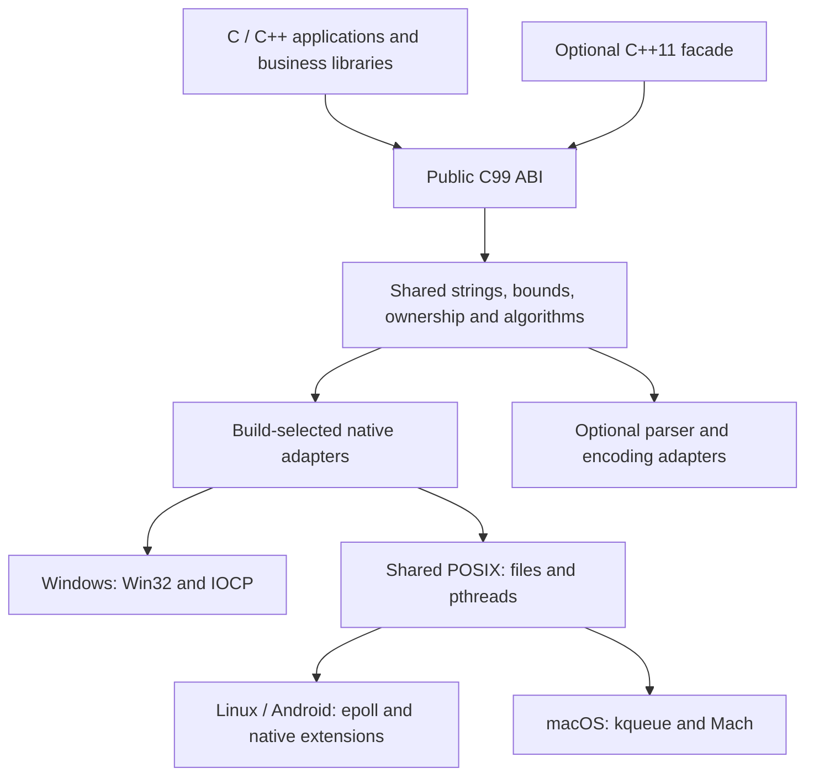
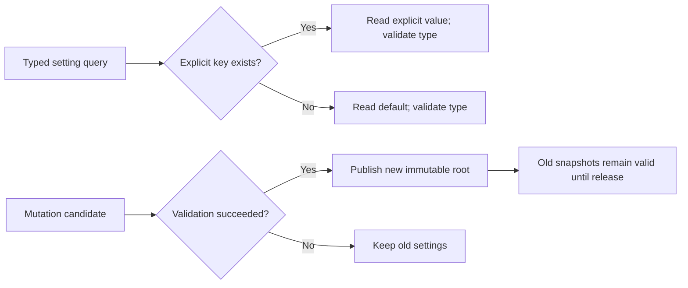
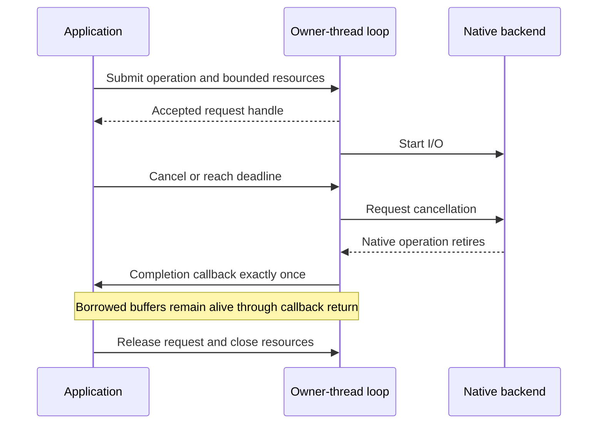
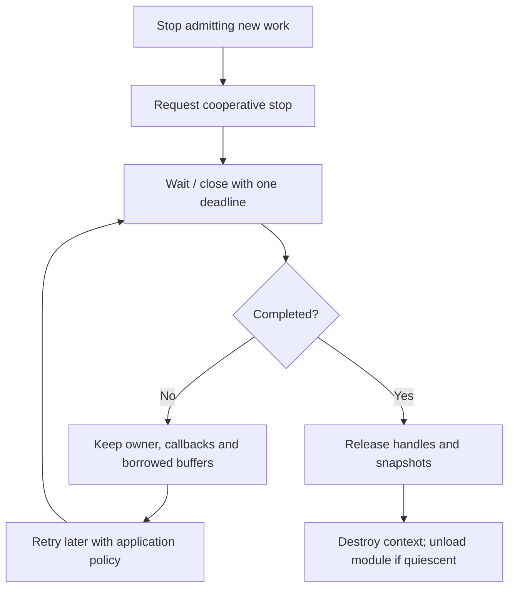

# hx_c_platform detailed reference

[简体中文](REFERENCE.zh-CN.md) · [Home](../README.md) · [Task tutorials](USAGE.md)

This reference covers platform differences, interface limits, resource management, build options and validation status. Start with the homepage and task tutorials when using the library for the first time, then consult this reference for an operation's boundaries. Build commands run from the library source root unless stated otherwise.

The default SDK-backed modules need the matching dependencies: OpenSSL for CRYPTO/TLS, libcurl for HTTP/URL, utf8proc for UNICODE, and archive/compression codecs. PERSISTENT_QUEUE uses the pinned SQLite adapter. Prepare the [dependency SDK](DEPENDENCIES.md), then pass its prefix through `CMAKE_PREFIX_PATH` or `HX_OS_DEPENDENCY_PREFIX`. Disable unused modules explicitly or select `cmake/minimal.cmake`. The [native dependency guide](NATIVE_DEPENDENCIES.md) also shows direct SDK calls.

TLS connections, bounded full-duplex queues and JSON business programs: [TLS guide](TLS.md).
- [1. Purpose and interface boundaries](#section-1)
- [2. Platforms, languages and verification status](#section-2)
- [3. Architecture, directories and backend selection](#section-3)
- [4. Build and run a first program](#section-4)
- [5. Integrate, install and link](#section-5)
- [6. Errors, contexts and allocator ownership](#section-6)
- [7. UTF-8 strings and encoding conversion](#section-7)
- [8. Files, directories and atomic publication](#section-8)
- [9. Environment, special paths and process identity](#section-9)
- [10. Configuration parsing and serialization](#section-10)
- [11. Mutable settings, defaults and snapshots](#section-11)
- [12. C containers, variant values and ownership](#section-12)
- [13. Clocks, deadlines and precise waits](#section-13)
- [14. Threads, synchronization and thread-local storage](#section-14)
- [15. C thread pools and delayed tasks](#section-15)
- [16. C++11 tasks, results and cooperative cancellation](#section-16)
- [17. Atomics, alignment and memory order](#section-17)
- [18. Networking and the event loop](#section-18)
- [19. Pipes, local IPC and process output capture](#section-19)
- [20. Periodic timers and directory notifications](#section-20)
- [21. System information and dynamic libraries](#section-21)
- [22. Memory pools, arenas, pages and mappings](#section-22)
- [23. Random bytes, UUIDs, wide arithmetic and bit tools](#section-23)
- [24. Calendar strings, translation files and filenames](#section-24)
- [25. Signals, named procedures and interval profiling](#section-25)
- [26. Bounded lexical analysis](#section-26)
- [27. Build options and optional dependencies](#section-27)
- [28. Android and embedded Linux builds](#section-28)
- [29. ABI, ownership and shutdown rules](#section-29)
- [30. Tests, CI and performance evidence](#section-30)
- [31. Engineering rules, platform extensions and licensing](#section-31)
- [32. Detailed documents and runnable examples](#section-32)
- [33. Data, transfer and persistent-work extensions](#section-33)

<a id="section-1"></a>

## 1. Purpose and interface boundaries

`hx_c_platform` is an independent C99 foundation library with a C ABI and an optional C++11 facade. Applications use the same calls for common operating system tasks; shared behavior and native adapters live inside the library. The current project version is **0.1.0**. The names remain provisional and this is not a declared stable ABI release.

Common calls handle their own composition: read a UTF-8 file into `hx_string`, get an environment value, load a translation catalog, capture a process, or submit a task. Options are for changing limits and behavior. Ordinary use does not require a global runtime initialization sequence.

| This library owns | Consumers own |
| --- | --- |
| Files, Unicode paths, strings, conversion, configuration trees | Business schemas, validation policies, save timing |
| Threads, synchronization, bounded task pools, async I/O | Job dependencies, application scheduling, shutdown decisions |
| Native errors, allocators, resource ownership | Logging, diagnostics presentation, recovery policy |
| File publication and timestamp mechanisms | Log rotation, retention, formatting and filtering |
| Interval profiling and native system queries | Crash policy, LocalDumps setup and historical log rings |

The library builds, tests, installs and runs independently of hx_c_log. It does not require Qt, C++, or the OBS runtime. OBS informs the unified API, shared implementation and build-selected adapter organization. hx_c_log integration remains future work. Self-developed stackful and stackless coroutines are described in [the coroutine guide](COROUTINES.md). Thread-local storage **TLS** is separate from the optional [encrypted network TLS module](TLS.md).

<a id="section-2"></a>

## 2. Platforms, languages and verification status

| Target | Design baseline | Available evidence |
| --- | --- | --- |
| Windows | Win7 SP1 / 8.1 compatibility retained; x86/x64 | Local MSVC x86/x64 builds and tests; old OS runtime pending |
| Linux | Native POSIX/Linux APIs | WSL GCC/Clang builds and runtime tests |
| macOS | Intel 10.13, ARM64 11.0; universal defaults to 11.0 | Adapters present; Apple-host build/run pending |
| Embedded Linux | ARMv7-A / AArch64; SDK-selected libc and ABI | glibc cross-builds and partial QEMU runs; physical boards pending |
| Android | API 21; arm64-v8a and armeabi-v7a; additional API 28 | Both ARM ABIs cross-built; API 34 emulator evidence described below |
| iOS / BSD | Potential reuse of POSIX/common code | Not currently supported as completed targets |
| FreeRTOS / bare metal | Separate memory/thread/filesystem model required | Outside current scope |

The C core is a compiled library, **not header-only**. Only the optional C++ facade is header-only. C++11 is verified; a C++14/17/20 matrix is not claimed. CMake **3.16** is the baseline; compiler/SDK support must be checked separately from operating system API compatibility, especially for a Win7 deployment.

See [platform support](PLATFORMS.md) for build requirements and capability limits. Regression sources, detailed execution records and temporary reports remain local; public examples are independent and remote CI is disabled.

<a id="section-3"></a>

## 3. Architecture, directories and backend selection



Calls normally go directly to the implementation chosen by CMake. OS, compiler, CPU architecture and optional dependencies are separate decisions. Shared POSIX code is not copied into each OS directory. Necessary native conditionals stay below public business-facing calls. Unknown target systems fail configuration; unavailable capabilities do not silently succeed.

```text
hx_c_platform/
├── include/
│   ├── hx_os.h                 Public C umbrella header
│   ├── hx_os_*.h               Native facilities and utility contracts
│   ├── hx_string.h             UTF-8 strings and borrowed views
│   ├── hx_container.h          Generic and typed POD containers
│   ├── hx_config.h             Immutable configuration documents
│   ├── hx_settings.h           Mutable settings and snapshots
│   └── hx/*.hpp                Optional C++11 facade
├── src/                       Shared implementations
│   ├── windows/               Windows adapters
│   ├── posix/                 Shared POSIX adapters
│   ├── linux/                 Linux / Android backend pieces
│   └── apple/                 Apple backend pieces
├── cmake/                     Target options, packages and SDK toolchain
├── examples/                  Buildable common tasks
├── benchmarks/                Development performance probes
├── tools/                     Dependency preparation and verification
└── docs/                      Separate English and Chinese documents
```

| Header group | Main responsibility |
| --- | --- |
| `hx_os_base.h`, `hx_os_atomic.h` | Errors, contexts, clocks, capabilities and atomics |
| `hx_os_file.h`, `hx_os_file_extra.h` | Files, paths, directory traversal, attributes and locks |
| `hx_os_text.h`, `hx_string.h` | Conversion, Unicode validation and strings |
| `hx_config.h`, `hx_settings.h`, `hx_container.h` | Documents, mutable values and containers |
| `hx_os_thread.h`, `hx_os_pool.h`, `hx_os_wait.h` | Threads, TLS, synchronization, tasks and waits |
| `hx_os_net.h`, `hx_os_loop.h`, `hx_os_loop_fd.h` | Sockets, requests and native descriptor readiness |
| `hx_os_pipe.h`, `hx_os_local.h`, `hx_os_process.h` | Pipes, local IPC and processes |
| `hx_os_timer.h`, `hx_os_watch.h` | Periodic timers and directory notifications |
| `hx_os_sysinfo.h`, `hx_os_system.h`, `hx_os_library.h` | Metrics, identity, CPU capabilities and dynamic libraries |
| `hx_os_memory.h`, `hx_os_vm.h` | Pools, arenas, pages and mappings |
| `hx_os_util.h`, `hx_os_bits.h`, `hx_os_wide.h`, `hx_os_bitstream.h` | Randomness, UUIDs, CRC, integer and bit utilities |
| `hx_os_calendar.h`, `hx_os_text_lookup.h`, `hx_os_lexer.h` | Calendar strings, catalogs and tokenization |
| `hx_os_signal.h`, `hx_os_procedure.h`, `hx_os_profiler.h` | Signals, named procedures and interval trees |
| `hx_os_env.h`, `hx_os_paths.h`, `hx_os_posix.h` | Environment, special directories and POSIX clock conversion |
| `hx_os_registry.h`, `hx_os_power.h`, `hx_os_obfuscate.h` | Optional registry, scoped power requests and obfuscation |

<a id="section-4"></a>

## 4. Build and run a first program

### 4.1 Desktop build

A fresh configuration builds only the library. Tests, examples and benchmarks are opt-in. Prepare the dependency SDK described above, then reuse one build directory per platform/compiler/configuration. For Linux:

```sh
cmake -S . -B out/linux -DCMAKE_BUILD_TYPE=Release
cmake --build out/linux --parallel 4
```

For Windows with a current CMake and MSVC:

```powershell
cmake -S . -B out/windows -G "Visual Studio 17 2022" -A x64
cmake --build out/windows --config Release --parallel 4
```

CMake 3.16 predates the VS2022 generator; use NMake in a configured MSVC developer shell for that version. Ordinary C library builds do not probe for a C++ compiler. Existing caches retain their previous options; pass `-DHX_OS_BUILD_TESTS=OFF -DHX_OS_BUILD_EXAMPLES=OFF` to turn them off in an existing directory.

Enable examples and build the program you want to explore, such as formatted printing:

```sh
cmake -S . -B out/linux -DHX_OS_BUILD_EXAMPLES=ON
cmake --build out/linux --target hx_os_format --parallel 4
out/linux/bin/hx_os_format
```

With a Windows multi-configuration generator, add `--config Release`; executables are under `out/windows/bin/Release/`. Examples are independent of private regressions; their tutorials give the arguments. Regression files are not distributed in the public repository, and library users do not need `HX_OS_BUILD_TESTS`. Reuse build directories; documentation edits normally need no rebuild.

For Visual Studio, open the generated `hx_c_platform.sln`. The solution groups existing targets as follows; optional targets appear only when enabled:

```text
hx_c_platform
├── libraries
│   ├── hx_c_platform
│   │   ├── Header Files
│   │   │   ├── Public       (C headers and hx/ C++ headers)
│   │   │   └── Private      (internal and selected platform headers)
│   │   ├── Source Files    (compiled sources, with platform subfolders)
│   │   └── Generated Files
│   └── hx_archive_7zip     (optional adapter)
├── deps                    (dependency build targets)
├── examples
│   ├── demos               (usage examples)
│   └── benchmarks          (performance and layout tools)
└── CMake                   (ALL_BUILD, INSTALL, ZERO_CHECK, etc.)
```

These are IDE folders. Source directories and executable names stay the same. In CMake GUI, select the existing source/build directories, then click **Configure** and **Generate**; reload the solution in Visual Studio. Do not edit `.sln`, `.vcxproj` or `.filters` files by hand. All public C/C++ headers are available under `Public`; `Source Files` shows the sources selected by the current platform and feature switches. When used via `add_subdirectory`, the enclosing project controls the global `USE_FOLDERS` setting. An installed SDK consumer shows its own targets; open the library's source solution to browse the implementation.

### 4.2 Read UTF-8 text from C

Save as `main.c` and place a UTF-8 `配置.json` beside the program's working directory. The call opens the file, reads with a default 16 MiB bound, removes an initial UTF-8 BOM, validates text and closes the file. Failure leaves the output string unchanged.

```c
#include <hx_os.h>
#include <stdio.h>

int main(void)
{
	hx_string text = HX_STRING_INIT;
	hx_os_error error;
	hx_os_status status =
		hx_os_file_read_text("配置.json", &text, &error);

	if (status == HX_OS_OK)
		puts(hx_string_c_str(&text));
	else {
		char message[2304];
		size_t required;

		if (hx_os_error_message(&error, message, sizeof(message),
			    &required) == HX_OS_OK)
			fprintf(stderr, "%s\n", message);
		else
			fprintf(stderr, "%s\n", hx_os_status_name(status));
	}

	hx_string_destroy(&text);

	return status == HX_OS_OK ? 0 : 1;
}
```

### 4.3 The corresponding C++11 calls

The C++ facade returns `Result<T>`. Check `ok()` before reading `value()`, or inspect `error()` on failure. Text results own UTF-8 storage through `hx::String` and use the same C implementation. Library code uses no exception mechanism; allocation failures remain explicit with exceptions disabled. See [C++ Result contracts](CPP_RESULTS.md) for partial results, callbacks, ownership and migration.

```cpp
#include <hx/Files.hpp>
#include <hx/Paths.hpp>
#include <cstdio>

int main()
{
	auto text = hx::Files::readText("配置.json");
	if (!text) {
		std::fprintf(stderr, "%s\n",
			hx_os_status_name(text.status()));

		return 1;
	}

	auto path = hx::Paths::configFile("hx_example", "settings.json");
	if (!path) {
		std::fprintf(stderr, "%s\n",
			hx_os_status_name(path.status()));

		return 1;
	}

	std::printf("%s\n%s\n", text.value().c_str(),
		path.value().c_str());

	return 0;
}
```

### 4.4 Edit strings and settings with fewer checks

After a successful string creation, ASCII trim/case changes operate in place and need no allocation or error check. `Settings::update()` and `CallData::edit()` apply setters immediately and report the first failure at `finish()`; later setters are skipped. Directory iteration opens, reads, grows one reusable name buffer and closes internally. This complete program is also [direct_calls.cpp](../examples/direct_calls.cpp).

The settings label is a retained `SettingStringView`: it remains valid after an update or settings close. The parameter-pack label is a borrowed `StringView`: keep the pack unchanged and alive while using it. Operations that allocate, perform I/O or can fail still return a checked result.

```cpp
#include <hx/Files.hpp>
#include <hx/Settings.hpp>
#include <hx/Signal.hpp>
#include <cstdio>

static int report_failure(hx_os_status status)
{
	std::fprintf(stderr, "%s\n", hx_os_status_name(status));

	return 1;
}

int main()
{
	auto text = hx::String::copy("  Hello 中文😀  ");
	if (!text)
		return report_failure(text.status());

	text.value().trimAscii().lowerAscii();
	std::puts(text.value().c_str());
	if (hx_os_capabilities() & HX_OS_CAP_SETTINGS) {
		hx_settings *owner = NULL;

		hx::Settings settings(owner);

		auto created = settings.create();
		if (!created)
			return report_failure(created.status());

		auto changed = settings.update()
				       .setInt("port", 8080)
				       .setString("label", "服务😀")
				       .finish();

		auto label = settings.stringView("label");

		auto closed = settings.closeUntil(HX_OS_DEADLINE_NOW);
		if (!closed)
			return report_failure(closed.status());

		if (!changed)
			return report_failure(changed.status());

		if (!label)
			return report_failure(label.status());

		// The lease owns immutable bytes after the settings close.
		std::puts(label.value().c_str());
	}

	if (hx_os_capabilities() & (HX_OS_CAP_SIGNALS | HX_OS_CAP_PROCEDURES)) {
		hx::CallData data;

		auto prepared = data.edit()
					.setInt("number", 42)
					.setString("label", text.value().view())
					.finish();
		if (!prepared)
			return report_failure(prepared.status());

		auto label = data.view().stringView("label");
		if (!label)
			return report_failure(label.status());

		std::printf("%.*s\n", static_cast<int>(label.value().size()),
			label.value().data());
	}

	auto listed =
		hx::Directory::forEach(".", [](hx::StringView name) noexcept {
			std::printf("Entry: %.*s\n",
				static_cast<int>(name.size()), name.data());
			return false;
		});

	return listed ? 0 : report_failure(listed.status());
}
```

<a id="section-5"></a>

## 5. Integrate, install and link

### 5.1 Use a source subdirectory

For an application with the library checkout in `deps/hx_c_platform`:

```cmake
cmake_minimum_required(VERSION 3.16)
project(my_app LANGUAGES C)

add_subdirectory(deps/hx_c_platform)

add_executable(my_app main.c)
set_target_properties(my_app PROPERTIES
	C_STANDARD 99
	C_STANDARD_REQUIRED YES
	C_EXTENSIONS NO)
target_link_libraries(my_app PRIVATE hx_c_platform::hx_c_platform)

if(MSVC)
	target_compile_options(my_app PRIVATE /utf-8)
endif()
```

### 5.2 Consume an installed package

```sh
cmake --install build --config Release --prefix /absolute/install/prefix
```

In the consumer project:

```cmake
cmake_minimum_required(VERSION 3.16)
project(my_app LANGUAGES C)

find_package(hx_c_platform 0.1 CONFIG REQUIRED)

add_executable(my_app main.c)
set_target_properties(my_app PROPERTIES
	C_STANDARD 99
	C_STANDARD_REQUIRED YES
	C_EXTENSIONS NO)
target_link_libraries(my_app PRIVATE hx_c_platform::hx_c_platform)

if(MSVC)
	target_compile_options(my_app PRIVATE /utf-8)
endif()
```

Configure the consumer with `-DCMAKE_PREFIX_PATH=/absolute/install/prefix`. For a C++ application, use `LANGUAGES CXX`, a `.cpp` source and `hx_c_platform::cpp`; this target requests C++11 only for consumers selecting it. Do not add native libraries manually when using the exported target.

### 5.3 Static and shared deployment

`BUILD_SHARED_LIBS=OFF` is the default. Set it to ON for a shared library. The package installs public headers, libraries, CMake exports and pkg-config metadata. Imported targets carry shared-library definitions and required static dependencies. Relative install layouts support relocation; explicitly absolute install directories keep their configured paths.

On Windows, deploy the DLL beside the application or on its runtime search path. Match architecture, compiler runtime and build configuration. A static copy inside each plugin does not create a shared allocator universe; free objects through their originating library/context and complete callbacks before unloading a module.

<a id="section-6"></a>

## 6. Errors, contexts and allocator ownership

### 6.1 Status is not a Boolean

| Status | Meaning / response |
| --- | --- |
| `HX_OS_OK` | Success; some I/O calls can still report short progress |
| `HX_OS_EOF` | End of input, not a generic error |
| `HX_OS_TIMEOUT` | Wait budget exhausted; preserve resources as specified |
| `HX_OS_WOULD_BLOCK` | No immediate progress; wait or retry |
| `HX_OS_OUTPUT_FULL` | Output capacity insufficient; inspect required/progress fields |
| `HX_OS_NOT_FOUND` | Missing key/path; apply defaults only where intended |
| `HX_OS_TYPE_MISMATCH` | Value exists with the wrong type; do not silently default |
| `HX_OS_LIMIT` | A configured resource bound was reached |
| `HX_OS_NOT_SUPPORTED` | Disabled module or unavailable platform behavior |
| `HX_OS_BUSY` / `HX_OS_DEADLOCK` | Lifetime or self-wait constraint prevents the call |

`hx_os_error` preserves the unified status plus native domain/code and an available secondary cause. It contains no borrowed diagnostic string. `hx_os_error_message` writes to caller-owned storage. Dynamic-loader extended calls can additionally write an owned `hx_string` diagnostic. The library does not report its own errors through hx_c_log or a global last-error string.

### 6.2 A context belongs to its consumer

Passing `context=NULL` selects the immutable default allocator. Custom contexts copy an allocator table; user state is borrowed until destruction. Allocation/free callbacks must support cross-thread release and fundamental alignment. The wrapper handles requested extended alignment. Do not replace the allocator while objects are alive.

```c
#include <hx_os.h>
#include <stdlib.h>

static void *HX_OS_CALL allocate_bytes(size_t bytes, void *user)
{
	(void)user;

	return malloc(bytes);
}

static void HX_OS_CALL release_bytes(void *memory, void *user)
{
	(void)user;

	free(memory);
}

int main(void)
{
	hx_os_context_options options;
	hx_os_context *context = NULL;
	hx_string text;
	hx_os_status status;

	hx_os_context_options_init(&options);
	options.allocator.allocate = allocate_bytes;
	options.allocator.deallocate = release_bytes;
	options.allocator.user = NULL;

	status = hx_os_context_create(&options, &context, NULL);
	if (status != HX_OS_OK)
		return 1;

	hx_string_init(&text, context);

	status = hx_string_assign_cstr(&text, "owned by this context", NULL);

	hx_string_destroy(&text);
	if (hx_os_context_destroy(&context, NULL) != HX_OS_OK)
		return 2;

	return status == HX_OS_OK ? 0 : 1;
}
```

An initialized empty string can still hold a context lease. Destroy all strings, handles, snapshots and TLS values before destroying the context. `hx_os_context_destroy` returns BUSY while outstanding ownership remains. Exclude new API entrants during final destruction; a context is not a global configuration switch shared by unrelated consumers.

<a id="section-7"></a>

## 7. UTF-8 strings and encoding conversion

### 7.1 Owning strings and views

`hx_string` owns UTF-8 storage; `hx_string_view` borrows bytes. Use `HX_STRING_INIT` for the default context or `hx_string_init` once for a specific context. Copy with `hx_string_copy`, transfer with `hx_string_move`, and release with `hx_string_destroy`; plain structure assignment is not an owning copy.

```c
#include <hx_os.h>
#include <stdio.h>

int main(void)
{
	hx_string text = HX_STRING_INIT;
	hx_string_parts *parts = NULL;
	hx_os_status status;
	hx_os_text_result converted;
	unsigned char utf16[128];
	size_t i;

	status = hx_string_assign_cstr(&text, " alpha,beta,中文😀 ", NULL);
	if (status == HX_OS_OK) {
		hx_string_trim_ascii_in_place(&text);

		status = hx_string_split(&text,
			hx_string_view_from_cstr(","), &parts, NULL);
	}

	if (status == HX_OS_OK) {
		for (i = 0; i < hx_string_parts_count(parts); ++i) {
			hx_string_view part;

			status = hx_string_parts_at(parts, i, &part);
			if (status != HX_OS_OK)
				break;

			(void)fwrite(part.data, 1, part.size, stdout);
			putchar('\n');
		}
	}

	if (status == HX_OS_OK)
		status = hx_string_encode(&text, HX_OS_UTF16LE, utf16,
			sizeof(utf16), &converted, NULL);

	if (status == HX_OS_OK)
		printf("UTF-16 bytes: %zu\n", converted.output_used);

	hx_string_parts_destroy(&parts);
	hx_string_destroy(&text);

	return status == HX_OS_OK ? 0 : 1;
}
```

| Operation | Interface family |
| --- | --- |
| Assign, append, reserve | `hx_string_assign`, `append`, `reserve` |
| Insert, erase, replace | `hx_string_insert`, `erase`, `replace` |
| Find, compare, prefix/suffix | `hx_string_find`, `compare`, `starts_with`, `ends_with` |
| Trim, ASCII case, replace all | `hx_string_trim_ascii`, `lower_ascii`, `upper_ascii`, `replace_all` |
| Split and join | `hx_string_split`, `hx_string_parts_at`, `hx_string_join` |
| Formatting | `hx_string_format`, `hx_string_append_format` |
| Decode / encode | `hx_string_assign_encoded`, `hx_string_encode` |

Offsets and lengths are bytes. Codepoint counts are not grapheme counts. Embedded NUL is supported, but C-string consumers stop at it. Ordinary views expire on mutation/destruction; split owns an input copy, so its views last until parts_destroy. Split defaults to at most 4096 pieces and retains empty pieces. ASCII case/trim operations do not implement Unicode case folding, normalization or locale collation. printf formatting follows the caller's locale; use numeric conversion utilities when locale independence matters.

Use `hx_string_trim_ascii_in_place`, `lower_ascii_in_place` and `upper_ascii_in_place` for a valid initialized string. They return void, allocate nothing and preserve non-ASCII UTF-8 bytes; `hx::String` offers `trimAscii().lowerAscii()` on the same object. Assign, append and reserve remain fallible. The older status-returning ASCII APIs remain available.

### 7.2 Windows paths and legacy encodings

Public paths are UTF-8 and Windows adapters convert them to UTF-16 internally. There is no ANSI-codepage guess or implicit process-locale change. Compile consumer UTF-8 literals with MSVC `/utf-8`. Console display remains the host's responsibility; path support does not automatically reconfigure stdout.

Built-in conversion covers UTF-8, UTF-16LE/BE, UTF-32LE/BE, ASCII and ISO-8859-1. Optional iconv supports additional encoding identifiers including GB2312, GBK, GB18030:2005/:2022, Big5, Shift-JIS, EUC-JP/KR and Windows 1252/932/936/949/950, subject to backend availability.

```sh
cmake -S . -B build-text -DHX_OS_ENABLE_ICONV=ON \
  -DHX_OS_ENABLE_CRYPTO=OFF -DHX_OS_ENABLE_ARCHIVE=OFF \
  -DHX_OS_ENABLE_COMPRESSION=OFF -DHX_OS_ENABLE_HTTP=OFF \
  -DHX_OS_ENABLE_URL=OFF -DHX_OS_ENABLE_UNICODE=OFF \
  -DHX_OS_ENABLE_PERSISTENT_QUEUE=OFF
cmake --build build-text --config Release --parallel 4
```

Enabling ICONV now selects the pinned GNU libiconv release through the common dependency provider, with SHA256 verification and a reusable cache. Its official Git tree lacks generated tables, so this one dependency uses the official release archive even with the SUBMODULE default. Set `HX_OS_ICONV_USE_SYSTEM=ON` to explicitly choose system iconv; an explicit `HX_OS_ICONV_SOURCE_DIR` remains supported. Upstream files are unchanged. Query `hx_os_encoding_supported()` before depending on a particular encoding. Strict string decoding is transactional; streaming conversion can report a consumed/produced prefix, so inspect both status and progress. Encoded output has no implicit terminator.

<a id="section-8"></a>

## 8. Files, directories and atomic publication

### 8.1 Low-level I/O with progress

`read_some` separates EOF, error and bytes read. `write_some` may succeed with short progress; the caller retries the remaining span. `write_all` performs that loop and still reports completed bytes on failure. File position operations require caller serialization.

```c
#include <hx_os.h>
#include <stdio.h>

int main(void)
{
	const char payload[] = "hello, 中文\n";
	hx_os_file *file = NULL;
	hx_os_error error;
	hx_os_status status, closed;
	size_t completed = 0;

	status = hx_os_file_open(NULL, "readme-output.txt",
		HX_OS_FILE_WRITE | HX_OS_FILE_CREATE | HX_OS_FILE_TRUNCATE,
		&file, &error);
	if (status != HX_OS_OK)
		return 1;

	status = hx_os_file_write_all(file, payload, sizeof(payload) - 1,
		&completed, &error);
	if (status == HX_OS_OK)
		status = hx_os_file_sync(file, &error);

	closed = hx_os_file_close(&file, NULL);
	if (status == HX_OS_OK)
		status = closed;

	if (status != HX_OS_OK)
		fprintf(stderr, "%s after %zu bytes\n",
			hx_os_status_name(status), completed);

	return status == HX_OS_OK ? 0 : 1;
}
```

File objects have no user-space stream buffer. `hx_os_file_sync` requests native persistence through fsync/FlushFileBuffers; it cannot guarantee the storage hardware's power-loss behavior. File close **consumes the handle even on error**, unlike retryable thread/I/O-owner shutdown. Never retry the same native close after ownership has been consumed.

C++ `File::read()` returns a successful `ReadResult` with `eof=true` at end of input; `readSome()` and `readAt()` keep their existing EOF status. Actual failures still retain completed bytes through `hasValue()`.

### 8.2 Save and publish a complete file

`hx_os_file_save` writes a whole byte span; `hx_os_file_write_text` atomically publishes an initialized UTF-8 string. `hx_os_file_save_atomic_ex` syncs a same-directory temporary, then publishes it by replacement. Publication and directory durability are reported separately.

```c
#include <hx_os.h>
#include <stdio.h>

int main(void)
{
	const char json[] = "{\"port\":8080}\n";
	hx_os_file_save_result result;

	hx_os_status status = hx_os_file_save_atomic_ex(
		"readme-settings.json", json, sizeof(json) - 1, &result, NULL);
	if (status != HX_OS_OK)
		return 1;

	printf("published=%d directory_synced=%d\n",
		result.published, result.directory_synced);
	if (result.durability_error.status != HX_OS_OK)
		fprintf(stderr, "Directory sync: %s\n",
			hx_os_status_name(result.durability_error.status));

	return 0;
}
```

Backup replacement is not a rollback transaction. Cross-filesystem move is not silently emulated by copying. Preserve native errors and recovery state when replacement partly progresses.

### 8.3 Additional file facilities

Recursive basename search provides hx_os_directory_find_first_file / Directory::findFirstFile for one owned path and hx_os_directory_find_files / Directory::findFiles for synchronous streamed matches. They reuse buffers and native entry types where available, with explicit depth/count/memory limits. They work without CONTAINERS and can run on an existing pool. [File search](FILE_SEARCH.md) documents matching, partial failure, borrowed callback paths and worker/UI lifetimes. Path glob still matches explicitly supplied path levels without recursive double-star semantics.

| Need | Interfaces / example |
| --- | --- |
| Copy, existence, whole-file read, path composition | `hx_os_file.h`; [text_file.c](../examples/text_file.c) |
| Direct directory visit, bounded glob and recursive removal | `hx_os_directory_visit`, `hx::Directory::forEach`; recursive removal does not follow links |
| Position-independent I/O | `hx_os_file_read_at`, `write_at`; [positioned_read.c](../examples/positioned_read.c) |
| Extended file type/timestamps | `hx_os_path_stat_extended`; [file_info.c](../examples/file_info.c) |
| Range locks, timestamps and permissions | `hx_os_file_extra.h`; [file_attributes.c](../examples/file_attributes.c) |

Positioned calls do not change shared file position, but overlapping writes, truncate and close still need coordination. Append-mode positioned writes are rejected. Permission summaries are not an ACL/access check. Path helpers perform lexical operations, not a security sandbox or symlink containment test.

<a id="section-9"></a>

## 9. Environment, special paths and process identity

Use string outputs to avoid repeating capacity-query loops in consumers. An empty environment value differs from a missing variable.

```c
#include <hx_os.h>
#include <stdio.h>

int main(void)
{
	hx_string path = HX_STRING_INIT;
	hx_string value = HX_STRING_INIT;
	hx_os_status status =
		hx_os_path_config_file("my_app", "settings.json", &path, NULL);

	if (status == HX_OS_OK)
		puts(hx_string_c_str(&path));

	if (status == HX_OS_OK) {
		status = hx_os_env_get_string("HX_APP_MODE", &value, NULL);
		if (status == HX_OS_NOT_FOUND)
			status = hx_string_assign_cstr(&value, "production",
				NULL);
	}

	if (status == HX_OS_OK)
		puts(hx_string_c_str(&value));

	hx_string_destroy(&value);
	hx_string_destroy(&path);

	return status == HX_OS_OK ? 0 : 1;
}
```

| Query | Entry point |
| --- | --- |
| Home, per-user config/data | `hx_os_path_home_string`, `config_home_string`, `data_home_string` |
| Machine-wide shared data | `hx_os_path_program_data_string` |
| Temporary directory | `hx_os_path_temp_string` |
| Executable path / this module directory | `hx_os_path_executable_string`, `module_string` |
| Environment get/set/remove/enumerate | `hx_os_env_*` |
| UTF-8 arguments, PID, hostname, CPU features | `hx_os_system.h` |

Special-path queries do not create or guarantee writable directories. User data and machine-wide data are different concepts. Explicit environment mutation affects the process/future children; the host coordinates changes from native APIs and other libraries. No helper implicitly changes cwd.

CPU capabilities include OS permission to use the instruction state, not only hardware bits. An unknown emulation state is not reported as definitely native. [special_paths.c](../examples/special_paths.c) and [environment.c](../examples/environment.c) provide complete examples.

<a id="section-10"></a>

## 10. Configuration parsing and serialization

### 10.1 Formats and backends

The default backend is always BUILTIN; installed dependencies do not change parsing silently. Select `options.backend` explicitly and query `hx_os_config_backend_available(format, backend)`.

| Format | Built-in profile | Optional C backend |
| --- | --- | --- |
| JSON | Strict values, objects, arrays, escapes, exact numeric text | cJSON 1.7.19 |
| YAML | One document; block mappings/sequences and scalar values | libyaml 0.2.5 |
| XML | UTF-8 XML 1.0 elements, attributes, mixed text and CDATA | Mini-XML 4.0.6 |
| INI | Sections and string key/value pairs | inih r62 |
| TOML | Common tables, dotted keys, scalars, arrays and inline tables | tomlc17 R260821 |
| ENV | Explicit dotenv dialect; no shell evaluation | Built-in |
| .properties | UTF-8 Java-style syntax and Unicode escapes | Built-in |

These are defined profiles. Built-in YAML is not full YAML 1.2; anchors, aliases and custom tags are rejected in both adapters. XML loads no external entities or DTD. TOML multiline strings, arrays of tables and date/time need tomlc17. Legacy ISO-8859-1 properties input must be converted explicitly. See [format contracts](CONFIGURATION.md) for exact limits and differences.

### 10.2 Parse, query and release

This standalone example parses TOML in memory and reads `/server/port`.

```c
#include <hx_os.h>

#include <inttypes.h>
#include <stdio.h>
#include <string.h>

int main(void)
{
	static const char input[] =
		"title = '中文 configuration'\n[server]\nport = 8080\n";
	hx_os_config_document *document = NULL;
	hx_os_config_error error;
	const hx_os_config_node *port;
	hx_os_status status;
	int64_t number;

	if (!hx_os_config_backend_available(
		    HX_OS_CONFIG_TOML, HX_OS_CONFIG_BUILTIN)) {
		puts("Configuration module is disabled.");

		return 0;
	}

	status = hx_os_config_parse(NULL, HX_OS_CONFIG_TOML, input,
		strlen(input), NULL, &document, &error);
	if (status != HX_OS_OK) {
		fprintf(stderr, "%s at %zu:%zu: %s\n", error.source, error.line,
			error.column, error.message);

		return 1;
	}

	status = hx_os_config_pointer(
		hx_os_config_root(document), "/server/port", &port);
	if (status == HX_OS_OK)
		status = hx_os_config_get_i64(port, &number);

	if (status == HX_OS_OK)
		printf("Server port: %" PRId64 "\n", number);
	else
		fprintf(stderr, "Server port: %s\n", hx_os_status_name(status));

	hx_os_config_release(document);

	return status == HX_OS_OK ? 0 : 1;
}
```

Inputs are borrowed only during parse; retained document values are copied. Documents are immutable and reference counted. Nodes/slices borrow the document; retaining a node pointer does not retain its owner. Queries use exact keys; JSON Pointer uses `/` segments, not implicit dotted paths. Wrong types return TYPE_MISMATCH and missing keys return NOT_FOUND.

Default limits are 1 MiB input, 16 MiB parser memory, 65,536 nodes, depth 64 and 16,777,216 work units. Parsing does not spawn a worker or modify process environment. Configuration errors include status and available source position without forwarding secret-bearing backend text.

### 10.3 Write representable data

`hx_os_config_serialize` supports JSON, INI and properties; `hx_os_config_save` combines serialization with atomic publication. Unsupported types/nesting fail instead of being flattened or coerced. Parsing seven formats does not mean seven lossless serializers. See [config_save.c](../examples/config_save.c). Optional parser build commands are in section 27.

<a id="section-11"></a>

## 11. Mutable settings, defaults and snapshots

`hx_config` remains immutable. `hx_settings` owns explicit user values and a separate default layer. A default applies only when a key is absent; type errors and damaged files remain errors. Strings, arrays and objects are copied on assignment. Borrowed user pointers are not automatically freed.



```c
#include <hx_os.h>
#include <stdio.h>

int main(void)
{
	hx_settings *settings = NULL;
	hx_settings_string_ref label = HX_SETTINGS_STRING_REF_INIT;
	hx_string json = HX_STRING_INIT;
	int64_t port;
	hx_os_error error;

	hx_os_status status = hx_settings_create(NULL, &settings, &error);
	if (status == HX_OS_OK)
		status = hx_settings_set_default_i64(
			settings, "port", 80, &error);

	if (status == HX_OS_OK) {
		hx_settings_update update = hx_settings_update_begin(settings);
		hx_settings_update_set_i64(&update, "port", 8080);
		hx_settings_update_set_string(&update, "label", "服务😀");

		status = hx_settings_update_finish(&update, NULL, &error);
	}

	if (status == HX_OS_OK)
		status = hx_settings_get_i64(settings, "port", &port, &error);

	if (status == HX_OS_OK)
		status = hx_settings_get_string_ref(
			settings, "label", &label, &error);

	if (status == HX_OS_OK)
		printf("%s: %lld\n", label.text.data, (long long)port);

	if (status == HX_OS_OK && (hx_os_capabilities() & HX_OS_CAP_CONFIG) &&
		(hx_os_capabilities() & HX_OS_CAP_CONFIG_SERIALIZE)) {
		status = hx_settings_to_json(settings, &json, &error);
		if (status == HX_OS_OK)
			puts(hx_string_c_str(&json));
	}

	if (settings) {
		hx_os_status closed = hx_settings_destroy(&settings, NULL);
		if (status == HX_OS_OK)
			status = closed;
	}

	hx_settings_string_ref_destroy(&label);
	hx_string_destroy(&json);
	if (status != HX_OS_OK)
		fprintf(stderr, "%s\n", hx_os_status_name(status));

	return status == HX_OS_OK ? 0 : 1;
}
```

Use `hx_settings_snapshot` for a retained immutable tree and `hx_settings_value_release` when finished. A snapshot can outlive the settings object and retain its context. Limits apply to each tree, not the sum of all caller-held historical snapshots. Default JSON saving records explicit user values; the program continues to provide defaults. Loading failure preserves the existing state. Concurrent updates have bounded retries and can return BUSY. See [settings contracts](PLATFORM_UTILITIES.md#mutable-settings-and-retained-snapshots-batch-23b).

The update cursor commits and notifies for every successful setter. If setting the port succeeds but setting the name fails, the port remains changed and later setters do not run. `hx_settings_update_finish` / C++ `finish()` reports the first error and the count of successful setters, including on failure. It neither commits delayed work nor rolls back prior changes. Keep the settings owner alive through the setters.

`hx_settings_get_string_ref` returns a retained immutable string without copying its bytes. Initialize with `HX_SETTINGS_STRING_REF_INIT`, copy via `hx_settings_string_ref_copy`, and release with `hx_settings_string_ref_destroy`; raw assignment is not an owning copy. The lease survives mutation/close and keeps its allocator context busy. C++ uses `SettingStringView` for the same lifetime. `integerOr`, `booleanOr`, `realOr` and `stringOr` default only on NOT_FOUND.

<a id="section-12"></a>

## 12. C containers, variant values and ownership

The optional container module provides vector, deque, queue, stack, list, max-heap, ordered/hash map and set. It is a C facility with byte-sized elements and callbacks, not a C++ template emulation layer.

### 12.1 Typed POD vector

```c
#include <hx_os.h>
#include <stdio.h>

HX_OS_DECLARE_VECTOR(int_values, int)

int main(void)
{
	int_values *values = NULL;

	hx_os_status status = int_values_create(NULL, 128, &values, NULL);
	if (status == HX_OS_OK)
		status = int_values_push(values, 42, NULL);

	if (status == HX_OS_OK) {
		const int *first = int_values_at(values, 0);
		if (first)
			printf("%d, size=%zu\n", *first,
				int_values_size(values));
	}

	if (values) {
		hx_os_status closed = int_values_destroy(&values, NULL);
		if (status == HX_OS_OK)
			status = closed;
	}

	return status == HX_OS_OK ? 0 : 1;
}
```

`HX_OS_DECLARE_QUEUE(name, type)` provides the corresponding FIFO adapter. The generated names use lowercase prefixes and share the existing sequence implementation. These macros are for trivially byte-copyable values, not owning `hx_string` objects or nontrivial C++ classes.

### 12.2 Generic containers

Initialize `hx_os_container_options` with the element size, then set count, byte and alignment limits. Use copy/drop callbacks for owned elements; the string preset performs deep copies. Normal insertion copies; `_take` operations transfer only on success. Pop/erase ownership depends on whether an output receives the element. Follow the documented operation contract.

Ordered maps use O(log n) operations; hash keys use exact bytes and hash iteration preserves insertion order. A private unchanged uthash 2.4.0 header supports hash storage. Views/iterators cannot survive arbitrary mutation, and containers do not add implicit application-level synchronization. See [container contracts](CONTAINERS.md) and [queue example](../examples/containers.c).

### 12.3 Variant values and custom structures

`hx_variant` holds one active number, owned UTF-8 string, borrowed pointer or custom structure. Native scalars are inline; custom structures use separately aligned storage. Getters check the exact type, replacement releases the former value, and failed copy/construct preserves it. Initialize once, use copy/move for ownership and destroy the final value.

C++11 Variant/TypedVariant expose set/get<T>/emplace/clone/visit using Result and no exceptions. hx_variant_container_options_init provides deep-copy/drop operations for existing C vector/queue/map. VARIANT is independent of CONFIG, SETTINGS and CONTAINERS; container combinations require CONTAINERS. Nested value allocations remain outside container max_bytes.

Full examples, custom copy/drop callbacks, costs, allocator and plugin lifetimes: [VARIANT.md](VARIANT.md). Buildable sources: [variant.c](../examples/variant.c), [variant.cpp](../examples/variant.cpp).

<a id="section-13"></a>

## 13. Clocks, deadlines and precise waits

| Value / call | Units and behavior |
| --- | --- |
| `hx_os_wall_time_read` | Unix milliseconds; may jump with wall-clock adjustment |
| `hx_os_monotonic_read` | Nanoseconds, excluding suspend; units do not imply resolution |
| `hx_os_high_resolution_read` / `hx_os_high_resolution_ns` | High-resolution interval timestamps in nanoseconds; separate from deadlines |
| `hx_os_deadline_after_ms` | Relative milliseconds converted to this library's absolute monotonic deadline |
| `HX_OS_DEADLINE_NOW` | Immediate attempt; success if already ready |
| `HX_OS_DEADLINE_INFINITE` | Explicit unbounded wait only where the API permits it |
| `hx_os_sleep_until` | Ordinary low-CPU wait |
| `hx_os_sleep_until_precise_ex` | Sleep then spin within a caller-selected budget |

Use one deadline across related shutdown steps rather than granting every step a fresh timeout. Native timespec conversion belongs at the POSIX seam; do not interpret these values as any arbitrary OS clock's absolute time.

Use `hx_os_high_resolution_read(&stamp, &error)` to measure short operations,
frame intervals or playback timing. The C API lives in `hx_os_base.h`, is always
available in the core (including the minimal profile), and needs no runtime
initialization, allocation or optional `WIDE_MATH` feature.

| Platform | Native source | Includes system suspend |
| --- | --- | --- |
| Windows, including the Win7 API baseline | `QueryPerformanceCounter`, with cached frequency | Yes |
| Linux / Android | `clock_gettime(CLOCK_MONOTONIC)` | No |
| macOS | `mach_absolute_time` | No |

These timestamps have an unspecified origin and are independent of wall-clock
adjustments. Compare timestamps from this API on the same running system only.
**Do not pass them to `hx_os_deadline` APIs or subtract `hx_os_monotonic_ns()`
values from them**, even if their numbers look similar on a particular OS.
Windows QPC and the deadline clock have different suspend behavior. The new
API does not change existing deadline or sleep semantics.

A successful read writes a value in `0..UINT64_MAX-1`; failure preserves the
output and returns a status/native error. The convenience form returns
`UINT64_MAX` on failure. Counter conversion uses checked integer arithmetic,
rounds down to nanoseconds and returns `HX_OS_RANGE` on overflow. Check both
read results, subtract the integer timestamps, then convert the duration to
milliseconds or seconds. Nanosecond units do not promise 1 ns resolution or
exact wake-up times: adjacent samples may be equal, and event ordering across
threads finer than one native tick is not guaranteed. This API does not alter
system timer resolution, spin, create a worker or promise hard real-time timing.

The [complete C example](../examples/high_resolution_time.c) measures a requested
20 ms wait and prints the actual elapsed time. Build only that useful example
from the library root:

```sh
cmake -S . -B build/clock -C cmake/minimal.cmake -DHX_OS_BUILD_EXAMPLES=ON
cmake --build build/clock --config Release --target hx_os_high_resolution_time
```

Run `build/clock/bin/hx_os_high_resolution_time` on a single-configuration build,
or `build/clock/bin/Release/hx_os_high_resolution_time.exe` with Visual Studio.
The actual interval can exceed 20 ms because the OS schedules the wake-up.
See Microsoft's [QPC guidance](https://learn.microsoft.com/en-us/windows/win32/sysinfo/acquiring-high-resolution-time-stamps)
for the Windows counter and suspend contract. The macOS implementation is
provided; this addition has not been executed on an Apple host.

For simple periodic work on the calling thread, no loop setup is needed:

```c
#include <hx_os.h>
#include <stdio.h>

static hx_os_status HX_OS_CALL tick(void *user, hx_os_error *error)
{
	unsigned *count = user;

	(void)error;
	printf("tick %u\n", ++*count);

	return HX_OS_OK;
}

int main(void)
{
	unsigned count = 0;

	hx_os_status status = hx_os_repeat_until(10, 3, tick, &count,
		hx_os_deadline_after_ms(1000), NULL, NULL);

	return status == HX_OS_OK && count == 3 ? 0 : 1;
}
```

`repeat` starts after one interval, coalesces missed periods and lets EOF stop successfully. Callbacks cannot be preempted. Precise wait defaults to a 200 us spin window; `_ex` accepts 0..10 ms, with zero using ordinary sleep. INFINITE is invalid for precise wait. There are no global timer-resolution changes, hidden threads or hard-real-time guarantees. The Win7-compatible tick clock can limit short waits; QPC bounds spinning without changing clock semantics.

<a id="section-14"></a>

## 14. Threads, synchronization and thread-local storage

### 14.1 Preserve the worker state across a timeout

The following functions operate on an application-owned `app_worker`. Keep that object alive after start. Call finish with a monotonic deadline; on timeout retain it and retry. Read `answer` only after successful completion.

```c
#include <hx_os.h>

typedef struct app_worker {
	hx_os_thread *thread;
	int answer;
} app_worker;

static void *HX_OS_CALL calculate(void *user)
{
	app_worker *worker = user;

	worker->answer = 42;

	return NULL;
}

hx_os_status app_worker_start(app_worker *worker, hx_os_error *error)
{
	worker->thread = NULL;
	worker->answer = 0;

	return hx_os_thread_create(NULL, calculate, worker, &worker->thread,
		error);
}

hx_os_status app_worker_finish(app_worker *worker,
	hx_os_deadline deadline, hx_os_error *error)
{
	hx_os_status status = hx_os_thread_join_until(
		worker->thread, deadline, NULL, error);
	if (status == HX_OS_OK)
		status = hx_os_thread_destroy(&worker->thread, error);

	return status;
}
```

There is one joiner at a time. Successful join includes native TLS cleanup; destroy is then safe. A timeout neither kills nor detaches the worker. Extended options add names, stack size, priority and affinity; unsupported strict binding returns NOT_SUPPORTED. Native IDs may be reused after exit.

### 14.2 Choose the synchronization semantics

| Primitive | Contract |
| --- | --- |
| Mutex | Normal/recursive creation; owner and lifetime rules apply |
| Condition variable | Wait with a locked mutex; recheck the predicate in a loop; notification is not stored |
| Manual-reset event | Set remains signaled until reset; multiple waiters can proceed |
| Auto-reset event | One retained signal releases one waiter; repeated sets are not an unbounded count |
| Bounded semaphore | Post is all-or-nothing at its maximum; wait consumes one token |
| TLS key | Per-thread value with an optional normal-thread-exit destructor |

Destroy synchronization objects only after excluding operations and waiters. TLS replacement does not destroy the replaced value. A key with live values returns BUSY on destruction; its destructor must not reset that key or throw. Windows uses FLS, so hosts switching native fibers see fiber-local values. Unload callback code only after every relevant thread/TLS cleanup completes. See [thread options example](../examples/thread_options.c).

<a id="section-15"></a>

## 15. C thread pools and delayed tasks

A pool has explicit worker and queued-task limits. Accepted work has a task handle, work result, cooperative cancel flag and optional cleanup. Cleanup runs exactly once for accepted tasks, including queued cancellation; rejected submission does not adopt the user pointer.

```c
#include <hx_os.h>
#include <stdio.h>

static hx_os_status HX_OS_CALL work(hx_os_task *task, void *user)
{
	(void)user;

	return hx_os_task_cancel_requested(task) ? HX_OS_CANCELLED : HX_OS_OK;
}

int main(void)
{
	hx_os_thread_pool_options options;
	hx_os_thread_pool *pool = NULL;
	hx_os_task *task = NULL;
	hx_os_status status, closed, result = HX_OS_OK;

	hx_os_thread_pool_options_init(&options);
	options.threads = 2;
	options.queue_capacity = 128;

	status = hx_os_thread_pool_create(NULL, &options, &pool, NULL);
	if (status != HX_OS_OK)
		return 1;

	status = hx_os_thread_pool_submit(pool, work, NULL, NULL, &task, NULL);
	if (status == HX_OS_OK)
		status = hx_os_task_wait_until(task,
			hx_os_deadline_after_ms(2000), &result, NULL);

	closed = hx_os_thread_pool_shutdown_ex(&pool,
		HX_OS_POOL_CANCEL_PENDING, hx_os_deadline_after_ms(2000), NULL);

	hx_os_task_release(task);
	if (closed != HX_OS_OK) {
		fprintf(stderr, "Close pending: %s\n",
			hx_os_status_name(closed));

		// A service retains pool in its shutdown state and retries.
		return 1;
	}

	return status == HX_OS_OK && result == HX_OS_OK ? 0 : 1;
}
```

This command-line example uses a trivial task and reports a pending close as failure. A long-running application stores the retained pool in its shutdown state and retries; it must not discard the owner or referenced user state. The two-second budget is an example choice, not a library-wide policy.

| Operation | Semantics |
| --- | --- |
| `submit` | Immediate eligibility; bounded admission |
| `submit_prepared` | Admission before construction of owned task data |
| `submit_delayed` | Absolute monotonic eligibility; shares the same queue capacity |
| `task_cancel` | Cooperative request; does not forcibly stop a running callback |
| `task_wait_until` | Wait result is separate from task work status; includes cleanup |
| `POOL_DRAIN` | Complete accepted work, including delayed eligibility |
| `POOL_CANCEL_PENDING` | Retire queued work without waiting for future due times |
| `shutdown` / `shutdown_ex` | Close and destroy; retain owner on failure |

Tasks can retain completed results after pool shutdown. A worker cannot wait on an unfinished task from its own pool or close that pool: DEADLOCK avoids a direct self-wait. Cross-pool dependency cycles are not automatically detected. Delayed work reuses existing workers; no task dependency graph or goroutine scheduler is implemented. See [delayed_task.c](../examples/delayed_task.c).

<a id="section-16"></a>

## 16. C++11 tasks, results and cooperative cancellation

The facade accepts ordinary functions, lambdas, move-only arguments/results, member functions and reference wrappers, with explicit Result outcomes. It uses the C pool's capacity and lifecycle. Link `hx_c_platform::cpp`.

```cpp
#include <hx/ThreadPool.hpp>
#include <cstdio>

int main()
{
	hx_os_thread_pool *owner = NULL;

	if (!(hx_os_capabilities() & HX_OS_CAP_THREAD_POOL)) {
		std::puts("Thread pools are disabled.");

		return 0;
	}

	auto created = hx::ThreadPool::withThreads(owner, 2);
	if (!created) {
		std::fprintf(
			stderr, "%s\n", hx_os_status_name(created.status()));

		return 1;
	}

	auto &pool = created.value();

	auto submitted =
		pool.submit([](int value) noexcept { return value * 2; }, 21);

	hx_os_status workStatus = submitted.status();
	if (submitted) {
		auto answer = submitted.value().getUntil(
			hx_os_deadline_after_ms(2000));
		workStatus = answer.status();
		if (answer)
			std::printf("Task result: %d\n", answer.value());
	}

	auto closed = pool.shutdownUntil(
		hx_os_deadline_after_ms(2000), HX_OS_POOL_CANCEL_PENDING);
	if (!closed) {
		std::fprintf(stderr, "Close pending: %s\n",
			hx_os_status_name(closed.status()));

		// A service keeps owner in its shutdown state and retries.
		// This command-line example reports the pending close.
		return 1;
	}

	return workStatus == HX_OS_OK ? 0 : 1;
}
```

`submitCancelable` supplies `hx::CancellationToken`; the callable checks `stopRequested()` or checks the result of `check()` at safe points. A cancellation request cannot interrupt a blocking native call. `submitAfter`/`submitAt` schedule delayed eligibility. Returned task objects retain result state; `getUntil()` returns Result<T>, retaining the task on wait failure and consuming a completed outcome.

The host owns `hx_os_thread_pool *owner`; the facade refers to it. Its destructor does not hide an infinite wait, detach or force-kill. Use `closeUntil` when retaining the pool object, or `shutdownUntil` to close and release it. Keep owner and captured objects alive on failure. Full callable, result, failure and alignment contracts are in [CPP_POOL.md](CPP_POOL.md).

Other C++ facades include `hx::Files`, `Paths`, `Strings`, `TextLookup`, `Lexer`, `SystemInfo`, `CpuUsage`, `ProcedureHandler`, `Settings` and resource-specific wrappers under [include/hx](../include/hx). Synchronous RAII and explicitly closable asynchronous owners have different lifetime duties.

<a id="section-17"></a>

## 17. Atomics, alignment and memory order

`hx_os_atomic32` has 4-byte alignment; the existing 64-bit atomic type keeps 8-byte alignment. Pointer atomics are separate. Use the provided operations and initialization macros; never substitute volatile or access storage non-atomically while other threads use it atomically.

This standalone example publishes a result with release/acquire. The short spin is illustrative; use an event or condition for a potentially long wait. The final infinite join is an explicit choice in this trivial example.

```c
#include "hx_os.h"
#include <stdio.h>

typedef struct shared_result {
	hx_os_atomic32 ready;
	int answer;
} shared_result;

static void *calculate(void *user)
{
	shared_result *result = user;

	result->answer = 42;
	hx_os_atomic32_store(&result->ready, 1, HX_OS_RELEASE);

	return NULL;
}

int main(void)
{
	shared_result result = {HX_OS_ATOMIC32_INIT(0), 0};

	hx_os_thread *thread = NULL;
	hx_os_status status =
		hx_os_thread_create(NULL, calculate, &result, &thread, NULL);

	if (status != HX_OS_OK)
		return 1;

	// For a long wait use an event/condition, not a busy loop.
	while (!hx_os_atomic32_load(&result.ready, HX_OS_ACQUIRE))
		hx_os_cpu_relax();

	printf("answer: %d\n", result.answer);

	status = hx_os_thread_join_until(
		thread, HX_OS_DEADLINE_INFINITE, NULL, NULL);
	if (status == HX_OS_OK)
		status = hx_os_thread_destroy(&thread, NULL);

	return status == HX_OS_OK && result.answer == 42 ? 0 : 1;
}
```

Loads, stores and compare-exchange have different legal memory orders. Compare-exchange failure order cannot be release/acq_rel or stronger than the success order. GCC/Clang dispatch to constant-order builtins; MSVC supplies ordering no weaker than requested. Capability queries identify lock-free 64-bit support; a target can need libatomic. Fences do not make unrelated non-atomic races safe. See [atomic contracts](ATOMICS.md).

<a id="section-18"></a>

## 18. Networking and the event loop

### 18.1 Sockets and DNS

Create a `hx_os_network` owner for native networking, then create sockets or resolve addresses. IPv4/IPv6, TCP/UDP, numeric addresses, DNS, connect/wait, short send/receive, peer queries and socket options are available in [hx_os_net.h](../include/hx_os_net.h). DNS resolution may block; asynchronous resolution uses bounded workers and cannot forcibly interrupt getaddrinfo.

Sockets are nonblocking and noninheritable. Retry short I/O using completed byte counts and the same deadline. `SO_REUSEADDR` is **explicit** through `hx_os_socket_set_reuseaddr`; bind never enables it silently. TCP_NODELAY and keepalive have common wrappers; native option numbers/layouts remain native. This socket layer provides no HTTP or reconnect policy. Verified TLS is a separate optional [module](TLS.md).

### 18.2 A local loop without networking

Use `hx_os_loop_create_local` for posts, timers and local pipes. Poll/run execute on the owner thread; they do not create a polling thread.

```c
#include <hx_os.h>

static void HX_OS_CALL posted(hx_os_request *request,
	const hx_os_completion *completion, void *user)
{
	int *count = user;

	(void)request;
	if (completion->error.status == HX_OS_OK)
		++*count;
}

int main(void)
{
	hx_os_loop *loop = NULL;
	hx_os_request *request = NULL;
	hx_os_operation operation;
	hx_os_status status, closed;
	int count = 0;

	status = hx_os_loop_create_local(NULL, NULL, &loop, NULL);
	if (status != HX_OS_OK)
		return 1;

	hx_os_operation_init(&operation, HX_OS_OP_POST);

	status = hx_os_loop_submit(loop, &operation, posted, &count,
		&request, NULL);
	if (status == HX_OS_OK)
		status = hx_os_loop_run_until(
			loop, hx_os_deadline_after_ms(2000), NULL);

	closed = hx_os_loop_close_until(loop, HX_OS_DEADLINE_NOW, NULL);
	if (closed == HX_OS_OK)
		closed = hx_os_loop_destroy(&loop, NULL);

	hx_os_request_release(request);

	return status == HX_OS_OK && closed == HX_OS_OK && count == 1
		? 0 : 1;
}
```

### 18.3 Completion and cancellation ownership



Accepted requests complete once on the polling thread, never inline during submit. Rejection calls no completion and transfers no ownership. Writes copy by default; borrowed writes and read buffers live until callback return. Waiting on a request does not drive the loop. Cancel/deadline requests do not promise hard completion deadlines.

The creator thread owns polling, ordinary I/O submission and final close; POST and request cancel/retain/release/wait have documented cross-thread use. Do not mix direct socket I/O with loop-owned pending operations. Windows uses IOCP, Linux/Android epoll, macOS kqueue. POSIX external descriptor readiness is a separate optional extension in `hx_os_loop_fd.h`.

<a id="section-19"></a>

## 19. Pipes, local IPC and process output capture

### 19.1 Choose an endpoint type

| Need | Facility |
| --- | --- |
| Simple blocking pipe | File endpoints from synchronous pipe factories |
| Deadline/cancel-aware pipe requests | Dedicated `hx_os_pipe` objects with a local loop |
| Child standard-stream redirection | Synchronous child end plus async parent end |
| Bidirectional local connection | Local stream sockets or duplex file endpoints |

Windows async pipes use private named pipes supporting overlapped I/O; CreatePipe handles alone cannot supply that behavior. POSIX pipe writes handle SIGPIPE without installing a process-wide signal handler. Do not mix synchronous and asynchronous I/O on the same endpoint. Local socket support and Windows fallback capabilities are explicit; see [pipe_transfer.c](../examples/pipe_transfer.c) and [duplex_message.c](../examples/duplex_message.c).

### 19.2 Start once and keep a capture session

The functions below act on an application-owned `session`. Arguments are a NULL-terminated array of UTF-8 arguments excluding argv[0], not a shell command string. Pass an executable path supported by the process contract. The capture entry point creates pipes and drains stdout/stderr together.

```c
#include <hx_os.h>

hx_os_status app_capture_start(const char *executable,
	const char *const arguments[], hx_os_process_capture **session,
	hx_os_error *error)
{
	return hx_os_process_capture_run(NULL, executable, arguments, NULL,
		hx_os_deadline_after_ms(2000), session, error);
}

hx_os_status app_capture_finish(hx_os_process_capture **session,
	hx_string *stdout_text, hx_string *stderr_text, hx_os_error *error)
{
	hx_os_status status = hx_os_process_capture_wait_until(*session,
		hx_os_deadline_after_ms(2000), NULL, error);
	if (status != HX_OS_OK)
		return status;

	status = hx_os_process_capture_text(*session, 0, stdout_text, error);
	if (status == HX_OS_OK)
		status = hx_os_process_capture_text(
			*session, 1, stderr_text, error);

	if (status != HX_OS_OK)
		return status;

	return hx_os_process_capture_close_until(
		session, HX_OS_DEADLINE_NOW, error);
}
```

After start, inspect both status and session. Creation failure leaves it NULL; TIMEOUT, LIMIT or an I/O failure can retain a live session. Retry wait on that same object. The default bound is **1 MiB per stream**; explicitly raise the bound or request discard when needed. The library never silently drops captured bytes or kills the child to make close succeed.

Text access defaults to strict UTF-8; raw views preserve bytes and `_encoded` access converts a selected encoding. A timeout can split a character, so text conversion can fail until more bytes arrive. Close waits for process exit and both pipe EOFs; descendants inheriting streams can delay EOF. Keep the session even if text conversion fails, then handle/close it explicitly. See [capture_process.c](../examples/capture_process.c) for a runnable CLI policy.

<a id="section-20"></a>

## 20. Periodic timers and directory notifications

### 20.1 Timers

A periodic timer is a dedicated object; existing one-shot loop requests retain their original behavior. Interval units are nanoseconds. The timer uses its original time axis, coalesces missed periods, and permits stop from the callback. Polling determines when callbacks can actually execute.

```c
#include <hx_os.h>
#include <stdio.h>

static void tick(hx_os_timer *timer, const hx_os_error *error, void *user)
{
	unsigned *count = user;

	if (error->status != HX_OS_OK)
		return;

	printf("tick %u\n", ++*count);
	if (*count == 3)
		hx_os_timer_stop(timer);
}

int main(void)
{
	hx_os_loop *loop = NULL;
	hx_os_timer *timer = NULL;
	hx_os_status status;
	unsigned count = 0;

	if (hx_os_loop_create_local(NULL, NULL, &loop, NULL) != HX_OS_OK)
		return 1;

	status = hx_os_timer_create(
		loop, UINT64_C(10000000), tick, &count, &timer, NULL);
	if (status == HX_OS_OK)
		status = hx_os_loop_run_until(
			loop, hx_os_deadline_after_ms(2000), NULL);

	if (timer)
		(void)hx_os_timer_close_until(&timer, HX_OS_DEADLINE_NOW, NULL);

	(void)hx_os_loop_close_until(loop, HX_OS_DEADLINE_NOW, NULL);

	(void)hx_os_loop_destroy(&loop, NULL);

	return status == HX_OS_OK && count == 3 ? 0 : 1;
}
```

For synchronous periodic work, use section 13's `hx_os_repeat` instead. Timer close retains ownership on failure; its loop must remain alive until the timer has retired.

### 20.2 Directory watches

`hx_os_watch_create` accepts a UTF-8 path, recursion choice, callback and borrowed user state. It owns bounded notification storage and its native watch machinery, including necessary worker activity. Merely enabling the module starts nothing. Callback paths are borrowed for the invocation.

Handle `HX_OS_WATCH_OVERFLOW` by rescanning; notifications are not a complete filesystem transaction log. Do not infer exact event correspondence across Windows/Linux/macOS. Stop/close before releasing user state; a close timeout retains the watch for retry. Full code: [watch_directory.c](../examples/watch_directory.c).

<a id="section-21"></a>

## 21. System information and dynamic libraries

### 21.1 Independent process CPU sampling

```c
#include <hx_os.h>
#include <stdio.h>

int main(void)
{
	hx_string version = HX_STRING_INIT;
	hx_os_cpu_usage *cpu = NULL;
	hx_os_error error;
	double percent;

	hx_os_status status = hx_os_sys_version_string(&version, &error);
	if (status == HX_OS_OK) {
		puts(hx_string_c_str(&version));

		status = hx_os_cpu_usage_create(NULL, &cpu, &error);
	}

	if (status == HX_OS_OK)
		status =
			hx_os_sleep_until(hx_os_deadline_after_ms(100), &error);

	if (status == HX_OS_OK)
		status = hx_os_cpu_usage_query(cpu, &percent, &error);

	if (status == HX_OS_OK)
		printf("Process CPU: %.2f%%\n", percent);
	else
		fprintf(stderr, "%s\n", hx_os_status_name(status));

	hx_os_cpu_usage_destroy(&cpu);
	hx_string_destroy(&version);

	return status == HX_OS_OK ? 0 : 1;
}
```

CPU usage is current-process user+kernel time between samples, divided by elapsed monotonic time and creation-time logical CPU count. Creation supplies the first baseline. Zero elapsed time returns WOULD_BLOCK without advancing the sample. This is not whole-machine instantaneous CPU load or child usage.

System queries also distinguish total/available RAM, physical/logical cores, page size, disk availability, resident memory and virtual address space. Unknown physical topology returns NOT_SUPPORTED instead of another metric. Linux/Android OS version reports the kernel, not a distribution or Android API.

### 21.2 Load a plugin through an explicit ABI

`hx_os_library_open_ex` and `bind_ex` place loader diagnostics in a caller-owned string. `bind_ex` copies a symbol representation into a function-pointer object of the supplied size; avoid assuming a portable data-pointer cast. The [load_plugin.c example](../examples/load_plugin.c) checks an ABI version before calling a plugin function, then closes the module.

A successful symbol lookup does not validate a signature. Stop plugin work, retire callbacks/TLS destructors and release plugin-allocated objects before unloading. No global last-loader-error pointer or automatic plugin registry is introduced.

<a id="section-22"></a>

## 22. Memory pools, arenas, pages and mappings

| Facility | Lifetime and intended use |
| --- | --- |
| Variable-size memory pool | Thread-safe nonmoving blocks; cached free pages and statistics |
| Object pool | Fixed object size/alignment with bounded outstanding objects |
| Arena | Caller-serialized temporary allocations; reset invalidates all allocations |
| Virtual pages | Explicit allocation/protection/release; page alignment requirements |
| File mapping | Read-only, shared writable or private copy-on-write modes |

Pool `reserved_bytes` includes retained pages/metadata, while `live_allocations` and `requested_bytes` track live requests. collect releases empty pages; destroy requires zero live blocks and quiescence. Arena reset may retain a normal-sized block for reuse. A higher RSS after free alone does not prove a leak.

Read-only mapping and CRC inspection:

```c
#include <hx_os.h>
#include <stdio.h>

int main(void)
{
	hx_os_file_map *map = NULL;
	hx_os_status status =
		hx_os_file_map_open("配置.json", HX_OS_MAP_READ, &map, NULL);

	if (status == HX_OS_EOF)
		return 0;

	if (status != HX_OS_OK)
		return 1;

	printf("%zu bytes, CRC32=%08x\n", hx_os_file_map_size(map),
		(unsigned)hx_os_crc32(0, hx_os_file_map_view(map),
			hx_os_file_map_size(map)));

	status = hx_os_file_map_destroy(&map, NULL);

	return status == HX_OS_OK ? 0 : 1;
}
```

Mapping objects retain their own native resources after the original file object closes. Empty-file mapping returns EOF. Concurrent truncation can invalidate mapped access and must be excluded by the application. Shared flush requests persistence; private copy-on-write changes are not written back. See [memory contracts](CONTRACTS.md) and [mapped_file.c](../examples/mapped_file.c).

<a id="section-23"></a>

## 23. Random bytes, UUIDs, wide arithmetic and bit tools

### 23.1 Native randomness and UUID v4

```c
#include <hx_os.h>
#include <stdio.h>

int main(void)
{
	hx_string uuid = HX_STRING_INIT;
	hx_os_error error;

	if (hx_os_uuid_generate_string(&uuid, &error) != HX_OS_OK) {
		fprintf(stderr, "%s\n", hx_os_status_name(error.status));

		return 1;
	}

	puts(hx_string_c_str(&uuid));

	hx_string_destroy(&uuid);

	return 0;
}
```

`hx_os_random_bytes` uses a system cryptographic source and reports native failure; it does not fall back to a predictable PRNG. CRC32 detects accidental changes, not malicious tampering. `hx_os_secure_zero` is for intentional buffer erasure; string obfuscation is reversible encoding, not encryption.

### 23.2 Exact timebase conversion

```c
#include <hx_os.h>
#include <inttypes.h>
#include <stdio.h>

int main(void)
{
	uint64_t interval_ns = 0;

	hx_os_status status = hx_os_muldiv_u64(1001, UINT64_C(1000000000),
		30000, HX_OS_ROUND_NEAREST, &interval_ns, NULL);
	if (status == HX_OS_OK)
		printf("%" PRIu64 " ns\n", interval_ns);

	return status == HX_OS_OK && interval_ns == UINT64_C(33366667)
		? 0 : 1;
}
```

The 128-bit product is retained before division. Rounding supports down/up/ nearest, with ties upward. Division by zero is INVALID; a uint64 result overflow is RANGE. Failure preserves the output. Compiler 128-bit arithmetic is used where available; other targets keep the correct portable fallback.

### 23.3 Bit cursors and integer helpers

`hx_os_bit_reader` and writer borrow fixed buffers, use MSB-first order and operate on 0..64 bits at a time. Read shortage returns EOF; write shortage returns OUTPUT_FULL. Failure leaves cursor/data/output unchanged. Integer helpers cover checked size arithmetic, alignment and related small operations; see `hx_os_bits.h`, `hx_os_bitstream.h` and `hx_os_wide.h`.

<a id="section-24"></a>

## 24. Calendar strings, translation files and filenames

### 24.1 A flat language catalog

Save this UTF-8 file as `language.ini`:

```ini
# Flat catalog, not a section-based configuration file.
window.title="Main window"
button.ok="OK"
message="First line\nSecond line"
```

```c
#include <hx_os.h>
#include <stdio.h>

int main(void)
{
	hx_os_text_lookup *language = NULL;
	hx_string title = HX_STRING_INIT, filename = HX_STRING_INIT;
	hx_os_status status =
		hx_os_text_lookup_load(NULL, "language.ini", &language, NULL);

	if (status == HX_OS_OK)
		status = hx_os_text_lookup_get_string(
			language, "window.title", &title, NULL);

	if (status == HX_OS_OK)
		status = hx_os_filename_format_string(0,
			"capture_%CCYY-%MM-%DD_%hh-%mm-%ss", "txt",
			&filename, NULL);

	if (status == HX_OS_OK)
		printf("%s: %s\n", hx_string_c_str(&title),
			hx_string_c_str(&filename));

	hx_string_destroy(&filename);
	hx_string_destroy(&title);
	hx_os_text_lookup_destroy(&language);

	return status == HX_OS_OK ? 0 : 1;
}
```

Catalogs accept a UTF-8 BOM, LF/CRLF, comments, quoted JSON-style escapes and trimmed unquoted text. No sections, includes, interpolation or locale changes are performed. Later duplicate keys win; a missing key returns the key itself. `add_file` overlays transactionally: malformed input, I/O failure and limit errors preserve every old entry. Defaults are 4096 entries and 1 MiB combined key/value text; old and candidate tables can coexist during an update.

### 24.2 Calendar and filename rules

UTC formatting accepts Unix milliseconds and tokens `%CCYY`, `%MM`, `%DD`, `%hh`, `%mm`, `%ss`, `%%`; it does not use strftime's token grammar. The default is an ISO-like UTC string. A separate query reports the current local offset in minutes; it is not a historical timezone database.

Filename generation creates one portable component, repairs Windows-invalid characters/device stems and preserves Unicode. It does not reserve a unique file, create a directory or guarantee collision freedom. Use exclusive file creation when uniqueness matters. C++ equivalents are `hx::TextLookup` and `hx::Calendar`. See [common utilities](COMMON_UTILITIES.md).

<a id="section-25"></a>

## 25. Signals, named procedures and interval profiling

### 25.1 Notifications and named calls

| Mechanism | Purpose |
| --- | --- |
| Signal handler | Synchronous notification to multiple connected callbacks |
| Procedure handler | One registered callback for an exact name, with returned parameters |
| `hx_os_calldata` | Typed argument/result pack, with explicitly borrowed pointer values |

```c
#include <hx_os.h>
#include <inttypes.h>
#include <stdio.h>

static hx_os_status HX_OS_CALL answer(hx_os_calldata *data,
	void *user, hx_os_error *error)
{
	(void)user;

	return hx_os_calldata_set_i64(data, "answer", 42, error);
}

int main(void)
{
	hx_os_proc_handler *procedures = NULL;
	hx_os_calldata data = HX_OS_CALLDATA_INIT;
	int64_t value = 0;

	hx_os_status status = hx_os_proc_create(NULL, &procedures, NULL);
	if (status == HX_OS_OK)
		status = hx_os_proc_register(
			procedures, "answer", answer, NULL, NULL);

	if (status == HX_OS_OK)
		status = hx_os_proc_call(procedures, "answer", &data, NULL);

	if (status == HX_OS_OK)
		status = hx_os_calldata_get_i64(&data, "answer", &value, NULL);

	if (status == HX_OS_OK)
		printf("%" PRId64 "\n", value);

	if (procedures) {
		hx_os_status closed =
			hx_os_proc_close_until(&procedures, HX_OS_DEADLINE_NOW,
				NULL);

		if (status == HX_OS_OK)
			status = closed;
	}

	return status == HX_OS_OK && value == 42 ? 0 : 1;
}
```

Callbacks run outside internal locks. Signal emission follows its snapshot's registration order; a disconnected callback that has not started is skipped. Disconnect stops new starts, while an explicit wait retires in-flight calls. Waiting on the current/ancestor callback returns DEADLOCK. Concurrent emits or calls can overlap; the consumer synchronizes its own callback state.

Procedure names are copied UTF-8, unique, case-sensitive and 1..127 bytes. Parameters are copied for invocation and committed only after successful callback return; side effects through borrowed pointers cannot be rolled back. There is no signature DSL or type coercion. Defaults bound registrations, parallel calls and nesting. See [signal example](../examples/signal_notifications.c) and [procedure contracts](COMMON_UTILITIES.md).

For multiple parameter assignments, use `hx_os_calldata_edit_begin`, its typed setters and `hx_os_calldata_edit_finish`, or C++ `data.edit().setInt(...).setString(...).finish()`. Each assignment is immediate; first failure preserves prior assignments and skips later ones. `CallDataView::stringView()` borrows the pack without copying; the pack must remain alive and unchanged. Named-procedure callback result publication still follows the existing success-only commit contract.

All-signal observation uses `hx_os_signal_connect_all` or C++ `connectAll`; C++ `notify` also works when Qt defines `emit`. The callback receives the signal name and a borrowed read-only argument view. See [ordering, ownership and the runnable example](SIGNALS.md).

Mutable signals use `connect_mutable` / `connect_all_mutable` with `emit_params`: successful modifications remain even if a later callback fails, and later eligible callbacks continue. General observers can read all growable types; legacy fixed callbacks are invoked only when the entire pack is representable. Named procedures use `hx_os_proc_add_params` / `hx_os_proc_call_params` to return an independent result only on success. See [mutable dispatch and compatibility](SIGNALS.md#6-change-parameters-during-a-notification).

### 25.2 Profile an interval tree

```c
#include <hx_os.h>
#include <stdio.h>

int main(void)
{
	hx_os_profiler *profiler = NULL;
	hx_string text = HX_STRING_INIT;
	hx_os_error error;

	hx_os_status status = hx_os_profiler_create(NULL, &profiler, &error);
	if (status == HX_OS_OK)
		status = hx_os_profiler_start_root(profiler, "frame", &error);

	if (status == HX_OS_OK)
		status = hx_os_profiler_reach(profiler, "work", &error);

	if (status == HX_OS_OK)
		status = hx_os_profiler_leave(profiler, &error);

	if (status == HX_OS_OK)
		status = hx_os_profiler_leave(profiler, &error);

	if (status == HX_OS_OK)
		status = hx_os_profiler_dump_string(profiler, &text, &error);

	if (status == HX_OS_OK)
		fputs(hx_string_c_str(&text), stdout);

	if (profiler) {
		hx_os_status closed;

		(void)hx_os_profiler_restart_thread(profiler, NULL);

		closed = hx_os_profiler_destroy(&profiler, NULL);
		if (status == HX_OS_OK)
			status = closed;
	}

	hx_string_destroy(&text);
	if (status != HX_OS_OK)
		fprintf(stderr, "%s\n", hx_os_status_name(status));

	return status == HX_OS_OK ? 0 : 1;
}
```

The profiler records bounded interval trees, not native call stacks or task dependency graphs. Pair each successful enter with leave. Clear idle thread caches with restart_thread or retire them on thread exit before destruction. Close can time out while other threads retain caches; do not unload callback code or discard the profiler at that point. See the [profiler contract](PLATFORM_UTILITIES.md#bounded-interval-profiler-batch-23c).

<a id="section-26"></a>

## 26. Bounded lexical analysis

The lexer copies UTF-8 input and returns borrowed token views. It recognizes identifiers, numbers, strings, punctuation, whitespace/newlines and selected comments. It is not a C parser, preprocessor or expression evaluator.

```c
#include <hx_os.h>
#include <stdio.h>

int main(void)
{
	hx_os_lexer *lexer = NULL;
	hx_os_token token;
	hx_string value = HX_STRING_INIT;

	hx_os_status status = hx_os_lexer_create(NULL,
		hx_string_view_from_cstr("name = \"中文😀\"\nport = 8080"),
		&lexer, NULL);
	if (status != HX_OS_OK)
		return 1;

	while ((status = hx_os_lexer_next(lexer, &token, NULL)) == HX_OS_OK) {
		status = hx_os_token_string(&token, &value, NULL);
		if (status != HX_OS_OK)
			break;

		printf("%zu:%zu kind=%d bytes=%zu\n", token.line,
			token.column, token.kind, hx_string_size_bytes(&value));
	}

	hx_string_destroy(&value);
	hx_os_lexer_destroy(&lexer);

	return status == HX_OS_EOF ? 0 : 1;
}
```

Offsets are bytes; line/column are one-based Unicode codepoints, with a tab counting as one. EOF produces an END token; lexical errors are sticky until reset and preserve the output token. Default bounds are 16 MiB input, 1 MiB per token and 1 Mi tokens; skipped comments/space still consume limits. `hx_os_token_string` decodes quoted escapes into an owned string. The C++ facade is `hx::Lexer`. See [hx_os_lexer.h](../include/hx_os_lexer.h).

<a id="section-27"></a>

## 27. Build options and optional dependencies

### 27.1 Module switches

All new native/common modules default to ON; optional third-party encoding and parser adapters default to OFF. Enabling a module does not itself start threads. Use capability queries as well as compile-time configuration.

| Option | Default | Purpose |
| --- | --- | --- |
| `BUILD_SHARED_LIBS` | OFF | Build shared library |
| `HX_OS_BUILD_TESTS` | OFF | Advanced local maintainer option; regression sources are not distributed |
| `HX_OS_ENABLE_CRYPTO` | ON | OpenSSL data cryptography |
| `HX_OS_ENABLE_TLS` | ON | Verified full-duplex TLS endpoints |
| `HX_OS_ENABLE_ARCHIVE` | ON | Files/directories through the archive SDK |
| `HX_OS_ENABLE_7ZIP` | OFF | Separate native 7-Zip dynamic adapter |
| `HX_OS_ENABLE_COMPRESSION` | ON | Memory zlib/gzip/XZ/Zstd; independent of ARCHIVE |
| `HX_OS_ENABLE_HTTP` / `HX_OS_ENABLE_URL` | ON | libcurl transfer and URL tools |
| `HX_OS_ENABLE_UNICODE` | ON | utf8proc normalization and case folding |
| `HX_OS_ENABLE_PERSISTENT_QUEUE` | ON | SQLite-backed acknowledged queue |
| `HX_OS_ENABLE_FRAME` | ON | Bounded stream message framing |
| `HX_OS_ENABLE_CLI` | ON | UTF-8 command-line options |
| `HX_OS_ENABLE_TEMP` | ON | Owned temporary files/directories |
| `HX_OS_ENABLE_ONCE` | ON | Retryable one-time initialization |
| `HX_OS_ENABLE_SERIAL` | ON | Native serial byte I/O |
| `HX_OS_ENABLE_SHARED_MEMORY` | ON | Named native/file-backed mappings |
| `HX_OS_ENABLE_REGEX` | ON | Self-developed bounded UTF-8 regex |
| `HX_OS_BUILD_EXAMPLES` | OFF | Build standalone C examples |
| `HX_OS_BUILD_BENCHMARKS` | OFF | Build development microbenchmarks |
| `HX_OS_ENABLE_NETWORK` | ON | Build native networking |
| `HX_OS_ENABLE_LOOP` | ON | Build asynchronous event loop |
| `HX_OS_ENABLE_THREAD_POOL` | ON | Build bounded task pools |
| `HX_OS_ENABLE_DELAYED_TASKS` | ON | Build bounded delayed pool tasks |
| `HX_OS_ENABLE_MEMORY_POOLS` | ON | Build memory pools and arena |
| `HX_OS_ENABLE_ICONV` | OFF | Build legacy text encoding adapter |
| `HX_OS_ENABLE_CONFIG` | ON | Build configuration file parsers |
| `HX_OS_ENABLE_CONTAINERS` | ON | Build generic C containers |
| `HX_OS_ENABLE_FORMAT` | ON | UTF-8 brace formatting and printing; [guide](FORMAT.md) |
| `HX_OS_ENABLE_VARIANT` | ON | Build owned variant values and custom structures |
| `HX_OS_ENABLE_SYSINFO` | ON | Build native system information |
| `HX_OS_ENABLE_LIBRARY` | ON | Build native dynamic library loading |
| `HX_OS_ENABLE_FILE_UTILS` | ON | Build file and path conveniences |
| `HX_OS_ENABLE_ENV` | ON | Build UTF-8 environment access |
| `HX_OS_ENABLE_PATHS` | ON | Build special path queries |
| `HX_OS_ENABLE_THREAD_EX` | ON | Thread options, semaphore, cancellation, WaitGroup and reader/writer lock |
| `HX_OS_ENABLE_PIPE` | ON | Build synchronous and asynchronous pipes |
| `HX_OS_ENABLE_NET_OPTIONS` | ON | Build socket options and peer queries |
| `HX_OS_ENABLE_POSITIONED_IO` | ON | Build position-independent file I/O |
| `HX_OS_ENABLE_FILE_INFO` | ON | Build extended file and directory information |
| `HX_OS_ENABLE_BOM` | ON | Build Unicode BOM helpers |
| `HX_OS_ENABLE_TEXT_NUMBER` | ON | Build public numeric text conversion |
| `HX_OS_ENABLE_ENCODING` | ON | Standalone Base64/Base64URL and hex, without OpenSSL |
| `HX_OS_ENABLE_LINE_READER` | ON | Bounded UTF-8 lines; requires STREAM |
| `HX_OS_ENABLE_CONFIG_SERIALIZE` | ON | Build configuration serialization |
| `HX_OS_ENABLE_TIMER` | ON | Build periodic loop timers |
| `HX_OS_ENABLE_RANDOM` | ON | Build secure system randomness and UUID v4 |
| `HX_OS_ENABLE_VIRTUAL_MEMORY` | ON | Build pages and file mappings |
| `HX_OS_ENABLE_FILE_EXTRA` | ON | Build range locks, times and permissions |
| `HX_OS_ENABLE_WATCH` | ON | Build bounded native directory monitoring |
| `HX_OS_ENABLE_LOOP_FD` | ON | Build POSIX descriptor readiness integration |
| `HX_OS_ENABLE_SYSTEM_UTILS` | ON | Build process and CPU identity queries |
| `HX_OS_ENABLE_PROCESS` | ON | Build explicit child process control |
| `HX_OS_ENABLE_LOCAL_SOCKETS` | ON | Build pathname local stream sockets |
| `HX_OS_ENABLE_DUPLEX_PIPE` | ON | Build synchronous duplex socket pairs |
| `HX_OS_ENABLE_REGISTRY` | ON | Build Windows registry access |
| `HX_OS_ENABLE_SLEEP_INHIBIT` | ON | Build native idle-sleep requests |
| `HX_OS_ENABLE_LINUX_DESKTOP` | ON | Optional installed sd-bus desktop runtime |
| `HX_OS_ENABLE_PERFORMANCE_REQUEST` | ON | Build native execution activities |
| `HX_OS_ENABLE_OBFUSCATION` | ON | Build reversible string obfuscation |
| `HX_OS_ENABLE_CALENDAR` | ON | Build locale-independent calendar helpers |
| `HX_OS_ENABLE_TEXT_LOOKUP` | ON | Build bounded translation tables |
| `HX_OS_ENABLE_BITSTREAM` | ON | Build bounded bit stream cursors |
| `HX_OS_ENABLE_SIGNALS` | ON | Build synchronous signals and parameter packs |
| `HX_OS_ENABLE_SETTINGS` | ON | Build mutable settings and immutable snapshots |
| `HX_OS_ENABLE_PROFILER` | ON | Build bounded interval profiling trees |
| `HX_OS_ENABLE_WIDE_MATH` | ON | Build exact wide integer conversion |
| `HX_OS_ENABLE_PRECISE_WAIT` | ON | Build explicit bounded spin waits |
| `HX_OS_ENABLE_LEXER` | ON | Build bounded UTF-8 tokenization |
| `HX_OS_ENABLE_PROCEDURES` | ON | Build named synchronous procedures |
| `HX_OS_ENABLE_CJSON` | OFF | Optional CJSON configuration adapter |
| `HX_OS_ENABLE_LIBYAML` | OFF | Optional LIBYAML configuration adapter |
| `HX_OS_ENABLE_MINIXML` | OFF | Optional MINIXML configuration adapter |
| `HX_OS_ENABLE_INIH` | OFF | Optional INIH configuration adapter |
| `HX_OS_ENABLE_TOMLC` | OFF | Optional TOMLC configuration adapter |
| `HX_OS_SANITIZER` | empty | GCC/Clang: address,undefined or thread |
| `HX_OS_ICONV_USE_SYSTEM` | OFF | Explicitly use system iconv instead of the pinned release |
| `HX_OS_ICONV_SOURCE_DIR` | empty | Unmodified iconv source path |
| `HX_OS_<PARSER>_SOURCE_DIR` | empty | Selected parser source path |

Disabled modules preserve public declarations and ABI entry points; creation or active operations report NOT_SUPPORTED and capability bits are cleared. Dependency combinations are checked explicitly. A local loop remains useful without NETWORK; asynchronous DNS needs NETWORK, LOOP and THREAD_POOL. Capture also needs PIPE and LOOP; catalog file loading needs TEXT_LOOKUP, LEXER and FILE_UTILS. Header presence alone is not runtime capability proof.

### 27.2 Optional configuration backends

```sh
git submodule update --init --recursive
cmake -S . -B build-parsers \
  -DHX_OS_ENABLE_CJSON=ON -DHX_OS_ENABLE_LIBYAML=ON \
  -DHX_OS_ENABLE_MINIXML=ON -DHX_OS_ENABLE_INIH=ON \
  -DHX_OS_ENABLE_TOMLC=ON \
  -DHX_OS_ENABLE_CRYPTO=OFF -DHX_OS_ENABLE_ARCHIVE=OFF \
  -DHX_OS_ENABLE_COMPRESSION=OFF -DHX_OS_ENABLE_HTTP=OFF \
  -DHX_OS_ENABLE_URL=OFF -DHX_OS_ENABLE_UNICODE=OFF \
  -DHX_OS_ENABLE_PERSISTENT_QUEUE=OFF
cmake --build build-parsers --config Release --parallel 4
```

These are POSIX-shell continuations; PowerShell users can put the configure arguments on one line or use PowerShell continuation. The common provider verifies pinned Git revisions; dependencies stay private and unchanged. Enabling a backend does not select it for parsing. Core Unicode/native facilities have no mandatory third-party dependency; default-enabled containers privately use vendored uthash. Third-party terms are listed separately.

<a id="section-28"></a>

## 28. Android and embedded Linux builds

### 28.1 Android NDK and a selected device

Use an installed NDK and dependency SDK matching the ABI/API. Cross-compile the library and examples with CMake, then run them on an explicitly selected device using adb. The [Android guide](ANDROID.md) covers commands, runtime deployment and platform limits without private maintainer scripts. API 21 supports finite joins; process creation requires a build minimum of API 28.

### 28.2 A small C-only board configuration

```sh
cmake -C cmake/minimal.cmake -S . -B build-board \
  -DCMAKE_TOOLCHAIN_FILE=cmake/toolchains/embedded-linux.cmake \
  -DHX_OS_TARGET_PROCESSOR=aarch64 \
  -DHX_OS_CROSS_PREFIX=/sdk/bin/aarch64-linux-gnu- \
  -DHX_OS_SYSROOT=/sdk/sysroot \
  -DHX_OS_BUILD_TESTS=OFF -DHX_OS_BUILD_EXAMPLES=OFF
cmake --build build-board --parallel 4
```

Replace the example paths with the actual SDK. ARMv7 float ABI, libc, kernel and atomics support come from that SDK, not the example triplet. The minimal profile retains base errors/context, clocks, ordinary files, UTF-8 strings, core conversion, threads/synchronization/TLS and atomics. Put desired `-DHX_OS_ENABLE_...=ON` overrides after `-C`, using a fresh build directory. QEMU results are separate from real-board acceptance; musl/uClibc-ng need their own target checks. FreeRTOS/bare metal are not implied by this profile.

<a id="section-29"></a>

## 29. ABI, ownership and shutdown rules

Public C functions use the `hx_os_` prefix, with `hx_string` and `hx_settings` families for their respective value models. Public headers have guards and `extern "C"`; `HX_OS_API` controls exports/imports and `HX_OS_CALL` the call convention. Native HANDLE, pthread and Mach types stay behind opaque handles where practical.

Existing public layouts are preserved. New expandable structures require version/capacity-aware initialization; adding size/version fields alone does not make an unsafe larger write ABI-compatible. Version 0.1.0 still has no blanket stable-ABI release promise. Shared-library ABI checks use baseline headers against the newer implementation.



| Resource | What the consumer must retain / release |
| --- | --- |
| `hx_string` | Destroy once; views borrow owner storage |
| Config document | Balance retain/release; nodes borrow the document |
| Settings string reference | Release the C lease / destroy SettingStringView; valid after owner close |
| Catalog / parameter-pack view | Keep source alive and unchanged; missing catalog key borrows fallback |
| Settings snapshot | Release even after its mutable owner closes |
| Thread / pool / watch | Preserve owner and borrowed state after timeout |
| Request | Keep read/borrowed-write buffers through callback return; release request reference |
| Process capture | Preserve session on timeout, output limit or error |
| File | Close consumes ownership, including close error |
| TLS key / plugin callbacks | Retire values and in-flight calls before code unload |
| Allocator context | Destroy only after all allocations/leases and new entrants are gone |

The library does not force process termination or kill business threads. Deadline expiry is not permission to free live resources. Callbacks must obey their documented reentry rules; raw C callbacks must not throw, longjmp or exit their thread across the library frame. The host coordinates final destruction and unload. A future hx_c_log adapter can retain its own default two-second shutdown policy without imposing it on other consumers.

<a id="section-30"></a>

## 30. Tests, CI and performance evidence

### 30.1 Customer examples and local regressions

The public repository provides the library, API documentation and runnable `examples/`. Enable `HX_OS_BUILD_EXAMPLES=ON` to build them; business runners use only example programs, with no regression dependency.

The maintainer keeps 20 daily suites and opt-in specialized checks locally. They are excluded from Git and installation packages; customers need no test configuration. If an existing cache enables `HX_OS_BUILD_TESTS`, turn it OFF before configuring the public sources.

### 30.2 Platform boundaries

See [platform support](PLATFORMS.md) for build requirements and capability limits. Regression sources, detailed execution records and temporary reports remain local; public examples are independent and remote CI is disabled.

### 30.3 Measure actual cost

Enable `HX_OS_BUILD_BENCHMARKS=ON` for development benchmarks. Record throughput/latency, allocations, locks, system calls, contention and target configuration. Object size/alignment matters for arrays and frequently allocated objects, but a smaller object is not itself runtime speed evidence.

Compare performance using a fixed workload and toolchain, measuring time, memory and call overhead. Keep measurements local. hx_c_log's five-times locked baseline and no single-thread regression remain acceptance requirements for its future integration.

<a id="section-31"></a>

## 31. Engineering rules, platform extensions and licensing

First-party source is UTF-8 without BOM, LF, Tab width 8, with an 80-column source/script limit and lowercase underscore C functions, including static functions and callbacks. Warnings are target-local and follow the recorded OBS-derived policy. Third-party files remain unchanged. Layout decisions respect natural alignment, ABI and access patterns rather than mechanically sorting members by size.

Source and document examples use one blank line between distinct logical steps, while keeping an operation with its error check. CMake groups project setup, dependencies, targets, feature/platform blocks and installation by responsibility. Literal data and macro continuations are preserved.

Comments default to English: use `//` for short notes and `/** ... */` for multiline contracts, with applicable `\brief`, directed `\param`, `\returns`, `\note` and `\warning` tags. Simple functions need no boilerplate documentation. Use scoped diffs and relevant checks for routine edits, without generating hash manifests. Keep detailed regression and audit records local.

Native APIs and compiler builtins come first; assembly is reserved for measured local improvements with correct supported-target fallbacks. Most Apple code remains C; the optional Apple performance request adapter alone uses Objective-C/Foundation. Linux desktop sleep inhibition uses optional D-Bus services; unsupported power/performance operations return NOT_SUPPORTED. Registry access is an explicit Windows extension. Strict affinity is not promised where the OS cannot implement it.

Future work includes native target validation and measured improvements. hx_c_log migration, crash-policy frameworks and FreeRTOS/bare metal adaptation are not delivered features. The first-party distribution license is **not yet selected**; third-party licenses remain independently applicable. See [THIRD_PARTY_NOTICES.md](../THIRD_PARTY_NOTICES.md).

<a id="section-32"></a>

## 32. Detailed documents and runnable examples

| Topic | Document / source |
| --- | --- |
| Core behavior and lifetime | [CONTRACTS.md](CONTRACTS.md) |
| Configuration profiles | [CONFIGURATION.md](CONFIGURATION.md) |
| C containers and element ownership | [CONTAINERS.md](CONTAINERS.md) |
| Variant values and custom structures | [VARIANT.md](VARIANT.md) |
| C++ Result and migration | [CPP_RESULTS.md](CPP_RESULTS.md) |
| C++ task pool | [CPP_POOL.md](CPP_POOL.md) |
| Platform utilities | [PLATFORM_UTILITIES.md](PLATFORM_UTILITIES.md) |
| Direct string/catalog/procedure/lexer calls | [COMMON_UTILITIES.md](COMMON_UTILITIES.md) |
| Mutable settings | [Settings contracts](PLATFORM_UTILITIES.md#mutable-settings-and-retained-snapshots-batch-23b) |
| Interval profiling | [Profiler contracts](PLATFORM_UTILITIES.md#bounded-interval-profiler-batch-23c) |
| Atomics and ordering | [ATOMICS.md](ATOMICS.md) |
| Android baseline | [ANDROID.md](ANDROID.md) |
| Platform requirements and limits | [platform support](PLATFORMS.md) |

| Future consumer migration | [MIGRATION.md](MIGRATION.md) |
| Buildable examples | [examples/](../examples) |

[ci-badge]: https://img.shields.io/badge/CI-configured-lightgrey?logo=githubactions
[c-badge]: https://img.shields.io/badge/C-99-blue?logo=c
[cpp-badge]: https://img.shields.io/badge/C%2B%2B-11-blue?logo=cplusplus
[header-badge]: https://img.shields.io/badge/header--only-C%2B%2B%20facade-yellowgreen
[cmake-badge]: https://img.shields.io/badge/CMake-3.16%2B-blue?logo=cmake
[license-badge]: https://img.shields.io/badge/license-pending-lightgrey
[linux-badge]: https://img.shields.io/badge/Linux-GCC%20%7C%20Clang-yellow?logo=linux
[macos-badge]: https://img.shields.io/badge/macOS-pending-lightgrey?logo=apple
[windows-badge]: https://img.shields.io/badge/Windows-MSVC-blue
[tests-badge]: https://img.shields.io/badge/tests-local%20records-blue
[embedded-badge]: https://img.shields.io/badge/embedded%20Linux-target%20pending-lightgrey
[android-badge]: https://img.shields.io/badge/Android-API%2021%20ARM%20builds-blue?logo=android

For complete calls, see [cryptography](CRYPTO.md), [TLS](TLS.md) and [archives](ARCHIVE.md). Archive options define overwrite, partial publication, path restrictions, passwords, resource bounds and native dependency deployment.

<a id="section-33"></a>

## 33. Data, transfer and persistent-work extensions

See [everyday tools](UTILITY_EXTENSIONS.md) for bounded memory compression, URL/query helpers, CLI, HTTP/HTTPS, temporary resources, serial I/O and named mappings; [message frames](FRAMES.md), [one-time initialization](ONCE.md), [integer tools](INTEGER_TOOLS.md), [incremental hashes](INCREMENTAL_HASH.md), [Unicode](UNICODE.md), [binary/search tools](FAST_TOOLS.md), [persistent queue](PERSISTENT_QUEUE.md) and [self-developed regex](REGEX.md) define their independent ownership and limits. Corresponding public C headers and C++11 wrappers are installed without requiring Qt. Direct SDK targets remain available through [native dependencies](NATIVE_DEPENDENCIES.md).
