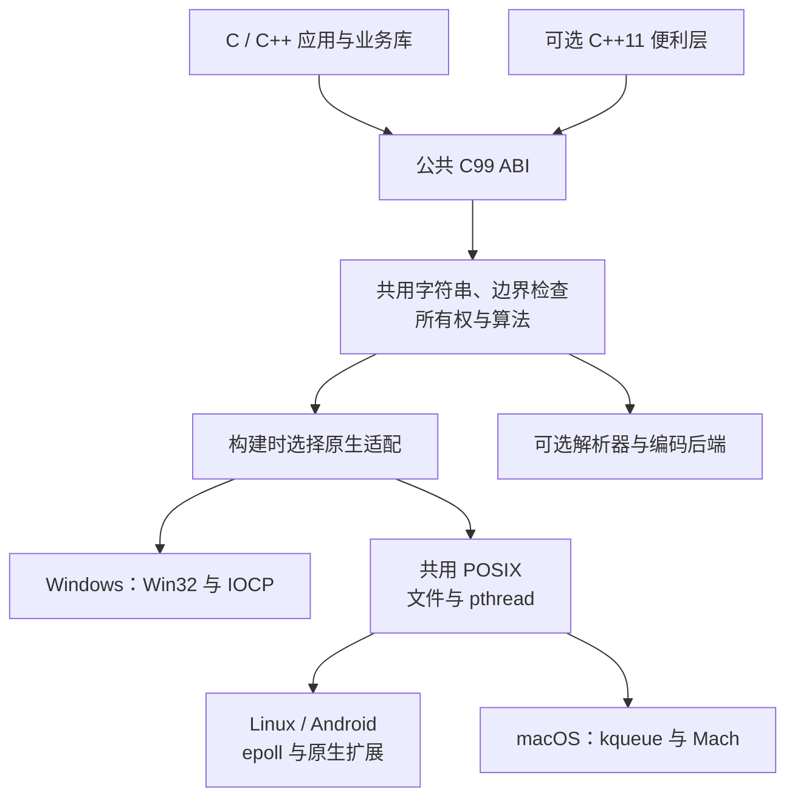
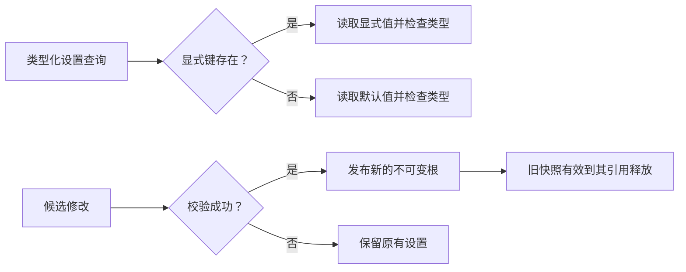
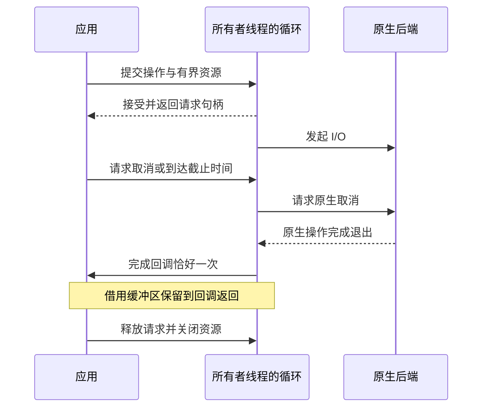
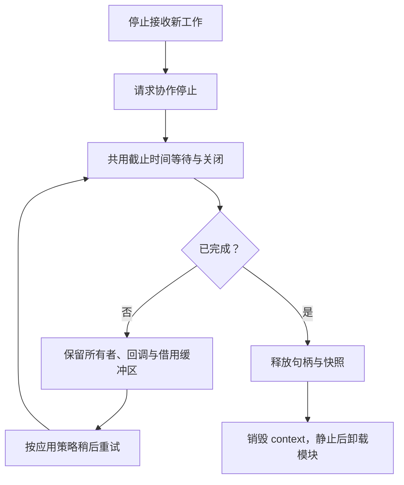

# hx_c_platform 详细参考

[English](REFERENCE.md) · [首页](../README.zh-CN.md) · [常用任务教程](USAGE.zh-CN.md)

这份参考集中说明平台差异、接口限制、资源管理、构建开关和验证状态。第一次使用时，先阅读首页和常用任务教程；需要了解某个操作的边界，再查询这里。除另有说明，构建命令在库源码根目录执行。

- [1. 项目定位与接口边界](#section-1)
- [2. 平台、语言与验证状态](#section-2)
- [3. 分层架构、目录与后端选择](#section-3)
- [4. 构建并运行第一个程序](#section-4)
- [5. 工程接入、安装与链接](#section-5)
- [6. 错误状态、context 与分配器所有权](#section-6)
- [7. UTF-8 字符串与字符编码转换](#section-7)
- [8. 文件、目录与原子发布](#section-8)
- [9. 环境变量、常用目录与进程身份](#section-9)
- [10. 配置文件解析与序列化](#section-10)
- [11. 可变设置、默认值与快照](#section-11)
- [12. C 容器与元素所有权](#section-12)
- [13. 时钟、截止时间与精细等待](#section-13)
- [14. 线程、同步与线程局部存储](#section-14)
- [15. C 线程池与延迟任务](#section-15)
- [16. C++11 任务、结果与协作取消](#section-16)
- [17. 原子操作、对齐与内存序](#section-17)
- [18. 网络与事件循环](#section-18)
- [19. 管道、本地 IPC 与进程输出捕获](#section-19)
- [20. 周期定时器与目录监听](#section-20)
- [21. 系统信息与动态库](#section-21)
- [22. 内存池、arena、页与文件映射](#section-22)
- [23. 随机数、UUID、宽位运算与位工具](#section-23)
- [24. 日期文本、翻译文件与格式化文件名](#section-24)
- [25. 信号、命名过程与区间 profiler](#section-25)
- [26. 有界词法分析](#section-26)
- [27. 构建开关与可选依赖](#section-27)
- [28. Android 与嵌入式 Linux 构建](#section-28)
- [29. ABI、所有权与关闭契约](#section-29)
- [30. 测试、CI 与性能证据](#section-30)
- [31. 工程规范、平台扩展与许可](#section-31)
- [32. 详细文档与可运行示例](#section-32)

<a id="section-1"></a>

## 1. 项目定位与接口边界

`hx_c_platform` 是独立的 C99 基础库，提供 C ABI 和可选的 C++11 便利层。业务项目通过同一套接口使用常见系统能力，共用逻辑和原生平台适配由库内部承担。当前版本为 **0.1.0**，项目与接口名称仍属于暂定命名，尚未宣布稳定 ABI 发布。

常用入口负责完成整个动作：读取 UTF-8 文件到 `hx_string`、查询环境变量、加载翻译文件、启动进程并收集输出、提交线程池任务。只有需要调整容量、限制或行为时才传 options。普通使用不要求先执行一串全局运行环境初始化。

| 基础库负责 | 消费者负责 |
| --- | --- |
| 文件、Unicode 路径、字符串、编码转换、配置树 | 业务配置结构、校验策略、保存时机 |
| 线程、同步、有界线程池、异步 I/O | 任务依赖、业务调度、关闭决策 |
| 原生错误、分配器、资源所有权 | 日志记录、诊断展示、恢复策略 |
| 文件发布与时间戳机制 | 日志轮转、保留数量、格式与过滤 |
| 区间 profiler 和原生系统查询 | 崩溃策略、LocalDumps 配置、日志历史环 |

基础库可以脱离 hx_c_log 独立构建、测试、安装和使用，不强制依赖 Qt、C++ 或 OBS 运行库。借鉴 OBS 的是统一接口、共用实现与构建选择平台实现的组织方式。 hx_c_log 接入与协程仍属于后续工作。线程局部存储 **TLS** 与网络加密 TLS 是不同概念；本库没有内置网络加密协议栈。

<a id="section-2"></a>

## 2. 平台、语言与验证状态

| 目标 | 设计基线 | 已有证据 |
| --- | --- | --- |
| Windows | 保留 Win7 SP1 / 8.1 兼容要求；x86/x64 | 本地 MSVC x86/x64 构建和运行；旧系统待实测 |
| Linux | 使用原生 POSIX/Linux API | WSL GCC/Clang 构建和运行 |
| macOS | Intel 10.13、ARM64 11.0；通用构建默认 11.0 | 已有适配代码；Apple 主机构建与运行待验证 |
| 嵌入式 Linux | ARMv7-A / AArch64；libc 和 ABI 由 SDK 决定 | glibc 交叉编译与部分 QEMU 运行；真实板卡待验证 |
| Android | API 21，arm64-v8a 与 armeabi-v7a；额外覆盖 API 28 | 两种 ARM ABI 已交叉编译；API 34 模拟器记录见后文 |
| iOS / BSD | 可复用部分 POSIX 和共用代码 | 尚未作为完整适配目标交付 |
| FreeRTOS / 裸机 | 需要另行确定内存、线程和文件系统模型 | 不在当前范围 |

C 核心需要编译成库，**不是 header-only**；只有可选 C++ 便利层是仅头文件。已验证 C++11，不宣称 C++14/17/20 矩阵通过。CMake 最低基线为 **3.16**。编译器、CRT 和 SDK 的兼容性需要与操作系统 API 兼容性分别确认，尤其是 Win7 部署，不能因接口保留兼容就宣称当前工具链生成的所有二进制都能直接运行。

徽章记录截至 **2026-10-01** 的本地证据：Windows 84 项、Linux 86 项 CTest，数字表示测试条目，不是断言数量；Linux 多两项原生随机源故障测试。 GitHub Actions 已配置，未宣称远程 CI 已通过。Android 的十一项集合不等于桌面全部测试。具体配置与限制见[验证记录](VALIDATION.zh-CN.md)。

<a id="section-3"></a>

## 3. 分层架构、目录与后端选择



默认通过 CMake 选择实现并直接调用。操作系统、编译器、CPU 架构与可选依赖分别处理，不把兼容的 POSIX 代码复制到每个平台目录。必要的条件编译集中在底层，业务调用不需要到处判断平台。未知目标在配置阶段失败；不能提供的能力明确报告，不用空实现返回成功。

```text
hx_c_platform/
├── include/
│   ├── hx_os.h                 公共 C 汇总头
│   ├── hx_os_*.h               系统设施与工具契约
│   ├── hx_string.h             UTF-8 字符串与借用视图
│   ├── hx_container.h          通用容器与类型化 POD 容器
│   ├── hx_config.h             不可变配置文档
│   ├── hx_settings.h           可变设置与快照
│   └── hx/*.hpp                可选 C++11 便利层
├── src/                       共用实现
│   ├── windows/               Windows 适配
│   ├── posix/                 POSIX 共用适配
│   ├── linux/                 Linux / Android 后端部分
│   └── apple/                 Apple 后端部分
├── cmake/                     开关、安装包与 SDK 工具链
├── examples/                  可编译的常用任务示例
├── tests/                     契约、独立头文件和安装消费测试
├── benchmarks/                开发用性能探针
├── tools/                     依赖准备与验证工具
└── docs/                      分开的中英文文档
```

| 头文件组 | 主要职责 |
| --- | --- |
| `hx_os_base.h`、`hx_os_atomic.h` | 错误、context、时钟、能力查询、原子操作 |
| `hx_os_file.h`、`hx_os_file_extra.h` | 文件、路径、目录遍历、属性与文件锁 |
| `hx_os_text.h`、`hx_string.h` | 编码转换、Unicode 校验和字符串 |
| `hx_config.h`、`hx_settings.h`、`hx_container.h` | 配置文档、可变值与容器 |
| `hx_os_thread.h`、`hx_os_pool.h`、`hx_os_wait.h` | 线程、TLS、同步、任务与等待 |
| `hx_os_net.h`、`hx_os_loop.h`、`hx_os_loop_fd.h` | 套接字、异步请求与原生描述符就绪 |
| `hx_os_pipe.h`、`hx_os_local.h`、`hx_os_process.h` | 管道、本地 IPC 与进程 |
| `hx_os_timer.h`、`hx_os_watch.h` | 周期定时器与目录通知 |
| `hx_os_sysinfo.h`、`hx_os_system.h`、`hx_os_library.h` | 系统指标、身份、CPU 能力与动态库 |
| `hx_os_memory.h`、`hx_os_vm.h` | 内存池、arena、页与文件映射 |
| `hx_os_util.h`、`hx_os_bits.h`、`hx_os_wide.h`、`hx_os_bitstream.h` | 随机数、UUID、CRC、整数与位工具 |
| `hx_os_calendar.h`、`hx_os_text_lookup.h`、`hx_os_lexer.h` | 日期文本、翻译表与词法分析 |
| `hx_os_signal.h`、`hx_os_procedure.h`、`hx_os_profiler.h` | 信号、命名过程与区间计时树 |
| `hx_os_env.h`、`hx_os_paths.h`、`hx_os_posix.h` | 环境变量、常用目录与 POSIX 时钟换算 |
| `hx_os_registry.h`、`hx_os_power.h`、`hx_os_obfuscate.h` | 注册表、作用域电源请求与字符串混淆 |

<a id="section-4"></a>

## 4. 构建并运行第一个程序

### 4.1 桌面构建

在源码根目录运行。下列命令也适用于 CMake 3.16；多配置生成器在构建和测试阶段选择 Release。

```sh
cmake -S . -B build -DCMAKE_BUILD_TYPE=Release
cmake --build build --config Release --parallel 4
cd build
ctest -C Release --output-on-failure
cd ..
```

Windows 使用较新 CMake 时，可以显式选择 VS2022：

```powershell
cmake -S . -B build-msvc -G "Visual Studio 17 2022" -A x64
cmake --build build-msvc --config Release --parallel 4
```

CMake 3.16 早于 VS2022 生成器；使用该版本时，可在配置好的 MSVC 开发者终端中选择 NMake。纯 C 部署关闭测试和示例后，不需要启用 C++ 编译器。

### 4.2 使用 C 读取 UTF-8 文本

保存为 `main.c`，在程序工作目录放一个 UTF-8 编码的 `配置.json`。这一调用会完成打开、读取、移除开头的 UTF-8 BOM、校验和关闭，默认最多读取 16 MiB。失败时，输出字符串保持原值。

```c
#include <hx_os.h>
#include <stdio.h>

int main(void)
{
	hx_string text = HX_STRING_INIT;
	hx_os_error error;
	hx_os_status status =
		hx_os_file_read_text("配置.json", &text, &error);
	if (status == HX_OS_OK)
		puts(hx_string_c_str(&text));
	else {
		char message[2304];
		size_t required;
		if (hx_os_error_message(&error, message, sizeof(message),
			    &required) == HX_OS_OK)
			fprintf(stderr, "%s\n", message);
		else
			fprintf(stderr, "%s\n", hx_os_status_name(status));
	}
	hx_string_destroy(&text);
	return status == HX_OS_OK ? 0 : 1;
}
```

### 4.3 对应的 C++11 调用

C++ 便利层返回 `Result<T>`，通过 `ok()` 检查成功，再读取 `value()` 或 `error()`；文本结果为持有 UTF-8 存储的 `hx::String`，底层继续调用同一套 C 接口。库代码不使用异常机制，关闭异常编译也保留可诊断的分配失败。完整的部分结果、回调、所有权和旧接口迁移说明见 [C++ Result 契约](CPP_RESULTS.zh-CN.md)。

```cpp
#include <hx/Files.hpp>
#include <hx/Paths.hpp>
#include <cstdio>

int main()
{
	auto text = hx::Files::readText("配置.json");
	if (!text) {
		std::fprintf(stderr, "%s\n",
			hx_os_status_name(text.status()));
		return 1;
	}
	auto path = hx::Paths::configFile("hx_example", "settings.json");
	if (!path) {
		std::fprintf(stderr, "%s\n",
			hx_os_status_name(path.status()));
		return 1;
	}
	std::printf("%s\n%s\n", text.value().c_str(),
		path.value().c_str());
	return 0;
}
```

### 4.4 原地处理、连续设置与直接遍历

字符串创建成功后，ASCII 去空白和大小写转换原地执行，不再分配，也不需要逐步检查。`Settings::update()` 和 `CallData::edit()` 立即执行各项设置，在 `finish()` 处检查一次；首次失败后跳过后续项。目录遍历在内部完成打开、读取、复用文件名缓冲区及关闭。下面是完整程序，对应 [direct_calls.cpp](../examples/direct_calls.cpp)。

设置名称使用持有引用的 `SettingStringView`，修改或关闭设置后仍有效。参数包名称使用借用的 `StringView`，读取期间必须保持参数包有效且不被修改。涉及分配、I/O 或其他可能失败的操作继续返回可检查的结果。

```cpp
#include <hx/Files.hpp>
#include <hx/Settings.hpp>
#include <hx/Signal.hpp>
#include <cstdio>

static int report_failure(hx_os_status status)
{
	std::fprintf(stderr, "%s\n", hx_os_status_name(status));
	return 1;
}
int main()
{
	auto text = hx::String::copy("  Hello 中文😀  ");
	if (!text)
		return report_failure(text.status());
	text.value().trimAscii().lowerAscii();
	std::puts(text.value().c_str());
	if (hx_os_capabilities() & HX_OS_CAP_SETTINGS) {
		hx_settings *owner = NULL;
		hx::Settings settings(owner);
		auto created = settings.create();
		if (!created)
			return report_failure(created.status());
		auto changed = settings.update()
				       .setInt("port", 8080)
				       .setString("label", "服务😀")
				       .finish();
		auto label = settings.stringView("label");
		auto closed = settings.closeUntil(HX_OS_DEADLINE_NOW);
		if (!closed)
			return report_failure(closed.status());
		if (!changed)
			return report_failure(changed.status());
		if (!label)
			return report_failure(label.status());
		/* The lease owns immutable bytes after the settings close. */
		std::puts(label.value().c_str());
	}
	if (hx_os_capabilities() & (HX_OS_CAP_SIGNALS | HX_OS_CAP_PROCEDURES)) {
		hx::CallData data;
		auto prepared = data.edit()
					.setInt("number", 42)
					.setString("label", text.value().view())
					.finish();
		if (!prepared)
			return report_failure(prepared.status());
		auto label = data.view().stringView("label");
		if (!label)
			return report_failure(label.status());
		std::printf("%.*s\n", static_cast<int>(label.value().size()),
			label.value().data());
	}
	auto listed =
		hx::Directory::forEach(".", [](hx::StringView name) noexcept {
			std::printf("Entry: %.*s\n",
				static_cast<int>(name.size()), name.data());
			return false;
		});
	return listed ? 0 : report_failure(listed.status());
}
```

<a id="section-5"></a>

## 5. 工程接入、安装与链接

### 5.1 通过源码子目录接入

假设库源码位于应用的 `external/hx_c_platform`：

```cmake
cmake_minimum_required(VERSION 3.16)
project(my_app LANGUAGES C)
set(HX_OS_BUILD_TESTS OFF CACHE BOOL "" FORCE)
set(HX_OS_BUILD_EXAMPLES OFF CACHE BOOL "" FORCE)
add_subdirectory(external/hx_c_platform)
add_executable(my_app main.c)
set_target_properties(my_app PROPERTIES
	C_STANDARD 99 C_STANDARD_REQUIRED YES C_EXTENSIONS NO)
target_link_libraries(my_app PRIVATE hx_c_platform::hx_c_platform)
if(MSVC)
	target_compile_options(my_app PRIVATE /utf-8)
endif()
```

### 5.2 消费安装后的 CMake 包

```sh
cmake --install build --config Release --prefix /absolute/install/prefix
```

消费者工程：

```cmake
cmake_minimum_required(VERSION 3.16)
project(my_app LANGUAGES C)
find_package(hx_c_platform 0.1 CONFIG REQUIRED)
add_executable(my_app main.c)
set_target_properties(my_app PROPERTIES
	C_STANDARD 99 C_STANDARD_REQUIRED YES C_EXTENSIONS NO)
target_link_libraries(my_app PRIVATE hx_c_platform::hx_c_platform)
if(MSVC)
	target_compile_options(my_app PRIVATE /utf-8)
endif()
```

配置消费者时传入 `-DCMAKE_PREFIX_PATH=/absolute/install/prefix`。 C++ 应用改用 `LANGUAGES CXX`、`.cpp` 源文件并链接 `hx_c_platform::cpp`；该目标只为选择它的消费者添加 C++11 要求。使用导出目标后，不必手工拼接各操作系统的原生依赖库。

### 5.3 静态与动态部署

默认 `BUILD_SHARED_LIBS=OFF`；设为 ON 构建共享库。安装内容包括公共头、库、 CMake 导出和 pkg-config 元数据。导入目标携带共享库定义和静态链接所需依赖。相对安装目录支持重定位；显式配置的绝对目录保持原路径。

Windows 将 DLL 放在应用旁或运行时搜索路径中，并匹配架构、编译器运行库和构建配置。每个插件静态链接一份库，不代表各份库共享同一个分配器环境；对象应通过其来源库/context 释放，插件卸载前完成相关回调和资源清理。

<a id="section-6"></a>

## 6. 错误状态、context 与分配器所有权

### 6.1 状态值不能当作布尔值

| 状态 | 含义与处理方式 |
| --- | --- |
| `HX_OS_OK` | 成功；某些 I/O 仍可能只完成部分字节 |
| `HX_OS_EOF` | 输入结束，不是普通失败 |
| `HX_OS_TIMEOUT` | 等待预算耗尽；按契约保留资源 |
| `HX_OS_WOULD_BLOCK` | 暂时无法推进；等待或重试 |
| `HX_OS_OUTPUT_FULL` | 输出容量不足；查看所需容量或进度 |
| `HX_OS_NOT_FOUND` | 键或路径缺失；仅在需要时应用默认值 |
| `HX_OS_TYPE_MISMATCH` | 值存在但类型不对，不应静默回退默认值 |
| `HX_OS_LIMIT` | 达到配置的资源上限 |
| `HX_OS_NOT_SUPPORTED` | 模块关闭或平台无法提供该行为 |
| `HX_OS_BUSY` / `HX_OS_DEADLOCK` | 生命周期或自身等待限制阻止操作 |

`hx_os_error` 保留统一状态、原生错误域/错误码和可用的次要原因，不保存借用的临时诊断字符串。`hx_os_error_message` 写入调用者缓冲区；动态库扩展入口还可以将详细诊断写入调用者持有的 `hx_string`。基础库不通过 hx_c_log 报告自身错误，也不依赖全局“最后错误字符串”。

### 6.2 每个消费者持有自己的 context

`context=NULL` 使用不可变的默认分配器。自定义 context 复制分配器函数表，其中 user 状态借用到 context 成功销毁为止。回调需要支持跨线程释放和基础对齐；额外对齐由库的分配包装处理。对象存活期间不能更换分配器。

```c
#include <hx_os.h>
#include <stdlib.h>

static void *HX_OS_CALL allocate_bytes(size_t bytes, void *user)
{
	(void)user;
	return malloc(bytes);
}

static void HX_OS_CALL release_bytes(void *memory, void *user)
{
	(void)user;
	free(memory);
}

int main(void)
{
	hx_os_context_options options;
	hx_os_context *context = NULL;
	hx_string text;
	hx_os_status status;
	hx_os_context_options_init(&options);
	options.allocator.allocate = allocate_bytes;
	options.allocator.deallocate = release_bytes;
	options.allocator.user = NULL;
	status = hx_os_context_create(&options, &context, NULL);
	if (status != HX_OS_OK)
		return 1;
	hx_string_init(&text, context);
	status = hx_string_assign_cstr(&text, "owned by this context", NULL);
	hx_string_destroy(&text);
	if (hx_os_context_destroy(&context, NULL) != HX_OS_OK)
		return 2;
	return status == HX_OS_OK ? 0 : 1;
}
```

即使已初始化的字符串为空，也可能持有 context 的生命周期引用。先释放字符串、句柄、快照和 TLS 值，再销毁 context。仍有分配或引用时， `hx_os_context_destroy` 返回 BUSY。最终销毁期间应排除新调用进入；context 不是能够随意影响其他消费者的全局配置开关。

<a id="section-7"></a>

## 7. UTF-8 字符串与字符编码转换

### 7.1 字符串所有者与借用视图

`hx_string` 持有 UTF-8 内存，`hx_string_view` 只借用字节。默认分配器使用 `HX_STRING_INIT`；指定 context 时调用一次 `hx_string_init`。复制使用 `hx_string_copy`，转移使用 `hx_string_move`，结束后调用 `hx_string_destroy`。直接赋值结构体不等于复制一份独立的字符串。

```c
#include <hx_os.h>
#include <stdio.h>

int main(void)
{
	hx_string text = HX_STRING_INIT;
	hx_string_parts *parts = NULL;
	hx_os_status status;
	hx_os_text_result converted;
	unsigned char utf16[128];
	size_t i;
	status = hx_string_assign_cstr(&text, " alpha,beta,中文😀 ", NULL);
	if (status == HX_OS_OK) {
		hx_string_trim_ascii_in_place(&text);
		status = hx_string_split(&text,
			hx_string_view_from_cstr(","), &parts, NULL);
	}
	if (status == HX_OS_OK) {
		for (i = 0; i < hx_string_parts_count(parts); ++i) {
			hx_string_view part;
			status = hx_string_parts_at(parts, i, &part);
			if (status != HX_OS_OK)
				break;
			(void)fwrite(part.data, 1, part.size, stdout);
			putchar('\n');
		}
	}
	if (status == HX_OS_OK)
		status = hx_string_encode(&text, HX_OS_UTF16LE, utf16,
			sizeof(utf16), &converted, NULL);
	if (status == HX_OS_OK)
		printf("UTF-16 bytes: %zu\n", converted.output_used);
	hx_string_parts_destroy(&parts);
	hx_string_destroy(&text);
	return status == HX_OS_OK ? 0 : 1;
}
```

| 操作 | 接口组 |
| --- | --- |
| 赋值、追加、预留容量 | `hx_string_assign`、`append`、`reserve` |
| 插入、删除、替换 | `hx_string_insert`、`erase`、`replace` |
| 查找、比较、前后缀 | `hx_string_find`、`compare`、`starts_with`、`ends_with` |
| 去空白、ASCII 大小写、全部替换 | `hx_string_trim_ascii`、`lower_ascii`、`upper_ascii`、`replace_all` |
| 拆分与拼接 | `hx_string_split`、`hx_string_parts_at`、`hx_string_join` |
| 格式化 | `hx_string_format`、`hx_string_append_format` |
| 解码与编码 | `hx_string_assign_encoded`、`hx_string_encode` |

长度和偏移以字节计；Unicode 码点数量不等于用户看到的字素数量。允许嵌入 NUL，但 C 字符串消费者会在 NUL 处停止。普通视图在修改或销毁后失效；split 持有输入副本，其视图可保留到 parts_destroy。拆分默认最多 4096 项并保留空项。 ASCII 大小写和去空白不包含 Unicode 大小写折叠、规范化或本地化排序。 printf 格式化遵循调用者 locale；需要 locale 无关数字转换时使用专用工具。

对有效、已初始化的字符串，可直接调用 `hx_string_trim_ascii_in_place`、`lower_ascii_in_place` 和 `upper_ascii_in_place`。这些 void 入口不分配内存，保留非 ASCII UTF-8 字节；C++ 可在同一对象上调用 `trimAscii().lowerAscii()`。赋值、追加、预留容量仍可能失败，既有返回状态码的 ASCII 接口继续保留。

### 7.2 Windows 路径与传统编码

公共路径统一是 UTF-8，Windows 适配层内部转换为 UTF-16，不猜测 ANSI 代码页，不暗中改变进程 locale。MSVC 消费者用 `/utf-8` 编译 UTF-8 源码字面量。控制台如何显示字符由宿主决定，支持 UTF-8 路径不代表自动修改 stdout 配置。

内置转换覆盖 UTF-8、UTF-16LE/BE、UTF-32LE/BE、ASCII、ISO-8859-1。可选 iconv 提供 GB2312、GBK、GB18030:2005/:2022、Big5、Shift-JIS、 EUC-JP/KR、Windows 1252/932/936/949/950 等编码标识，具体取决于后端能力。

```sh
python tools/fetch_iconv.py
cmake -S . -B build-text -DHX_OS_ENABLE_ICONV=ON \
  -DHX_OS_ICONV_SOURCE_DIR=/absolute/path/to/.deps/libiconv-1.18
cmake --build build-text --config Release --parallel 4
```

Python 3.12+ 工具准备固定版本并校验散列。CMake 不自动下载或修改第三方源码。启用 ICONV 但不提供源码路径时，选择检测到的系统 iconv。使用某种传统编码前调用 `hx_os_encoding_supported()`。严格字符串解码失败保持原值；流式转换可能已消费/产生部分数据，应同时检查状态和进度。编码输出不会自动追加结束符。

<a id="section-8"></a>

## 8. 文件、目录与原子发布

### 8.1 带进度的底层 I/O

`read_some` 区分 EOF、错误和实际读取字节数。`write_some` 允许成功但短写，调用者重试剩余部分；`write_all` 在内部完成循环，失败时仍报告已完成字节数。涉及共享文件位置的操作由调用者串行化。

```c
#include <hx_os.h>
#include <stdio.h>

int main(void)
{
	const char payload[] = "hello, 中文\n";
	hx_os_file *file = NULL;
	hx_os_error error;
	hx_os_status status, closed;
	size_t completed = 0;
	status = hx_os_file_open(NULL, "readme-output.txt",
		HX_OS_FILE_WRITE | HX_OS_FILE_CREATE | HX_OS_FILE_TRUNCATE,
		&file, &error);
	if (status != HX_OS_OK)
		return 1;
	status = hx_os_file_write_all(file, payload, sizeof(payload) - 1,
		&completed, &error);
	if (status == HX_OS_OK)
		status = hx_os_file_sync(file, &error);
	closed = hx_os_file_close(&file, NULL);
	if (status == HX_OS_OK)
		status = closed;
	if (status != HX_OS_OK)
		fprintf(stderr, "%s after %zu bytes\n",
			hx_os_status_name(status), completed);
	return status == HX_OS_OK ? 0 : 1;
}
```

文件对象没有用户态流缓冲区。`hx_os_file_sync` 通过 fsync/FlushFileBuffers 请求持久化，不能保证存储硬件断电后的行为。文件 close **即使失败也消耗句柄**，这与线程或异步 I/O 所有者的可重试关闭不同；不能对已经消耗的原生句柄再次 close。

C++ `File::read()` 在文件结束时返回成功的 `ReadResult`，通过 `eof=true` 表达结束；`readSome()` 和 `readAt()` 继续保留既有 EOF 状态。真正失败时仍可用 `hasValue()` 取得已完成字节数。

### 8.2 保存并发布完整文件

`hx_os_file_save` 保存完整字节串，`hx_os_file_write_text` 原子发布已初始化的 UTF-8 字符串。 `hx_os_file_save_atomic_ex` 在同一目录创建临时文件，完整写入并同步后执行替换，分别报告“已经发布”与“目录持久化请求”的结果。

```c
#include <hx_os.h>
#include <stdio.h>

int main(void)
{
	const char json[] = "{\"port\":8080}\n";
	hx_os_file_save_result result;
	hx_os_status status = hx_os_file_save_atomic_ex(
		"readme-settings.json", json, sizeof(json) - 1, &result, NULL);
	if (status != HX_OS_OK)
		return 1;
	printf("published=%d directory_synced=%d\n",
		result.published, result.directory_synced);
	if (result.durability_error.status != HX_OS_OK)
		fprintf(stderr, "Directory sync: %s\n",
			hx_os_status_name(result.durability_error.status));
	return 0;
}
```

带备份替换不是自动回滚事务；跨文件系统移动不会偷偷变成复制。替换失败时，保留原生错误和可供恢复的现场，不能假设所有中间步骤都没有发生。

### 8.3 其他文件能力

| 需求 | 接口与示例 |
| --- | --- |
| 复制、存在检查、整文件读取、路径组合 | `hx_os_file.h`；[text_file.c](../examples/text_file.c) |
| 直接目录遍历、有界 glob、递归删除 | `hx_os_directory_visit`、`hx::Directory::forEach`；递归删除不跟随链接 |
| 不改变文件位置的 I/O | `hx_os_file_read_at`、`write_at`；[positioned_read.c](../examples/positioned_read.c) |
| 扩展类型与时间戳 | `hx_os_path_stat_extended`；[file_info.c](../examples/file_info.c) |
| 区间锁、时间戳和权限 | `hx_os_file_extra.h`；[file_attributes.c](../examples/file_attributes.c) |

定位读写不改变共享位置，但重叠写入、truncate 和 close 仍需协调；追加模式的定位写入明确拒绝。权限摘要不是 ACL 或实际访问许可检查。路径工具只做词法处理，不构成安全沙箱或符号链接范围限制。

<a id="section-9"></a>

## 9. 环境变量、常用目录与进程身份

字符串输出入口避免消费者反复编写容量查询和重试。环境变量空值与不存在不同。

```c
#include <hx_os.h>
#include <stdio.h>

int main(void)
{
	hx_string path = HX_STRING_INIT;
	hx_string value = HX_STRING_INIT;
	hx_os_status status =
		hx_os_path_config_file("my_app", "settings.json", &path, NULL);
	if (status == HX_OS_OK)
		puts(hx_string_c_str(&path));
	if (status == HX_OS_OK) {
		status = hx_os_env_get_string("HX_APP_MODE", &value, NULL);
		if (status == HX_OS_NOT_FOUND)
			status = hx_string_assign_cstr(&value, "production",
				NULL);
	}
	if (status == HX_OS_OK)
		puts(hx_string_c_str(&value));
	hx_string_destroy(&value);
	hx_string_destroy(&path);
	return status == HX_OS_OK ? 0 : 1;
}
```

| 查询 | 入口 |
| --- | --- |
| 用户主目录、配置目录、数据目录 | `hx_os_path_home_string`、`config_home_string`、`data_home_string` |
| 机器共享数据目录 | `hx_os_path_program_data_string` |
| 临时目录 | `hx_os_path_temp_string` |
| 可执行文件路径、本模块目录 | `hx_os_path_executable_string`、`module_string` |
| 环境变量读取、设置、删除和枚举 | `hx_os_env_*` |
| UTF-8 启动参数、PID、主机名、CPU 能力 | `hx_os_system.h` |

目录查询不自动创建目录，也不保证目录可写。用户数据与机器共享数据是两个概念。显式修改环境变量影响本进程与未来子进程；宿主需协调原生 API 和其他库对环境的修改。库不隐式切换工作目录。

CPU 能力判断包含系统是否允许使用对应指令状态，不只读取硬件标志；不能确定仿真状态时不会直接报告“原生运行”。完整示例见 [special_paths.c](../examples/special_paths.c) 与 [environment.c](../examples/environment.c)。

<a id="section-10"></a>

## 10. 配置文件解析与序列化

### 10.1 格式和后端

默认后端始终是 BUILTIN，安装依赖不会悄悄改变解析行为。通过 `options.backend` 显式选择，并调用 `hx_os_config_backend_available(format, backend)` 查询。

| 格式 | 内置语法范围 | 可选 C 后端 |
| --- | --- | --- |
| JSON | 严格值、对象、数组、转义、精确保留数字文本 | cJSON 1.7.19 |
| YAML | 单文档、块映射/序列和标量值 | libyaml 0.2.5 |
| XML | UTF-8 XML 1.0 元素、属性、混合文本和 CDATA | Mini-XML 4.0.6 |
| INI | 分节与字符串键值 | inih r62 |
| TOML | 常用表、点号键、标量、数组和内联表 | tomlc17 R260821 |
| ENV | 明确的 dotenv 方言，不执行 shell | 内置 |
| .properties | UTF-8 Java 风格语法和 Unicode 转义 | 内置 |

这些是明确界定的语法范围。内置 YAML 不等于完整 YAML 1.2；两个后端都拒绝锚点、别名与自定义标签。XML 不加载外部实体或 DTD。TOML 多行字符串、表数组、日期时间需要 tomlc17。传统 ISO-8859-1 properties 输入应先显式转换。详细限制与差异见[配置格式契约](CONFIGURATION.zh-CN.md)。

### 10.2 解析、查询与释放

下面的完整程序解析内存中的 TOML，并读取 `/server/port`：

```c
#include <hx_os.h>

#include <inttypes.h>
#include <stdio.h>
#include <string.h>

int main(void)
{
	static const char input[] =
		"title = '中文 configuration'\n[server]\nport = 8080\n";
	hx_os_config_document *document = NULL;
	hx_os_config_error error;
	const hx_os_config_node *port;
	hx_os_status status;
	int64_t number;
	if (!hx_os_config_backend_available(
		    HX_OS_CONFIG_TOML, HX_OS_CONFIG_BUILTIN)) {
		puts("Configuration module is disabled.");
		return 0;
	}
	status = hx_os_config_parse(NULL, HX_OS_CONFIG_TOML, input,
		strlen(input), NULL, &document, &error);
	if (status != HX_OS_OK) {
		fprintf(stderr, "%s at %zu:%zu: %s\n", error.source, error.line,
			error.column, error.message);
		return 1;
	}
	status = hx_os_config_pointer(
		hx_os_config_root(document), "/server/port", &port);
	if (status == HX_OS_OK)
		status = hx_os_config_get_i64(port, &number);
	if (status == HX_OS_OK)
		printf("Server port: %" PRId64 "\n", number);
	else
		fprintf(stderr, "Server port: %s\n", hx_os_status_name(status));
	hx_os_config_release(document);
	return status == HX_OS_OK ? 0 : 1;
}
```

输入仅在 parse 调用期间借用，文档需要保留的内容会复制。文档不可变并采用引用计数，节点和切片借用文档；只保留一个节点指针并不会延长文档寿命。查询使用精确键名，JSON Pointer 使用 `/` 分段，不把点号自动当作路径。类型不符返回 TYPE_MISMATCH，缺失返回 NOT_FOUND。

默认上限为输入 1 MiB、解析内存 16 MiB、65,536 个节点、深度 64、 16,777,216 个工作单位。解析不会启动后台线程或修改进程环境。配置错误包含状态和可用的源位置，不直接转发可能夹带配置秘密值的后端错误文本。

### 10.3 写出可表示的数据

`hx_os_config_serialize` 支持 JSON、INI 和 properties；`hx_os_config_save` 组合序列化与原子发布。目标格式无法表示的类型/嵌套明确失败，不静默展平或转换类型。能够解析七种格式，不代表存在七种无损序列化器。示例见 [config_save.c](../examples/config_save.c)，可选后端构建命令见第 27 节。

<a id="section-11"></a>

## 11. 可变设置、默认值与快照

`hx_config` 保持不可变。独立的 `hx_settings` 持有用户显式值和默认值两层，只有键缺失时才使用默认值；类型错误、文件损坏仍然报告。设置字符串、数组和对象会复制必要内容，用户指针按借用处理，不自动释放。



```c
#include <hx_os.h>
#include <stdio.h>
int main(void)
{
	hx_settings *settings = NULL;
	hx_settings_string_ref label = HX_SETTINGS_STRING_REF_INIT;
	hx_string json = HX_STRING_INIT;
	int64_t port;
	hx_os_error error;
	hx_os_status status = hx_settings_create(NULL, &settings, &error);
	if (status == HX_OS_OK)
		status = hx_settings_set_default_i64(
			settings, "port", 80, &error);
	if (status == HX_OS_OK) {
		hx_settings_update update = hx_settings_update_begin(settings);
		hx_settings_update_set_i64(&update, "port", 8080);
		hx_settings_update_set_string(&update, "label", "服务😀");
		status = hx_settings_update_finish(&update, NULL, &error);
	}
	if (status == HX_OS_OK)
		status = hx_settings_get_i64(settings, "port", &port, &error);
	if (status == HX_OS_OK)
		status = hx_settings_get_string_ref(
			settings, "label", &label, &error);
	if (status == HX_OS_OK)
		printf("%s: %lld\n", label.text.data, (long long)port);
	if (status == HX_OS_OK && (hx_os_capabilities() & HX_OS_CAP_CONFIG) &&
		(hx_os_capabilities() & HX_OS_CAP_CONFIG_SERIALIZE)) {
		status = hx_settings_to_json(settings, &json, &error);
		if (status == HX_OS_OK)
			puts(hx_string_c_str(&json));
	}
	if (settings) {
		hx_os_status closed = hx_settings_destroy(&settings, NULL);
		if (status == HX_OS_OK)
			status = closed;
	}
	hx_settings_string_ref_destroy(&label);
	hx_string_destroy(&json);
	if (status != HX_OS_OK)
		fprintf(stderr, "%s\n", hx_os_status_name(status));
	return status == HX_OS_OK ? 0 : 1;
}
```

通过 `hx_settings_snapshot` 获取持有引用的不可变树，结束后调用 `hx_settings_value_release`。快照可以比设置对象活得更久，同时保留其 context。限制针对每棵树，不是调用者保留全部历史快照后的总内存配额。默认 JSON 保存只记录显式值，默认值继续由程序提供；加载失败保持旧状态。并发修改采用有界重试，可能返回 BUSY。完整契约见[平台工具中的设置说明](PLATFORM_UTILITIES.zh-CN.md)。

连续设置中的每次成功都立即提交，并按原规则通知观察者。端口成功、名称失败时，端口保留，后续设置不执行。`hx_settings_update_finish`／C++ `finish()` 返回首次错误及成功设置次数，失败时也保留次数。它不执行延迟提交，也不回滚之前的修改；各 setter 执行期间设置 owner 必须有效。

`hx_settings_get_string_ref` 持有不可变字符串引用，无需复制字节。先使用 `HX_SETTINGS_STRING_REF_INIT`，通过 `hx_settings_string_ref_copy` 复制持有关系，再用 `hx_settings_string_ref_destroy` 释放；直接结构体赋值不等于增加引用。修改或关闭设置后该引用仍有效，会继续持有分配器 context。C++ `SettingStringView` 提供相同生命周期。`integerOr`、`booleanOr`、`realOr` 和 `stringOr` 只对 NOT_FOUND 使用默认值。

<a id="section-12"></a>

## 12. C 容器与元素所有权

可选容器模块提供 vector、deque、queue、stack、list、最大堆、有序/hash map 和 set。它是基于元素尺寸和回调的 C 容器设施，不是模拟 C++ 模板的另一套语言。

### 12.1 类型化 POD vector

```c
#include <hx_os.h>
#include <stdio.h>

HX_OS_DECLARE_VECTOR(int_values, int)

int main(void)
{
	int_values *values = NULL;
	hx_os_status status = int_values_create(NULL, 128, &values, NULL);
	if (status == HX_OS_OK)
		status = int_values_push(values, 42, NULL);
	if (status == HX_OS_OK) {
		const int *first = int_values_at(values, 0);
		if (first)
			printf("%d, size=%zu\n", *first,
				int_values_size(values));
	}
	if (values) {
		hx_os_status closed = int_values_destroy(&values, NULL);
		if (status == HX_OS_OK)
			status = closed;
	}
	return status == HX_OS_OK ? 0 : 1;
}
```

`HX_OS_DECLARE_QUEUE(name, type)` 提供对应的 FIFO 适配。生成的函数使用小写前缀，复用已有 sequence 实现。宏用于可按字节复制的值，不能直接装入具有所有权的 `hx_string` 或非平凡 C++ 对象。

### 12.2 通用容器

用元素尺寸初始化 `hx_os_container_options`，再设置元素数、字节数和对齐限制。持有资源的元素提供 copy/drop 回调；字符串预设执行深拷贝。普通插入复制， `_take` 仅成功时转移所有权。pop/erase 是否向输出移交元素，由具体操作契约决定。

有序 map 的查找、插入、删除为 O(log n)；hash 键按精确字节比较，遍历保留插入顺序。hash 存储私有使用未修改的 uthash 2.4.0。视图和迭代器不能跨任意修改继续使用，容器也不会自动替业务完成线程同步。见[容器契约](CONTAINERS.zh-CN.md)和 [queue 示例](../examples/containers.c)。

<a id="section-13"></a>

## 13. 时钟、截止时间与精细等待

| 值或入口 | 单位与行为 |
| --- | --- |
| `hx_os_wall_time_read` | Unix 毫秒，可能随系统校时跳变 |
| `hx_os_monotonic_read` | 纳秒、排除系统休眠；单位不等于分辨率 |
| `hx_os_deadline_after_ms` | 相对毫秒转换为本库单调时钟的绝对截止时间 |
| `HX_OS_DEADLINE_NOW` | 立即尝试，已就绪仍可成功 |
| `HX_OS_DEADLINE_INFINITE` | 只在允许的接口中显式无限等待 |
| `hx_os_sleep_until` | 常规低 CPU 等待 |
| `hx_os_sleep_until_precise_ex` | 先睡眠，再在指定预算内短暂自旋 |

组合关闭步骤应共用一个 deadline，不为每步重新发放完整超时。原生 timespec 换算放在 POSIX 边界，不能把本库时间值当作任意原生时钟的绝对值。

当前线程上的简单周期任务无需先搭建 loop：

```c
#include <hx_os.h>
#include <stdio.h>

static hx_os_status HX_OS_CALL tick(void *user, hx_os_error *error)
{
	unsigned *count = user;
	(void)error;
	printf("tick %u\n", ++*count);
	return HX_OS_OK;
}

int main(void)
{
	unsigned count = 0;
	hx_os_status status = hx_os_repeat_until(10, 3, tick, &count,
		hx_os_deadline_after_ms(1000), NULL, NULL);
	return status == HX_OS_OK && count == 3 ? 0 : 1;
}
```

repeat 在一个间隔后首次调用，错过多个周期时合并，回调返回 EOF 可正常停止。不能抢占正在执行的回调。精细等待默认自旋窗口为 200 us，`_ex` 允许 0..10 ms， 0 退回普通睡眠；精细等待不接受 INFINITE。不改变系统全局计时器精度，不创建隐藏线程，也不保证硬实时。兼容 Win7 的 tick 时钟会限制短等待，QPC 只用于约束自旋预算而不改变时钟语义。目标实测见[审查报告](BUG_MEMORY_LEAK_AUDIT.zh-CN.md)。

<a id="section-14"></a>

## 14. 线程、同步与线程局部存储

### 14.1 超时后保留工作线程状态

下面的函数操作应用持有的 `app_worker`。start 后保持对象有效；finish 接收单调截止时间，超时后保留对象并重试。只有成功完成后才能读取 `answer`。

```c
#include <hx_os.h>

typedef struct app_worker {
	hx_os_thread *thread;
	int answer;
} app_worker;

static void *HX_OS_CALL calculate(void *user)
{
	app_worker *worker = user;
	worker->answer = 42;
	return NULL;
}

hx_os_status app_worker_start(app_worker *worker, hx_os_error *error)
{
	worker->thread = NULL;
	worker->answer = 0;
	return hx_os_thread_create(NULL, calculate, worker, &worker->thread,
		error);
}

hx_os_status app_worker_finish(app_worker *worker,
	hx_os_deadline deadline, hx_os_error *error)
{
	hx_os_status status = hx_os_thread_join_until(
		worker->thread, deadline, NULL, error);
	if (status == HX_OS_OK)
		status = hx_os_thread_destroy(&worker->thread, error);
	return status;
}
```

同一线程同时只允许一个 joiner，join 成功包含原生 TLS 清理，然后才能 destroy。超时不会强杀或分离线程。扩展选项包括名称、栈大小、优先级和亲和性；平台不能提供严格绑定时返回 NOT_SUPPORTED。线程退出后，原生线程 ID 可能被复用。

### 14.2 先选择需要的同步语义

| 原语 | 契约 |
| --- | --- |
| 互斥锁 | 创建时选择普通/递归；遵守锁所有者和生命周期规则 |
| 条件变量 | 持锁等待，用循环重新检查条件；通知本身不保留 |
| 手动复位事件 | set 后保持有信号，直到 reset；可放行多个等待者 |
| 自动复位事件 | 保留一个信号并放行一个等待者；多次 set 不累计无限计数 |
| 有界信号量 | 超过最大计数时 post 整体失败，wait 消耗一个令牌 |
| TLS key | 每线程值与可选的正常退出析构回调 |

销毁同步对象前排除操作与等待者。TLS set 替换旧值时，不自动析构旧值。仍有存活值时，key 销毁返回 BUSY；析构回调不能再次设置该 key 或抛出异常。 Windows 使用 FLS，宿主切换原生 fiber 时会观察到 fiber 局部值。插件中的析构代码必须保留到所有相关线程和 TLS 清理完成。示例见 [thread_options.c](../examples/thread_options.c)。

<a id="section-15"></a>

## 15. C 线程池与延迟任务

线程池明确限制工作线程数与排队任务数。接受的任务有句柄、执行结果、协作式取消标记和可选 cleanup。接受的任务即使在排队时取消，cleanup 也执行一次；拒绝提交时不接管 user 指针。

```c
#include <hx_os.h>
#include <stdio.h>

static hx_os_status HX_OS_CALL work(hx_os_task *task, void *user)
{
	(void)user;
	return hx_os_task_cancel_requested(task) ? HX_OS_CANCELLED : HX_OS_OK;
}

int main(void)
{
	hx_os_thread_pool_options options;
	hx_os_thread_pool *pool = NULL;
	hx_os_task *task = NULL;
	hx_os_status status, closed, result = HX_OS_OK;
	hx_os_thread_pool_options_init(&options);
	options.threads = 2;
	options.queue_capacity = 128;
	status = hx_os_thread_pool_create(NULL, &options, &pool, NULL);
	if (status != HX_OS_OK)
		return 1;
	status = hx_os_thread_pool_submit(pool, work, NULL, NULL, &task, NULL);
	if (status == HX_OS_OK)
		status = hx_os_task_wait_until(task,
			hx_os_deadline_after_ms(2000), &result, NULL);
	closed = hx_os_thread_pool_shutdown_ex(&pool,
		HX_OS_POOL_CANCEL_PENDING, hx_os_deadline_after_ms(2000), NULL);
	hx_os_task_release(task);
	if (closed != HX_OS_OK) {
		fprintf(stderr, "Close pending: %s\n",
			hx_os_status_name(closed));
		/* A service retains pool in its shutdown state and retries. */
		return 1;
	}
	return status == HX_OS_OK && result == HX_OS_OK ? 0 : 1;
}
```

这个命令行示例只执行很小的任务，关闭未完成时报告失败。长期运行的应用应将仍存活的 pool 保存在关闭状态机中重试，不能丢弃所有者或它借用的用户状态。两秒是示例的选择，不是库对所有消费者强加的规则。

| 操作 | 语义 |
| --- | --- |
| `submit` | 立即具备执行条件，有界准入 |
| `submit_prepared` | 先取得队列名额，再构造任务持有的数据 |
| `submit_delayed` | 单调绝对时间表示最早可执行时间，与普通任务共享容量 |
| `task_cancel` | 协作式请求，不强制打断正在运行的回调 |
| `task_wait_until` | 等待结果与任务执行状态分开，成功包含 cleanup 完成 |
| `POOL_DRAIN` | 完成已接受任务，遵守延迟任务到期时间 |
| `POOL_CANCEL_PENDING` | 不等待未来到期，回收尚未开始的任务 |
| `shutdown` / `shutdown_ex` | 组合关闭与销毁；失败保留所有者 |

已完成任务的结果可以在池关闭后继续持有。工作线程不能等待同池未完成任务或关闭自身所在池，接口返回 DEADLOCK；跨池依赖环不会自动检测。延迟任务复用已有工作线程，不实现任务依赖图或 goroutine 调度器。见 [delayed_task.c](../examples/delayed_task.c)。

<a id="section-16"></a>

## 16. C++11 任务、结果与协作取消

C++ 便利层接受普通函数、lambda、仅移动参数/结果、成员函数和引用包装，通过 Result 显式报告结果，共用 C 线程池的容量和生命周期。消费者链接 `hx_c_platform::cpp`。

```cpp
#include <hx/ThreadPool.hpp>
#include <cstdio>

int main()
{
	hx_os_thread_pool *owner = NULL;
	if (!(hx_os_capabilities() & HX_OS_CAP_THREAD_POOL)) {
		std::puts("Thread pools are disabled.");
		return 0;
	}
	auto created = hx::ThreadPool::withThreads(owner, 2);
	if (!created) {
		std::fprintf(
			stderr, "%s\n", hx_os_status_name(created.status()));
		return 1;
	}
	auto &pool = created.value();
	auto submitted =
		pool.submit([](int value) noexcept { return value * 2; }, 21);
	hx_os_status workStatus = submitted.status();
	if (submitted) {
		auto answer = submitted.value().getUntil(
			hx_os_deadline_after_ms(2000));
		workStatus = answer.status();
		if (answer)
			std::printf("Task result: %d\n", answer.value());
	}
	auto closed = pool.shutdownUntil(
		hx_os_deadline_after_ms(2000), HX_OS_POOL_CANCEL_PENDING);
	if (!closed) {
		std::fprintf(stderr, "Close pending: %s\n",
			hx_os_status_name(closed.status()));
		/* A service keeps owner in its shutdown state and retries.
		 * This command-line example reports the pending close.
		 */
		return 1;
	}
	return workStatus == HX_OS_OK ? 0 : 1;
}
```

`submitCancelable` 向 callable 提供 `hx::CancellationToken`，在安全位置检查 `stopRequested()` 或检查 `check()` 的返回结果。取消请求不能打断阻塞的原生调用。`submitAfter`/`submitAt` 安排延迟执行资格；任务对象持有结果状态， `getUntil()` 返回 Result<T>，等待失败保留任务，完成后消费结果。

宿主持有 `hx_os_thread_pool *owner`，facade 引用它。facade 析构不隐式无限等待、不 detach、不强杀。需要保留池对象时用 `closeUntil`，关闭并释放时用 `shutdownUntil`；失败时保留 owner 与捕获对象。完整 callable、返回值、失败、对齐与关闭契约见 [CPP_POOL.zh-CN.md](CPP_POOL.zh-CN.md)。

其他 C++ 入口包括 `hx::Files`、`Paths`、`Strings`、`TextLookup`、`Lexer`、 `SystemInfo`、`CpuUsage`、`ProcedureHandler`、`Settings` 以及 [include/hx](../include/hx) 下的资源包装。同步 RAII 与需要显式关闭的异步所有者承担不同的生命周期责任。

<a id="section-17"></a>

## 17. 原子操作、对齐与内存序

`hx_os_atomic32` 保持 4 字节对齐，既有 64 位原子类型保持 8 字节对齐，指针原子采用独立类型。使用提供的初始化宏和操作函数；不要用 volatile 代替同步，也不要在其他线程原子访问期间直接读写底层存储。

下面的完整程序以 release/acquire 发布结果。短自旋用于说明发布关系，长等待应使用事件或条件变量。最后的无限 join 是这个简单程序显式选择的行为。

```c
#include "hx_os.h"
#include <stdio.h>

typedef struct shared_result {
	hx_os_atomic32 ready;
	int answer;
} shared_result;

static void *calculate(void *user)
{
	shared_result *result = user;
	result->answer = 42;
	hx_os_atomic32_store(&result->ready, 1, HX_OS_RELEASE);
	return NULL;
}

int main(void)
{
	shared_result result = {HX_OS_ATOMIC32_INIT(0), 0};
	hx_os_thread *thread = NULL;
	hx_os_status status =
		hx_os_thread_create(NULL, calculate, &result, &thread, NULL);
	if (status != HX_OS_OK)
		return 1;
	/* For a long wait use an event/condition, not a busy loop. */
	while (!hx_os_atomic32_load(&result.ready, HX_OS_ACQUIRE))
		hx_os_cpu_relax();
	printf("answer: %d\n", result.answer);
	status = hx_os_thread_join_until(
		thread, HX_OS_DEADLINE_INFINITE, NULL, NULL);
	if (status == HX_OS_OK)
		status = hx_os_thread_destroy(&thread, NULL);
	return status == HX_OS_OK && result.answer == 42 ? 0 : 1;
}
```

load、store、CAS 的合法内存序不同。CAS 失败序不能是 release/acq_rel，也不能强于成功序。GCC/Clang 分派到常量内存序内建调用，MSVC 提供不弱于请求的顺序。能力查询区分 64 位无锁支持，部分目标可能需要链接 libatomic。栅栏不会自动修复无关的非原子数据竞争。见[原子契约](ATOMICS.zh-CN.md)。

<a id="section-18"></a>

## 18. 网络与事件循环

### 18.1 套接字与 DNS

先创建 `hx_os_network` 所有者，再创建套接字或解析地址。 [hx_os_net.h](../include/hx_os_net.h) 提供 IPv4/IPv6、TCP/UDP、数字地址、DNS、连接/等待、短收发、对端查询和套接字选项。DNS 解析可能阻塞；异步 DNS 使用有界工作线程，但不能强制中断 getaddrinfo。

套接字为非阻塞、不可继承对象，依据已完成字节数和同一 deadline 重试短 I/O。 `SO_REUSEADDR` 必须通过 `hx_os_socket_set_reuseaddr` **显式开启**，bind 不会自动设置。TCP_NODELAY、keepalive 有通用包装；原生选项编号和结构仍是平台定义。本层不提供 HTTP、加密 TLS 或业务重连策略。

### 18.2 不依赖网络初始化的本地 loop

POST、定时器和本地管道使用 `hx_os_loop_create_local`。poll/run 在所有者线程执行，不会自动创建一个轮询线程。

```c
#include <hx_os.h>

static void HX_OS_CALL posted(hx_os_request *request,
	const hx_os_completion *completion, void *user)
{
	int *count = user;
	(void)request;
	if (completion->error.status == HX_OS_OK)
		++*count;
}

int main(void)
{
	hx_os_loop *loop = NULL;
	hx_os_request *request = NULL;
	hx_os_operation operation;
	hx_os_status status, closed;
	int count = 0;
	status = hx_os_loop_create_local(NULL, NULL, &loop, NULL);
	if (status != HX_OS_OK)
		return 1;
	hx_os_operation_init(&operation, HX_OS_OP_POST);
	status = hx_os_loop_submit(loop, &operation, posted, &count,
		&request, NULL);
	if (status == HX_OS_OK)
		status = hx_os_loop_run_until(
			loop, hx_os_deadline_after_ms(2000), NULL);
	closed = hx_os_loop_close_until(loop, HX_OS_DEADLINE_NOW, NULL);
	if (closed == HX_OS_OK)
		closed = hx_os_loop_destroy(&loop, NULL);
	hx_os_request_release(request);
	return status == HX_OS_OK && closed == HX_OS_OK && count == 1
		? 0 : 1;
}
```

### 18.3 完成、取消与所有权



被接受的请求在轮询线程完成回调一次，不在 submit 内直接调用。拒绝提交不触发完成回调，也不转移所有权。写操作默认复制数据；借用写和读缓冲区需要保留到回调返回。等待 request 本身不会驱动 loop，取消和截止时间也不承诺硬截止完成。

创建者线程负责轮询、普通 I/O 提交和最终关闭；POST 以及请求的取消、引用、释放、等待支持契约规定的跨线程调用。不能混用直接套接字 I/O 与 loop 中的在途操作。 Windows 使用 IOCP，Linux/Android 使用 epoll，macOS 使用 kqueue。 POSIX 外部描述符就绪集成是 `hx_os_loop_fd.h` 中单独的可选扩展。

<a id="section-19"></a>

## 19. 管道、本地 IPC 与进程输出捕获

### 19.1 选择端点类型

| 需求 | 设施 |
| --- | --- |
| 简单阻塞管道 | 同步管道工厂返回文件端点 |
| 带截止时间和取消的管道请求 | 专用 `hx_os_pipe` 对象与本地 loop |
| 子进程标准流重定向 | 同步子端与异步父端配对 |
| 双向本地连接 | 本地流套接字或双向文件端点 |

Windows 异步管道使用支持重叠 I/O 的私有命名管道，单凭 CreatePipe 句柄不能获得该保证。POSIX 管道写入处理 SIGPIPE，不安装进程级信号处理器。不要让同步与异步 I/O 竞争同一端点。本地套接字及 Windows 回退能力明确区分，示例见 [pipe_transfer.c](../examples/pipe_transfer.c)、[duplex_message.c](../examples/duplex_message.c)。

### 19.2 启动一次，保留捕获会话

下面的函数操作应用持有的 `session`。参数为以 NULL 结束、不含 argv[0] 的 UTF-8 参数数组，不是 shell 命令字符串；可执行文件路径遵循进程接口契约。捕获入口会创建管道并同时读取 stdout/stderr。

```c
#include <hx_os.h>

hx_os_status app_capture_start(const char *executable,
	const char *const arguments[], hx_os_process_capture **session,
	hx_os_error *error)
{
	return hx_os_process_capture_run(NULL, executable, arguments, NULL,
		hx_os_deadline_after_ms(2000), session, error);
}

hx_os_status app_capture_finish(hx_os_process_capture **session,
	hx_string *stdout_text, hx_string *stderr_text, hx_os_error *error)
{
	hx_os_status status = hx_os_process_capture_wait_until(*session,
		hx_os_deadline_after_ms(2000), NULL, error);
	if (status != HX_OS_OK)
		return status;
	status = hx_os_process_capture_text(*session, 0, stdout_text, error);
	if (status == HX_OS_OK)
		status = hx_os_process_capture_text(
			*session, 1, stderr_text, error);
	if (status != HX_OS_OK)
		return status;
	return hx_os_process_capture_close_until(
		session, HX_OS_DEADLINE_NOW, error);
}
```

start 后同时检查状态和 session。创建失败时为 NULL；TIMEOUT、LIMIT 或 I/O 失败可能仍有存活会话，应在同一个对象上继续 wait。默认上限为 **每路 1 MiB**，需要时显式提高上限或选择 discard；库不会静默丢弃输出，也不靠杀子进程完成 close。

文本入口默认严格 UTF-8，原始视图保留字节，`_encoded` 入口按选定编码转换。超时可能停在字符中间，更多字节到达之前文本转换可能失败。close 等待进程退出以及两路 EOF；继承管道的后代进程也可能延迟 EOF。即使文本转换失败也要保留会话，再显式处理和关闭。完整命令行策略见 [capture_process.c](../examples/capture_process.c)。

<a id="section-20"></a>

## 20. 周期定时器与目录监听

### 20.1 周期定时器

周期定时器使用独立对象，既有一次性 loop 请求行为不变。间隔单位为纳秒，沿原定时间轴调度，错过多个周期时合并，回调内允许请求停止。实际回调时间仍取决于轮询。

```c
#include <hx_os.h>
#include <stdio.h>

static void tick(hx_os_timer *timer, const hx_os_error *error, void *user)
{
	unsigned *count = user;
	if (error->status != HX_OS_OK)
		return;
	printf("tick %u\n", ++*count);
	if (*count == 3)
		hx_os_timer_stop(timer);
}

int main(void)
{
	hx_os_loop *loop = NULL;
	hx_os_timer *timer = NULL;
	hx_os_status status;
	unsigned count = 0;
	if (hx_os_loop_create_local(NULL, NULL, &loop, NULL) != HX_OS_OK)
		return 1;
	status = hx_os_timer_create(
		loop, UINT64_C(10000000), tick, &count, &timer, NULL);
	if (status == HX_OS_OK)
		status = hx_os_loop_run_until(
			loop, hx_os_deadline_after_ms(2000), NULL);
	if (timer)
		(void)hx_os_timer_close_until(&timer, HX_OS_DEADLINE_NOW, NULL);
	(void)hx_os_loop_close_until(loop, HX_OS_DEADLINE_NOW, NULL);
	(void)hx_os_loop_destroy(&loop, NULL);
	return status == HX_OS_OK && count == 3 ? 0 : 1;
}
```

当前线程同步重复工作可以直接使用第 13 节的 `hx_os_repeat`。timer 关闭失败保留对象；timer 完成退出前，所属 loop 必须保持有效。

### 20.2 目录通知

`hx_os_watch_create` 接收 UTF-8 路径、是否递归、回调和借用 user 状态，负责有界通知存储和原生监听设施，包括确有需要的工作线程。仅启用模块不会启动它。回调路径只在本次调用期间借用。

收到 `HX_OS_WATCH_OVERFLOW` 后重新扫描目录；通知不是完整的文件系统事务日志。 Windows/Linux/macOS 的事件不能假定一一对应。释放 user 前先停止并关闭，关闭超时后保留 watch 重试。完整代码见 [watch_directory.c](../examples/watch_directory.c)。

<a id="section-21"></a>

## 21. 系统信息与动态库

### 21.1 独立的进程 CPU 采样

```c
#include <hx_os.h>
#include <stdio.h>

int main(void)
{
	hx_string version = HX_STRING_INIT;
	hx_os_cpu_usage *cpu = NULL;
	hx_os_error error;
	double percent;
	hx_os_status status = hx_os_sys_version_string(&version, &error);
	if (status == HX_OS_OK) {
		puts(hx_string_c_str(&version));
		status = hx_os_cpu_usage_create(NULL, &cpu, &error);
	}
	if (status == HX_OS_OK)
		status =
			hx_os_sleep_until(hx_os_deadline_after_ms(100), &error);
	if (status == HX_OS_OK)
		status = hx_os_cpu_usage_query(cpu, &percent, &error);
	if (status == HX_OS_OK)
		printf("Process CPU: %.2f%%\n", percent);
	else
		fprintf(stderr, "%s\n", hx_os_status_name(status));
	hx_os_cpu_usage_destroy(&cpu);
	hx_string_destroy(&version);
	return status == HX_OS_OK ? 0 : 1;
}
```

CPU 用量取当前进程两次采样间的用户态加内核态时间，除以单调经过时间和创建时的逻辑核心数。创建动作提供第一次基线；时间差为零时返回 WOULD_BLOCK 并保留原样本。这不是全机瞬时 CPU 用量，也不包括子进程。

系统查询还区分总量/可用内存、物理/逻辑核心、页大小、磁盘可用量、驻留内存和虚拟地址空间。缺少物理拓扑时报告 NOT_SUPPORTED，不用逻辑核顶替。 Linux/Android 版本查询报告内核版本，不是发行版名称或 Android API 级别。

### 21.2 通过明确 ABI 加载插件

`hx_os_library_open_ex`、`bind_ex` 将加载器诊断写入调用者字符串。 `bind_ex` 按给定尺寸复制符号表示到函数指针对象，避免假设数据指针强转在所有平台都成立。[load_plugin.c](../examples/load_plugin.c) 先协商 ABI 版本，再调用插件函数并关闭模块。

查到符号不代表签名一定正确。卸载前停止插件工作，等待回调与 TLS 析构完成，释放插件分配的对象。库不引入全局最后错误指针或自动插件注册中心。

<a id="section-22"></a>

## 22. 内存池、arena、页与文件映射

| 设施 | 生命周期与用途 |
| --- | --- |
| 可变大小内存池 | 线程安全、地址不移动，提供空页缓存与统计 |
| 对象池 | 固定尺寸/对齐，有界未归还对象数 |
| Arena | 调用者串行管理临时内存，reset 使全部分配失效 |
| 虚拟内存页 | 显式分配、保护与释放，遵守页对齐要求 |
| 文件映射 | 只读、共享可写、私有写时复制三种模式 |

内存池 `reserved_bytes` 包含保留页与元数据，`live_allocations` 和 `requested_bytes` 表示存活请求。collect 释放空页，destroy 要求没有存活块且没有并发操作。arena reset 可以保留一块常规尺寸内存供复用。free 后 RSS 没有马上下降，单凭这一点不能认定内存泄漏。

只读映射并计算 CRC：

```c
#include <hx_os.h>
#include <stdio.h>

int main(void)
{
	hx_os_file_map *map = NULL;
	hx_os_status status =
		hx_os_file_map_open("配置.json", HX_OS_MAP_READ, &map, NULL);
	if (status == HX_OS_EOF)
		return 0;
	if (status != HX_OS_OK)
		return 1;
	printf("%zu bytes, CRC32=%08x\n", hx_os_file_map_size(map),
		(unsigned)hx_os_crc32(0, hx_os_file_map_view(map),
			hx_os_file_map_size(map)));
	status = hx_os_file_map_destroy(&map, NULL);
	return status == HX_OS_OK ? 0 : 1;
}
```

映射对象持有自己的原生资源，原文件对象提前关闭不会直接使其失效。空文件映射返回 EOF。其他线程或进程截断文件可能使映射访问失效，应用需要排除这一情况。共享映射 flush 请求持久化，私有写时复制不会回写原文件。见 [内存契约](CONTRACTS.zh-CN.md)和 [mapped_file.c](../examples/mapped_file.c)。

<a id="section-23"></a>

## 23. 随机数、UUID、宽位运算与位工具

### 23.1 系统随机源与 UUID v4

```c
#include <hx_os.h>
#include <stdio.h>

int main(void)
{
	hx_string uuid = HX_STRING_INIT;
	hx_os_error error;
	if (hx_os_uuid_generate_string(&uuid, &error) != HX_OS_OK) {
		fprintf(stderr, "%s\n", hx_os_status_name(error.status));
		return 1;
	}
	puts(hx_string_c_str(&uuid));
	hx_string_destroy(&uuid);
	return 0;
}
```

`hx_os_random_bytes` 使用系统安全随机源并报告原生失败，不降级为可预测的伪随机序列。CRC32 用于检查意外变化，不能防止恶意篡改。 `hx_os_secure_zero` 用于主动清零，字符串混淆只做可逆编码，不是加密。

### 23.2 精确的时基换算

```c
#include <hx_os.h>
#include <inttypes.h>
#include <stdio.h>

int main(void)
{
	uint64_t interval_ns = 0;
	hx_os_status status = hx_os_muldiv_u64(1001, UINT64_C(1000000000),
		30000, HX_OS_ROUND_NEAREST, &interval_ns, NULL);
	if (status == HX_OS_OK)
		printf("%" PRIu64 " ns\n", interval_ns);
	return status == HX_OS_OK && interval_ns == UINT64_C(33366667)
		? 0 : 1;
}
```

先保留完整 128 位乘积再除法，支持向下、向上、最近值舍入，中点向上。除零返回 INVALID，uint64 结果溢出返回 RANGE，失败保持输出不变。支持时使用编译器 128 位运算，其他目标保留正确的可移植回退。

### 23.3 位游标与整数工具

`hx_os_bit_reader` 和 writer 借用固定缓冲区，使用 MSB-first 顺序，每次处理 0..64 位。读取不足返回 EOF，写入不足返回 OUTPUT_FULL；失败不改变游标、数据或输出。整数工具提供尺寸运算溢出检查、对齐等小操作，见 `hx_os_bits.h`、 `hx_os_bitstream.h` 与 `hx_os_wide.h`。

<a id="section-24"></a>

## 24. 日期文本、翻译文件与格式化文件名

### 24.1 扁平翻译文件

将下面的 UTF-8 内容保存为 `language.ini`：

```ini
# Flat catalog, not a section-based configuration file.
window.title="Main window"
button.ok="OK"
message="First line\nSecond line"
```

```c
#include <hx_os.h>
#include <stdio.h>

int main(void)
{
	hx_os_text_lookup *language = NULL;
	hx_string title = HX_STRING_INIT, filename = HX_STRING_INIT;
	hx_os_status status =
		hx_os_text_lookup_load(NULL, "language.ini", &language, NULL);
	if (status == HX_OS_OK)
		status = hx_os_text_lookup_get_string(
			language, "window.title", &title, NULL);
	if (status == HX_OS_OK)
		status = hx_os_filename_format_string(0,
			"capture_%CCYY-%MM-%DD_%hh-%mm-%ss", "txt",
			&filename, NULL);
	if (status == HX_OS_OK)
		printf("%s: %s\n", hx_string_c_str(&title),
			hx_string_c_str(&filename));
	hx_string_destroy(&filename);
	hx_string_destroy(&title);
	hx_os_text_lookup_destroy(&language);
	return status == HX_OS_OK ? 0 : 1;
}
```

翻译文件接受 UTF-8 BOM、LF/CRLF、注释、引号内 JSON 风格转义和去除两端空白的未加引号文本，不提供分节、include、插值或进程 locale 修改。重复键取后值，缺失键返回键本身。`add_file` 叠加具有失败保持语义：语法、I/O、上限错误都不改变旧表。默认最多 4096 项、键值文本合计 1 MiB，更新期间旧表与候选表可共存。

### 24.2 日期和文件名规则

UTC 格式化接收 Unix 毫秒，支持 `%CCYY`、`%MM`、`%DD`、`%hh`、`%mm`、 `%ss`、`%%`，不是 strftime 的格式规则。默认生成类似 ISO 的 UTC 文本。另有入口查询当前本地时区偏移分钟数，不提供历史时区数据库。

文件名生成只产生一个可移植组件，修正 Windows 非法字符与设备保留名，保留 Unicode。它不占用唯一文件名、不创建目录，也不保证无碰撞；需要唯一性时使用独占创建。C++ 对应 `hx::TextLookup` 和 `hx::Calendar`。见[常用工具说明](COMMON_UTILITIES.zh-CN.md)。

<a id="section-25"></a>

## 25. 信号、命名过程与区间 profiler

### 25.1 通知和命名调用

| 机制 | 用途 |
| --- | --- |
| Signal handler | 同步通知多个已连接回调 |
| Procedure handler | 按精确名称调用唯一注册函数，并返回参数结果 |
| `hx_os_calldata` | 类型化参数/结果包，指针值明确按借用处理 |

```c
#include <hx_os.h>
#include <inttypes.h>
#include <stdio.h>

static hx_os_status HX_OS_CALL answer(hx_os_calldata *data,
	void *user, hx_os_error *error)
{
	(void)user;
	return hx_os_calldata_set_i64(data, "answer", 42, error);
}

int main(void)
{
	hx_os_proc_handler *procedures = NULL;
	hx_os_calldata data = HX_OS_CALLDATA_INIT;
	int64_t value = 0;
	hx_os_status status = hx_os_proc_create(NULL, &procedures, NULL);
	if (status == HX_OS_OK)
		status = hx_os_proc_register(
			procedures, "answer", answer, NULL, NULL);
	if (status == HX_OS_OK)
		status = hx_os_proc_call(procedures, "answer", &data, NULL);
	if (status == HX_OS_OK)
		status = hx_os_calldata_get_i64(&data, "answer", &value, NULL);
	if (status == HX_OS_OK)
		printf("%" PRId64 "\n", value);
	if (procedures) {
		hx_os_status closed =
			hx_os_proc_close_until(&procedures, HX_OS_DEADLINE_NOW,
				NULL);
		if (status == HX_OS_OK)
			status = closed;
	}
	return status == HX_OS_OK && value == 42 ? 0 : 1;
}
```

回调在内部锁外执行。信号按本次快照中的注册顺序触发，已断开且尚未开始的回调会跳过。disconnect 阻止后续启动，等待在途回调结束使用独立机制；等待当前或祖先回调返回 DEADLOCK。并发 emit/call 可以重叠，消费者自行同步回调数据。

过程名复制 UTF-8，大小写敏感、唯一，长度为 1..127 字节。参数先复制，回调成功后才提交结果；借用指针指向的数据副作用不能回滚。没有签名 DSL 或隐式类型转换。默认对注册数、并发调用数与嵌套深度设限。见[信号示例](../examples/signal_notifications.c)和[命名过程契约](COMMON_UTILITIES.zh-CN.md)。

连续填写参数可使用 `hx_os_calldata_edit_begin`、类型化 setter 和 `hx_os_calldata_edit_finish`，或 C++ `data.edit().setInt(...).setString(...).finish()`。每项立即生效，首次失败保留已有成功项并跳过后续项。`CallDataView::stringView()` 直接借用参数包，无需复制，使用期间参数包必须有效且不被修改。命名过程的回调结果仍按既有契约，仅成功返回后才发布。

### 25.2 区间计时树

```c
#include <hx_os.h>
#include <stdio.h>
int main(void)
{
	hx_os_profiler *profiler = NULL;
	hx_string text = HX_STRING_INIT;
	hx_os_error error;
	hx_os_status status = hx_os_profiler_create(NULL, &profiler, &error);
	if (status == HX_OS_OK)
		status = hx_os_profiler_start_root(profiler, "frame", &error);
	if (status == HX_OS_OK)
		status = hx_os_profiler_reach(profiler, "work", &error);
	if (status == HX_OS_OK)
		status = hx_os_profiler_leave(profiler, &error);
	if (status == HX_OS_OK)
		status = hx_os_profiler_leave(profiler, &error);
	if (status == HX_OS_OK)
		status = hx_os_profiler_dump_string(profiler, &text, &error);
	if (status == HX_OS_OK)
		fputs(hx_string_c_str(&text), stdout);
	if (profiler) {
		hx_os_status closed;
		(void)hx_os_profiler_restart_thread(profiler, NULL);
		closed = hx_os_profiler_destroy(&profiler, NULL);
		if (status == HX_OS_OK)
			status = closed;
	}
	hx_string_destroy(&text);
	if (status != HX_OS_OK)
		fprintf(stderr, "%s\n", hx_os_status_name(status));
	return status == HX_OS_OK ? 0 : 1;
}
```

profiler 记录有界区间树，不捕获原生调用栈，也不构造任务依赖图。成功进入的每层区间都应配对 leave。空闲线程缓存需要在最终销毁前通过 restart_thread 清理，或在线程正常退出时清理。其他线程仍持有缓存时，close 可能超时，此时不能卸载相关代码或丢弃 profiler。见[平台工具中的 profiler 契约](PLATFORM_UTILITIES.zh-CN.md)。

<a id="section-26"></a>

## 26. 有界词法分析

lexer 复制 UTF-8 输入，返回借用的 token 视图，识别标识符、数字、字符串、标点、空白/换行和选定注释；它不是 C 语法解析器、预处理器或表达式求值器。

```c
#include <hx_os.h>
#include <stdio.h>

int main(void)
{
	hx_os_lexer *lexer = NULL;
	hx_os_token token;
	hx_string value = HX_STRING_INIT;
	hx_os_status status = hx_os_lexer_create(NULL,
		hx_string_view_from_cstr("name = \"中文😀\"\nport = 8080"),
		&lexer, NULL);
	if (status != HX_OS_OK)
		return 1;
	while ((status = hx_os_lexer_next(lexer, &token, NULL)) == HX_OS_OK) {
		status = hx_os_token_string(&token, &value, NULL);
		if (status != HX_OS_OK)
			break;
		printf("%zu:%zu kind=%d bytes=%zu\n", token.line,
			token.column, token.kind, hx_string_size_bytes(&value));
	}
	hx_string_destroy(&value);
	hx_os_lexer_destroy(&lexer);
	return status == HX_OS_EOF ? 0 : 1;
}
```

偏移是字节，行/列是从 1 开始的 Unicode 码点计数，Tab 算一列。EOF 产生 END token，词法错误在 reset 前持续保留，失败不改输出 token。默认限制输入 16 MiB、单 token 1 MiB、token 数量 1 Mi，被跳过的注释和空白也计算在限制中。 `hx_os_token_string` 将引号转义解码到拥有内存的字符串；C++ 对应 `hx::Lexer`。完整定义见 [hx_os_lexer.h](../include/hx_os_lexer.h)。

<a id="section-27"></a>

## 27. 构建开关与可选依赖

### 27.1 模块裁剪

新增原生/共用模块默认 ON，可选第三方编码和解析后端默认 OFF。启用模块本身不启动线程。除了构建配置，还应查询运行时能力。

| 开关 | 默认 | 用途 |
| --- | --- | --- |
| `BUILD_SHARED_LIBS` | OFF | 共享库替代默认静态库 |
| `HX_OS_BUILD_TESTS` | ON | 契约测试与独立公共头验证 |
| `HX_OS_BUILD_EXAMPLES` | ON | C 示例；存在 C++ 编译器时增加 C++ 示例 |
| `HX_OS_BUILD_BENCHMARKS` | OFF | 开发用性能基准 |
| `HX_OS_ENABLE_NETWORK` | ON | 原生套接字与网络生命周期 |
| `HX_OS_ENABLE_LOOP` | ON | 有界异步请求、轮询和完成回调 |
| `HX_OS_ENABLE_THREAD_POOL` | ON | 有界线程池与任务 |
| `HX_OS_ENABLE_DELAYED_TASKS` | ON | 与线程池共享容量的延迟任务 |
| `HX_OS_ENABLE_MEMORY_POOLS` | ON | 内存池、对象池与 arena |
| `HX_OS_ENABLE_ICONV` | OFF | 传统字符编码转换后端 |
| `HX_OS_ENABLE_CONFIG` | ON | 不可变配置文档解析 |
| `HX_OS_ENABLE_CONTAINERS` | ON | C 容器与私有 uthash 存储 |
| `HX_OS_ENABLE_SYSINFO` | ON | 系统指标与进程 CPU 采样 |
| `HX_OS_ENABLE_LIBRARY` | ON | 动态库加载、符号与诊断 |
| `HX_OS_ENABLE_FILE_UTILS` | ON | 文件/路径便利操作、原子发布和遍历 |
| `HX_OS_ENABLE_ENV` | ON | UTF-8 环境变量 |
| `HX_OS_ENABLE_PATHS` | ON | 用户、共享、临时与模块路径 |
| `HX_OS_ENABLE_THREAD_EX` | ON | 线程栈/名称选项与有界信号量 |
| `HX_OS_ENABLE_PIPE` | ON | 同步管道及配合 LOOP 的异步管道 |
| `HX_OS_ENABLE_NET_OPTIONS` | ON | 套接字选项与对端查询 |
| `HX_OS_ENABLE_POSITIONED_IO` | ON | 保持文件位置不变的读写 |
| `HX_OS_ENABLE_FILE_INFO` | ON | 扩展文件与目录信息 |
| `HX_OS_ENABLE_BOM` | ON | Unicode BOM 检测与生成 |
| `HX_OS_ENABLE_TEXT_NUMBER` | ON | locale 无关数字文本转换 |
| `HX_OS_ENABLE_CONFIG_SERIALIZE` | ON | JSON、INI、properties 序列化 |
| `HX_OS_ENABLE_TIMER` | ON | 周期 loop 定时器 |
| `HX_OS_ENABLE_RANDOM` | ON | 系统安全随机数与 UUID v4 |
| `HX_OS_ENABLE_VIRTUAL_MEMORY` | ON | 虚拟页与文件映射 |
| `HX_OS_ENABLE_FILE_EXTRA` | ON | 区间锁、时间戳与权限摘要 |
| `HX_OS_ENABLE_WATCH` | ON | 有界目录监听与显式关闭 |
| `HX_OS_ENABLE_LOOP_FD` | ON | POSIX 描述符就绪集成 |
| `HX_OS_ENABLE_SYSTEM_UTILS` | ON | 进程/主机身份、UTF-8 参数、CPU 能力 |
| `HX_OS_ENABLE_PROCESS` | ON | 子进程控制；捕获还需要 PIPE 与 LOOP |
| `HX_OS_ENABLE_LOCAL_SOCKETS` | ON | 路径型本地流套接字 |
| `HX_OS_ENABLE_DUPLEX_PIPE` | ON | 不依赖 NETWORK 的双向文件端点 |
| `HX_OS_ENABLE_REGISTRY` | ON | Windows 注册表操作 |
| `HX_OS_ENABLE_SLEEP_INHIBIT` | ON | 作用域防睡眠请求 |
| `HX_OS_ENABLE_PERFORMANCE_REQUEST` | ON | 原生性能活动请求 |
| `HX_OS_ENABLE_OBFUSCATION` | ON | 可逆字符串混淆 |
| `HX_OS_ENABLE_CALENDAR` | ON | locale 无关日期与文件名 |
| `HX_OS_ENABLE_TEXT_LOOKUP` | ON | 有界翻译表 |
| `HX_OS_ENABLE_BITSTREAM` | ON | 有界位流游标 |
| `HX_OS_ENABLE_SIGNALS` | ON | 同步信号与参数包 |
| `HX_OS_ENABLE_SETTINGS` | ON | 可变设置与不可变快照 |
| `HX_OS_ENABLE_PROFILER` | ON | 有界区间计时树 |
| `HX_OS_ENABLE_WIDE_MATH` | ON | 精确宽位整数换算 |
| `HX_OS_ENABLE_PRECISE_WAIT` | ON | 显式有限预算自旋等待 |
| `HX_OS_ENABLE_LEXER` | ON | 有界 UTF-8 词法分析 |
| `HX_OS_ENABLE_PROCEDURES` | ON | 命名同步过程调用 |
| `HX_OS_ENABLE_CJSON` | OFF | 可选 CJSON 配置后端 |
| `HX_OS_ENABLE_LIBYAML` | OFF | 可选 LIBYAML 配置后端 |
| `HX_OS_ENABLE_MINIXML` | OFF | 可选 MINIXML 配置后端 |
| `HX_OS_ENABLE_INIH` | OFF | 可选 INIH 配置后端 |
| `HX_OS_ENABLE_TOMLC` | OFF | 可选 TOMLC 配置后端 |
| `HX_OS_SANITIZER` | 空 | GCC/Clang: address,undefined 或 thread |
| `HX_OS_ICONV_SOURCE_DIR` | 空 | 未修改的 iconv 源码路径 |
| `HX_OS_<PARSER>_SOURCE_DIR` | 空 | 所选解析器的源码路径 |

关闭模块后保留公共声明和 ABI 入口，创建或实际操作返回 NOT_SUPPORTED，对应能力位清除；依赖组合明确检查。NETWORK 关闭时仍能用本地 loop；异步 DNS 需要 NETWORK、LOOP、THREAD_POOL。进程捕获还需要 PIPE 与 LOOP；翻译文件加载需要 TEXT_LOOKUP、LEXER、FILE_UTILS。能包含头文件不等于目标平台具备该能力。

### 27.2 可选配置后端

```sh
python tools/fetch_parsers.py
cmake -S . -B build-parsers \
  -DHX_OS_ENABLE_CJSON=ON \
  -DHX_OS_CJSON_SOURCE_DIR=.deps/cJSON-1.7.19 \
  -DHX_OS_ENABLE_LIBYAML=ON \
  -DHX_OS_LIBYAML_SOURCE_DIR=.deps/libyaml-0.2.5 \
  -DHX_OS_ENABLE_MINIXML=ON \
  -DHX_OS_MINIXML_SOURCE_DIR=.deps/mxml-4.0.6 \
  -DHX_OS_ENABLE_INIH=ON \
  -DHX_OS_INIH_SOURCE_DIR=.deps/inih-r62 \
  -DHX_OS_ENABLE_TOMLC=ON \
  -DHX_OS_TOMLC_SOURCE_DIR=.deps/tomlc17-R260821
cmake --build build-parsers --config Release --parallel 4
```

这些是 POSIX shell 续行；PowerShell 可以将配置参数写成一行，或使用其自身的续行规则。工具校验固定版本压缩包，依赖保持私有且不修改源码。编译某后端不会自动选择它。核心 Unicode/原生设施不强制引入第三方；默认开启的容器模块私有使用 vendored uthash，第三方许可条款单独保留。

<a id="section-28"></a>

## 28. Android 与嵌入式 Linux 构建

### 28.1 Android NDK 和指定设备

使用已经安装的 NDK，工具不修改 SDK 源码：

```sh
python tools/verify_android.py --ndk /absolute/path/to/ndk
python tools/verify_android.py --ndk /absolute/path/to/ndk --api 21 --minimal
python tools/verify_android.py --ndk /absolute/path/to/ndk --api 21 --static
adb devices -l
python tools/verify_android.py --ndk /absolute/path/to/ndk \
  --api 21 --abi arm64-v8a --serial DEVICE_SERIAL
```

默认交叉编译两种 ARM ABI 的 API 21/28 配置，通过 `--serial` 明确选择运行设备。 `--abi x86_64` 用于匹配的模拟器。adb 列表为空时，可能只是已有 AVD 未启动；先用 `emulator -list-avds` 检查，不能直接认定机器没有模拟器。

当前常用接口改进已编译 API 21 ARM64/ARMv7 的完整与最小共享配置。ARM64 两种配置各通过十一项 Android 测试，在 Android 14/API 34 x86_64 模拟器经翻译执行；ARMv7 缺少运行环境。此前 API 28、静态库和 x86_64 执行保留为历史记录。API 21 构建不等于 Android 5.0 运行通过；ARM 真机性能、应用沙箱和旧系统仍需目标验证。API 28 以下进程能力与有限时长原生 join 有明确限制，见 [ANDROID.zh-CN.md](ANDROID.zh-CN.md)。

### 28.2 板卡的最小纯 C 配置

```sh
cmake -C cmake/minimal.cmake -S . -B build-board \
  -DCMAKE_TOOLCHAIN_FILE=cmake/toolchains/embedded-linux.cmake \
  -DHX_OS_TARGET_PROCESSOR=aarch64 \
  -DHX_OS_CROSS_PREFIX=/sdk/bin/aarch64-linux-gnu- \
  -DHX_OS_SYSROOT=/sdk/sysroot \
  -DHX_OS_BUILD_TESTS=OFF -DHX_OS_BUILD_EXAMPLES=OFF
cmake --build build-board --parallel 4
```

替换成实际 SDK 路径。ARMv7 浮点 ABI、libc、内核和原子能力由 SDK 决定，不能从示例三元组推定。最小配置保留基础错误/context、时钟、普通文件、UTF-8 字符串、核心转换、线程/同步/TLS 与原子操作。在新的构建目录中，将希望开启的 `-DHX_OS_ENABLE_...=ON` 放在 `-C` 后。QEMU 结果与板卡验收分开；musl/uClibc-ng 需要自身目标验证，此配置不意味着已经支持 FreeRTOS 或裸机。

<a id="section-29"></a>

## 29. ABI、所有权与关闭契约

公共 C 函数采用 `hx_os_` 前缀，字符串与设置分别使用 `hx_string`、`hx_settings` 系列。公共头有保护宏和 `extern "C"`，`HX_OS_API` 管理导出/导入，`HX_OS_CALL` 管理调用约定。HANDLE、pthread、Mach 等原生类型尽量隔离在不透明对象内部。

保留既有公共布局。新的可扩展结构需要带版本和调用方容量的初始化设计，不能只加 size/version 就认为较大写入自动 ABI 安全。0.1.0 尚无整体稳定 ABI 发布承诺；共享库验证使用基线旧头编译的消费者配合新实现运行。



| 资源 | 消费者的持有与释放责任 |
| --- | --- |
| `hx_string` | 销毁一次，视图借用字符串存储 |
| 配置文档 | retain/release 配对，节点借用文档 |
| 设置字符串引用 | 释放 C 引用／销毁 SettingStringView，owner 关闭后仍有效 |
| 翻译表／参数包视图 | 保持来源有效且不变；翻译项缺失时借用 fallback |
| 设置快照 | 可变所有者关闭后，仍需释放快照 |
| 线程、线程池、监听器 | 超时后保留所有者和借用状态 |
| Request | 读/借用写缓冲区保留到回调返回，结束后释放请求引用 |
| 进程捕获 | 超时、输出上限或错误时保留会话 |
| 文件 | close 消耗所有权，包含 close 报错 |
| TLS key、插件回调 | 卸载代码前回收存活值并等待在途调用 |
| 分配器 context | 分配、引用及新调用都清理后才能销毁 |

库不擅自终止进程或强杀业务线程。截止时间到达不代表可以释放仍被使用的资源。回调遵守重入契约；原始 C 回调不能跨库栈帧抛异常、longjmp 或退出线程。宿主协调最终销毁与插件卸载。未来 hx_c_log 薄适配可以保留自己的默认两秒关闭策略，不影响其他消费者。

<a id="section-30"></a>

## 30. 测试、CI 与性能证据

### 30.1 本地验证

```sh
python tools/verify_install.py build --config Release
python tools/verify_abi.py build-shared --config Release
```

安装工具使用构建目录内的独立前缀，默认能力齐全时运行十一项 C/C++ 消费测试，再运行纯 C 工程的七项测试。ABI 命令要求已准备的共享库构建和仓库基线历史。它们是原生主机检查，不会自动模拟交叉编译目标。

GCC/Clang 内存检查使用单独构建目录：

```sh
cmake -S . -B build-asan -DCMAKE_BUILD_TYPE=Debug \
  -DHX_OS_SANITIZER=address,undefined
cmake --build build-asan --parallel 4
cd build-asan
ASAN_OPTIONS=detect_leaks=1 ctest --output-on-failure
cd ..
```

TSan 在另一个目录配置 `HX_OS_SANITIZER=thread`，不与 ASan 混用。测试覆盖 UTF-8 路径、短 I/O、失败和上限、超时重试、取消、回调、TLS 清理、 C/C++ 独立头、模块裁剪与安装消费，并保留各目标的验证限制。

### 30.2 已配置 CI 与已执行证据

| 已配置任务 | 覆盖内容 |
| --- | --- |
| Desktop | Windows / Ubuntu / macOS、静态/共享、安装消费 |
| Parser backends | 桌面可选 C 解析后端 |
| Minimal | 模块关闭契约 |
| Sanitizers | ASan/UBSan 与 TSan |
| musl | Alpine 原生容器测试 |
| ARM Linux | ARMv7/AArch64 交叉编译及 QEMU 兼容集合 |
| Android | API 21/28、两种 ARM ABI 和最小配置 |

工作流见 [build.yml](../.github/workflows/build.yml)。配置存在不等于远程已运行通过。本次全量 CTest 为 Windows 84/84、WSL Linux 86/86；常用接口改进另通过 ASan/UBSan/LSan 相关测试 11/11 和 TSan 6/6。此前全量 sanitizer 与 1,001 轮生命周期审查对应各自记录的版本，该次审查在每轮清理后观测到追踪存活字节为零。详见[验证记录](VALIDATION.zh-CN.md)。

### 30.3 测量实际成本

设置 `HX_OS_BUILD_BENCHMARKS=ON` 构建开发基准，记录吞吐、延迟、分配、锁、系统调用、争用以及目标配置。对象大小和对齐会影响数组与高频分配，但对象变小本身不是运行变快的证据。

[性能与内存审查](BUG_MEMORY_LEAK_AUDIT.zh-CN.md)记录了重复前缀搜索、大容量命名过程扫描、MSVC 宽位除法回退的优化空间。C 任务分配四个 context 块，报告基线中的 C++ 整数结果任务为五个。这些是该基线的成本，不能替代新版 C++ Result 便利层的性能测量。 hx_c_log 的锁定原版五倍、单线程不回退门槛，需要真正接入后再验证。

<a id="section-31"></a>

## 31. 工程规范、平台扩展与许可

自有源码采用 UTF-8 无 BOM、LF、8 列 Tab，源码/脚本 80 列，全部 C 函数包括 static 和回调实现使用小写加下划线。警告只作用于自身目标，遵循已记录的 OBS 警告基线。第三方文件保持不变。成员布局考虑自然对齐、ABI 和访问模式，不机械地按字段大小排序。

优先原生 API 与编译器内建；汇编用于有测量依据的局部优化，并保留受支持目标的正确回退。Apple 实现以 C 为主，仅可选性能请求适配使用 Objective-C/Foundation。 Linux 电源/性能请求明确返回 NOT_SUPPORTED，注册表是显式 Windows 扩展，系统无法提供时不承诺严格 CPU 亲和性。

后续工作包括真实目标验证与有依据的性能改进。协程、hx_c_log 迁移、崩溃策略框架、FreeRTOS/裸机适配均不是已经交付的功能。自有代码的发布许可证**尚未选定**，第三方许可独立适用，见 [THIRD_PARTY_NOTICES.zh-CN.md](../THIRD_PARTY_NOTICES.zh-CN.md)。

<a id="section-32"></a>

## 32. 详细文档与可运行示例

| 主题 | 文档与源码 |
| --- | --- |
| 基础行为与生命周期 | [CONTRACTS.zh-CN.md](CONTRACTS.zh-CN.md) |
| 配置格式范围 | [CONFIGURATION.zh-CN.md](CONFIGURATION.zh-CN.md) |
| C 容器与元素所有权 | [CONTAINERS.zh-CN.md](CONTAINERS.zh-CN.md) |
| C++ Result 与迁移 | [CPP_RESULTS.zh-CN.md](CPP_RESULTS.zh-CN.md) |
| C++ 线程池 | [CPP_POOL.zh-CN.md](CPP_POOL.zh-CN.md) |
| 平台工具 | [PLATFORM_UTILITIES.zh-CN.md](PLATFORM_UTILITIES.zh-CN.md) |
| 字符串、翻译、过程、lexer 便利调用 | [COMMON_UTILITIES.zh-CN.md](COMMON_UTILITIES.zh-CN.md) |
| 可变设置 | [平台工具中的设置契约](PLATFORM_UTILITIES.zh-CN.md) |
| 区间 profiler | [平台工具中的 profiler 契约](PLATFORM_UTILITIES.zh-CN.md) |
| 原子操作与内存序 | [ATOMICS.zh-CN.md](ATOMICS.zh-CN.md) |
| Android 基线 | [ANDROID.zh-CN.md](ANDROID.zh-CN.md) |
| 验证与待测目标 | [VALIDATION.zh-CN.md](VALIDATION.zh-CN.md) |
| 性能与内存 | [BUG_MEMORY_LEAK_AUDIT.zh-CN.md](BUG_MEMORY_LEAK_AUDIT.zh-CN.md) |
| OBS 风格批次实现记录 | [OBS_COMPLETION.zh-CN.md](OBS_COMPLETION.zh-CN.md) |
| 后续消费者迁移 | [MIGRATION.zh-CN.md](MIGRATION.zh-CN.md) |
| 可编译示例 | [examples/](../examples) |
| 安装消费验证 | [tests/install_consumer/](../tests/install_consumer) |

[ci-badge]: https://img.shields.io/badge/CI-configured-lightgrey?logo=githubactions
[c-badge]: https://img.shields.io/badge/C-99-blue?logo=c
[cpp-badge]: https://img.shields.io/badge/C%2B%2B-11-blue?logo=cplusplus
[header-badge]: https://img.shields.io/badge/header--only-C%2B%2B%20facade-yellowgreen
[cmake-badge]: https://img.shields.io/badge/CMake-3.16%2B-blue?logo=cmake
[license-badge]: https://img.shields.io/badge/license-pending-lightgrey
[linux-badge]: https://img.shields.io/badge/Linux-GCC%20%7C%20Clang-yellow?logo=linux
[macos-badge]: https://img.shields.io/badge/macOS-pending-lightgrey?logo=apple
[windows-badge]: https://img.shields.io/badge/Windows-MSVC-blue
[tests-badge]: https://img.shields.io/badge/tests-Win%2084%2F84%20Linux%2086%2F86-brightgreen
[embedded-badge]: https://img.shields.io/badge/embedded%20Linux-target%20pending-lightgrey
[android-badge]: https://img.shields.io/badge/Android-API%2021%20ARM%20builds-blue?logo=android
