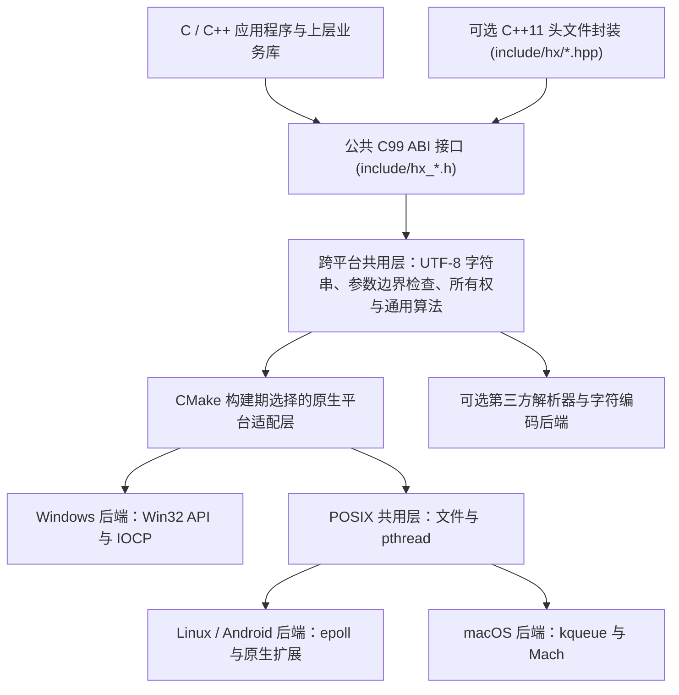
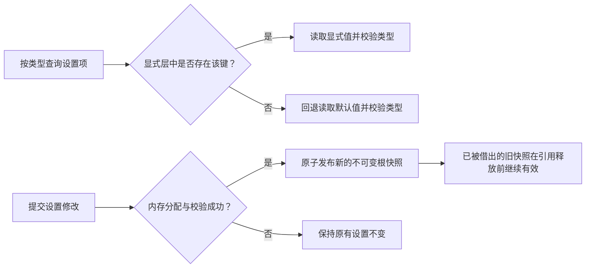
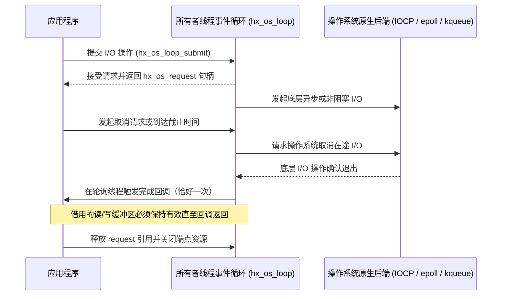

# hx_c_platform 详细参考

[English](REFERENCE.md) · [首页](../README.zh-CN.md) · [常用任务教程](USAGE.zh-CN.md)

如果你想按具体场景查找可直接编译运行的示例程序，可以先看[可运行示例目录](../examples/README.zh-CN.md)：其中列出了每个示例的使用场景、CMake 构建目标、所需输入和预期输出。

本文档集中说明 `hx_c_platform` 的架构分层、各模块接口与调用方式、资源生命周期契约、平台差异以及 CMake 构建开关。初次上手建议先阅读[首页](../README.zh-CN.md)和[常用任务教程](USAGE.zh-CN.md)；在编写业务代码需要确认某个 API 的参数边界、错误码含义或跨平台行为时，再查阅本参考手册。除另有说明外，本文中的构建命令均在仓库根目录下执行。

> [!NOTE]
> 默认开启的部分扩展模块依赖对应的原生第三方 SDK：`CRYPTO` / `TLS` 使用 OpenSSL，`HTTP` / `URL` 使用 libcurl，`UNICODE` 使用 utf8proc，归档与内存压缩使用相应编解码库，`PERSISTENT_QUEUE` 使用固定版本的 SQLite 适配层。构建前请先按[依赖指南](DEPENDENCIES.zh-CN.md)准备依赖 SDK，并通过 `CMAKE_PREFIX_PATH` 或 `HX_OS_DEPENDENCY_PREFIX` 传入安装前缀；若当前工程不需要这些扩展模块，可在配置时将对应开关显式设为 `OFF`，或直接加载 `cmake/minimal.cmake` 预设。需要在业务代码中直接调用底层第三方 SDK 时，请参阅[底层依赖教程](NATIVE_DEPENDENCIES.zh-CN.md)。关于 TLS 加密连接、有界全双工队列与 JSON 业务消息收发的完整用法，请参阅 [TLS 教程](TLS.zh-CN.md)。

- [1. 项目定位与接口边界](#section-1)
- [2. 平台、语言与验证状态](#section-2)
- [3. 分层架构、目录与后端选择](#section-3)
- [4. 构建并运行第一个程序](#section-4)
- [5. 工程接入、安装与链接](#section-5)
- [6. 错误状态、context 与分配器所有权](#section-6)
- [7. UTF-8 字符串与字符编码转换](#section-7)
- [8. 文件、目录与原子发布](#section-8)
- [9. 环境变量、常用目录与进程身份](#section-9)
- [10. 配置文件解析与序列化](#section-10)
- [11. 可变设置、默认值与快照](#section-11)
- [12. C 容器、variant 与元素所有权](#section-12)
- [13. 时钟、截止时间与精细等待](#section-13)
- [14. 线程、同步与线程局部存储](#section-14)
- [15. C 线程池与延迟任务](#section-15)
- [16. C++11 任务、结果与协作取消](#section-16)
- [17. 原子操作、对齐与内存序](#section-17)
- [18. 网络与事件循环](#section-18)
- [19. 管道、本地 IPC 与进程输出捕获](#section-19)
- [20. 周期定时器与目录监听](#section-20)
- [21. 系统信息与动态库](#section-21)
- [22. 内存池、arena、页与文件映射](#section-22)
- [23. 随机数、UUID、宽位运算与位工具](#section-23)
- [24. 日期文本、翻译文件与格式化文件名](#section-24)
- [25. 信号、命名过程与区间 profiler](#section-25)
- [26. 有界词法分析](#section-26)
- [27. 构建开关与可选依赖](#section-27)
- [28. Android 与嵌入式 Linux 构建](#section-28)
- [29. ABI、所有权与关闭契约](#section-29)
- [30. 测试、CI 与性能证据](#section-30)
- [31. 工程规范、平台扩展与许可](#section-31)
- [32. 详细文档与可运行示例](#section-32)
- [33. 数据、传输及持久化工作扩展](#section-33)

<a id="section-1"></a>

## 1. 项目定位与接口边界

`hx_c_platform` 是一个独立的 C99 跨平台系统基础库，提供稳定的 C 接口以及可选的 header-only C++11 封装层。应用程序通过统一的 API 访问文件、字符串、配置、线程、同步、网络与进程等常见系统能力，跨平台公共逻辑与操作系统原生适配均封装在库内部。当前版本号为 **0.1.0**，库名与符号前缀仍处于演进阶段，尚未宣布冻结长期 ABI。

高频操作均提供一步到位的便利入口：例えば直接把 UTF-8 文本文件读入 `hx_string`、读取环境变量、加载多语言翻译表、启动子进程并收集标准输出、向线程池提交任务等。只有在需要自定义容量上限、超时策略或特殊行为时才需要传入 `options` 结构体，日常使用无需先调用一套复杂的全局运行时初始化序列。

| `hx_c_platform` 负责的能力 | 宿主应用 / 上层业务负责的策略 |
| --- | --- |
| 文件 I/O、Unicode 路径转换、UTF-8 字符串、字符集转换、配置语法解析树 | 业务配置结构定义、字段语义校验策略、何时保存配置文件 |
| 线程管理、同步原语、有界线程池、异步事件循环与 I/O | 业务任务依赖编排、应用层调度策略、服务退出时的超时决策 |
| 原生系统错误捕获、自定义分配器上下文（`hx_os_context`）、资源所有权边界 | 日志落盘、用户界面错误展示、业务级故障恢复策略 |
| 临时文件写入、同步刷盘与原子替换发布机制、高精度时间戳 | 日志文件按大小/时间轮转、历史归档保留数量、日志格式化与级别过滤 |
| 区间计时树（Profiler）、系统指标查询、显式配置 Windows WER LocalDumps | 崩溃恢复流程、客户现场转储文件上传与清理、日志内存回溯环形缓冲 |

本库可以完全脱离 `hx_c_log` 独立构建、测试、安装和使用，不依赖 Qt、C++ 运行库或 OBS 运行时（仅在架构设计上借鉴了 OBS“统一公共头 + 共享通用实现 + CMake 构建期选择平台后端”的组织方式）。自研有栈与无栈协程的用法见[协程教程](COROUTINES.zh-CN.md)。注意区分文档中的两个缩写：线程局部存储（Thread-Local Storage，位于 `hx_os_thread.h`）与[网络加密传输模块 TLS](TLS.zh-CN.md)。

<a id="section-2"></a>

## 2. 平台、语言与验证状态

| 目标平台 | 设计与兼容基线 | 当前构建与验证状态 |
| --- | --- | --- |
| Windows | 保留 Windows 7 SP1 / 8.1 系统 API 兼容基线；支持 x86 与 x64 | 已在本地 MSVC x86 / x64 环境完成编译与回归测试；旧版 Windows 实体机运行待验证 |
| Linux | 使用原生 POSIX / Linux 系统调用 | 已在 WSL GCC / Clang 环境完成编译与运行验证 |
| macOS | Intel 最低 10.13，ARM64 最低 11.0（Universal 通用构建默认 11.0） | 已完成 Apple 适配代码实现；待在 Apple 主机上执行编译与运行验证 |
| 嵌入式 Linux | ARMv7-A / AArch64；具体 libc 与浮点 ABI 由目标板 SDK 决定 | 已完成 glibc 交叉编译与部分 QEMU 运行验证；真实开发板待验证 |
| Android | 最低 API 21（`arm64-v8a` 与 `armeabi-v7a`）；子进程模块要求 API 28+ | 已完成两种 ARM ABI 的 NDK 交叉编译，并在 API 34 模拟器上完成运行验证 |
| iOS / BSD | 可复用大部分 POSIX 与跨平台公共代码 | 尚未作为完整支持目标交付 |
| FreeRTOS / 裸机 | 需另行设计无 OS 内存、任务与文件系统模型 | 不在当前支持范围内 |

> [!IMPORTANT]
> - **编译形态**：C 核心库必须编译为静态库或动态库（**不是 header-only**），只有 `include/hx/` 下的可选 C++11 封装层是纯头文件。
> - **标准与工具链基线**：C 核心遵循 C99，C++ 封装层按 C++11 标准验证（同时提供可选的 C++20 协程头文件适配），CMake 最低版本要求为 **3.16**。
> - **Windows 7 部署注意**：源码层面保留了 Win7 SP1 API 兼容，但实际部署到 Win7 时还需确保所选用的 MSVC 工具链、UCRT 运行库及第三方依赖 SDK 同样以 Win7 兼容模式编译。各平台的详细构建要求与能力边界请参阅[平台支持说明](PLATFORMS.zh-CN.md)。

<a id="section-3"></a>

## 3. 分层架构、目录与后端选择



CMake 在配置阶段根据目标操作系统、编译器、CPU 架构和功能开关选择对应的平台源文件，公共接口调用直接进入选定的实现，不在每个平台目录下重复拷贝通用的 POSIX 代码，也不需要业务层到处编写 `#ifdef _WIN32`。遇到未受支持的目标系统时，CMake 会在配置阶段直接报错；平台无法提供的能力会在运行时明确返回 `HX_OS_NOT_SUPPORTED`，绝不用空实现伪装成功。

```text
hx_c_platform/
├── include/
│   ├── hx_os.h                 公共 C 汇总头文件
│   ├── hx_os_*.h               操作系统设施与各模块 C 接口契约
│   ├── hx_string.h             持有内存的 UTF-8 字符串与只读借用视图
│   ├── hx_container.h          通用容器与类型化 POD 容器宏
│   ├── hx_config.h             不可变只读配置文档解析与查询
│   ├── hx_settings.h           运行时可变设置、默认值层与不可变快照
│   └── hx/*.hpp                可选 C++11 无异常封装层（Result<T>）
├── src/                        跨平台共用实现
│   ├── windows/                Windows 原生适配层
│   ├── posix/                  POSIX 共用适配层
│   ├── linux/                  Linux / Android 专属后端实现
│   └── apple/                  macOS / Apple 专属后端实现
├── cmake/                      CMake 模块开关、打包配置与交叉编译工具链
├── examples/                   可独立编译运行的常用任务示例
├── benchmarks/                 按需开启的性能基准与对象布局探针
├── tools/                      第三方依赖 SDK 准备与验证脚本
└── docs/                       中英文配对的开发者文档
```

| 头文件分组 | 核心职责 |
| --- | --- |
| `hx_os_base.h`、`hx_os_atomic.h` | 状态码、`hx_os_error`、分配器上下文（`hx_os_context`）、时钟、运行时能力位查询与原子操作 |
| `hx_os_file.h`、`hx_os_file_extra.h` | 文件读写、原子保存发布、路径处理、目录遍历、文件属性与字节区间锁 |
| `hx_os_text.h`、`hx_string.h` | 字符编码转换、Unicode 合法性校验与 UTF-8 字符串操作 |
| `hx_config.h`、`hx_settings.h`、`hx_container.h` | 只读配置文件解析、运行时可变设置与 C 容器 |
| `hx_os_thread.h`、`hx_os_pool.h`、`hx_os_wait.h` | 线程创建与汇合、线程局部存储（TLS）、互斥锁/事件/信号量、有界线程池与精细等待 |
| `hx_os_net.h`、`hx_os_loop.h`、`hx_os_loop_fd.h` | TCP/UDP 套接字、异步事件循环（Reactor/Proactor）与 POSIX 外部描述符就绪集成 |
| `hx_os_pipe.h`、`hx_os_local.h`、`hx_os_process.h` | 同步/异步管道、本地进程间通信（IPC）与子进程控制/输出捕获 |
| `hx_os_timer.h`、`hx_os_watch.h` | 事件循环周期定时器与文件系统目录变更监听 |
| `hx_os_sysinfo.h`、`hx_os_system.h`、`hx_os_library.h` | 系统硬件/内存指标、进程身份、CPU 指令集检测与动态库（插件）加载 |
| `hx_os_memory.h`、`hx_os_vm.h` | 线程安全内存池、固定大小对象池、Arena 分配器、虚拟内存页与文件内存映射（mmap） |
| `hx_os_util.h`、`hx_os_bits.h`、`hx_os_wide.h`、`hx_os_bitstream.h` | 系统安全随机数、UUID v4、CRC32、128 位乘除换算与位流读写游标 |
| `hx_os_calendar.h`、`hx_os_text_lookup.h`、`hx_os_lexer.h` | UTC 日期格式化、安全文件名生成、多语言翻译表与有界词法分析器 |
| `hx_os_signal.h`、`hx_os_procedure.h`、`hx_os_profiler.h` | 同步信号广播、按名称调用的过程注册表（Procedure）与有界区间计时树（Profiler） |
| `hx_os_env.h`、`hx_os_paths.h`、`hx_os_posix.h` | UTF-8 环境变量访问、系统标准目录查询与 POSIX `timespec` 截止时间换算 |
| `hx_os_registry.h`、`hx_os_power.h`、`hx_os_obfuscate.h` | Windows 注册表读写、作用域防休眠/性能活动请求与可逆字符串混淆 |
| `hx_os_local_dumps.h` | 按可执行文件名显式配置 Windows [WER LocalDumps](LOCAL_DUMPS.zh-CN.md)（不自动安装进程内异常捕获器） |

<a id="section-4"></a>

## 4. 构建并运行第一个程序

### 4.1 桌面环境构建

全新的 CMake 构建目录默认只编译核心库本身，示例程序（`HX_OS_BUILD_EXAMPLES`）和性能基准（`HX_OS_BUILD_BENCHMARKS`）均按需开启。请先按[依赖指南](DEPENDENCIES.zh-CN.md)准备好所需的依赖 SDK（或关闭不使用的扩展模块），然后为每个工具链复用固定的构建目录。

在 Linux / macOS 下构建：

```sh
cmake -S . -B out/linux -DCMAKE_BUILD_TYPE=Release
cmake --build out/linux --parallel 4
```

在 Windows 下使用 Visual Studio 2022 生成器构建：

```powershell
cmake -S . -B out/windows -G "Visual Studio 17 2022" -A x64
cmake --build out/windows --config Release --parallel 4
```

> [!TIP]
> - CMake 3.16 早于 Visual Studio 2022 发布；如果使用旧版 CMake 3.16，可在配置好环境变量的 MSVC 开发者终端中使用 `NMake Makefiles` 或 `Ninja` 生成器。
> - 仅构建 C 核心库时，CMake 不会探测 C++ 编译器。
> - CMake 缓存会保留上一次配置的开关；若要在已有构建目录中关闭测试或示例，请显式传入 `-DHX_OS_BUILD_TESTS=OFF -DHX_OS_BUILD_EXAMPLES=OFF`。

开启示例开关后，可以按目标名单独编译你想学习的示例程序（例如花括号格式化打印 `hx_os_format`）：

```sh
cmake -S . -B out/linux -DHX_OS_BUILD_EXAMPLES=ON
cmake --build out/linux --target hx_os_format --parallel 4
out/linux/bin/hx_os_format
```

在 Windows 下使用 Visual Studio 多配置生成器时，编译命令需加上 `--config Release`，生成的可执行文件位于 `out/windows/bin/Release/`。

如果使用 Visual Studio IDE 打开生成的 `hx_c_platform.sln`，解决方案资源管理器会按职责将目标归类到虚拟文件夹中（不影响磁盘上的实际路径或可执行文件名）：

```text
hx_c_platform
├── libraries
│   ├── hx_c_platform
│   │   ├── Header Files
│   │   │   ├── Public       （公共 C 头文件与 include/hx/ 下的 C++ 头文件）
│   │   │   └── Private      （内部实现头文件与当前平台私有头文件）
│   │   ├── Source Files     （当前平台与功能开关实际选中的编译源文件）
│   │   └── Generated Files
│   └── hx_archive_7zip      （可选的 7-Zip 动态适配库）
├── deps                     （第三方依赖构建目标）
├── examples
│   ├── demos                （功能演示示例）
│   └── benchmarks           （性能基准与对象内存布局探针）
└── CMake                    （ALL_BUILD、INSTALL、ZERO_CHECK 等内置目标）
```

在 `cmake-gui` 中修改选项后，依次点击 **Configure** 和 **Generate**，再在 Visual Studio 中重新加载解决方案即可，切勿手动编辑 `.sln`、`.vcxproj` 或 `.filters` 文件。当宿主工程通过 `add_subdirectory` 引入本库时，全局 `USE_FOLDERS` 属性由宿主工程控制。

### 4.2 使用 C 读取 UTF-8 文本并获取详细错误

将以下代码保存为 `main.c`，并在程序运行的工作目录下放一个 UTF-8 编码的 `配置.json`。`hx_os_file_read_text` 会一次性完成打开、读取（默认上限 16 MiB）、剥离 UTF-8 BOM、校验 UTF-8 合法性以及关闭文件；若读取失败，输出字符串 `text` 保持初始空状态不变，且可通过 `hx_os_error_message` 格式化底层错误原因：

```c
#include <hx_os.h>
#include <stdio.h>

int main(void)
{
	hx_string text = HX_STRING_INIT;
	hx_os_error error;
	hx_os_status status =
		hx_os_file_read_text("配置.json", &text, &error);

	if (status == HX_OS_OK)
		puts(hx_string_c_str(&text));
	else {
		char message[2304];
		size_t required;

		if (hx_os_error_message(&error, message, sizeof(message),
			    &required) == HX_OS_OK)
			fprintf(stderr, "%s\n", message);
		else
			fprintf(stderr, "%s\n", hx_os_status_name(status));
	}

	hx_string_destroy(&text);

	return status == HX_OS_OK ? 0 : 1;
}
```

### 4.3 对应的 C++11 调用

C++ 封装层统一返回 `hx::Result<T>`，不抛出异常。调用方先通过 `if (!result)` 或 `result.ok()` 检查操作是否成功，再访问 `result.value()` 或 `result.error()`。文本结果类型为自动管理 UTF-8 内存的 `hx::String`，底层调用同一套 C 实现。关于部分完成结果（Partial Result）、回调绑定与所有权的完整说明，请参阅 [C++ Result 契约](CPP_RESULTS.zh-CN.md)。

```cpp
#include <hx/Files.hpp>
#include <hx/Paths.hpp>
#include <cstdio>

int main()
{
	auto text = hx::Files::readText("配置.json");
	if (!text) {
		std::fprintf(stderr, "%s\n",
			hx_os_status_name(text.status()));

		return 1;
	}

	auto path = hx::Paths::configFile("hx_example", "settings.json");
	if (!path) {
		std::fprintf(stderr, "%s\n",
			hx_os_status_name(path.status()));

		return 1;
	}

	std::printf("%s\n%s\n", text.value().c_str(),
		path.value().c_str());

	return 0;
}
```

### 4.4 原地字符串处理、链式更新与目录遍历

为了减少样板错误检查，许多高频操作提供了流式或原地入口：
- 字符串分配成功后，ASCII 去空白（`trimAscii`）与大小写转换（`lowerAscii`）直接在原缓冲区上就地修改，不分配新内存，也不会失败。
- `Settings::update()` 与 `CallData::edit()` 会在每个 setter 调用时立即执行修改，一旦某一步出错则跳过后续步骤，最后只需在 `.finish()` 处统一检查一次状态。
- `hx::Directory::forEach` 在内部自动管理目录句柄的打开、文件名缓冲区的复用以及退出时的关闭。

下面的完整程序对应仓库中的 [direct_calls.cpp](../examples/direct_calls.cpp)：

```cpp
#include <hx/Files.hpp>
#include <hx/Settings.hpp>
#include <hx/Signal.hpp>
#include <cstdio>

static int report_failure(hx_os_status status)
{
	std::fprintf(stderr, "%s\n", hx_os_status_name(status));

	return 1;
}

int main()
{
	auto text = hx::String::copy("  Hello 中文😀  ");
	if (!text)
		return report_failure(text.status());

	text.value().trimAscii().lowerAscii();
	std::puts(text.value().c_str());
	if (hx_os_capabilities() & HX_OS_CAP_SETTINGS) {
		hx_settings *owner = NULL;

		hx::Settings settings(owner);

		auto created = settings.create();
		if (!created)
			return report_failure(created.status());

		auto changed = settings.update()
				       .setInt("port", 8080)
				       .setString("label", "服务😀")
				       .finish();

		auto label = settings.stringView("label");

		auto closed = settings.closeUntil(HX_OS_DEADLINE_NOW);
		if (!closed)
			return report_failure(closed.status());

		if (!changed)
			return report_failure(changed.status());

		if (!label)
			return report_failure(label.status());

		// The lease owns immutable bytes after the settings close.
		std::puts(label.value().c_str());
	}

	if (hx_os_capabilities() & (HX_OS_CAP_SIGNALS | HX_OS_CAP_PROCEDURES)) {
		hx::CallData data;

		auto prepared = data.edit()
					.setInt("number", 42)
					.setString("label", text.value().view())
					.finish();
		if (!prepared)
			return report_failure(prepared.status());

		auto label = data.view().stringView("label");
		if (!label)
			return report_failure(label.status());

		std::printf("%.*s\n", static_cast<int>(label.value().size()),
			label.value().data());
	}

	auto listed =
		hx::Directory::forEach(".", [](hx::StringView name) noexcept {
			std::printf("Entry: %.*s\n",
				static_cast<int>(name.size()), name.data());
			return false;
		});

	return listed ? 0 : report_failure(listed.status());
}
```

> [!NOTE]
> 请注意上面代码中两种字符串视图的生命周期差异：
> - `settings.stringView("label")` 返回的是持有底层不可变字符串引用的 `SettingStringView`（内部管理引用计数），即使随后修改或关闭了 `settings` 对象，该视图在自身析构前依然有效。
> - `data.view().stringView("label")` 返回的是零拷贝借用的 `StringView`，在读取该视图期间必须保持 `CallData` 对象存活且不被修改。

<a id="section-5"></a>

## 5. 工程接入、安装与链接

### 5.1 通过源码子目录（`add_subdirectory`）接入

如果将本库源码放在宿主工程的 `deps/hx_c_platform` 目录下，可直接在 `CMakeLists.txt` 中引入：

```cmake
cmake_minimum_required(VERSION 3.16)
project(my_app LANGUAGES C)

add_subdirectory(deps/hx_c_platform)

add_executable(my_app main.c)
set_target_properties(my_app PROPERTIES
	C_STANDARD 99
	C_STANDARD_REQUIRED YES
	C_EXTENSIONS NO)
target_link_libraries(my_app PRIVATE hx_c_platform::hx_c_platform)

if(MSVC)
	target_compile_options(my_app PRIVATE /utf-8)
endif()
```

### 5.2 通过已安装的 CMake 包（`find_package`）接入

先将构建好的库安装到指定前缀目录：

```sh
cmake --install build --config Release --prefix /absolute/install/prefix
```

然后在宿主工程中使用 `find_package` 导入：

```cmake
cmake_minimum_required(VERSION 3.16)
project(my_app LANGUAGES C)

find_package(hx_c_platform 0.1 CONFIG REQUIRED)

add_executable(my_app main.c)
set_target_properties(my_app PROPERTIES
	C_STANDARD 99
	C_STANDARD_REQUIRED YES
	C_EXTENSIONS NO)
target_link_libraries(my_app PRIVATE hx_c_platform::hx_c_platform)

if(MSVC)
	target_compile_options(my_app PRIVATE /utf-8)
endif()
```

配置宿主工程时传入 `-DCMAKE_PREFIX_PATH=/absolute/install/prefix`。如果是 C++ 工程，只需在 `project()` 中启用 `CXX` 语言并链接 `hx_c_platform::cpp`（该导出目标仅对链接它的消费者开启 C++11 要求）。导出目标已包含各平台所需的系统库依赖，宿主工程无需手动拼接 `pthread`、`ws2_32` 等底层库。

### 5.3 静态库与动态库部署注意事项

默认构建静态库（`BUILD_SHARED_LIBS=OFF`）；将 `BUILD_SHARED_LIBS` 设为 `ON` 可构建动态库（`.dll` / `.so` / `.dylib`）。安装目录包含公共头文件、库文件、CMake 导出配置以及 `pkg-config` 元数据。使用默认相对路径安装时支持整个目录重定位。

> [!WARNING]
> - 在 Windows 下使用 DLL 时，请将生成的 DLL 放在可执行文件同级目录或系统运行时搜索路径中，并确保宿主程序与 DLL 的目标架构、MSVC 运行库（CRT）和 Debug/Release 配置一致。
> - 如果宿主程序与多个动态插件各自静态链接了一份 `hx_c_platform`，各个模块拥有各自独立的默认分配器实例。跨插件边界传递的对象必须通过创建它的那一侧库实例或绑定的 `hx_os_context` 释放，且在卸载插件前必须先完成所有相关回调和线程局部存储（TLS）的清理。

<a id="section-6"></a>

## 6. 错误状态、context 与分配器所有权

### 6.1 状态码分类与分支处理

`hx_os_status` 区分了成功、正常边界状态（如读到文件末尾、等待超时）与各类失败原因，调用方应根据具体状态码做分支处理，不要简单把所有非零返回值都当成同一种致命错误：

| 状态码常量 | 含义与调用方处理方式 |
| --- | --- |
| `HX_OS_OK` | 操作成功（注意：底层流式读写 `read_some` / `write_some` 在返回 `HX_OS_OK` 时仍可能只完成了部分字节） |
| `HX_OS_EOF` | 已到达输入末尾，属于正常结束边界而非异常失败 |
| `HX_OS_TIMEOUT` | 等待截止时间耗尽；目标资源仍处于活动状态，按契约必须保留所有者以便重试，切勿直接释放正在使用的资源 |
| `HX_OS_WOULD_BLOCK` | 非阻塞操作当前无法立即推进，可稍后等待就绪或重试 |
| `HX_OS_OUTPUT_FULL` | 调用方提供的输出缓冲区容量不足；可检查返回结构中的所需容量或已处理进度 |
| `HX_OS_NOT_FOUND` | 指定的配置键、环境变量或文件路径不存在；仅在此状态下才应按业务需要回退到默认值 |
| `HX_OS_TYPE_MISMATCH` | 键或节点存在，但实际数据类型与请求的类型不匹配（不应静默当作默认值处理） |
| `HX_OS_LIMIT` | 超出配置的内存、长度、深度或数量上限 |
| `HX_OS_NOT_SUPPORTED` | 对应模块在编译期已关闭，或当前操作系统平台不支持该能力 |
| `HX_OS_BUSY` / `HX_OS_DEADLOCK` | 对象仍有未释放的引用/在途操作，或检测到工作线程等待自身所在线程池等自锁行为 |

`hx_os_error` 结构体记录统一的 `hx_os_status`、原生错误域（如 Win32、POSIX `errno`、Mach 等）、原生错误码以及次要原因码，内部不持有借用的临时字符串指针。调用 `hx_os_error_message` 可将人类可读的错误描述格式化到调用方提供的缓冲区中。基础库自身不会调用 `hx_c_log` 打日志，也不使用线程全局的“最后错误字符串”。

### 6.2 自定义分配器上下文（`hx_os_context`）

所有接收 `hx_os_context *` 的接口在传入 `NULL` 时均使用内置的不可变默认分配器。如果需要统计内存或接入自定义内存池，可以创建独立的 `hx_os_context`：

```c
#include <hx_os.h>
#include <stdlib.h>

static void *HX_OS_CALL allocate_bytes(size_t bytes, void *user)
{
	(void)user;

	return malloc(bytes);
}

static void HX_OS_CALL release_bytes(void *memory, void *user)
{
	(void)user;

	free(memory);
}

int main(void)
{
	hx_os_context_options options;
	hx_os_context *context = NULL;
	hx_string text;
	hx_os_status status;

	hx_os_context_options_init(&options);
	options.allocator.allocate = allocate_bytes;
	options.allocator.deallocate = release_bytes;
	options.allocator.user = NULL;

	status = hx_os_context_create(&options, &context, NULL);
	if (status != HX_OS_OK)
		return 1;

	hx_string_init(&text, context);

	status = hx_string_assign_cstr(&text, "owned by this context", NULL);

	hx_string_destroy(&text);
	if (hx_os_context_destroy(&context, NULL) != HX_OS_OK)
		return 2;

	return status == HX_OS_OK ? 0 : 1;
}
```

> [!IMPORTANT]
> - `hx_os_context_create` 会复制分配器函数指针表，`options.allocator.user` 指针会被借用至 `context` 成功销毁为止。自定义分配/释放回调必须支持跨线程释放并满足平台基础对齐（扩展对齐由库内部包装层自动处理）。
> - 即使是用 `hx_string_init(&text, context)` 初始化的空字符串，也会持有一份对 `context` 的生命周期引用。在销毁 `context` 之前，必须先销毁所有绑定到该 `context` 的字符串、句柄、配置快照和 TLS 值；只要仍有未归还的内存或存活引用，`hx_os_context_destroy` 就会返回 `HX_OS_BUSY`。

<a id="section-7"></a>

## 7. UTF-8 字符串与字符编码转换

### 7.1 字符串所有者（`hx_string`）与只读视图（`hx_string_view`）

`hx_string` 持有以 `\0` 结尾的 UTF-8 内存缓冲区，而 `hx_string_view` 只借用字节切片（不持有内存所有权）。使用默认分配器时可直接用 `HX_STRING_INIT` 初始化；绑定自定义 `context` 时调用一次 `hx_string_init`。深拷贝请调用 `hx_string_copy`，转移所有权请调用 `hx_string_move`，生命周期结束时调用 `hx_string_destroy`（切勿直接用 C 语言结构体赋值 `=` 来复制 `hx_string`）。

```c
#include <hx_os.h>
#include <stdio.h>

int main(void)
{
	hx_string text = HX_STRING_INIT;
	hx_string_parts *parts = NULL;
	hx_os_status status;
	hx_os_text_result converted;
	unsigned char utf16[128];
	size_t i;

	status = hx_string_assign_cstr(&text, " alpha,beta,中文😀 ", NULL);
	if (status == HX_OS_OK) {
		hx_string_trim_ascii_in_place(&text);

		status = hx_string_split(&text,
			hx_string_view_from_cstr(","), &parts, NULL);
	}

	if (status == HX_OS_OK) {
		for (i = 0; i < hx_string_parts_count(parts); ++i) {
			hx_string_view part;

			status = hx_string_parts_at(parts, i, &part);
			if (status != HX_OS_OK)
				break;

			(void)fwrite(part.data, 1, part.size, stdout);
			putchar('\n');
		}
	}

	if (status == HX_OS_OK)
		status = hx_string_encode(&text, HX_OS_UTF16LE, utf16,
			sizeof(utf16), &converted, NULL);

	if (status == HX_OS_OK)
		printf("UTF-16 bytes: %zu\n", converted.output_used);

	hx_string_parts_destroy(&parts);
	hx_string_destroy(&text);

	return status == HX_OS_OK ? 0 : 1;
}
```

| 操作类别 | 核心函数族 |
| --- | --- |
| 赋值、追加与预留容量 | `hx_string_assign`、`hx_string_append`、`hx_string_reserve` |
| 插入、擦除与区间替换 | `hx_string_insert`、`hx_string_erase`、`hx_string_replace` |
| 查找、比较与前后缀判断 | `hx_string_find`、`hx_string_compare`、`hx_string_starts_with`、`hx_string_ends_with` |
| 空白修剪、ASCII 大小写与全局替换 | `hx_string_trim_ascii`、`hx_string_lower_ascii`、`hx_string_upper_ascii`、`hx_string_replace_all` |
| 分隔符拆分与拼接 | `hx_string_split`、`hx_string_parts_at`、`hx_string_join` |
| `printf` 风格格式化 | `hx_string_format`、`hx_string_append_format` |
| 字符编码解码与编码输出 | `hx_string_assign_encoded`、`hx_string_encode` |

对于已经有效初始化的 `hx_string`，可以直接调用无返回值的原地接口 `hx_string_trim_ascii_in_place`、`hx_string_lower_ascii_in_place` 和 `hx_string_upper_ascii_in_place`（在 C++ 中对应 `hx::String::trimAscii()` 与 `lowerAscii()`）。它们不分配内存、不会失败，且完整保留非 ASCII 的 UTF-8 多字节序列。

> [!NOTE]
> - 所有字符串长度和偏移量均以**字节（byte）**为单位。字符串中间允许包含嵌入的 `\0` 字节，但传给传统 C 字符串接口时会在第一个 `\0` 处截断。
> - 普通的 `hx_string_view` 在源字符串被修改或销毁后立即失效；但 `hx_string_split` 生成的 `hx_string_parts` 内部持有一份输入字符串的独立副本，因此通过 `hx_string_parts_at` 取出的视图在调用 `hx_string_parts_destroy` 之前始终有效（默认最多拆分 4096 项并保留空项）。
> - `hx_string_format` 遵循当前进程的 C `locale`；若需要不受 `locale` 小数点影响的确定性数字与文本转换，请使用 `hx_os_text_number` 工具集。

### 7.2 Windows UTF-8 路径与传统字符编码（`ICONV`）

所有公共路径参数统一使用 UTF-8，Windows 平台适配层会在内部将其无损转换为 UTF-16 宽字符再调用 Win32 `W` 系列 API，绝不依赖当前系统的 ANSI 代码页猜测编码，也不会偷偷修改宿主进程的全局 `locale`。在 MSVC 下编写包含中文字符字面量的源码时，请添加 `/utf-8` 编译选项。

内置编码转换器原生支持 `UTF-8`、`UTF-16LE`、`UTF-16BE`、`UTF-32LE`、`UTF-32BE`、`ASCII` 和 `ISO-8859-1`。当需要转换 `GB2312`、`GBK`、`GB18030`（2005 / 2022）、`Big5`、`Shift-JIS`、`EUC-JP`、`EUC-KR` 以及 Windows 代码页 `1252` / `932` / `936` / `949` / `950` 时，可在配置时开启 `HX_OS_ENABLE_ICONV=ON`：

```sh
cmake -S . -B build-text -DHX_OS_ENABLE_ICONV=ON \
  -DHX_OS_ENABLE_CRYPTO=OFF -DHX_OS_ENABLE_ARCHIVE=OFF \
  -DHX_OS_ENABLE_COMPRESSION=OFF -DHX_OS_ENABLE_HTTP=OFF \
  -DHX_OS_ENABLE_URL=OFF -DHX_OS_ENABLE_UNICODE=OFF \
  -DHX_OS_ENABLE_PERSISTENT_QUEUE=OFF
cmake --build build-text --config Release --parallel 4
```

开启 `HX_OS_ENABLE_ICONV=ON` 后，统一依赖管理脚本默认拉取固定版本的 GNU `libiconv` 官方发布归档并校验 SHA256（由于 GNU `libiconv` 的上游 Git 仓库不含预生成的转换表，即使在默认 `SUBMODULE` 模式下该组件也会使用官方发布包）；如需改用操作系统自带的 `iconv`，可显式传入 `-DHX_OS_ICONV_USE_SYSTEM=ON` 或通过 `HX_OS_ICONV_SOURCE_DIR` 指定源码目录。运行期调用某种传统编码前，建议先用 `hx_os_encoding_supported()` 查询当前构建是否支持该编码。注意：`hx_string_encode` 输出的是原始编码字节流，不会在末尾隐式追加 `\0` 终止符。

<a id="section-8"></a>

## 8. 文件、目录与原子发布

### 8.1 带完成进度的底层文件 I/O

底层文件读写接口将“正常读到文件末尾（`HX_OS_EOF`）”、“发生错误”和“实际完成的字节数”明确区分开：
- `hx_os_file_read_some`：报告实际读取的字节数，到达文件末尾时返回 `HX_OS_EOF`。
- `hx_os_file_write_some`：允许返回 `HX_OS_OK` 但只写入部分字节（Short Write），由调用方根据已写入字节数继续提交剩余切片。
- `hx_os_file_write_all`：在内部自动循环写完全部字节；即使中途发生 I/O 错误，也会通过 `completed` 参数报告出错前已成功写入的字节数。

```c
#include <hx_os.h>
#include <stdio.h>

int main(void)
{
	const char payload[] = "hello, 中文\n";
	hx_os_file *file = NULL;
	hx_os_error error;
	hx_os_status status, closed;
	size_t completed = 0;

	status = hx_os_file_open(NULL, "readme-output.txt",
		HX_OS_FILE_WRITE | HX_OS_FILE_CREATE | HX_OS_FILE_TRUNCATE,
		&file, &error);
	if (status != HX_OS_OK)
		return 1;

	status = hx_os_file_write_all(file, payload, sizeof(payload) - 1,
		&completed, &error);
	if (status == HX_OS_OK)
		status = hx_os_file_sync(file, &error);

	closed = hx_os_file_close(&file, NULL);
	if (status == HX_OS_OK)
		status = closed;

	if (status != HX_OS_OK)
		fprintf(stderr, "%s after %zu bytes\n",
			hx_os_status_name(status), completed);

	return status == HX_OS_OK ? 0 : 1;
}
```

> [!WARNING]
> - `hx_os_file` 不包含用户态流缓冲区，每次读写直接调用操作系统接口。`hx_os_file_sync` 会调用 `fsync` 或 `FlushFileBuffers` 请求操作系统将缓存刷入存储介质。
> - **文件关闭一次性消耗句柄**：与线程池或异步事件循环的“超时可重试关闭”不同，`hx_os_file_close` **无论返回成功还是失败，都会消费并置空文件句柄**，绝不能对已关闭的文件句柄重复调用 `close`。
> - 在 C++ 封装中，`hx::File::read()` 在到达文件末尾时返回成功的 `ReadResult` 并将 `eof` 标记设为 `true`；而 `readSome()` 与 `readAt()` 保持返回 `HX_OS_EOF` 状态码。当读写中途发生错误时，仍可通过 `hasValue()` 获取已完成的部分字节数。

### 8.2 整文件保存与原子替换发布

`hx_os_file_save` 用于一次性写入完整字节缓冲区，`hx_os_file_write_text` 用于原子发布 UTF-8 字符串。对于关键配置文件，使用 `hx_os_file_save_atomic_ex` 可以在目标文件所在目录先创建临时文件、完整写入并执行同步刷盘，最后通过原子重命名替换目标文件，从而避免程序崩溃或掉电留下半截损坏文件：

```c
#include <hx_os.h>
#include <stdio.h>

int main(void)
{
	const char json[] = "{\"port\":8080}\n";
	hx_os_file_save_result result;

	hx_os_status status = hx_os_file_save_atomic_ex(
		"readme-settings.json", json, sizeof(json) - 1, &result, NULL);
	if (status != HX_OS_OK)
		return 1;

	printf("published=%d directory_synced=%d\n",
		result.published, result.directory_synced);
	if (result.durability_error.status != HX_OS_OK)
		fprintf(stderr, "Directory sync: %s\n",
			hx_os_status_name(result.durability_error.status));

	return 0;
}
```

`hx_os_file_save_result` 将“文件是否已成功替换发布（`published`）”与“父目录项同步请求是否成功（`directory_synced`）”分开报告。注意：带备份的文件替换不是可自动回滚的数据库事务，且跨文件系统的移动操作不会在后台静默退化为文件拷贝。

### 8.3 目录遍历、递归查找与扩展文件能力

按文件名通配符递归搜索目录可使用 `hx_os_directory_find_first_file`（C++ `hx::Directory::findFirstFile`，直接返回第一个匹配项的完整路径）或 `hx_os_directory_find_files`（C++ `hx::Directory::findFiles`，同步流式回调所有匹配项）。它们在内部复用路径缓冲区并利用操作系统目录项类型信息减少额外 `stat` 开销，内置递归深度、匹配数量与内存上限，不依赖 `CONTAINERS` 模块，也可以直接提交到线程池中异步执行。完整用法见[文件查询教程](FILE_SEARCH.zh-CN.md)。

| 常见文件与路径需求 | 对应头文件与示例程序 |
| --- | --- |
| 文件复制、存在性检查、整文件读写、词法路径拼接 | `hx_os_file.h`；参见 [text_file.c](../examples/text_file.c) |
| 单层目录遍历、有界通配符匹配（`path_glob`）、不跟随符号链接的递归删除 | `hx_os_directory_visit`、`hx::Directory::forEach` |
| 不改变共享文件偏移量的定位读写（Pread / Pwrite） | `hx_os_file_read_at`、`hx_os_file_write_at`；参见 [positioned_read.c](../examples/positioned_read.c) |
| 查询扩展文件类型与纳秒级时间戳 | `hx_os_path_stat_extended`；参见 [file_info.c](../examples/file_info.c) |
| 字节区间文件锁、修改时间戳与权限摘要 | `hx_os_file_extra.h`；参见 [file_attributes.c](../examples/file_attributes.c) |

> [!NOTE]
> - 定位读写（`read_at` / `write_at`）不会修改文件的当前读写偏移量，但多线程重叠写入、截断（`truncate`）与关闭仍需调用方自行同步；以追加模式（Append）打开的文件不支持 `write_at`。
> - 路径拼接与规范化工具仅执行纯词法层面的字符串处理，不充当防目录穿越的安全沙箱或符号链接边界检查。

<a id="section-9"></a>

## 9. 环境变量、常用目录与进程身份

查询系统标准路径或环境变量时，直接使用输出 `hx_string` 的入口即可省去手动探测缓冲区长度的循环。请注意，环境变量“存在但值为空字符串 `""`”与“变量未定义（返回 `HX_OS_NOT_FOUND`）”是两种不同的状态：

```c
#include <hx_os.h>
#include <stdio.h>

int main(void)
{
	hx_string path = HX_STRING_INIT;
	hx_string value = HX_STRING_INIT;
	hx_os_status status =
		hx_os_path_config_file("my_app", "settings.json", &path, NULL);

	if (status == HX_OS_OK)
		puts(hx_string_c_str(&path));

	if (status == HX_OS_OK) {
		status = hx_os_env_get_string("HX_APP_MODE", &value, NULL);
		if (status == HX_OS_NOT_FOUND)
			status = hx_string_assign_cstr(&value, "production",
				NULL);
	}

	if (status == HX_OS_OK)
		puts(hx_string_c_str(&value));

	hx_string_destroy(&value);
	hx_string_destroy(&path);

	return status == HX_OS_OK ? 0 : 1;
}
```

| 查询需求 | 对应 API 入口 |
| --- | --- |
| 当前用户主目录、用户级配置目录、用户级数据目录 | `hx_os_path_home_string`、`hx_os_path_config_home_string`、`hx_os_path_data_home_string` |
| 本机所有用户共享的数据目录（ProgramData / `/var/lib` 等） | `hx_os_path_program_data_string` |
| 系统临时目录 | `hx_os_path_temp_string` |
| 当前可执行文件完整路径、当前动态库/模块所在目录 | `hx_os_path_executable_string`、`hx_os_path_module_string` |
| UTF-8 环境变量的读取、设置、删除与枚举 | `hx_os_env_get_string`、`hx_os_env_set`、`hx_os_env_remove`、`hx_os_env_visit` |
| UTF-8 命令行参数、进程 PID、主机名与 CPU 指令集能力 | `hx_os_system.h` |

目录路径查询函数仅返回约定路径字符串，不会在磁盘上自动创建目录，也不保证该目录当前可写。修改环境变量会影响当前进程及后续创建的子进程（多线程环境下修改进程环境变量需与宿主中的其他库协调）。CPU 指令集能力查询会同时检查硬件标志位与操作系统是否已启用对应的寄存器上下文保存（如 AVX 状态），完整示例见 [special_paths.c](../examples/special_paths.c) 与 [environment.c](../examples/environment.c)。

<a id="section-10"></a>

## 10. 配置文件解析与序列化

### 10.1 支持的格式与解析后端

无论是否编译了可选的第三方解析库，配置解析的默认后端始终是内置解析器（`HX_OS_CONFIG_BUILTIN`），开启依赖开关不会暗中改变既有解析行为。如需切换后端，请显式设置 `options.backend` 并通过 `hx_os_config_backend_available(format, backend)` 检查可用性：

| 配置格式 | 内置解析器（`HX_OS_CONFIG_BUILTIN`）支持的语法范围 | 可选第三方 C 解析后端 |
| --- | --- | --- |
| JSON | 严格符合规范的 JSON 值、对象、数组、转义序列，并精确保留原始数字文本 | `cJSON` 1.7.19 |
| YAML | 单文档块级映射（Mapping）、序列（Sequence）与标量值 | `libyaml` 0.2.5 |
| XML | UTF-8 XML 1.0 元素、属性、混合文本与 CDATA 节点 | `Mini-XML` 4.0.6 |
| INI | 标准 `[section]` 分节与字符串键值对 | `inih` r62 |
| TOML | 常用表（Table）、点分键、标量、数组与内联表 | `tomlc17` R260821 |
| ENV | 明确定义的 `.env`（dotenv）方言，绝不执行任何 Shell 命令展开 | 仅内置 |
| `.properties` | UTF-8 Java 风格键值语法与 `\uXXXX` Unicode 转义 | 仅内置 |

> [!NOTE]
> 各格式的内置解析器均针对工程配置场景明确界定了语法子集：
> - 内置 YAML 解析器并非完整的 YAML 1.2 实现，且内置后端与 `libyaml` 适配层均拒绝锚点（Anchor）、别名（Alias）和自定义标签以防膨胀攻击。
> - XML 解析器绝不加载外部实体（XXE）或外部 DTD。
> - TOML 的多行字符串、表数组（`[[array_of_tables]]`）和原生日期时间字面量需启用 `tomlc17` 后端。
> - 传统 `ISO-8859-1` 编码的 `.properties` 文件在解析前应先显式转换为 UTF-8。各格式的精确语法边界请参阅[配置格式契约](CONFIGURATION.zh-CN.md)。

### 10.2 解析、查询与生命周期

下面的完整程序直接解析内存中的 TOML 文本，并按 JSON Pointer 路径读取 `/server/port`：

```c
#include <hx_os.h>

#include <inttypes.h>
#include <stdio.h>
#include <string.h>

int main(void)
{
	static const char input[] =
		"title = '中文 configuration'\n[server]\nport = 8080\n";
	hx_os_config_document *document = NULL;
	hx_os_config_error error;
	const hx_os_config_node *port;
	hx_os_status status;
	int64_t number;

	if (!hx_os_config_backend_available(
		    HX_OS_CONFIG_TOML, HX_OS_CONFIG_BUILTIN)) {
		puts("Configuration module is disabled.");

		return 0;
	}

	status = hx_os_config_parse(NULL, HX_OS_CONFIG_TOML, input,
		strlen(input), NULL, &document, &error);
	if (status != HX_OS_OK) {
		fprintf(stderr, "%s at %zu:%zu: %s\n", error.source, error.line,
			error.column, error.message);

		return 1;
	}

	status = hx_os_config_pointer(
		hx_os_config_root(document), "/server/port", &port);
	if (status == HX_OS_OK)
		status = hx_os_config_get_i64(port, &number);

	if (status == HX_OS_OK)
		printf("Server port: %" PRId64 "\n", number);
	else
		fprintf(stderr, "Server port: %s\n", hx_os_status_name(status));

	hx_os_config_release(document);

	return status == HX_OS_OK ? 0 : 1;
}
```

输入缓冲区 `input` 仅在 `hx_os_config_parse` 调用期间被读取，解析生成的 `hx_os_config_document` 会自己持有所有节点数据的副本。文档对象不可变且采用引用计数管理；节点指针（`hx_os_config_node *`）和字符串视图仅借用文档内存，单独保存节点指针不会延长文档的生命周期。查询时若键不存在返回 `HX_OS_NOT_FOUND`，类型不匹配返回 `HX_OS_TYPE_MISMATCH`。

默认资源上限为：输入大小 1 MiB、解析树内存 16 MiB、节点数 65,536 个、嵌套深度 64 层、解析工作步数 16,777,216 步。解析失败时，`hx_os_config_error` 提供错误码、行列位置与脱敏的语法错误说明（不会把可能包含密码或密钥的原始配置值拼进错误消息中）。

### 10.3 配置序列化与保存

`hx_os_config_serialize` 支持将配置树序列化为 `JSON`、`INI` 和 `.properties` 三种格式，`hx_os_config_save` 则将序列化与原子文件发布结合为一步调用。如果配置树中包含目标格式无法表达的结构（例如往扁平的 `.properties` 里写多层嵌套数组），序列化会明确返回错误，绝不会静默丢弃层级或强行把结构拼成字符串。完整示例见 [config_save.c](../examples/config_save.c)。

<a id="section-11"></a>

## 11. 可变设置、默认值与快照

`hx_os_config_document` 用于只读解析，而 `hx_settings` 专为运行时需要动态读取、修改、监听和持久化的应用设置设计。`hx_settings` 内部维护了“用户显式设置值”和“程序默认值”两层结构：只有当某个键在显式层中不存在（`HX_OS_NOT_FOUND`）时，查询才会自动回退到默认值层；如果显式值存在但类型不匹配（`HX_OS_TYPE_MISMATCH`），则会直接报告错误。



```c
#include <hx_os.h>
#include <stdio.h>

int main(void)
{
	hx_settings *settings = NULL;
	hx_settings_string_ref label = HX_SETTINGS_STRING_REF_INIT;
	hx_string json = HX_STRING_INIT;
	int64_t port;
	hx_os_error error;

	hx_os_status status = hx_settings_create(NULL, &settings, &error);
	if (status == HX_OS_OK)
		status = hx_settings_set_default_i64(
			settings, "port", 80, &error);

	if (status == HX_OS_OK) {
		hx_settings_update update = hx_settings_update_begin(settings);
		hx_settings_update_set_i64(&update, "port", 8080);
		hx_settings_update_set_string(&update, "label", "服务😀");

		status = hx_settings_update_finish(&update, NULL, &error);
	}

	if (status == HX_OS_OK)
		status = hx_settings_get_i64(settings, "port", &port, &error);

	if (status == HX_OS_OK)
		status = hx_settings_get_string_ref(
			settings, "label", &label, &error);

	if (status == HX_OS_OK)
		printf("%s: %lld\n", label.text.data, (long long)port);

	if (status == HX_OS_OK && (hx_os_capabilities() & HX_OS_CAP_CONFIG) &&
		(hx_os_capabilities() & HX_OS_CAP_CONFIG_SERIALIZE)) {
		status = hx_settings_to_json(settings, &json, &error);
		if (status == HX_OS_OK)
			puts(hx_string_c_str(&json));
	}

	if (settings) {
		hx_os_status closed = hx_settings_destroy(&settings, NULL);
		if (status == HX_OS_OK)
			status = closed;
	}

	hx_settings_string_ref_destroy(&label);
	hx_string_destroy(&json);
	if (status != HX_OS_OK)
		fprintf(stderr, "%s\n", hx_os_status_name(status));

	return status == HX_OS_OK ? 0 : 1;
}
```

核心所有权与生命周期规则：
- **不可变快照（Snapshot）**：调用 `hx_settings_snapshot` 可获取当前时刻的不可变设置树快照，用完后调用 `hx_settings_value_release` 释放。快照拥有独立的引用计数，即使原 `hx_settings` 对象已经修改或关闭，快照依然有效（并继续持有其 `hx_os_context` 的引用）。
- **零拷贝字符串引用（`hx_settings_string_ref` / `SettingStringView`）**：`hx_settings_get_string_ref` 无需复制字符串字节即可安全持有底层不可变字符串节点。请先用 `HX_SETTINGS_STRING_REF_INIT` 初始化，复制引用时调用 `hx_settings_string_ref_copy`，用完后调用 `hx_settings_string_ref_destroy` 释放（不要直接用结构体赋值 `=` 复制引用）。
- **连续更新游标（`hx_settings_update`）**：游标中的每个 setter 在调用时立即生效并触发观察者回调；若某一步失败，此前已成功的修改保留，后续步骤跳过，`hx_settings_update_finish`（及 C++ `finish()`）返回首个错误状态并报告已成功执行的项数。
- **JSON 保存范围**：默认导出 JSON 时只写出用户显式设置的值，默认值继续由程序代码在启动时提供。完整契约请参阅[平台工具：可变设置说明](PLATFORM_UTILITIES.zh-CN.md)。

<a id="section-12"></a>

## 12. C 容器、variant 与元素所有权

`CONTAINERS` 模块为 C99 提供了带容量与字节上限检查的常用数据结构：`vector`、`deque`、`queue`、`stack`、`list`、最大堆（`max_heap`）、红黑树有序映射/集合（`ordered_map` / `ordered_set`）以及保留插入顺序的哈希表（`hash_map` / `hash_set`）。

### 12.1 类型化 POD 容器宏

对于整数、浮点数或普通 POD 结构体，使用 `HX_OS_DECLARE_VECTOR(name, type)` 和 `HX_OS_DECLARE_QUEUE(name, type)` 可以直接生成带类型检查的函数族：

```c
#include <hx_os.h>
#include <stdio.h>

HX_OS_DECLARE_VECTOR(int_values, int)

int main(void)
{
	int_values *values = NULL;

	hx_os_status status = int_values_create(NULL, 128, &values, NULL);
	if (status == HX_OS_OK)
		status = int_values_push(values, 42, NULL);

	if (status == HX_OS_OK) {
		const int *first = int_values_at(values, 0);
		if (first)
			printf("%d, size=%zu\n", *first,
				int_values_size(values));
	}

	if (values) {
		hx_os_status closed = int_values_destroy(&values, NULL);
		if (status == HX_OS_OK)
			status = closed;
	}

	return status == HX_OS_OK ? 0 : 1;
}
```

### 12.2 支持深拷贝回调的通用容器

当容器元素持有堆内存（如 `hx_string` 或自定义结构体）时，使用 `hx_os_container_options` 初始化元素大小、最大元素个数、最大字节数和对齐要求，并配置 `copy` 与 `drop` 回调函数（库已内置字符串容器预设）。普通插入操作会调用 `copy` 复制元素；带 `_take` 后缀的接口则在插入成功时直接接管元素所有权（失败时不接管）。

有序映射（`ordered_map`）的查找、插入与删除复杂度为 $O(\log n)$；哈希表（`hash_map`）内部私有封装了未修改的 `uthash 2.4.0`，按键的精确字节比对并按插入顺序遍历。容器本身不包含隐式锁，多线程并发读写需由调用方加锁，且不能在容器修改后继续使用旧的元素指针或迭代器。详见[容器契约](CONTAINERS.zh-CN.md)与 [containers.c](../examples/containers.c)。

### 12.3 `hx_variant` 与自定义结构体

`hx_variant` 每次保存一个活动值（基本数值、拥有内存的 UTF-8 字符串、借用指针或自定义结构体）。标量数值直接内联存储，自定义结构体则按对齐要求分配独立存储。读取时严格校验类型，赋新值时自动释放旧值，若新值拷贝失败则完整保留旧值。

在 C++11 中，`hx::Variant` 与 `hx::TypedVariant<Ts...>` 提供了基于 `hx::Result` 的 `set`、`get<T>`、`emplace`、`clone` 和 `visit` 接口。通过 `hx_variant_container_options_init` 还可以把 `hx_variant` 放进 C `vector`、`queue` 或 `map` 中构建异构集合。详见 [variant 专题文档](VARIANT.zh-CN.md)以及示例 [variant.c](../examples/variant.c)、[variant.cpp](../examples/variant.cpp)。

<a id="section-13"></a>

## 13. 时钟、截止时间与精细等待

| 时间类型或函数 | 单位与工程语义 |
| --- | --- |
| `hx_os_wall_time_read` | Unix 纪元毫秒数（Wall Clock），可能随系统校时或 NTP 同步发生前后跳变 |
| `hx_os_monotonic_read` | 单调递增纳秒时钟（不包含系统休眠挂起时间），用于计算超时截止时间（`hx_os_deadline`） |
| `hx_os_high_resolution_read` / `hx_os_high_resolution_ns` | 专为测量短耗时、帧间隔与播放计时设计的高精度纳秒时间戳（与 `hx_os_deadline` 独立） |
| `hx_os_deadline_after_ms` | 将相对毫秒数转换为基于本库单调时钟的绝对截止时间 `hx_os_deadline` |
| `HX_OS_DEADLINE_NOW` | 非阻塞立即尝试；若目标已就绪仍可成功返回 `HX_OS_OK` |
| `HX_OS_DEADLINE_INFINITE` | 在允许阻塞的接口中表示显式无限等待 |
| `hx_os_sleep_until` | 常规低 CPU 占用睡眠等待 |
| `hx_os_sleep_until_precise_ex` | 先执行系统睡眠，临近截止时间前在调用方指定的预算窗口内短暂自旋以提高唤醒精度 |

在执行多步组合关闭流程时，应当在入口处计算一次 `hx_os_deadline` 并在后续各步之间共用同一个截止时间，不要为每一步都重新生成完整的超时预算。

### 高精度耗时测量（`hx_os_high_resolution_read`）

测量函数微基准耗时、音视频帧间隔或渲染周期时，请使用 `hx_os_high_resolution_read(&stamp, &error)`（位于 `hx_os_base.h`，属于无需初始化、不分配内存的核心功能，在 `cmake/minimal.cmake` 最小配置下同样可用）：

| 操作系统平台 | 底层硬件/系统时钟源 | 是否计入系统休眠挂起时间 |
| --- | --- | --- |
| Windows（含 Win7 基线） | `QueryPerformanceCounter`（频率仅在首次调用时查询并缓存） | 是 |
| Linux / Android | `clock_gettime(CLOCK_MONOTONIC)` | 否 |
| macOS | `mach_absolute_time` | 否 |

> [!WARNING]
> **切勿混用高精度测量时间戳与 `hx_os_deadline`**：`hx_os_high_resolution_read` 返回的时间戳起点未作规定，仅用于在同一运行进程中前后两次采样相减计算耗时（确认两次读取均返回 `HX_OS_OK` 后再做无符号整数相减）。**不要**将其传给接收 `hx_os_deadline` 的等待接口，也**不要**与 `hx_os_monotonic_ns()` 的返回值相减——在 Windows 上，QPC 与单调截止时间时钟对系统休眠的计时方式不同，即使数值接近也绝不能混算。

读取成功时向输出参数写入 `0 .. UINT64_MAX - 1` 范围内的纳秒值；便捷入口 `hx_os_high_resolution_ns()` 在失败时返回 `UINT64_MAX`（计数值换算采用带溢出检查的整数运算并向下取整为纳秒，溢出返回 `HX_OS_RANGE`）。可在源码根目录单独编译并运行[高精度计时示例](../examples/high_resolution_time.c)：

```sh
cmake -S . -B build/clock -C cmake/minimal.cmake -DHX_OS_BUILD_EXAMPLES=ON
cmake --build build/clock --config Release --target hx_os_high_resolution_time
```

单配置生成器运行 `build/clock/bin/hx_os_high_resolution_time`，Visual Studio 生成器运行 `build/clock/bin/Release/hx_os_high_resolution_time.exe`。关于 Windows QPC 的硬件特性可参考[微软官方文档](https://learn.microsoft.com/en-us/windows/win32/sysinfo/acquiring-high-resolution-time-stamps)。

### 当前线程上的简单周期执行（`hx_os_repeat_until`）

如果只需要在当前线程按固定间隔重复执行一个小回调，无需搭建完整的异步事件循环，可直接调用 `hx_os_repeat_until`：

```c
#include <hx_os.h>
#include <stdio.h>

static hx_os_status HX_OS_CALL tick(void *user, hx_os_error *error)
{
	unsigned *count = user;

	(void)error;
	printf("tick %u\n", ++*count);

	return HX_OS_OK;
}

int main(void)
{
	unsigned count = 0;

	hx_os_status status = hx_os_repeat_until(10, 3, tick, &count,
		hx_os_deadline_after_ms(1000), NULL, NULL);

	return status == HX_OS_OK && count == 3 ? 0 : 1;
}
```

`hx_os_repeat_until` 会在第一个间隔到期后触发首次回调；若某次回调耗时较长错过了多个周期，后续周期会自动合并而不会无限制追赶积压；回调主动返回 `HX_OS_EOF` 可提前正常结束循环。精细等待 `hx_os_sleep_until_precise` 默认自旋窗口为 200 微秒（`_ex` 版本允许在 `0 .. 10` 毫秒之间指定，传 `0` 退化为普通睡眠，不支持 `HX_OS_DEADLINE_INFINITE`）。本库绝不调用 `timeBeginPeriod` 修改系统全局时钟中断频率。

<a id="section-14"></a>

## 14. 线程、同步与线程局部存储

### 14.1 工作线程生命周期与超时重试

线程创建后，其借用的用户数据结构必须保持有效，直到 `hx_os_thread_join_until` 返回 `HX_OS_OK`。如果 `join_until` 返回 `HX_OS_TIMEOUT`，说明工作线程仍在运行，此时必须保留线程句柄和用户数据以便稍后重试，绝不能提前释放工作线程正在访问的内存：

```c
#include <hx_os.h>

typedef struct app_worker {
	hx_os_thread *thread;
	int answer;
} app_worker;

static void *HX_OS_CALL calculate(void *user)
{
	app_worker *worker = user;

	worker->answer = 42;

	return NULL;
}

hx_os_status app_worker_start(app_worker *worker, hx_os_error *error)
{
	worker->thread = NULL;
	worker->answer = 0;

	return hx_os_thread_create(NULL, calculate, worker, &worker->thread,
		error);
}

hx_os_status app_worker_finish(app_worker *worker,
	hx_os_deadline deadline, hx_os_error *error)
{
	hx_os_status status = hx_os_thread_join_until(
		worker->thread, deadline, NULL, error);
	if (status == HX_OS_OK)
		status = hx_os_thread_destroy(&worker->thread, error);

	return status;
}
```

同一个线程同一时刻只允许一个调用者执行 `join`。`hx_os_thread_join_until` 返回 `HX_OS_OK` 时，目标线程上的线程局部存储（TLS）析构回调也已全部执行完毕，此时调用 `hx_os_thread_destroy` 才是安全的。超时绝不会强行杀死或 `detach` 工作线程。通过 `hx_os_thread_options` 可以配置线程名称、栈大小、调度优先级与 CPU 亲和性掩码（若当前操作系统不支持强制绑定 CPU 核心，会明确返回 `HX_OS_NOT_SUPPORTED`）。

### 14.2 同步原语与线程局部存储（TLS）契约

| 同步原语 | 行为与使用契约 |
| --- | --- |
| 互斥锁（`hx_os_mutex`） | 创建时显式选择普通锁或递归锁；必须由加锁线程解锁，销毁前确保无人持锁或等待 |
| 条件变量（`hx_os_cond`） | 必须在持有互斥锁的情况下等待，并用 `while` 循环重新检查业务条件（唤醒信号本身不累积保存） |
| 手动复位事件（Manual-Reset Event） | `set` 后保持有信号状态并放行所有等待线程，直到显式调用 `reset` |
| 自动复位事件（Auto-Reset Event） | 每次 `set` 仅保留一个信号并唤醒一个等待线程；连续多次 `set` 不会累加无限计数 |
| 有界信号量（`hx_os_semaphore`） | 释放令牌若超过设定的最大计数则整体返回失败；每次成功 `wait` 消耗一个令牌 |
| 线程局部存储（`hx_os_tls_key`） | 为每个线程保存独立指针值，并支持注册线程正常退出时的自动析构回调 |

> [!IMPORTANT]
> - 调用 `hx_os_tls_set` 用新指针替换当前线程已有的旧指针时，**不会**自动触发旧值的析构回调（析构回调仅在线程正常退出且该槽位非 `NULL` 时执行）。
> - 销毁 `hx_os_tls_key` 时，若仍有任何线程持有非空值，销毁调用会返回 `HX_OS_BUSY`。TLS 析构回调内部不得再次对同一个 key 设置非空值，也不得抛出 C++ 异常。在 Windows 上底层采用 Fiber-Local Storage（FLS）实现，以便在线程退出时可靠触发清理。详见 [thread_options.c](../examples/thread_options.c)。

<a id="section-15"></a>

## 15. C 线程池与延迟任务

`hx_os_thread_pool` 强制限制工作线程数量与排队任务容量上限。每个被线程池接受的任务都会获得一个 `hx_os_task *` 句柄、独立的执行状态码、协作式取消标记以及可选的 `cleanup` 资源清理回调。只要任务已被线程池接受（哪怕在排队阶段被取消而未实际运行工作函数），`cleanup` 回调也保证会执行且仅执行一次；若提交被拒绝（例如队列已满或池正在关闭），线程池不会接管调用方的 `user` 指针。

```c
#include <hx_os.h>
#include <stdio.h>

static hx_os_status HX_OS_CALL work(hx_os_task *task, void *user)
{
	(void)user;

	return hx_os_task_cancel_requested(task) ? HX_OS_CANCELLED : HX_OS_OK;
}

int main(void)
{
	hx_os_thread_pool_options options;
	hx_os_thread_pool *pool = NULL;
	hx_os_task *task = NULL;
	hx_os_status status, closed, result = HX_OS_OK;

	hx_os_thread_pool_options_init(&options);
	options.threads = 2;
	options.queue_capacity = 128;

	status = hx_os_thread_pool_create(NULL, &options, &pool, NULL);
	if (status == HX_OS_OK)
		status = hx_os_thread_pool_submit(
			pool, work, NULL, NULL, &task, NULL);
	if (status == HX_OS_OK)
		status = hx_os_task_wait_until(task,
			hx_os_deadline_after_ms(2000), &result, NULL);

	closed = hx_os_thread_pool_shutdown_ex(&pool,
		HX_OS_POOL_CANCEL_PENDING, hx_os_deadline_after_ms(2000), NULL);

	hx_os_task_release(task);
	if (closed != HX_OS_OK) {
		fprintf(stderr, "Close pending: %s\n",
			hx_os_status_name(closed));

		// A service retains pool in its shutdown state and retries.
		return 1;
	}

	return status == HX_OS_OK && result == HX_OS_OK ? 0 : 1;
}
```

| 线程池操作 / 模式 | 工程语义 |
| --- | --- |
| `hx_os_thread_pool_submit` | 提交立即可执行的任务，受队列容量上限约束 |
| `hx_os_thread_pool_submit_prepared` | 先在队列中预占名额，成功后再构造任务专属数据，避免入队失败时白白分配和回滚 |
| `hx_os_thread_pool_submit_delayed` | 按单调时钟截止时间指定任务最早可执行时刻，与普通任务共享队列容量（见 [delayed_task.c](../examples/delayed_task.c)） |
| `hx_os_task_cancel` | 发出协作式取消请求；若任务尚未开始则直接取消，若正在运行则置位取消标记而不强杀线程 |
| `hx_os_task_wait_until` | 等待任务执行及 `cleanup` 完成；函数返回值表示等待本身是否超时，输出参数 `result` 保存任务回调返回的状态码 |
| `HX_OS_POOL_DRAIN` | 关闭策略：等待所有已入队任务（包括尚未到期的延迟任务）全部执行完毕 |
| `HX_OS_POOL_CANCEL_PENDING` | 关闭策略：立即取消并清理队列中尚未开始执行的任务（包括未到期的延迟任务），仅等待当前正在运行的任务自然退出 |
| `hx_os_thread_pool_shutdown` / `shutdown_ex` | 组合执行关闭与销毁；若在截止时间内未能完全退出，返回 `HX_OS_TIMEOUT` 并保留 `pool` 句柄供后续重试 |

> [!WARNING]
> 线程池的工作线程内部**不能**同步等待同一个线程池中尚未完成的任务，也**不能**在工作线程内部调用自身所在线程池的 `shutdown`，此类直接自等待会被检测并立即返回 `HX_OS_DEADLOCK`。

<a id="section-16"></a>

## 16. C++11 任务、结果与协作取消

`include/hx/ThreadPool.hpp` 在 C 线程池之上提供了类型安全的 C++11 封装，支持普通函数、lambda、仅移动对象（Move-Only 参数与返回值）、成员函数指针与 `std::reference_wrapper`，所有错误均通过 `hx::Result<T>` 显式返回，不依赖 C++ 异常（链接 `hx_c_platform::cpp` 即可使用）：

```cpp
#include <hx/ThreadPool.hpp>
#include <cstdio>

int main()
{
	hx_os_thread_pool *owner = NULL;

	if (!(hx_os_capabilities() & HX_OS_CAP_THREAD_POOL)) {
		std::puts("Thread pools are disabled.");

		return 0;
	}

	auto created = hx::ThreadPool::withThreads(owner, 2);
	if (!created) {
		std::fprintf(
			stderr, "%s\n", hx_os_status_name(created.status()));
		auto closed = hx::ThreadPool(owner).shutdownUntil(
			hx_os_deadline_after_ms(2000));
		if (!closed)
			std::fputs("Cleanup pending; keep owner to retry.\n",
				stderr);

		return 1;
	}

	auto &pool = created.value();

	auto submitted =
		pool.submit([](int value) noexcept { return value * 2; }, 21);

	hx_os_status workStatus = submitted.status();
	if (submitted) {
		auto answer = submitted.value().getUntil(
			hx_os_deadline_after_ms(2000));
		workStatus = answer.status();
		if (answer)
			std::printf("Task result: %d\n", answer.value());
	}

	auto closed = pool.shutdownUntil(
		hx_os_deadline_after_ms(2000), HX_OS_POOL_CANCEL_PENDING);
	if (!closed) {
		std::fprintf(stderr, "Close pending: %s\n",
			hx_os_status_name(closed.status()));

		// A service keeps owner in its shutdown state and retries.
		// This command-line example reports the pending close.
		return 1;
	}

	return workStatus == HX_OS_OK ? 0 : 1;
}
```

- **协作式取消（`submitCancelable`）**：向任务可调用对象注入 `hx::CancellationToken`，任务可在循环安全点检查 `token.stopRequested()` 或 `token.check()`（注意：取消标记无法打断正在阻塞的操作系统原生调用）。
- **延迟任务（`submitAfter` / `submitAt`）**：指定相对延迟或绝对单调时间点；返回的 `Task<T>` 对象持有异步结果槽位，调用 `getUntil()` 若等待超时仍保留任务对象以便继续等待，成功完成后则移动消费结果值。
- **所有权与关闭责任**：宿主程序持有底层 `hx_os_thread_pool *owner` 指针，`hx::ThreadPool` 只是引用它的轻量门面。`hx::ThreadPool` 析构时不会暗中无限阻塞或强杀线程；请显式调用 `closeUntil`（关闭但保留池对象）或 `shutdownUntil`（关闭并释放池对象），若超时则保留 `owner` 与任务捕获的数据稍后重试。完整说明见 [C++ 线程池契约](CPP_POOL.zh-CN.md)。

除线程池外，`include/hx/` 下还提供了 `hx::Files`、`hx::Paths`、`hx::String`、`hx::TextLookup`、`hx::Lexer`、`hx::SystemInfo`、`hx::CpuUsage`、`hx::ProcedureHandler`、`hx::Settings` 等全套 C++11 封装。

<a id="section-17"></a>

## 17. 原子操作、对齐与内存序

`hx_os_atomic32` 保证 4 字节对齐，64 位原子类型 `hx_os_atomic64` 保证 8 字节对齐，指针原子操作使用独立的 `hx_os_atomic_ptr`。请始终使用 `HX_OS_ATOMIC32_INIT` 等宏初始化并通过 `hx_os_atomic*` 函数访问，切勿用 C 语言的 `volatile` 关键字代替多线程原子同步，也不要在其他线程正在执行原子操作时直接非原子地读写底层结构体字段。

下面的示例演示了工作线程通过 `HX_OS_RELEASE` 发布计算结果、主线程通过 `HX_OS_ACQUIRE` 读取结果的配对用法：

```c
#include "hx_os.h"
#include <stdio.h>

typedef struct shared_result {
	hx_os_atomic32 ready;
	int answer;
} shared_result;

static void *calculate(void *user)
{
	shared_result *result = user;

	result->answer = 42;
	hx_os_atomic32_store(&result->ready, 1, HX_OS_RELEASE);

	return NULL;
}

int main(void)
{
	shared_result result = {HX_OS_ATOMIC32_INIT(0), 0};

	hx_os_thread *thread = NULL;
	hx_os_status status =
		hx_os_thread_create(NULL, calculate, &result, &thread, NULL);

	if (status != HX_OS_OK)
		return 1;

	// For a long wait use an event/condition, not a busy loop.
	while (!hx_os_atomic32_load(&result.ready, HX_OS_ACQUIRE))
		hx_os_cpu_relax();

	printf("answer: %d\n", result.answer);

	status = hx_os_thread_join_until(
		thread, HX_OS_DEADLINE_INFINITE, NULL, NULL);
	if (status == HX_OS_OK)
		status = hx_os_thread_destroy(&thread, NULL);

	return status == HX_OS_OK && result.answer == 42 ? 0 : 1;
}
```

`load`、`store` 与 `compare_exchange`（CAS）各自校验合法的内存序参数：例如 CAS 的失败内存序（Failure Order）不能为 `HX_OS_RELEASE` 或 `HX_OS_ACQ_REL`，且不能强于成功内存序（Success Order）。在 GCC / Clang 下会直接分派到对应的编译器内建原子指令，在 MSVC 下提供不弱于所请求内存序的屏障语义。可通过运行时能力位查询当前平台是否支持原生无锁 64 位原子操作（部分 32 位嵌入式架构可能需要链接 `libatomic`）。详细规则见[原子操作契约](ATOMICS.zh-CN.md)。

<a id="section-18"></a>

## 18. 网络与事件循环

### 18.1 套接字与 DNS 解析

使用原生套接字前，先创建 `hx_os_network` 上下文所有者（在 Windows 上管理 Winsock 生命周期），再创建套接字或发起域名解析。[hx_os_net.h](../include/hx_os_net.h) 提供 IPv4 / IPv6、TCP / UDP、数字地址解析、DNS 查询、非阻塞连接与就绪等待、收发、对端地址查询以及常用套接字选项。

- **非阻塞与显式选项**：所有 `hx_os_socket` 默认均为非阻塞且不可被子进程继承（`CLOEXEC` / 无句柄继承）。发生短读写时，调用方依据已完成字节数和同一截止时间继续重试。`SO_REUSEADDR` 必须通过 `hx_os_socket_set_reuseaddr` **显式开启**，`bind` 不会在后台暗中设置。`TCP_NODELAY` 与 TCP Keepalive 提供跨平台统一包装。
- **DNS 与上层协议边界**：系统 `getaddrinfo` 解析可能阻塞；内置异步 DNS 通过有界工作线程执行，但操作系统层面无法强行打断正在阻塞的 `getaddrinfo`（如需无需线程、可随时取消的纯异步 DNS 解析，可开启 `HX_OS_ENABLE_CARES` 使用 c-ares 后端）。基础套接字层不包含 HTTP 协议或自动重连策略，带证书校验的加密传输由独立的 [TLS 模块](TLS.zh-CN.md)提供。

### 18.2 不依赖网络模块的本地事件循环

如果只需要跨线程唤醒投递（`HX_OS_OP_POST`）、周期定时器或本地异步管道，无需初始化网络子系统，直接调用 `hx_os_loop_create_local` 即可创建本地事件循环。`poll` 与 `run_until` 均在创建该循环的所有者线程上同步驱动，不会在后台隐式启动轮询线程：

```c
#include <hx_os.h>

static void HX_OS_CALL posted(hx_os_request *request,
	const hx_os_completion *completion, void *user)
{
	int *count = user;

	(void)request;
	if (completion->error.status == HX_OS_OK)
		++*count;
}

int main(void)
{
	hx_os_loop *loop = NULL;
	hx_os_request *request = NULL;
	hx_os_operation operation;
	hx_os_status status, closed;
	int count = 0;

	status = hx_os_loop_create_local(NULL, NULL, &loop, NULL);
	if (status != HX_OS_OK)
		return 1;

	hx_os_operation_init(&operation, HX_OS_OP_POST);

	status = hx_os_loop_submit(loop, &operation, posted, &count,
		&request, NULL);
	if (status == HX_OS_OK)
		status = hx_os_loop_run_until(
			loop, hx_os_deadline_after_ms(2000), NULL);

	closed = hx_os_loop_close_until(loop, HX_OS_DEADLINE_NOW, NULL);
	if (closed == HX_OS_OK)
		closed = hx_os_loop_destroy(&loop, NULL);

	hx_os_request_release(request);

	return status == HX_OS_OK && closed == HX_OS_OK && count == 1
		? 0 : 1;
}
```

### 18.3 异步请求完成、取消与缓冲区所有权



> [!IMPORTANT]
> - **完成回调时机**：凡是被 `hx_os_loop_submit` 接受的请求，其完成回调保证在轮询线程中**恰好执行一次**（绝不会在 `submit` 调用栈内同步重入执行）。如果 `submit` 当场返回失败，则不会触发完成回调，也不会接管任何缓冲区所有权。
> - **缓冲区生命周期**：异步写操作默认复制一份待发送数据；若使用零拷贝借用写缓冲区或传入异步读缓冲区，调用方必须保证该缓冲区在**完成回调返回之前**始终有效（即使中途调用了取消或等待超时，在底层 I/O 真正退出并触发回调前也不能提前 `free` 缓冲区）。
> - **线程分工与后端**：循环创建者线程负责 `poll`/`run`、普通 I/O 提交与最终关闭；`HX_OS_OP_POST` 以及对 `hx_os_request` 的取消、引用计数增减和等待支持跨线程调用。切勿在同一个套接字上同时混用直接同步读写与事件循环在途请求。Windows 底层使用 IOCP，Linux / Android 使用 `epoll`，macOS 使用 `kqueue`；POSIX 外部文件描述符就绪监听位于可选扩展头文件 `hx_os_loop_fd.h`。

<a id="section-19"></a>

## 19. 管道、本地 IPC 与进程输出捕获

### 19.1 选择合适的本地通信端点

| 通信场景 | 推荐使用的设施 |
| --- | --- |
| 简单的父子进程或线程间阻塞字节流 | 同步管道工厂函数（返回标准 `hx_os_file` 读写端点） |
| 需要超时截止时间、取消与事件循环集成的管道读写 | 专用 `hx_os_pipe` 对象配合本地 `hx_os_loop` |
| 子进程 `stdout` / `stderr` 重定向采集 | 子进程端使用同步句柄、父进程端使用异步管道配对 |
| 本机进程间双向流式或消息通信 | 本地流套接字（`hx_os_local.h`）或双向全双工管道端点 |

在 Windows 上，异步管道底层采用支持重叠 I/O（Overlapped I/O）的私有唯一命名管道实现（Win32 匿名 `CreatePipe` 不支持真正的异步重叠读写）；在 POSIX 系统上，管道写入操作会自动屏蔽 `SIGPIPE` 信号而无需修改进程全局信号处理器。請勿在同一个管道端点上同时混用同步阻塞读写和异步事件循环请求。完整示例见 [pipe_transfer.c](../examples/pipe_transfer.c) 与 [duplex_message.c](../examples/duplex_message.c)。

### 19.2 启动子进程并安全捕获标准输出

下面的辅助函数展示了子进程输出捕获会话（`hx_os_process_capture`）的标准用法。传入的 `arguments` 是以 `NULL` 结尾、不包含 `argv[0]` 的 UTF-8 参数数组（直接启动目标可执行文件，不经过系统 Shell 解析命令字符串，从而避免命令注入风险）：

```c
#include <hx_os.h>

hx_os_status app_capture_start(const char *executable,
	const char *const arguments[], hx_os_process_capture **session,
	hx_os_error *error)
{
	return hx_os_process_capture_run(NULL, executable, arguments, NULL,
		hx_os_deadline_after_ms(2000), session, error);
}

hx_os_status app_capture_finish(hx_os_process_capture **session,
	hx_string *stdout_text, hx_string *stderr_text, hx_os_error *error)
{
	hx_os_status status = hx_os_process_capture_wait_until(*session,
		hx_os_deadline_after_ms(2000), NULL, error);
	if (status != HX_OS_OK)
		return status;

	status = hx_os_process_capture_text(*session, 0, stdout_text, error);
	if (status == HX_OS_OK)
		status = hx_os_process_capture_text(
			*session, 1, stderr_text, error);

	if (status != HX_OS_OK)
		return status;

	return hx_os_process_capture_close_until(
		session, HX_OS_DEADLINE_NOW, error);
}
```

> [!IMPORTANT]
> - **保留未完成的捕获会话**：调用 `hx_os_process_capture_run` 后应同时检查返回状态和 `*session` 指针。若进程根本未能启动，`*session` 为 `NULL`；若子进程已成功启动但在等待期间发生超时（`HX_OS_TIMEOUT`）、达到输出上限（`HX_OS_LIMIT`）或 I/O 错误，`*session` 会保留非空的有效会话，调用方应在同一个 `session` 上继续调用 `wait_until` 或最终调用 `close_until`。如果启动阶段的内部回滚也发生异常，保留的非空 `session` 仅用于资源清理（此时对其调用 `wait` 或读取输出会返回 `HX_OS_CLOSED`，请直接调用 `hx_os_process_capture_close_until` 回收资源）。
> - **输出容量上限与 UTF-8 校验**：`stdout` 和 `stderr` 默认各有 **1 MiB** 的捕获缓冲上限（可通过选项调高上限或显式配置为丢弃输出）；本库绝不会静默丢弃超出上限的输出字节，也不会为了强行让 `close` 成功而暗中杀死子进程。`hx_os_process_capture_text` 默认按严格 UTF-8 校验输出（若需要读取原始二进制字节或按传统编码转换，可使用对应的原始视图或 `_encoded` 入口）。完整命令行处理流程见 [capture_process.c](../examples/capture_process.c)。

<a id="section-20"></a>

## 20. 周期定时器与目录监听

### 20.1 事件循环周期定时器（`hx_os_timer`）

`hx_os_timer` 是绑定在 `hx_os_loop` 上的周期定时器对象，周期单位为纳秒。定时器严格沿着初始设定的时间轴推进，若某次轮询延迟导致错过了多个周期，会将错过的周期合并触发一次，并允许在回调函数内部直接调用 `hx_os_timer_stop(timer)` 停止后续触发：

```c
#include <hx_os.h>
#include <stdio.h>

static void tick(hx_os_timer *timer, const hx_os_error *error, void *user)
{
	unsigned *count = user;

	if (error->status != HX_OS_OK)
		return;

	printf("tick %u\n", ++*count);
	if (*count == 3)
		hx_os_timer_stop(timer);
}

int main(void)
{
	hx_os_loop *loop = NULL;
	hx_os_timer *timer = NULL;
	hx_os_status status;
	unsigned count = 0;

	if (hx_os_loop_create_local(NULL, NULL, &loop, NULL) != HX_OS_OK)
		return 1;

	status = hx_os_timer_create(
		loop, UINT64_C(10000000), tick, &count, &timer, NULL);
	if (status == HX_OS_OK)
		status = hx_os_loop_run_until(
			loop, hx_os_deadline_after_ms(2000), NULL);

	if (timer)
		(void)hx_os_timer_close_until(&timer, HX_OS_DEADLINE_NOW, NULL);

	(void)hx_os_loop_close_until(loop, HX_OS_DEADLINE_NOW, NULL);

	(void)hx_os_loop_destroy(&loop, NULL);

	return status == HX_OS_OK && count == 3 ? 0 : 1;
}
```

如果只需要在当前线程同步重复执行任务，直接使用第 13 节的 `hx_os_repeat_until` 更简单。销毁所属 `loop` 之前，必须先确保绑定其上的所有 `hx_os_timer` 已成功关闭。

### 20.2 目录变更监听（`hx_os_watch`）

`hx_os_watch_create` 接收 UTF-8 目录路径、是否递归监听子目录、事件回调函数以及借用的 `user` 指针，内部封装了有界通知队列及各平台的原生监听机制（仅在调用 `create` 时才会按需启动监听资源）。回调收到的路径字符串仅在当次回调执行期间有效。

> [!NOTE]
> 操作系统的目录变更通知并非严格有序的事务日志，且 Windows、Linux（`inotify`）与 macOS 的底层事件粒度不完全一一对应。当短时间内发生大量文件变更导致通知缓冲溢出时，回调会收到 `HX_OS_WATCH_OVERFLOW`，此时业务层应主动重新扫描一次目录以同步最新状态。释放 `user` 状态前请先调用关闭接口；若关闭超时，需保留 `watch` 对象稍后重试。完整示例见 [watch_directory.c](../examples/watch_directory.c)。

<a id="section-21"></a>

## 21. 系统信息与动态库

### 21.1 进程级 CPU 占用率采样与系统硬件信息

`hx_os_cpu_usage` 用于采样**当前进程自身**在两次查询之间的 CPU 占用百分比（计算公式为：两次采样间本进程的用户态时间 + 内核态时间增量，除以经过的单调时钟时间及创建采样器时的逻辑 CPU 核心数）：

```c
#include <hx_os.h>
#include <stdio.h>

int main(void)
{
	hx_string version = HX_STRING_INIT;
	hx_os_cpu_usage *cpu = NULL;
	hx_os_error error;
	double percent;

	hx_os_status status = hx_os_sys_version_string(&version, &error);
	if (status == HX_OS_OK) {
		puts(hx_string_c_str(&version));

		status = hx_os_cpu_usage_create(NULL, &cpu, &error);
	}

	if (status == HX_OS_OK)
		status =
			hx_os_sleep_until(hx_os_deadline_after_ms(100), &error);

	if (status == HX_OS_OK)
		status = hx_os_cpu_usage_query(cpu, &percent, &error);

	if (status == HX_OS_OK)
		printf("Process CPU: %.2f%%\n", percent);
	else
		fprintf(stderr, "%s\n", hx_os_status_name(status));

	hx_os_cpu_usage_destroy(&cpu);
	hx_string_destroy(&version);

	return status == HX_OS_OK ? 0 : 1;
}
```

`hx_os_cpu_usage_create` 会记录第一次采样基线；如果两次查询间隔极短导致单调时钟差值为 0，`hx_os_cpu_usage_query` 会返回 `HX_OS_WOULD_BLOCK` 并保留上一次的采样基线（该指标反映本进程负载，而非整机全局 CPU 占用率，也不包含已退出的子进程）。

此外，`hx_os_sysinfo.h` 还提供了物理内存总量与可用量、物理核心数与逻辑核心数、系统内存页大小、磁盘可用空间、当前进程常驻内存（RSS）与虚拟地址空间大小查询。当运行环境无法获取真实的物理核心拓扑时，物理核心查询会明确返回 `HX_OS_NOT_SUPPORTED` 而不用逻辑核心数冒充；Linux / Android 下的系统版本查询返回的是内核版本字符串。

### 21.2 动态库（插件）加载与符号绑定

`hx_os_library_open_ex` 与 `hx_os_library_bind_ex` 支持在加载失败或符号查找失败时，将操作系统加载器返回的详细诊断信息写入调用方提供的 `hx_string` 中。`hx_os_library_bind_ex` 通过按目标函数指针大小安全拷贝符号地址的方式完成绑定，避免了直接将 `void *` 强转为函数指针在严格 C99 下潜在的未定义行为。

> [!WARNING]
> 动态库符号按名称查找成功并不代表 C 函数签名一定匹配，建议参照 [load_plugin.c](../examples/load_plugin.c) 先校验插件導出的 ABI 版本号再调用业务函数。卸载动态库（`hx_os_library_close`）之前，必须确保插件启动的所有后台任务、注册的信号/过程回调、TLS 析构函数已全部执行完毕，且由插件分配的所有对象均已释放。

<a id="section-22"></a>

## 22. 内存池、arena、页与文件映射

| 内存设施 | 适用场景与生命周期规则 |
| --- | --- |
| 可变大小内存池（Memory Pool） | 线程安全、已分配块地址固定不移动；支持空页缓存回收（`collect`）与分配指标统计 |
| 固定大小对象池（Object Pool） | 针对固定尺寸与对齐要求的高频对象分配，强制限制未归还的活动对象上限 |
| Arena 线性分配器 | 由调用方单线程或串行管理阶段性临时内存；调用 `reset` 一次性使此前所有分配失效并复用底层大块内存 |
| 虚拟内存页（Virtual Pages） | 按系统页大小对齐显式申请、修改读写权限保护与释放虚拟内存页 |
| 文件内存映射（File Mapping） | 支持只读映射（`HX_OS_MAP_READ`）、共享可写映射与私有写时复制（Copy-on-Write）三种模式 |

内存池统计信息中，`reserved_bytes` 包含池持有的缓存页与内部元数据开销，`live_allocations` 与 `requested_bytes` 反映当前尚未归还的分配请求；销毁内存池前必须确保所有已分配块均已归还且无并发操作（注意：释放内存后进程的常驻内存 RSS 未立即下降通常是操作系统或页缓存策略所致，不能单凭 RSS 判定内存泄漏）。

下面的示例以只读模式将 `配置.json` 映射进内存并计算其 CRC32 校验值：

```c
#include <hx_os.h>
#include <stdio.h>

int main(void)
{
	hx_os_file_map *map = NULL;
	hx_os_status status =
		hx_os_file_map_open("配置.json", HX_OS_MAP_READ, &map, NULL);

	if (status == HX_OS_EOF)
		return 0;

	if (status != HX_OS_OK)
		return 1;

	printf("%zu bytes, CRC32=%08x\n", hx_os_file_map_size(map),
		(unsigned)hx_os_crc32(0, hx_os_file_map_view(map),
			hx_os_file_map_size(map)));

	status = hx_os_file_map_destroy(&map, NULL);

	return status == HX_OS_OK ? 0 : 1;
}
```

映射长度为 0 的空文件会返回 `HX_OS_EOF`。`hx_os_file_map` 内部独立持有操作系统映射句柄；映射存续期间，宿主应用需避免其他线程或外部进程将该文件截断（Truncate）变小，否则访问超出新文件末尾的映射页会触发硬件异常。详见[内存生命周期契约](CONTRACTS.zh-CN.md)与 [mapped_file.c](../examples/mapped_file.c)。

<a id="section-23"></a>

## 23. 随机数、UUID、宽位运算与位工具

### 23.1 系统安全随机源与 UUID v4 生成

```c
#include <hx_os.h>
#include <stdio.h>

int main(void)
{
	hx_string uuid = HX_STRING_INIT;
	hx_os_error error;

	if (hx_os_uuid_generate_string(&uuid, &error) != HX_OS_OK) {
		fprintf(stderr, "%s\n", hx_os_status_name(error.status));

		return 1;
	}

	puts(hx_string_c_str(&uuid));

	hx_string_destroy(&uuid);

	return 0;
}
```

`hx_os_random_bytes` 与 `hx_os_uuid_generate_string` 直接调用操作系统的密码学安全随机数生成器（CSPRNG）；如果底层随机源故障会如实返回错误，绝不会静默降级为可预测的伪随机数序列。注意区分几个安全工具的边界：
- `hx_os_crc32` 仅用于检测意外的数据损坏，不具备防恶意篡改的密码学摘要强度。
- `hx_os_secure_zero` 用于擦除内存中的敏感缓冲（防止被编译器优化消除）。
- `hx_os_obfuscate.h` 提供的字符串混淆只是可逆掩码编码，不能代替加密。

### 23.2 无中间溢出的 64 位乘除时基换算（`hx_os_muldiv_u64`）

在音视频时基转换或高精度时钟换算中，计算 `(a * b) / c` 时直接用 64 位乘法很容易发生中间结果溢出。`hx_os_muldiv_u64` 内部先保留完整的 128 位中间乘积再执行除法，并支持向下取整、向上取整和四舍五入（`HX_OS_ROUND_NEAREST`，半值向上）：

```c
#include <hx_os.h>
#include <inttypes.h>
#include <stdio.h>

int main(void)
{
	uint64_t interval_ns = 0;

	hx_os_status status = hx_os_muldiv_u64(1001, UINT64_C(1000000000),
		30000, HX_OS_ROUND_NEAREST, &interval_ns, NULL);
	if (status == HX_OS_OK)
		printf("%" PRIu64 " ns\n", interval_ns);

	return status == HX_OS_OK && interval_ns == UINT64_C(33366667)
		? 0 : 1;
}
```

除数为 `0` 时返回 `HX_OS_INVALID`，最终商超出 `uint64_t` 表示范围时返回 `HX_OS_RANGE`，失败时不修改输出变量。

### 23.3 有界位流读写游标与整数工具

`hx_os_bit_reader` 与 `hx_os_bit_writer` 借用调用方提供的固定缓冲区，按高位优先（MSB-first）顺序每次读写 `0 .. 64` 个比特位。剩余可读位数不足时返回 `HX_OS_EOF`，可写空间不足时返回 `HX_OS_OUTPUT_FULL`，且失败时保持游标位置不变。此外，`hx_os_bits.h` 与 `hx_os_wide.h` 提供了带溢出检查的 `size_t` 加法/乘法与内存对齐辅助函数。

<a id="section-24"></a>

## 24. 日期文本、翻译文件与格式化文件名

### 24.1 扁平多语言翻译表（`hx_os_text_lookup`）

在工作目录下创建一个 UTF-8 编码的 `language.ini`：

```ini
# Flat catalog, not a section-based configuration file.
window.title="Main window"
button.ok="OK"
message="First line\nSecond line"
```

使用 `hx_os_text_lookup_load` 加载翻译表，并结合 `hx_os_filename_format_string` 生成带时间戳的安全文件名：

```c
#include <hx_os.h>
#include <stdio.h>

int main(void)
{
	hx_os_text_lookup *language = NULL;
	hx_string title = HX_STRING_INIT, filename = HX_STRING_INIT;
	hx_os_status status =
		hx_os_text_lookup_load(NULL, "language.ini", &language, NULL);

	if (status == HX_OS_OK)
		status = hx_os_text_lookup_get_string(
			language, "window.title", &title, NULL);

	if (status == HX_OS_OK)
		status = hx_os_filename_format_string(0,
			"capture_%CCYY-%MM-%DD_%hh-%mm-%ss", "txt",
			&filename, NULL);

	if (status == HX_OS_OK)
		printf("%s: %s\n", hx_string_c_str(&title),
			hx_string_c_str(&filename));

	hx_string_destroy(&filename);
	hx_string_destroy(&title);
	hx_os_text_lookup_destroy(&language);

	return status == HX_OS_OK ? 0 : 1;
}
```

翻译文件采用扁平的 `key=value` 结构，支持 UTF-8 BOM、LF / CRLF 换行、`#` 注释、双引号内的 JSON 风格转义序列以及未加引号的文本（自动修剪首尾空白），不包含 `[section]` 分节、文件嵌套包含或变量插值，也不会修改进程的 `locale`。遇到同名键时后出现的覆盖前值；查询不存在的键时默认回退返回键名本身。调用 `hx_os_text_lookup_add_file` 叠加语言包具有全有或全无的原子语义：若新文件存在语法错误或超出容量上限（默认最多 4096 项、总文本 1 MiB），原有翻译表保持完好不变。

### 24.2 日期格式化与跨平台安全文件名规则

- **UTC 日期格式化**：接收 Unix 毫秒时间戳，支持明确的占位符 `%CCYY`（四位年）、`%MM`（月）、`%DD`（日）、`%hh`（时）、`%mm`（分）、`%ss`（秒）和 `%%`（字面量百分号），不依赖受平台与 `locale` 影响的 `strftime`。
- **安全文件名生成（`hx_os_filename_format_string`）**：生成单个跨平台合法的文件名组件，自动替换路径分隔符、Windows 非法字符与设备保留名（如 `CON`、`NUL`、`COM1`），同时完整保留中文等合法 Unicode 字符。注意该函数只负责生成文件名字符串，不会在磁盘上创建文件或保证文件名无冲突；如需防止并发重名覆盖，请在打开文件时使用独占创建标志。C++ 对应封装为 `hx::TextLookup` 与 `hx::Calendar`，详见[常用工具说明](COMMON_UTILITIES.zh-CN.md)。

<a id="section-25"></a>

## 25. 信号、命名过程与区间 profiler

### 25.1 同步信号广播与命名过程调用（Procedure）

| 组件 | 职责与通信模型 |
| --- | --- |
| 信号处理器（`hx_os_signal_handler`） | 一对多同步广播通知，按连接顺序依次调用所有已注册的观察者回调 |
| 过程处理器（`hx_os_proc_handler`） | 一对一按精确名称查找并调用唯一注册的处理函数，支持通过参数包返回执行结果 |
| 参数与结果包（`hx_os_calldata`） | 类型安全的键值参数包（字符串与数值按值拷贝，原始指针按借用传递） |

```c
#include <hx_os.h>
#include <inttypes.h>
#include <stdio.h>

static hx_os_status HX_OS_CALL answer(hx_os_calldata *data,
	void *user, hx_os_error *error)
{
	(void)user;

	return hx_os_calldata_set_i64(data, "answer", 42, error);
}

int main(void)
{
	hx_os_proc_handler *procedures = NULL;
	hx_os_calldata data = HX_OS_CALLDATA_INIT;
	int64_t value = 0;

	hx_os_status status = hx_os_proc_create(NULL, &procedures, NULL);
	if (status == HX_OS_OK)
		status = hx_os_proc_register(
			procedures, "answer", answer, NULL, NULL);

	if (status == HX_OS_OK)
		status = hx_os_proc_call(procedures, "answer", &data, NULL);

	if (status == HX_OS_OK)
		status = hx_os_calldata_get_i64(&data, "answer", &value, NULL);

	if (status == HX_OS_OK)
		printf("%" PRId64 "\n", value);

	if (procedures) {
		hx_os_status closed =
			hx_os_proc_close_until(&procedures, HX_OS_DEADLINE_NOW,
				NULL);

		if (status == HX_OS_OK)
			status = closed;
	}

	return status == HX_OS_OK && value == 42 ? 0 : 1;
}
```

关键并发与生命周期规则：
- 所有回调均在管理器内部锁之外执行。信号广播按触发瞬间的快照顺序执行，已断开（Disconnect）且尚未开始执行的回调会被跳过；若在回调内部尝试同步等待当前正在执行的回调本身或其外层调用链，会立即返回 `HX_OS_DEADLOCK`。
- 命名过程（Procedure）的名称区分大小写（长度 `1 .. 127` 字节），调用时先复制输入参数，仅在回调函数返回 `HX_OS_OK` 后才向调用方提交结果修改。
- 连续写入多个参数可使用 `hx_os_calldata_edit_begin` / `hx_os_calldata_edit_finish` 或 C++ `data.edit().setInt(...).setString(...).finish()`。
- 如需监听某个信号处理器下的所有信号，可使用 `hx_os_signal_connect_all`（C++ `connectAll`）；在定义了 Qt `emit` 宏的工程中，C++ 可改用 `notify` 方法触发信号。若需要在信号通知过程中原地修改参数供后续观察者读取，可使用 `connect_mutable` / `connect_all_mutable` 配合 `emit_params`，详见[信号与可写派发说明](SIGNALS.zh-CN.md)。

### 25.2 区间计时树（`hx_os_profiler`）

`hx_os_profiler` 用于显式记录带层级的函数或阶段耗时树（不执行基于信号的抢占式调用栈采样）：

```c
#include <hx_os.h>
#include <stdio.h>

int main(void)
{
	hx_os_profiler *profiler = NULL;
	hx_string text = HX_STRING_INIT;
	hx_os_error error;

	hx_os_status status = hx_os_profiler_create(NULL, &profiler, &error);
	if (status == HX_OS_OK)
		status = hx_os_profiler_start_root(profiler, "frame", &error);

	if (status == HX_OS_OK)
		status = hx_os_profiler_reach(profiler, "work", &error);

	if (status == HX_OS_OK)
		status = hx_os_profiler_leave(profiler, &error);

	if (status == HX_OS_OK)
		status = hx_os_profiler_leave(profiler, &error);

	if (status == HX_OS_OK)
		status = hx_os_profiler_dump_string(profiler, &text, &error);

	if (status == HX_OS_OK)
		fputs(hx_string_c_str(&text), stdout);

	if (profiler) {
		hx_os_status closed;

		(void)hx_os_profiler_restart_thread(profiler, NULL);

		closed = hx_os_profiler_destroy(&profiler, NULL);
		if (status == HX_OS_OK)
			status = closed;
	}

	hx_string_destroy(&text);
	if (status != HX_OS_OK)
		fprintf(stderr, "%s\n", hx_os_status_name(status));

	return status == HX_OS_OK ? 0 : 1;
}
```

每次成功调用 `start_root` 或 `reach` 进入计时区间后，都必须配对调用一次 `hx_os_profiler_leave`。各线程的本地计时缓存在线程正常退出时自动归还；对于长期存活的空闲线程，在最终销毁 `profiler` 前应先调用 `hx_os_profiler_restart_thread` 清理当前线程缓存。详见[平台工具：Profiler 契约](PLATFORM_UTILITIES.zh-CN.md)。

<a id="section-26"></a>

## 26. 有界词法分析

`hx_os_lexer` 复制输入的 UTF-8 文本并按序切分出借用的 Token 视图，支持识别标识符、数字、带引号字符串、标点符号、空白/换行以及常用注释格式（它是一个通用词法分词器，而非完整的 C 语言语法分析器、宏预处理器或数学表达式求值器）：

```c
#include <hx_os.h>
#include <stdio.h>

int main(void)
{
	hx_os_lexer *lexer = NULL;
	hx_os_token token;
	hx_string value = HX_STRING_INIT;

	hx_os_status status = hx_os_lexer_create(NULL,
		hx_string_view_from_cstr("name = \"中文😀\"\nport = 8080"),
		&lexer, NULL);
	if (status != HX_OS_OK)
		return 1;

	while ((status = hx_os_lexer_next(lexer, &token, NULL)) == HX_OS_OK) {
		status = hx_os_token_string(&token, &value, NULL);
		if (status != HX_OS_OK)
			break;

		printf("%zu:%zu kind=%d bytes=%zu\n", token.line,
			token.column, token.kind, hx_string_size_bytes(&value));
	}

	hx_string_destroy(&value);
	hx_os_lexer_destroy(&lexer);

	return status == HX_OS_EOF ? 0 : 1;
}
```

Token 的字节偏移量从 0 开始计算，而行号（`line`）和列号（`column`）是从 1 开始的 Unicode 码点计数（制表符 Tab 计为 1 列）。读到输入末尾时返回 `HX_OS_EOF` 并生成 `END` 类型的 Token；若遇到未闭合引号等词法错误，错误状态会一直保持直到调用 `reset`。默认上限为：输入文本 16 MiB、单个 Token 1 MiB、Token 总数 $1024 \times 1024$ 个。调用 `hx_os_token_string` 可将带引号 Token 中的转义序列解码写入 `hx_string`（C++ 对应封装为 `hx::Lexer`）。完整定义见 [hx_os_lexer.h](../include/hx_os_lexer.h)。

<a id="section-27"></a>

## 27. 构建开关与可选依赖

### 27.1 CMake 模块裁剪开关一览

所有跨平台原生模块默认均为 `ON`，而可选的第三方字符集（`ICONV`）和第三方配置解析器后端默认为 `OFF`。仅仅在编译期开启某个模块并不会在进程启动时自动创建后台线程。业务代码除关注编译期宏外，在运行期也可通过 `hx_os_capabilities()` 查询实际支持的能力位：

| CMake 选项 | 默认值 | 功能说明 |
| --- | --- | --- |
| `BUILD_SHARED_LIBS` | `OFF` | 设为 `ON` 时构建动态库（`.dll` / `.so` / `.dylib`），默认构建静态库 |
| `HX_OS_BUILD_TESTS` | `OFF` | 维护者本地回归测试开关（公开源码仓库不包含私有 `tests/` 目录，接入使用时保持 `OFF`） |
| `HX_OS_ENABLE_CRYPTO` | `ON` | 基于 OpenSSL 的对称加密、哈希与消息认证码 |
| `HX_OS_ENABLE_TLS` | `ON` | 基于 OpenSSL、默认强制校验证书的全双工 TLS 安全传输 |
| `HX_OS_ENABLE_ARCHIVE` | `ON` | 基于归档 SDK 的文件与目录打包/解压 |
| `HX_OS_ENABLE_7ZIP` | `OFF` | 独立的原生 7-Zip 动态库适配层 |
| `HX_OS_ENABLE_COMPRESSION` | `ON` | 内存缓冲区压缩与解压（zlib / gzip / XZ / Zstd，独立于 `ARCHIVE`） |
| `HX_OS_ENABLE_HTTP` / `HX_OS_ENABLE_URL` | `ON` | 基于 libcurl 的 HTTP/HTTPS 传输与 URL 解析/编码工具 |
| `HX_OS_ENABLE_UNICODE` | `ON` | 基于 utf8proc 的 Unicode 规范化与大小写折叠 |
| `HX_OS_ENABLE_PERSISTENT_QUEUE` | `ON` | 基于 SQLite 的崩溃安全持久化确认队列 |
| `HX_OS_ENABLE_FRAME` | `ON` | 面向字节流的有界消息帧编解码（Frame） |
| `HX_OS_ENABLE_CLI` | `ON` | UTF-8 命令行参数与选项解析 |
| `HX_OS_ENABLE_TEMP` | `ON` | 自动管理生命周期的临时文件与临时目录 |
| `HX_OS_ENABLE_ONCE` | `ON` | 失败可重试的单次初始化原语（Once） |
| `HX_OS_ENABLE_SERIAL` | `ON` | 跨平台原生串口通信读写 |
| `HX_OS_ENABLE_SHARED_MEMORY` | `ON` | 跨进程命名共享内存与文件映射 |
| `HX_OS_ENABLE_REGEX` | `ON` | 自研带执行步数与内存预算限制的 UTF-8 正则表达式引擎 |
| `HX_OS_BUILD_EXAMPLES` | `OFF` | 编译 `examples/` 下的 C 示例（若当前工具链启用了 C++ 则同时编译 C++ 示例） |
| `HX_OS_BUILD_BENCHMARKS` | `OFF` | 编译 `benchmarks/` 下的性能微基准测试 |
| `HX_OS_DEVELOPER_ANALYSIS` | `OFF` | 为[显式性能与符号分析](ANALYSIS.zh-CN.md)保留私有符号与栈帧指针（不开启任何自动后台采集） |
| `HX_OS_ENABLE_NETWORK` | `ON` | 原生 TCP/UDP 套接字与网络子系统生命周期管理 |
| `HX_OS_ENABLE_CARES` | `ON` | 基于 c-ares 的显式可取消异步 DNS 解析后端（依赖 `NETWORK`） |
| `HX_OS_ENABLE_LOOP` | `ON` | 有界异步事件循环、I/O 请求投递与完成回调 |
| `HX_OS_ENABLE_THREAD_POOL` | `ON` | 有界多线程任务池 |
| `HX_OS_ENABLE_DELAYED_TASKS` | `ON` | 与线程池共享队列容量的延迟定时任务 |
| `HX_OS_ENABLE_MEMORY_POOLS` | `ON` | 可变大小内存池、固定对象池与 Arena 分配器 |
| `HX_OS_ENABLE_ICONV` | `OFF` | 传统多字节字符编码转换后端（GNU libiconv 或系统 iconv） |
| `HX_OS_ENABLE_CONFIG` | `ON` | 不可变配置文件解析（JSON / YAML / XML / INI / TOML / ENV / `.properties`） |
| `HX_OS_ENABLE_CONTAINERS` | `ON` | C 通用容器、类型化 POD 容器宏与内部私有的 `uthash` 哈希表 |
| `HX_OS_ENABLE_FORMAT` | `ON` | UTF-8 花括号风格 `{}` 字符串格式化与终端打印；参见[格式化教程](FORMAT.zh-CN.md) |
| `HX_OS_ENABLE_VARIANT` | `ON` | 持有所有权的 `hx_variant` 动态类型值与自定义结构体支持 |
| `HX_OS_ENABLE_SYSINFO` | `ON` | 系统内存/核心/磁盘指标查询与进程 CPU 占用率采样 |
| `HX_OS_ENABLE_LIBRARY` | `ON` | 动态库加载、符号绑定与加载器错误诊断 |
| `HX_OS_ENABLE_FILE_UTILS` | `ON` | 文件读写便利函数、原子替换保存与目录遍历 |
| `HX_OS_ENABLE_ENV` | `ON` | UTF-8 环境变量读取、修改与枚举 |
| `HX_OS_ENABLE_PATHS` | `ON` | 用户目录、系统共享数据目录、临时目录与模块路径查询 |
| `HX_OS_ENABLE_THREAD_EX` | `ON` | 扩展线程属性、有界信号量、取消令牌、WaitGroup 与读写锁 |
| `HX_OS_ENABLE_PIPE` | `ON` | 同步管道及配合 `LOOP` 使用的异步命名/匿名管道 |
| `HX_OS_ENABLE_NET_OPTIONS` | `ON` | 套接字扩展选项、UDP 组播、对端地址查询与本机网卡 IP 列表快照 |
| `HX_OS_ENABLE_POSITIONED_IO` | `ON` | 不改变文件偏移量的定位读写（`read_at` / `write_at`） |
| `HX_OS_ENABLE_FILE_INFO` | `ON` | 扩展文件类型与高精度时间戳查询 |
| `HX_OS_ENABLE_BOM` | `ON` | Unicode BOM 检测与生成工具 |
| `HX_OS_ENABLE_TEXT_NUMBER` | `ON` | 不受 `locale` 影响的确定性数字与字符串互转 |
| `HX_OS_ENABLE_ENCODING` | `ON` | 零外部依赖的 Base64 / Base64URL 与十六进制（Hex）编解码 |
| `HX_OS_ENABLE_LINE_READER` | `ON` | 有界 UTF-8 逐行流式读取器（依赖 `STREAM`） |
| `HX_OS_ENABLE_CONFIG_SERIALIZE` | `ON` | 将配置树序列化为 JSON、INI 与 `.properties` |
| `HX_OS_ENABLE_TIMER` | `ON` | 事件循环周期定时器 |
| `HX_OS_ENABLE_RANDOM` | `ON` | 系统密码学安全随机数与 UUID v4 生成 |
| `HX_OS_ENABLE_VIRTUAL_MEMORY` | `ON` | 虚拟内存页管理与文件内存映射（`hx_os_file_map`） |
| `HX_OS_ENABLE_FILE_EXTRA` | `ON` | 文件字节区间锁、时间戳修改与权限摘要 |
| `HX_OS_ENABLE_WATCH` | `ON` | 有界文件系统目录监听 |
| `HX_OS_ENABLE_LOOP_FD` | `ON` | POSIX 外部文件描述符就绪事件集成 |
| `HX_OS_ENABLE_SYSTEM_UTILS` | `ON` | 进程 PID、主机名、UTF-8 启动参数与 CPU 指令集能力检测 |
| `HX_OS_ENABLE_PROCESS` | `ON` | 子进程启动与控制（若使用输出捕获还需开启 `PIPE` 与 `LOOP`） |
| `HX_OS_ENABLE_LOCAL_SOCKETS` | `ON` | 基于路径的本地流套接字（Unix Domain Socket） |
| `HX_OS_ENABLE_DUPLEX_PIPE` | `ON` | 不依赖 `NETWORK` 模块的本地双向全双工管道端点 |
| `HX_OS_ENABLE_REGISTRY` | `ON` | Windows 注册表读写扩展 |
| `HX_OS_ENABLE_LOCAL_DUMPS` | `ON` | 编译 Windows WER LocalDumps 显式配置接口（未主动调用时不修改任何系统注册表项） |
| `HX_OS_ENABLE_SLEEP_INHIBIT` | `ON` | 作用域系统防休眠请求 |
| `HX_OS_ENABLE_LINUX_DESKTOP` | `ON` | 在 Linux 桌面环境下可选使用系统 `sd-bus` 运行库实现防休眠 |
| `HX_OS_ENABLE_PERFORMANCE_REQUEST` | `ON` | 操作系统原生性能/能效活动提示请求 |
| `HX_OS_ENABLE_OBFUSCATION` | `ON` | 可逆字符串掩码混淆工具 |
| `HX_OS_ENABLE_CALENDAR` | `ON` | 不受 `locale` 影响的 UTC 日期格式化与安全文件名生成 |
| `HX_OS_ENABLE_TEXT_LOOKUP` | `ON` | 有界多语言翻译表加载与查询 |
| `HX_OS_ENABLE_BITSTREAM` | `ON` | 有界位流读写游标 |
| `HX_OS_ENABLE_SIGNALS` | `ON` | 同步信号广播与 `hx_os_calldata` 参数包 |
| `HX_OS_ENABLE_SETTINGS` | `ON` | 运行时可变设置与不可变快照 |
| `HX_OS_ENABLE_PROFILER` | `ON` | 有界区间计时树（Profiler） |
| `HX_OS_ENABLE_WIDE_MATH` | `ON` | 128 位精确乘除时基换算 |
| `HX_OS_ENABLE_PRECISE_WAIT` | `ON` | 带自旋预算上限的高精度睡眠等待 |
| `HX_OS_ENABLE_LEXER` | `ON` | 有界 UTF-8 词法分词器 |
| `HX_OS_ENABLE_PROCEDURES` | `ON` | 按名称调用的同步过程注册表（Procedure） |
| `HX_OS_ENABLE_CJSON` | `OFF` | 启用可选的 `cJSON` 配置解析后端 |
| `HX_OS_ENABLE_LIBYAML` | `OFF` | 启用可选的 `libyaml` 配置解析后端 |
| `HX_OS_ENABLE_MINIXML` | `OFF` | 启用可选的 `Mini-XML` 配置解析后端 |
| `HX_OS_ENABLE_INIH` | `OFF` | 启用可选的 `inih` 配置解析后端 |
| `HX_OS_ENABLE_TOMLC` | `OFF` | 启用可选的 `tomlc17` 配置解析后端 |
| `HX_OS_SANITIZER` | 空 | 在 GCC / Clang 下启用 `address,undefined` 或 `thread` 检查器 |
| `HX_OS_ICONV_USE_SYSTEM` | `OFF` | 显式使用操作系统自带的 `iconv`，替代固定的 GNU `libiconv` 发布包 |
| `HX_OS_ICONV_SOURCE_DIR` | 空 | 自定义未修改的 `libiconv` 源码目录路径 |
| `HX_OS_<PARSER>_SOURCE_DIR` | 空 | 自定义所选配置解析器的本地源码目录路径 |

关闭某个模块后，公共头文件声明与导出函数符号仍然保留以维持 ABI 稳定，但在运行期调用创建或操作函数会明确返回 `HX_OS_NOT_SUPPORTED`，且 `hx_os_capabilities()` 中对应的能力位会被清零。

请注意几个跨模块组合关系：
- 关闭 `NETWORK` 时，本地事件循环（`hx_os_loop_create_local`）依然可用。
- 系统默认异步 DNS 解析依赖 `NETWORK` + `LOOP` + `THREAD_POOL`；而基于 c-ares 的异步 DNS 解析仅依赖 `NETWORK` + `CARES`，无需启动工作线程。
- 协程版 HTTP 客户端依赖 `HTTP` + `COROUTINES` + `THREAD_POOL`（详见[网络 I/O](NETWORK_IO.zh-CN.md) 与 [HTTP 文件传输](HTTP_FILES.zh-CN.md)）。
- 子进程输出捕获（`hx_os_process_capture`）需要同时开启 `PROCESS` + `PIPE` + `LOOP`；翻译表文件加载需要开启 `TEXT_LOOKUP` + `LEXER` + `FILE_UTILS`。

### 27.2 编译可选的第三方配置解析器后端

```sh
git submodule update --init --recursive
cmake -S . -B build-parsers \
  -DHX_OS_ENABLE_CJSON=ON -DHX_OS_ENABLE_LIBYAML=ON \
  -DHX_OS_ENABLE_MINIXML=ON -DHX_OS_ENABLE_INIH=ON \
  -DHX_OS_ENABLE_TOMLC=ON \
  -DHX_OS_ENABLE_CRYPTO=OFF -DHX_OS_ENABLE_ARCHIVE=OFF \
  -DHX_OS_ENABLE_COMPRESSION=OFF -DHX_OS_ENABLE_HTTP=OFF \
  -DHX_OS_ENABLE_URL=OFF -DHX_OS_ENABLE_UNICODE=OFF \
  -DHX_OS_ENABLE_PERSISTENT_QUEUE=OFF
cmake --build build-parsers --config Release --parallel 4
```

（上面使用的是 POSIX Shell 反斜杠换行；在 Windows PowerShell 中可将参数写在同一行或改用反引号 `` ` `` 换行。）依赖管理脚本会校验固定的 Git 提交哈希，并将第三方解析器作为内部私有静态目标编译，不污染外部符号表，也不修改上游源码。各第三方组件的开源许可证声明汇总在 [THIRD_PARTY_NOTICES.zh-CN.md](../THIRD_PARTY_NOTICES.zh-CN.md)。

<a id="section-28"></a>

## 28. Android 与嵌入式 Linux 构建

### 28.1 Android NDK 交叉编译与设备运行

准备好 Android NDK 以及与目标 ABI / API 级别匹配的依赖 SDK 后，可直接使用 CMake 交叉编译本库及示例程序，并通过 `adb` 推送到指定设备或模拟器上运行。[Android 构建与运行指南](ANDROID.zh-CN.md)提供了完整的配置命令、运行库部署方法及平台注意事项。注意：Android API 21 即支持带超时的线程 `join`，而子进程创建（`HX_OS_ENABLE_PROCESS`）要求最低目标级别为 **API 28**。

### 28.2 嵌入式 Linux 开发板的最小纯 C 配置

对于资源受限的嵌入式 Linux 板卡，可以使用 `cmake/minimal.cmake` 预设关闭所有扩展模块，仅保留最核心的错误/分配器上下文、时钟、基础文件 I/O、UTF-8 字符串、基础编码转换、线程/同步/TLS 与原子操作：

```sh
cmake -C cmake/minimal.cmake -S . -B build-board \
  -DCMAKE_TOOLCHAIN_FILE=cmake/toolchains/embedded-linux.cmake \
  -DHX_OS_TARGET_PROCESSOR=aarch64 \
  -DHX_OS_CROSS_PREFIX=/sdk/bin/aarch64-linux-gnu- \
  -DHX_OS_SYSROOT=/sdk/sysroot \
  -DHX_OS_BUILD_TESTS=OFF -DHX_OS_BUILD_EXAMPLES=OFF
cmake --build build-board --parallel 4
```

请将上面命令中的 `/sdk/...` 替换为你实际板卡交叉编译工具链的路径。若需要在最小配置基础上按需开启个别模块，请在全新的构建目录中将 `-DHX_OS_ENABLE_<MODULE>=ON` 放在 `-C cmake/minimal.cmake` 参数之后。

<a id="section-29"></a>

## 29. ABI、所有权与关闭契约

所有公共 C 函数均采用 `hx_os_`、`hx_string_`、`hx_settings_` 或 `hx_variant_` 命名空间前缀。公共头文件均包含头文件保护宏与 `extern "C"` 块，通过 `HX_OS_API` 控制动态库符号导出/导入，通过 `HX_OS_CALL` 固定函数调用约定。操作系统的底层句柄（如 Win32 `HANDLE`、`pthread_t`、Mach 端口等）封装在不透明指针内部，不向业务代码暴露平台私有头文件。

```mermaid
flowchart TD
    A["1. 停止接收新的业务请求"] --> B["2. 发出协作式停止/取消信号"]
    B --> C["3. 使用同一个截止时间 (hx_os_deadline) 等待并执行关闭"]
    C --> D{"在截止时间内完成了吗？"}
    D -->|否 (HX_OS_TIMEOUT)| E["保留所有者句柄、回调函数代码与借用的读写缓冲区"]
    E --> F["按宿主应用策略稍后重试关闭"]
    F --> C
    D -->|是 (HX_OS_OK)| G["安全释放任务句柄、配置快照与局部引用"]
    G --> H["销毁 hx_os_context，确认完全静止后再卸载动态库模块"]
```

| 资源类型 | 调用方的所有权与释放责任 |
| --- | --- |
| `hx_string` | 调用一次 `hx_string_destroy` 释放；`hx_string_view` 仅借用源字符串内存，源修改或销毁后失效 |
| `hx_os_config_document` | `retain` 与 `release` 成对调用；文档内的 `hx_os_config_node` 仅借用文档内存 |
| `hx_settings_string_ref` / `SettingStringView` | 独立持有不可变字符串引用（即使 `hx_settings` 已关闭仍有效），用完必须销毁该引用 |
| 翻译表视图 / `hx_os_calldata` 视图 | 读取期间必须保持来源对象存活且不被修改 |
| 设置快照（`hx_settings_value`） | 即使原 `hx_settings` 已关闭，仍需调用 `hx_settings_value_release` 释放快照 |
| 线程、线程池、目录监听器 | 若等待或关闭返回 `HX_OS_TIMEOUT`，必须保留所有者句柄及其借用的用户状态以便重试 |
| 异步事件循环请求（`hx_os_request`） | 读缓冲区与借用写缓冲区必须保留至完成回调返回；最后调用 `hx_os_request_release` |
| 子进程输出捕获（`hx_os_process_capture`） | 发生超时、达到输出上限或 I/O 错误时必须保留会话对象，直至 `close_until` 成功 |
| 文件句柄（`hx_os_file`） | `hx_os_file_close` **一次性消耗句柄**（即使返回错误也不得再次 `close`） |
| TLS key 与动态库插件回调 | 在卸载插件代码前，必须先清空所有线程上的 TLS 存活值并等待所有在途回调返回 |
| 自定义分配器上下文（`hx_os_context`） | 必须在所有通过该上下文分配的对象、引用和在途调用全部归零后才能调用 `hx_os_context_destroy` |

> [!WARNING]
> 本库绝不会在内部调用 `exit()` / `abort()` 终止宿主进程，也绝不会调用 `TerminateThread` / `pthread_cancel` 强行杀死业务线程。**等待超时（`HX_OS_TIMEOUT`）绝不意味着你可以直接 `free` 仍在后台运行的资源**。传入本库的 C 回调函数不得跨库栈帧抛出 C++ 异常、调用 `longjmp` 或直接退出当前线程。

<a id="section-30"></a>

## 30. 测试、CI 与性能证据

### 30.1 公开可运行示例与本地回归测试

公开源码仓库提供完整的库源码、开发者文档以及 `examples/` 下的可独立运行示例程序（配置 `-DHX_OS_BUILD_EXAMPLES=ON` 即可编译）。普通用户接入或验证功能时只需编译并运行 `examples/` 中的程序，无需开启 `HX_OS_BUILD_TESTS`（维护者日常使用的 20 组 CTest 回归套件仅保存在本地未跟踪的 `tests/` 目录中，不随公开仓库或安装包分发；若旧构建缓存中开启了 `HX_OS_BUILD_TESTS=ON`，传入 `-DHX_OS_BUILD_TESTS=OFF` 重新配置即可）。

### 30.2 平台支持边界

各操作系统的版本基线、交叉编译工具链要求及已知平台差异汇总在[平台支持文档](PLATFORMS.zh-CN.md)中。

### 30.3 性能基准测试（Benchmarks）

在配置时传入 `-DHX_OS_BUILD_BENCHMARKS=ON` 可编译 `benchmarks/` 目录下的开发期性能探针，用于测量固定工作负载与固定工具链下的吞吐量、延迟分布、内存分配次数、锁争用与系统调用开销。

<a id="section-31"></a>

## 31. 工程规范、平台扩展与许可

- **编码与格式规范**：自有源码统一采用 UTF-8 无 BOM 编码、LF 换行、8 列宽 Tab 缩进，源码与构建脚本行宽不超过 80 列。所有 C 函数（包括 `static` 内部函数和回调实现）统一使用 `lower_snake_case` 命名；C++ 类名使用 `PascalCase`，方法名使用 `camelCase`。编译警告仅作用于本库自有目标，不污染宿主工程或第三方依赖。
- **代码组织与注释规范**：不同逻辑步骤之间用一行空行分隔，函数调用与其错误检查保持紧邻。代码注释使用英文（单行说明用 `//`，多行接口契约用 `/** ... */` 并标注 `\brief`、带方向的 `\param[in]`/`\param[out]`、`\returns`、`\note` 和 `\warning`）。
- **平台特性与原生扩展**：优先使用操作系统原生 API 与编译器内建指令；macOS 下除可选的性能活动请求适配层使用 Objective-C / Foundation 外，其余实现均为纯 C；Linux 桌面防休眠支持可选的 `sd-bus` 服务；Windows 注册表（`hx_os_registry.h`）与 [WER LocalDumps 显式配置](LOCAL_DUMPS.zh-CN.md)属于 Windows 专属扩展，非目标平台或未支持能力统一返回 `HX_OS_NOT_SUPPORTED`。
- **许可证状态**：第一方自有源码的开源发布许可证**尚未最终选定**；仓库中引用的第三方组件各自遵循其原有的开源许可证，详见 [THIRD_PARTY_NOTICES.zh-CN.md](../THIRD_PARTY_NOTICES.zh-CN.md)。

<a id="section-32"></a>

## 32. 详细文档与可运行示例

| 专题领域 | 对应文档与源码入口 |
| --- | --- |
| 核心生命周期、锁与内存契约 | [CONTRACTS.zh-CN.md](CONTRACTS.zh-CN.md) |
| 配置文件语法范围与后端对比 | [CONFIGURATION.zh-CN.md](CONFIGURATION.zh-CN.md) |
| C 容器与元素所有权规则 | [CONTAINERS.zh-CN.md](CONTAINERS.zh-CN.md) |
| `variant` 动态类型值与自定义结构体 | [VARIANT.zh-CN.md](VARIANT.zh-CN.md) |
| C++ `Result<T>` 错误处理与接口迁移 | [CPP_RESULTS.zh-CN.md](CPP_RESULTS.zh-CN.md) |
| C++11 线程池、取消令牌与关闭契约 | [CPP_POOL.zh-CN.md](CPP_POOL.zh-CN.md) |
| 网络、进程、管道、映射与系统指标 | [PLATFORM_UTILITIES.zh-CN.md](PLATFORM_UTILITIES.zh-CN.md) |
| 字符串、翻译表、命名过程与词法分词便利接口 | [COMMON_UTILITIES.zh-CN.md](COMMON_UTILITIES.zh-CN.md) |
| 运行时可变设置与快照契约 | [平台工具：可变设置契约](PLATFORM_UTILITIES.zh-CN.md) |
| 有界区间计时树（Profiler）契约 | [平台工具：Profiler 契约](PLATFORM_UTILITIES.zh-CN.md) |
| 原子操作与内存序保证 | [ATOMICS.zh-CN.md](ATOMICS.zh-CN.md) |
| Android NDK 交叉编译与设备运行 | [ANDROID.zh-CN.md](ANDROID.zh-CN.md) |
| 各操作系统版本基线与能力限制 | [PLATFORMS.zh-CN.md](PLATFORMS.zh-CN.md) |
| 下游消费者迁移指南 | [MIGRATION.zh-CN.md](MIGRATION.zh-CN.md) |
| 可独立编译运行的示例源码 | [examples/](../examples) |

[ci-badge]: https://img.shields.io/badge/CI-configured-lightgrey?logo=githubactions
[c-badge]: https://img.shields.io/badge/C-99-blue?logo=c
[cpp-badge]: https://img.shields.io/badge/C%2B%2B-11-blue?logo=cplusplus
[header-badge]: https://img.shields.io/badge/header--only-C%2B%2B%20facade-yellowgreen
[cmake-badge]: https://img.shields.io/badge/CMake-3.16%2B-blue?logo=cmake
[license-badge]: https://img.shields.io/badge/license-pending-lightgrey
[linux-badge]: https://img.shields.io/badge/Linux-GCC%20%7C%20Clang-yellow?logo=linux
[macos-badge]: https://img.shields.io/badge/macOS-pending-lightgrey?logo=apple
[windows-badge]: https://img.shields.io/badge/Windows-MSVC-blue
[tests-badge]: https://img.shields.io/badge/tests-local%20records-blue
[embedded-badge]: https://img.shields.io/badge/embedded%20Linux-target%20pending-lightgrey
[android-badge]: https://img.shields.io/badge/Android-API%2021%20ARM%20builds-blue?logo=android

关于数据加密、安全传输与归档压缩的完整用法，请参阅[密码学工具](CRYPTO.zh-CN.md)、[TLS 安全传输](TLS.zh-CN.md)与[归档压缩教程](ARCHIVE.zh-CN.md)（其中详细说明了覆盖策略、部分解压发布、路径穿越防护、密码保护、资源预算上限及运行库部署）。

<a id="section-33"></a>

## 33. 数据、传输及持久化工作扩展

更多扩展模块的用法与所有权契约请参阅对应专题文档：
- [日常扩展工具](UTILITY_EXTENSIONS.zh-CN.md)：有界内存压缩（zlib / gzip / XZ / Zstd）、URL 解析与查询参数构造、UTF-8 命令行解析（CLI）、HTTP/HTTPS 客户端、自动清理的临时文件/目录、原生串口通信与命名共享内存映射。
- 独立专题指南：[流式消息帧（Frames）](FRAMES.zh-CN.md)、[可重试单次初始化（Once）](ONCE.zh-CN.md)、[安全整数与尺寸运算](INTEGER_TOOLS.zh-CN.md)、[流式增量哈希摘要](INCREMENTAL_HASH.zh-CN.md)、[Unicode 规范化与大小写折叠](UNICODE.zh-CN.md)、[二进制编解码与快速查找工具](FAST_TOOLS.zh-CN.md)、[SQLite 持久化确认队列](PERSISTENT_QUEUE.zh-CN.md) 以及 [自研有界 UTF-8 正则表达式](REGEX.zh-CN.md)。
- 所有扩展模块的公共 C 头文件与 C++11 封装均随安装包一起导出，不依赖 Qt；如需在业务工程中直接链接并调用底层第三方 SDK（如 OpenSSL、libcurl、SQLite、zlib 等），请参阅[底层依赖目标指南](NATIVE_DEPENDENCIES.zh-CN.md)。
