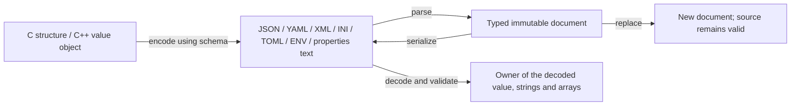

# Serialization, deserialization and nested documents

[简体中文](SERIALIZATION.zh-CN.md) · [README](../README.md) · [Parser profiles](CONFIGURATION.md)

When persisting application settings, reporting device telemetry, or exchanging structured payloads, you often need to convert **C structs or C++ value objects** to and from **JSON, YAML, XML, TOML, INI, ENV, or properties** text—or construct and transform deeply nested documents containing mixed runtime types. This module provides **schema-driven struct encoding and decoding (Codec)** alongside **immutable document construction and serialization APIs**.

To see a complete struct-to-JSON round-trip first, build `hx_os_serialization` and run it using the [example instructions](../examples/README.md#run) (passing no arguments selects JSON; inspect [serialization.c](../examples/serialization.c) alongside [serialization_schema.h](../examples/serialization_schema.h)). The program populates a device struct with a name, two sensor samples, a nested range struct, and an enabled flag, encodes it to text with `hx_os_codec_encode()`, decodes it back into an owning result handle with `hx_os_codec_decode()`, and prints the output. Pass `yaml`, `xml`, or `toml` on the command line to inspect the same structure in those formats (passing `ini` returns `HX_OS_UNREPRESENTABLE` because INI does not support arrays).

To adapt this to your own types, declare a schema once with the `HX_CODEC_STRUCT` macro or an explicit field table. Note that decoded string views and dynamic array spans **borrow from the owning `hx_os_codec_result` handle**, so finish reading them before releasing the result handle.

## 1. Choose an entry point

- **Fixed-shape domain structs (use `Codec`)**: For new C or C++ value types, use `HX_CODEC_STRUCT` to declare the struct and its field schema in one place, then call `hx_os_codec_encode()` and `hx_os_codec_decode()` (existing struct definitions can use explicit field tables instead). Supported field types include integers, floats, booleans, strings, nested structs, and arrays. In C++11, `hx::Codec<T>` wraps these operations in `hx::Result` with no C++ exceptions.
- **Variable-shape or heterogeneous trees (use `ConfigDocument`)**: When an array mixes numbers, strings, `null`, objects, and sub-arrays—or when the document shape is only known at runtime—use `hx_os_config_parse()`, `hx_os_config_create()`, `hx_os_config_replace()`, and `hx_os_config_serialize()`. Each node preserves its exact runtime `hx_os_config_kind`, which you can inspect before calling the matching typed getter.



The CMake options `HX_OS_ENABLE_CONFIG`, `HX_OS_ENABLE_CONFIG_SERIALIZE`, and `HX_OS_ENABLE_CODEC` all default to `ON`. `CODEC` depends on the first two modules; passing `-DHX_OS_ENABLE_CODEC=OFF` strips struct mapping while keeping document parsing and serialization (making codec availability queries return `0` and encode/decode calls return `HX_OS_NOT_SUPPORTED`). No extra third-party dependencies, global initialization, or background threads are used.

## 2. What each format represents

| Format | Direct document output (`serialize`) | Struct schema mapping (`Codec`) | Format boundaries and limits |
| --- | --- | --- | --- |
| **JSON** | Objects, arrays, strings, booleans, `null`, integers, and reals | Nested structs, arrays, and dynamic `NODE` subtrees | Rejects `NaN`/`Infinity`; preserves full 64-bit integer precision |
| **YAML** | Block mappings/sequences, mixed arrays, and empty `{}` / `[]` | Nested structs, arrays, and `NODE` subtrees | Emits explicitly quoted strings; parsing follows the built-in/`libyaml` profile |
| **XML** | Elements, attributes, and ordered element/text children | Root and field elements, nested structs, `<item>` array children, optional scalar attributes | Does not guess arbitrary schema-less JSON-to-XML mappings; omits comments, PIs, CDATA boundaries, and source formatting |
| **TOML** | Root assignments, nested inline tables, and mixed arrays | Representable nested structs and arrays | Root must be a table/object; no `null`; integers must fit signed 64-bit range |
| **INI** | Global string key/values and one `[section]` level | Converts scalars per declared field type; maps 1-level child structs to sections | No arrays, deeper nesting, or values with newlines/trimmable edge spaces |
| **ENV** | Flat quoted/escaped string assignments | Flat scalar structs only | Keys must match `[A-Za-z_][A-Za-z0-9_]*`; no variable expansion or `environ` mutation |
| **properties** | Flat escaped string assignments | Flat scalar structs only | UTF-8 input/output; no arrays or nested objects |

Grammar profiles follow the implemented subsets of [XML 1.0](https://www.w3.org/TR/xml/), [YAML 1.2](https://yaml.org/spec/1.2.2/), and [TOML 1.0](https://toml.io/en/v1.0.0) (see [Parser profiles](CONFIGURATION.md) for full details).

- **Document serialization vs. schema conversion**: Serializing a document tree directly (`hx_os_config_serialize`) preserves node types strictly without turning numbers into strings. Conversely, when mapping structs to/from string-only formats (XML, INI, ENV, and properties), `Codec` intentionally parses and formats scalar text according to your declared field types. Any structure that cannot be represented in the target format returns `HX_OS_UNREPRESENTABLE` rather than silently flattening containers, dropping fields, or converting `null` into `0`.
- **No implicit nested parsing**: A JSON string containing `"{\"a\":1}"` remains an ordinary string node unless you explicitly parse it as an embedded document via `hx_os_config_parse_node()`.

## 3. Complete C example: a structure to JSON and back

The complete C99 program below links only against `hx_c_platform`. `HX_CODEC_STRUCT` expands via the standard C99/C++11 preprocessor to define the struct, its field table, and `connection_schema` in one step—no Python, Clang analyzer, or build-time code generator is required. See [codec_macros.c](../examples/codec_macros.c):

```c
#include <hx_codec_macros.h>
#include <stdio.h>

HX_CODEC_STRUCT(connection,
	HX_CODEC_STRING(host),
	HX_CODEC_I32(port)
);

int main(void)
{
	connection source = {{"localhost", 9}, 8080};
	hx_string json = HX_STRING_INIT;
	hx_os_codec_result *owner = NULL;
	hx_os_config_error error;
	hx_os_status status;
	const connection *decoded;

	status = hx_os_codec_encode(&connection_schema, &source,
		HX_OS_CONFIG_JSON, &json, NULL, &error);
	if (status == HX_OS_OK)
		status = hx_os_codec_decode(NULL, &connection_schema,
			HX_OS_CONFIG_JSON, json.data, json.size, NULL,
			&owner, &error);

	if (status != HX_OS_OK) {
		fprintf(stderr, "%s: %s\n",
			hx_os_status_name(status), error.message);

		hx_string_destroy(&json);

		return 1;
	}

	puts(hx_string_c_str(&json));
	decoded = hx_os_codec_data(owner);
	printf("port = %d\n", (int)decoded->port);

	hx_os_codec_release(owner);
	hx_string_destroy(&json);

	return 0;
}
```

Output:

```text
{"host":"localhost","port":8080}
port = 8080
```

Changing `HX_OS_CONFIG_JSON` to `HX_OS_CONFIG_XML` in both calls outputs `<connection><host>localhost</host><port>8080</port></connection>` and decodes back to the exact same struct. Because `connection` is flat, it also round-trips cleanly through YAML, TOML, INI, ENV, and properties.

**Ownership and Lifetimes:**
- `json` (`hx_string`) owns the encoded text buffer.
- `owner` (`hx_os_codec_result *`) owns the decoded struct, all decoded string bytes, dynamic array elements, and `NODE` subtrees. `hx_os_codec_data(owner)` returns a read-only pointer borrowing from `owner`.
- Because `owner` holds its own copies, the input text buffer (`json`) can be destroyed or overwritten immediately after `hx_os_codec_decode()` returns. Finish reading `decoded` before calling `hx_os_codec_release(owner)`, and **never** call `free()` on individual strings or arrays inside `decoded`.

## 4. Nested structures, arrays and dynamic JSON

The runnable [serialization.c](../examples/serialization.c) example uses the schema in [serialization_schema.h](../examples/serialization_schema.h): a `device` struct containing `name`, `enabled`, a nested `range` struct (`limits`), and a dynamic `samples` array of `sample` structs:

```c
HX_CODEC_STRUCT(device,
	HX_CODEC_STRING(name),
	HX_CODEC_ARRAY(samples, sample),
	HX_CODEC_OBJECT(range, limits),
	HX_CODEC_BOOL(enabled)
);
```

- **Dynamic vs. fixed-length arrays**:
  - `HX_CODEC_ARRAY(samples, sample)` declares an `hx_os_codec_array` member (`{data, count}`). On encode, it borrows your contiguous array; on decode, it points to a contiguous array owned by the `hx_os_codec_result` handle (declare the element struct `sample` with `HX_CODEC_STRUCT` first).
  - `HX_CODEC_FIXED(points, double, 3)` declares an inline fixed-size array `double points[3]`; decoding fails with `HX_OS_RANGE` unless the input array has exactly `3` elements.
- **Scalars and character buffers**: Supported field types cover signed/unsigned `8`-, `16`-, `32`-, and `64`-bit integers, `float`, `double`, booleans, `hx_string_view` (`STRING`, which preserves exact byte lengths and valid embedded `NUL` bytes), and inline NUL-terminated character arrays (`BUFFER`, which fails if the string exceeds capacity or contains an embedded `NUL`).
- **Dynamic subtrees (`HX_CODEC_NODE`)**: When a struct field (such as `payload`) can receive arbitrary, variably shaped JSON at runtime:

```json
{"items":[1,"文字",null,{"children":[true,2.5,{},[]]}]}
```

Declare the field with `HX_CODEC_NODE(payload)` (which maps a `const hx_os_config_node *` member). Decoding preserves the entire subtree inside the result owner so you can query it via `hx_os_config_pointer(payload, "/items/3/children/1", &node)`. Encoding a `NODE` field deep-copies the subtree from a live document node you supply.

When the entire document is dynamic and does not map to a C struct, see [nested_document.c](../examples/nested_document.c): describe the tree with `hx_os_config_value`, materialize an immutable document with `hx_os_config_create()`, and serialize it with `hx_os_config_serialize()`.

### 4.1 Choosing field macros

| Field macro | Generated struct member and behavior |
| --- | --- |
| `HX_CODEC_STRING(host)` | `hx_string_view host` (follows Section 3 lifetime rules) |
| `HX_CODEC_I32(port)` | `int32_t port` (also `I8`, `U8`, `I16`, `U16`, `U32`, `I64`, `U64`) |
| `HX_CODEC_FLOAT(value)` / `HX_CODEC_DOUBLE(value)` | `float value` / `double value` |
| `HX_CODEC_BOOL(enabled)` | `hx_codec_bool enabled` (`int` storage with boolean semantics) |
| `HX_CODEC_BUFFER(name, 64)` | Inline `char name[64]` (capacity includes trailing `NUL`) |
| `HX_CODEC_OBJECT(range, limits)` | Inline child struct `limits range` (declare `limits` first) |
| `HX_CODEC_ARRAY(samples, sample)` | Dynamic `hx_os_codec_array samples` with element type `sample` |
| `HX_CODEC_FIXED(points, double, 3)` | Inline `double points[3]` |
| `HX_CODEC_NODE(payload)` | `hx_codec_node payload` (`const hx_os_config_node *`) |

`HX_CODEC_ARRAY` element types can be fixed-width integer types (`int8_t` through `uint64_t`), `float`, `double`, `hx_string_view`, `hx_codec_bool`, `hx_codec_node`, or any struct previously defined with `HX_CODEC_STRUCT` in the current scope.

Wrap individual field macros to override serialized field names, mark fields as optional, or map scalar fields to XML attributes:

```c
HX_CODEC_STRUCT_NAMED(connection_options, "connection",
	HX_CODEC_NAME("server_host", HX_CODEC_STRING(host)),
	HX_CODEC_OPTIONAL(HX_CODEC_I32(port)),
	HX_CODEC_XML_ATTRIBUTE(HX_CODEC_I32(id))
);
```

Here, the C struct members remain `host`, `port`, and `id`, while the serialized wire names are `server_host`, `port`, and `id`. In XML, the root element is `<connection>` and `id` is written as an attribute (`<connection id="...">`), while remaining a normal field in JSON, YAML, and TOML. Modifiers compose freely (for example, `HX_CODEC_OPTIONAL(HX_CODEC_XML_ATTRIBUTE(...))`). Missing `OPTIONAL` fields remain zero-initialized/empty on decode, whereas present fields with the wrong type still fail.

> [!NOTE]
> **Macro Scope vs. Explicit Field Tables:**
> Place `HX_CODEC_STRUCT` at file or C++ namespace scope with a trailing semicolon. Each struct supports **1–32 fields** (with no trailing comma after the last field). Because the generated `<type>_fields` and `<type>_schema` definitions have internal linkage and `static const` storage, you can place `HX_CODEC_STRUCT` declarations in a guarded shared header.
> For existing public struct declarations, structs with more than 32 fields, or direct nested arrays-of-arrays, use the explicit descriptor macros in `<hx_codec.h>`: `HX_OS_CODEC_FIELD`, `HX_OS_CODEC_OBJECT_FIELD`, `HX_OS_CODEC_ARRAY_FIELD`, `HX_OS_CODEC_FIXED_FIELD`, and `HX_OS_CODEC_SCHEMA`.

### 4.2 Embedded Linux

Because `HX_CODEC_STRUCT` expands to standard C99/C++11 declarations, your target cross-compiler (such as ARM GCC or Clang) evaluates `sizeof` and `offsetof` directly—no host-side offset generator, Python interpreter, or Clang analyzer is needed on the target board or during cross-compilation. Ensure your cross-toolchain sysroot, ABI, and alignment flags match your target hardware as in any standard C/C++ build. See [platform support](PLATFORMS.md) for target boundaries.

## 5. C++11 without exceptions

C++11 code can reuse the exact same `device_schema`. The snippet below from [serialization.cpp](../examples/serialization.cpp) decodes JSON into a `device` struct and re-encodes it as XML:

```cpp
hx::Codec<device> codec(device_schema);

auto decoded = codec.decode(json_text);
if (!decoded)
	return 1;

auto xml = codec.encode(decoded.value().value(), HX_OS_CONFIG_XML);
if (!xml)
	return 1;

std::puts(xml.value().c_str());
```

- `decoded.value()` is a move-only `hx::Decoded<device>` that owns all decoded storage and releases it on destruction; access the struct via `decoded.value().value()` or `decoded.value()->enabled`.
- Use `hx::arrayItem<sample>(span, index)` to access typed elements of an `hx_os_codec_array` span (any `hx_string_view` members inside the element still borrow from the owning `hx::Decoded` instance).
- **C++ type requirements**: `hx::Codec<T>` requires `T` to be a standard-layout, trivially copyable value type with a `noexcept` default constructor. Value structs may define helper methods, but **never** pass classes containing `std::string`, `std::vector`, virtual functions, owning RAII handles, or packed/over-aligned attributes to offset-based schema mapping.

## 6. Edit a document, convert a format or save a file

Because configuration documents are immutable, replacing a node returns a brand-new `ConfigDocument` while keeping the original document and its borrowed nodes valid:

```cpp
auto source = hx::ConfigDocument::parse("{\"port\":8080}");
if (!source)
	return 1;

hx_os_config_value port = {
	{NULL, 0}, {"9090", 4}, NULL, NULL, 0, 0, HX_OS_CONFIG_INTEGER
};

auto changed = source.value().withValue("/port", port);
if (!changed)
	return 1;

auto yaml = changed.value().serialize(HX_OS_CONFIG_YAML);
if (!yaml)
	return 1;
```

- **In-memory replacement & format conversion**: In C, call `hx_os_config_replace(source, target, &value, options, &out, &error)` (where `target` belongs to `source` and retains its key name). To convert text from one format to another in a single call, use `hx_os_config_convert()` or C++ `ConfigDocument::convert(text, from, to)` (for instance, JSON → YAML preserves arrays and numeric types, while JSON → INI rejects arrays with `HX_OS_UNREPRESENTABLE`).
- **File load and save**: Use `hx_os_config_load()` / `hx_os_config_save()` and `hx_os_codec_load()` / `hx_os_codec_save()` (or `ConfigDocument::load/save` and `Codec<T>::load/save` in C++). Saving requires `HX_OS_ENABLE_FILE_UTILS` and uses atomic file publication.
- **Runtime settings (`hx_settings`) export**: `hx_settings_serialize()` and `hx_settings_save()` also support YAML, TOML, and ENV output in addition to JSON, INI, and properties (because `hx_settings` is a generic key/value object tree without XML element vs. attribute metadata, serializing `hx_settings` directly to XML returns `HX_OS_UNREPRESENTABLE`).

## 7. Failure, type and resource contracts

- **Strict typed formats vs. string-scalar formats**: When decoding JSON, YAML, or TOML, the decoder checks actual node kinds—`"8080"` is rejected for an integer field, `true` is rejected for `1`, and `null` is never coerced to `0`. When decoding XML, INI, ENV, or properties, scalar strings are parsed according to the field's declared type in the schema.
- **Status codes**:
  - `HX_OS_NOT_FOUND`: A required (non-`OPTIONAL`) field is missing. An absent optional `NODE` pointer is omitted on encode. A pointer to a live JSON null node encodes as an explicit `null`.
  - `HX_OS_TYPE_MISMATCH`: The input node type is incompatible with the schema field type.
  - `HX_OS_RANGE`: An integer value overflows a narrower 8/16/32-bit target field, or an inline `FIXED` array length does not match.
  - `HX_OS_EXISTS`: Duplicate XML elements appear for a scalar or child-struct field (XML arrays use a single field container element wrapping repeated `<item>` children).
  - **Unknown fields**: Extra fields present in the input but absent from the schema are ignored during struct decoding; use a document tree or `HX_CODEC_NODE` when you need to preserve unknown fields.
- **Depth and memory bounds**: Default maximum nesting depth is `64` (configurable up to `128`, counting the root as `1` and XML scalar text children as an extra level). Default bounds are `1 MiB` input/output size, `16 MiB` document allocation budget, `65,536` nodes, and `16,777,216` work units. Exceeding any bound returns `HX_OS_LIMIT` without silent truncation.
- **Transactional failure**: Failed encode or conversion calls leave the destination `hx_string` untouched; failed decode calls set the result handle to `NULL` and free all allocations made during the call. `hx_os_config_error` reports the status code, source byte offset/line/column (or `SIZE_MAX` when a field conversion offset is unknown), and a value-redacted English diagnostic.

## 8. Build and run the examples

After completing the [example setup](../examples/README.md#run), build the four serialization example targets from the repository root (replace `build` with your build directory):

```sh
cmake --build build --config Release --target hx_os_codec_macros
cmake --build build --config Release --target hx_os_serialization
cmake --build build --config Release --target hx_os_nested_document
cmake --build build --config Release --target hx_os_cpp_serialization
```

On Windows (Visual Studio generator):

```powershell
.\build\bin\Release\hx_os_codec_macros.exe
.\build\bin\Release\hx_os_serialization.exe json
.\build\bin\Release\hx_os_serialization.exe xml
.\build\bin\Release\hx_os_nested_document.exe
.\build\bin\Release\hx_os_cpp_serialization.exe
```

On Linux / macOS / WSL:

```sh
./build/bin/hx_os_codec_macros
./build/bin/hx_os_serialization json
./build/bin/hx_os_serialization xml
./build/bin/hx_os_nested_document
./build/bin/hx_os_cpp_serialization
```

All four examples use embedded source data and require no external files:

| Executable | Expected output |
| --- | --- |
| `hx_os_codec_macros` | Prints `{"host":"localhost","port":8080}` and `port = 8080` from Section 3 |
| `hx_os_serialization json` | Prints JSON with `name`, two `samples`, `range`, and `enabled` to `stdout`; prints `Decoded: samples=2 enabled=true` to `stderr` |
| `hx_os_serialization xml` | Prints the same device as `<device>...<samples><item>...` XML to `stdout` and the same decode confirmation to `stderr` |
| `hx_os_nested_document` | Prints `{"items":[1,"文字",null,{"children":[true,2.5]}]}` to `stdout`; prints `items[3].children[1] = 2.5` to `stderr` |
| `hx_os_cpp_serialization` | Decodes embedded JSON and prints `<device>...</device>` XML for `sensor` with one sample |

`hx_os_serialization` also accepts `yaml` and `toml`. Passing `ini`, `env`, or `properties` demonstrates `HX_OS_UNREPRESENTABLE` because the `device` struct contains an array.

### 8.1 Move an example into your own project

Follow the [C project](USAGE.md#c-project), [C++ project](USAGE.md#cpp-project), or [installed-package setup](USAGE.md#installed-project) guide for your language, copying one example entry point at a time:

| Goal | Files to copy |
| --- | --- |
| Minimal C struct mapping | Copy `codec_macros.c` as `main.c` |
| Nested C structs and arrays | Copy `serialization.c` as `main.c`, plus `serialization_schema.h` in the same directory |
| C++11 JSON-to-XML struct conversion | Copy `serialization.cpp` as `main.cpp`, plus `serialization_schema.h` in the same directory |
| Dynamic heterogeneous JSON construction & query | Copy `nested_document.c` as `main.c` |

If a call returns `HX_OS_NOT_SUPPORTED`, verify that `HX_OS_ENABLE_CONFIG`, `HX_OS_ENABLE_CONFIG_SERIALIZE`, and `HX_OS_ENABLE_CODEC` are enabled in CMake. If CJK characters appear garbled in Windows PowerShell, run `chcp 65001` to switch the console to UTF-8 before running the binary. See [platform support](PLATFORMS.md) for target boundaries.
