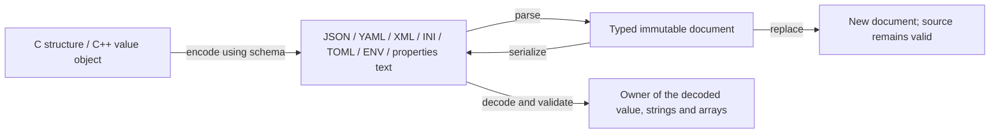

# Serialization, deserialization and nested documents

[简体中文](SERIALIZATION.zh-CN.md) · [README](../README.md) · [Parser profiles](CONFIGURATION.md)

## 1. Choose an entry point

For a known data structure, declare its fields once and call `hx_os_codec_encode/decode`. Fields can contain integers, floating-point values, booleans, strings, nested structures and arrays. C++11 uses `hx::Codec<T>` and `Result`, with exceptions disabled.

For a variable shape, use `hx_os_config_parse/create/replace/serialize`. An array can contain numbers, strings, null, objects and further arrays. Each node retains its actual type. Inspect `hx_os_config_kind` before selecting a getter; a heterogeneous array should not be declared as an integer array.



`CONFIG`, `CONFIG_SERIALIZE` and `CODEC` default to ON. Codec requires both configuration modules. Disabling any dependency makes the codec availability query false and encode/decode return `HX_OS_NOT_SUPPORTED`. `-DHX_OS_ENABLE_CODEC=OFF` removes object conversion independently of document parsing/writing. No new third-party dependency, implicit initialization or background thread is introduced.

## 2. What each format represents

| Format | Document output | Schema mapping | Limits |
| --- | --- | --- | --- |
| JSON | Objects, arrays, strings, booleans, null, integers and reals | Nested objects/arrays and dynamic NODE subtrees | No NaN/Infinity; integers retain their precision |
| YAML | Block mappings/sequences, heterogeneous arrays and empty collections | Nested objects/arrays and NODE subtrees | Explicitly quoted strings; existing builtin/libyaml parsing profiles remain, rather than a complete YAML implementation |
| XML | Elements, attributes and ordered element/text children | Root and field elements, nested objects, arrays containing `item` elements, optional scalar attributes | No guessed JSON-to-XML mapping; comments, processing instructions, CDATA boundaries and source formatting are not preserved |
| TOML | Root assignments, nested inline tables and heterogeneous arrays | Representable objects and arrays | Object root, no null, signed 64-bit integers; datetime nodes come from existing TOMLC parsing |
| INI | Global string assignments and one section level | Declared scalar conversion; a nested scalar structure becomes a section | No arrays, deeper objects or unrepresentable whitespace/newlines |
| ENV | Flat quoted/escaped string assignments | Flat scalar structures | Names use `[A-Za-z_][A-Za-z0-9_]*`; no interpolation or environment mutation |
| properties | Flat escaped string assignments | Flat scalar structures | UTF-8; no arrays or nested objects |

Format rules follow the implemented profiles of [XML 1.0](https://www.w3.org/TR/xml/), [YAML 1.2](https://yaml.org/spec/1.2.2/) and [TOML 1.0](https://toml.io/en/v1.0.0); the table states the supported subset, not full syntax coverage.

Document conversion preserves types; it does not turn numbers into strings automatically. Schema conversion deliberately converts XML/INI/ENV/properties scalar text using the declared field type. Unrepresentable input returns `HX_OS_UNREPRESENTABLE`, without flattening, dropping fields or replacing null with zero.

A JSON string containing `"{...}"` stays a string. Only the explicit `hx_os_config_parse_node` call interprets it as another document.

## 3. Complete C example: a structure to JSON and back

This program links only to `hx_c_platform`. The same `HX_OS_CODEC_FIELD` declarations drive both directions.

```c
#include <hx_codec.h>
#include <stdio.h>

typedef struct connection {
	hx_string_view host;
	int32_t port;
} connection;

static const hx_os_codec_field connection_fields[] = {
	HX_OS_CODEC_FIELD(connection, host, HX_OS_CODEC_STRING),
	HX_OS_CODEC_FIELD(connection, port, HX_OS_CODEC_I32)
};
static const hx_os_codec_schema connection_schema =
	HX_OS_CODEC_SCHEMA(connection, connection_fields, "connection");

int main(void)
{
	connection source = {{"localhost", 9}, 8080};
	hx_string json = HX_STRING_INIT;
	hx_os_codec_result *owner = NULL;
	hx_os_config_error error;
	hx_os_status status;
	const connection *decoded;

	status = hx_os_codec_encode(&connection_schema, &source,
		HX_OS_CONFIG_JSON, &json, NULL, &error);
	if (status == HX_OS_OK)
		status = hx_os_codec_decode(NULL, &connection_schema,
			HX_OS_CONFIG_JSON, json.data, json.size, NULL,
			&owner, &error);
	if (status != HX_OS_OK) {
		fprintf(stderr, "%s: %s\n",
			hx_os_status_name(status), error.message);
		hx_string_destroy(&json);
		return 1;
	}

	puts(hx_string_c_str(&json));
	decoded = hx_os_codec_data(owner);
	printf("port = %d\n", (int)decoded->port);
	hx_os_codec_release(owner);
	hx_string_destroy(&json);
	return 0;
}
```

Output:

```text
{"host":"localhost","port":8080}
port = 8080
```

Change the format in both calls to `HX_OS_CONFIG_XML` to produce `<connection><host>localhost</host><port>8080</port></connection>` and recover the same structure. This flat example also works with YAML, TOML, INI, ENV and properties.

`json` owns the encoded text. `owner` owns the decoded structure, strings, arrays and nodes; `hx_os_codec_data` returns borrowed read-only storage. Read the result before releasing its owner. The source input buffer may be destroyed or overwritten after decoding. Do not free individual decoded members. Use a fresh output handle variable; replacing an existing owner is the caller's responsibility after the new decode succeeds.

## 4. Nested structures, arrays and dynamic JSON

The runnable [serialization.c](../examples/serialization.c) uses [serialization_schema.h](../examples/serialization_schema.h): a device has `name`, `enabled`, a nested `range`, and a `samples` array. Each sample contains a unit, value and channel.

Common field declarations:

```c
HX_OS_CODEC_FIELD(device, name, HX_OS_CODEC_STRING)
HX_OS_CODEC_OBJECT_FIELD(device, range, &limits_schema)
HX_OS_CODEC_ARRAY_FIELD(device, samples, &sample_type)
```

A dynamic array field has type `hx_os_codec_array`, a `{data, count}` span. Encoding borrows your contiguous array; decoding returns a contiguous array owned by the result. `sample_type` describes an element. Inline fixed arrays use `HX_OS_CODEC_FIXED_FIELD`; decoded length must match exactly. Array elements may themselves be objects or arrays, within depth and memory limits.

Field kinds cover signed/unsigned 8/16/32/64-bit integers, `float`, `double`, booleans, `hx_string_view`, inline character buffers, objects, dynamic/fixed arrays and NODE. Boolean storage is `int` or a one-byte bool. BUFFER is an inline NUL-terminated character array and rejects overflow or embedded NUL. STRING preserves byte length and allowed embedded NUL.

For a `payload` that can contain this:

```json
{"items":[1,"文字",null,{"children":[true,2.5,{},[]]}]}
```

Declare `const hx_os_config_node *payload` and map it as `HX_OS_CODEC_NODE`. It retains the entire subtree. `hx_os_config_pointer(payload, "/items/3/children/1", &node)` locates the nested number. Nodes borrow the decoded owner. Encoding a NODE borrows a live document and copies its subtree. XML NODE fields require XML element subtrees; other formats must also represent the supplied subtree.

For document-only construction, [nested_document.c](../examples/nested_document.c) describes a mixed array with `hx_os_config_value`, copies it with `hx_os_config_create`, then writes JSON with `hx_os_config_serialize`. Descriptor names, strings and numeric text are borrowed only until create returns. Numeric descriptions use complete JSON number text to avoid a double conversion that could round a large integer.

## 5. C++11 without exceptions

C++ reuses the same field mapping. These calls are from [serialization.cpp](../examples/serialization.cpp), using the previous `device_schema`:

```cpp
hx::Codec<device> codec(device_schema);
auto decoded = codec.decode(json_text);
if (!decoded)
	return 1;

auto xml = codec.encode(decoded.value().value(), HX_OS_CONFIG_XML);
if (!xml)
	return 1;
std::puts(xml.value().c_str());
```

`decoded.value()` is the owning `Decoded<device>`; its `.value()` is the business structure. `decoded.value()->enabled` accesses a member directly. Moving transfers ownership; destruction releases all decoded storage. `arrayItem<sample>(span, index)` copies an element whose type matches the schema into a C++ object; borrowed members still depend on the `Decoded` lifetime.

`Codec<T>` requires a standard-layout, trivially copyable value type. Decode also requires nonthrowing default construction. Ordinary value classes can have business methods. Do not use offset mapping for `std::string`, `std::vector`, virtual classes, resource-owning members, pointer object graphs, packed or over-aligned types. Explicitly adapt those domain objects to a mapped value structure. This interface does not copy raw memory into such owning objects or promise reflection of arbitrary C++ classes.

## 6. Edit a document, convert a format or save a file

Documents are immutable. Editing returns a new version while the source and its borrowed nodes stay valid:

```cpp
auto source = hx::ConfigDocument::parse("{\"port\":8080}");
if (!source)
	return 1;
hx_os_config_value port = {
	{NULL, 0}, {"9090", 4}, NULL, NULL, 0, 0, HX_OS_CONFIG_INTEGER
};
auto changed = source.value().withValue("/port", port);
if (!changed)
	return 1;
auto yaml = changed.value().serialize(HX_OS_CONFIG_YAML);
if (!yaml)
	return 1;
```

C uses `hx_os_config_replace(source, target, &value, options, &out, &error)`. The target must belong to source, and its original name is retained. `hx_os_config_convert` parses then writes in one call; C++ provides `ConfigDocument::convert(text, from, to)`. JSON → YAML retains arrays and number types. JSON → INI rejects arrays. Use a business schema to specify the relationship between XML and a generic object tree.

File APIs are `hx_os_config_load/save` and `hx_os_codec_load/save`, with matching `ConfigDocument::load/save` and `Codec<T>::load/save`. Saving needs `FILE_UTILS` and uses the existing atomic publication contract, without extra power-loss durability or transactional rollback promises. Paths are UTF-8, with internal Windows native conversion.

`hx_settings_serialize/save` also accepts the new YAML, TOML and ENV outputs. Settings is an object tree without XML element/attribute semantics, so direct XML serialization returns unrepresentable; use an XML document or explicit schema. Existing settings defaults remain depth 32 with a maximum of 64. Document/codec limits are below.

## 7. Failure, type and resource contracts

- Calls are synchronous. They create no threads, execute no configuration content and do not modify the process locale. Dispatch large workloads to an application worker when appropriate.
- JSON/YAML/TOML decode checks real node kinds: `"8080"` is not an integer field, `true` is not integer 1 and null is not zero. XML/INI/ENV/properties scalar conversion follows the declared type.
- Missing required fields return NOT_FOUND, incompatible kinds TYPE_MISMATCH, narrowing overflow and fixed-array length mismatches RANGE. Missing OPTIONAL fields remain zero/empty; absence is not tracked separately from explicit zero. Unknown members are ignored when selecting mapped fields. Use a document or NODE to preserve unknown content.
- Repeated XML elements for a scalar/object field return EXISTS. XML arrays use a field container with repeated `item` children. Non-whitespace mixed content in an object requires NODE.
- Default maximum depth is 64, configurable up to 128, counting root as one. An XML scalar text child consumes an additional level. Exceeding a limit returns LIMIT, without truncation.
- Defaults are 1 MiB input/output, 16 MiB document allocation budget, 65,536 nodes and 16,777,216 work units. Document construction bounds the aggregate name/value bytes by the input limit. Codec parsing and decoded storage share one document memory budget; the encoding tree and output each use their own budget. Existing caller input/output, other retained documents and native locale allocations are outside the new-document budget. Numeric getter scratch buffers are also temporary storage outside the document allocation budget.
- Descriptions and schemas must remain valid for the call. Offsets, sizes, overlapping fields, duplicate names and array multiplication are checked. Cyclic descriptions/schemas fail within depth/work limits. Arbitrary invalid memory pointers cannot be made safe by a schema validator.
- Encoding/conversion failure preserves the output string. Decode failure publishes NULL and frees this call's allocations. Loading never partially overwrites an existing business object; use a new result handle and adopt it only after success.
- Encoding borrows its input. One result owner manages decoded memory; concurrent readers must exclude release. Never retain a borrowed member after its owner dies. Allocator/context lifetime follows the existing cross-thread release contract.

`hx_os_config_error` provides status, native details and controlled diagnostics. Syntax errors include available source positions; field conversion uses SIZE_MAX for unknown offsets rather than inventing a location. Diagnostic messages do not embed configuration values.

## 8. Build and run the examples

From the project root:

```sh
cmake -S . -B build-serialization
cmake --build build-serialization --config Release --parallel 4
ctest --test-dir build-serialization -C Release -R 'config_tree|codec|serialization|nested_document' --output-on-failure
```

Windows executables are in `build-serialization/bin/Release`; a single-configuration Linux build uses `build-serialization/bin`:

```powershell
./build-serialization/bin/Release/hx_os_serialization.exe json
./build-serialization/bin/Release/hx_os_serialization.exe xml
./build-serialization/bin/Release/hx_os_nested_document.exe
./build-serialization/bin/Release/hx_os_cpp_serialization.exe
```

`hx_os_serialization` also accepts `yaml` and `toml`. It encodes and decodes before printing only the encoded document to stdout. The device contains an array, so selecting ini/env/properties fails explicitly; use the flat connection structure from section 3 for those formats.

`test_config_tree.c` covers mixed types, empty collections, 32/64/128 levels, source/replacement lifetime, Unicode and limit failures. `test_codec.c` covers all formats, scalar widths, arrays, XML attributes, file persistence and allocation failure cleanup. `test_cpp_codec.cpp` validates the facade under C++11 with exceptions disabled. `test_serialization_interop.py` uses Python JSON/XML/TOML readers and already-installed PyYAML, plus 101 seeded mixed-data cases against shared builds. TOML requires Python 3.11+; unavailable optional readers report a skip. Actual run evidence is in [validation records](VALIDATION.md).
