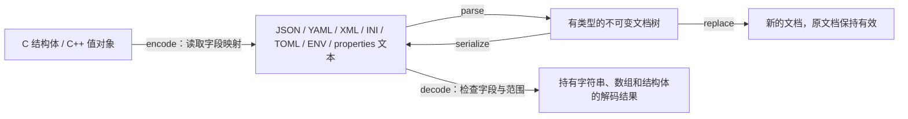

# 序列化、反序列化与多层文档

[English](SERIALIZATION.md) · [README](../README.zh-CN.md) · [解析格式范围](CONFIGURATION.zh-CN.md)

在服务配置、设备状态上报或本地持久化场景中，我们经常需要在 **C 结构体／C++ 值对象**与 **JSON、YAML、XML、TOML、INI、ENV、properties** 文本之间做双向转换，或者在内存中构造并修改包含混合类型的多层嵌套文档。本模块提供基于编译期宏或显式字段表的**类型安全结构体编解码（Codec）**，以及面向动态结构的**不可变文档构建与序列化接口**。

你可以先通过内置示例体验完整的“结构体 → JSON → 结构体”往返流程：按[示例方法](../examples/README.zh-CN.md#run)编译并运行 `hx_os_serialization`（不传命令行参数时默认使用 JSON；源码见 [serialization.c](../examples/serialization.c) 与配套的 [serialization_schema.h](../examples/serialization_schema.h)）。程序会准备好设备名称、两条传感器采样记录、上下限子结构体和启用标志，调用 `hx_os_codec_encode()` 输出 JSON 文本，再调用 `hx_os_codec_decode()` 还原为持有数据的结果对象并打印。传入 `yaml`、`xml` 或 `toml` 参数还可以对比同一份结构体在其他格式下的文本表示（由于该结构体包含数组，若传入不支持数组的 `ini` 会明确返回 `HX_OS_UNREPRESENTABLE`）。

接入你自己的业务类型时，只需用宏或字段表声明一次结构体映射即可。请注意：解码生成的结构体内部的字符串视图与动态数组均**借用自解码结果所有者（`hx_os_codec_result`）**，请在使用完毕后再释放该结果对象。

## 1. 先选择适合你的入口

- **结构固定的业务数据（推荐使用 `Codec`）**：对于新定义的业务类型，使用 `HX_CODEC_STRUCT` 可以一次性声明 C 结构体及其字段映射表，随后直接调用 `hx_os_codec_encode()` 与 `hx_os_codec_decode()`（已有的公共结构体也可使用显式字段表映射）。字段类型支持整数、浮点数、布尔、字符串、嵌套子结构体和数组。C++11 提供 `hx::Codec<T>` 封装，返回 `hx::Result` 且不使用异常。
- **结构不固定的动态数据（使用 `ConfigDocument`）**：当同一个数组中混合了数字、字符串、`null`、子对象和子数组，或者字段结构在运行期完全动态变化时，请使用 `hx_os_config_parse()`、`hx_os_config_create()`、`hx_os_config_replace()` 和 `hx_os_config_serialize()`。读取这类动态节点时，先检查 `hx_os_config_kind` 再调用对应的取值函数，不要把异构混合数组强行声明为“整数数组”。



CMake 选项 `HX_OS_ENABLE_CONFIG`、`HX_OS_ENABLE_CONFIG_SERIALIZE` 和 `HX_OS_ENABLE_CODEC` 默认均处于开启状态。其中 `CODEC` 依赖前两个模块；若通过 `-DHX_OS_ENABLE_CODEC=OFF` 单独关闭结构体编解码，仍可正常使用文档解析与写出，此时调用 `codec` 编解码接口会返回 `HX_OS_NOT_SUPPORTED`。整个模块无新增第三方依赖，无需全局初始化，也不启动后台线程。

## 2. 七种格式分别能保存什么

| 格式 | 文档树直接写出（`serialize`） | 结构体映射（`Codec`） | 明确的格式边界与限制 |
| --- | --- | --- | --- |
| **JSON** | 对象、数组、字符串、布尔、`null`、整数、浮点数 | 支持嵌套结构体、数组及 `NODE` 动态子树 | 不支持 `NaN`／`Infinity`；完整保留 64 位整数原始精度 |
| **YAML** | 块级映射与序列（含混合类型、空对象 `{}` 与空数组 `[]`） | 支持嵌套结构体、数组及 `NODE` 动态子树 | 写出时使用明确引号保护字符串；解析遵循内置／`libyaml` 既有配置子集 |
| **XML** | XML 元素、属性、有序文本／元素子节点 | 根元素、字段子元素、嵌套对象、以 `<item>` 包裹的数组、可选标量属性 | 不对无 schema 的任意 JSON 对象盲猜 XML 映射；不保留原文件注释、PI、CDATA 分界与缩进排版 |
| **TOML** | 顶层键值、嵌套内联表、混合数组 | 支持可由 TOML 表示的嵌套对象与数组 | 顶层必须是对象（表）；无 `null` 类型；整数限有符号 64 位范围 |
| **INI** | 顶层全局字符串键值及单层 `[section]` | 按声明的字段类型转换标量；单层嵌套子结构体映射为 `[section]` | 不支持数组、超过一层的嵌套对象，以及包含换行或会被裁剪的首尾空白 |
| **ENV** | 扁平字符串键值（带引号与转义） | 仅限扁平标量结构体 | 键名须匹配 `[A-Za-z_][A-Za-z0-9_]*`；不展开变量，不修改进程环境变量 |
| **properties** | 扁平字符串键值及转义 | 仅限扁平标量结构体 | 统一使用 UTF-8 读写；不支持数组与嵌套对象 |

各格式的具体语法范围以项目实现的 [XML 1.0](https://www.w3.org/TR/xml/)、[YAML 1.2](https://yaml.org/spec/1.2.2/) 和 [TOML 1.0](https://toml.io/en/v1.0.0) 配置子集为准（详见[解析格式范围](CONFIGURATION.zh-CN.md)）。

- **文档直接写出 vs. 结构体映射**：直接序列化文档树（`hx_os_config_serialize`）会严格保留每个节点的真实类型，不会把数字静默转成字符串；而通过结构体 Schema 编解码 XML、INI、ENV 和 properties 时，则会依据你在 Schema 中声明的字段类型有据可依地转换标量文本。遇到目标格式无法表示的结构（如向 INI 写出数组）会明确返回 `HX_OS_UNREPRESENTABLE`，绝不会悄悄展平、丢弃字段或把 `null` 当成 `0`。
- **不隐式解析字符串内容**：JSON 字符串中的 `"{\"a\":1}"` 始终只是普通字符串；只有当你显式调用 `hx_os_config_parse_node()` 时，才会把该字符串节点的内容当作另一份内嵌配置文档解析。

## 3. 完整 C 示例：结构体和 JSON 相互转换

下面这段完整的 C99 程序仅依赖 `hx_c_platform`。`HX_CODEC_STRUCT` 宏在普通 C99／C++11 预处理器下直接展开，同时生成结构体定义、字段描述符数组与 `connection_schema`（无需 Python、Clang 分析器或任何外部代码生成步骤）。完整源码见 [codec_macros.c](../examples/codec_macros.c)：

```c
#include <hx_codec_macros.h>
#include <stdio.h>

HX_CODEC_STRUCT(connection,
	HX_CODEC_STRING(host),
	HX_CODEC_I32(port)
);

int main(void)
{
	connection source = {{"localhost", 9}, 8080};
	hx_string json = HX_STRING_INIT;
	hx_os_codec_result *owner = NULL;
	hx_os_config_error error;
	hx_os_status status;
	const connection *decoded;

	status = hx_os_codec_encode(&connection_schema, &source,
		HX_OS_CONFIG_JSON, &json, NULL, &error);
	if (status == HX_OS_OK)
		status = hx_os_codec_decode(NULL, &connection_schema,
			HX_OS_CONFIG_JSON, json.data, json.size, NULL,
			&owner, &error);

	if (status != HX_OS_OK) {
		fprintf(stderr, "%s: %s\n",
			hx_os_status_name(status), error.message);

		hx_string_destroy(&json);

		return 1;
	}

	puts(hx_string_c_str(&json));
	decoded = hx_os_codec_data(owner);
	printf("port = %d\n", (int)decoded->port);

	hx_os_codec_release(owner);
	hx_string_destroy(&json);

	return 0;
}
```

运行输出：

```text
{"host":"localhost","port":8080}
port = 8080
```

如果你把 `encode` 和 `decode` 中的 `HX_OS_CONFIG_JSON` 同时改为 `HX_OS_CONFIG_XML`，程序会输出 `<connection><host>localhost</host><port>8080</port></connection>` 并还原出完全一致的 `connection` 结构体；由于该结构体是扁平标量结构，改为 YAML、TOML、INI、ENV 或 properties 也同样可以直接往返。

**所有权与生命周期规则：**
- `json`（`hx_string`）独立持有编码生成的文本。
- `owner`（`hx_os_codec_result *`）统一持有解码还原出的结构体、字符串内容、动态数组和子树节点；`hx_os_codec_data(owner)` 返回指向该结构体的只读借用指针。
- 解码完成后，即使立即销毁或覆写原始输入文本缓冲区（如 `json`），`owner` 中的数据依然完全有效。请先读取完 `decoded` 的所有字段，最后调用一次 `hx_os_codec_release(owner)` 统一释放，**切勿**对结构体内部的字符串或数组指针单独调用 `free()`。

## 4. 子结构体、数组和不固定的 JSON

可运行示例 [serialization.c](../examples/serialization.c) 使用了定义在 [serialization_schema.h](../examples/serialization_schema.h) 中的嵌套设备结构：顶层 `device` 包含字符串 `name`、布尔值 `enabled`、子结构体 `range`（类型为 `limits`），以及包含多条 `sample` 记录的动态数组 `samples`。

其宏声明写法非常直观：

```c
HX_CODEC_STRUCT(device,
	HX_CODEC_STRING(name),
	HX_CODEC_ARRAY(samples, sample),
	HX_CODEC_OBJECT(range, limits),
	HX_CODEC_BOOL(enabled)
);
```

- **动态数组与固定长度数组**：
  - `HX_CODEC_ARRAY(samples, sample)` 生成类型为 `hx_os_codec_array`（即 `{data, count}` 切片）的成员。编码时它借用你提供的连续元素数组；解码时它指向由 `owner` 统一分配并持有的连续数组（注意：元素结构体 `sample` 需先在前面完成声明）。
  - `HX_CODEC_FIXED(points, double, 3)` 生成内嵌的固定长度数组 `double points[3]`，解码时要求输入数组的元素个数必须严格等于 `3`，否则返回 `HX_OS_RANGE`。
- **标量与缓冲区字段**：支持有符号／无符号 `8`、`16`、`32`、`64` 位整数、`float`、`double`、布尔值、`hx_string_view`（`STRING`，完整保留精确字节长度与合法的内嵌 `\0`）以及内嵌定长字符数组（`BUFFER`，始终以 `\0` 结尾，若文本超长或含内嵌 `\0` 则解码失败）。
- **保留动态子树（`HX_CODEC_NODE`）**：如果结构体中的某个字段（例如 `payload`）在运行期可能收到结构任意变化的混合 JSON：

```json
{"items":[1,"文字",null,{"children":[true,2.5,{},[]]}]}
```

你可以将该字段声明为 `HX_CODEC_NODE(payload)`（对应 C 类型 `const hx_os_config_node *`）。解码时它会保留整棵动态子树，随后你可以用 `hx_os_config_pointer(payload, "/items/3/children/1", &node)` 直接按路径查询深层节点（该节点指针同样借用自解码结果 `owner`）。编码 `NODE` 字段时，库会从你提供的有效文档节点深拷贝整棵子树。

若整个文档都是动态混合结构而不需要映射到 C 结构体，请参考 [nested_document.c](../examples/nested_document.c)：使用 `hx_os_config_value` 描述混合层级，调用 `hx_os_config_create()` 一次性构建不可变文档，再调用 `hx_os_config_serialize()` 写出文本。

### 4.1 常用宏怎么选

| 字段宏写法 | 生成的结构体成员类型与用途 |
| --- | --- |
| `HX_CODEC_STRING(host)` | `hx_string_view host`（生命周期见第 3 节） |
| `HX_CODEC_I32(port)` | `int32_t port`（另有 `I8`、`U8`、`I16`、`U16`、`U32`、`I64`、`U64`） |
| `HX_CODEC_FLOAT(value)` / `HX_CODEC_DOUBLE(value)` | `float value` / `double value` |
| `HX_CODEC_BOOL(enabled)` | `hx_codec_bool enabled`（底层为 `int`，按布尔语义编解码） |
| `HX_CODEC_BUFFER(name, 64)` | 内嵌定长字符数组 `char name[64]`（容量含末尾 `\0`） |
| `HX_CODEC_OBJECT(range, limits)` | 内嵌子结构体 `limits range`（需先声明子类型 `limits`） |
| `HX_CODEC_ARRAY(samples, sample)` | 动态切片 `hx_os_codec_array samples`，元素类型为 `sample` |
| `HX_CODEC_FIXED(points, double, 3)` | 内嵌定长数组 `double points[3]` |
| `HX_CODEC_NODE(payload)` | 动态子树指针 `hx_codec_node payload`（即 `const hx_os_config_node *`） |

`HX_CODEC_ARRAY` 的元素类型支持 `int8_t`…`uint64_t`、`float`、`double`、`hx_string_view`、`hx_codec_bool`、`hx_codec_node` 或当前作用域内已用 `HX_CODEC_STRUCT` 定义的结构体名。

如果需要**自定义序列化字段名**、标记**可选字段**或将标量映射为 **XML 属性**，可以在字段宏外层嵌套修饰宏：

```c
HX_CODEC_STRUCT_NAMED(connection_options, "connection",
	HX_CODEC_NAME("server_host", HX_CODEC_STRING(host)),
	HX_CODEC_OPTIONAL(HX_CODEC_I32(port)),
	HX_CODEC_XML_ATTRIBUTE(HX_CODEC_I32(id))
);
```

上述声明生成的 C 结构体成员名依然是 `host`、`port` 和 `id`，但在序列化写出时，`host` 的键名为 `"server_host"`，XML 根元素名为 `<connection>`，且 `id` 在 XML 下作为属性 `<connection id="...">` 读写（在 JSON／YAML 等格式下则仍作为普通字段）。修饰宏支持自由组合（如 `HX_CODEC_OPTIONAL(HX_CODEC_XML_ATTRIBUTE(...))`）。当输入中缺少 `OPTIONAL` 字段时，解码器会将该成员保持为零值／空视图；但若该字段存在却类型不匹配，仍会严格报错。

> [!NOTE]
> **宏的适用范围与显式 Schema 宏：**
> `HX_CODEC_STRUCT` 需写在文件作用域或 C++ 命名空间作用域并以分号结尾，单个结构体支持 **1—32 个字段**（最后一个字段末尾不加逗号）。生成的 `<type>_fields` 与 `<type>_schema` 具有静态内部链接，因此可直接放在带 include guard 的公共头文件中。
> 如果你需要映射项目中已有的结构体定义、字段数超过 32 个、或者需要映射多层“数组套数组”，请使用 `<hx_codec.h>` 中的显式描述符宏（`HX_OS_CODEC_FIELD`、`HX_OS_CODEC_OBJECT_FIELD`、`HX_OS_CODEC_ARRAY_FIELD`、`HX_OS_CODEC_FIXED_FIELD` 与 `HX_OS_CODEC_SCHEMA`）。

### 4.2 在嵌入式 Linux 中使用

`HX_CODEC_STRUCT` 仅展开为标准 C99／C++11 源码声明，所有的 `sizeof` 与 `offsetof` 均由最终的目标架构编译器（如 ARM GCC/Clang）在编译期直接计算，不依赖任何宿主机脚本预计算字节偏移。因此在交叉编译嵌入式 Linux 目标时，照常使用目标板 SDK 工具链构建即可，目标板运行期也没有任何反射注册表开销。各平台的工具链与系统边界见[平台支持](PLATFORMS.zh-CN.md)。

## 5. C++11：直接取结果，不使用异常

C++11 代码可以直接复用同一份 `device_schema`。以下片段取自 [serialization.cpp](../examples/serialization.cpp)，展示了解码 JSON 并转存为 XML 的过程：

```cpp
hx::Codec<device> codec(device_schema);

auto decoded = codec.decode(json_text);
if (!decoded)
	return 1;

auto xml = codec.encode(decoded.value().value(), HX_OS_CONFIG_XML);
if (!xml)
	return 1;

std::puts(xml.value().c_str());
```

- `decoded.value()` 返回移动语义的 `hx::Decoded<device>`，它负责管理底层解码内存的生命周期（析构时自动释放）；通过 `decoded.value().value()` 或 `decoded.value()->enabled` 即可访问还原出的业务结构体。
- 若需在 C++ 中按类型访问 `hx_os_codec_array` 中的元素，可使用辅助方法 `hx::arrayItem<sample>(span, index)`（注意其内部的 `hx_string_view` 依然借用自所属的 `hx::Decoded` 对象）。
- **C++ 类型约束**：`hx::Codec<T>` 要求 `T` 必须是标准布局（Standard-Layout）、可平凡复制（Trivially Copyable）且具备 `noexcept` 默认构造函数的纯值类型。可以包含普通的成员方法，但**切勿**将含有 `std::string`、`std::vector`、虚函数、RAII 资源句柄或 packed 非对齐属性的 C++ 类交给偏移量映射。

## 6. 修改文档、转换格式与保存文件

对于动态不可变文档（`ConfigDocument`），修改某个节点会返回一份全新的文档对象，原文档及其借用节点继续保持有效：

```cpp
auto source = hx::ConfigDocument::parse("{\"port\":8080}");
if (!source)
	return 1;

hx_os_config_value port = {
	{NULL, 0}, {"9090", 4}, NULL, NULL, 0, 0, HX_OS_CONFIG_INTEGER
};

auto changed = source.value().withValue("/port", port);
if (!changed)
	return 1;

auto yaml = changed.value().serialize(HX_OS_CONFIG_YAML);
if (!yaml)
	return 1;
```

- **C 语言节点替换与格式互转**：C 接口对应 `hx_os_config_replace(source, target, &value, options, &out, &error)`（其中 `target` 必须是属于 `source` 的节点指针，替换后保留原键名）。若只需在两种格式文本之间直接转换，可调用 `hx_os_config_convert()` 或 C++ `ConfigDocument::convert(text, from, to)`（例如 JSON 转 YAML 会完整保留数组与数值类型；而将含数组的 JSON 转为 INI 则会返回 `HX_OS_UNREPRESENTABLE`）。
- **文件直接读写**：提供 `hx_os_config_load()`／`hx_os_config_save()` 与 `hx_os_codec_load()`／`hx_os_codec_save()`（以及 C++ 对应的 `load`／`save` 方法）。保存操作复用文件工具模块的原子发布机制。
- **运行期设置（`hx_settings`）导出**：`hx_settings_serialize()` 与 `hx_settings_save()` 同样支持输出 JSON、YAML、TOML、INI、ENV 和 properties（由于 `hx_settings` 是键值对象树而不具备 XML 元素／属性区分模型，直接将其保存为 XML 会返回 `HX_OS_UNREPRESENTABLE`）。

## 7. 失败、类型与容量规则

- **严格类型匹配 vs. 标量文本转换**：在解码 JSON、YAML 和 TOML 时，解码器严格核对节点的真实类型——字符串 `"8080"` 不会被当成整数 `8080`，布尔 `true` 不会被当成整数 `1`，`null` 也不会被当成 `0`。而在解码本身只有文本标量的 XML、INI、ENV 和 properties 时，解码器则会严格按照 Schema 声明的字段类型解析文本。
- **常见错误码**：
  - `HX_OS_NOT_FOUND`：缺少必需字段（未标记为 `OPTIONAL`）。编码时省略空指针表示的可选 `NODE` 字段。指向实际 JSON null 节点的指针仍编码为显式 `null`。
  - `HX_OS_TYPE_MISMATCH`：节点类型与 Schema 字段类型不兼容。
  - `HX_OS_RANGE`：整数缩窄到 8/16/32 位时发生溢出，或定长数组 `FIXED` 长度不匹配。
  - `HX_OS_EXISTS`：XML 中对应标量或子结构体字段的同名元素重复出现（XML 数组则规范地使用一个字段容器元素包裹多个 `<item>` 子元素）。
  - **忽略未知字段**：解码结构体时，输入中多出的未声明字段会被安全忽略，方便协议向前兼容；若业务需要完整保留未知字段，请配合文档树或 `HX_CODEC_NODE` 使用。
- **深度与内存预算**：默认最大深度为 `64` 层（最高可配 `128` 层，根节点算第 1 层，XML 标量元素的文本子节点也计入深度），默认单次输入与输出上限各为 `1 MiB`、文档内存预算 `16 MiB`、节点上限 `65,536` 个、工作量上限 `16,777,216` 单位。超出预算一律返回 `HX_OS_LIMIT`，绝不静默截断。
- **失败无副作用**：编码或格式转换失败时，目标 `hx_string` 保持原内容不变；解码失败时输出句柄置为 `NULL` 并释放当次已分配的全部内存。`hx_os_config_error` 提供状态码、字节偏移／行列号（未知偏移记为 `SIZE_MAX`）以及脱敏的英文错误原因。

## 8. 直接构建和运行示例

完成[示例配置](../examples/README.zh-CN.md#run)后，可在仓库根目录直接按需编译以下四个示例目标（将 `build` 替换为你的构建目录）：

```sh
cmake --build build --config Release --target hx_os_codec_macros
cmake --build build --config Release --target hx_os_serialization
cmake --build build --config Release --target hx_os_nested_document
cmake --build build --config Release --target hx_os_cpp_serialization
```

在 Windows（Visual Studio 生成器）下运行：

```powershell
.\build\bin\Release\hx_os_codec_macros.exe
.\build\bin\Release\hx_os_serialization.exe json
.\build\bin\Release\hx_os_serialization.exe xml
.\build\bin\Release\hx_os_nested_document.exe
.\build\bin\Release\hx_os_cpp_serialization.exe
```

在 Linux / macOS / WSL 下运行：

```sh
./build/bin/hx_os_codec_macros
./build/bin/hx_os_serialization json
./build/bin/hx_os_serialization xml
./build/bin/hx_os_nested_document
./build/bin/hx_os_cpp_serialization
```

这四个示例的输入数据均内置在源码中，无需准备外部文件：

| 示例程序 | 预期输出 |
| --- | --- |
| `hx_os_codec_macros` | 打印第 3 节的 `{"host":"localhost","port":8080}` 与 `port = 8080` |
| `hx_os_serialization json` | `stdout` 打印包含 `name`、两条 `samples`、`range` 和 `enabled` 的 JSON；`stderr` 打印 `Decoded: samples=2 enabled=true` |
| `hx_os_serialization xml` | `stdout` 打印同一设备数据的 `<device>...<samples><item>...` XML；`stderr` 打印相同的解码提示 |
| `hx_os_nested_document` | `stdout` 打印 `{"items":[1,"文字",null,{"children":[true,2.5]}]}`；`stderr` 打印 `items[3].children[1] = 2.5` |
| `hx_os_cpp_serialization` | 读取内置 JSON 并向 `stdout` 打印转换后的 `<device>...</device>` XML |

`hx_os_serialization` 还可以传入小写的 `yaml` 或 `toml`；若传入 `ini`、`env` 或 `properties`，则会因为结构体含有数组而演示 `HX_OS_UNREPRESENTABLE` 错误返回。

### 8.1 把示例放进自己的工程

你可以按[C 工程](USAGE.zh-CN.md#c-project)、[C++ 工程](USAGE.zh-CN.md#cpp-project)或[安装包配置](USAGE.zh-CN.md#installed-project)将任意一个示例复制到自己的项目中作为起点：

| 目标场景 | 需要复制的源文件 |
| --- | --- |
| 最简单的 C 结构体字段映射 | 将 `codec_macros.c` 复制为 `main.c` |
| 含嵌套子结构体与数组的 C 编解码 | 将 `serialization.c` 复制为 `main.c`，并将 `serialization_schema.h` 放在同一目录 |
| C++11 JSON 转 XML 结构体编解码 | 将 `serialization.cpp` 复制为 `main.cpp`，并将 `serialization_schema.h` 放在同一目录 |
| 动态混合类型 JSON 的构建与查询 | 将 `nested_document.c` 复制为 `main.c` |

如果运行中遇到 `HX_OS_NOT_SUPPORTED`，请检查构建时是否开启了 `HX_OS_ENABLE_CONFIG`、`HX_OS_ENABLE_CONFIG_SERIALIZE` 与 `HX_OS_ENABLE_CODEC`；若在 Windows 终端下看到中文字符乱码，可在运行前执行 `chcp 65001` 将终端活动代码页切为 UTF-8。更多平台边界说明见[平台支持](PLATFORMS.zh-CN.md)。
