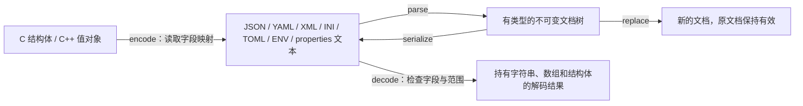

# 序列化、反序列化与多层文档

[English](SERIALIZATION.md) · [README](../README.zh-CN.md) · [解析格式范围](CONFIGURATION.zh-CN.md)

## 1. 先选择适合你的入口

新数据类型可以用 `HX_CODEC_STRUCT` 一次声明结构体和字段映射，使用 `hx_os_codec_encode/decode`。已有结构体继续使用显式映射。字段可以是整数、浮点、布尔、字符串、子结构体或数组。C++11 使用 `hx::Codec<T>`，返回 `Result`，不使用异常。

数据结构不固定时，使用 `hx_os_config_parse/create/replace/serialize`。例如同一个数组里既有数字，又有字符串、null、对象和子数组，每个节点会保留自己的类型。读取时先看 `hx_os_config_kind`，再选择对应的 getter。不要把这样的数组声明为“整数数组”。



`CONFIG`、`CONFIG_SERIALIZE`、`CODEC` 默认开启。`CODEC` 依赖前两个模块；关闭任一依赖后，codec 查询返回不可用，编码/解码入口返回 `HX_OS_NOT_SUPPORTED`。`-DHX_OS_ENABLE_CODEC=OFF` 可以单独移除结构体转换，保留文档读写。没有新增第三方依赖，没有隐式初始化或后台线程。

## 2. 七种格式分别能保存什么

| 格式 | 文档写出 | 结构体映射 | 明确的限制 |
| --- | --- | --- | --- |
| JSON | 对象、数组、字符串、布尔、null、整数、实数 | 支持嵌套结构体、数组及 NODE 动态子树 | 不表示 NaN/Infinity；保留整数原始精度 |
| YAML | block 映射和序列，含混合类型、空对象和空数组 | 同样支持嵌套结构体、数组及 NODE | 输出使用明确引号；解析仍遵守内置/libyaml 的既有范围，不是完整 YAML 语法实现 |
| XML | XML 元素、属性、有序文本/元素子节点 | 根元素、字段子元素、嵌套对象、数组的 `item` 子元素；可选标量属性 | 不猜测任意 JSON 对象的 XML 映射；不保留注释、处理指令、CDATA 分界或源文件排版 |
| TOML | 顶层键值、嵌套 inline table、混合数组 | 支持可表示的嵌套对象和数组 | 顶层必须是对象；没有 null；整数限制在有符号 64 位范围；日期节点来自现有 TOMLC 解析 |
| INI | 全局字符串键值及一层节 | 按字段类型转换标量；一层子结构体对应节 | 不支持数组、更多层对象及无法无损表示的空白/换行 |
| ENV | 扁平字符串键值，带引号和转义 | 扁平标量结构体 | 键为 `[A-Za-z_][A-Za-z0-9_]*`；无变量展开，不修改环境变量 |
| properties | 扁平字符串键值及转义 | 扁平标量结构体 | UTF-8 输入输出；不支持数组和嵌套对象 |

格式行为以项目已实现的 [XML 1.0](https://www.w3.org/TR/xml/)、[YAML 1.2](https://yaml.org/spec/1.2.2/) 和 [TOML 1.0](https://toml.io/en/v1.0.0) 范围为准；表中说明的是支持子集，不宣称完整覆盖所有语法。

文档转换保留节点类型，不把数字自动变成字符串。结构体映射对 XML、INI、ENV、properties 按你声明的字段类型转换，这是有明确类型依据的转换。不能表示的输入返回 `HX_OS_UNREPRESENTABLE`，不会悄悄展平、删字段或把 null 改成零。

JSON 字符串中的 `"{...}"` 始终是字符串。只有你显式调用 `hx_os_config_parse_node` 时，才会把字符串当成另一份文档解析。

## 3. 完整 C 示例：结构体和 JSON 相互转换

下面的程序只需要 `hx_c_platform`。`HX_CODEC_STRUCT` 同时声明结构体、字段表和 schema；`host`、`port` 各写一次。宏由正常的 C99/C++11 预处理器展开，不需要 Python、Clang 分析器或额外生成步骤。完整文件见 [codec_macros.c](../examples/codec_macros.c)。

```c
#include <hx_codec_macros.h>
#include <stdio.h>

HX_CODEC_STRUCT(connection,
	HX_CODEC_STRING(host),
	HX_CODEC_I32(port)
);

int main(void)
{
	connection source = {{"localhost", 9}, 8080};
	hx_string json = HX_STRING_INIT;
	hx_os_codec_result *owner = NULL;
	hx_os_config_error error;
	hx_os_status status;
	const connection *decoded;

	status = hx_os_codec_encode(&connection_schema, &source,
		HX_OS_CONFIG_JSON, &json, NULL, &error);
	if (status == HX_OS_OK)
		status = hx_os_codec_decode(NULL, &connection_schema,
			HX_OS_CONFIG_JSON, json.data, json.size, NULL,
			&owner, &error);
	if (status != HX_OS_OK) {
		fprintf(stderr, "%s: %s\n",
			hx_os_status_name(status), error.message);
		hx_string_destroy(&json);
		return 1;
	}

	puts(hx_string_c_str(&json));
	decoded = hx_os_codec_data(owner);
	printf("port = %d\n", (int)decoded->port);
	hx_os_codec_release(owner);
	hx_string_destroy(&json);
	return 0;
}
```

输出：

```text
{"host":"localhost","port":8080}
port = 8080
```

把两个调用的格式都改成 `HX_OS_CONFIG_XML`，会得到 `<connection><host>localhost</host><port>8080</port></connection>` 并还原相同的结构体。这个扁平示例也能使用 YAML、TOML、INI、ENV、properties。

`json` 自己持有编码文本。`owner` 持有解码后的结构体、字符串、数组和文档节点；`hx_os_codec_data` 返回只读借用指针。先读完结果，再释放 `owner`。即使原始输入缓冲区已经释放或被改写，解码结果仍有效。不要单独释放它里面的字符串或数组。输出句柄使用新的空变量；新的解码成功后，再由调用者替换并释放旧结果。

## 4. 子结构体、数组和不固定的 JSON

可运行的 [serialization.c](../examples/serialization.c) 使用 [serialization_schema.h](../examples/serialization_schema.h) 中的设备类型：`name`、`enabled`、子结构体 `range`，以及含多个采样结构体的 `samples` 数组。每个采样还有单位、数值和通道号。

字段映射有这些常用形式：

```c
HX_CODEC_STRUCT(device,
	HX_CODEC_STRING(name),
	HX_CODEC_ARRAY(samples, sample),
	HX_CODEC_OBJECT(range, limits),
	HX_CODEC_BOOL(enabled)
);
```

动态数组字段的 C 类型是 `hx_os_codec_array`，即 `{data, count}`。编码时指向你现有的连续数组；解码时指向结果对象持有的连续数组。宏中的 `sample` 说明每个元素的实际类型，先用 `HX_CODEC_STRUCT` 声明它。固定内嵌数组使用 `HX_CODEC_FIXED(points, double, 3)`，解码长度必须完全匹配。宏数组可以包含对象。直接的“数组套数组”使用现有显式元素描述组合；深度与内存都受配置上限约束。

字段类型支持带符号/无符号 8、16、32、64 位整数、`float`、`double`、布尔、`hx_string_view`、固定字符数组、对象、动态/固定数组以及 `NODE`。布尔存储为 `int` 或一字节布尔；`BUFFER` 字段是有 NUL 终止的内嵌字符数组，溢出或无法保存内嵌 NUL 时失败；`STRING` 保留精确字节长度和允许的内嵌 NUL。

如果 `payload` 可能收到这样的内容：

```json
{"items":[1,"文字",null,{"children":[true,2.5,{},[]]}]}
```

使用 `HX_CODEC_NODE(payload)`，或者将已有字段 `const hx_os_config_node *payload` 显式映射成 `HX_OS_CODEC_NODE`。它能保留整个子树，再用 `hx_os_config_pointer(payload, "/items/3/children/1", &node)` 查询里面的数值。这个指针仍借用解码结果。编码 NODE 时借用你提供的有效文档；库会复制子树。XML 的 NODE 字段要求 XML 元素子树；其他格式也必须能够表示该子树。

纯文档用法见 [nested_document.c](../examples/nested_document.c)：先用 `hx_os_config_value` 描述混合数组，再 `hx_os_config_create` 一次复制成文档，最后 `hx_os_config_serialize` 写出 JSON。描述中的名字、字符串和数字文本只借用到 create 返回。数字描述使用完整的 JSON 数字文本，避免经过 double 损失大整数精度。

### 4.1 常用宏怎么选

| 写法 | 生成的成员 / 用途 |
| --- | --- |
| `HX_CODEC_STRING(host)` | `hx_string_view host`，借用/持有规则见第 3 节 |
| `HX_CODEC_I32(port)` | `int32_t port`；另有 I8/U8/I16/U16/U32/I64/U64 |
| `HX_CODEC_FLOAT(value)` / `HX_CODEC_DOUBLE(value)` | `float` / `double` |
| `HX_CODEC_BOOL(enabled)` | `hx_codec_bool`，即 `int`，语义为布尔 |
| `HX_CODEC_BUFFER(name, 64)` | 内嵌 `char name[64]`，包括 NUL 的容量 |
| `HX_CODEC_OBJECT(range, limits)` | 内嵌 `limits range`，子类型先声明 |
| `HX_CODEC_ARRAY(samples, sample)` | 动态 `hx_os_codec_array`，元素是 `sample` |
| `HX_CODEC_FIXED(points, double, 3)` | 内嵌 `double points[3]` |
| `HX_CODEC_NODE(payload)` | `hx_codec_node`，即 `const hx_os_config_node *` |

数组元素可以是 `int8_t` 到 `uint64_t` 的整数宽度类型、`float`、`double`、`hx_string_view`、`hx_codec_bool`、`hx_codec_node`，或当前作用域内先用 `HX_CODEC_STRUCT` 定义的类型。字符串数组例如 `HX_CODEC_ARRAY(names, hx_string_view)`，布尔数组例如 `HX_CODEC_ARRAY(states, hx_codec_bool)`。动态数组要指出元素类型，因为 `hx_os_codec_array` 本身只记录指针和数量。

需要改名、可选字段或 XML 属性时，在单个字段外包一层：

```c
HX_CODEC_STRUCT_NAMED(connection_options, "connection",
	HX_CODEC_NAME("server_host", HX_CODEC_STRING(host)),
	HX_CODEC_OPTIONAL(HX_CODEC_I32(port)),
	HX_CODEC_XML_ATTRIBUTE(HX_CODEC_I32(id))
);
```

它仍生成普通成员 `host`、`port`、`id`；写出名称分别为 `server_host`、`port`、`id`。XML 根名为 `connection`，`id` 在 XML 中成为属性，在 JSON 等格式中仍为普通字段。这些包装可以组合，例如可选的 XML 属性。缺失可选值仍按原 codec 契约清零，不把类型错误当作缺失。

宏适合新类型，需放在文件作用域或 C++ 命名空间作用域，末尾写分号；每个结构体支持 **1～32 个字段**，最后一个字段后不要加逗号。固定数组长度和字符缓冲容量必须为正整数常量表达式。顺序就是结构体的成员声明顺序，宏不会排序、压缩对齐或猜测指针类型。生成的 `类型_fields`、`类型_schema` 是当前编译单元的静态只读描述，可以把同一份声明放进有保护的头文件。

现有公共结构体不需要改写成宏，继续使用 `HX_OS_CODEC_FIELD`、`HX_OS_CODEC_OBJECT_FIELD`、`HX_OS_CODEC_ARRAY_FIELD`、`HX_OS_CODEC_FIXED_FIELD` 和 `HX_OS_CODEC_SCHEMA`。超过 32 个字段、其他 typedef 元素别名或跨命名空间的限定类型，也使用这些显式入口。简洁宏的 32 字段上限不改变底层文档深度和节点上限。

### 4.2 在嵌入式 Linux 中使用

只需用实际 SDK 正常交叉编译。宏展开产生标准 C99/C++11 声明，`sizeof`、`offsetof` 由 ARM 等目标编译器计算，不包含宿主机生成的数值偏移。Windows/x86 上构建 ARM 程序时，板子不需要 Python、Clang 或其他生成工具。没有额外运行时注册和初始化；编解码仍调用同一份 codec 实现。

使用正确的 sysroot、libc、浮点 ABI、头文件及对齐配置；它们是普通 C/C++ 工程的兼容要求。不能把某套 glibc 交叉编译结果推广到所有 musl、旧 SDK 或板卡。新宏的 ARMv7/AArch64 编译和 QEMU 证据见[验证记录](VALIDATION.zh-CN.md)，QEMU 通过不等于板卡实测。

## 5. C++11：直接取结果，不使用异常

C++ 可以复用同一份字段映射。下面是 [serialization.cpp](../examples/serialization.cpp) 中的核心调用，`device_schema` 仍是上一节那一份：

```cpp
hx::Codec<device> codec(device_schema);
auto decoded = codec.decode(json_text);
if (!decoded)
	return 1;

auto xml = codec.encode(decoded.value().value(), HX_OS_CONFIG_XML);
if (!xml)
	return 1;
std::puts(xml.value().c_str());
```

`decoded.value()` 是持有结果的 `Decoded<device>`，它的 `.value()` 才是业务结构体；也可写 `decoded.value()->enabled` 访问成员。返回对象支持移动，析构自动释放全部解码存储。`arrayItem<sample>(span, index)` 将匹配映射类型的一个元素复制为 C++ 值，其内部借用文本仍依赖 `Decoded` 的寿命。

`Codec<T>` 要求标准布局、可平凡复制的值类型；解码还要求不抛异常的默认构造。普通 C++ 值类可以有自己的业务方法，但不要把 `std::string`、`std::vector`、虚函数类、拥有资源的成员、指针对象图、packed 或过度对齐类型交给偏移映射。此类业务对象应与可映射的数据结构显式转换。本接口不对这些对象执行原始内存复制，不承诺反射任意 C++ 对象。

## 6. 修改文档、转换格式与保存文件

文档不可变；修改时创建新的版本，旧版本及其借用节点保持有效：

```cpp
auto source = hx::ConfigDocument::parse("{\"port\":8080}");
if (!source)
	return 1;
hx_os_config_value port = {
	{NULL, 0}, {"9090", 4}, NULL, NULL, 0, 0, HX_OS_CONFIG_INTEGER
};
auto changed = source.value().withValue("/port", port);
if (!changed)
	return 1;
auto yaml = changed.value().serialize(HX_OS_CONFIG_YAML);
if (!yaml)
	return 1;
```

C 对应调用 `hx_os_config_replace(source, target, &value, options, &out, &error)`，目标必须来自 source；函数保留目标原来的字段名。`hx_os_config_convert` 一次完成解析和写出，C++ 是 `ConfigDocument::convert(text, from, to)`。例如 JSON → YAML 会保留数组和数字类型；JSON → INI 如果遇到数组，会明确失败。XML 与一般对象树之间的转换请通过业务 schema 指定关系。

文件接口有 `hx_os_config_load/save` 和 `hx_os_codec_load/save`，C++ 对应 `ConfigDocument::load/save`、`Codec<T>::load/save`。保存需要 `FILE_UTILS`，使用既有原子发布机制；不额外承诺断电持久化或失败事务回滚。路径为 UTF-8，Windows 内部转换为原生路径。

`hx_settings_serialize/save` 也可使用新增的 YAML、TOML、ENV 输出。settings 是对象树，没有 XML 元素/属性模型，直接保存 XML 会返回不可表示；用 XML 文档或 schema 转换表达你的 XML 结构。settings 原有默认深度 32、上限 64 保持不变；新的文档/codec 深度规则见下一节。

## 7. 失败、类型与容量规则

- 所有新操作同步执行。不会启动线程、自动执行文件内容或修改进程 locale；较大数据可以由业务线程调用。
- JSON/YAML/TOML 根据真实节点类型解码。`"8080"` 不能直接当作整数字段，`true` 不能当作整数 1，null 不能当作零；XML/INI/ENV/properties 则按声明的标量类型转换。
- 缺失必需字段返回 `NOT_FOUND`；类型不符返回 `TYPE_MISMATCH`；整数缩窄溢出、固定数组长度不符等返回 `RANGE`。`OPTIONAL` 字段缺失时保持零/空状态；这不记录“缺失”和“显式零”的区别。未知字段忽略，适合只读取声明的业务字段；需要保留未知数据时用文档树或 NODE。
- 标量字段同名 XML 元素重复时返回 `EXISTS`，不自动取其中一个。XML 数组是一个字段元素，内部有多个 `item`；对象中的非空白混合文本要求使用 NODE。
- 默认最大深度 64，显式选项最多 128，根节点计为第 1 层。XML 标量的文本子节点也占一层。超过上限返回 `LIMIT`，不静默截断。
- 默认输入/输出各最多 1 MiB、单个文档分配预算 16 MiB、节点数 65,536、工作量 16,777,216。创建文档时名字和值的字节总量受输入上限约束。codec 的解析树和解码结果共用文档内存预算；编码树和最终输出分别使用预算。既有输入、调用方旧输出、同时持有的其他文档及原生 locale 对象不计入本次新文档预算。 数值 getter 的转换临时缓冲也在文档分配预算之外。
- 描述/schema 必须指向调用期间有效的数据；偏移、尺寸、重叠字段、重复名字和数组乘法会被检查。循环描述/schema 在深度/工作限制内失败，不无限递归。没有通用内存指针有效性检测。
- 编码或转换失败时，`hx_string` 保持原内容。解码失败时结果指针为 NULL，并释放本次分配。加载失败不会改变调用方已有的业务对象。
- 编码借用输入，不增加输入对象的所有权。解码结果由一个 owner 管理，多个读线程可以在排除释放竞争的前提下读取；释放时不允许其他线程继续使用其借用指针。allocator/context 按现有跨线程释放契约存活。

可通过 `hx_os_config_error` 得到统一状态、原生详情和受控诊断。解析语法错误带可取得的输入位置；字段转换错误的位置未知时用 `SIZE_MAX`，不会伪造行列。消息不拼入配置内容。

## 8. 直接构建和运行示例

在项目根目录运行：

```sh
cmake -S . -B build-serialization
cmake --build build-serialization --config Release --parallel 4
ctest --test-dir build-serialization -C Release -R 'config_tree|codec|serialization|nested_document' --output-on-failure
```

Windows 程序在 `build-serialization/bin/Release`；单配置 Linux 构建在 `build-serialization/bin`。例如：

```powershell
./build-serialization/bin/Release/hx_os_codec_macros.exe
./build-serialization/bin/Release/hx_os_serialization.exe json
./build-serialization/bin/Release/hx_os_serialization.exe xml
./build-serialization/bin/Release/hx_os_nested_document.exe
./build-serialization/bin/Release/hx_os_cpp_serialization.exe
```

`hx_os_serialization` 还接受 `yaml`、`toml`，先编码再解码检查，stdout 只打印编码结果。嵌套设备包含数组，改用 `ini/env/properties` 会明确失败；用第 3 节的扁平连接结构体即可测试这些格式。

`test_config_tree.c` 检查混合类型、空集合、嵌套 32/64/128 层、修改后的新旧文档、Unicode 和超限拒绝；`test_codec.c` 检查全部格式、宽度范围、数组、XML 属性、文件保存与逐次分配失败清理；`test_cpp_codec.cpp` 在关闭异常的 C++11 配置下验证便利层。`test_serialization_interop.py` 使用 Python 标准 JSON/XML/TOML 读取器和已安装时的 PyYAML，并对共享库执行 101 组固定种子的混合数据测试。TOML 需要 Python 3.11+；缺少可选解析器会明确标为跳过。具体运行结果见 [验证记录](VALIDATION.zh-CN.md)。
